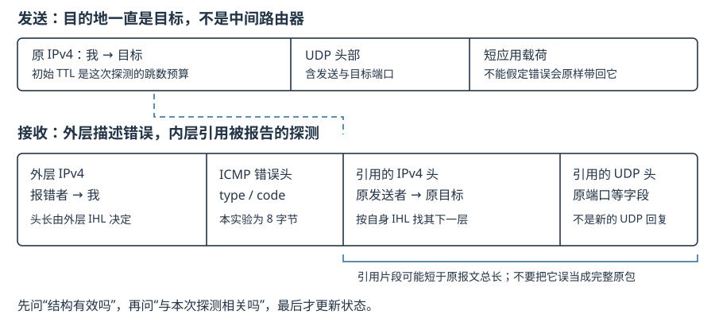

# Traceroute：把字节证据、探测身份与跳数分开

## 一、先把任务拆成三种不同的正确性

Traceroute 很容易出现“打印看起来合理，返回值却错了”的情况。开始写代码前，把工作分成三个层次：

1. **字节解释正确**：同一段字节按协议得到唯一的字段值；长度和偏移有明确单位。
2. **响应归属正确**：收到的 ICMP 真的是对自己有关探测的报告，而不是旧包、别的协议或别的目标。
3. **状态推进正确**：一个被认可的响应应当怎样影响当前跳，什么时候进入下一 TTL，什么时候停止整次运行。

不要把这三层揉成一个很深的 `if` 树。一个便于手推的结构是：解释数据的辅助函数不悄悄推进 TTL；决定接收与结束的逻辑不重复散落字节偏移。这里给的是职责边界，不是应照抄的完整算法。

所有硬约束、A1–A6/B1–B16 列表见[实验说明](#/c/berkeley-cs168-2025/lab/traceroute?v=zh)。本页集中讲如何理解、设计和定位问题，不把单个测试的特判拼成答案。

## 二、代码地图：哪些地方已经替你做了

以下行号来自固定 ZIP 原始文件，不是其他学期的仓库。

### `traceroute.py`

| 位置 | 现有内容 | 你的关注点 |
|---|---|---|
| 第 7 行 | `TRACEROUTE_MAX_TTL = 30` | 上限包含 30；不要改常量躲避环路或沉默 |
| 第 14 行 | `TRACEROUTE_PORT_NUMBER = 33434` | 注释解释 33434–33464 的常见用法，不是目标端口开放状态保证 |
| 第 19 行 | `PROBE_ATTEMPT_COUNT = 3` | 每跳探测次数，不是每跳必须有三个不同路由器 |
| 第 21–49 行 | `IPv4` 字段、空构造器、已有字符串表示 | 只改构造器；`header_len` 必须是字节而不是 IHL 原值 |
| 第 52–67 行 | `ICMP` 类 | 成员只有 type/code/checksum，不代表整个头只有这 4 字节 |
| 第 70–86 行 | `UDP` 类 | 四个 16 位成员；长度成员名为 `len`，不是 IPv4 的 `length` |
| 第 88 行附近 | 允许添加辅助函数的注释 | 可以分离解析、判定等职责，不新增 import 或全局硬编码状态 |
| 第 90–113 行 | `traceroute` 签名、合同、占位打印循环 | 实际探测逻辑的入口；参数顺序是发送 socket、接收 socket、目标 IP |
| 第 116–120 行 | 命令行入口 | 域名解析、建立两个 socket、调用函数；不是学生应改的区域 |

三个 `__str__` 已提供调试视图，不要为了让打印好看修改不允许编辑的代码。构造器尚未初始化成员时，直接打印对象可能报属性不存在；这不能用来推断实际网络异常。

### `util.py`：只读的操作系统适配层

| 位置 | 行为 | 调试含义 |
|---|---|---|
| 第 17 行 | `SELECT_TIMEOUT = 2` | 没包时一次 `recv_select()` 最多等约两秒；慢并不一定卡死 |
| 第 24–53 行 | 主机／网络序与地址转换包装 | 已提供常用工具；理解输入输出，不要重复转换 |
| 第 56 行 | `gethostbyname` | CLI 在调用你的函数前把域名解析为 IPv4 |
| 第 66 行 | `Socket.make_udp` | 建立 `AF_INET/SOCK_DGRAM/IPPROTO_UDP` 发送端 |
| 第 74 行 | `Socket.make_icmp` | 优先建立 `AF_INET/SOCK_RAW/IPPROTO_ICMP` 接收端 |
| 第 74–88 行 | 权限失败处理 | 非 Darwin 提示以 root 运行并退出；Darwin 会尝试非特权 ICMP datagram socket，注释说这种路径更脆弱 |
| 第 95 行 | `set_ttl` | 通过 `IP_TTL` 修改后续发包设置，不只作用于下一次调用 |
| 第 105 行 | `sendto` | 传进去的是 UDP 载荷字节；返回发送字节数，系统建立 UDP 头 |
| 第 114 行 | `recvfrom` | 一次最多读 4096 字节，返回字节缓冲与发送者地址元组 |
| 第 122 行 | `recv_select` | 使用 `select.select` 等待可读；它不消费任何数据 |
| 第 127 行 | `print_result` | 空列表打印 `*`；非空地址尝试反向 DNS，失败时显示地址 |
| 第 145 行 | `parse_args` | 只有一个位置参数 `host`，没有本地测试选择参数 |

两个重要结论：

- **传入 socket 就是依赖边界。** 不要在学生函数内部自己建 raw socket，也不要改 `util.py` 让某个测试“更方便”；官方可以通过相同接口提供测试环境。
- **展示也可能涉及网络。** `print_result` 的反向 DNS 可能拖慢输出；它既不是 ICMP 探测超时，也不是你应移除规定调用的理由。记录现象时区分等待收包与名字解析。

`README.md` 只有项目标题和通向当前 `cs168.io/proj1/` 的链接，不能作为固定 2025 测试命令的依据。

## 三、报文不变量：每次读取都知道自己站在哪一层

图为编者自绘。这里的“引用”是错误报告附带的原报文头片段，不是一次新的 UDP 应答。图块宽度只表示结构，不按真实字节比例。

### 1. 三种长度不能混为一谈

给每个长度量写上单位和范围：

- IPv4 IHL：单位为 4 字节字；用于定位这一层载荷的起点。
- IPv4 Total Length：单位为字节，包含这一层 IPv4 头和载荷。
- UDP Length：单位为字节，包含 UDP 头和 UDP 载荷。
- 实际缓冲区长度：你真正拿到的字节数；报文自报长度不会凭空创造缺失字节。

从外层开始解析时，先证明最小头部存在，再解释 IHL，再证明相应可变头部在缓冲区中。不能先切出一个可能很短的片段，依靠 Python 切片不报错，就认为数据完整。

**检查对象也有层次差别。** 外层 IPv4 是本次收到的包，外层声明的长度与实际收到长度之间可以揭示截断。ICMP 内层 IPv4 则只是原探测的引用头：它的 Total Length 描述原来的整个探测，可能大于这次被引用的字节数。项目并不承诺引用完整 UDP 应用载荷。因此不能把“内层总长大于剩余引用长度”一概当成坏包，否则会拒绝正常 ICMP 错误。

你的安全目标应当是：所有**本次确实需要读取的头字段**都存在且边界一致；不是强求协议没有承诺携带的数据也在里面。

### 2. 先确定类型，再选择解析方式

收到某个 IP 包，不代表它一定是自己要的 ICMP。头部的 `proto` 是决定后续解释方式的证据。随机数据可能恰好在某个位置取值 11，不能因此被接受为 Time Exceeded。

同理，type 与 code 是配对的语义：Time Exceeded 的 code 0 表示传输中 TTL 用尽；Destination Unreachable 的 code 3 才是这里用于识别终点的端口不可达。不要只比较一个数字，不要根据数据包来自哪个 IP 就省略结构和语义判断。

解析器成功，只说明字段能被读出来；是否属于本项目、当前目标、当前探测，还需要另外判断。这样也更容易解释 B5 与 B16 的差别：前者结构或语义无法解释，后者结构可以完全合法却不相关。

### 3. 不要把两个 TTL 当成同一个时钟

自己设置的 TTL 是发出探测的跳数预算。收到的**外层** IP TTL 是错误回复自身的剩余跳数，取决于报错者的初值与返回路径，不能据此直接推导去程跳数。

引用的原 IP TTL 也经历过路由器处理，不能不加分析就假定它等于你当初设置的初值。B15 要问的是“错误是否由这个阶段的某次探测触发”，不是“包头里某个 TTL 是否碰巧与当前循环变量相同”。

### 4. 校验和与分片不是加分扩展

本实验要求解析保存指定字段，但不要求实现校验和验证、生成、分片重组或 IPv6。不要把真实互联网完整协议实现的额外条件强加给教学测试包。

官方 Guide 对校验和作了教学简化；实际出站 UDP/IP 头由系统 socket 路径生成，本文未抓包验证实际校验和值。准确的任务表述是“学生不用自行计算或校验”，而不是“任何真实 IPv4 包的 checksum=0 都有效”。

## 四、状态不变量：一个数字通常不够表达全部进度

在纸上给每个状态写清生命周期。下面不是要求你使用这些变量名，而是提醒哪些概念不能混用。

| 状态概念 | 生存范围 | 不应被什么替代 |
|---|---|---|
| 目标地址 | 整次调用 | 当前报错路由器地址 |
| 当前 TTL | 当前探测阶段 | 已返回子列表中非空项的数量 |
| 当前阶段已发探测 | 当前 TTL | 接收调用次数 |
| 已认可的独立响应／探测进度 | 与你的探测设计一致 | 任意收到的包数、路由器地址个数 |
| 当前距离发现的地址 | 当前 TTL | 整次运行的全局地址集合 |
| 探测与响应的关联信息 | 至少覆盖可能混淆的阶段 | “现在收到，所以一定现在发出” |
| 输出列表 | 整次调用 | 排除了空跳后压缩过的路径 |

应始终成立的性质：

1. 无效、无关、重复的包不能凭空创建新探测成功记录。
2. 同一阶段，同一个地址只展示一次；独立探测可以都由同一个地址回答。
3. 阶段切换不会把上个 TTL 未处理的重复包自动变成新阶段证据。
4. 接收失败不撤销先前已经可靠发现的地址。
5. TTL 单调增加，且不越过 30；空结果不改变其编号。
6. 只有经过本轮相关性和终点语义判断的响应才可终止；终点行按合同只保留 `[ip]`。
7. 正常无错误路径有一个不依赖超时的完成依据，错误路径也不会无界等待。

这些性质比“B13 不过就再读一次包”更有用：局部补丁可能让某个排列通过，却在包稍微换个顺序时破坏另一条性质。

## 五、如何循序推进，而不是同时调十六种故障

### 第一步：先证明字段解释

拿一份你有权使用的静态字节记录，在纸上标注：每个字段覆盖哪些位、是否跨字节、解码后的单位是什么。使用已有打印方法核对所有字段，不只查看源地址是否像一个 IP。

容易暴露问题的思考样本：

- 一个字节的高四位与低四位不相等，检查 version/IHL 是否混淆。
- 16 位字段的两个字节不同，检查大小端；例如 `01 02` 应读作 258，而不是 513。
- flags 非零且 fragment offset 也非零，检查是否把整个 16 位字段直接当 offset。
- IHL 为 6 时，下一层应在第 24 字节后开始，而不是仍按 20。
- 地址包含需要多位十进制数字的八位组，检查是否误打印为十六进制或忘记分隔。

这些是离线推导提示，不是本文运行过的测试，也不是可提交的测试实现。A1–A4 通过之前，不急着用真实路径打印掩盖解析问题。

### 第二步：只考虑正常路径

先思考一个两跳中间路由器加终点的路径。每次发送的目的 IP 是否不变？三次响应都来自同一路由器时，输出集合大小应为 1，而探测进度是否已经完成？到达目标时，是否还会为后续 TTL 追加空行？

再想同一 TTL 有两个分支：不同探测可能发现不同地址，内部顺序不应成为正确性条件。**多路径结果不是三棵固定树，也不是要求找到恰好三个路由器。**

正常路径完成后就开始维护 B1 的性质，否则后续所有异常都容易被“循环直到超时”粗暴遮盖。

### 第三步：引入不改变因果关系的异常

按“格式／协议错误 → Options → 沉默和丢失 → 环路”的思路逐项手推。重点看拒绝一个包是否误增计数、空跳是否跳过输出、同一地址跨 TTL 是否被误删。

错误处理使用清楚的早返回／拒绝分支，给每条分支一个语义名称。不要用包住整个函数的宽泛异常捕获让程序“不会崩溃”：这会同时吞掉学生代码中的属性名错误、状态错误，甚至导致一条真正有效的路径悄悄消失。

### 第四步：最后处理身份与重复

先回答几个问题，再改接收循环：

- 错误报告究竟保留了原探测哪些内容，哪些内容不保证保留？
- 在不新增 import、不修改 `util.py` 的前提下，你能控制哪些会出现在报告里的信息？
- 两个响应来自同一路由器，何时代表两个独立探测，何时只是同一个探测的重复？
- 一份旧 TTL 或旧目标的有效响应到达时，哪个事实让你知道它不能归入当前阶段？
- “已收够”指的是任意包数、不同地址数，还是与自己发送行为相符的进度？

不要直接搜索学生答案来跨过这一步。官方的建议是重新读协议头、骨架注释和专业工具的设计；官方参考链接可以用于补充理解，但不是许可你持有别人的本课程实现。本页不提供探测标识的完整编码方案、去重键或接收循环答案。

## 六、重复、超时与队列：用事件轨迹检查设计

### 1. 同一个地址，不一定是重复响应

假设当前 TTL 发出三次独立探测，三次都由路由器 R 正常回答。

- 路由器集合始终只有一个元素 R。
- 正常网络中应能完成本阶段，不应为等到三个不同地址一直等超时。
- 如果把地址集合大小当作“已收回复数”，会破坏 B1。

**展示去重的单位是地址；探测进度的单位由探测身份决定。** 两者需要分开解释。

### 2. 收到三个包，不一定已经完成三次探测

用符号记录事件，`a′` 表示 `a` 的重复，而不是新的独立探测：

| 到达顺序 | 你应问的问题 |
|---|---|
| `a, b, c` | 干净网络是否无需第四次等待就能结束？ |
| `a, a′, b, c` | 第三个到达事件时，是否真的已经收到三次独立探测的证据？ |
| `a, b, c, c′` | 进入下一 TTL 后收到的 `c′` 是否还能被识别为旧响应？ |
| `旧阶段的 a′, 当前 d, 当前 e, 当前 f` | 第一份迟到包是否误占当前阶段额度或插入旧路由器？ |
| `无关目标的 x, 当前 d, 当前 e` | 合法格式的 x 是否被错误用作当前进度？ |

这里不是声称测试具有某一种固定队列实现，而是在枚举协议必须区分的事件。B14 的重复探测与 B13 的重复响应在字节上不一定完全相同，因此“整个回复逐字节相等才算重复”不应未经证明就成为唯一判据。

### 3. 为什么两个看似合理的循环都不够

- **每跳固定取三个收到的包**：有重复或无关包时，三个接收事件不等于三次有效进展；队列也可能残留。
- **每跳一直取到队列空并超时**：通常能清理更多残留，但干净网络必然多出一次无包等待，违反 B1。

官方 Sep 19 提示允许错误情况下继续接收、帮助清理重复，并允许这种情况下发生超时；正常情况下有三份独立有效响应就无需再等。具体如何把这个原则实现为一致、有限的接收策略，要由你的整体设计决定。

不要认为“清过一次队列”即可证明将来不再有旧包：B15 的核心就是它可以在之后才到达。排队处理与相关性判定解决的是不同问题。

### 4. 沉默路径中的时间量级

本地辅助层一次无包等待约两秒。若一种设计在 30 个 TTL 每个分别等待三次，那么全沉默时光等待就可能达到 $30\times3\times2=180$ 秒；这只是按接口上限推算的示例，不是本项目实测耗时，也不是必须采用这种调度。

B1 关心的是**正常路径不做多余等待**，不是让你缩短 `SELECT_TIMEOUT` 或修改 `util.py` 以掩盖问题。反向 DNS 延迟又是另一种时间开销，需要单独识别。

## 七、从失败现象定位到应该检查的边界

| 现象／相关测试 | 优先检查 | 不要先做什么 |
|---|---|---|
| IPv4 基本能读、随机头不对（A2） | 位域宽度、符号／进制、端序、字段是否全部赋值 | 硬编码示例字段 |
| ICMP type/code 总是异常 | 外层 IHL 和 ICMP 切片起点 | 把任意非零类型都当路由器回复 |
| 有选项就错（B8） | 头长从字数转字节、每层独立偏移 | 丢弃所有 IHL > 5 的包 |
| 末尾缺字节就崩（B6） | 读取前的实际边界证明 | 全函数 `except` 后静默返回空结果 |
| 真实包可解码，内层长度检查却失败 | 原探测总长与引用片段长度的区别 | 要求原应用载荷也必须被引用 |
| 一跳无响应导致后面跳号提前（B11/B12） | 空列表是否保留；TTL 与列表下标关系 | 过滤空行让输出“好看” |
| 环路只打印一次就停止（B9） | 是否错误使用全局地址去重 | 因为看过这个地址就判定到达目标 |
| 无错误也每跳慢两秒（B1） | 完成后是否又调用一次 `recv_select` | 调小只读工具里的超时 |
| 重复处多一行旧地址或空行（B13–B15） | 接收队列、独立进度与旧阶段关联 | 只在最终列表上事后删相邻重复 |
| 完全合法的错误污染路径（B16） | 引用的原目标与当前调用关系 | 仅相信外层报错者地址 |
| 系统工具与学生输出不一致 | 路径变化、探测方式、策略过滤、DNS 展示 | 自动认定任何不同都必须改算法 |
| 启动就失败 | Python 解释器、域名解析、raw socket 权限边界 | 把基础权限错误记为 B 系列功能失败 |

做调试记录时可在纸上列“当前 TTL、发送事件、实际长度、外层协议、ICMP type/code、引用目标、关联结论、是否重复、接受／拒绝原因、输出变化”。这比打印大量十六进制却不标事件关系更容易发现计数污染。不要上传含真实隐私的抓包，不要公开学生实现。

## 八、离线自问：能解释才算设计站稳

三个探测都得到同一 IP 的回复，结果列表为什么只有一个元素？

列表表达当前距离观察到的地址集合，三次独立探测可以观察到同一路由器。独立响应数量与结果中不同地址数量是两种量；不能用其中一种替代另一种。

第二跳没有响应，为什么第三跳仍然可能被发现？

第二跳的设备可能愿意转发但不发送 TTL 错误；或错误在回程丢失。第三次跳数预算更大的探测依然可能经过它并在后续设备产生响应。因此保留空行、继续更大 TTL，不推断链路必然断开。

为什么不能把 ICMP 外层目的地址与 traceroute 目标比较来证明相关性？

外层错误包正发回自己，它的目的地址描述错误投递给谁。原探测目的地址位于被引用的原 IP 头。把这两层地址混用，会拒绝正常包或接受不相关包。

收到的 IP 头没有 Options，是否说明引用的 IP 也可以固定按 20 字节处理？

两个头各自有 IHL。当前项目出站没有 Options 是教学前提，但外层头长从来不能替代内层头长；在结构推导中分别标识每层头部更不易把偏移混在一起。

把最终输出里连续相同的行合并，能修复重复响应吗？

不能。环路中连续或周期性相同的路由器可能是真实不同 TTL 的观测；而错误归属可能已经导致下一跳响应丢失。必须在报文进入状态时判断，而不是用输出去重掩盖因果错误。

同为 Python 3.11，为什么这里仍写“运行未验证”？

本次只执行版本查询，没有调用实验入口、收发 socket、接触目标或运行 Gradescope。版本号符合官方范围只能说明一项前提相符，不能证明权限、系统适配、网络策略、解析器与协议状态都正确。

## 九、运行与评分的真实边界

固定 ZIP 没有 `pytest`、`unittest`、`autograder.py` 或阶段测试配置。A1–A6、B1–B16 是官方网页列出的**远端评分测试名称与行为合同**，不是在当前目录可以运行的函数名。不要套用本站其他课程的 `make grade`、QEMU 或 transport 的 autograder 命令。

官方实际手动入口是 `sudo python3 traceroute.py cmu.edu`；官方成绩入口是 Gradescope 的 Project 1A 和 Project 1B，分别只上传 `traceroute.py`。本材料仅静态确认入口和合同，没有访问测试源码、提交或声称通过。

本次本机环境为 Darwin 25.3.0 arm64、Python 3.11.8（pyenv shim）。官方测试过 Linux/Mac 与 Python 3.11，Windows 推荐 WSL。本次没有运行实验入口，没有 raw socket、`sudo`、系统 traceroute、外部目标探测，也没有运行构建、lint、formatter 或学生测试。下载官方 HTML/ZIP 与检查静态图像不等于验证实验运行。

## 引用与来源

- 已全文读取：[Project 1 索引](https://sp25.cs168.io/proj1/)、[网络与头部 Guide](https://sp25.cs168.io/proj1/guide/)、[Setup](https://sp25.cs168.io/proj1/setup/)、[1A](https://sp25.cs168.io/proj1/proj1a/)、[1B](https://sp25.cs168.io/proj1/proj1b/)。1B 的 B1 与 Sep 19 重复包提示共同约束队列策略，不能只读其中一段。
- [固定 2025 ZIP](https://sp25.cs168.io/assets/projects/proj1/cs168-sp25-proj1-traceroute.zip)：全文静态读取 `traceroute.py`、`util.py`、`README.md`；代码地图与 API 行为来自这些实际文件。无本地测试源码是归档清单和 1A 正文一致确认的事实，不是下载失败。
- [课程政策](https://sp25.cs168.io/policies/)已读：本指导不提供可提交解答，不改变官方对自动生成代码、结对合作、外部帮助和公开答案的限制。
- 背景复习可回到[第 1 讲：分层与头部](#/c/berkeley-cs168-2025/lec/lec01?v=notes)与[第 2 讲：互联网设计原则](#/c/berkeley-cs168-2025/lec/lec02?v=notes)。共享 `source-map.json` 把相关教材归给这些讲次，本包不另行复制教材；教材固定的是当前快照，不假称 2025 历史版本。
- 原创示意图 `assets/icmp-evidence.svg` 只表达协议结构，没有重用官方图像。来源原件、28 张项目图片、实际哈希、静态入口证据、版本勘误与读取范围保存在 `sources/labs/traceroute/` 和 `sources/packages/Traceroute/`。未访问装饰照片、附加幻灯片或外链参考全文，不宣称它们经过核查。
