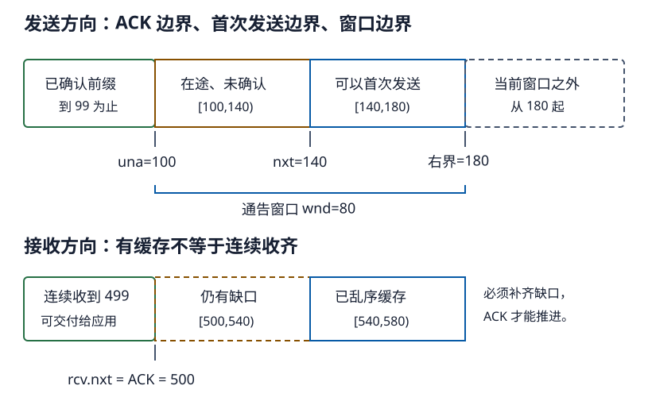

# Transport 无答案指导：先确定边界，再写状态变更

最容易写错的不是某个复杂公式，而是把两个坐标系当成一个：收到报文的 `seq` 描述对端发给你的字节；同一报文的 `ack` 描述对端已经收到你发给它的哪些字节。两个方向独立，只有同一连接把它们装进了同一段。

学习时准备一张事件表，列出“事件前状态、收到的字段、两个方向的边界、缓冲长度、队列内容、事件后状态”。先在纸上推一小段轨迹，再决定哪个已有方法负责那次变化。本页给出检查问题与证据，不把九阶段拼成可直接提交的实现。

## 一、用一张字节账本区分六个数

下面是自拟的非回绕例子：本端已确认到 99，已发送到 139，对端给出的窗口从 100 开始、宽 80 字节。因此 100–139 在途，140–179 尚可首次发送，180 是当前不能发送的第一个位置。



图中的数字只用于理解，不应硬编码到实验。

### ACK 是半开区间的右边界

若一个数据段从序号 700 开始、含 30 字节，覆盖的是 $[700,730)$。收到 ACK 730 表示 730 之前的连续前缀已经收齐，并不是“确认了字节 730”。相应地：

- ACK 等于 `snd.nxt` 可以合法确认全部已发内容；
- ACK 等于 `snd.una` 不代表新增确认，但也不能仅因相等就把一个带有新数据的正常段误当作“确认了从未发送的内容”；
- 过旧 ACK 与 ACK 超前于 `snd.nxt` 是不同类别，框架要求的后续控制流也不同。

**排错问题：** 你的比较是在比较“最后一个字节”，还是比较“下一个字节的位置”？每个判断旁应能用一个半开区间解释，而不是靠试着换 `<` 与 `<=`。

### 数据、SYN、FIN 和纯 ACK 的计数不同

数据按载荷字节数消耗序号；SYN 与 FIN 各占一个序号；单独的 ACK 不占序号。自拟例子：SYN 起点为 20，之后第一字节起点为 21；若应用发送 5 字节，则数据结束边界为 26，FIN 占位置 26，对它的确认边界为 27。收到 FIN 不应往应用缓冲添加一个假字节。

在真实骨架里，FIN 的发送序号推进已由 `FinControl.try_send()` 完成；若同时在 `tx()` 里再推进一次，会出现所有数据都正确、但关闭最后一个 ACK 总差一位的症状。重发 SYN、FIN 或数据也不能再次消费新序号。

### 回绕不是负数修补问题

32 位环形序号中，`0xFFFFFFFF` 之后是 0。框架的模比较以小于半圈的距离定义先后；不应先用普通减法得到负数，再“看情况加一个大常数”。序号差若代表已经明确的前缀长度，可作为切片长度；窗口剩余空间则要先判断是否仍有许可，不能把负额度包成一个巨大的无符号数。

窗口收缩后，已经在途的字节不会消失。即使总在途量暂时超过新窗口，也应停止新增发送，而不是撤销历史、回退 `snd.nxt` 或发送一个异常大段。

## 二、阅读骨架的正确顺序

相对于解压根目录：

```text
ext/cs168p2/student_socket.py
ext/cs168p2/modulo_math.py
ext/cs168p2/__init__.py
ext/cs168p2/autograder.py
ext/cs168p2/tests/
ext/tcpip/tcp_socket_manager.py
ext/tcpip/recoco_sockets.py
ext/tcpip/ip_stack.py
ext/tcpip/__init__.py
pox.py
```

无需实现整套 POX。以下是固定 ZIP 的定位点，行号只对本页固定版本有效。

| 阅读对象 | 固定行号 | 要回答的问题 |
|---|---|---|
| `StudentUSocketBase` | 27–218 | 应用 `send/recv` 如何改缓冲？状态改变如何唤醒等待者？ |
| 控制块与 FIN helper | 221–307 | 谁保存两个方向的边界？FIN 何时真正发出？ |
| 两类队列 | 309–407 | 哪类允许乱序插入？“最早时间”与“最小序号”分别是哪一个接口？ |
| 学生 socket 的常量、建包 | 411–470 | RTO、计时粒度、ACK 默认值来自哪里？ |
| 接收主链 | 573–651、788–813 | 哪些分支会阻断处理？哪些收尾必须执行？ |
| 发送与计时 | 548–571、815–885 | 首发与重发如何区分？谁调用周期检查？ |
| manager | 38、62–67、181–208 | 0.1001 秒模拟计时如何送入 socket？ |
| grader | 55–79、81–171 | 配置怎样变成进程？它实际以什么条件判通过？ |

`cs168p2.__init__.student_socket()` 只替换名称形如 `c1` 的客户端节点。测试服务端使用已给出的栈，所以不应从 `LISTEN` 状态入手补全服务器实现。

### 接收调用链中的“继续”有多层含义

接收入口先按状态和可接收性分派，之后处理排队报文，最后尝试发送数据、待发 ACK、待发 FIN，并唤醒应用。已接受段的内部次序则是检查 ACK，再处理载荷，再处理 FIN。

由此有三个不同的停止位置：

1. 不再取接收队列的下一个元素；
2. 不再处理当前段的载荷/FIN，但保留函数其他职责；
3. 立即退出整个函数。

Stage 2、3 提醒不要随意 `return`，不是风格偏好。如果你刚设了 `ack_pending` 就退出 `rx()`，本轮真正发送 ACK 的位置可能根本到不了。反过来，非法未来 ACK 要阻断哪些处理，则必须遵守 `check_ack()` 返回值的契约。

## 三、接收侧：队列不是交付

### 建立三个区域的不变量

用自拟例子：已连续接收到位置 499，下一处期待 500；收到 $[540,580)$，它只进入乱序缓存，累计 ACK 仍是 500。后来收到 $[500,540)$，这时可以一并消除缺口，让连续边界走到 580。

在每一步检查：

- `rx_data` 只能存放已经按序交付给 socket 缓冲的内容，不能带洞；
- `rcv.nxt` 不能因见到了更大序号就跳跃；
- 同一个字节不能因为重复报文而再次计入缓冲和接收窗口扣减；
- 接收队列可以有重叠项，但它们不是多份独立应用数据；
- 一次缺口补齐可能使多个队首都可处理，不能只处理一个就停。

Stage 3 的 dropper 对已经成功放行过的起始序号不再放行重传，这是与 Stage 2 的关键区别。若 Stage 2 通过、Stage 3 长期等不到完整内容，应先问是否错误丢掉了仅成功到达一次的后缀，而不是先怀疑定时器。

### 重叠裁剪要从“已交付边界”出发

若已经交付到 540，而队首覆盖 $[530,560)$，其中前 10 字节是重复的，只有 $[540,560)$ 是新内容。如果整段都在已交付范围内，新内容长度为零，不能再调用要求非空载荷的处理函数，也不能让序号后退。

这是字节流去重，不是“每个包只处理一次”：重传可能改变分段布局，相同应用字节不必总有相同包边界。先确定新字节集合，再确定载荷视图，最后审视缓冲与窗口是否只变化了真正新增的数量。

`handle_accepted_payload()` 已按 `rcv.wnd` 截短过长内容，更新量应与真正接纳的载荷一致。应用之后调用 `recv()`，外壳会根据剩余 `rx_data` 恢复接收窗口；学生代码不应把这部分职责再做一次。

### 零窗口与控制报文

没有剩余接收空间不代表所有控制信息都应该被丢弃。`acceptable_seg()` 已单独处理无载荷段及零窗口。它是固定框架的一部分，不能为了让某个测试通过而任意重写。读它时区分“段可进入当前接收窗口”与“段的 ACK 可以推进发送方向”，前者成立不自动保证后者成立。

## 四、发送侧：三个上限，一本历史账

将发送前的条件写成三个自然语言问题：还有多少尚未发送的数据？对端窗口扣掉在途内容后还允许多少？一个段最多能装多少？这些限制必须同时成立。

本框架 MSS 来自目标设备 MTU，预留最大 IP 与 TCP 头各 60 字节；测试中常见 1380 不应该被硬编码。网页的“发三个包”是特定数据量/环境的描述，不是接口保证。

### `tx_data` 和 `retx_queue` 的生命周期

首次发送之后，该前缀不再属于“尚未发送”的 `tx_data`，但还需要作为未确认报文保留在重传队列中。累计 ACK 到来后才从后者移除。因而：

- `tx_data` 为空不代表全部数据都已确认；
- 重传不能从 `tx_data` 再取一份新的数据；
- `snd.una` 随确认前进，`snd.nxt` 随首次发送前进，重传不改变已发送区间；
- 累计 ACK 可以一次移除多个段，即便那些段各自的 ACK 曾丢失。

Stage 8 第一项正是用“前面 ACK 丢了、后面 ACK 到了”检查这点。若你为每个报文强求一个独立 ACK，接收端已经拿到全部字节时仍会发生多余重传。

### 窗口更新不是看到 `win` 就无条件替换

`update_window()` 有 `wl1/wl2` 的现成记录，`check_ack()` 有使用它们判断通告新旧的逻辑。不要通过到处直接赋值绕开这个入口，否则网络中的旧 ACK 可能重新打开一个过时窗口。

窗口为 1 字节的测试非常适合定位“把整个发送缓冲一次发出”的错误。窗口测试失败时先查看每段载荷与通告值，再看累计确认边界是否推进；不要通过减小常量或改测试的服务端缓冲绕过问题。

## 五、关闭不是一个布尔值

最有用的纸上模型不是“connected=true/false”，而是分别问：**我还有没有新数据要发？对方还有没有新数据要发？我发出的结束标志有没有被确认？**

### 被动关闭仍能完成另一方向发送

对端 FIN 表示对端发送方向结束；本端可能还有数据，所以进入 `CLOSE_WAIT` 后允许应用继续发送。应用真正关闭后，FIN helper 等待本端 `tx_data` 清空才发 FIN，进入 `LAST_ACK`。等待 FIN 的确认与等待应用关闭是两种不同事件。

### 主动关闭的三种交错都要在概念上理解

同一份入站段可能同时带 FIN 与 ACK。在本骨架中，ACK 处理先于 FIN 处理，所以进入 `handle_accepted_fin()` 时看到的状态可能已被 `check_ack()` 改变。调试时应记录**进入每个方法的状态**，而不是只记录 `rx()` 开头的状态。

“FIN+ACK”只是两个标志为真，不能单凭标志就断言本端 FIN 已被确认；还要看 ACK 边界是否满足 `FinControl` 的条件。它的 `sent_seqno` 实际保存的是 FIN 之后的边界，不是 FIN 自己的起始位置。

`TIME_WAIT` 不是立即释放 socket 的别名。调用 helper 才会同时设状态与安排 30 秒期限；单改状态会让自动删除永远不发生。对仍处于等待期的相关报文，骨架有重新启动等待的路径。

### 已知框架边界，不要把它们变成必填实现

- 网页 Stage 7 的“无 ACK 标志 FIN”与接收函数过滤矛盾，见[要求页](#/c/berkeley-cs168-2025/lab/transport?v=zh)。不要擅自在标记区块外放行所有报文。
- `acks_our_fin()` 用 `sent_seqno` 的真值判断是否已发送；该字段若恰回绕为零，存在边界歧义。这里是静态观察，不是已复现失败；现有回绕测试主要设置的是服务端 ISN。
- `shutdown()` 是已给外壳中的空方法，本项目没有要求把它补成操作系统完整 shutdown 语义。
- `unpoll()` 中 `_wakes` 与初始化的 `_wakers` 拼写不一致，属于现成外壳的可疑点，不是九阶段学生区块；未执行触发它，也不在归档中替上游修改。

## 六、重传与时间：先问“用的是哪一种时钟”

`self.stack.now` 是模拟时间。真实机器跑得快慢不应改变一个 TCP 段经历了多少虚拟秒。不要导入 `time`、新建线程或用墙钟去替换它。

### 时间戳、队列顺序与定时粒度

`retx_queue.push()` 要求首次发送序号递增；接收队列才会为乱序重新排序。重传时再次 `push()` 不仅产生重复项，还可能触发次序断言。`get_earliest_pkt()` 则找最小 `tx_ts`，这是时间语义，不要误用队首接收序号。

检查器每 0.1001 秒被调度，且启动有轻微抖动；骨架用“已等待时间严格大于 RTO”触发。因此日志中稍晚于 1 秒，不自动说明错误；必须考虑采样粒度。`s8_t2` 只证明其代码中所写的数据/包数条件，未直接测量精确重传间隔。

本课程把首次时间戳、队列扫描和退避作为教学模型，**不是完整 RFC 6298 定时器实现**。固定骨架在 `tx(..., retxed=True)` 时不更新首次时间戳，超时函数也没有完整复刻 RFC §5 的所有重新启动规则。尤其达到 RTO 上限后，“距首次发送多久”不能直接等价于“距上次重传多久”。这里保留模型与标准的区别，不在学习材料中悄悄添加未要求的算法或提交代码。

### 为什么重传样本不能直接估 RTT

自拟轨迹：原段在 $t=2.0$ 发出，$t=3.0$ 重传，$t=3.2$ 收到 ACK。如果 ACK 对应原段，样本是 1.2 秒；若对应重传，样本是 0.2 秒。单凭该 ACK 无法区分。

骨架通过 `p.retxed` 标记并过滤这类样本。`update_rto()` 接到的是刚从重传队列移除的原发送包；网页把它称为“收到的 ACK”容易误导。不能对 ACK 包自己的新建时间计算往返时间。

### 理解估计器，而非背下赋值顺序

RFC 6298 的三个量解决三个问题：SRTT 跟踪中心趋势，RTTVAR 跟踪波动，RTO 在中心趋势外加安全余量。首个样本 $R$ 建立基线：

$$
SRTT=R,\qquad RTTVAR=R/2.
$$

以后用新样本 $R'$ 混合历史：

$$
\begin{aligned}
\mathrm{RTTVAR}_{new}&=(1-\beta)\mathrm{RTTVAR}_{old}\\
&\quad+\beta|\mathrm{SRTT}_{old}-R'|.
\end{aligned}
$$

$$
SRTT_{new}=(1-\alpha)SRTT_{old}+\alpha R'.
$$

最后由 $SRTT+\max(G,4RTTVAR)$ 得出候选 RTO，再遵循实验的上下限。重点不是把式子翻成一串赋值，而是理解：若先更新 SRTT 再算偏差，会人为缩小这次观测的偏离程度；若把所有重传 ACK 都纳入，又会污染样本。

网页将 RTTVAR 口语化为“估计标准差”，但算法实际平滑的是绝对偏差，并未计算平方误差的方差或开方。文案理解不能改变规定公式。

RTO 下限为 1 秒，所以测得 RTT 为 0.4 秒时，不能以“RTO 没有等于 0.4”判失败。出现超时则倍增 RTO，至多 60 秒；取得新的干净样本后估计值可以再次下降。退避不是拥塞控制：这里没有要求同时调整 cwnd。

## 七、把失败定位到可观察事实

以下表格是静态阅读后的检索索引，不是本次运行结果。具体命令见[要求页](#/c/berkeley-cs168-2025/lab/transport?v=zh)。

| 症状 | 优先查看 | 不要先做什么 |
|---|---|---|
| sanity 也无法启动 | 工作目录、`pox.py` 可执行权限、启动器选中的解释器 | 改 socket 状态机 |
| 第三个握手包缺失 | `rx()` 是否走到 pending ACK 收尾、两方向起点 | 加随机 sleep |
| 回绕版失败，普通版正常 | 序号比较与模加减 | 把 ISN 固定到小数 |
| 收到数据重复或少一截 | 重叠裁剪边界、`rx_data` 与 `rx_queue` 的职责 | 修改预期字符串 |
| Stage 2 通过而 Stage 3 不完整 | 是否丢掉已成功到达一次的乱序段 | 盲目缩短 RTO |
| 发送停住但缓冲未空 | 在途量、通告窗口、ACK 是否推进、是否再次 `maybe_send()` | 强制无限窗口 |
| FIN 早于剩余数据 | 是否绕过 `FinControl` 的 pending 机制 | 手动清空 `tx_data` |
| 最后关闭 ACK 总差一个位置 | SYN/FIN 是否重复消费序号 | 在每个分支都补一次加一 |
| 重传队列次序断言失败 | 重传是否重新入队，首发是否使用旧序号 | 删除断言 |
| SRTT 很大或漂移 | 使用模拟时间否、样本是否重传过、旧 SRTT 顺序 | 改 alpha/beta 来凑测试区间 |
| grader 五秒超时 | 是否死循环、断点、没有让队列/额度取得进展；同时区分虚拟与现实时间 | 把所有配置 run_time 都减小 |

### 测试文字与实际断言的几处差别

1. `s2_t1` 网页称检查序号，现存 `do_score()` 主要检查完整内容与包数/ACK 数范围；不能据此宣称所有序号边界已经测试。
2. `s2_t5` 的实际 dropper 是交错丢、每个起始序号最多丢一次，而不是只固定丢第二个包。
3. `s4_t1–t3` 的包数检查被注释，实际生效的是内容比较；回绕配置复用相应模块。
4. `s7_t1` 两条提示字符串误写 `LAST_ACK`，实际预期常量分别是 `FIN_WAIT_1`、`FIN_WAIT_2`。
5. `s7_t2` 注释说查“first FIN”，循环却保留最后遇到的 FIN 索引；因此其“FIN 后无数据”断言比注释想表达的范围弱。
6. `s9_t1/t2` 提示字符串写“2*RTT”，计算却以双倍单程链路延迟为目标，即真正 RTT，而不是再次把 RTT 翻倍。
7. 历史 `rx_fin.py` 不是阶段评分入口：有 `itervalues()`、未定义变量及与 Scorer 接口不符的调用，不要因它报错便判定你的九阶段必然错误。

这些记录用于忠实理解固定版本，不是修改测试或有意迎合弱检查的理由。公开测试也无法替代不变量推理。

## 八、无代码自检

<details>
<summary>1. 已收到 [100,120) 和 [140,160)，累计 ACK 应到哪里？</summary>

若初始期待 100，则只能到 120。后段可以缓存，不能使确认越过缺口 [120,140)。接收方拥有的最高字节不是累计 ACK。

</details>

<details>
<summary>2. 全部 tx_data 已经发出，是否可以删除重传队列？</summary>

不能。前者表示首次发送任务已经完成；后者记录尚未获确认的历史。只有足够的累计 ACK 才能证明哪些内容无需再重传。

</details>

<details>
<summary>3. 一个带 FIN 的段也有 ACK 标志，是否一定可以离开 FIN_WAIT_1？</summary>

不能只看标志。要检查其 ACK 是否真正确认本端 FIN，并注意同段先处理 ACK 后处理 FIN的调用顺序；两个方向的结束信息独立。

</details>

<details>
<summary>4. 新 RTT 样本小于旧 SRTT，为什么仍可能需要较大的 RTO？</summary>

一次较快的样本不消除已有波动，而且实验设有一秒下限。RTO 是对不确定性的保守等待阈值，不是最近一次 RTT 的复制。

</details>

<details>
<summary>5. 本地 30 个测试全部存在，是否能说本实验已经完成？</summary>

不能。这里仅静态取得并读过测试。本次没有填写或执行实现，状态为 not_attempted；即使将来测试通过，也仍须检查官方修改边界、学术诚信及提交要求。

</details>

## 引用与来源

- [官方 Spring 2025 Project 3](https://sp25.cs168.io/proj3/) 与 [starter ZIP](https://sp25.cs168.io/assets/projects/proj3/cs168-sp25-proj3-transport.zip)：全文与五图阅读；`student_socket.py` 全部 886 行、全部阶段 `.cfg/.py`、grader 和必要外壳接口静态阅读。方法定位依据固定 ZIP，不是其他年份仓库。
- [官方课程政策](https://sp25.cs168.io/policies/#collaboration-policy)：不提供代码解答；正式课程禁止使用自动代码生成器完成作业。
- Paxson、Allman、Chu、Sargent，2011，[RFC 6298，Computing TCP's Retransmission Timer](https://www.rfc-editor.org/rfc/rfc6298)，§2 更新式、§3 Karn 算法、§4 粒度、§5 计时管理。这里只补充概念与模型边界，不要求实现整个 RFC。
- SVG 为自拟数值与布局的原创解释图，不是题面截图。独立文件自带浅/深主题颜色；本次未做站点浏览器显示验证，交由主代理统一检查。
- 所有命令均是操作参考，未执行实验测试、模拟器或网络探测；未报告任何通过结果。源材料许可未确认的部分仅保留在 sources，不作为公开英文题面页面。
