# 互联网简介

## 什么是互联网？

互联网是一种无处不在的工具，用来在世界各地的设备之间传送数据。本课程重点研究支撑这种通信的基础设施，包括硬件与软件。

互联网（Internet）与万维网（World Wide Web）不是同一件事。可以把万维网理解为建立在互联网之上的应用，例如 Facebook、Twitter；人们通过 Firefox、Chrome 等浏览器访问这些应用。万维网以外的应用也会使用互联网基础设施，例如 Zoom、在线游戏，以及冰箱或汽车中的传感器这类物联网（IoT）设备。

## 互联网为什么值得研究？

互联网并不是一种全新的网络传输技术：例如，电线早就存在。它解决的是一个全新的问题——如何把已经存在、彼此不同的网络连接起来。解决这个问题需要新的设计范式，这些范式后来也影响了计算机科学的其他领域。

相对于许多传统计算机科学领域，网络是较新的研究方向，也带来了不同的挑战。例如，和理论研究不同，我们没有一个能囊括整个互联网的形式化模型；和硬件设计不同，也没有一个统一的可测性能基准来判定整个互联网的优劣。

与此前可能学过的课程不同，仅仅写出能够工作的代码已经不够。代码必须能扩展到数十亿用户，还必须符合不同运营商之间的商业关系；否则，运营商可能根本不愿运行它。

适用于家用计算机等轻量应用的代码，可能不适用于重负载服务器。今天能工作的代码，也可能因为明天有不同的计算机加入或离开网络而失效。

互联网设计影响了现代系统架构的方法，例如围绕目标、约束和取舍进行推理。网络架构更重视思考设计，而不是证明定理或编写代码；更重视比较取舍，而不是满足某个特定基准；更重视实用系统，而不是寻找最优设计。互联网并非最优，却成功平衡了很广泛的一组目标。

## 互联网是联邦式系统

互联网由多个自治主体组成，是一个**联邦式系统（federated system）**，要求不同运营商之间可以互操作。每个运营商或互联网服务提供商（ISP）独立行动，但要把全世界连接起来，所有运营商又必须合作。换句话说，要实现全球连通，世界各地的 ISP 必须同意采用某些共同协议。

联邦式结构带来多种困难。相互竞争的实体，例如竞争公司，被迫合作，但它们可能不愿向对方透露机密信息。因此，协议设计不仅要考虑技术，还必须考虑现实商业激励。

联邦式结构也使创新更复杂。在其他领域，公司可以通过开发别人没有的新功能取得优势；但在互联网中，如果一个功能只有你自己支持，就无法拿它与别人通信。所有人必须说共同的语言，即协议，所以升级互联网时必须考虑互操作性。

## 互联网具有可扩展性

联邦式结构使互联网能够达到如此巨大的规模。我们不必由单一运营商管理数十亿用户和数万亿服务，而可以集中解决不同运营商如何互联的问题。它也允许我们使用极其多样的技术构建互联网，例如无线与光通信；这些技术的能力差别很大，例如容量很小的家庭链路与容量很大的海底光缆。技术还在不断演进，容量和需求经常以数量级增长，因此设计不能瞄准一个永远不变的目标。

互联网规模巨大，也意味着系统必须支持种类繁多的用户和应用：有的需要更多容量，有的甚至可能怀有恶意。

全球尺度意味着系统与协议必须异步运行。数据不能比光速更快，实际往往慢得多。假设你给地球另一端的服务器发消息；等消息抵达时，你的 CPU 可能已经又执行了数百万条指令，发出的信息也可能已经过时。

在这样的规模下，即使只发送一条消息，也可能涉及软件、交换机、链路等许多组件。任何组件都可能发生故障，我们甚至可能不知道它坏了；即使最终能获知坏消息，也可能要等待很久。互联网是最早必须针对大规模故障进行设计的系统之一，许多相关思想后来被其他领域采用。

## 协议

本课程很大一部分内容是**协议（protocol）**：它规定通信实体交换什么格式的消息，以及收到消息后如何响应。

例如，你正在编写一个需要通过互联网收发数据的应用。发送方与接收方的代码必须同时认可数据的格式，也必须认可面对不同消息应该采取的动作。

一个例子是：Alice 和 Bob 先互相问好，然后 Alice 请求一个文件，Bob 回复该文件。要定义这个协议，必须规定语法，例如如何把“给我这个文件”编码成 0 和 1；也必须规定语义，例如 Alice 必须先收到 Bob 的问候，才可以请求文件。

不同需求对应不同协议。如果 Alice 希望尽快拿到文件，可以设计一个省略开头问候的协议。设计好协议往往比看上去困难：必须考虑边界情形、程序错误和恶意行为。例如 Alice 请求文件，Bob 却回复了问候，Alice 应该怎么办？

课程中会出现许多已在互联网中标准化的协议。介绍协议时，有时会看到 RFC，即 Request For Comments。许多标准以 RFC 文档形式发布，并最终被广泛接受，但并不是所有 RFC 都会被采用。RFC 有编号，协议有时也用编号指称。例如，“RFC 1918 地址”指该编号文档定义的地址。

不同标准组织负责不同协议。IEEE 主要关注较低层、偏电气工程的部分；IETF 关注互联网，并负责相关 RFC 标准化工作。

# 互联网的层次

## 第 1 层：物理层

下面自底向上构建互联网：从基本组件出发，逐步组合出互联网基础设施。我们始终使用邮政系统作类比，因为它与互联网有许多相似的设计选择。

首先，需要某种办法让信号跨越空间。在邮政系统里，这可以是邮递员、驿马快递、卡车、信鸽等。

在互联网中，我们需要让比特，也就是 0 和 1，跨越空间。可以使用导线上的电压、无线电波、光纤中的光脉冲等技术。电气工程中有完整的研究领域专门处理信号的空间传送，本课程不展开这些细节。

## 第 2 层：链路层

有了跨空间传送信息的办法，就可以用这个组件连接两所房屋，甚至连接同一城镇的所有房屋。

在互联网中，**链路（link）**连接机器，可以采用有线、无线、光纤等任意合适技术。如果用链路把附近的一批计算机连接起来，例如连接 UC Berkeley 的计算机，就得到**局域网（LAN）**。

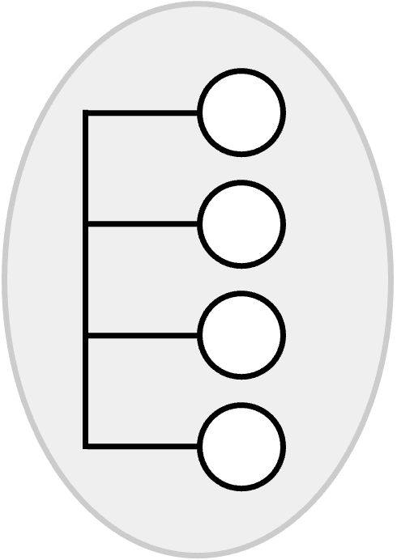

第 2 层还把比特组成称为**分组（packet）**的数据单位，在这一层有时称为帧（frame）；它要在物理信号中划定分组的开始与结束，也要处理多个人同时使用同一根导线发送数据等问题。

## 第 3 层：互联网层

现在能够连接一个局部区域中的所有人，但不同区域中的两个人要通信怎么办？一种办法是在不同局域网之间增加大量链路，但这并不高效：如果两个局域网位于不同大陆，情况尤其明显。

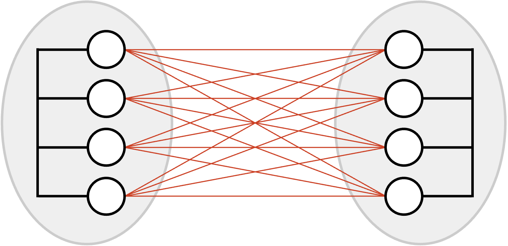

更聪明的办法是在每个网络中设立一个“邮局”，只把两个邮局连接起来。网络 A 中的人要与网络 B 中的人通信，先把信寄到 A 的邮局；A 的邮局转给 B 的邮局，后者再把信送到目的地。

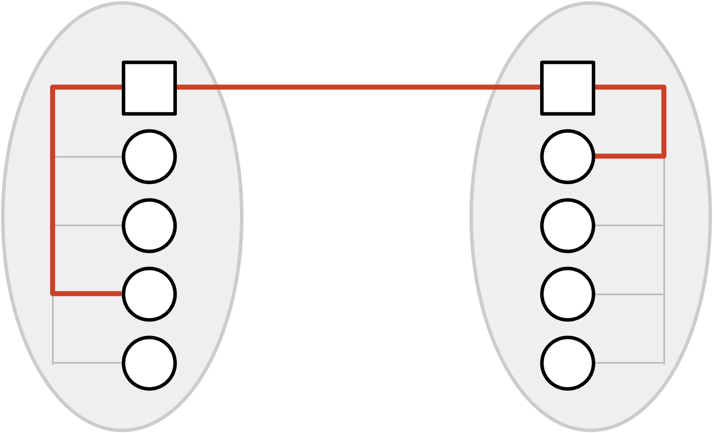

在互联网中，这种负责收取并转送邮件的“邮局”叫作**交换机（switch）**或**路由器（router）**。

继续在交换机之间增加链路，就能连接更多局域网。只要有足够多的链路和局域网，就能连接全世界，形成互联网。

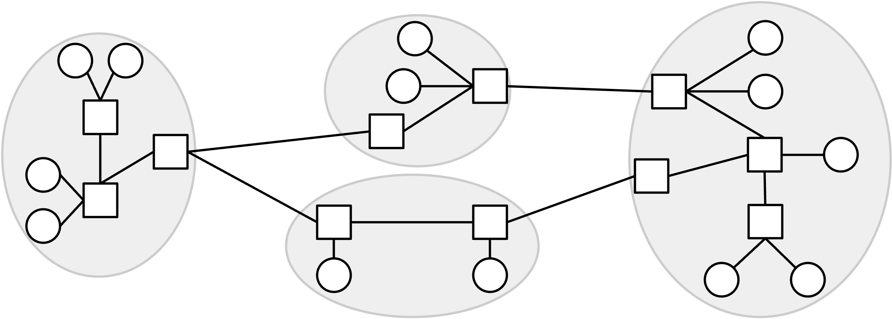

一个必须回答的问题是如何在网络中寻找路径：交换机收到分组时，如何知道应该转给哪里，才能使它更接近最终目的地？这将是路由单元的重点。

另一个问题是，怎样确保链路有足够的容量承载数据。这将是拥塞控制单元的重点。

上图展示了互联网基础设施，但课程还要研究管理它的运营者。在邮政类比中，他们是建设和管理邮局的人；在互联网中，他们是拥有、运营基础设施的 **ISP**，例如 AT&T、Amazon Web Services，乃至 UC Berkeley。除了软硬件，还必须把这些实体视为现实企业和组织，考虑其经济与政治激励。例如 AT&T 建设一条海底光缆后，可能向使用这条光缆的其他 ISP 收费。

## 网络的网络

互联网常被称为**网络的网络（network of networks）**。它由许多较小的局部网络组成，局部网络内部的事务可以由本地组织管理，例如 UC Berkeley；这些局部网络再互联形成互联网。

不同链路可以使用不同的第 2 层技术。有的使用有线以太网，有的使用光纤或蜂窝无线技术。第 2 层解决的是：使用某个局部网络的具体技术，如何沿该网络的链路发送分组。第 3 层则把“能够沿链路传送分组”作为组件，实现互联网任意地点之间的通信。分组跨越不同网络时，可能经过很多不同类型的链路。

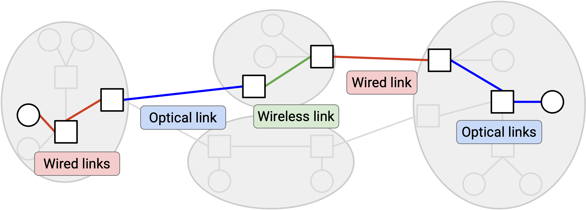

在邮政类比中，房屋与邮局的角色不同。房屋里的人互寄信件；邮局不是在寄收自己的信，而是在帮助房屋之间互通。

在互联网中，**端系统（end host）**是参与通信的机器，例如服务器、笔记本电脑和手机。相比之下，**交换机／路由器**的角色不是发送或接收自己的应用数据，而是帮助端系统通信。例如家中的路由器，以及 ISP 部署的大型路由器。

本教材通常把端系统画成圆形，把路由器画成方形。

## 抽象层次

构建互联网的过程，其实是在把一个大问题分解成较小的任务和抽象。

Barbara Liskov 在图灵奖演讲中说过，基于抽象的模块化是构建系统的方法。这也是构建和维护大型计算机系统的方式。模块化对互联网尤其重要，因为它既包含许多设备，如主机和路由器，也包含许多现实主体，如用户、科技公司和 ISP。所有人认同任务如何拆分，才使互联网能够大规模运行。

这种分层、“网络的网络”的方式有一个重要优点：每个网络可以独立决定如何移动数据。例如，同一分组跨越互联网时，有些链路可以用无线，有些用有线；逐跳改变低层协议，并不会妨碍第 3 层协议工作。

分层还使创新可以并行推进。硬件芯片设计者、软件开发者等不同群体，可以分别在不同层上创新。

## 第 3 层：尽力而为的服务模型

看起来已经能够向世界任何地方发数据了，为什么不就此停止？因为第 3 层还有两个问题没有解决。

第一个问题是第 3 层的服务模型。用户通过网络发消息时，网络向用户提供什么承诺？可以把服务模型看成网络与用户之间的契约，说明网络支持什么、不支持什么。

可能的服务模型包括：保证数据送达；保证在某个时限内送达；或者不保证送达，但失败时一定报告错误。

互联网设计者没有选择上述任何一种。互联网只提供**尽力而为（best effort）**的数据交付。通过第 3 层发出的数据，网络会努力递送，但不保证一定送达，也不会保证告诉你递送是否成功。

为什么选择这么弱的服务模型？一个重要原因是，满足较弱要求的网络更容易构建。

## 第 3 层：分组抽象

目前为止，我们把每条消息都看成独立穿越互联网。更正式地说，第 3 层传送数据的基本单位是**分组**：一小块字节作为一个整体在路由器之间跳转，穿越互联网。

第 3 层的第二个问题是分组大小有限。如果应用要发送很大的数据，例如视频，就必须把它拆成多个分组，并让各分组独立经过网络。

有了分组抽象，就可以追踪一个分组的一生。发送方把数据拆成分组；分组沿链路到达交换机；交换机把它转给目的地，或转给更接近目的地的另一台交换机。分组经过一个或多个交换机，每台继续转发，直到抵达目的地。但别忘了尽力而为的服务模型：沿途任何交换机都可能丢弃它，所以并不能保证分组最终抵达。

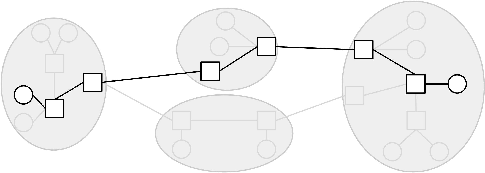

## 第 4 层：传输层

现在识别出两个问题：大块数据必须切成分组，而 IP 只提供尽力而为服务。

为处理这两个问题，引入**传输层（transport layer）**。它以第 3 层为基础，增加协议机制，例如重发丢失的分组、把数据切成分组、整理乱序抵达的分组，以及其他功能。

传输层使我们可以不再只考虑孤立分组，而开始考虑**流（flow）**：在两个端点之间交换的一系列分组。

## 第 7 层：应用层

把应用层建在互联网基础设施之上，是一个很有力量的设计选择。假如低层专门为传视频构建基础设施，邮件客户端就得另外建设一套传邮件的设施。而互联网的设计使它成为通用通信网络，可以承载任意种类的应用数据。

本课程主要研究支撑应用层的设施，例如邮递员和邮局，而不是信件里的具体内容。不过课程后面也会介绍一些常用应用协议。

现在回看各层：每层依赖紧邻的下一层提供服务，又向紧邻的上一层提供服务。例如，编写第 7 层应用协议的人，在使用可靠传输服务时，可以依靠第 4 层解决单个分组丢失的问题，不必自行处理每个丢包。

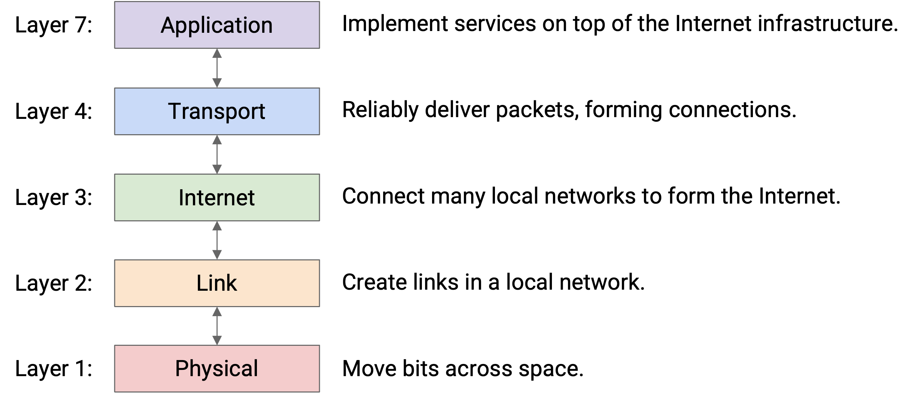

两个相邻层通过彼此的接口直接交互。原文在这里强调，通常不会跳过中间层，直接把第 7 层架在第 3 层之上。

你可能注意到跳过了第 5 层和第 6 层。20 世纪 70 年代提出标准分层时，设计者认为需要这些独立层次；现代互联网通常不把它们作为独立层实现。如果好奇，第 5 层会话层原本负责把不同流组成会话，例如把图片、广告等组合成网页；第 6 层表示层负责数据的表示。如今这些功能大多包含在第 7 层的实现里。

> **编者注：模型的边界。** 本节以 TCP 式可靠传输说明第 4 层，但 UDP 也属于第 4 层，不提供同样的可靠性。分层是设计抽象，不是禁止 raw IP、隧道或跨层优化的物理定律。第 5、6 层的功能并未消失，只是本课程的五层模型不单列它们。本文前面的 switch/router 同义用法也是入门简化，后续学习以太网时会区分二层交换与三层路由。

# 首部

## 为什么需要首部？

前一章看到，第 3 层的数据以分组形式穿越互联网。假设应用想发送文件，可以把图像的一部分比特装进分组，再发出去。然而，交换机收到这一串 0 和 1 时，并不知道该怎么处理。

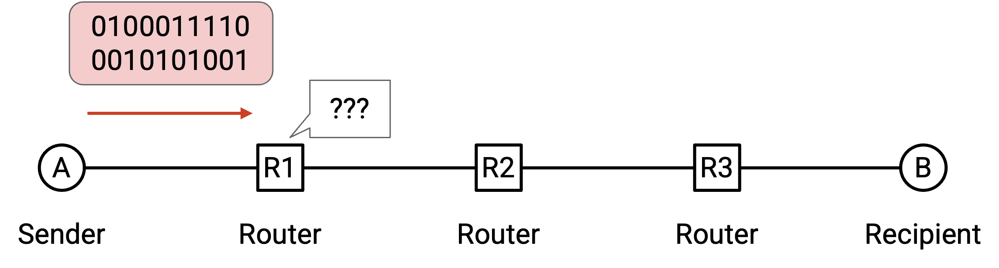

邮政类比也一样：把写给朋友的一封信直接交给邮局，邮局并不知道往哪里寄。应当先把信放入信封，在信封上写朋友的地址等信息，告诉邮局如何处理。

发送分组时，同样必须附加元数据，指示基础设施如何处理它。这些额外元数据称为**首部（header）**。其余比特，例如要传的文件或信封里的信，称为**载荷（payload）**。

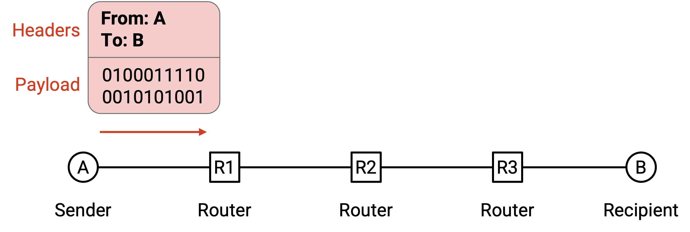

邮局不应阅读信件正文，只需查看信封来决定如何递送。类似地，网络基础设施应通过首部决定如何递送数据。

收信人关心信封内的信，而不是信封本身；端系统中的应用也关心载荷，而不是首部。不过，端系统仍必须懂得首部，因为发出分组前要加上首部。

## 首部必须标准化

也可以把首部看成收发数据的端系统与运送数据的基础设施之间的 API。编写软件时，要规定使用者能调用哪些函数、传入哪些参数；类似地，首部中的信息就是用户调用网络功能、传递参数的方式。

互联网中的每个端系统、每台交换机，都必须认同首部格式。如果 Microsoft Windows 修改系统代码，用完全不同的首部结构发送分组，其他设备就无法理解。

这也意味着首部设计必须慎重。一旦部署到互联网，就很难更改，因为要让所有参与者一起同意修改。这正是标准组织可能花数年设计和标准化首部的原因。

## 首部应该包含什么？

首部一定需要目的地址，说明分组要发往哪里。

还可以放入不是递送本身绝对必需、却很有用的信息。技术上说，单纯把分组送达不一定需要源地址；但实际首部几乎总会带上源地址，使接收方能回复发送方。

首部还可以包含校验和，用于检查传输途中是否发生损坏。

也可以包含分组长度等其他元数据。分组的大小可以不同，例如用户可能只需发送几个字节。

## 多层首部

回到邮政类比：A 公司的老板想给 B 公司的老板写信，消息怎样送达？

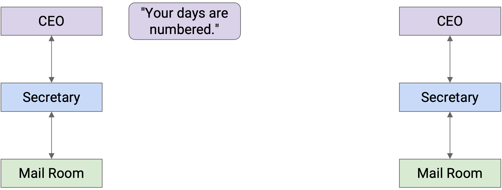

A 公司的老板把信折好，交给秘书。秘书把信放进信封，写上 B 公司老板的姓名。

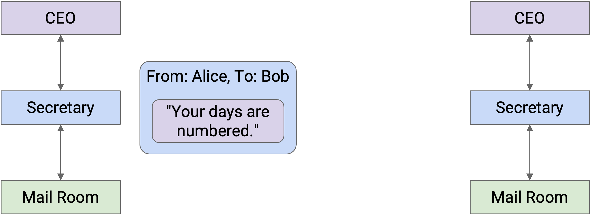

秘书再把信交给收发室。邮务人员把信封装入盒子，在盒子上写 B 公司的街道地址，然后把包裹放上送货车。

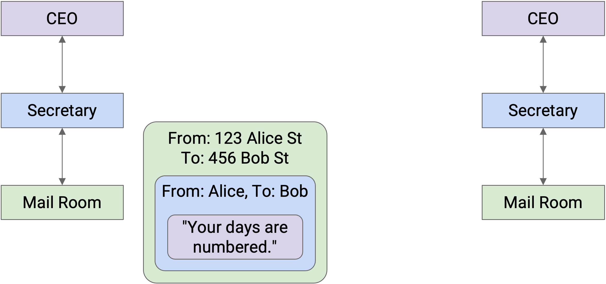

这时，信已被多层识别信息包围：信封、盒子。递送公司将其送往 B 公司，途中可能经过多辆车、飞机、邮递员等。

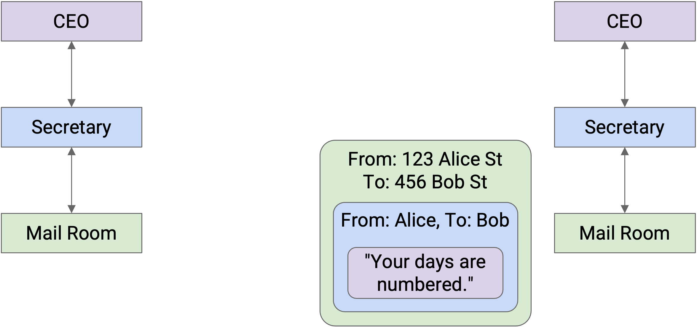

抵达 B 公司后，收发室拆掉盒子，把里面的信封交给秘书。

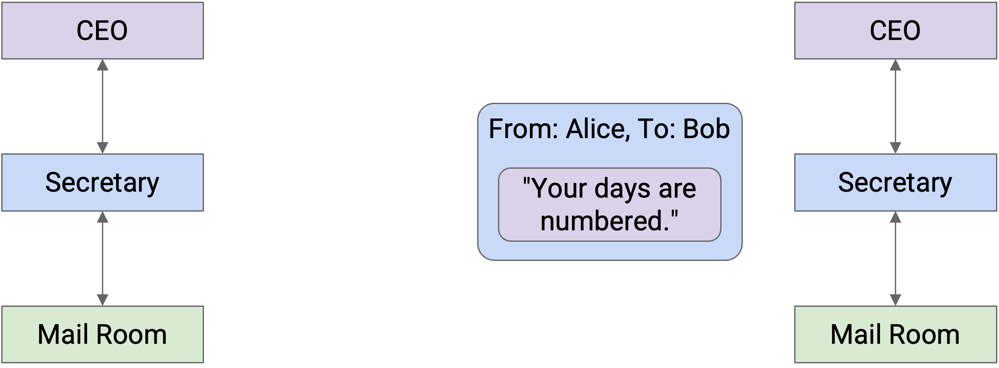

秘书看到老板的姓名，拆掉信封，再把信交给 B 公司的老板。

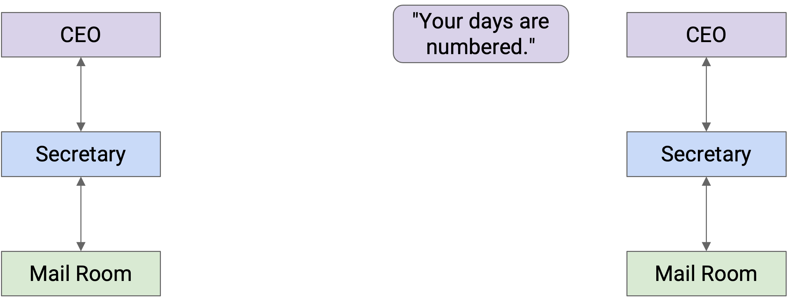

注意，沿抽象层向下移动时，我们在数据外包装越来越多的首部；向上移动时，则逐层剥去它们。

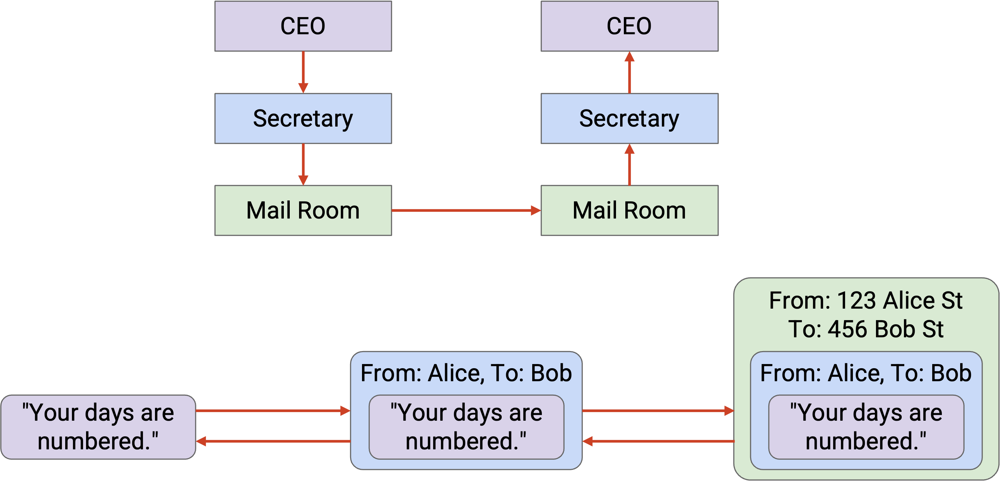

每一层只需要理解自己的首部，并在某种意义上与另一端同一层的“对等实体”通信。A 的秘书写在信封上的姓名，是给 B 的秘书看的，不是给邮递员或老板看的。

正式地说，互联网中的同层对等实体通过该层协议通信，这个协议只对相应层的实体有意义。

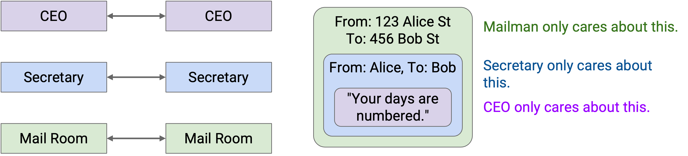

某些层提供多种协议选择，例如第 2 层可用有线或无线协议。在这种情况下，通信双方必须选择兼容的协议；不能让使用有线信令的发送方直接与只懂无线信令的接收方通信。

## 寻址与命名

前面说首部必须包含接收方的地址，但地址究竟是什么？形式上，网络地址是一个指出主机在网络中所处位置的值。

不同层有不同寻址方式。在 Soda Hall 内寄信，可以写“413 Soda Hall”，楼里的人知道投递到哪间房；寄往纽约，则需要完整街道地址，例如“123 Main Street, New York, NY”。

互联网中的各层同样选择适合本层的寻址方式。同一主机有时由人类可读的名字表示，例如 `www.google.com`；有时用机器可读的 IP 地址，例如 `74.124.56.2`。这个数字以某种方式反映服务器的网络位置，移动位置后可能改变。还可以用硬件 MAC 地址指称它；原文将其描述为不会改变的硬件标识。

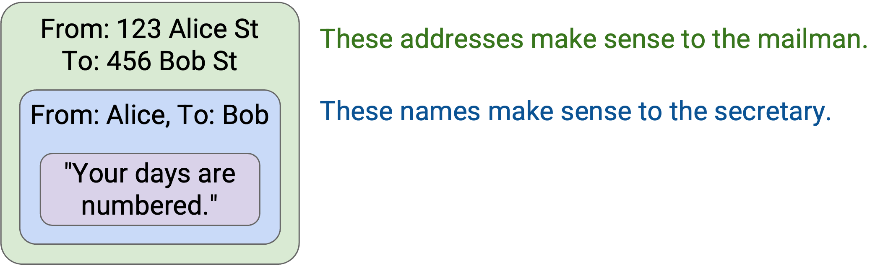

> **编者注：MAC 地址并非绝对不变。** 网卡可能有出厂地址，但系统也可以配置或随机化实际使用的 MAC 地址。IP 地址通常关联接口，主机也可能有多个接口与多个地址。这里的单主机、单地址图景是入门模型。

## 主机和路由器分别实现哪些层？

互联网不只有发送方和接收方。两个端系统之间，还有把分组逐跳向目的地转发的路由器。分层与首部如何跨这些机器共同工作？

端系统需要实现所有层。计算机要理解第 7 层，才能运行浏览器；也要理解第 1 层，才能把比特送上导线。中间各层也都需要，否则应用层数据就无法一路传递到物理层。

路由器需要第 1 层接收线上的比特，需要第 2 层通过链路发送分组，需要第 3 层在全球网络中转发分组。但为完成这个转发角色，它不需要处理第 4、7 层：它不用浏览器显示网页，也不用负责端到端可靠性，因为网络提供的是尽力而为服务。

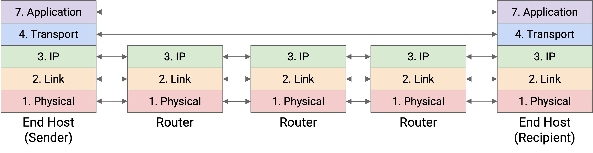

概括起来：底下三层处处存在，上面两层的端到端功能由端系统实现。

## 主机与路由器中的多层首部：邮政类比

A 公司把信放进信封，再放进盒子。但盒子不会神奇地直接到达 B 公司，途中可能经过多个邮局。

在每个邮局，邮务人员打开最外面的盒子，整理邮件，查看拆箱后露出的下一层首部，发现其最终目的地是 B 公司。

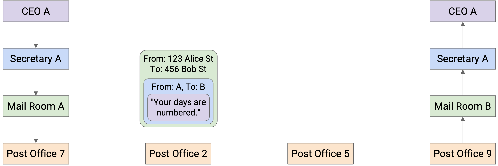

邮务人员把信封装进另一个可能不同的盒子，使信能到达通往 B 公司途中的下一邮局。

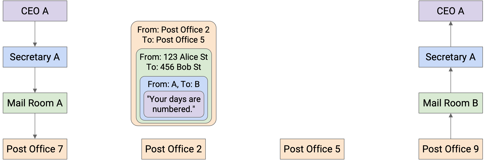

每个邮局重复这个过程：拆箱、露出内部信封、放入发往下一邮局的新盒子。它们都不需要拆开最内层信封读取信件正文。

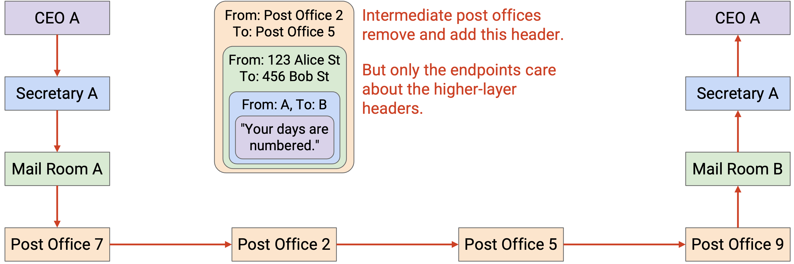

最终，盒子抵达 B 公司。这一次，B 公司会继续拆掉盒子和信封，取出正文。

## 主机与路由器中的多层首部

把主机与路由器放到同一幅图里，再看一次分组多跳传输时的封装与解封装。

首先，主机 A 从应用消息开始沿协议栈向下，逐层处理第 7、4、3、2、1 层的封装与发送。原文把这个过程统称为给每层加首部；得到能由物理层发送的分组。

第 1 层协议沿介质发送这些比特，到达通往目的地的第一台路由器。

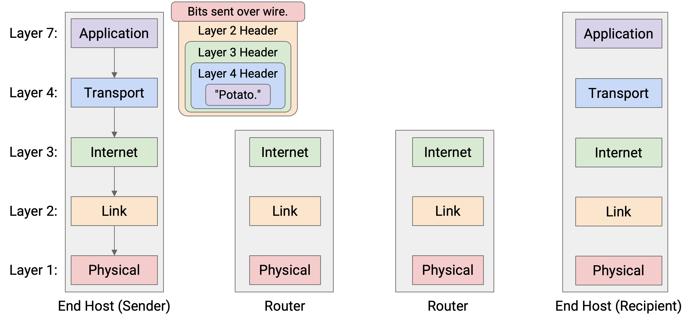

这台路由器必须把分组转给下一跳，使其最终抵达主机 B。全球网络中的转发是第 3 层工作，因此路由器需要把分组解析到第 3 层。

它处理并去除第 1、2 层对应的传输与封装信息，露出第 3 层首部，再读取该首部，决定下一步转给谁。

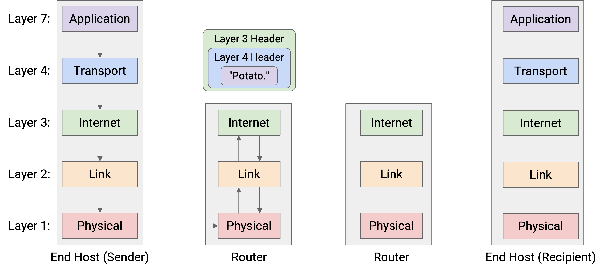

为了转给下一跳，路由器再沿协议栈向下，形成新的第 2 层封装和第 1 层发送形式，把比特沿下一条链路发出。

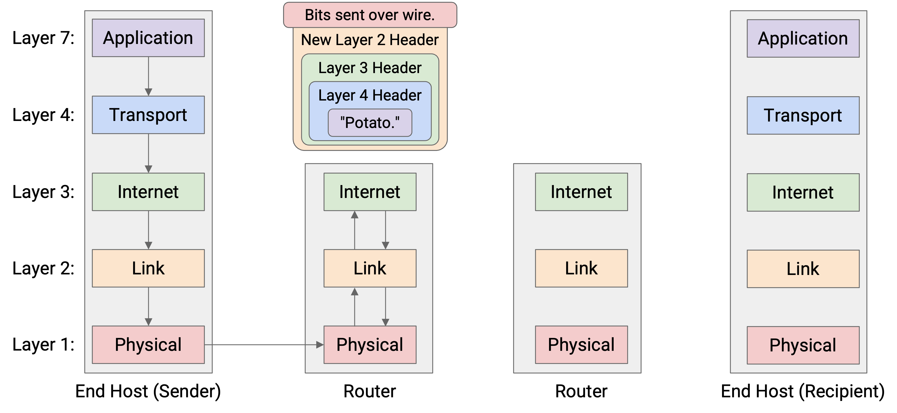

每台路由器都重复这个模式：先处理第 1、2 层以查看第 3 层，再重新进行第 2、1 层的封装与发送。在这个基础模型中，路由器不解析第 3 层之上的协议，较高层留给端系统。

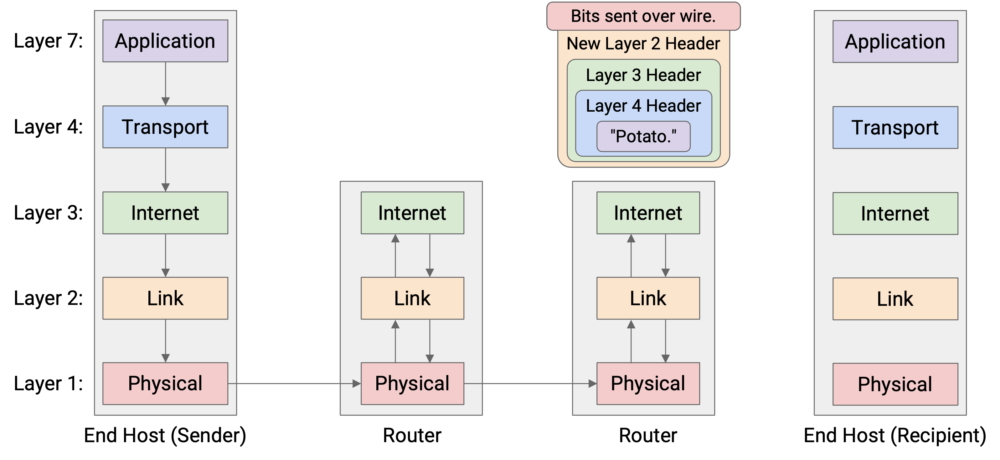

分组最终到达主机 B。B 依次处理第 1、2、3、4、7 层，成功恢复消息。

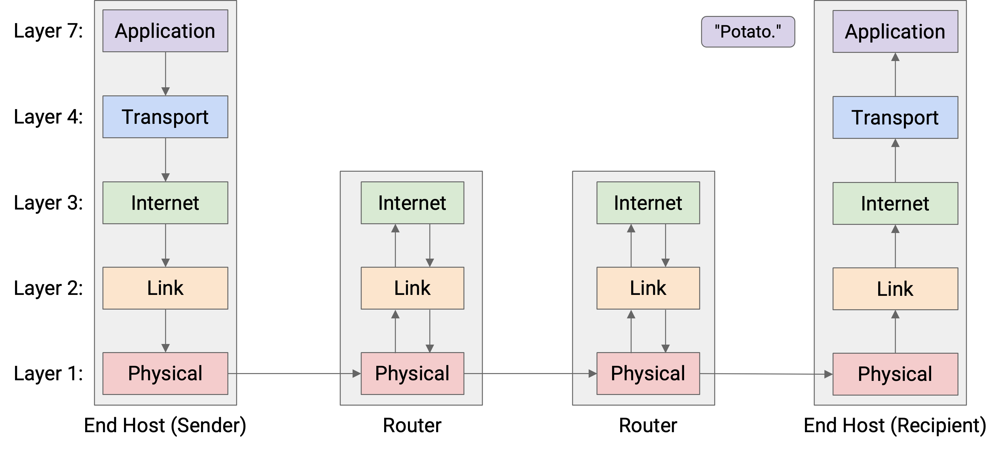

这种分层方式的结果之一，是不同跳可以使用不同的第 1、2 层协议。例如第一跳沿导线传输，主机 A 与第一台路由器使用对应的有线协议；后面某跳走无线链路，则两端使用对应无线协议。

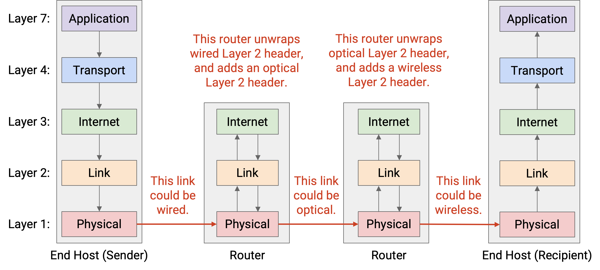

每一层只需要与同层对等实体通信，这个原则现在可以在整条路径上观察到。第 4、7 层的两个端系统必须使用彼此理解的协议；一端主机的对等方是另一端主机。

第 1、2 层则不同：路由器必须在入链路上使用与上一跳兼容的协议，在出链路上使用与下一跳兼容的协议。它在这些层的对等方是路径上的相邻设备。

因此，原图 1-19 中，较高层的对等关系跨越两端主机，较低层的对等关系逐跳建立。每台路由器解析第 1 至第 3 层，而端系统解析从物理到应用的整个协议栈。

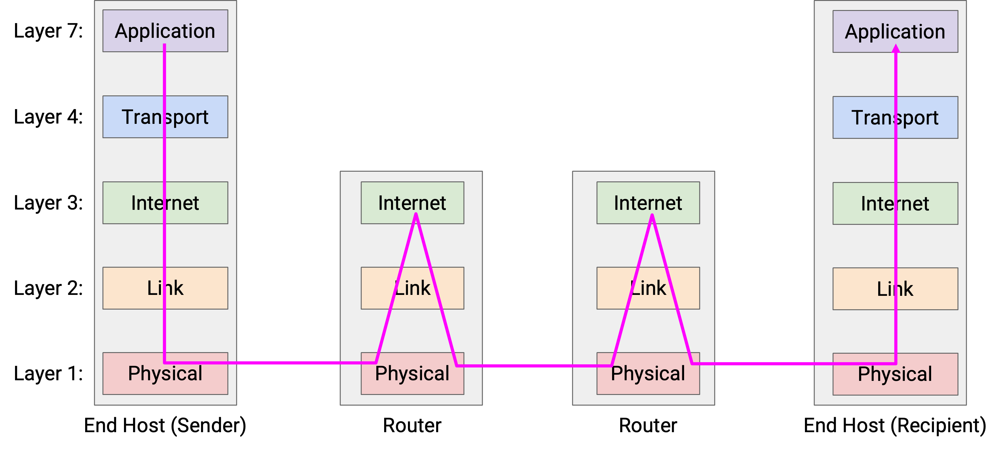

> **编者注：不要把示意图当作逐字节承诺。** 物理层不一定存在与 IP 首部同样形式的“首部”，帧还可能有尾部。普通转发保持端到端目的地址，但 IP 首部并非每个字节都不变，例如 TTL 会改变；NAT、隧道、防火墙等也超出此处的简化模型。路由器不读取应用内容，是基本转发职责的描述，不是加密保证，也不表示路由器不能运行管理应用。

## 引用与来源

- 作者：Peyrin Kao；依据 Sylvia Ratnasamy、Rob Shakir 等人的课程讲授编写。
- 完整翻译章节：[Introduction to the Internet](https://textbook.cs168.io/intro/intro.html)、[Layers of the Internet](https://textbook.cs168.io/intro/layers.html)、[Headers](https://textbook.cs168.io/intro/headers.html)。
- 固定源码：[berkeley-cs168/textbook，commit 0b8208742d31df7fc3d53a0cd94fdd4e04f8d47e](https://github.com/berkeley-cs168/textbook/tree/0b8208742d31df7fc3d53a0cd94fdd4e04f8d47e/intro)，提交日期 2026-10-01。这是为 Spring 2025 课表阅读固定的较新快照，不是声称恢复了 2025 历史教材。
- 原图 1-01 至 1-30 均来自该固定版本 `assets/intro/`；保留图像，新增中文替代文字和图注。重复引用的图 1-19 只嵌入一次，后文回指，不丢失其含义。
- 修改：完整中文翻译、重排层级、中文图注，并把模型简化和纠错单列为编者注。透明原图显示于白底以保证深浅主题可读。本文及教材图像改编遵循 [CC BY-SA 4.0](https://creativecommons.org/licenses/by-sa/4.0/)，许可依据为[教材首页](https://textbook.cs168.io/)。此许可不推广到课堂录像或幻灯片。
