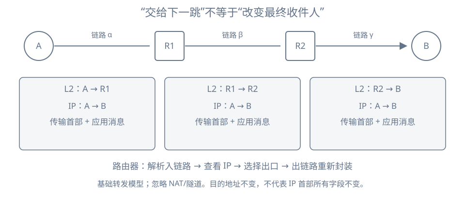

# 从一根链路到互联网

## 先回答三个问题

1. **谁与谁通信？** 应用希望与远端应用交换信息；链路只能解决局部相邻设备之间的传输。
2. **谁承诺什么？** IP 提供尽力而为的分组递送，不承诺可靠、有序、及时交付。可靠传输是另一个协议承担的工作。
3. **谁理解哪些字节？** 首部并不是一张写给全网所有设备的说明书。每层解释自己的控制信息，把内层当作载荷。

把这三个问题分开，后面的路由、TCP、拥塞控制和应用协议就各有位置，而不是一堆需要死记的缩写。

## 1. 为什么不能把互联网当成“一个巨大的程序”？

单个程序往往能由一个团队统一升级、使用统一的数据结构；互联网则由自治组织组成。假设你设计了一个更省空间的地址格式，如果其他运营商仍按旧格式解释首部，省下的字节并不能换来正确递送。

这揭示出两种正确性：

- **局部计算正确**：自己的代码算出了预期结果。
- **交互契约正确**：不同实现对格式、状态转换与异常响应具有兼容理解。

互联网还要面对规模、异步、故障和利益差异。一个企业不一定愿意公开内部拓扑，另一家也不一定愿意为不获益的新功能升级。协议设计不能只问“能不能实现”，还应问“谁愿意部署、哪些节点必须同时理解”。

### 一个数量级检查

课堂用远距离通信说明异步性。若距离 4,125 km，即使按真空光速 300,000 km/s，也至少要 13.75 ms。3 GHz 时钟在此期间走过约 4,125 万个周期。**周期不是指令数**，实际网络路径和介质还会增加时间。

因此，“我收到的远端状态”不等于“远端此刻的状态”。超时只是本地等待到某个时限，也不是获得了对方已经崩溃的证明。

同样，如果路径需要 50 个独立组件同时正常，每个正常概率为 0.99，则至少一个故障的概率是

$$1-0.99^{50}\approx39.5\%.$$

这不是对真实互联网故障率的测量，而是说明：即使组件单独看起来可靠，组合后的系统仍必须认真处理失败。独立性假设必须写出来。

## 2. 分层到底省去了什么复杂度？

可以把五层记成一个逐步增强的服务链：

| 层 | 解决的问题 | 不应偷带进来的承诺 |
| --- | --- | --- |
| L1 物理 | 如何用信号传递比特 | 不是全球寻路 |
| L2 链路 | 如何在一段局部链路／网络上组织和发送帧 | 不是跨整个互联网找路径 |
| L3 IP | 如何把分组送向远端主机 | 不保证送达、有序或有时限 |
| L4 传输 | 如何向端点提供合适的传输抽象 | 不同协议能力不同，UDP 不等于 TCP |
| L7 应用 | 如何解释应用消息并提供服务 | TCP 交付不自动等于业务完成 |

关键不在“恰好五层”，而在接口。只要低层仍实现相同的上层契约，光纤设计者可以改低层，应用开发者不必重写邮件逻辑。

反过来，分层也有代价：每层可能有首部开销，隐藏的信息可能妨碍跨层优化。后面的协议有时会跨越这种整齐划分，所以要把它当作分析工具，不是自然定律。

## 3. 一份数据怎样穿越异构链路？

假设 A 经 R1、R2 给 B 发数据，三跳分别使用不同介质。理想化的线上结构是：

$$H_2^{(i)}\;\Vert\;H_3\;\Vert\;H_4\;\Vert\;M.$$

这里 $\Vert$ 表示按顺序拼接，$M$ 是应用消息，$H_2^{(i)}$ 是第 $i$ 跳的链路首部。图省略物理编码、链路尾部与协议细节。

在 R1：

1. 接收并识别入链路上的帧。
2. 查看其中 IP 分组的目的地址 B。
3. 根据转发信息选择 R2 这一下一跳。
4. 给 IP 分组构造适合出链路的新帧，链路目的地写 R2。
5. 沿出链路发送。

**R2 是这一跳的收件人，B 是整个 IP 分组的目的地。** 如果每过一跳就把 IP 目的地址改成下一台路由器，后续设备就失去了原来要去 B 的信息。

不过“IP 目的地址不变”不等于“IP 首部所有位都不变”：例如 TTL 需要逐跳变化；NAT、隧道等另有规则。本讲先建立普通转发模型。

## 4. 首部与载荷是相对概念

同一段 TCP 首部：

- 对 TCP 实现，是需要解释的控制信息。
- 对 IP，是 IP 载荷的一部分。
- 对链路层，则和整个 IP 分组一起成为帧的载荷。

因此看到“路由器忽略载荷”，不要把它理解成某段字节在物理上无法被读取。只要字节没有被加密，设备可能具备检查能力；基础路由职责只是不需要理解应用含义。**封装不是保密。**

首部的标准化要求通常包括字段顺序、宽度、编码、长度解释和合法状态。只约定“里面有目的地”远远不够。双方还必须约定目的地到底占哪几位、如何解释。

## 5. 从协议到状态机

教材的问候—请求文件例子，可以改写成两个不同问题：

- 语法问题：怎样区分 `HELLO`、`GET` 和 `DATA`？怎样表示文件名和长度？
- 语义问题：未问候就收到 `GET` 怎么办？等待文件却又收到 `HELLO` 怎么办？请求重复怎么办？

学习协议时，建议自己补出“当前状态 × 输入消息 → 动作与下一状态”的表，而不是只画正常路径。正常流程容易，异常组合才经常暴露双方理解不一致。

这也是后面实现路由协议和可靠传输时的基本方法：先写不变量，再写状态转移，最后才考虑优化。

## 6. 易混点清单

- **Web ≠ Internet**：Web 是使用互联网的应用集合；游戏、语音和传感器也能使用互联网。
- **同层对等 ≠ 直接物理连接**：两端 TCP 在逻辑上对等，字节仍需经过低层和中间路由器。
- **主机／路由器是角色**：路由器也能运行管理服务；“只到 L3”描述的是基础转发路径。
- **分组／流不是两种不同介质**：流是对一组相关分组的组织与解释。
- **尽力而为不是保证失败通知**：收到某些网络错误不等于所有失败都会通知；没收到错误也不等于成功。
- **可靠传输不是无限承诺**：永久断网时不能靠重传把物理不连通变成送达，应用仍需处理连接失败。

## 7. 自测

1. A 到 B 经过两台路由器、三条链路。接收端用了 Wi-Fi，发送端能否用以太网？

能。每条链路两端必须理解该链路协议，而不是整个路径只能使用一种链路技术。连接不同技术的中间设备要能处理各自入口和出口的封装。

2. IP 已有目的地址，为什么还需要链路目的地址和传输端口？

它们回答不同范围的问题：链路地址找到局部这一跳的接收者；IP 地址表达跨网络的目的接口／主机；传输端口帮助把数据交给该端点的正确套接字。最后一项将在第 2 讲展开。

3. 有人把链路速率提高十倍，就声称“全球所有通信都快十倍”。错在哪里？

不同延迟来源不能混为一谈。提高速率能减少发送相同数据的序列化时间，却不自动缩短信号传播距离、消除排队或加快远端应用。第 3 讲会定量分解。

4. 普通路由器转发一次分组，是否应该解开应用消息并重新运行应用？

不需要。它为了转发查看 IP 等必要信息，再给下一条链路重新封装。若每台路由器都必须理解全部应用，新增应用就要全球协调升级，违背通用基础设施的目标。

5. “接收端收到了 10 个分组”是否足以证明编号 1 至 10 都收齐？

不够，可能有重复分组而缺少某个编号。应检查所需编号集合，而不只是计数；这为下一讲端到端正确性建立更精确的模型。

## 课堂时间索引

时间来自本视频英语自动字幕，按主题转折取整到秒；用于定位，不声称逐帧准确。未产生字幕的区间不自动等于静音。

| 时间 | 实际内容 |
| --- | --- |
| 00:00–02:00 | 开场、课程安排；首条字幕从 00:08.760 开始 |
| 02:00–17:29 | 基础设施、联邦、规模、异步与故障 |
| 17:29–20:14 | 协议的语法、语义与课堂举手类比 |
| 20:14–37:49 | L1–L3、网络的网络、逐跳传送、尽力而为；含路由问题 |
| 37:49–43:23 | 传输、流、应用与分层边界 |
| 43:23–46:05 | 休息及零散问答；字幕不覆盖全部现场声音 |
| 46:05–59:41 | 首部、标准化、端点封装、同层对等与命名 |
| 59:41–73:36 | 多邮局类比、路由器处理层次、逐跳首部 |
| 73:36–78:21 | 能否直接读取内层字节的问答、异构链路 |
| 78:21–80:16 | 总结与结束；末条字幕结束于 80:15.199 |

## 引用与来源

- 本文是独立中文学习笔记，推导、例题和 SVG 由编者组织，不是录像全文的翻译或逐句改写。
- 全文阅读的课程教材：[Introduction](https://textbook.cs168.io/intro/intro.html)、[Layers](https://textbook.cs168.io/intro/layers.html)、[Headers](https://textbook.cs168.io/intro/headers.html)，固定版本为 [0b820874（2026-10-01）](https://github.com/berkeley-cs168/textbook/tree/0b8208742d31df7fc3d53a0cd94fdd4e04f8d47e)。作者 Peyrin Kao，依据 Sylvia Ratnasamy、Rob Shakir 等讲授；本页教材衍生内容与图依 [CC BY-SA 4.0](https://creativecommons.org/licenses/by-sa/4.0/) 分享。完整译文见本讲“材料”。
- [官方第 1 讲幻灯片](https://docs.google.com/presentation/d/1BHDgW1EqsSLO0N0qtB1hqZh6OPOR8phkh85Ef7woObs)，HTML 阅读范围 1–67 页；没有在材料页重复翻译 slides。幻灯片另有未知许可，不沿用教材许可。
- 课堂依据为 2025-01-23 上传的 `7mat3QOxpTg`，官方频道 CS 168 (Internet Architecture) at UC Berkeley，时长 80:16；视频许可字段为空。完整自动字幕已顺序阅读，语音、动画、板书与未被字幕收录的学生发言未核验。字幕与精简元数据保存在 `sources/lec01/`，不作为公开全文授权。
