# 网络架构

## 设计范式

此前从基本组件出发，自底向上建立了互联网的整体图景。现在改用自顶向下的视角，分析互联网设计中的总体架构选择。

这些设计范式影响互联网为什么这样工作，也影响我们在其上构建的应用。相对于历史上的系统构建方式，这些范式曾是很大的转变。

它们只是许多可能设计中的一种。许多选择在多年以前、互联网尚未达到今天的规模时就已做出。其他设计仍然存在，什么设计最好也仍有争论。

例如，互联网原本采用联邦式结构，由独立运营商合作；而近年来的软件定义网络（SDN）采用更集中的网络管理方式。

最初的互联网有意让交换机保持简单，只转发数据而不深入解析内容。但现代攻击者可能用大量无用流量淹没交换机，交换机于是可能需要检测这类攻击。早期提出“简单基础设施”范式的设计者没有充分考虑这一安全影响。

## 窄腰

同一层可以存在多种协议。例如第 7 层可用 HTTP 提供网页，也可用 NTP 同步系统时钟，它们都建立在同一互联网设施上。第 2 层可用有线以太网，也可用无线 Wi-Fi。

虽然同层有多种选择，一个应用仍可以选定自己的协议栈。例如，决定使用 HTTP over TCP over IP，而不使用其他应用层或传输层协议；这个应用的通信参与者就采用这套约定。

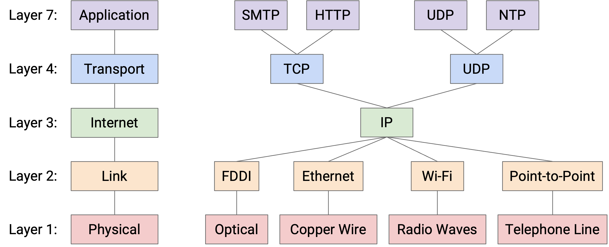

观察这张图，会发现第 3 层只画了一种协议。这就是使互联网能够互联的**窄腰（narrow waist）**。要在互联网中传送分组，最终所有参与者必须同意使用 IP。

> **编者注：原图标记错误。** 原图 1-31 把 UDP 写进了应用层的一格，紧接着的原图 1-32 在同一位置写的是 DNS。UDP 是传输层协议；保留原图以便审计，不把这个错误当作知识点。窄腰强调共同的 IP 服务接口，不表示现实中没有 IPv4/IPv6 版本差异。

## 分用

**分用（demultiplexing）**指设备判断一个收到的分组应该交给哪个更高层协议或应用的过程。每一层的首部含有用于识别下一处理者的信息。例如，IP 首部指出其载荷应按 TCP 还是 UDP 处理；TCP/UDP 首部里的目的端口号，帮助确定应收到数据的应用／套接字。

分组到达主机后，协议栈逐层分用：第 2 层首部识别第 3 层协议；第 3 层首部识别第 4 层协议；第 4 层目的端口帮助操作系统确定接收数据的应用套接字。

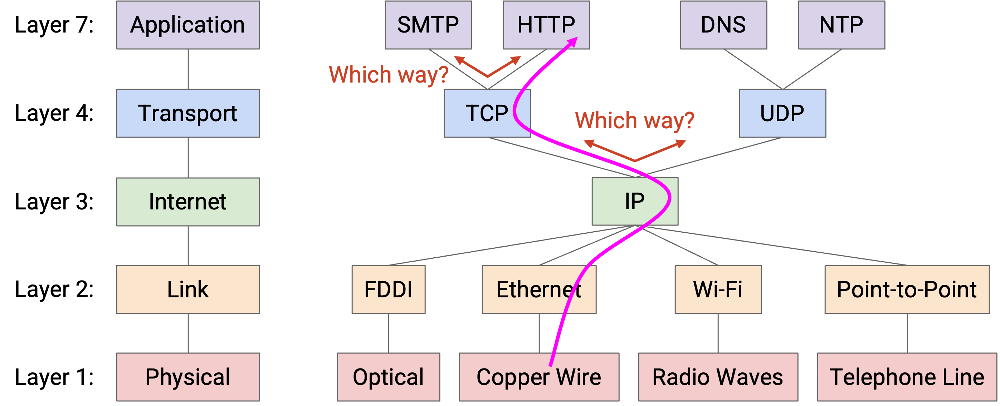

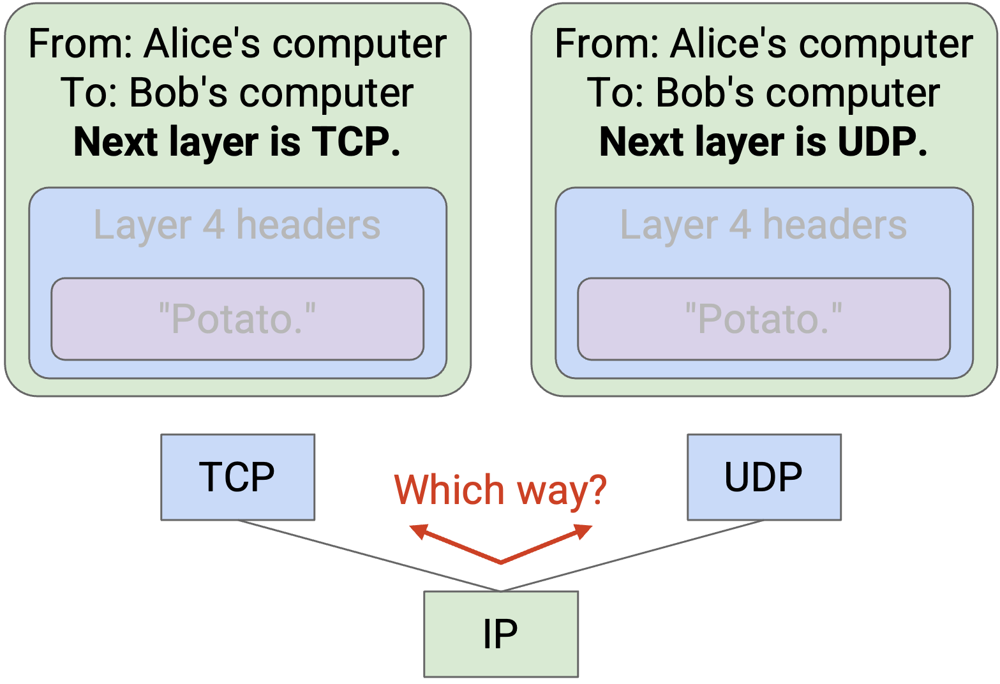

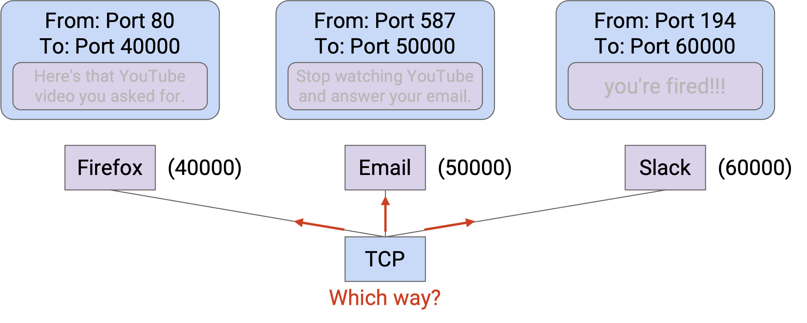

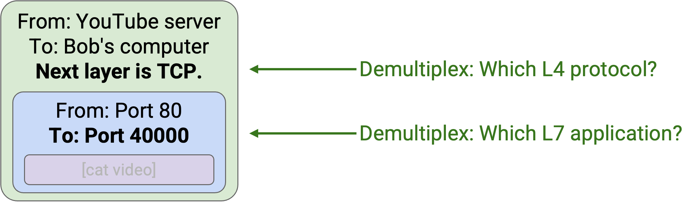

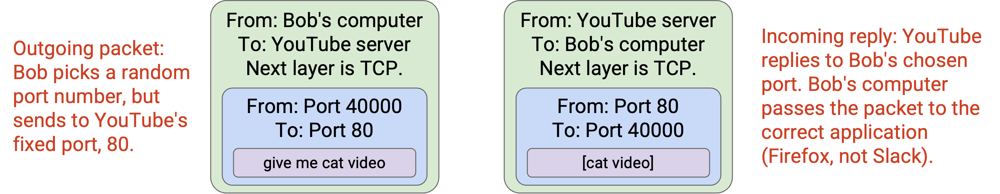

注意术语：网络中两种不同的东西都叫 **port**。物理端口是把链路接到交换机上的实际接口；逻辑端口则是第 4 层首部中的一个数字，用来区分分组属于哪个应用。

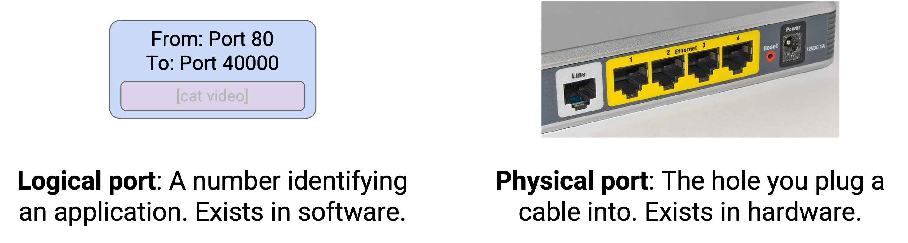

**套接字（socket）**是操作系统把应用连接到网络协议栈的一种机制。应用打开套接字时，它会与逻辑端口关联；操作系统收到分组后，利用端口等信息把分组送到相应套接字。

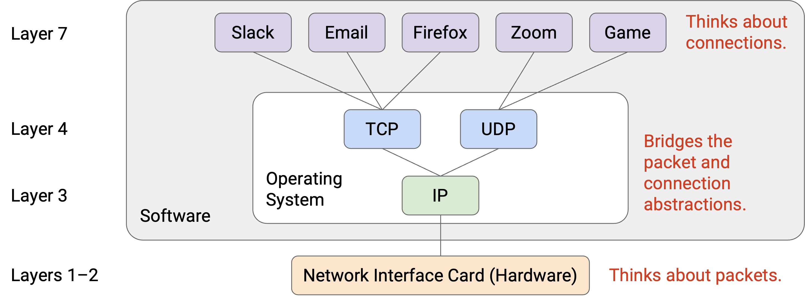

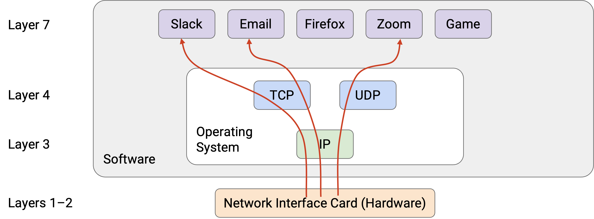

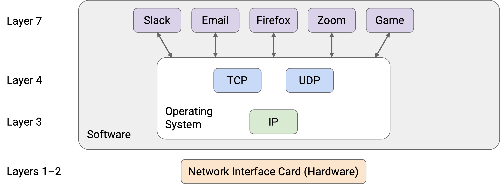

> **编者注：端口不是应用的永久身份证。** 图中的端口及 YouTube/80 是教学例子，不是现代视频服务的部署说明。实际连接的区分可能同时依赖协议、双方地址和端口；多个 TCP 连接可共享服务器的监听端口。硬件／软件分工也会因卸载和用户态网络栈而变化。

## 端到端原则

互联网为什么采用这种分层结构？为什么只有主机理解第 4、7 层，而不是让路由器也承担这些功能？

**端到端原则（end-to-end principle）**为这些设计问题提供指导。MIT 科学家、互联网架构委员会成员 David D. Clark 是这一原则的重要贡献者。他参与的《End-to-End Arguments in System Design》（1981）以及《The Design Philosophy of the DARPA Internet Protocols》（1988），对互联网设计思想有很大影响。

端到端原则帮助我们讨论哪些功能应由网络实现、哪些不应。其范围很广，这里只研究一个问题：可靠性，即此处第 4 层代表的功能，应该在网络内部实现，还是只由端系统实现？

先设想一个非常简单的可靠性协议。主机 A 要向 B 发送 10 个分组，将它们编号为 1 至 10 后发出。目标是：B 要么收到全部分组，要么发现有分组丢失并报告失败。暂不讨论如何从失败恢复。

如果在网络内部实现可靠性，互联网会是什么样子？与先前不同，每台路由器除了第 1、2、3 层，还得理解此处归于第 4 层的可靠性功能。

中间路由器必须可靠地把数据交给下一跳，检查下一跳是否收到全部分组，必要时重传。主机不再自行检查，而是依赖网络保证全部送达。

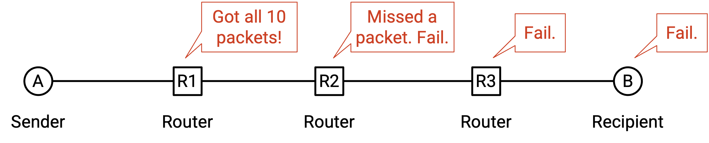

这种方法要求主机信任网络。如果某台路由器有错误并丢掉分组，端系统却没有自行检查，就无法发现真实结果。

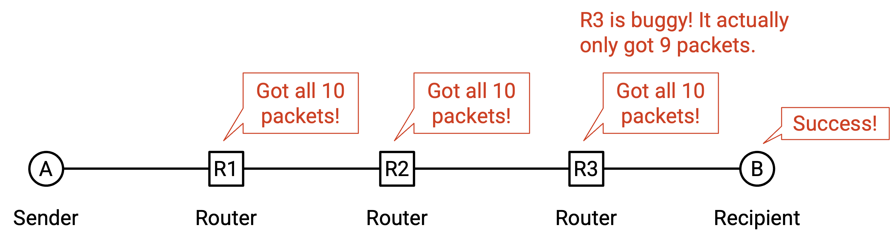

另一种方法是端到端方法：不要求网络内部实现可靠性，强制两端主机检查。路由器可以丢分组，是否收齐由端系统负责验证。

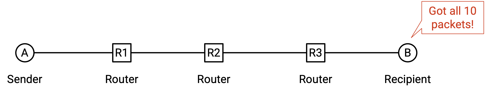

在端到端方案中，控制权掌握在主机手里。主机自身也可能出错并丢分组，但这时主机的拥有者有能力自行修复。更一般地说，编写代码时，最好把使功能正确工作的控制权掌握在自己手里，而不是依赖别人不出错，却又无权修复其错误。

经过比较可以发现，第一种依赖网络正确的方案，无法在网络有错误时保证完全可靠。主机最后很可能仍要增加第二种方案那样的端到端检查。

早期网络的各条链路可能实现可靠性；现代互联网在网络层提供尽力而为服务，要求需要可靠性的端系统自行实现，这符合端到端原则。

总结而言，一些应用需求必须端到端实现，才能保证正确；端到端实现本身已经足够，不必再要求网络提供额外支持。既然单靠端到端机制即可实现要求，再把同类功能放入网络，会增加复杂度与成本，却不能替代端点完成正确性检查。

这不是一个永远成立的数学定理，而是一种设计原则和论证方式。不同设计者可以提出支持或反对它的具体理由。

下面的例子说明它不是死板规则。即使端到端原则主张由端系统承担可靠性，也可以在保留端到端检查的同时，为网络额外添加可靠性机制。对高度不可靠的链路，这可能改善性能。假设 A 与 B 之间有 10 条链路，每条独立丢包概率为 10%，一次发送途中至少丢失一次的概率约为 65%。原文接着说：“每台路由器发送两个副本”，使每条链路失败率降到 0.1%，整条路径丢包率降到约 1%。无线链路有时也会增加可靠性，以降低错误率、改善端系统性能。

> **编者纠错：保留论证，明确修正算术。** 上段原文的“两个副本 → 0.1%”不成立。假设每次尝试的失败相互独立，总共两个副本的单链路全失败概率为 $0.1^2=1\%$，10 跳端到端失败概率为 $1-0.99^{10}\approx9.56\%$。要得到单链路 $0.1\%$ 和全路径约 $1\%$，应是每跳总共三次独立尝试：$0.1^3=0.001$，$1-0.999^{10}\approx0.996\%$。原始单次发送为 $1-0.9^{10}\approx65.13\%$。相关性、额外带宽和重复包处理也不能忽略。

端到端原则还能推广到其他领域。例如在安全问题中，它可能意味着通信两端应自行加密消息，而不只是依靠网络中间点加密。

用原文所引端到端论证的话来说：只有借助端点应用掌握的知识并得到其协助，相关功能才可能被完整而正确地实现。因此，不可能只把它作为通信系统内部的一个功能，就完整实现要求。有时，通信系统提供一个不完整的版本，仍可用作性能优化。

# 资源共享的设计

## 共享资源：统计复用

互联网中的链路和交换机容量有限。一个关键设计问题是：如何在不同互联网用户之间共享这些资源？

把问题说得更正式一些：**流**是两个端系统之间交换的一串分组，例如你与朋友的一次视频通话。虽然容量有限，互联网仍必须同时支持很多条流。

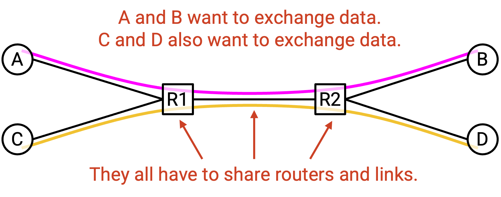

我们常说网络资源采用**统计复用（statistical multiplexing）**：根据用户需求动态分配资源，而不是预先为每个用户固定切出一份。

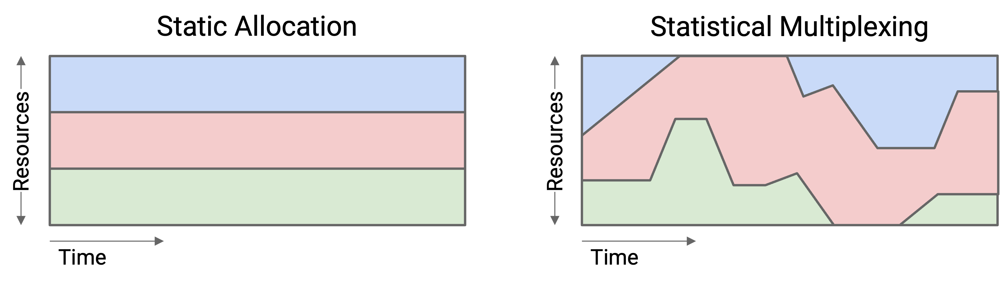

可以类比个人计算机：系统不会事先把一半 CPU 永久分给 Firefox、另一半永久分给 Zoom，并禁止应用使用另一半。相反，它按应用需求动态分配资源。

统计复用已广泛用于计算机科学。例如云计算中，不同公司可以动态共享数据中心里的资源。

它特别适合网络，因为用户需求随时间变化。你不太可能每天 24 小时、每一秒都持续使用固定的 10 Mbps 带宽；清醒时可能需求较高，睡觉时较低。

统计复用有效的经验前提是：**聚合需求的峰值，往往远小于各个需求峰值之和。**

把这句话拆开来看。假设有 A、B 两个用户，分别画出他们随时间变化的需求。

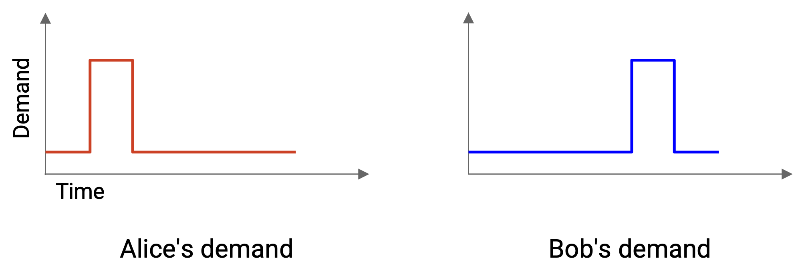

要完全满足两人的需求，需要配置多少容量？

不使用统计复用的办法，是分别找出 A 的峰值与 B 的峰值，再相加，也就是“峰值的总和”。

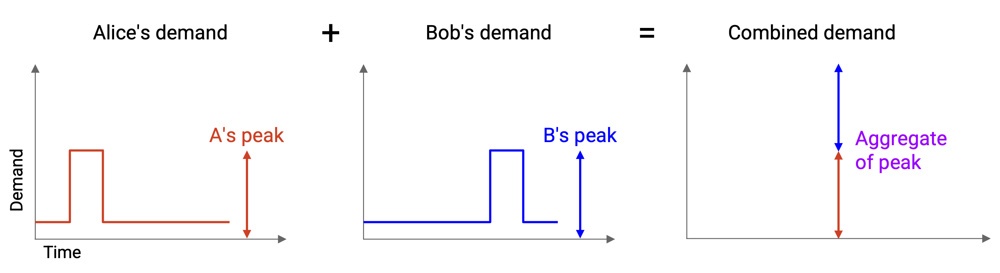

配置这么多容量当然能满足需求：A 的峰值是 X，就永久给 A 分配 X；B 的峰值是 Y，就永久给 B 分配 Y。但这会浪费，因为两人的峰值没有发生在同一时刻。

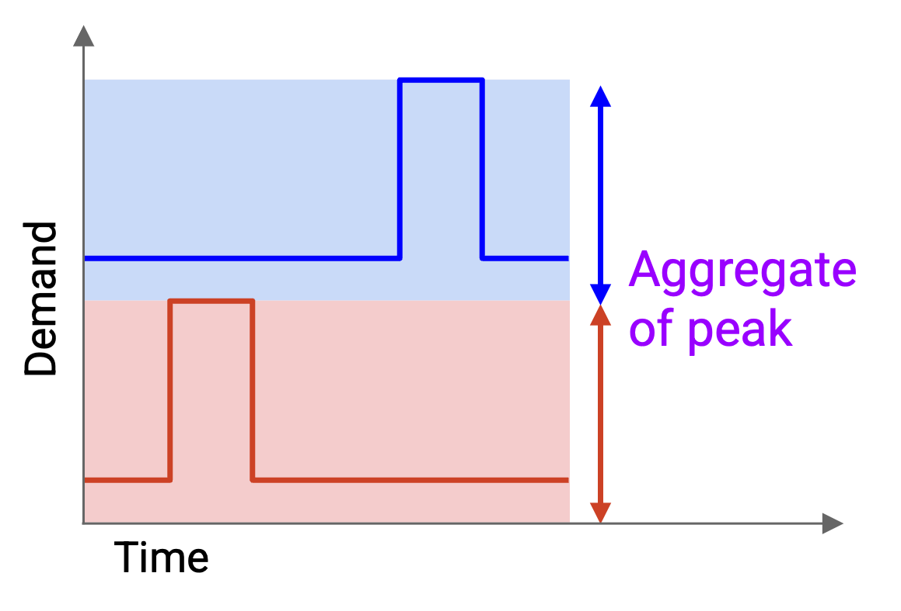

统计复用的办法是，先逐时刻把两人的需求相加，画出聚合需求曲线；例如新曲线上午 10 点的值，就是 A、B 上午 10 点的需求之和。然后取这条聚合曲线的峰值。

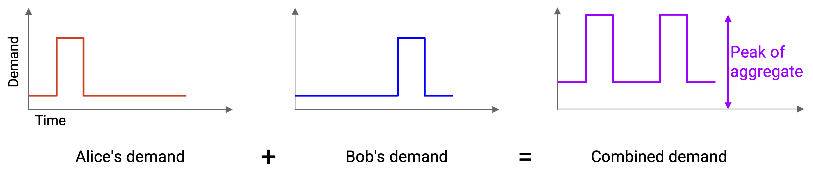

只配置这么多容量，就不能再给每个用户永久划定固定份额；但通过随时间调整分配，仍然可以在总容量较少的条件下满足需求。

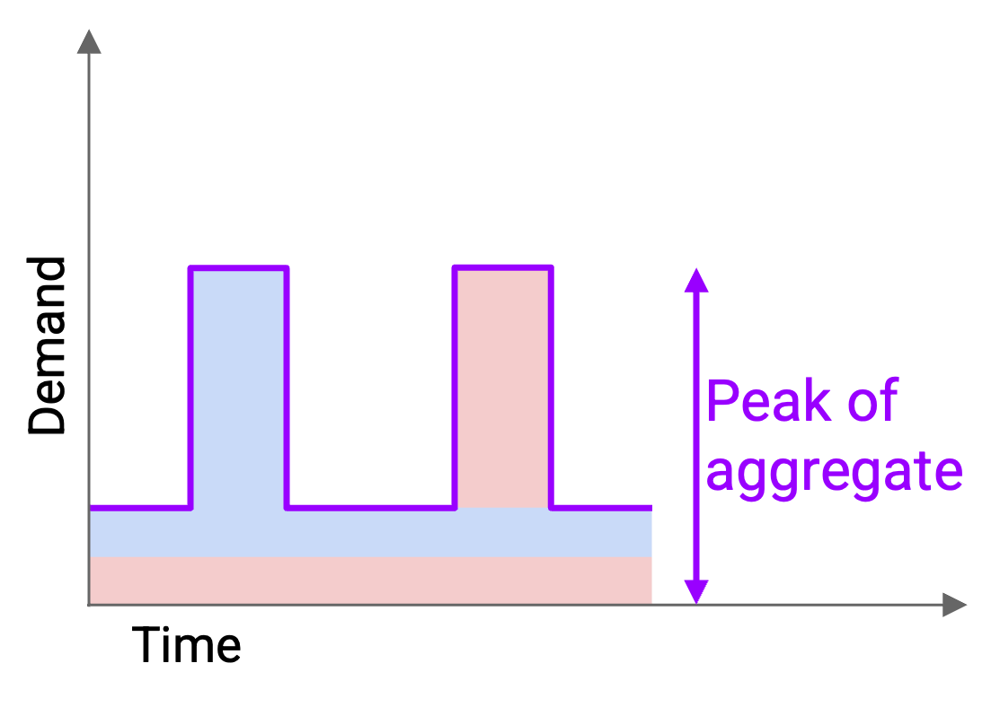

这样可以用较少容量服务同样的用户，成本更低、资源利用率更高。对许多需求分布，聚合峰值实际上更接近各用户平均需求之和，而不是各用户峰值之和。

实践中，网络通常不会按“所有需求恰好同时达到峰值”的绝对最坏情形建设。我们动态共享资源，希望峰值不要完全重合；如果真的同时出现峰值，分组可能排队或丢弃。设计选择是更高效地利用资源，同时接受并处理偶尔同时高峰的后果。

归根结底，统计复用也是有取舍的选择，不同用户可能作出不同决定。例如，金融交易所可能自行建设专用网络，以支持高峰需求，因为它们更重视高峰期间保持连通，也负担得起额外成本。

> **编者注：数学上应写不严格不等式。** 对需求 $f_i(t)$，总有 $\max_t\sum_i f_i(t)\leq\sum_i\max_t f_i(t)$。峰值完全重合时可以取等号；“远小于”是需求错峰的经验条件，不是无条件保证。

## 共享资源：电路交换与分组交换

知道了统计复用能帮助决定建设多少容量，接下来还要问：究竟怎样把资源动态分给用户？

类比一家客人很多、餐桌有限的餐馆。可以要求顾客预订，也可以让顾客先到先得地入座。

网络中一种方法是**尽力而为**：所有人都不预约，直接把数据发进网络，期待它得到服务。没有保证一定有足够带宽满足你的需求。

这种方法的典型设计叫作**分组交换（packet switching）**。交换机独立处理每个分组，把它向目的地转发，不要求先建立流的资源预留。

不仅不同分组被分别处理，不同交换机也分别处理每个经过的分组，不必为它们共同维护一次端到端预订。

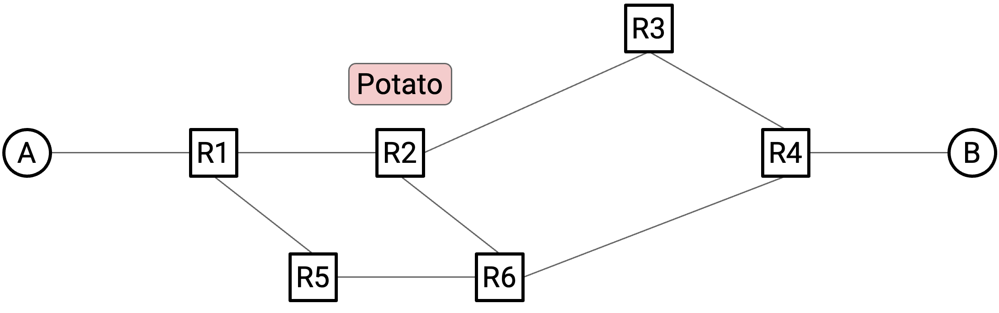

另一种方法是**预留（reservation）**：流开始时，用户明确申请所需带宽；数据发送完毕后，释放资源供别人申请。

这种在研究和工业界都探索过的典型设计叫作**电路交换（circuit switching）**。

流开始时，端系统通过某种路由算法找出一条由交换机和链路组成的路径。此时尚未学习路由算法，可以暂把找路径看成已经解决的问题。

随后，源端向目的端发送特殊的预留请求。沿途每台交换机也会看到请求。如果每台都接受，就建立起源与目的端之间的一条电路。

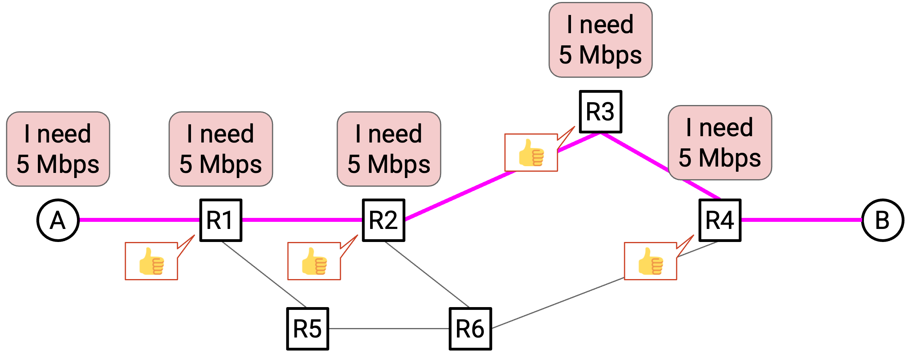

每台交换机确认预留后，就可以发送数据。流结束时，源端向接收方发送拆除消息；沿途交换机看到后释放相应容量。

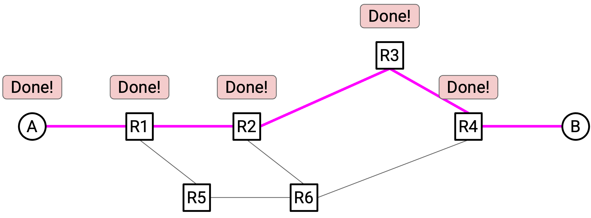

这里使用“电路”一词，是因为这个想法来自电话网络：它用类似办法让两人通话。

要记住，按本课程的分类，电路交换和分组交换都体现统计复用。差别在资源分配的粒度：前者按流预留，后者按分组尽力而为。电路交换仍是随申请动态分配，而不是把资源提前留给所有未来可能出现的流。

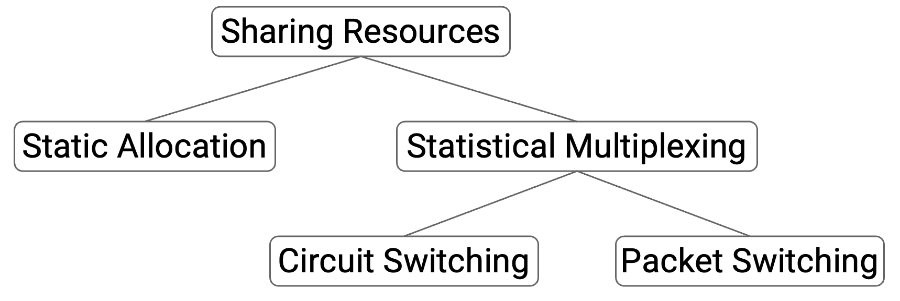

## 电路交换与分组交换的取舍

哪一种更好？必须先说明评价标准。下面从四个维度比较。

### 1. 向应用开发者提供的抽象／API 是否合适？

电路交换提供已预留带宽的保证，因此对开发者更容易理解和预测——前提是一切按约定工作。可以类比在云上预订一台运行任务的机器：知道机器规格，容易推断性能；不知道究竟会分到什么机器，任务虽然也可能完成，但性能更难预测。

对需要向用户分配资源的网络运营商，电路交换也提供了清晰抽象。运营商知道每个用户申请多少带宽，可以据此收费。如果对客户完全不提供资源保证，就更难设计同样直观的商业模式。

### 2. 在大规模下效率如何？会不会浪费带宽？

分组交换通常更高效，优势大小取决于流量的突发程度。

如果每个发送方始终以恒定速率发送，两种方式都能充分利用容量。

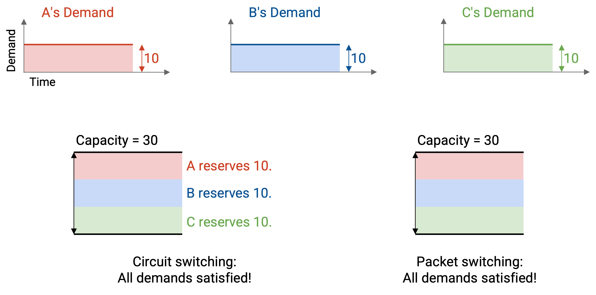

如果每个发送方的速率随时间变化，分组交换通常能更好地利用带宽。

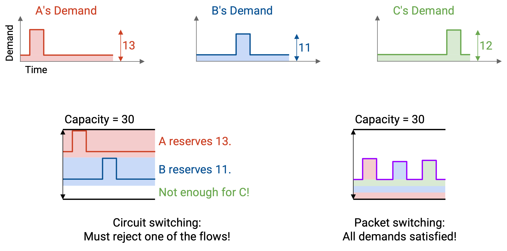

考虑这个随时间变化的需求例子。三个流要分别预留 12、11、13 Mbps，但链路只有 30 Mbps，因此至少一个预订会被拒绝。

这种做法有两种浪费。第一，预留 12 Mbps 的流在大部分时间并没有真正使用 12 Mbps。第二，如果接受了 12 Mbps 与 11 Mbps 两个申请，还剩 7 Mbps，却不足以接受余下的 13 Mbps 申请，留下无法利用的碎片。

相比之下，若分组一到就按实际需求发送，图中任何时刻的带宽总需求都未超过 30 Mbps，因此现有带宽可以支持全部流。

> **编者注：图与正文的流次序不同。** 图中先接受的是 13 与 11，剩 6，拒绝 12；正文举的是先接受 12 与 11，剩 7，拒绝 13。两种顺序都正确地说明了预留碎片，不应混成同一算式。

形式上，流的**突发程度（burstiness）**可用峰值速率与平均速率之比描述。平滑与突发之间没有统一的硬阈值，它们主要是描述性词语。

语音通话通常较平滑，例如峰均比约 3:1；网页浏览可能很突发，例如约 100:1。语音较平滑，也是电话网络使用预留的一项原因。

分组交换更高效的另一原因是：电路交换需要额外的建立和拆除时间。对下载很小文件等短流，这种开销尤其不划算。

### 3. 如何应对大规模故障？

分组交换更容易处理规模化故障。某台路由器失效后，可以把分组转到另一条路径。虽然尚未介绍细节，路由算法通常能够适应这类变化；端系统不必为路径重新申请资源。

电路交换中，路径上的路由器失效后，网络同样必须找新路径，但端系统还有额外工作：发现故障、重新发送预留请求、设法释放旧路径上的预留。新请求又可能被拒绝。

规模一大，情况更棘手：如果一台路由器承载数百万条流，它失效后就可能同时触发数百万次重建预订。

这里不详细解决这些问题，但应当看出，电路交换中的故障处理是一件相当困难的事。

### 4. 大规模实现有多复杂？

真正设计电路交换时，一系列额外问题会很快使协议变得复杂。

路由器如何知道整个预留已经成功？例如路由器 2 同意请求后，怎样知道 3、4 也同意了？一种可能办法是沿反方向发送确认，告知预留成功。

如果请求在路上丢失呢？1、2 已同意，但请求没到 3、4。可以设置定时器，未及时确认就删除预留，然后由端系统重试。

如果大家都同意了，但反向确认丢失呢？4、3 已看到确认，2、1 却没有，设备对状态的认识就不一致。

如果请求被拒绝，端系统应该降低需求再试，还是稍等后以相同需求重试？路由器是否应在拒绝消息中协商：“我给不了 10 Mbps，但能给 8 Mbps”？

这里不会解决全部设计问题，但可以看到，实现电路交换远比最初想象的复杂。

根本困难在于对状态达成一致：所有相关路由器都必须保存额外状态，并且对这些状态取得协调一致的认识。

你也许听过 Paxos 一类让多个处理器对状态达成一致的协议。教材用其复杂性作类比：人们通常在少量服务器中部署一致性机制，而全互联网逐流预留却要求在极大数量的路由器与流之间协调状态。

> **编者注：这是复杂性类比，不是实现要求。** 电路预留并不等于必须把整个互联网组成一个 Paxos 共识组。关键是沿途资源状态、请求与确认丢失、超时和恢复都需要明确协议。

总结：电路交换利用预留带宽，为应用提供较明确的性能和可预测行为。分组交换则能更高效地共享带宽、避免资源预留的启动等待，更容易从故障恢复，实现也一般更简单，路由器需要考虑的逐流预留事务更少。

## 现实中的电路交换与分组交换

现代互联网默认采用分组交换。

电路式预留仍出现在有限范围。例如资源预留协议 RSVP 可以在较小、受控的网络里用于带宽预留；教材举的是路由器之间的预留场景。

另一类例子是专用电路，例如 MPLS 电路和租用线路。企业可以购买为自身业务专用的互联网带宽，有时还涉及物理基础设施。相比普通互联网连接，这通常很昂贵。

这些专用电路的规模目标比“整个互联网都逐流预留”保守得多。预留常由人工建立，可能持续数年，粒度是公司，而不是每条短暂应用流。

简要回顾历史：20 世纪 70 至 80 年代，互联网还较小，是政府资助的研究项目，采用分组交换。

到了 90 年代，控制权逐渐转向商业企业，研究界和工业界曾认为互联网需要转向电路交换。他们预测主要重负载应用会是语音与直播电视，这两者带宽需求相对平滑，适合电路交换。商业化后的 ISP 又需要赚钱，预留似乎提供了更直观的收费模式。

研究人员和标准组织为电路交换投入了大量工作，但这一全互联网愿景最终没有实现，原因包括前面讨论的种种问题。推动互联网增长的主要应用又是邮件和万维网，而不是原先预测的语音与电视，这也不利于该愿景。

一个有意思的结果是，用户和开发者适应了分组交换的现实。今天看视频时，如果网络不好，应用降低画质，我们通常觉得可以接受；传统广播电视并不是这样运作的。这提醒我们，技术也能反过来改变用户行为。

## 引用与来源

- 作者：Peyrin Kao，基于 Sylvia Ratnasamy、Rob Shakir 等人的讲授。
- 全文翻译：[Network Architecture](https://textbook.cs168.io/intro/architecture.html)、[Designing Resource Sharing](https://textbook.cs168.io/intro/sharing-resources.html)。第 3 讲 Multiplexing 指定阅读复用本页，不另做一份译文。
- 固定版本：[0b8208742d31df7fc3d53a0cd94fdd4e04f8d47e](https://github.com/berkeley-cs168/textbook/tree/0b8208742d31df7fc3d53a0cd94fdd4e04f8d47e/intro)，2026-10-01；不是 Spring 2025 历史原样版本。
- 图 1-31 至 1-56 来自固定教材 `assets/intro/`，已保留原图并增加中文图注。原图标错与数值错误在正文分别说明，未静默改成原作者的新说法。
- 修改包括全文中译、层级重排、图注和明确标识的纠错。透明原图显示于白底以保证深浅主题可读。译文与教材图像改编依 [CC BY-SA 4.0](https://creativecommons.org/licenses/by-sa/4.0/) 发布，授权依据为[教材首页](https://textbook.cs168.io/)。不把该许可用于视频、幻灯片或教材引用的独立论文。
- 上文两篇论文是教材列举的思想来源；本页翻译的是教材对它们的介绍，不声称已独立阅读论文全文。
