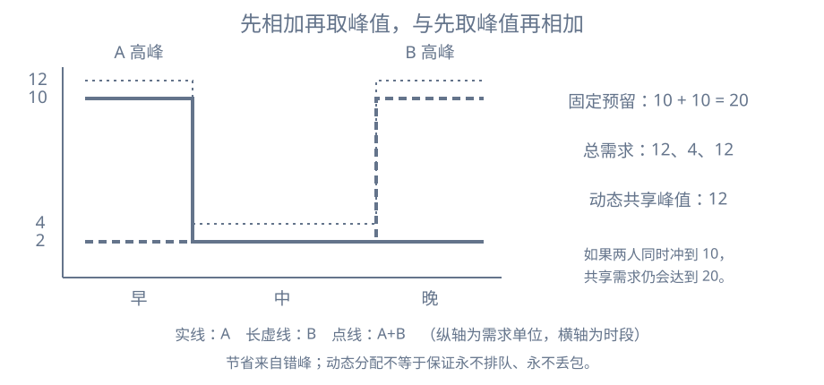

# 设计原则不是规则清单

## 核心问题：功能究竟应该放在哪里？

上一讲建立了一个“IP 尽力转发，端点处理更高层功能”的图景。本讲不再背层号，而问：如果把功能搬到别处，会增加哪些状态、信任与协调成本？

分析架构时，可以固定四个问题：

1. **正确性必须由谁判断？** 谁拥有判定目标是否完成所需的信息？
2. **性能瓶颈在哪里？** 局部优化是否值得增加复杂度？
3. **状态保存在哪里？** 故障时哪些节点需要恢复一致认识？
4. **部署要谁同意？** 单个应用升级，还是所有中间设备升级？

“分层、窄腰、端到端、分散控制、简单基础设施、绕开故障、尽力而为”是回答这些问题时积累的经验，不是七条没有例外的法律。

## 1. 窄腰统一的是接口，不是整个实现

上层应用可以不同，下层链路也可以不同，但跨网络通信需要一个大家共同理解的接口。IP 在中间承担这一角色：不同网络不必共享内部实现，却能交换共同格式的分组。

可以把创新范围分成两侧：

- 应用端引入新服务，只要仍能通过既有 IP 网络发包，就不必要求沿途运营商理解新业务。
- 链路引入新介质，只要仍能承载 IP 分组，就不必迫使所有应用重写。

由此得到一个重要反例：**窄腰不是要求整个协议栈唯一。** 两个端点可以选择 TCP 或 UDP；不同跳也可以选不同链路技术。但选定某协议的通信对等方必须相互兼容。

代价是窄腰本身的改变很困难：依赖它的参与者最多。IPv4 与 IPv6 的差异也提醒我们，“所有人使用 IP”是一种架构抽象，并不保证不同版本可以无条件直接互通。

## 2. 分用：沿栈向上，怎样不走错门？

收到一串比特时，不能靠“看起来像网页”选择处理程序。应逐层读用于分用的字段。

| 处理位置 | 需要回答的问题 | 入门模型中的依据 |
| --- | --- | --- |
| 链路层 | 里面是哪种网络层分组？ | 链路协议的类型信息 |
| IP | 载荷交给 TCP、UDP，还是别的协议？ | IP 的上层协议标识 |
| TCP/UDP | 应交给哪个套接字？ | 地址、端口与协议相关的连接状态 |

教材固定版本已经明确 IPv4 中 TCP 协议号为 6、UDP 为 17；它们不是端口号。端口号又不是网卡上的物理插孔。

### 一个回包例子

设客户端在本机选择逻辑端口 40000，访问服务器某个已知服务端口 80。请求的源／目的端口是 `40000 → 80`，回复是 `80 → 40000`。源端口看似不影响请求送到服务器，却让回复能够返回正确套接字。

不要过度推广：这只是传统 HTTP 教学例子，不是现代 YouTube 必定使用 80 的事实。客户端临时端口也不是每次完全随便选，系统必须满足本地分配约束。

**更精确的边界**：一个服务器的很多 TCP 连接可以共同使用本地 80 端口，通过对端地址、对端端口等区分。因此“一个端口唯一代表一个应用”只适合初步理解，不能作为完整套接字实现规格。

## 3. 端到端论证：检查放进网络，端点就能不检查吗？

设目标为：接收端需要收到编号集合 $S=\{1,2,\ldots,10\}$。成功不变量应该是

$$\mathrm{declareSuccess}\Longrightarrow S\subseteq\mathrm{receivedIDs}.$$

现在考虑两个方案。

**方案 N：只由网络判断。** 每个路由器告诉下一跳“我收齐了”，接收端相信最后一个报告。如果最后一台设备错误地把 9 个不同编号说成“全部收到”，端点就可能错误宣布成功。

**方案 E：端点自行判断。** 接收端直接检查自己拥有的编号集合。沿途设备是否误报，不能替代接收端的检查。

关键不是“网络设备一定比主机笨”，而是：

1. 要确保应用要求，端点无论如何都需要检查。
2. 在这个限定目标中，端点检查已经能防止缺包却误报成功。
3. 因而中间重复检查不能消除端点检查的必要性，是否值得做应另从性能评估。

还要注意这个例子的边界：没有定义完成期限和失败检测时，端点不能仅凭沉默区分“还没到”与“永远不会到”；永久断网时更不能保证最终送达。课堂的极简协议用来讨论**判断是否正确**，不是一个完整的 TCP 替代品。

## 4. 正确性与性能必须分两本账

保留端到端检查的同时，在差的无线链路上做局部重传，可能降低长距离重传的代价。这不违反论证的核心：局部优化不能替代最终检查。

假设一条路径有 10 跳，每次链路传输独立失败概率为 $p=0.1$：

$$P_{\mathrm{fail},1}=1-(1-p)^{10}\approx65.13\%.$$

若每跳总共发送两次独立副本，只要一次成功就继续，则每跳全失败概率为 $p^2$：

$$P_{\mathrm{fail},2}=1-(1-p^2)^{10}\approx9.56\%.$$

这里特意修正课堂和教材的算术：它们把“两份”与“单跳 0.1%、全路径约 1%”并列；后面的数值对应的是每跳三次独立尝试，不是两次。

当然，增加副本消耗带宽；同一干扰导致的丢失可能高度相关，不能照搬独立概率公式。局部机制还要处理重复、超时和缓存。因此“更可靠”并不自动等于“整体更快”。

## 5. 统计复用：省下的是闲置容量，不是峰值需求本身

令用户 $i$ 在时间 $t$ 的需求为 $f_i(t)$。

- 各人永久独占足够应付自身高峰的容量，需 $C_{\mathrm{fixed}}=\sum_i\max_t f_i(t)$。
- 完美按当前需求分配，针对这条已知需求轨迹，需 $C_{\mathrm{shared}}=\max_t\sum_i f_i(t)$。

因为任意时刻都有 $f_i(t)\leq\max_t f_i(t)$，相加再取最大值得到

$$C_{\mathrm{shared}}\leq C_{\mathrm{fixed}}.$$

这是不严格不等式。所有峰值同时出现时，两者相等；只有错峰时才有节省。课堂口头说“总是严格更少”，不能当作普遍定理。

现实网络既不知道未来全部需求，也通常不按绝对最坏情况建设。因此它选择以统计规律换取效率，并用队列、丢包与拥塞控制处理偶然同时高峰。**平均负载低不是无丢包证明。**

## 6. 资源分配粒度：预订一顿饭，还是到一个包服务一个包？

本课程先区分静态分配与动态共享，再把动态共享分成：

- **电路交换**：对一个活动流预留一段时间的资源，结束后释放。
- **分组交换**：不先做端到端带宽预订，逐包安排转发。

所以电路交换不等于“给每个人永久留一份”。它在流的生命周期尺度上动态分配，只是相比逐包复用，粒度更粗。

### 用一个例子比较效率

出口容量 30 Mbps，三个流峰值分别为 13、11、12 Mbps。如果先给前两个流预留，剩 6 Mbps，第三个 12 Mbps 请求无法获准。但若这些流的突发错开，任何时刻实际总需求都小于 30，逐包共享却可以全部满足。

这里有两种闲置：被预留却未被该用户使用的容量，以及剩下但不足以满足整个新申请的碎片。峰均比越高，这种浪费往往越突出。

峰均比定义为峰值速率除以平均速率。语音约 3:1、网页约 100:1 是教材帮助建立直觉的示例，不是每种现代应用的固定常数。

### 教材补充：本次课堂没完成的两个比较维度

本次视频讲到效率后下课，下面内容实际由第 3 讲续讲，也已完整包含在本讲指定教材中：

- **故障恢复**：分组交换可以在路由收敛后使用新路径；预留方案还要清理旧状态、重建资源，可能同时触发大量请求。
- **实现复杂度**：部分设备同意、请求或确认丢失、拆除未送达时，各节点如何知道电路是否有效？核心代价是额外分布式状态，不只是多发几条消息。

“分组交换更简单”不等于路由器没有状态，也不等于网络不会拥塞；它省去的是这类逐流端到端预留状态。

## 7. 自测

1. 两个用户峰值都为 10，是否必然只需 12 的共享容量？

不必然。12 来自例子中另一用户在高峰期间只需 2。若同时达到 10，聚合峰值就是 20。要先给出需求轨迹或统计模型，不能只看两个单独峰值。

2. 网络每一跳都有 CRC，应用可以省掉文件完整性检查吗？

不能据此推出可以。应用要求可能覆盖内存、存储、软件处理及其他错误环节，逐跳检查并未覆盖整个目标。中间校验可以提高性能，但不能自动替代最终语义所需的端到端检查。

3. 为什么“收到 10 个包”还要进一步改成“收齐所需编号集合”？

因为重复包可能凑够数量，却仍缺某个编号。应写清成功不变量，而不是让一个模糊计数替代需求。

4. 一台服务器只有一个服务端口，能否同时服务很多客户端？

可以。真实 TCP 分用不仅查看本地端口，还使用双方地址、双方端口等连接信息。端口帮助定位服务，但不是全局唯一连接标识。

5. 电路预留的确认丢了，能否把“没收到确认”直接解释为“所有设备都没预留”？

不能。请求可能已获若干或全部设备接受，只是确认没回来。需要明确定义临时状态、超时、重复请求和释放机制，这正是分布式状态的成本。

## 课堂时间索引

| 时间 | 实际课堂内容 |
| --- | --- |
| 00:00–09:38 | 开场、七项设计原则与替代方案；首条字幕为 00:06.440 音乐标记 |
| 09:38–13:45 | 窄腰；“为什么在 L3”问答 |
| 13:45–26:35 | 分用、端口、请求与回复；含 IP／端口问答及麦克风调整 |
| 26:35–33:23 | 逻辑／物理端口、NIC／操作系统／应用的分工 |
| 33:23–46:55 | 端到端正确性论证、简化协议的边界问答 |
| 46:55–51:48 | 局部可靠性作为性能优化、思想来源；数值需按上文纠正 |
| 51:48–54:48 | 休息，零散非实质字幕 |
| 54:48–65:29 | 统计复用、错峰需求和峰值计算 |
| 65:29–72:19 | 餐馆类比、两种动态分配粒度 |
| 72:19–80:39 | 四维比较中的应用抽象与效率、突发性 |
| 80:39–81:10 | 试图转入故障比较后决定下次续讲；字幕结束 81:08.320 |

## 引用与来源

- 独立学习笔记；全文中译见本讲“材料”。教材作者 Peyrin Kao，基于 Sylvia Ratnasamy、Rob Shakir 等讲授：[Architecture](https://textbook.cs168.io/intro/architecture.html)、[Sharing Resources](https://textbook.cs168.io/intro/sharing-resources.html)，固定版本为 [0b820874（2026-10-01）](https://github.com/berkeley-cs168/textbook/tree/0b8208742d31df7fc3d53a0cd94fdd4e04f8d47e)。教材衍生内容与本页图按 [CC BY-SA 4.0](https://creativecommons.org/licenses/by-sa/4.0/) 分享。
- [第 2 讲官方 slides](https://docs.google.com/presentation/d/1paPqaOFTFxi5zadIpFFFjANnUmapSlSt1G0CDcjqzcs)，全文读至 64/64。slides 51–64 的主要内容并未在本次录像讲完，不能把页号当作时间轴。
- 视频 `ItYYFdUuz8k`：官方频道 CS 168 (Internet Architecture) at UC Berkeley，2025-01-28 上传，81:10；英语自动字幕全读，许可未知。本页不提供该视频全文翻译。课堂音频、动画和未收录学生发言未直接核验。
- 课堂和教材提及端到端论文，本笔记只引用已读教材中的论述，不声称独立读过论文全文。字幕中的“narrow waste”“D multiplexing”等识别按上下文与课件辨认为 narrow waist、demultiplexing；原始字幕不覆盖改写。
