# 链路

## 链路的性质

有了互联网各层的总体图景，现在仔细研究分组如何沿一条链路发送。

可以用三种性质衡量一条链路的性能。

链路的**带宽（bandwidth）**说明每单位时间能向链路发送多少比特，直观上就是链路传输数据的速率。把链路比作输水管，带宽相当于管道的粗细：越粗，每秒就能灌入越多水。带宽通常用比特每秒表示，例如 5 Gbps 表示每秒 50 亿比特。

链路的**传播时延（propagation delay）**说明一个比特沿链路行进需要多久。在水管类比中，它对应管道的长度：管道越短，水到另一端所需时间越少。传播时延以时间为单位，例如纳秒、毫秒。

把带宽与传播时延相乘，得到**带宽时延积（bandwidth-delay product，BDP）**。直观上，它是链路在某一时刻能容纳的在途比特量。把管道灌满并冻结时间，此刻管内水量就对应这个量。

有时也会看到 **latency** 一词。在讨论单条链路时，它可能指传播时延；在其他上下文中，也可能指跨多条链路的端到端时延。这个词单独使用并没有唯一含义，必须看语境。

> **编者注：区分两种“容量”。** 网络中也常用 capacity 表示链路速率，单位是 bit/s；本节水管类比中的 capacity 指在途数据量，单位是 bit。BDP 是满速稳定发送下的在途容量，不意味着空闲链路里也有这么多实际数据。这里使用单向传播时延，不能随意替换成 RTT。

## 时序图

假设链路带宽为 $1\text{ Mbps}=10^6\text{ bit/s}$，传播时延为 $1\text{ ms}=0.001\text{ s}$。

现在要沿它发送一个 100 字节，也就是 800 比特的分组。从开始发送第一个比特，到收到最后一个比特，需要多久？

为了回答，可以画时序图。左边竖线表示发送方，右边竖线表示接收方；顶部时间为 0，越往下时间越晚。

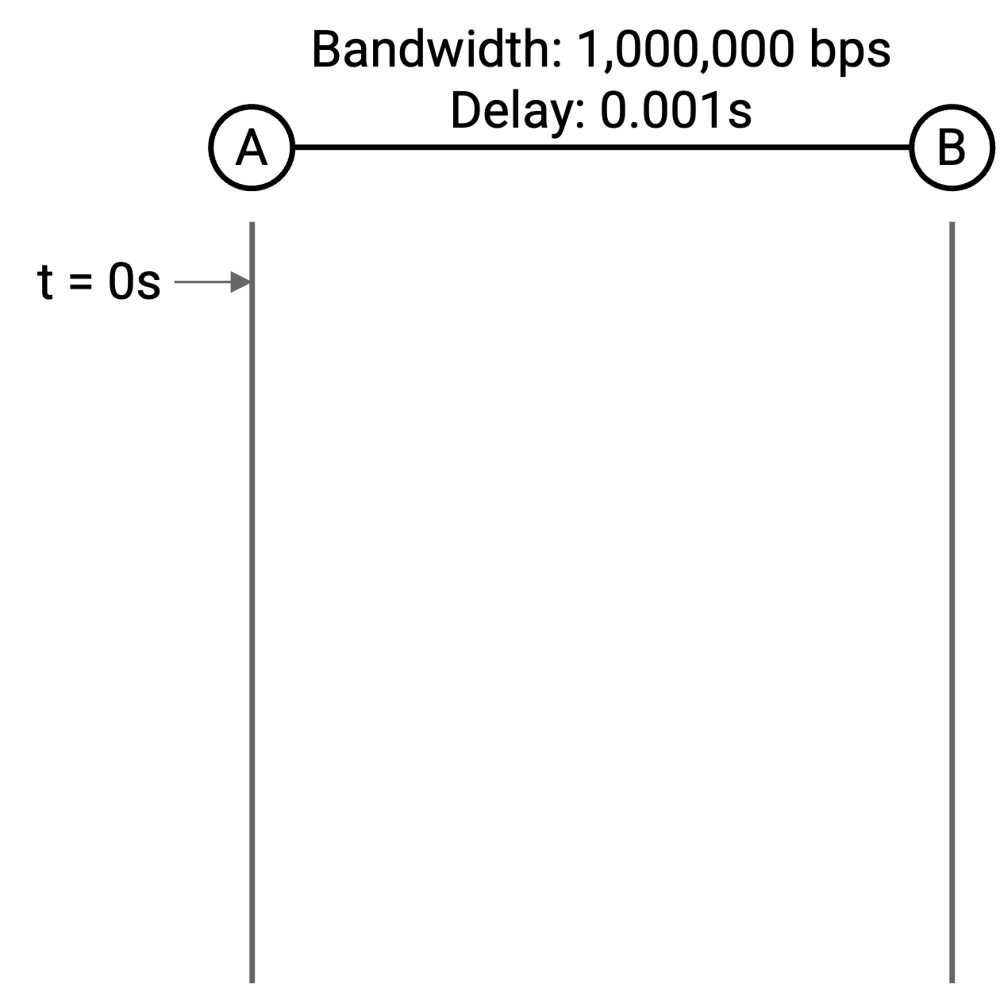

先看第一个比特。带宽是每秒 1,000,000 比特，所以把一个完整比特送上链路需要 $1/1{,}000{,}000=0.000001$ 秒。在 $t=0.000001$ 秒，第一个比特完成发送，位于发送端一侧。

它再用 0.001 秒穿越链路，因此在 $t=0.000001+0.001$ 秒，接收端收到完整的第一个比特。

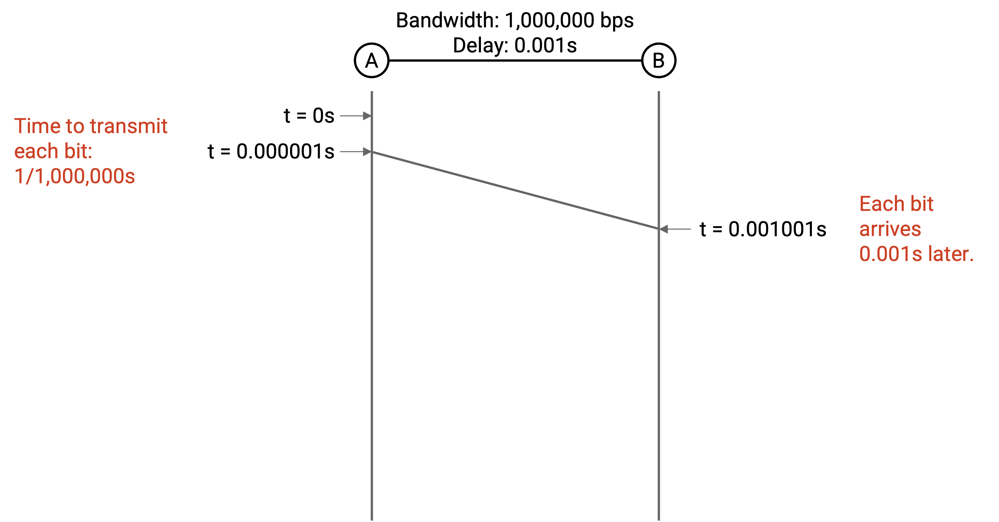

再看最后一个比特。每个比特占用 0.000001 秒，发送 800 比特，末比特完成进入链路的时刻就是

$$800\times0.000001=0.0008\text{ s}.$$

末比特再传播 0.001 秒，因此在 $0.0008+0.001=0.0018$ 秒，最后一个比特到达。这时才能说整个分组到达接收方。

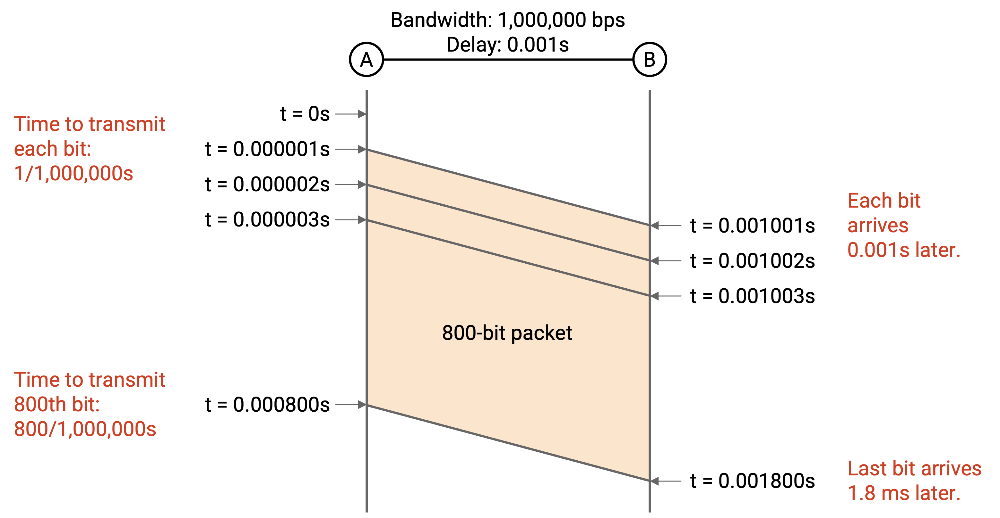

## 分组时延

更一般地，**分组时延（packet delay）**是整个分组从开始发送首比特，到另一端收到末比特的时间。它等于发送时延与传播时延之和。

**发送时延（transmission delay，也称序列化时延）**是把所有比特送上介质所需时间。在刚才的例子中，它是 $800\times(1/1{,}000{,}000)$ 秒。一般形式是分组大小除以链路带宽。

因此，利用带宽与传播时延两个链路性质，就能计算分组时延。设分组长度为 $L$ 比特、带宽为 $R$ bit/s、传播时延为 $d$ 秒：

$$D_{\mathrm{packet}}=D_{\mathrm{tx}}+D_{\mathrm{prop}}=\frac{L}{R}+d.$$

这里还没有计入排队或处理开销。

## 带宽与传播时延的取舍

考虑两条链路：

- 链路 1：带宽 10 Mbps，传播时延 10 ms。
- 链路 2：带宽 1 Mbps，传播时延 1 ms。

哪条更好？取决于要发的分组。

如果只发一个 10 字节的小分组，两条链路把它送上介质的时间都很短，传播时延是主要部分。链路 2 传播时延较短，所以更好。

如果发一个 10,000 字节的大分组，发送时延的影响就变大，我们会更偏向带宽较高的链路 1，因为它能更快把全部字节送上链路。正式计算也能验证：链路 1 约需 18 ms，链路 2 约需 81 ms。

现实例子是视频通话。如果画质差，可能是带宽不足，缩短传播时延未必有效；如果你说完话，对方很久才回应，则可能是传播时延较长，增加带宽未必解决问题。

> **编者注：这不是唯一诊断。** 排队、编码、应用缓冲和设备处理也会影响视频通话。大包例子中，链路 1 的发送时延为 8 ms、传播时延为 10 ms，不能说它的发送时延严格占最大部分；正确结论是增大包长后，高带宽优势足以抵消较大的传播时延。

## 管道图

此前用时序图表达网络事件何时发生，例如何时收到分组。

另一种视角是冻结时间，直接画出此刻链路上有哪些比特。两种图表达同一传输过程，但适合回答的问题不同。

把链路想成管道，再画成矩形：矩形的宽度代表传播时延，高度代表带宽，面积代表链路的在途容量。

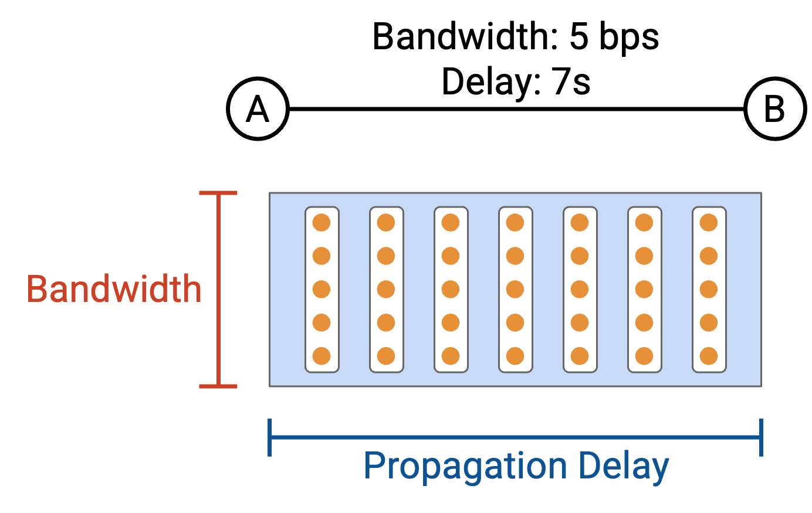

原文接下来提出发送一个“50 字节”分组，并用冻结时刻的管道图展示它的传输。

> **编者纠错：此处应为 50 比特。** 原图 1-62 至 1-64 共画 10 列、每列 5 个比特，最终时刻 17 秒；只有 $50/5+7=17$ 秒与图一致。若真是 50 字节，发送需 80 秒，总计应为 87 秒。下文按照图中 50 比特例子解释，保留原文单位差异以供核对。

分组画成一个矩形，矩形高度表示一个时间步内送上链路的比特量。每个时间步，矩形向右移动；最终它开始离开管道，每一步都有一列比特离开。

一个不太直观的事实是：时序图里的**发送时延，对应管道图中分组矩形的宽度**。

为了理解，假设链路每秒发送 5 比特，分组为 20 比特。原文说时序图中首尾比特发送之间为 11 秒。

> **编者纠错：11 秒是整个分组的到达时间，不是发送时延。** 图的传播时延为 7 秒，20 比特以 5 bit/s 发送需要 4 秒，末比特完整到达是 $4+7=11$ 秒。把“发送开始到发送完成”与“发送开始到接收完成”混为一谈，会直接读错下一幅图。

管道图中，每秒一列 5 比特进入。四列全部进入需要 4 秒，所以分组宽度为四个时间列，也就是 4 秒。

这种表示把发送时延与传播时延放在相同的横轴单位上，便于比较。

管道图也可用于比较不同链路。可以考察同样的分组通过不同参数链路的情况。

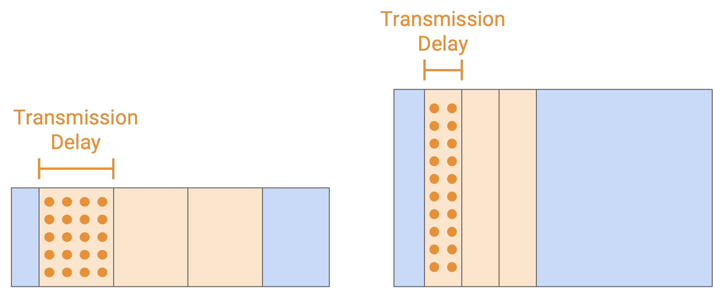

缩短传播时延，会让管道矩形变窄；高度不变，分组矩形形状也不变。别忘了，分组高度表示每个时间步送入多少比特，宽度表示把它全部送入所需多久。

分组宽度不变，说明发送时延没有改变；链路矩形面积缩小，说明其在途容量变小。

增大带宽，则使管道更高，每单位时间能送入更多比特。

分组形状也会变化：每单位时间送入更多比特，所以分组更高；同时更快完成发送，所以分组宽度，也就是发送时延，减小。

> **图文范围说明。** 原文引入段写“比较三条链路”，固定快照的原图 1-67 实际呈现两幅带宽对照图；缩短传播时延的情况由上述文字解释。没有凭空补出所谓第三张原图。

## 过载的链路

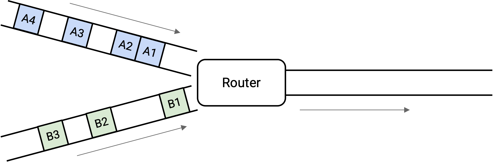

考虑分组抵达交换机的图景。交换机需要把它们全部转发到出链路。如果它有足够容量，在每个分组到来时及时处理，就没有问题。

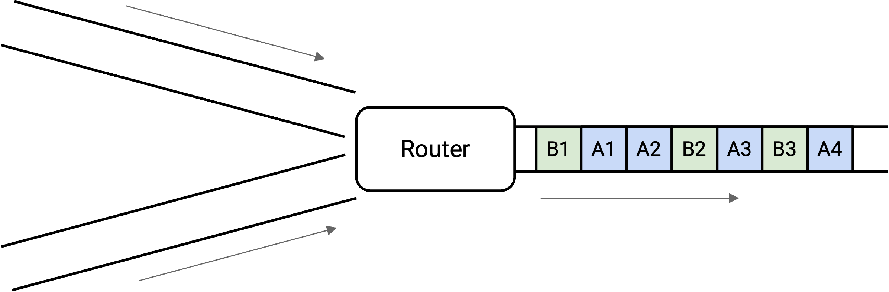

但如果变成下面这样呢？

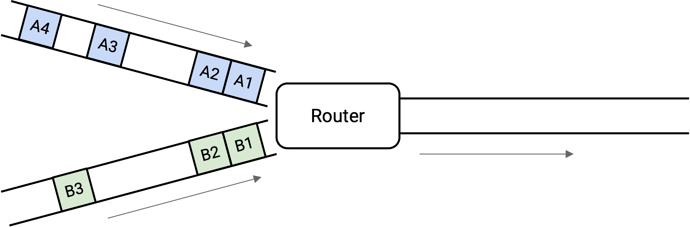

从长期看，出链路有足够容量发送全部分组；可在这个瞬间，两个分组同时到达，却只能发送一个。这称为**瞬时过载（transient overload）**，互联网交换机经常遇到。

应对办法是在交换机中维护分组队列。两个分组同时到达时，先发一个，另一个暂时排队。

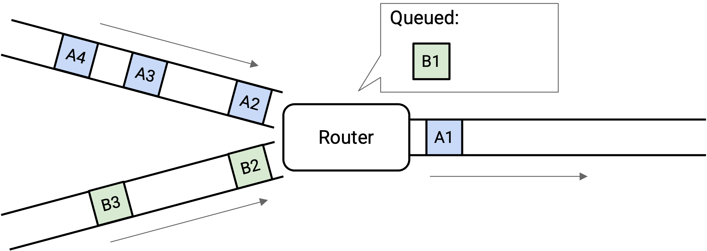

在任何时刻，交换机可能从某条入链路取一个分组发送，也可能从队列中取一个。这个选择由**分组调度（packet scheduling）**算法决定，后续将研究多种设计。

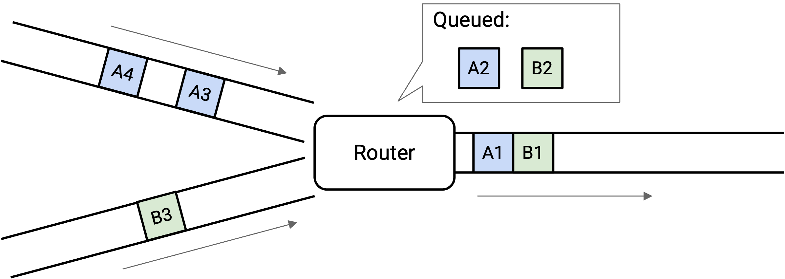

没有新的分组到来时，交换机就可以发送队列中的分组，逐渐排空队列。

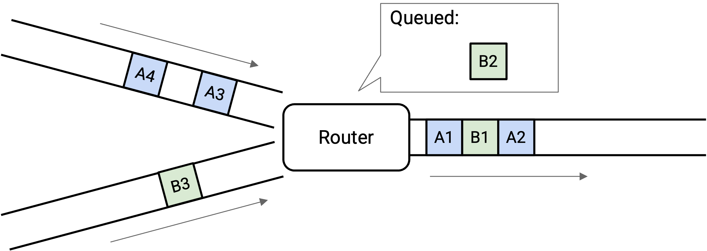

这样，队列就能吸收短暂突发。

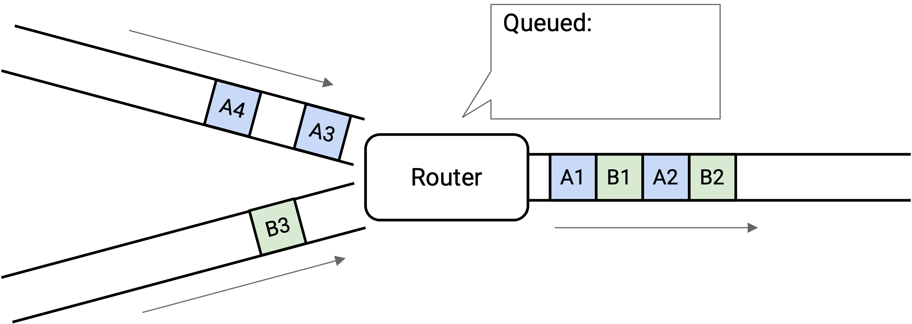

如果入链路一直像下面这样满负荷发送呢？

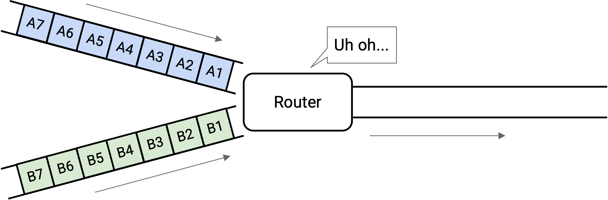

这就是**持续过载（persistent overload）**：出链路容量根本不足以支持输入流量。

即使把队列填满，也无法承载持续超过出口能力的负载。不管怎样，交换机最终都会丢分组。

如何处理持续过载？运营商需要合理配置链路和交换机。如果发现某处经常过载，可以考虑升级链路，这可能需要人工施工。

另一种办法是让路由器通知发送方减速，后续拥塞控制单元会研究这个方向。但对于有限容量，我们终究无法凭空消除所有过载，这也解释了为什么互联网只提供尽力而为服务。

有了排队概念，就需要更新分组时延公式：

$$D_{\mathrm{packet}}=\frac{L}{R}+d+D_{\mathrm{queue}}.$$

也就是发送时延、传播时延与排队时延之和。本节模型仍省略了设备处理开销。

## 本讲的共享指定阅读

课表中的 **Multiplexing** 指向 `intro/sharing-resources.html`，完整译文归属第 2 讲：[资源共享的设计](#/c/berkeley-cs168-2025/lec/lec02?v=materials)。阅读时应一并覆盖统计复用、电路／分组交换、四个比较维度和现实部署，不把相同章节重复翻译在这里。

## 引用与来源

- 作者：Peyrin Kao，依据 Sylvia Ratnasamy、Rob Shakir 等人的讲授。
- 完整章节：[Links](https://textbook.cs168.io/intro/links.html)。原图 1-57 至 1-75 均已保留，并新增中文图注。
- 固定来源：[commit 0b8208742d31df7fc3d53a0cd94fdd4e04f8d47e](https://github.com/berkeley-cs168/textbook/blob/0b8208742d31df7fc3d53a0cd94fdd4e04f8d47e/intro/links.md)，2026-10-01；这是较新教材快照，不是 Spring 2025 历史版本。
- 修改：全文中译、公式显式化、中文图注，并独立标注 50 字节／比特、11 秒／4 秒、图中链路数量和“发送时延主导”等原文问题。透明原图显示于白底以保证深浅主题可读。
- 译文及教材图像改编依 [CC BY-SA 4.0](https://creativecommons.org/licenses/by-sa/4.0/) 发布；许可依据为[教材首页](https://textbook.cs168.io/)。该许可不覆盖课程视频和幻灯片。
