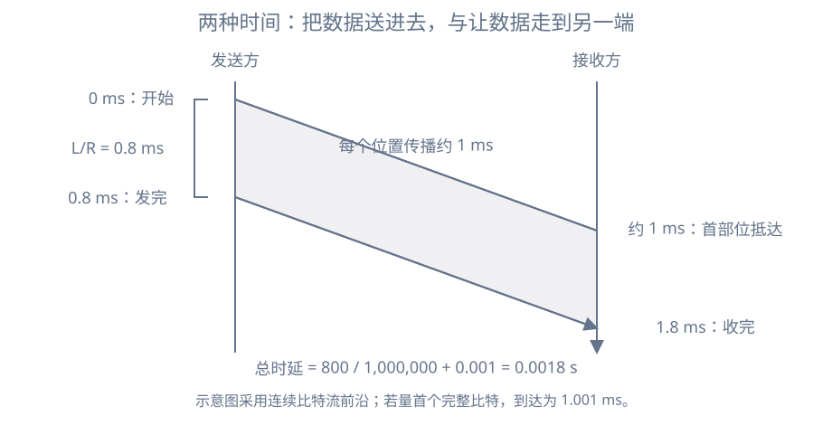
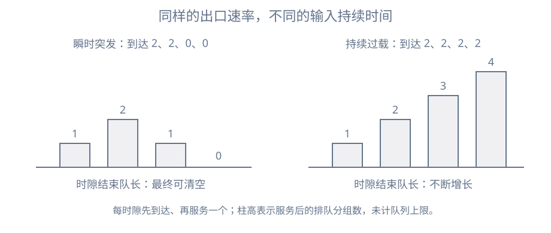

# 用时间轴理解链路与队列

## 一个公式，三个不同的问题

$$D_{\mathrm{packet}}=\underbrace{\frac{L}{R}}_{\text{发送}}+\underbrace{d}_{\text{传播}}+\underbrace{q}_{\text{排队}}.$$

这个公式要配合明确的计时边界：从分组等待发送开始，到接收端收到最后一个比特结束。$L$ 是比特数，$R$ 是 bit/s，$d$ 和 $q$ 是秒；暂不计处理开销。

三个项问的分别是：

- 要多久才能把分组全部送上出链路？
- 最后送出的那一部分还需多久才能走到对端？
- 开始发送前，前面的工作还要等待多久？

加带宽主要改变第一项，换短路径可能改变第二项，减负载和改调度可能改变第三项。它们不是一种名叫“网速”的东西。

## 1. 从最后一个比特推公式

例：100 字节分组、1 Mbps 链路、1 ms 传播时延。

$$L=100\times8=800\text{ bit},\qquad R=10^6\text{ bit/s}.$$

发送端从 $t=0$ 开始，到 $t=L/R=0.8$ ms 才把末比特完整送出。末比特再传播 1 ms，接收完成时刻就是 1.8 ms。

最常见的错误是对 800 个比特分别加 1 ms，好像前一个到达以后，下一个才能进入链路。实际上，它们可以流水传输：前面的比特还在路上，后面的比特已经进入。传播时延对整包完成时刻只需要在末比特后再加一次。

### “首比特”究竟是前沿还是完整比特？

连续流模型常把最前面的信号前沿到达写成 $d$。若按教材计算“首个完整比特”到达，则为 $d+1/R$。两种说法只要明确计量对象就不矛盾。

同样，从首比特开始发送到末比特完成发送是 $L/R$；从第一个完整比特完成发送到最后一个完整比特完成发送，则是 $(L-1)/R$。不要在同一推导中偷换起点。

## 2. 哪条链路更快，应该算临界包长

教材比较：链路 1 是 10 Mbps、10 ms；链路 2 是 1 Mbps、1 ms。先忽略排队。

设两者整包时延相等：

$$\frac{L}{10^7}+0.010=\frac{L}{10^6}+0.001.$$

解得 $L=10{,}000$ bit，也就是 1,250 字节。

- 小于这一长度，低传播时延的链路 2 更快。
- 大于这一长度，高带宽的链路 1 更快。
- 恰好这一长度，两条都需要 11 ms。

对教材的两个例子，代入即可：

| 大小 | 链路 1 | 链路 2 |
| --- | --- | --- |
| 10 B = 80 bit | 10.008 ms | 1.080 ms |
| 10,000 B = 80,000 bit | 18 ms | 81 ms |

这是编者补充推导，不是课堂出现过的另一道题。它比“高带宽适合大包”更精确：能直接知道多大算“大”。现实中还要考虑 MTU，10,000 字节应用数据未必作为单个普通 IP 包发送。

## 3. BDP 为什么是数据量，而不是时间？

$$\mathrm{BDP}=R\times d.$$

单位是 $(\mathrm{bit/s})\times\mathrm{s}=\mathrm{bit}$。在稳定满速发送时，它表示尚在链路中传播、未抵达另一端的比特量。

例如 5 bit/s、7 秒传播时延，满管最多容纳 35 比特。发送一个 50 比特分组时，整个分组比管道容量大，并不表示“不能发”：前面的部分先离开，后面的部分再进入即可，最终需要 $50/5+7=17$ 秒。

把“在途容量”误认为“最大分组长度”，就会错误地认为每个包必须小于 BDP。链路在传输期间不断收、不断发，并不是一次性把整包塞入封闭盒子。

这里的 $d$ 是单向传播时延。后面的滑动窗口问题可能使用带宽乘 RTT 表示维持双向反馈循环所需的在途量，不能把两种 BDP 的延迟口径混用。

## 4. 管道图必须同时保住两个面积

在教材的管道图中，纵轴是速率，横轴用时间尺度表示传播距离。因此：

- **管道矩形**：高度 $R$，宽度 $d$，面积 $Rd$。
- **某个分组矩形**：高度同为 $R$，宽度 $L/R$，面积 $L$。

这给出读图不变量：**换链路会改变分组的形状，但不会改变它的数据量。**

带宽翻倍：分组高度翻倍、宽度减半，面积仍为 $L$。传播时延减半、带宽不变：管道变短，但分组自身宽度不变，因为序列化时间没有变。

固定教材中有两个必须注意的错误：

1. 管道序列开头写“50 字节”，图实际是 50 比特，才会得到 17 秒。
2. 20 比特、5 bit/s 的例子写“发送之间 11 秒”，但发送时间应为 4 秒；11 秒是再加 7 秒传播后的完整到达时间。

在 [本讲材料](#/c/berkeley-cs168-2025/lec/lec03?v=materials) 中保留原图，并把纠错单列。课堂字幕也多次把 bit/byte、小数和“总时延／传播时延”混淆；本笔记以定义、课件数值与图中比特数交叉核对，不静默假装 ASR 完全准确。

## 5. 队列是时间缓冲，不是带宽生成器

令 $Q_t$ 为时隙开始积压，$A_t$ 为此时隙到达，出口每时隙最多服务 $C$。采用“先到达、后服务”的离散模型，暂忽略有限缓存：

$$Q_{t+1}=\max(0,Q_t+A_t-C).$$

若 $C=1$、$A_t=2,2,0,0$，从空队列开始，时隙结束队长为 $1,2,1,0$。平均负载允许清空，但前两个时隙仍会排队。

如果输入永远为 2，而服务能力永远为 1，那么积压持续增长。真实缓存有限，迟早丢包。这部分“持续过载”在本次视频中还没讲到，是完整教材与官方 slides 26–27 的补充。

### 一个连续速率估计

假设已经有 120 kbit 数据排在你前面，出口 10 Mbps，采用 FIFO 且暂不考虑当前正在发送的剩余数据，你至少还要等

$$q=120{,}000/10^7=12\text{ ms}.$$

这是等待时间，不是你的分组传播得更慢了。若增加缓存而不改变输入与服务速率，可以推迟丢包，却可能让等待更长。

队列位于具体输出竞争处。现实路由器可并行处理多个端口，本讲“两个包来了只能处理一个”的图景，是对单一瓶颈出口的简化，不是现代路由器一次只能处理全机一个包。

## 6. 接续上一讲：为什么预留状态使失败更难？

本次视频前约 34 分钟接着第 2 讲讲义，重点是交换方式的故障恢复、实现复杂度与历史。

如果只是逐包转发，路径故障后可以由路由机制寻找替代路径，端点不必重新申请一条资源电路。但这不保证没有短暂丢包，也不免除端到端重传。

如果已经沿途预留资源，路径失效则有三个不同任务：

1. 确认原路径不能继续承担预留。
2. 清理仍然存活节点上的旧状态。
3. 为新路径建立一致的新预留，处理新路径可能拒绝的情况。

课堂在反向确认例子中也出现了讲解自纠。学习时应抓住真正的问题：**A 没收到确认，不代表所有节点都知道预留失败；中间节点见过确认，也不代表 A 收到了。** 示例并不是完整可实现的预留协议。

资源共享指定阅读由第 2 讲持有：[完整译文](#/c/berkeley-cs168-2025/lec/lec02?v=materials)，这里不复制。对更完整的比较，请连着读故障、复杂度、有限范围专线与历史四部分。

## 7. 自测

1. 1,500 字节分组经过 100 Mbps、2 ms 的链路，无排队，总时延是多少？

$L=12{,}000$ bit，发送时间 $12{,}000/10^8=0.12$ ms，总时延为 2.12 ms。不是 1,500 除以 bit/s，也不是把 2 ms 乘以比特数。

2. 带宽翻倍但距离、传播速度不变，传播时延和 BDP 如何改变？

传播时延不变，BDP 翻倍。相同分组的发送时延减半，但整包总时延不一定减半。

3. 平均到达率小于出口速率，能否保证零排队、零丢包？

不能。短时集中到达会产生队列；有限缓存也可能被一次大突发耗尽。平均负载描述长期趋势，不给瞬时上界。

4. 20 比特、5 bit/s、7 秒传播时延，什么时候发完、什么时候收完？

从 $t=0$ 开始发送，$t=4$ 秒发完，$t=11$ 秒收完。此题正好检查固定教材的 11 秒误标。

5. 同一分组经过两条存储转发链路，可以直接把带宽相加吗？

不能。若完整收包后才能向下一链路发送，且忽略排队与处理，则完整到达时间为 $L/R_1+d_1+L/R_2+d_2$。这是编者补充，用来说明必须先确认存储转发或直通等处理假设，不能把单链路公式盲目搬到多跳。

## 课堂时间索引

| 时间 | 证据支持的内容 |
| --- | --- |
| 00:00–04:57 | 复习电路／分组交换、抽象、效率与突发性 |
| 04:57–18:18 | 故障恢复、预留状态、反向确认与拆除超时 |
| 18:18–30:09 | 四维比较、有限范围专用连接、商业化历史与用户适应 |
| 30:09–34:31 | 设计原则与资源共享总结 |
| 34:31–37:44 | 休息及非实质字幕 |
| 37:44–44:21 | 进入 Links，带宽、传播时延、BDP 与单位 |
| 44:21–52:37 | 800 比特例子的时序图与整包时延公式 |
| 52:37–57:30 | 大小分组的链路选择；距离与传播时延问答 |
| 57:30–76:49 | 管道图、50/20 比特例子、带宽变化与矩形宽度 |
| 76:49–81:46 | 单出口转发、同时到达与瞬时过载队列 |
| 81:46–82:54 | 说明超时下课、未完内容下次继续；末条字幕结束 82:27.520，最后约 26.48 秒无字幕 |

本次录像没有讲完 Links slides 的持续过载、学期预览与最终总结。它们在教材／课件中可读，但不能标成录像末尾“已经讲过”。未播放媒体，字幕空档不据此判定静音或无人提问。

## 引用与来源

- 教材 [Links](https://textbook.cs168.io/intro/links.html) 与共享 [Sharing Resources](https://textbook.cs168.io/intro/sharing-resources.html)，作者 Peyrin Kao，基于 Sylvia Ratnasamy、Rob Shakir 等讲授；固定版本为 [0b820874（2026-10-01）](https://github.com/berkeley-cs168/textbook/tree/0b8208742d31df7fc3d53a0cd94fdd4e04f8d47e)。完整翻译和原图在材料页；本页是独立推导与练习，教材衍生内容及自绘图依 [CC BY-SA 4.0](https://creativecommons.org/licenses/by-sa/4.0/) 分享。
- [官方 Links slides](https://docs.google.com/presentation/d/1NLcHY6V47ebSJzaxgeVIR0ZIPDjgccAnKiJet701s1Y)，完整读取 1–32 页 HTML；动画没有实际播放。slides 29–31 的预告讲次与最终课表不完全一致，课程导航应以 Spring 2025 最终课表为准。
- 视频 `jqprd49WDIc`：官方频道 CS 168 (Internet Architecture) at UC Berkeley，2025-01-30 上传，82:54；英语自动字幕全读，视频许可未知。本页不是视频全文译本，也没有以生成 SVG 冒充截图。
