# 一、路由导论

## 什么是路由？

假设机器 A、B 都接入了互联网。A 想给 B 发消息，但它们之间并没有直接相连的链路。A 应把消息发到哪里，才能让它最终到达 B？消息又会沿着网络中的哪一条路径到达目的地？本单元研究的**路由（routing）**就是为了解答这些问题。

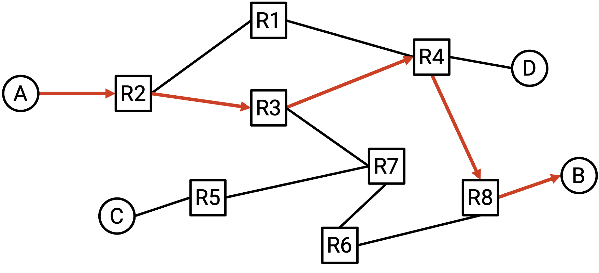

首先，我们将为互联网建立模型，把路由写成定义明确的问题；随后考察这个问题的答案是什么样，以及什么样的答案有效、什么样的答案更好。接下来研究能生成这些答案的不同路由协议，并说明如何借助寻址使协议扩展到整个互联网。最后，简要考察实现这些协议的实际硬件。

## 域间路由与域内路由

一种想法是：把世界上的每台机器都放进同一个模型，设计一个巨大的路由协议，让数据包能够到达任何机器。但是互联网的规模使这种办法在实践中不可行。

我们转而利用互联网是“网络的网络”这一事实。互联网包含许多局部网络；每个局部网络运行自己的路由协议，解决网络内部怎样送包的问题。再把这些局部网络连接起来，运行一个跨网络的协议，解决局部网络之间怎样送包的问题。

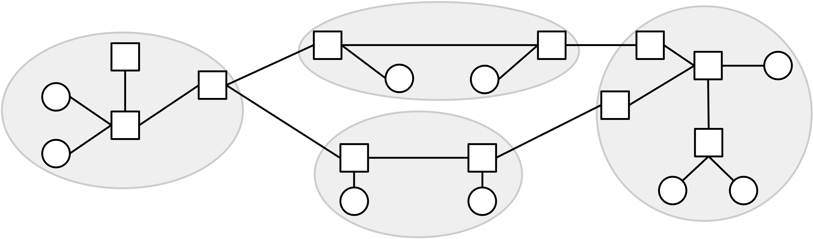

这些局部网络并不相同。它们的机器数量可能不同，物理覆盖范围也可能不同：例如整个伯克利校园，或仅仅一户人家。它们对带宽、可接受故障率、运维人员数量、基础设施的新旧程度，以及建设维护经费的要求也各不相同。因此，一个网络中有效的路由策略，在另一个网络里未必合适。

“网络的网络”模型允许各运营者自行选择最适合自己的内部策略。用于局部网络内部的协议称为**域内路由协议（intra-domain routing protocols）**，也叫**内部网关协议（IGP）**。现实中的例子有 OSPF（Open Shortest Path First）和 IS-IS（Intermediate System to Intermediate System）。

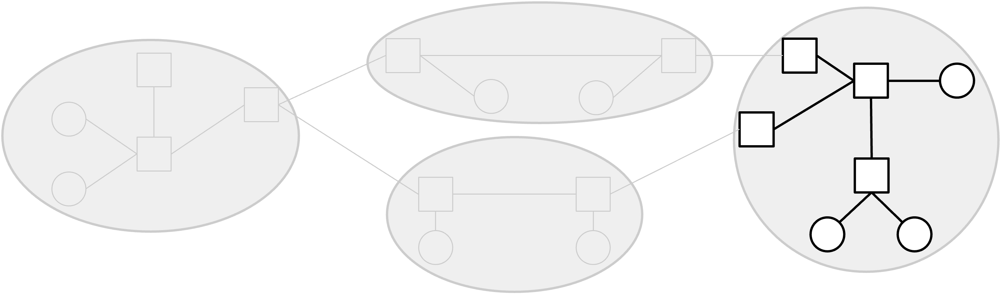

用于不同网络之间的协议称为**域间路由协议（inter-domain routing protocols）**，也叫**外部网关协议（EGP）**。为了让局部网络能够交换数据，各网络必须对跨网络协议达成一致。如果一个运营者只实现协议 X，另一个只实现协议 Y，就没有理由保证它们能够一致地互联。正因为大家需要采用共同的域间协议，互联网大规模部署的域间协议只有一个：**BGP（Border Gateway Protocol，边界网关协议）**。

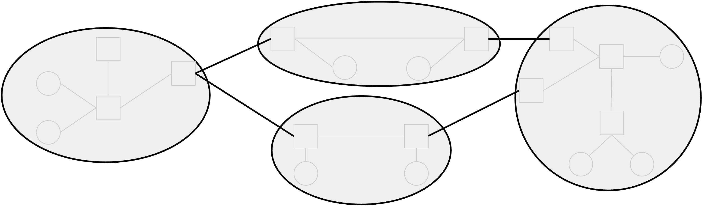

域内／域外的区分有助于建立直觉，但实践中界限并非总是清晰。例如，BGP 既用于网络之间，也可能在一个网络内部使用。

另一种分类维度是协议底层算法在做什么，而不是它部署在哪里。本单元将分别研究距离向量、链路状态和路径向量协议。

# 二、域内路由模型

## 把网络建模为图

为了形式化路由问题，先建立简化模型。上一单元中，互联网是一组机器和连接机器的链路。我们用**图**表示网络拓扑：每个节点是一台机器，连接两节点的边是一条链路。

历史上，一条链路有时连接两台以上的机器；本模型以现代点到点链路为主要抽象，通常假设一条边恰好连接两台机器。前面的图 2-002 同时展示了这个图模型及局部网络的边界。

## 全互连拓扑

两台机器 A、B 要通信，可以直接在它们之间增加链路。如果有五台机器，一种办法是在每一对机器之间都增加链路，让每台机器与其余每台机器直接相连。这称为**全互连（full mesh）拓扑**。

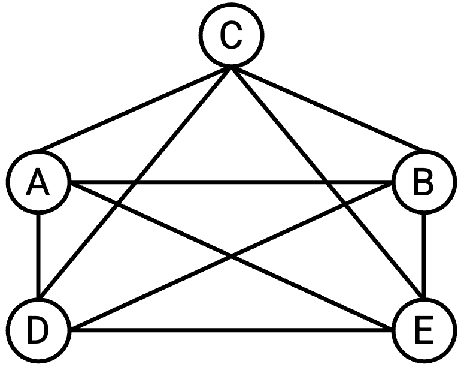

它有什么缺点？它难以扩展。如果把这种结构扩大到整个互联网，就需要在全世界每一对计算机之间连接一根线。每加入一台新计算机，都必须把它与世界上所有其他计算机连接起来。

不过，在规模较小的场景，全互连仍有优点：每一对机器有自己的专用链路，可以独占该链路的全部带宽。因此，网络可提供很大的总带宽。一般情况下，我们不保证每台机器都直接连接其他所有机器；底层图不一定是完全图。

## 单链路拓扑

另一种连接五台机器的办法，是让它们共用一条链路：

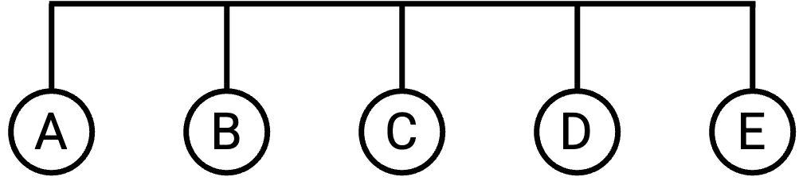

这里暂时放宽了“一条链路只连接两台机器”的假设。这种办法比全互连更容易扩展。例如，增加第六台机器，不必增加五条独立链路，只需把原有线路延伸到新机器。

代价是带宽受限：五台机器只有一条共同链路，必须共享它的带宽。要构建更丰富的拓扑，我们需要引入路由器。

## 路由器与终端主机

在简化模型中，把每台机器分为两类。

**终端主机（end host）**接入互联网是为了发送、接收数据。例如，运行浏览器的个人计算机，以及接收搜索请求、返回搜索结果的 Google 服务器。它们能产生发往别处的数据包，也能成为接收数据包的最终目的地，但通常不替其他目的地接收和转发中间数据包。

**路由器（router）**负责接收中间数据包，把它们转发得更接近最终目的地。例如家庭路由器和数据中心内的路由器。通常，用户不是为了与这些设备本身交流才发送数据，而是通过它们把数据送往 Google 等终端。它们不是这些用户数据包的最终目的地。

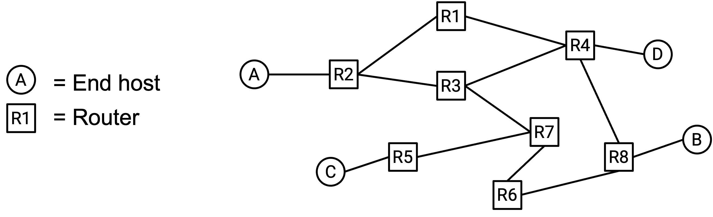

具体设计中，路由器也能是合法目的地；本单元暂时忽略把路由器当作目的地的情况。不过，路由器仍然可能作为源产生自己的数据包，例如协议消息。

教材有时也把路由器称为交换机（switch）。二者在历史上有区别，今天某些使用语境中会混用；本文尽量使用“路由器”。**编者注：**工程上仍常用二层交换／三层路由区分不同转发功能，不能把名称混用理解成两者永远没有区别。

图中，路由器通常是连接多个邻居的中间节点；终端主机通常连接一个或多个路由器。这些只是建模习惯，并不覆盖所有现实情形。教材尽量以方形画路由器、圆形画终端；实际网络图也会使用如下路由器图标。

## 带路由器的网络拓扑

引入路由器后，可以构造下图这样的拓扑。

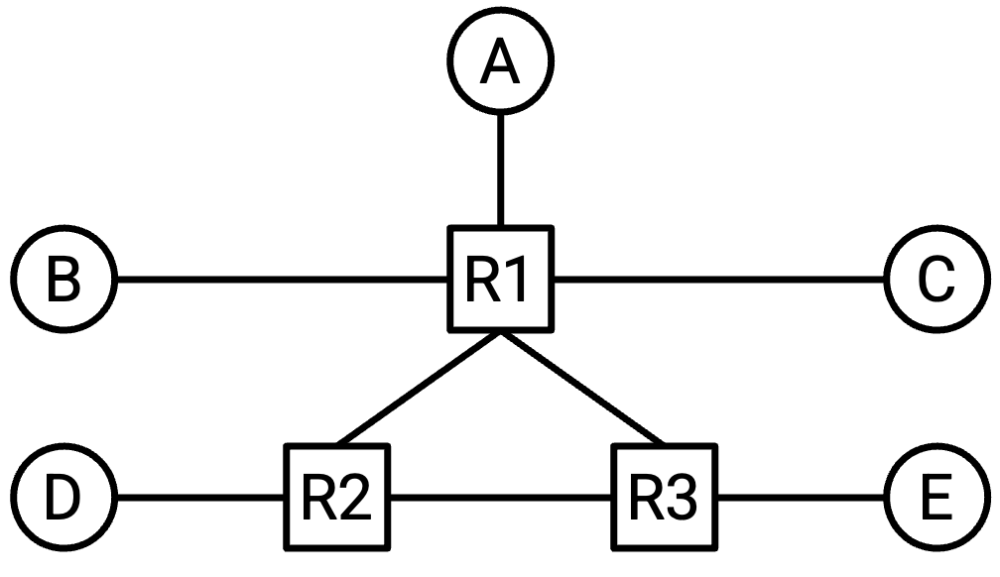

它结合了前两种拓扑的优点：链路数少于全互连，但可用总带宽又大于所有机器共享一条链路的情况。它对故障也更有韧性：一条链路失效后，数据包还可以沿另一条路径到达目的地。

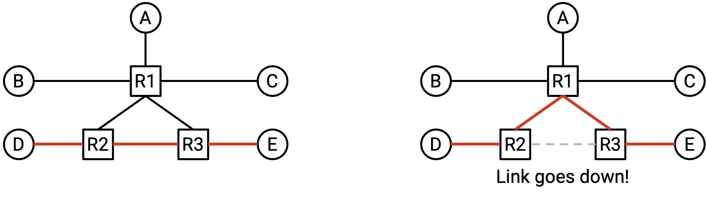

## 终端主机怎样参与路由？

终端一般不转发中间包，所以通常不参与路由协议。常见情况是终端用一条链路连接一个路由器，并默认把所有外发消息交给这个路由器，由它解决后面的路径问题。这种“全部交给某个路由器”的规则称为终端的**默认路由（default route）**。

因此，设计路由协议时，我们通常只把终端当作目的地；需要决定怎样到达这些目的地的是路由器。

## 数据包

应用想通过互联网发送数据时，会生成包含数据的包。包进入更低层协议时会被加上各层首部，首部中的元数据帮助它到达目的地。

本单元暂时忽略多层嵌套，只看一个首部和一个载荷。首部包含元数据，载荷包含应用数据。路由协议不关心载荷是图片、HTML 页面还是音频；对路由来说，它只是一串需要送到目的地的 0 和 1。

首部中最重要的字段是**目的地址**，它指定数据包最终要去哪里。路由器收到包后，根据这个字段决定怎样继续转发。这正是路由需要解决的核心问题。

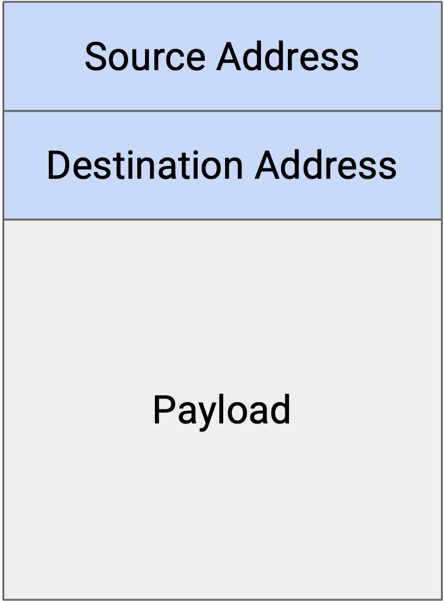

## 寻址

怎样把“目的地”写进包头？需要为网络中的机器分配地址的协议。本单元稍后研究可扩展的寻址方案；目前先给机器分配唯一标签，例如给三个路由器分别命名为 X、Y、Z，并暂时把标签当作地址。这样就可以先把路由和寻址分开思考。

现在可定义路由问题：**路由器收到数据包时，怎样知道把它转发到哪里，才能让包最终到达目的地？**

## 拓扑会变化

如果互联网是永不变化的固定图，也许直接观察整张图并计算路径就够了。但是，链路可能在不可预测的时刻失效，包必须改走别的路径；新增链路也可能提供更好的路径。路由协议必须能应对持续变化的网络拓扑。

## 路由协议是分布式的

即使我们愿意在图变化后重新计算，还有一个难点：路由器天生没有整个网络的全局视图。远处一条链路失效，其他路由器不会自动得知；协议必须负责传播有关新拓扑的信息。

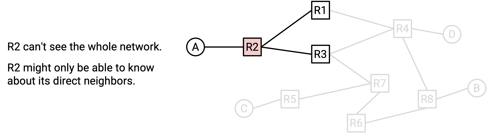

因此，路由协议通常是分布式协议：并非由一个中央“大脑”算出全部答案，而是各路由器在可能不知道完整拓扑的情况下，计算自己负责的部分。这些局部答案组合起来，必须构成能将数据送达的全局答案。

分布式还意味着必须处理单个路由器失效。如果唯一的中央计算机崩溃、忘掉答案，可以让它从头重算。分布式系统里，一个路由器崩溃只会丢失自己的那部分状态，协议必须让它恢复并重新学会正确状态，而不能假设其他节点都同时重启。

## 链路只提供尽力而为服务

第三层及以下提供的是尽力而为服务：包沿链路发出，不保证能抵达另一端；链路可能丢包。设计路由协议时，也必须处理协议消息丢失的问题。

# 三、路由状态

## 先看两种坏策略

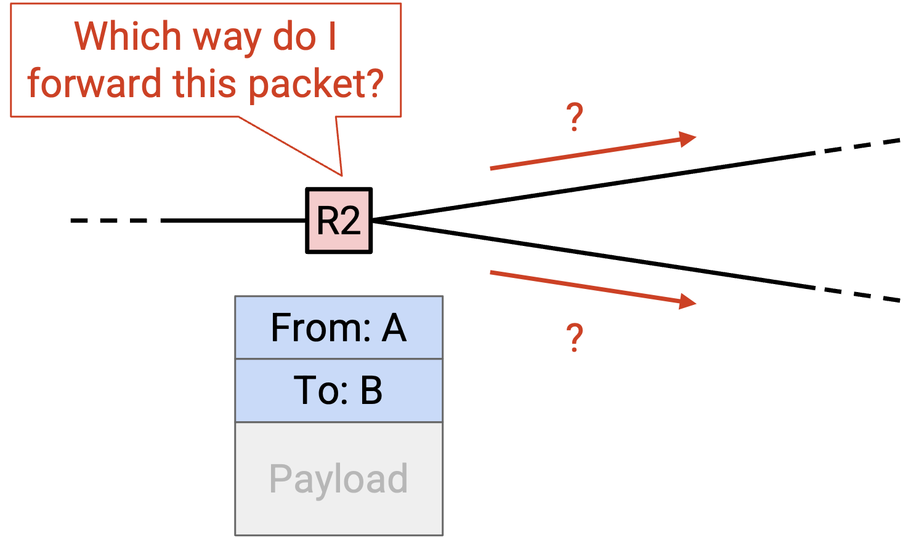

路由协议运行后产生的答案称为**路由状态（routing state）**。它是一组规则，规定各路由器怎样处理收到的数据包。我们需要知道这种答案长什么样，以及怎样判断它有效、优良。

一种策略是把包随机交给一个邻居。直观上，它不能保证包最终送达。另一种策略是向每个邻居都发送一份副本。副本也许会遍布整个网络，因而到达目的地，但会把大量带宽浪费在本来无须经过的路由器上。

要评价比这两种策略更聪明的协议，不能只靠直觉；需要形式化状态以及有效性和优劣标准。

## 转发表

路由器有若干条出链路，连接相邻路由器或主机。收到包后，它依据首部中的最终目的地，从相邻节点中选一个继续转发。这个紧接着接收包的节点叫**下一跳（next hop）**。

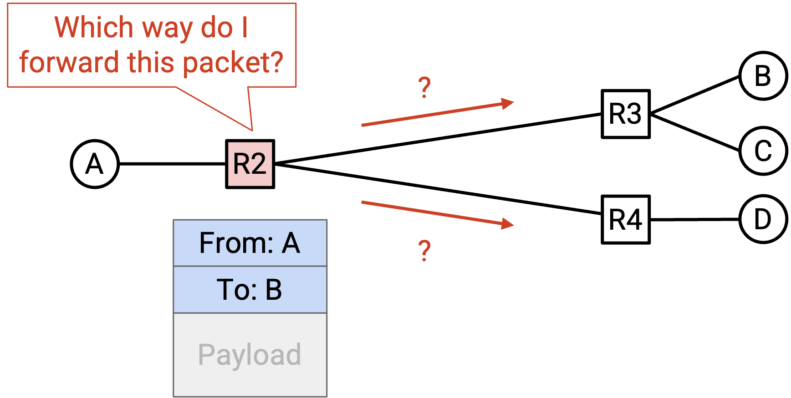

例如，R2 收到最终目的地为 B 的包，自然应选择 R3；若目的地为 A，则应朝 A 一侧转发。教材后续完整拓扑在 A 与 R2 之间还画有 R1，此时下一跳就是 R1。R2 不是直接把包送到最终目的地，而是从自己的邻居中选下一跳。

为每个可能的目的地记录相应下一跳，就得到**转发表（forwarding table）**。

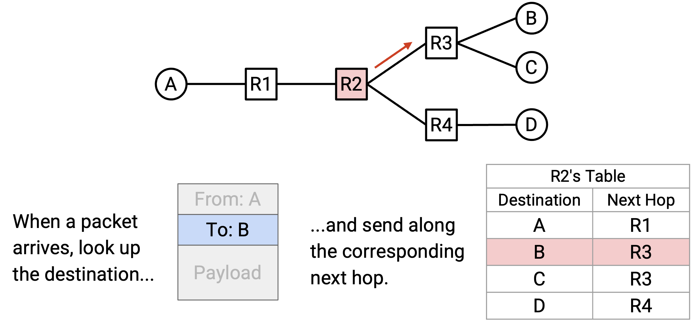

多个目的地可以使用同一个下一跳。例中，发往 B、C 的包都交给 R3。把所有路由器的转发表列出来，就得到了网络的完整路由状态：任意一个有确定目的地的数据包，经过每个路由器时会怎样被转发，都已确定。

物理设备的表通常不是“目的地→邻居名称”，而是“目的地→物理端口”。一个物理端口对应一条链路；在图上，相当于映射到边而非相邻节点。设备真正需要决定的是沿哪根线发包，并不需要关心那根线另一端的名称。教材为方便理解，通常继续画成目的地到下一跳的映射。

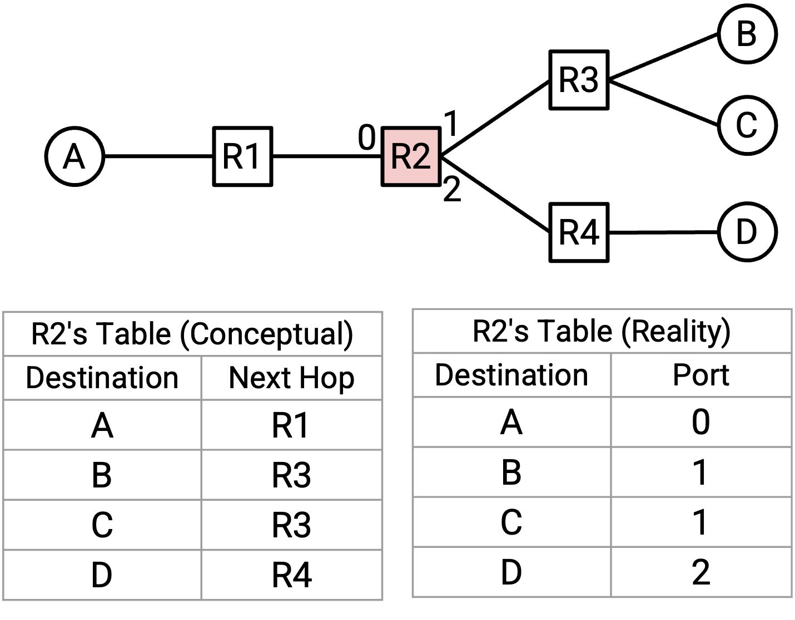

## 基于目的地的转发

使用这种转发表意味着：转发决策只依赖数据包的目的地址。在表不变的前提下，同一路由器收到的所有同目的地包都会交给同一个下一跳。因为每个目的地只有一个下一跳，本模型不允许这些包在同一路由器分成不同路径。这称为**基于目的地的转发／路由（destination-based forwarding/routing）**。

它是现代互联网最常见的转发方式。理论上也可以根据其他元数据决策，但一般只用于特定场景。后面的数据中心单元会允许一个目的地对应多个下一跳；本单元先坚持单下一跳假设。

## 路由与转发不是同一件事

**路由**是路由器相互通信，决定怎样填充转发表的过程。

**转发**是收到包、查现有表、把包发给相应邻居的过程。

转发不需要知道这张表是怎样产生的。它是局部操作，只需要当前包和本机转发表；路由器无须知道完整拓扑，也无须跟踪包交给下一跳后会怎样走。

相反，生成转发表需要非局部的信息，因此路由是全局问题。例如，填 R2 的表时，必须设法知道并不与 R2 直连的 B 位于 R3 那一侧。

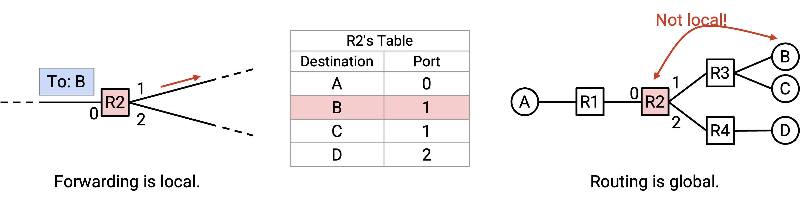

## 有效性必须全局判断

给定一组转发表，怎样判断它正确？本课程把能够保证转发决策最终把包送到目的地的性质称为**路由状态有效性（routing state validity）**；这个术语未必是课程以外的通用叫法。

只看某一台路由器的表无法判断有效性。即使看到“发往 A 的包交给 R3”，也不知道 R3 接着会做什么。

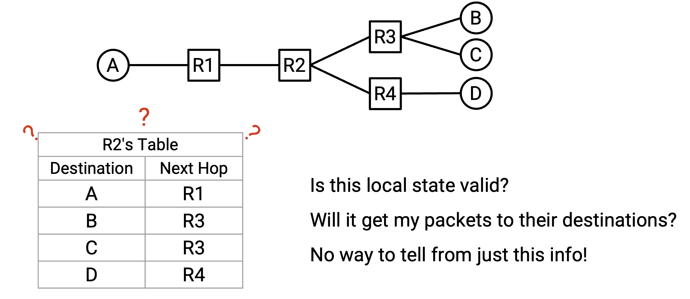

必须考察所有路由器转发表组成的全局状态。

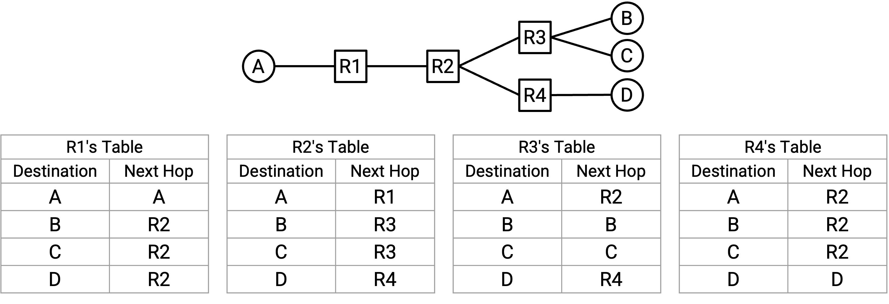

**原图勘误：**图 2-019 中 R3 到 D 的下一跳写为 R4，但所画拓扑中 R3 与 R4 不直接相邻，实际应先交给 R2。此图用于展示全局表的形式，不能把这个错误单元格当作合法转发示例。

## 有效性的充要条件

对于任意目的地，如果数据包既不会陷入**死路（dead end）**，也不会陷入**环路（loop）**，则全局路由状态有效；反之亦然。

死路指包到达某个中间路由器后，它不知道下一步怎样转发，例如表中缺少该目的地的表项，因此包停住。最终目的主机不转发不算死路：到达目的地后本来就不该继续转发。

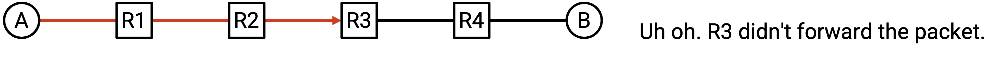

环路指包反复经过同一组节点。在本模型中，下一跳只依赖目的地；包第一次、第十次、第五百次回到同一路由器，都会得到相同决定。因此，只要表保持不变，进入环的包就会一直绕圈。

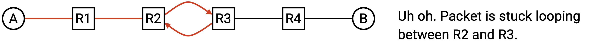

下面证明“无死路且无环路”与有效性等价。

**必要性：**若有死路，包在那里停止，不能送达。若有环，包被困在环里；最终目的地不会是环的一部分，因为目的地不再转发。因此，有效状态不能有这两种情况。

**充分性：**假设既无环也无死路。包不能重复访问同一个节点，又不能在到达目的地前停止，只能持续访问新节点。网络节点数有限，所以包最终必须抵达目的地。

**编者注：**这是在有限图、固定单下一跳转发表、链路可用且不计偶发丢包的模型中，对“可达目的地”的路径性质证明；不是尽力而为网络对每个真实包的可靠交付承诺。不可达目的地应被判为不可达，不能要求凭空建立路径。

## 有向投递树

先固定一个目的主机，暂时忽略其他终端。在每个路由器表中查这个目的地，把对应下一跳画成一条出箭头，就能看到所有可能的投递路径。

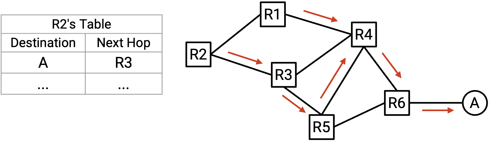

每个路由器只有一个出箭头，所以两条路径一旦汇合便不会再分叉。即使有多条入边，最终也共用唯一的出边；路由器只看目的地，不看包从哪里来。

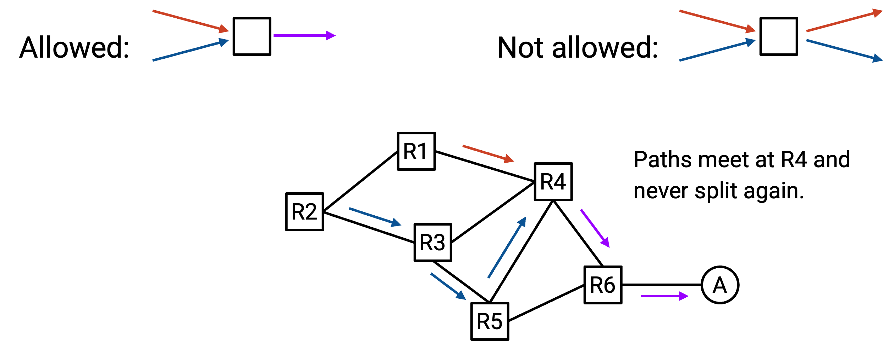

这些箭头构成的路径集合叫**有向投递树（directed delivery tree）**。有效投递树在图论上是一棵以目的地为根、边全部指向根的有向生成树。

“树”意味着不能有环；“生成”意味着覆盖每个需要到达该目的地的节点；“有向”表示边上的箭头说明转发方向。从任意节点顺着箭头都必须能走到根。

## 怎样检查有效性

1. 固定一个目的地，如 A，忽略其他终端。

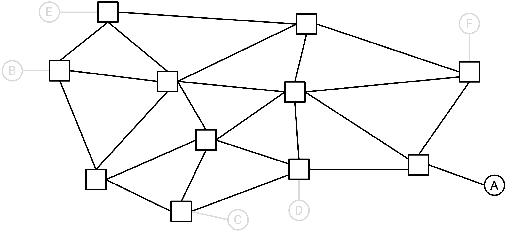

2. 根据各路由器转发表，每个路由器画一个出箭头。

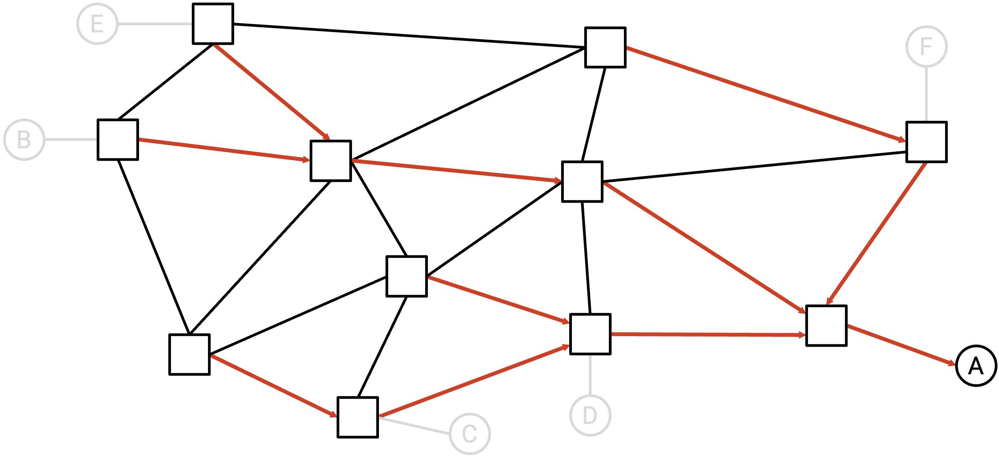

3. 删除没有箭头的链路，因为它们不会用于向 A 转发。

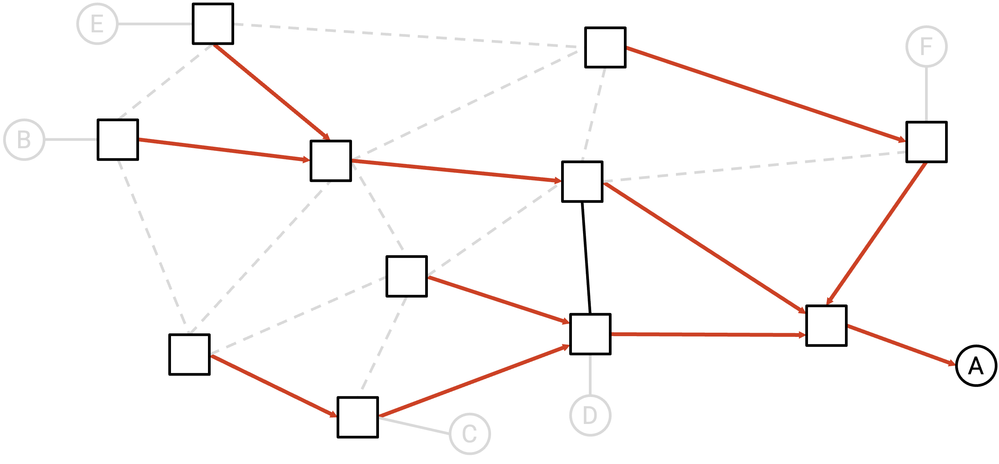

4. 检查剩余图是否是所有箭头朝向目的地的生成树。上例满足条件，因此对 A 有效。

下面两个例子无效。

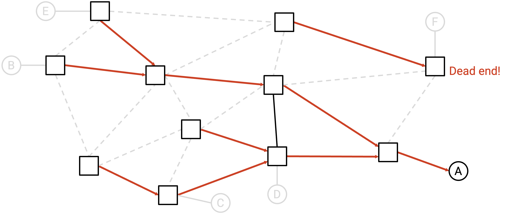

死路例中，一部分包会到达没有转发表项的节点而被丢弃。形式上，剩余图分成不连通的部分，不是一棵覆盖全部节点的树。

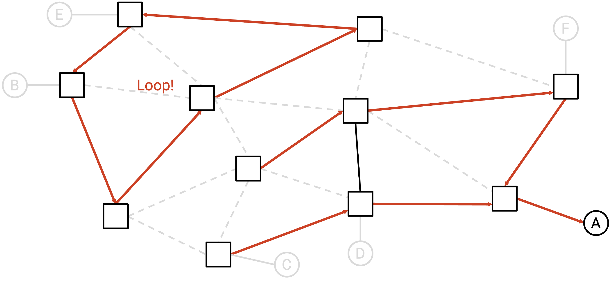

环路例中，剩余图既有环，又与通往目的地的部分分离。对每个目的地分别重复这个过程，只有全部目的地都通过检查，才称整个路由状态有效。

## 最小代价路由

有效状态不一定只有一个。为了比较不同有效状态，我们再定义“好”的标准。

**最小代价路由（least-cost routing）**为每条链路赋予数值代价，并让包沿总代价最小的路径到达目的地。

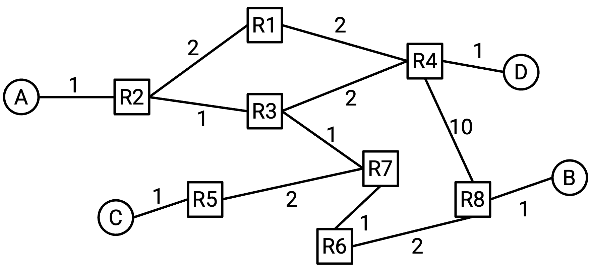

代价可以反映建设价格、传播时延、物理距离、不可靠程度、带宽等。例如，若希望优先选择高质量链路，可以由带宽和传播时延共同确定代价。运营者可以根据自己的目标配置权值：一条 400 Gbps、20 ms 的链路，与一条 10 Gbps、5 ms 的链路，谁更便宜，取决于想优化带宽、时延、两者的组合，还是其他指标。

若所有边的代价都是 1，最小代价就等价于经过最少链路，也叫最小化**跳数（hop count）**。教材中未标权的边默认代价为 1。

链路代价可以人工指定，也可以自动配置；不过有些指标不能由网络直接测得，例如建设费用。路由算法可以把“怎样定价”抽象出去：把别人提供的代价当作输入，计算最便宜路径，不必知道这些数字的现实含义。

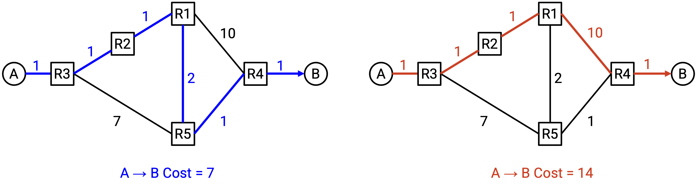

每个路由器只天然知道自己的出链路代价，不会自动知道所有远端链路的代价。这与没有全局视图的约束一致。

为简化协议，本单元作两项假设：

- **代价是正整数。**距离、费用等许多指标符合这个直觉；走过一条链路不会减少已经走过的物理距离。正权还避免负权环等问题：有负权环时，“不断绕环”反而会降低代价。
- **代价对称。**A→B 与 B→A 使用同一个代价，因此图上一条边只标一个数。教材据此简化协议；理论上可以处理非对称权值。

正权条件保证最小代价路径不会有环，因为绕环只会增加总代价，所以“最优”与“有效”的目标相容。**编者注：**实际网络可以使用定向或非对称度量；不要把本节的对称假设理解为所有现实协议的必然限制。

## 静态路由

运营者手动填写转发表称为**静态路由（static routing）**。单靠人工配置整个网络不够实际：不易扩展，也容易出错。不过，即使运行动态协议，仍然需要一些人工或本地生成的基础路由，可以把它们看成动态路由计算的“基本情况”。

如果某台机器与路由器直接相连，就可以为它配置直接转发的表项，称为**直连路由（direct/connected route）**。例如家庭路由器与个人计算机有直接链路，就能为计算机添加相应表项。该表项来自本地连接配置，不是从远端路由协议学来的。

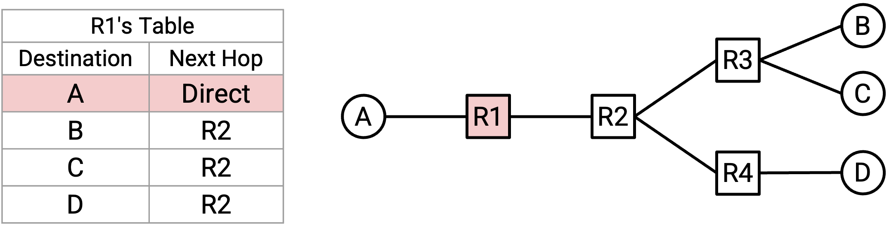

静态路由也可以指定非直连目的地。如果某条路径不会变化，希望它不受动态协议结果影响而一直保留，就可以手动硬编码这样的表项。

## 引用与来源

- 原著：Peyrin Kao，依据 Sylvia Ratnasamy、Rob Shakir 等人的课程讲授编写，*CS 168 Textbook*。
- 指定阅读：[Introduction to Routing](https://textbook.cs168.io/routing/intro.html)、[Model for Intra-Domain Routing](https://textbook.cs168.io/routing/model.html)、[Routing States](https://textbook.cs168.io/routing/solutions.html)。本文完整翻译三章的解释、例子、定义与证明，保留原图 2-001–2-031，中文图注为译者添加。
- 固定源版本：[0b8208742d31df7fc3d53a0cd94fdd4e04f8d47e](https://github.com/berkeley-cs168/textbook/tree/0b8208742d31df7fc3d53a0cd94fdd4e04f8d47e)，提交日期 2026-10-01；它是当前固定快照，不是声称恢复的 2025 历史教材。
- 教材[许可证据](https://textbook.cs168.io/#license)：[CC BY-SA 4.0](https://creativecommons.org/licenses/by-sa/4.0/)。本译文及对教材图的中文说明按相同许可发布。修改包括中文翻译、段落重排、图注，以及明确标注的模型边界与勘误说明；不代表原作者背书。
- 本文是教材译文，不是视频逐字稿；教材许可不延伸到课程视频或 Google Slides。

- 显示修改：教材透明原图采用白色底衬，确保深色主题中的黑色文字与连线可读；原图文件字节未更改，白底不是新绘制的课堂画面。
