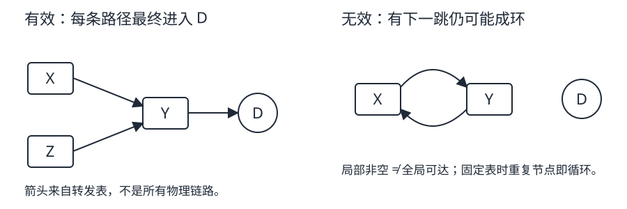

# 核心问题：每台路由器都“有下一跳”，为什么包仍可能永远送不到？

路由最容易被误解成“算一条路径”。真正困难在于：**每台设备只能执行自己的局部决定，而所有局部决定必须能拼成正确的全局行为；这些决定还要在丢包、故障和信息不同步时持续更新。**

本讲先建立判断答案的语言，再谈产生答案的算法。建议先能审查一组转发表，再进入 [L5 的距离向量](#/c/berkeley-cs168-2025/lec/lec05?v=notes)。

## 1. 为什么不能直接把所有计算机连起来？

如果 $n$ 台机器两两直连，需要 $n(n-1)/2$ 条无向链路。增加一台机器就要增加 $n$ 条线；专用带宽很好，建设与维护却随规模迅速增长。

如果全部共用一条链路，扩展布线容易，但共享带宽成为瓶颈。路由器让我们用中间转发连接更稀疏的图，保留多条可选路径与一定总容量，而不用让每对终端都有专线。

“有冗余链路”不等于“故障后已经恢复”：还需要协议检测故障、传播信息并更改下一跳。备用路径存在，只是恢复的必要资源，不是恢复过程本身。

## 2. 三个对象必须分清

设拓扑为有限图 $G=(V,E)$，固定目的地为 $d$。

- **物理图：**哪些节点之间有可用链路。
- **转发表：**节点 $u$ 对目的地 $d$ 选择的下一跳 $f_d(u)$，它必须是可用邻居。
- **路由状态：**全体节点的这些表项组成的集合，不是某台机器上的一个文件。

一次转发只执行 $u\leftarrow f_d(u)$；路由协议负责生成和更新 $f_d$。真实设备常把输出写成端口，而不是邻居名字。数据平面不需要重新运行全网算法才能处理每个包。

图为编者自拟，不是课堂截图。左边的两条路径在 Y 汇合后不再分叉；右边 X、Y 的表项都非空，却永远到不了 D。

## 3. 有效性定理要带上前提

先忽略偶发丢包，固定一个确实可达的目的地，假设拓扑和转发表在包行进时不改变，且每个路由器对这个目的地只有一个下一跳。

**命题：**所有节点最终抵达 $d$，当且仅当转发过程中不存在非目的地死路，也不存在环。

**必要性：**遇到死路就停止在错误位置；进入环后，因为决策只依赖目的地，下一次经过相同节点仍会作相同决定。

**充分性：**若未到目的地就不能停，又不能重复访问节点，就必须持续访问新节点。有限图中最多只有 $|V|$ 个节点可访问，因此最终只能在目的地终止。

这也说明检查方法：固定一个 $d$，只保留所有 $u\to f_d(u)$ 的箭头。除 $d$ 外每个节点出度为 1，且箭头最终都指向 $d$，便得到以 $d$ 为根的投递树。**拓扑本身可以有环，选中的转发图不能有环。**

错误终端也不能自动算成功。若包到达的终端不是其目的地，应按“非目的地终止”理解，而不是因为“它是主机”就免于检查。

## 4. 最优性比有效性更强，但不是同一性质

链路代价为正时，定义路径代价为边权之和：

$$C(P)=\sum_{e\in P}c(e).$$

设 U 到 D 有两条简单路径：`U–V–D` 的边权为 1、9，总成本 10；`U–W–X–D` 的边权为 2、2、2，总成本 6。两者都无环、可达，第二条跳数更多但更便宜。

最小代价路径不会含正权环：删除环可以严格减少总代价。这是从优化目标推出无环的一个证明。但“随便选一条无环路径”不保证最短；“每台节点宣称自己选最短”也不保证它们在**不同旧版本拓扑**上作出的决定能拼起来。

这部分教材属于本讲阅读，课堂实际上在 L5 开头才继续展开；不要把教材顺序当作录像时间轴。

## 5. 路由必须解决的三个信息问题

1. **变化：**链路、新节点、故障让昨天正确的表今天失效。
2. **局部知识：**远端失败不会自动出现在本地内存里；协议需要传播事实或计算结果。
3. **尽力而为消息：**更新包也会丢失，协议不能只发送一次便假设全网已知。

此外，单个路由器重启后可能丢掉自己的状态，其他节点并未同步重启。协议要支持局部恢复，而非要求全网回到统一初始时刻。

域内／域间描述部署边界，DV／LS／路径向量描述算法。两组分类不是一一绑定关系。BGP 常用于域间，也可部署在一个运营者网络内部。

## 6. 实现与建模陷阱

- **表非空不是可达性证书。**必须追踪依赖链，而不是只检查每个节点都有一行。
- **包 TTL 与路由寿命不同。**前者限制单个包绕圈，后者清理过时控制状态；丢掉绕圈包并没有修复错误转发表。
- **全局性质不等于集中式实现。**可以由分布式协议实现全局有效性。
- **默认路由不能凭空保证目的地存在。**它只是未匹配时的下一跳选择。
- **有效性不是可靠传输保证。**路径正确，仍可能因拥塞、链路错误而丢包。

## 7. 自测

① 三个路由器分别指向下一个，最后一个又指回第一个；每个端口都连接正常。这是有效状态吗？

不是。可用链路与完整表项只说明局部动作可执行；固定目的地的转发图中有环，无法保证送达。

② 两条到同一目的地的路径在节点 X 汇合后，能否在下一步重新分叉？

在本讲固定单下一跳、目的地转发模型中不能。X 对该目的地只有一个输出。多路径哈希、策略路由或表更新属于额外模型，不可偷偷用于反驳本命题。

③ 在有限网络中，只证明无环就够了吗？

不够。路径可能在没有该目的地表项的中间节点停下；还需排除非目的地死路。

④ 所有边权为 1 时最小代价意味着什么？若一条边权为 0，会影响哪个证明？

全为 1 时等价于最少跳数。允许零权后，“沿最短路距离严格下降”的论证不再直接成立，零权环需额外约束；这说明正权前提不能随意省略。

⑤ 一个路由器完全不知道目的地后面有哪些节点，为什么仍能转发？

因为转发只需当前目的地址与本地已安装的出口；远端信息的获取是此前控制面生成表的责任。

## 课堂回看索引

分块由已全文读取的自动字幕确定，显示四舍五入到秒；不是官方章节，也不是逐帧位置。完整字幕缺口见课堂整理和来源报告。

| 时间 | 核心问题／实际内容 |
|---|---|
| 00:00–19:26 | 开头 10.440 秒无字幕；随后承接上讲排队、时延与课程预告，并非本讲教材的时间线 |
| 19:26–33:11 | 为什么需要路由器？怎样简化网络？ |
| 33:11–46:06 | 网络变化、分布式知识、丢包与协议分类 |
| 46:06–49:09 | 宣布休息，稀疏无意义 cue 与字幕缺口；不据此断言静音 |
| 49:09–61:31 | 目的地转发、物理端口、routing 与 forwarding |
| 61:31–72:06 | 怎样从死路与环证明有效性？ |
| 72:06–81:21 | 投递树、有效图例与结束语 |

重点：**67:54–72:06** 对应有效性证明；**72:06–81:09** 对应投递树与图例。字幕最后结束于 81:22.679，超出元数据时长 1.679 秒；显示范围裁至 81:21，原字幕保持不变。

## 引用与来源

- 课程与视频对应关系：[CS168 Spring 2025 官方课表](https://sp25.cs168.io/)；已核对该讲独立 ID、标题、上传日期和 4881 秒时长。
- 指定教材完整译文：[L4 材料](#/c/berkeley-cs168-2025/lec/lec04?v=materials)，对应 *Introduction to Routing*、*Model for Intra-Domain Routing*、*Routing States*。作者 Peyrin Kao，基于 Sylvia Ratnasamy、Rob Shakir 等人的课程，固定 commit `0b8208742d31df7fc3d53a0cd94fdd4e04f8d47e`（2026-10-01），CC BY-SA 4.0。教材不是历史 2025 快照。
- [L4 slides](https://docs.google.com/presentation/d/1vog2mgvKPGx36gcLQF4gV1ebyGVEYBtOfnDRca9P7g0)：51 页完整可提取文本已读，未逐页观看课件视觉画面。本页图与推导为编者原创，教材图在材料页另行保留。
- 视频未知许可，因此课堂整理是独立中文学习摘记，不是授权全文译本。2050 条字幕已按原顺序全部读完，但音轨、视频画面、学生说话人身份和缺口中的内容未核验。教材最低成本／静态路由实际延至 L5，已显式区分。
