# 距离向量协议

## 算法轮廓

**距离向量协议（distance-vector，DV）**是三类路由算法之一，另外两类是链路状态和路径向量。它在互联网及其前身 ARPANET 中有很长的历史。典型实例是 **RIP（Routing Information Protocol）**；本章逐步设计的协议与 RIP 有许多相似之处。

先看下面的网络。开始时，每个路由器的转发表都是空的。目标是填好所有转发表，使包能够从网络任意位置到达目的地 A。

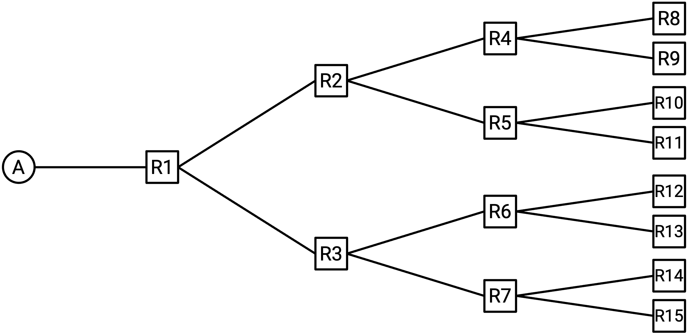

A 首先可以告诉 R1：“我是 A。”于是 R1 知道怎样向 A 转发。R1 再告诉邻居 R2、R3：“我是 R1，我能到达 A。”

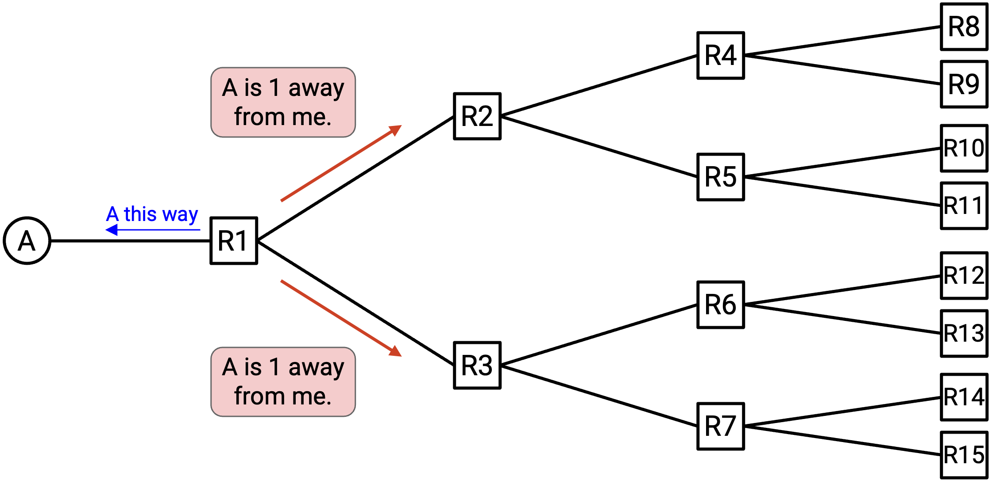

R2、R3 现在知道，把发往 A 的包交给 R1 即可。接着 R2 告诉 R4、R5 自己能到 A，R3 告诉 R6、R7 自己能到 A。

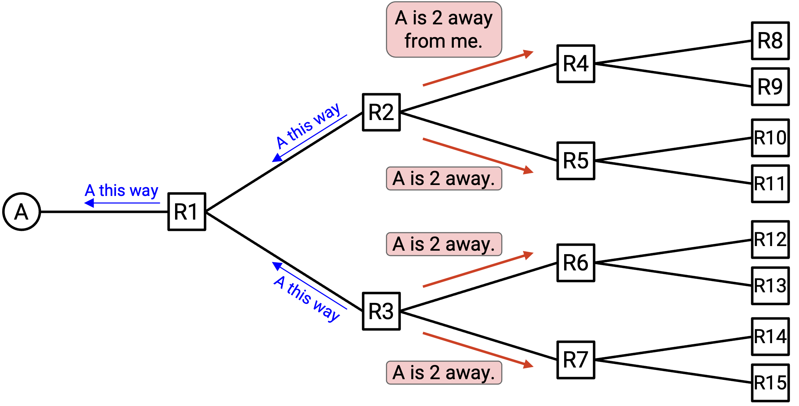

R4、R5 学到应向 R2 转发；R6、R7 学到应向 R3 转发。它们继续向邻居宣布自己的身份以及到 A 的可达性。最终所有节点都填好了表，能够把包朝 A 发送。

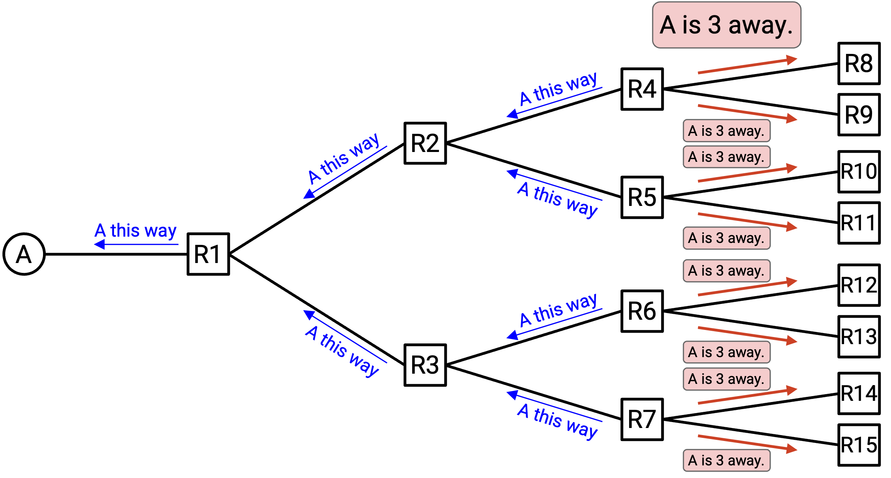

概括起来：听到某人说能到达 A，就记下消息是谁发来的；以后发往 A 的包便可交给那个人。自己既然有了到 A 的路径，也应该告诉邻居，让邻居有机会通过自己到达 A。

如果目的地不止一个，可以对每个目的地分别运行同一算法，转发表中便有多个目的地表项。本章为了清晰，主要研究单一目的地，但算法能扩展到多个目的地。

最初的规则是：对每个目的地，听到路径就更新表，再告诉所有邻居。下面会逐步修正这个过于简单的版本。

## 通告方向与数据方向

不要混淆两种消息的方向。关于“怎样到达 A”的路由通告从 A 开始向外传播。例如 B 对 D 说：“我是 B，发往 A 的消息可以经过我。”而真正发往 A 的数据包沿相反方向向内传播：从 D 先交给 B，再继续靠近 A。

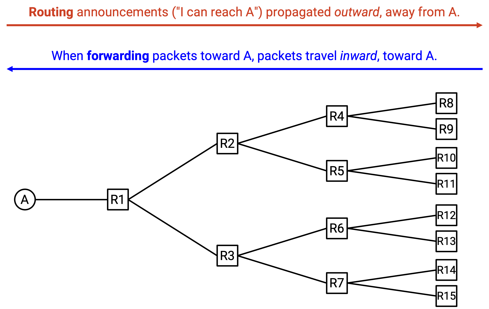

## 规则 1：Bellman–Ford 更新

如果到 A 有多条路径怎么办？

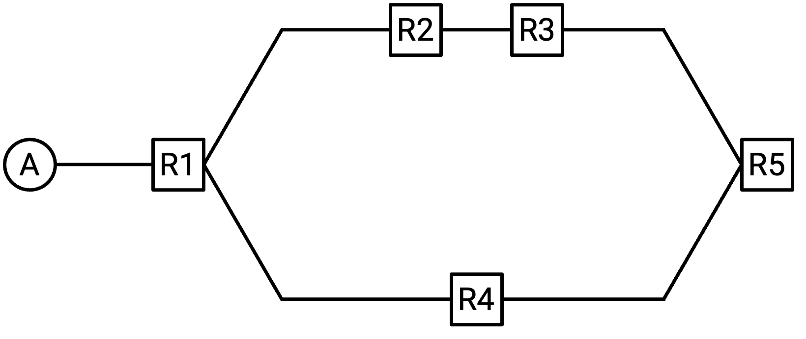

R3、R4 都能向 R5 宣布自己可到 A。R5 应选谁？我们的目标是最小代价，因此通告必须携带代价。R3 可以通告：“我是 R3，我到 A 的代价是 3。”R4 则通告自己的代价是 2。本例中 R5 到这两个邻居的链路代价相同，所以 R5 选择 R4。

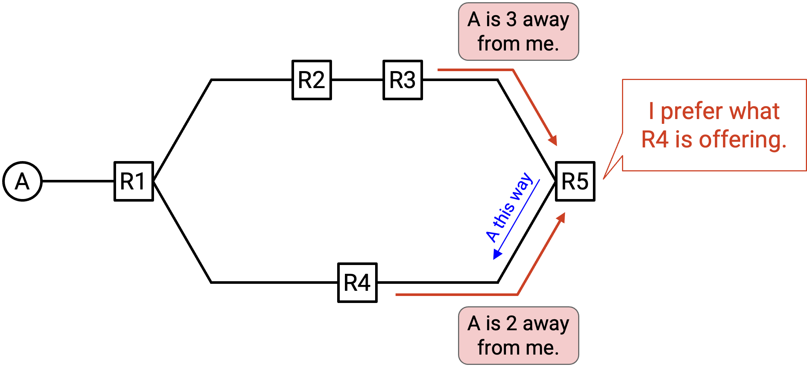

转发表现在需要记录目的地、下一跳，以及经该下一跳到目的地的最好已知代价。严格说，它是一个映射：目的地映射到 `(下一跳, 距离)` 二元组；图中为直观起见画成三列。

两条通告未必同时到来，所以应明确收到一条新通告时的三种情况。

1. 表中还没有该目的地的路径：接受。既然不知道怎么去，先接受别人提供的路径。

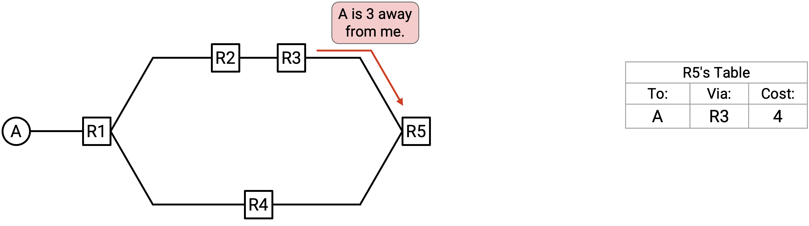

2. 新路径优于表中最好已知路径：接受，用新路径替换旧路径。

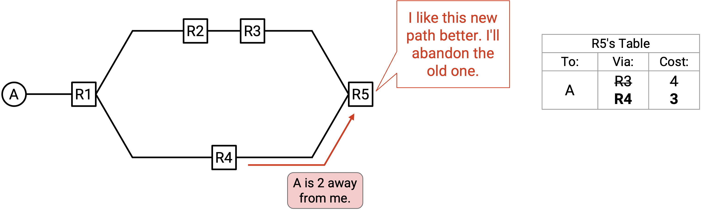

3. 新路径更差：忽略，保留原路径。

比较时不能只看邻居通告中的数字，因为各条本地链路代价可能不同。**经邻居到目的地的总代价 = 自己到邻居的链路代价 + 邻居通告的距离。**

例如，R1 说自己到 A 的距离为 5，而我们到 R1 的链路代价为 1，因此该候选路径总代价为 $1+5=6$。

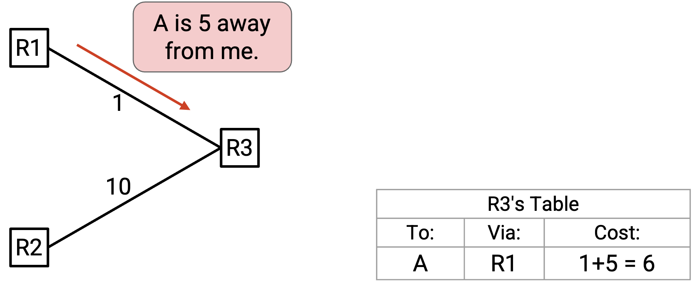

随后 R2 说自己到 A 的距离为 3，但到 R2 的本地链路代价为 10。这条候选路径实际是 $10+3=13$，比 6 差，所以不更新表，仍然向 R1 转发。

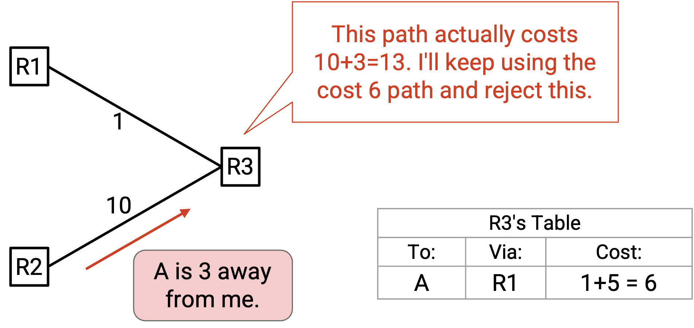

修正后的规则 1：目的地不存在，或者“邻居距离加本地链路代价”严格小于当前值时，更新转发表；更新后再通知邻居。

## 规则 1 的本质：分布式 Bellman–Ford

上面的运算就是最短路算法中的**松弛（relaxation）**。Dijkstra 算法使用松弛；Bellman–Ford 也使用松弛，而且形式更直接：反复遍历边并松弛，直到得到最短路径。

你也许在数据结构课（例如 Berkeley CS 61B）实现过这些算法，但集中式代码不能直接作为这里的路由协议。路由器没有完整图，也没有中央控制者；而且它们异步运行，没有谁能强制规定节点松弛或发送通告的先后顺序。

这里设计的是**分布式、异步 Bellman–Ford**：每台路由器不看全图，只填写自己的那部分答案；所有路由器可以同时计算，不依赖统一的执行顺序。

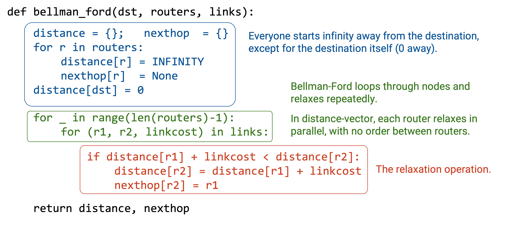

图中的集中式算法把除目的地以外的距离初始化为无穷大，目的地距离设为 0，下一跳初始为空；反复对边 `(r1,r2,c)` 检查 `distance[r1] + c < distance[r2]`，成立时更新 `distance[r2]` 和其下一跳。分布式版本用邻居通告提供 `distance[r1]`，由收到消息的节点完成自己的松弛。

虽然这里只画一个目的地，真实协议也能对所有目的地同时执行这种计算。

## Bellman–Ford 完整演示

“我是 R1，我到 A 的代价为 5”这样的消息称为**通告／广告路由（announcing/advertising a route）**。它携带三个重要值：目的地、通告者身份，以及通告者到目的地的总代价。通告者身份让接收者知道以后该把数据交给谁。

收到通告后，把本地链路代价加到通告距离上；若结果优于当前值，就把下一跳改成通告者，把距离改成这个和。如果表中没有目的地，则直接添加相应表项。每次改变表，都意味着学到一条新路径，必须向邻居通告自己的新结果。

现在逐步运行一遍。下图未标权，所以所有链路代价均为 1；唯一目的地是 A。

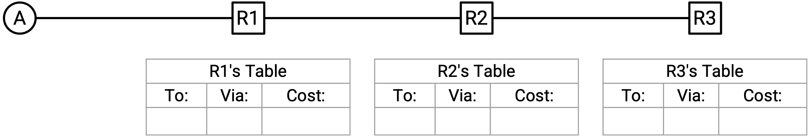

**第一步：**通过静态路由为 R1 配置到 A 的直连表项，下一跳是 A，代价为 1。

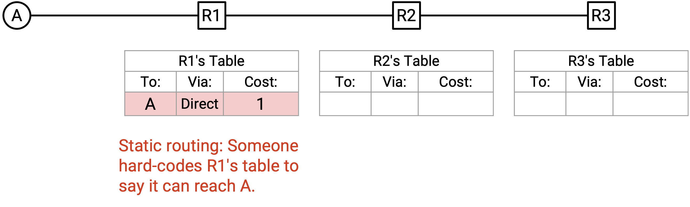

**第二步：**R1 的表变化，于是向唯一相邻路由器 R2 通告 `(目的地 A, 通告者 R1, 距离 1)`。R2 表为空，添加 `(A, R1, 1+1=2)`。

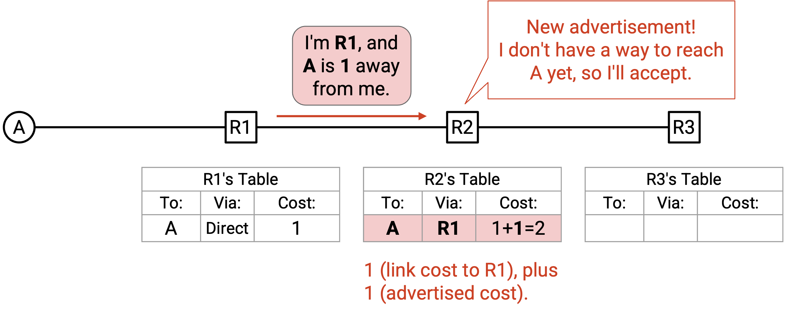

**第三步：**R2 的表变化，于是向所有相邻路由器，即 R1 和 R3，通告 `(A, R2, 2)`。当前版本确实也向刚刚提供路径的 R1 通告；稍后会重新讨论这件事。

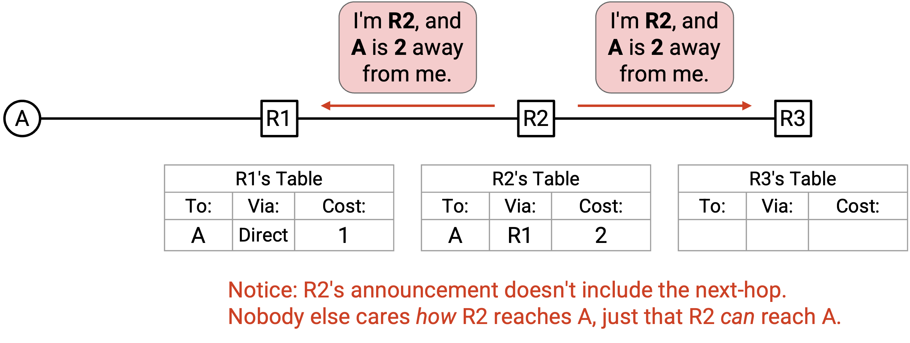

注意，R2 说的是“我能到 A，距离 2”，没有把自己如何到 A 的后续路径全部发出去。

**第四步：**R1 收到消息，比较现有距离 1 与候选距离 $2+1=3$。候选更差，所以忽略，表不变。

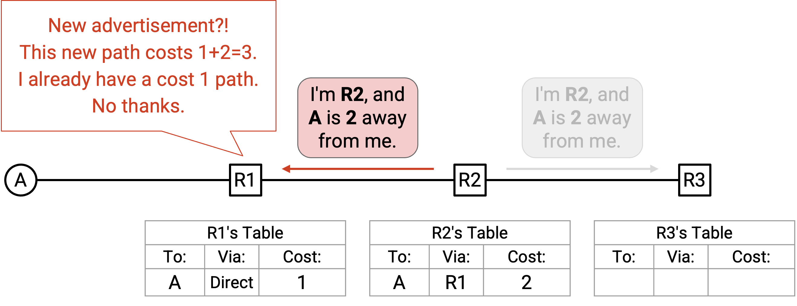

**第五步：**R3 也收到相同通告。R3 没有到 A 的表项，因此添加 `(A, R2, 2+1=3)`。

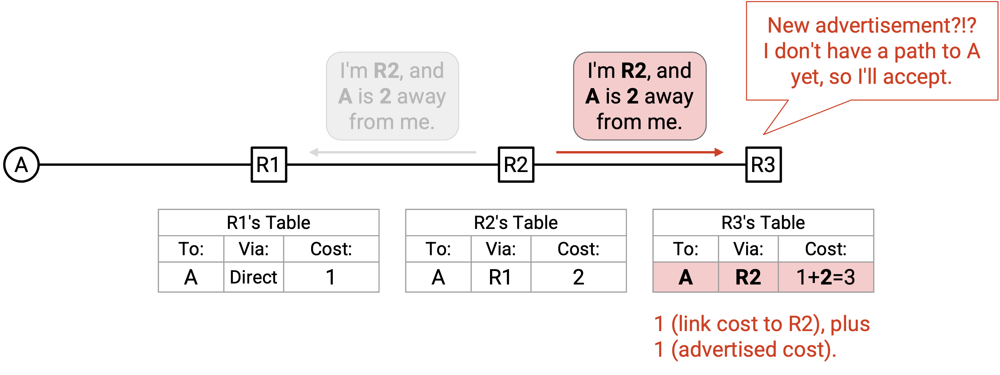

**第六步：**R3 的表变化，按照规则也必须向邻居 R2 通告 `(A, R3, 3)`。从全局视角看，我们知道这不会改变结果，但 R3 没有我们的全局视角，仍要执行协议。R2 比较现有距离 2 与候选 $3+1=4$，拒绝后者。

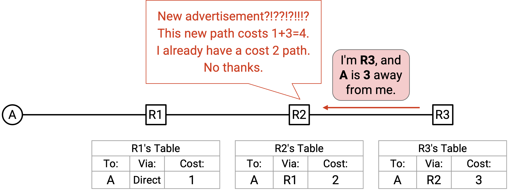

R2 没改表，因此不再触发通告。此时所有路由器都有到 A 的路径，转发表共同形成有效且最小代价的投递树。

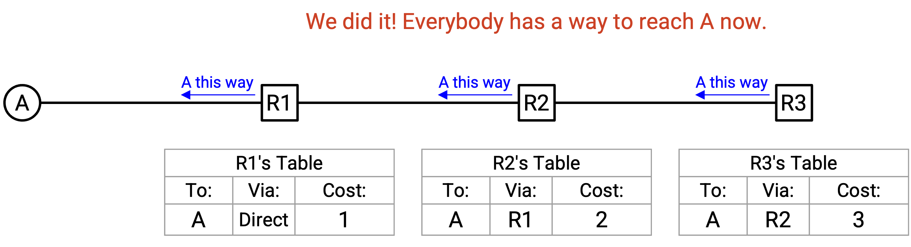

## 规则 2：必须接受当前下一跳的更新

网络拓扑会变化。假设 R2 通告自己到 A 的距离为 3，我们到 R2 的链路代价为 1；表原本为空，因此接受距离 $1+3=4$ 的路径。

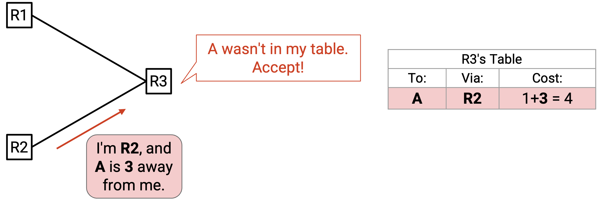

后来，R2 又通告自己到 A 的距离变成了 8。只按规则 1，我们会因为 $1+8=9>4$ 而拒绝它。

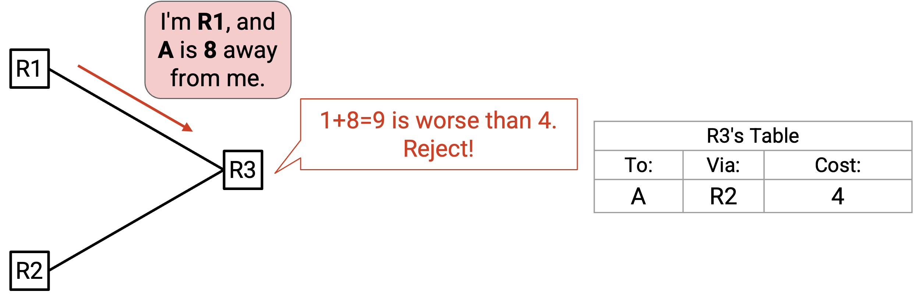

但这不是陌生邻居提供的一条更差备选路，而是**当前下一跳正在纠正自己的旧说法**：“你如果通过我走，现在到 A 的距离不再是 3，而是 8。”拒绝这个消息就会继续相信已经不存在的旧路径。

因此增加规则：**收到当前下一跳的通告，即使代价变差，也要更新表。**

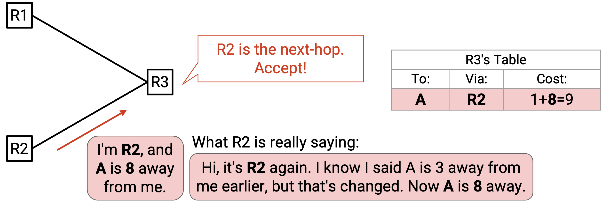

此时目的地与下一跳不变，改变的是距离。总的接受条件变为三选一：目的地不在表中；新路径严格更好；或者通告来自当前下一跳。

**图像勘误：**图 2-053 的气泡写成 R1，与正文和后续图的“当前下一跳 R2 变贵”示例不一致；本段按正文解释，图保留以便对照，不把图中的 R1 当成规则 2 的有效前提。

为了适应变化，协议持续运行。如果拓扑不变，最初一些松弛会成功、表会变化；最终大家找到最短路径，距离与下一跳不再变化，称为**收敛（convergence）**，收敛后的状态称为**稳态（steady state）**。此后再松弛也不会发现更短的路径。来自当前下一跳的相同通告仍可确认已有状态，而不改变路径。

若后来有路由器或链路失效，底层图改变，某些更新又会成功；经过一段时间，协议应再次收敛到新图上的最小代价路径。就像平静水面投入一块石头，会产生涟漪，随后重新平静。

## 规则 3：周期性重发

协议消息也可能丢失。回到刚开始的例子：R1 有到 A 的静态路由，R2、R3 表为空。如果 R1 唯一一次通告被丢弃，R2 永远学不到路径。

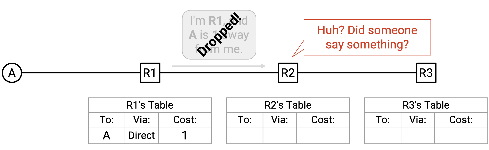

可以设计确认报文等更复杂可靠机制，但本章选择简单方法：**每隔一段时间重新发送通告**。协议定义一个**通告间隔（advertisement interval）**，现实中常见值为 30 秒。若间隔为 X 秒，就每 X 秒重发已有路由。

只要链路有时能正常工作，等待足够长、重发足够多次，通告最终有机会成功到达；如果它丢弃每一个包，任何方法都无法通过它传递信息，这种链路也不应继续视为可用边。此处依赖最终能送达更新的假设，而不是对任意丢包行为作无条件保证。

周期重发可以与“表变化后立即通告”并用。后一种叫**触发更新（triggered update）**。只用周期更新也可以收敛：先改表，等下一个周期再发布。但额外的触发更新能加快传播，既然已经知道变化，就不必等到下一轮。

稳态时仍然周期通告，不过不再改变已经最优的路径。例如 R3 重新向 R2 通告距离 3，R2 仍以当前距离 2 优于候选 4 为由忽略它。

## 规则 4：路由过期

链路和路由器可能失效；失效路由器不会主动告诉我们自己已经失效。于是我们可能一直保留无效路径。

解决办法是给每个动态路由表项一个有限的**生存时间（TTL）**，即还可以保留该表项多久的倒计时。当前下一跳的周期通告相当于确认路径仍存在：收到并接受它时，把该表项 TTL 重新充满。若网络失效导致确认停止，TTL 最终降到 0，便删除该表项。

下面以 R3 为观察者。$t=0$ 时收到 R2 的消息：“我是 R2，我到 A 的距离为 5。”表中没有 A，因此接受，总代价为 6，并把 TTL 设为 11。11 是本例任意选择的参数，实际值由协议或运营者设定。每个表项有自己的 TTL。

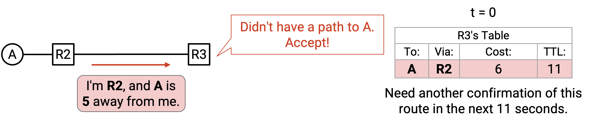

TTL 为 11 的含义是：未来 11 秒内必须再次收到 R2 对这条路径的确认，否则删除表项。时间经过，$t=1,2,3,4$ 时，TTL 分别为 10、9、8、7。

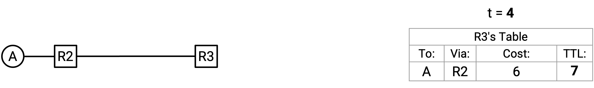

$t=5$ 时 R2 周期重发同一条路径。因为它来自当前下一跳，按规则 2 接受；确认路径仍存在，把 TTL 重置为 11。现在需在之后 11 秒内再次确认。

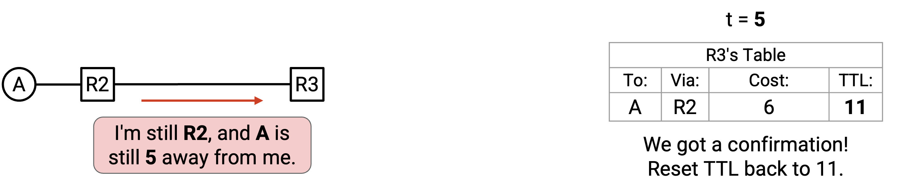

假设 $t=6$ 时 A–R2 链路失效，R2 删除到 A 的静态路由，也不再通告该路径。到 $t=16$，距离最后一次确认恰好 11 秒，R3 的表项 TTL 归零，删除表项。

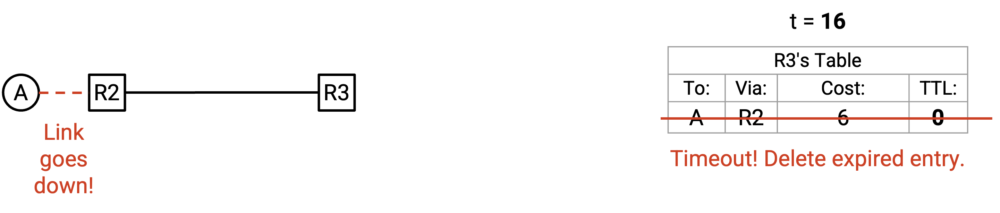

此时协议规则是：满足三个接受条件之一时更新表，**同时重置该表项 TTL**；表变化时以及周期到来时向邻居通告；表项到期则删除。

必须区分两个计时器：

- **通告间隔计时器**决定什么时候发送更新，通常整张表共用一个，触发时通告表中各条路由。本例间隔为 5 秒，因此 R2 在 0、5 秒发送。
- **路由表项 TTL**决定什么时候删除特定路径，每条路由独立计时。本例初始值为 11 秒，接受确认时重置。

这已经是大体可工作的协议，下面加入能改善故障后的收敛速度的机制。

## 规则 5：把过期路径毒化

只等待过期可能很慢。仍从 R3 看问题：$t=5$ 时已知经 R2 到 A 的路径，代价为 2，剩余 TTL 为 11。

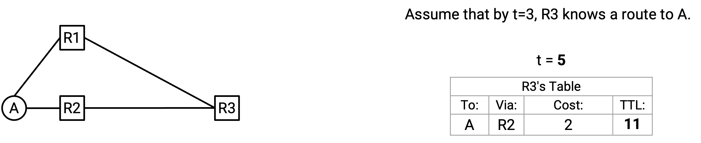

$t=6$ 时 A–R2 断开。旧表项实际已无效：继续把包交给 R2 也到不了 A。但 R3 还不知道，必须再等 10 秒。

同在 $t=6$，R1 通告自己到 A 的距离为 1。R3 已有“代价 2”的表项，所以会拒绝总代价同为 2 的新路径。本演示假定非当前下一跳的等价路径不会替换旧路。如果 R3 知道旧路已经断了，就能立刻接受新路；可是现在只能继续误用旧路。

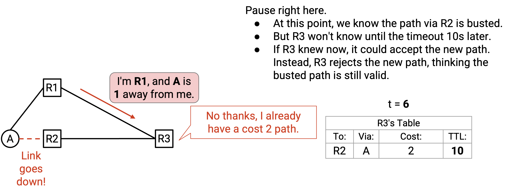

$t=11$，旧路 TTL 还剩 5 秒。R1 再次通告，R3 又因为相信旧路而拒绝。

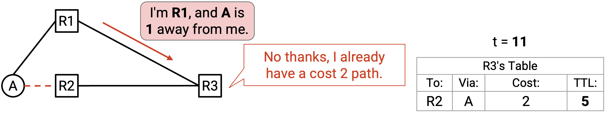

$t=16$，旧路终于到期删除。这时 R1 再次通告，R3 表中不再有 A，终于可以接受健康路径。

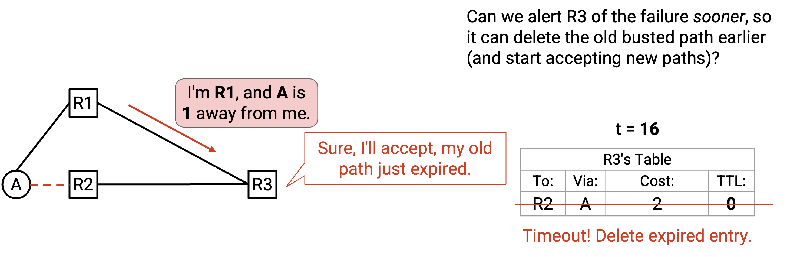

故障发生后的这 10 秒间，R3 发出的数据会丢失，还可能向其他节点继续通告坏路径，误导更多节点。问题在于：失败没有被明确报告，只能用超时推断。

解决办法是**毒化（poison）**：一旦能发现失败，就明确通告路径已失效。自然语言可以说“我是 R2，我已不能到达 A”；协议把它编码为“我到 A 的距离是无穷大”。无穷大表示不可达，不是一条特别昂贵但仍可转发的路径。

毒化通告按普通路径的规则传播。如果我们正向 R2 转发，收到 R2 的无穷大通告，便按规则 2 把距离改为无穷大，再告诉自己的邻居。这样，“路径失效”可以迅速传播，而不必逐跳等待超时。

重新演示：$t=5$ 的状态不变。$t=6$ 时 A–R2 断开；这次 R2 不再保持沉默，而是立刻向 R3 通告无穷大。R3 发现消息来自当前下一跳，于是接受并毒化自己的表项。

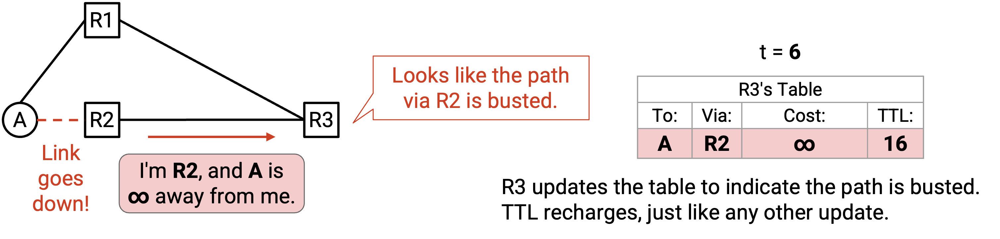

毒化表项也有 TTL，也可以向邻居通告。同在 $t=6$，R1 的距离 1 通告随后到达，候选总代价 2 小于无穷大，因此被立即接受，下一跳从 R2 改为 R1。

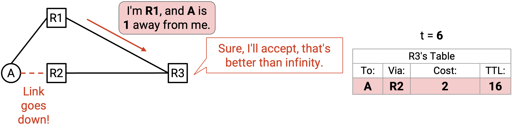

与此前相比，我们无需再等待 10 秒。6 到 16 秒间的数据现在可以正确抵达 A，也不会继续传播原来的坏路径；反而能把失效消息传给其他依赖自己的节点。

毒化的来源有两种：路由超时，或者检测到本地失败（如链路断开）。这时把相关表项距离设为无穷大，重置寿命，并通告邻居。收到当前下一跳的毒化通告时也要接受、更新与传播，因为这是下一跳告诉我们它已经不能提供旧路径。

转发逻辑还需同步改变：表中虽然存在 `(A, R1, ∞)`，也**不能**把发往 A 的包交给 R1。这条记录表示经 R1 不可达。

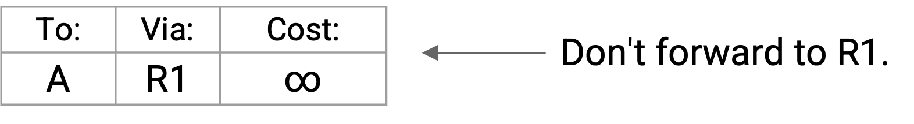

**图像勘误：**图 2-061–063 的部分表格把目的地 A 与下一跳 R2 写反；图 2-064–065 的 TTL 标注又与前文“11 秒剩余寿命”不一致；图 2-065 接受 R1 后的 Via 仍误写 R2。应按正文读作：目的地 A，旧下一跳 R2，新下一跳 R1；相对寿命在接受更新后重置。原图保留，不把这些排版值作为算法规则。

## 规则 6A：水平分割

回到直线拓扑 A–R1–R2–R3，假设已收敛：R1、R2、R3 到 A 的距离分别为 1、2、3，通告仍周期发送。

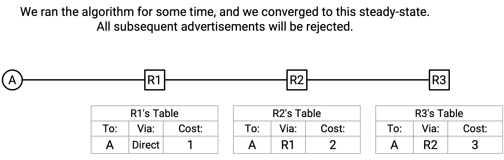

R1–R2 链路断开，R2 不再收到 R1 的通告，旧表项最终过期。在这个展示问题的版本中，R2 删除表项后表为空。

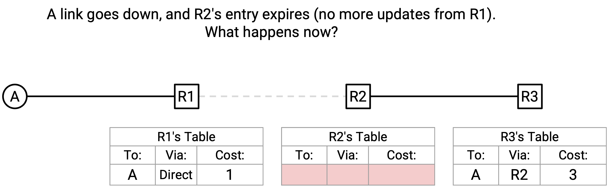

随后 R3 重新通告 `(A, R3, 3)`。R2 表为空，因而接受 `(A, R3, 4)`。

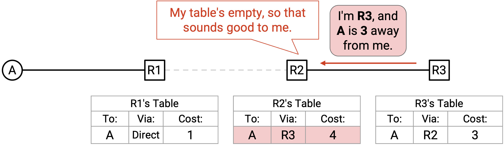

但 R3 的下一跳本来就是 R2。现在 R2 向 R3 转发，R3 又向 R2 转发，形成二节点环。

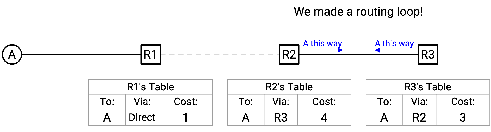

直觉上，若 Alice 给我一条路径，我就向 Alice 发包；如果我再把同一条路径提供给 Alice，她接受后会把包交给我，而我又交回给她。

拓扑不变时，这种通告通常无害：Alice 能看出“到我再回 Alice”的路比原路贵，因而拒绝。但是 Alice 一旦失去原路，我就可能骗她相信这是一条与她无关的备选路。核心问题是：她不知道我提供的路径实际依赖她本人。

**水平分割（split horizon）**因此规定：**不要把一条路由通告回提供这条路由的当前下一跳。**其他接受、定期通告和过期毒化规则不变。

## 规则 6B：毒性逆转

**毒性逆转（poison reverse）**是解决上述问题的另一种办法。在教材的简化选择中，水平分割与毒性逆转二选一：要么不向下一跳说这条路由，要么明确向下一跳说它不可达。

水平分割是沉默；毒性逆转则主动告诉提供路由的人：“不要把该目的地的数据交给我，因为我只会再交回给你。”因此向当前下一跳发送无穷大，而向其他邻居照常发送自己的有限距离。

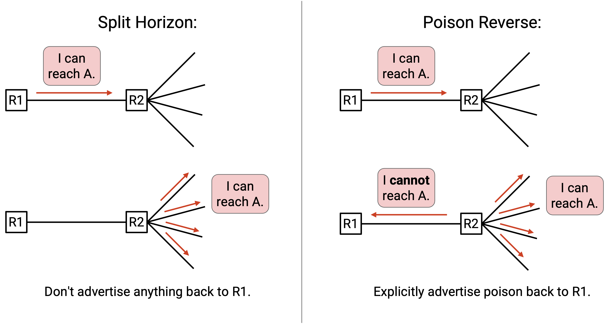

再次从稳定直线拓扑开始，R1–R2 失效，R2 的表项过期。

若没有修正，R3 会把距离 3 告诉 R2，造成环。若水平分割，R3 此时不向 R2 通告该路由。若毒性逆转，R3 明确向 R2 发送 `(A, R3, ∞)`。

R2 可以记录这条毒化表项，明确知道不能经 R3 到 A，因此没有形成转发环。

毒性逆转还可以更快消除已经出现的二节点环。假设某种原因使 R2、R3 已互为下一跳。使用水平分割时，双方都不向自己的下一跳通告，因此只能等待表项到期，在此之前数据可能一直绕圈。

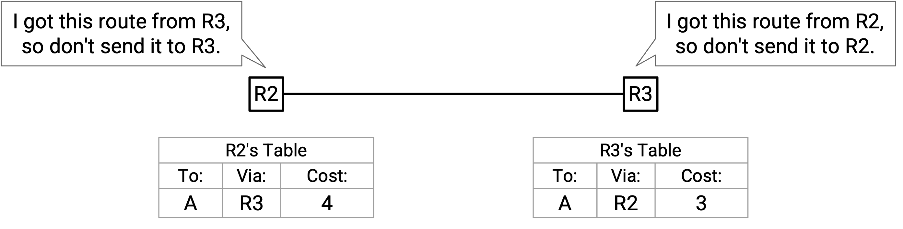

使用毒性逆转时，R3 会向 R2 通告无穷大。R2 的当前下一跳正是 R3，所以按规则 2 接受，立即使该路径不可转发，打断环。

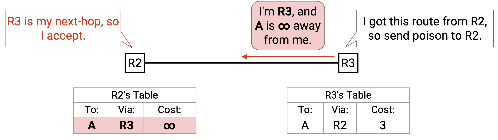

两种行为不能同时在同一次同一邻居通告中执行：不能既“不发”，又“发无穷大”。实际协议术语有时把后者叫带毒性逆转的水平分割；本章按两种互斥发送策略讲解。

## 规则 7：数到无穷大

水平分割或毒性逆转能处理直接相互依赖的二节点问题，但三个以上节点仍可能成环。

考虑下图：R1、R2、R3 构成三角形，A 直连 R3。稳态时 R3 到 A 距离为 1，R1、R2 都经 R3 到 A，距离为 2。

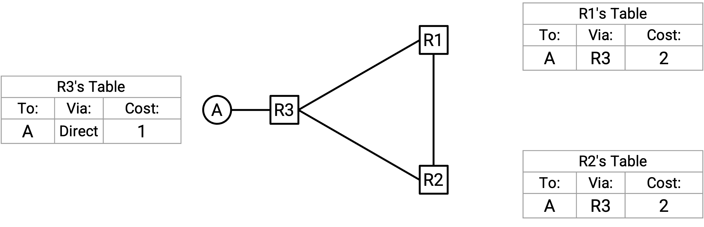

A–R3 失效，A 已不可达。R3 按规则 5 将自身距离改为无穷大，并向 R1、R2 发送毒化通告。

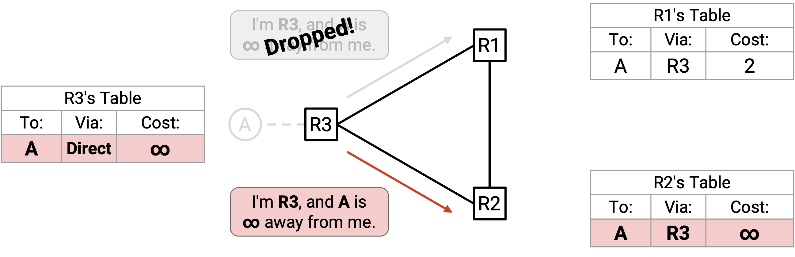

R2 收到当前下一跳的毒化并接受，所以 R2、R3 知道不可达。但是发往 R1 的那一份丢了，R1 仍相信能经 R3 到 A。毒化将来可以重发，但接下来的坏事可以发生在重发之前。

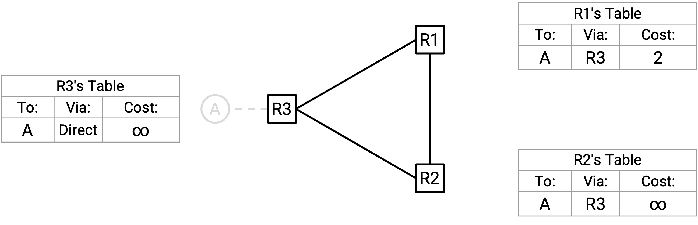

1. R1 通告自己的距离 2。水平分割阻止它向当前下一跳 R3 回告，却不阻止向 R2 通告。R2 没有有限路径，于是接受经 R1 的距离 3。

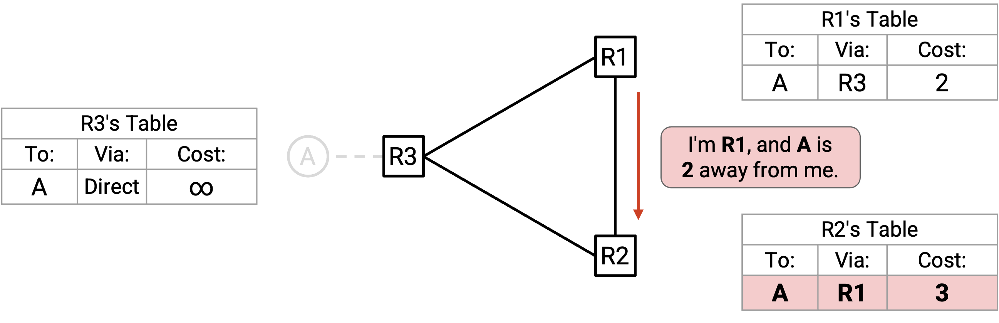

2. R2 把新距离 3 通告给 R3，不回告 R1。R3 原本不可达，于是接受经 R2 的距离 4。

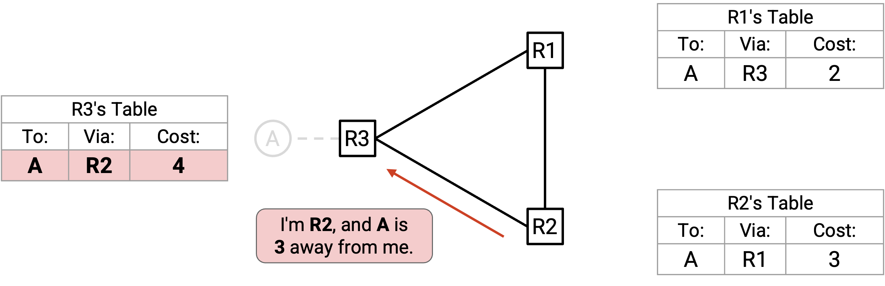

3. R3 向 R1 通告距离 4，不回告 R2。R1 的当前下一跳就是 R3，因此即使代价变差，也按规则 2 更新为 5。

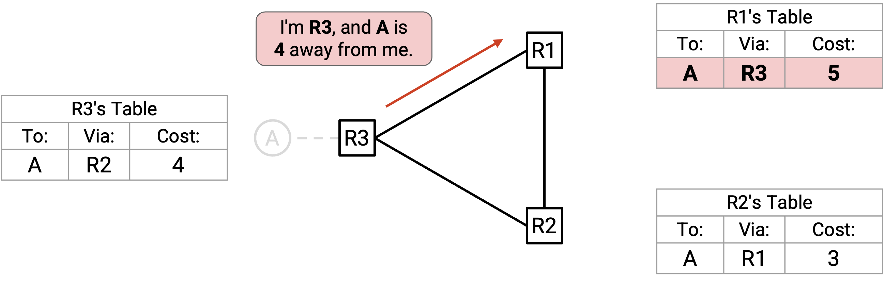

4. R1 再向 R2 通告距离 5。

5. R2 接受并把距离改为 6，继续向 R3 通告。图中同时展示了下一次 R3 更新为 7 的结果。

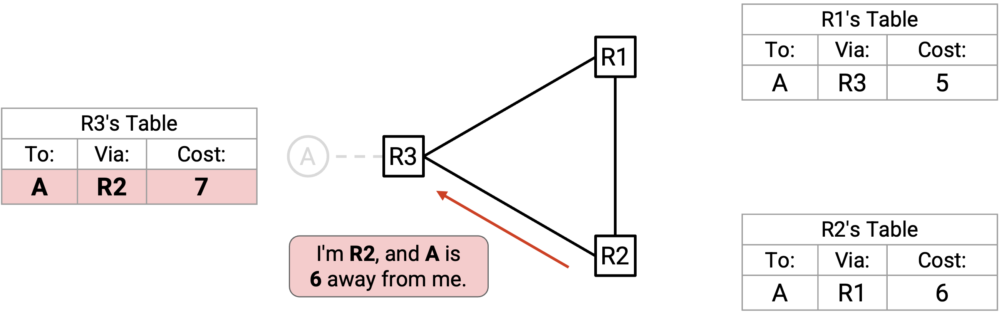

6. R3 的距离 7 通告使 R1 更新为 8。

7. R1 的距离 8 通告又使 R2 更新为 9。

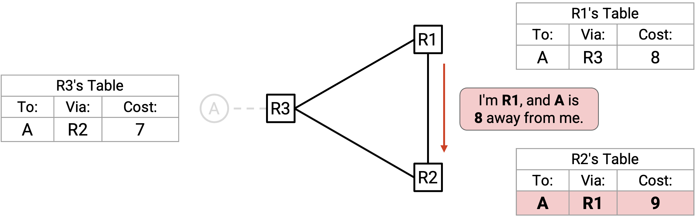

这些节点会不断沿环发送更大的距离，规则 2 又迫使接收者接受来自当前下一跳的更新。真正的数据包则在 R1、R3、R2 构成的转发环中循环。

问题源头是：毒化没有送到每个节点，其中一个节点仍有坏路径；坏路径再被绕环传播，各节点误以为是在学习彼此独立的路。

为什么水平分割没救场？因为它只禁止向**直接下一跳**回告，而本例中通告沿长度为 3 的环传播，每次都没有回告自己的下一跳。毒性逆转也无济于事：例如 R3 向 R2 发无穷大，R2 的当前下一跳却是 R1，它不会因为非下一跳提供一条更差的路而放弃当前路径。

这称为**数到无穷大（count to infinity）**。到目前为止，过期毒化、水平分割、毒性逆转都不能彻底解决它。

办法是强制设置有限的最大可用代价。RIP 的最大有限代价是 15；16 以及更大的值都视为无穷大。这样环仍可能存在一段时间，但不断增长的距离最终会触及不可达阈值。

继续上面的序列，若 R1 已到 14，它向 R2 通告后，R2 变为 15。

R2 向 R3 通告 15，R3 加上链路代价 1 得到 16，不再把它当作有限路径，而改记无穷大。

R3 向 R1 通告无穷大，R1 因为消息来自下一跳而接受。

最后 R1 向 R2 通告无穷大，R2 接受，所有节点都变为不可达。

网络重新进入稳态。后续无穷大通告不再改变路径状态；这些不可达记录可以在相应清理规则下删除，或者被新出现的有限路径替换。**编者注：**若实现把每次相互毒化都当成刷新并重新计时，就不能同时声称“它们一定自然过期”；毒化垃圾回收与刷新策略必须明确。这是简化教材规则尚未完全规定的实现边界。

## 汇总：最终规则

对每个目的地维护下一跳、代价和路由寿命。

1. 收到通告时，计算邻居通告距离与本地链路代价之和；有限上界之外统一视为无穷大。
2. 满足以下任一条件时接受，并按规定更新／刷新路由寿命：目的地没有表项；候选更优；通告者是当前下一跳。最后一条也包括更差的代价和毒化。
3. 表改变时触发通告；此外按通告间隔周期重发。
4. 对当前下一跳使用水平分割或毒性逆转：不发送该路由，或仅向该邻居发送无穷大；不要把正常有限距离原样回告。
5. 表项过期或检测到相关本地故障时，毒化并通告；无穷大表项不能用于数据转发。
6. RIP 示例中，任何达到或超过 16 的距离按不可达处理。

## 事件驱动更新

有三个时机会发送通告：

- **表发生变化。**这就是触发更新。变化可能来自新通告、新链路／新静态路由，或链路失效使路径被毒化。
- **周期到达。**每个通告间隔重发已有状态，弥补丢包。
- **表项过期。**旧路被毒化，需把不可达信息发出去。

触发更新是加速优化，而非唯一使协议正确的方式。即使不在每次表变化后马上发消息，也可以等下一周期再通告；不过“触发 + 周期”能把新信息尽早传播，同时保留可靠重发的机会。

## 引用与来源

- 原著：Peyrin Kao，依据 Sylvia Ratnasamy、Rob Shakir 等人的讲授编写，*CS 168 Textbook*，指定阅读 [Distance-Vector Protocols](https://textbook.cs168.io/routing/distance-vector.html)。本页覆盖从 Algorithm Sketch 到 Eventful Updates 的全部章节解释、规则、完整演示与原图 2-032–2-089；重复规则回顾在末节合并，未删去规则变化或反例。
- 固定版本：[0b8208742d31df7fc3d53a0cd94fdd4e04f8d47e](https://github.com/berkeley-cs168/textbook/blob/0b8208742d31df7fc3d53a0cd94fdd4e04f8d47e/routing/distance-vector.md)，2026-10-01，非声称恢复的 2025 历史版。
- [教材许可证据](https://textbook.cs168.io/#license)、[CC BY-SA 4.0](https://creativecommons.org/licenses/by-sa/4.0/)。中文翻译、中文图注及明确标注的编者勘误按相同许可发布；原图保留其固定快照内容。未修改原图中的已识别错误，以便审计。
- Lecture 6 复用本章，不另复制一份教材译文：[L6 故障与收敛笔记](#/c/berkeley-cs168-2025/lec/lec06?v=notes)。本文不属于课程视频译稿，教材许可不覆盖视频与 slides。

- 显示修改：教材透明原图采用白色底衬，确保深色主题中的黑色文字与连线可读；原图文件字节未更改，白底不是新绘制的课堂画面。
