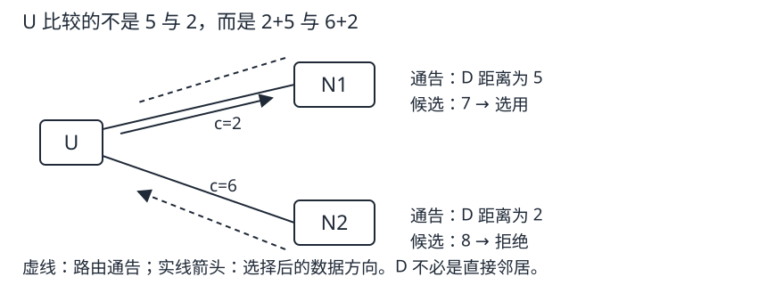

# 核心问题：不知道整张图，怎么知道该相信哪个邻居？

距离向量不是“把自己的整张地图发给别人”。它交换的是**计算结果**：我到某个目的地有多远。接收者只需补上与这个邻居之间的一跳，便能构造自己的候选路径。

本讲重点是规则 1–2 和静态环境下的收敛思路；丢包、超时、毒化与环路修复在 [L6](#/c/berkeley-cs168-2025/lec/lec06?v=notes)。完整教材只翻译一份，放在 [本讲材料](#/c/berkeley-cs168-2025/lec/lec05?v=materials)。

## 1. 从路径分解得到 Bellman 方程

设 $D_u(d)$ 是节点 $u$ 到目的地 $d$ 的最短距离，$N(u)$ 为可用邻居集合。任何非零长度路径都先经过某个邻居 $v$，所以：

$$D_u(d)=\min_{v\in N(u)}\{c(u,v)+D_v(d)\},\qquad D_d(d)=0.$$

这不是靠记忆猜来的公式：**把所有可能路径按第一跳分组，每一组的最好结果就是“一跳代价 + 邻居的最好后缀”。**

协议里收到的 $\widehat D_v(d)$ 未必是最新真值。它只是邻居上次发来的估计，所以节点实际处理的是候选：

$$q=c(u,v)+\widehat D_v(d).$$

转发表还必须保存取得当前值的下一跳；只有距离没有下一跳，不能转发，也无法识别“当前依赖者正在更正旧声明”。

图为自拟：经 N1 是 7，经 N2 是 8。不能只因为 N2 通告 2 比 N1 的 5 小，就选 N2。

## 2. 手算一组异步事件

自拟拓扑：D–A 代价 1，A–B 代价 2，B–C 代价 1，A–C 代价 7。目的地是 D。

- A 通过直连基础状态知道到 D 为 1。
- 若 C 先收到 A 的通告，先安装经 A 的距离 $7+1=8$，无需等待“全网计算完”。
- B 收到 A 的通告后安装距离 $2+1=3$。
- C 后来收到 B 的距离 3，候选 $1+3=4$，替换之前的 8。
- B 若收到 C 的距离 4，候选为 5，劣于现有 3，不替换。

最后 A、B、C 的距离为 1、3、4，下一跳分别为 D、A、B。通知顺序可以不同，中途状态也可以不同；在稳定、正权、充分传递更新的条件下，应得到相同的最短距离。等价路径的下一跳则可能依赖平局规则。

## 3. 为什么静态情况下能够收敛？

下面是编者对基本改善型算法的推导，不把它冒充课堂给出的完整形式化证明。

假设有限拓扑固定，权值为正，初始只知道目的地／直连路由，其余为无穷大；更新最终能沿每条必要边送达，并且只在找到更小值时替换。

**不低估：**每个有限估计由一条实际路径的代价构造，因而不小于真实最短距离。异步执行不会凭空造出低于最短路的合法路径代价。

**沿最短路传播：**取一条简单最短路，离目的地最近的节点首先能得知正确值；它的前驱最终收到该值后也能得到正确值。沿这条路径归纳，正确值会逐跳传到起点。

**正确值不再改善：**当值已经等于真实最短距离，没有更小的合法候选可替代它。因此全部节点最终稳定。

同步轮次的 Bellman–Ford 可用“第 $k$ 轮已经考虑最多 $k$ 条边的路径”理解。最短简单路径至多 $|V|-1$ 条边。但异步网络没有一个天然统一的“轮”，不能把 $|V|-1$ 直接当成秒数或收到的消息总数。

## 4. 为什么必须接受坏消息？

假设 U 当前经 V 到 D，V 通告距离 3，本地边代价 1，所以 U 记 4。后来 V 改口说距离为 8。如果 U 仍只接受更小值，就会永远保留 4，尽管其依据已经失效。

因此接受条件至少包括：

1. 尚无该目的地表项；
2. 新候选比当前路径严格更好；
3. 消息来自当前下一跳——即使它更差，也是在更新当前路径的事实。

第三条同时解释后面的 poison：当前依赖的邻居说自己到不了，不能拿旧距离拒绝现实。

**代价：**加入恶化更新后，前面的“距离只减不增”证明不再适用于故障过程。不能把静态改善算法的证明直接复制来证明动态 DV 一直无环。L6 的数到无穷大正是这个边界。

## 5. 直连、静态与传播的关系

分布式协议必须有事实起点。D 直连 A 时，A 的基础路由来自本地接口／配置，而非无限递归地“从某个邻居听说”。静态路由也可指向非直连目的地，但需要运营者保证指定下一跳合理。

通告从 D 附近向外传播，数据沿学到的下一跳反向靠近 D。通告者应宣告自己的距离和身份，不能让接收者误以为通告中保存的“通告者自己的下一跳”就是接收者应选择的邻居。

## 6. 实现陷阱

- 只比较 advertised cost，漏加接收端到发送者的链路代价。
- 新路径变优时只改距离，不改下一跳，造成数据面与控制状态分离。
- 当前下一跳代价变差时拒绝更新，留下不存在的“便宜路线”。
- 把每个相同周期通告都当作路径变化，反复触发无意义更新。后续要区分刷新寿命与改变路径。
- 把所有邻居的缓存版本当成同一时刻的真实图；它们实际上可能彼此不一致。

## 7. 自测

① U 到 X 链路代价 4、X 通告 2；到 Y 链路代价 1、Y 通告 6。选谁？

经 X 为 6，经 Y 为 7，选 X。下一跳选择必须比较本地完整候选代价。

② 当前经 X 距离 6，X 新通告使候选变成 12，Y 通告候选 8。两种消息顺序会怎样？

若 X 先到，先升为 12，再接受 Y 的 8。若 Y 先到，因 8 比当前 6 差而暂时忽略，随后 X 更新为 12；若只保存当前路径，需等 Y 再次通告才发现 8。保存所有邻居候选能改变反应速度，但属于不同状态设计，不能暗中假定已有缓存。

③ 为什么只知道距离不足以处理当前路径变差？

需要知道当前距离来自谁。来自其他邻居的较差备选通常可忽略，来自当前下一跳的较差消息却可能是对现有依赖的失效更正。

④ 稳态是否意味着网络不再发送任何路由消息？

不是。稳态指路径选择／距离不再变化；完整协议仍可能周期通告和刷新寿命。

⑤ “最终送达”与“每条消息都送达”有何差别？

收敛可以依赖重复传播，使必要更新最终到达，不需要保证每一次具体传输成功。但若某条必需链路永远丢包，就不能宣称该图上的路径必然被学到。

## 课堂回看索引

| 时间 | 实际内容／回看问题 |
|---|---|
| 00:00–01:41 | 开头稀疏无意义字幕及缺口，不能视为已有实质讲解 |
| 01:41–12:46 | 续 L4：怎样识别无效路由状态？含设备问题 |
| 12:46–28:48 | 最低代价、正权假设、直连与静态路由 |
| 28:48–47:57 | DV 如何传播，收到多条路径如何更新？ |
| 47:57–61:44 | 为什么要加本地链路代价？与松弛、异步 Bellman–Ford 的关系 |
| 61:44–69:10 | 直线拓扑中通告怎样逐步建立表？ |
| 69:10–80:12 | 当前下一跳变差为什么也要接受？稳态是什么意思？ |
| 80:12–81:13 | 结束后残余 cue 和缺口，没有可辨认的后续讲解 |

重点：**47:57–51:04** 是代价计算；**69:10–75:47** 是规则 2。规则 3–7 虽在同一套 113 页课件中，实际在 L6 讲解。本页较形式化的收敛推导及自拟事件序列是编者补充，不伪称课堂例子。

## 引用与来源

- [官方 Spring 2025 课表](https://sp25.cs168.io/)，视频元数据时长 4873 秒（81:13）；2015 条自动字幕全文按顺序读取。最后 cue 结束于 80:57.639，最后 15.361 秒无字幕；可辨认结束语止于约 80:12。没有核验音画，不能用字幕缺口推断静音。
- 指定教材 *Distance-Vector Protocols*，Peyrin Kao 等：[完整中译与原文链接](#/c/berkeley-cs168-2025/lec/lec05?v=materials)，固定 commit `0b8208742d31df7fc3d53a0cd94fdd4e04f8d47e`（非 2025 历史版），CC BY-SA 4.0。
- [L5–6 共用课件](https://docs.google.com/presentation/d/1bwx7O8ZLDfFKeZzOrqcUg_X8F13j6SM62DHJ8gEk7ho)全部 113 页可提取文本已读；课件视觉、动画未核验。时间边界来自字幕实际转折并取整到秒，不由教材或页码估计。
- 视频与 slides 未确认再发布许可。课堂整理是原创摘记，不是全文翻译；本页也是独立组织的学习材料。需要实现对应概念时参见 [Routing 实验导读](#/c/berkeley-cs168-2025/lab/routing?v=guide)，此处不提供可提交实验代码。
