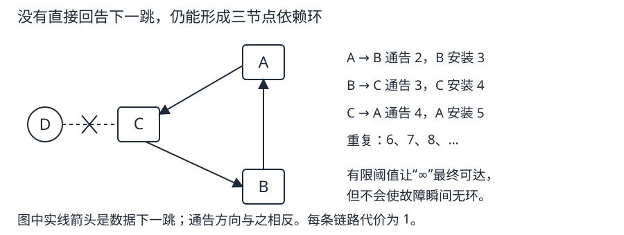

# 核心问题：好消息越传越广，为什么坏消息却会绕圈“变好”？

距离向量最大的陷阱不是算错加法，而是**把依赖自己的旧消息当成独立的新证据**。本讲从消息丢失、邻居失效出发，推导周期重发、超时、毒化、水平分割、毒性逆转和有限无穷大各自在解决什么问题。

本讲不复制共享教材。阅读原理与全部演示请使用 [L5 距离向量全章材料](#/c/berkeley-cs168-2025/lec/lec05?v=materials)；先修是 [L5 松弛与规则 2](#/c/berkeley-cs168-2025/lec/lec05?v=notes)。

## 1. 两个计时器、两种不同证据

**周期通告**解决“我说过，但你可能没听到”。每隔 $A$ 秒再发一次已有路线，让一次丢包不至于永久阻断信息。

**表项超时**解决“你不再说，我什么时候不应继续相信你？”若在 $T$ 秒内没有收到当前路径的有效确认，就使其过期。

二者不能混成同一个数。理想无丢包、零抖动时 $T>A$ 能给下一次刷新留余量；真实环境还要容忍传播延迟、定时误差与偶发丢包。若设 $T=A$，同一时刻“先执行过期还是先处理刷新”都可能影响行为。

自拟时间线：$A=4$ 秒、$T=13$ 秒，最后有效确认在 $t=8$，所以到期点为 $21$。即使邻居在 $t=9$ 已失败，本机也可能直到 21 才凭超时发现。缩短 $T$ 能加快检测，却提高把暂时丢包误判为失败的概率。

**只刷新被接受的路径证据。**来自其他邻居的较差消息不能无限延长当前坏路线的寿命，否则故障永远不会显现。

## 2. Poison 把“没有消息”变成“明确的坏消息”

若某节点已经检测到失败，就不必等所有下游分别超时。把距离改为无穷大，并向依赖它的邻居通告。

无穷大不是“大但仍可走的距离”。控制面可以保留不可达记录，用来传播撤销；数据面必须禁止沿它转发。

设 U 当前经 V 距离 5，另一个邻居 W 提供距离 5 的等价备选。在“不接受非当前下一跳等价路由”的规则下，U 可能继续留在坏的 V 上。V 发 poison 后，U 的当前值变为无穷大，W 的有限路径立刻变优，才可替换。

**删除与毒化不同：**删掉本地记录只让自己忘记；发送 poison 才让别人有机会得知撤销。反过来，已经断开的设备也无法主动报告自己失效，所以 poison 不能代替所有超时机制。

## 3. 两种“毒”不要混淆

| 机制 | 本地路径是否真的失效？ | 向谁说无穷大？ | 目的 |
|---|---|---|---|
| 失效毒化 | 是 | 按协议通知邻居 | 传播撤销 |
| 毒性逆转 | 未必，本地可能仍可达 | 仅对当前下一跳给出反向无穷大 | 禁止它把这条依赖它的路再交回来 |

水平分割是“不给当前下一跳通告这条路线”；毒性逆转是“明确向它通告不可经我走”。两者都针对**每个目的地、每个输出邻居**决定广告内容，不是把整张转发表在所有出口统一改成无穷大。

若 U 当前经 V 距离 4，向 V 反向通告无穷大，向其他邻居仍可通告 4。U 自己的正常转发路径仍是 V，不能因为构造一个出口的广告就破坏本地表项。

## 4. 三节点反例：为什么水平分割不够？

图为编者自拟节点标号，对应教材三节点失效机制。所有边代价为 1，D 原先直连 C；稳定时 C 距离 1，A、B 都经 C，距离 2。

1. D–C 断开。C 毒化；B 收到，A 那份却丢了。
2. A 仍以为距离为 2，向 B 通告。A 的下一跳是 C，所以水平分割**不禁止**向 B 发。
3. B 从不可达改为经 A，距离 3；向 C 通告 3。B 的下一跳是 A，所以这次也不违反水平分割。
4. C 从不可达改为经 B，距离 4；向 A 通告 4。A 正依赖 C，按规则 2 改为 5。
5. 然后 B=6，C=7，A=8，继续增长。

真实数据的下一跳是 `A→C→B→A`，通告沿相反方向循环。没有一步直接把有限路线回告给自己的下一跳，却仍形成环。

毒性逆转也不根治它：C 向自己的下一跳 B 发无穷大时，B 当前依赖 A；来自 C 的较差备选不会让 B 放弃经 A 的旧路径。

## 5. 有限“无穷大”是在牺牲什么？

若正代价沿环每轮都增加，却没有上界，那么无穷大要数无限久。定义一个有限阈值 $M$，把候选代价截为：

$$q=\min\{M,\ c(u,v)+\widehat D_v(d)\}$$

并把 $q=M$ 解释为不可达，就能让增长最终到达吸收状态。RIP 示例中 $M=16$，最大可用距离是 15。

它不保证故障瞬间无环，而是限制错误信息继续被当作有限路径的范围。同时，真正成本达到阈值的健康路径也会被判不可达。**较小阈值更快消灭计数链，较大阈值允许更大网络；两者有取舍。**

不能只因“整数最终到 16”就给真实网络报一个固定秒数。实际持续时间还取决于更新间隔、触发顺序、丢包与传播延迟。

## 6. 收敛工程应守住的不变量

- 有限表项才可用于数据转发；无穷大是控制状态，不是转发许可。
- 当前下一跳变差必须能更新本地状态。
- 广告度量只加一次本地链路代价；通告自己的距离时不再加接收者链路。
- 周期更新提供重新送达机会；触发更新减少等待，不能以触发替代所有重发。
- 表项失效、链路事件、收到通告、发送周期分别是不同事件，勿用一个计时器或一段副作用混在一起。
- 过期毒化与毒化垃圾回收要有明确规则，不能让不可达记录无意永久刷新，也不能刚检测到失败就无声删掉唯一撤销证据。

具体实验接口与允许修改范围以 [Routing 实验](#/c/berkeley-cs168-2025/lab/routing?v=zh) 为准；这些不变量不是一份可提交实现。

## 7. 自测

① “用了 poison reverse，所以不会有环。”哪部分错误？

它针对直接相互依赖的二节点环更有效，不携带完整路径，无法识别任意长度的间接依赖环。图中的三节点反例依然成立。

② U 当前经 V 到 D。W 通告 D 不可达，U 是否必须撤销？

不必。W 不是当前依赖的下一跳，它的不可达不证明 V 的路径不可达。只有当前路径来源的更新、本地故障、到期等合适证据才改变当前路径。

③ 为什么周期更新在稳态中仍有价值？

它确认路径仍存在，刷新寿命，并为曾丢失消息、刚恢复的邻居提供重新学习机会。路径不变不等于协议可以永久沉默。

④ 毒性逆转广告里的无穷大，是否表示发送者在所有方向都无法到达目的地？

不是。它对特定邻居表示“不要经我走”，本地有限路线和向其他邻居的有限广告可以同时存在。

⑤ 只增加包 TTL，能否修好 count-to-infinity？

不能。包 TTL 让一个包最终被丢弃，避免无限占用资源；错误控制状态与后续新包的环路仍然存在。

## 课堂回看索引

| 时间 | 实际内容／核心问题 |
|---|---|
| 00:00–04:53 | 开头 7.359 秒无字幕，之后回顾规则与稳态 |
| 04:53–15:59 | 周期重发与失效；两个计时器分别做什么？ |
| 15:59–36:20 | 等超时的损失、显式毒化、接受与转发规则 |
| 36:20–48:20 | 二节点环怎样产生？水平分割如何防止回告？ |
| 48:20–59:58 | 毒性逆转、两种毒化语义及计时器提问 |
| 59:58–61:54 | 休息的稀疏 cue 与缺口，未核验音画 |
| 61:54–76:14 | 三节点环、数到无穷大、有限阈值 |
| 76:14–80:38 | 事件／周期更新、总结与结束语 |

重点：**48:20–59:02** 对比水平分割与毒性逆转；**61:54–71:05** 展开三节点失败序列。时间来自本片字幕，不与 L5 共用零点。原字幕末端到 80:39.600，超过元数据 1.600 秒；显示裁至 80:38。

## 引用与来源

- [官方 2025 课表](https://sp25.cs168.io/)，本片 ID 独立核对，时长 4838 秒；1935 条自动字幕依序全文读取，包含问答、休息残余 cue 和结尾。声音、画面及不能辨认的问题未验证。
- 唯一教材正文：[L5 Distance-Vector 全章中译](#/c/berkeley-cs168-2025/lec/lec05?v=materials)，Peyrin Kao 等，固定教材 commit `0b8208742d31df7fc3d53a0cd94fdd4e04f8d47e`，CC BY-SA 4.0；不是历史 2025 教材。
- [L5–6 共用 slides](https://docs.google.com/presentation/d/1bwx7O8ZLDfFKeZzOrqcUg_X8F13j6SM62DHJ8gEk7ho)全文可提取文本已读。本讲课堂实际覆盖规则 3–7，不把它们错误归到 L5。
- 本页推导、图与自测为原创教学组织，时间取整到秒。视频许可未知，课堂整理不是授权全文译本；教材许可不延伸到视频或 slides。
