# 一、链路状态协议

## 引言

路由协议可以按底层算法分类。上一章研究了距离向量，本章研究另一个主要类别：**链路状态（link-state，LS）**。

也可以按部署范围区分域间的外部网关协议与域内的内部网关协议。链路状态和距离向量一样，通常用作域内协议。广泛部署的链路状态协议包括 IS-IS（Intermediate System to Intermediate System）和 OSPF（Open Shortest Path First）。

## 总体思路

距离向量进行分布式协作计算：每个节点依据邻居计算出的结果，计算自己的一部分答案；大家的局部答案组合成完整解。节点只需要邻居提供的局部信息，不知道整张网络图。

链路状态则由每个节点独立从头计算完整答案，不采用邻居已经算好的路径结果。但作为交换，每个节点必须得到来自全网的全局信息。

一句话概括：**每台路由器先学到完整网络图，再在本地运行最短路算法，填充自己的转发表。**

实现它需要两步。第一，学习每条链路是否可用、代价是多少，以及每个目的地位于哪里。第二，根据学到的图计算到各目的地的下一跳。先讨论第二步，再回头讨论第一步。

## 计算路径

有了全局网络图，路由器就可以使用最短路算法计算到所有目的地的路径。随后只保存每个目的地最短路径上的下一跳；真正转发时并不需要保存完整的后续路径，这一点与距离向量相同。

可以使用单源最短路算法，例如集中式 Bellman–Ford（不需要距离向量的分布式修改）或 Dijkstra；也可以考虑适用条件下的广度优先搜索，以及并行算法等变体。**编者注：**普通 BFS 只保证无权／等权图的最短路，不能直接替代一般带权最短路算法。

必须小心不同路由器之间的不一致。

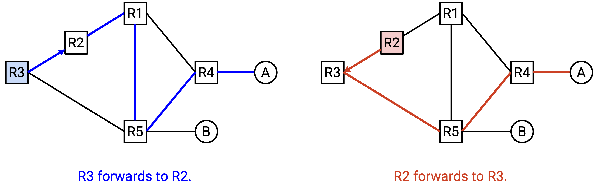

每台路由器独立计算，只能控制自己的下一跳，不能强制下一跳继续采用自己想象的后续路径。例如 R3 选择先去 R2，R2 却选择先去 R3，局部决策拼起来就成为环。

教材为产生相容决定列出四项要求：

1. **对网络拓扑达成一致。**如果链路失效只被一部分节点知道，它们是在不同图上计算，答案可能不相容。
2. **大家最小化相同的链路代价。**若某台路由器偏好更贵的路径，就不再共享同一个优化目标。
3. **链路代价为正。**负权可能产生负权环。
4. **采用相同的平局打破规则。**若最短路径唯一，前面的条件已能让结果一致；若有多条并列最短路径，统一规则能使节点选择一致。

满足这些约定时，路由器可以使用不同最短路算法而仍算出相容路径；实践中，为简单起见通常采用同一种算法。

**编者辨析：**在同一正权图上，只要每台路由器真的选最短路下一跳，到固定目的地的真实最短距离就沿每次转发严格下降。因此，“无环”本身不要求所有节点采用相同的平局规则。统一平局规则是教材追求一致选路的更强约定，不应误读成正权等价最短路径必然造成环。图 2-090 的互相指向也不能同时是同一正权图、同一目的地下的最短路决定。

## 学习网络拓扑

要获得整张图，先发现自己的邻居（路由器与目的主机），再把邻居信息分发到全网，最后把各节点提供的信息拼成拓扑。

发现邻居的方法是发送 **hello 消息**。

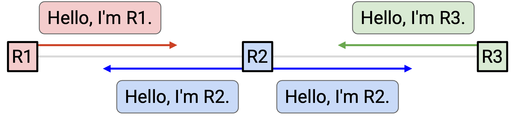

例如 R2 对 R1、R3 说“我是 R2”；R1、R3 因而知道自己与 R2 相连。R1、R3 也向 R2 打招呼，R2 便知道两个邻居分别是谁。此时每个节点只知道直接邻居：R1 仍不知道 R3，因为它们不直接相邻。

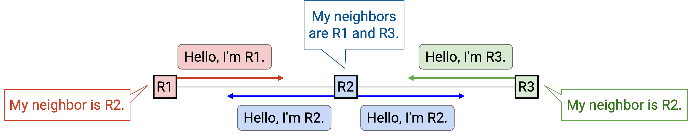

为了发现链路消失，hello 必须周期重发。如果连续若干次收不到某邻居的 hello，就推断它已经消失。

知道邻居后，还应告诉全网。先发给所有邻居；邻居收到后再传给自己的邻居，如此把信息扩散出去，称为**泛洪（flooding）**。邻居消失等信息变化也需泛洪。

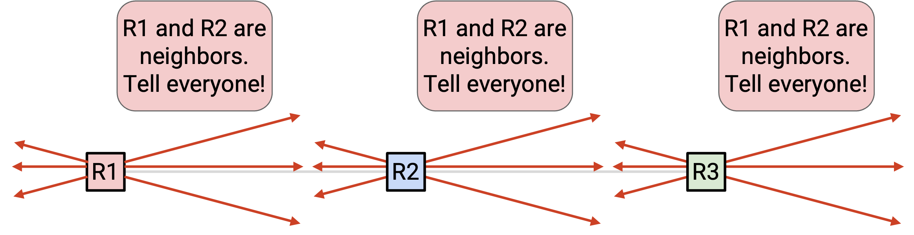

控制消息可能丢失，某些路由器若错过更新，就会继续在旧图上计算。教材沿用距离向量中的办法，周期重发信息；只要链路能工作，经过足够尝试，更新就能送达。

## 避免无限泛洪

不能把“每次收到消息都转发”直接当成完整实现。

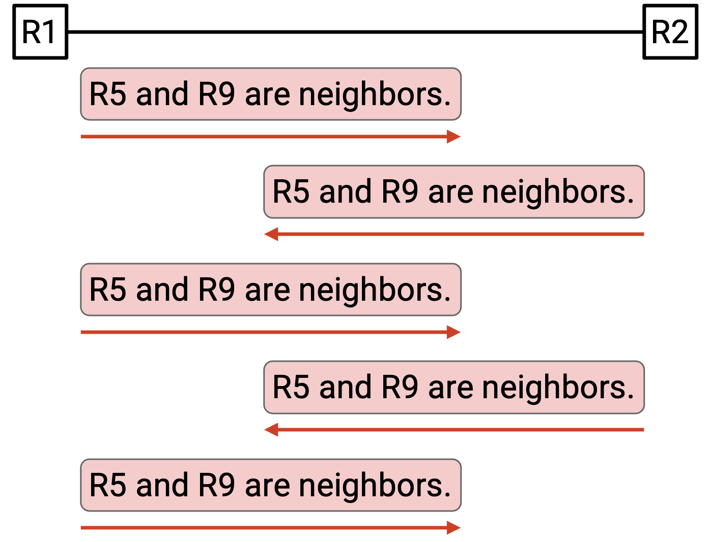

一台路由器发给邻居，邻居收到又发回来，原节点收到再发过去。虽然没有新信息，双方仍不断消耗带宽。这与可靠性所需的受控周期重发不同：后者可能每 5 秒一次，而无限反馈可能每秒发生百万次。

如果拓扑有环，情况更严重。考虑 R1、R2、R3 构成三角形：


- 时间步 1：R1 向 R2、R3 广播。
- 时间步 2：R2 向 R1、R3 广播；R3 向 R1、R2 广播。
- 时间步 3：R1 收到两份，因此广播两次；R2、R3 各广播一次。
- 时间步 4：R1 广播两次，R2、R3 各广播三次，每次仍发送给另外两个节点。
- 时间步 5：R1 广播六次，R2、R3 各五次。

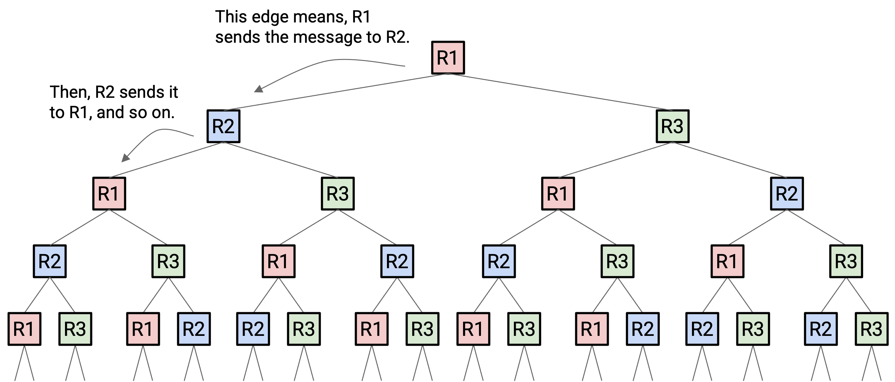

真正的新信息在第一步已经传到其他节点，后续全是重复消息，却会迅速压垮网络。

修正方法是：**同一份通告在某个节点首次出现时才转发。**第一次看到消息，就记下自己已经看过，再发送给邻居；以后又收到同一份则不再转发。反正为了拼出网络图，本来就需要记住这份信息。

为了唯一识别通告，可以加入时间戳或计数器。回到三角形：第一步 R1 发给 R2、R3；第二步 R2、R3 各转发一次；第三步所有节点都已经见过这份消息，停止继续转发。

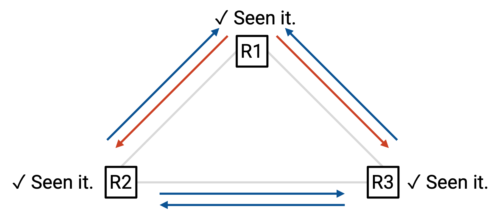

这并不意味着完全没有重复发送，而是重复不会无限持续。新的状态版本与为了可靠传播所需的受控重发，要与“收到同一个副本立即再泛洪”区分开。

## 收敛

每个路由器都得到完整拓扑并据此算出转发表后，链路状态协议收敛到有效的最小代价路由状态。关键在于大家使用同一张图。只要拓扑不再变，这个状态就能保持有效。

拓扑变化后，需要先检测变化，再传播信息，再重新计算和安装表项。收敛期间，一部分节点用旧图，一部分用新图，可能暂时出现死路、环路或非最短路径。

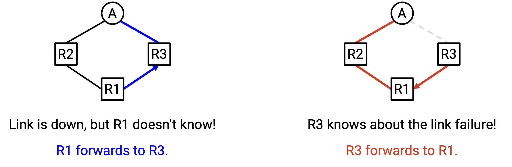

例如 R3–A 断开，R3 已获知故障，改向 R1 转发；R1 尚不知情，仍向 R3 转发，于是暂时成环。链路状态协议很多复杂性就在这些细节中：怎样更快收敛，以及怎样减少无效状态持续的时间。

## 与距离向量比较

距离向量收到邻居通告时，并不知道所接受路径的所有细节，只能相信邻居声明的距离。链路状态知道完整拓扑，因此对路径有更多了解。

具体实现不同，距离向量可能收敛较慢：必须等邻居重新计算并通告，自己才能更新；自己的邻居又要等自己。链路状态则可以先快速泛洪变化，让各节点并行重算。

链路状态适合局部网络，却不适合不加分层地直接覆盖整个互联网：它要求每个路由器知道全网图，而且运营者未必愿意把路由器位置、链路带宽等内部信息暴露给竞争对手。实践中的网络会组合使用不同类别的路由协议。

# 二、寻址

## 路由怎样扩展？

前面的转发表为每个目的地保存一条记录。这无法扩展到整个互联网。如果全网运行距离向量，就要为每台主机发布通告；如果全网运行链路状态，每台路由器就要知道整个互联网图。无论哪种，只要某台主机加入或离开，都可能引起重新计算。

关键技巧在于**怎样给主机命名和分配地址**。此前使用 A、B、R1 这样的标签；实际需要更有结构、更能体现位置的地址。


## IP 地址

回顾邮政类比：邮递员使用 2551 Hearst Ave 这样的街道地址，楼内秘书使用 413 Soda Hall 这样的房间号。地址不是随机数字；三楼房间以 3 开头，四楼以 4 开头，包含位置上下文。

互联网各层也有不同的寻址方式。本章聚焦第三层路由使用的 **IP 地址**。可以暂时假设每台主机有一个唯一 IP 地址。它是一个用来标识主机的数字，分配方式也能体现主机所在位置。

IP 地址不一定固定。搬家后邮寄地址会变；计算机移动到另一个网络后也可能得到新 IP，旧地址最终失效。

IPv4 地址长 32 位，IPv6 长 128 位。两者路由思想相近；为便于阅读，下面主要用较短的 IPv4 地址举例。

## 层次寻址

互联网由局部网络互联而成，天然具有可以利用的层次。可以先为每个网络分配编号，再在网络 3 中给主机编号 3.1、3.2、3.3，其他网络类似。

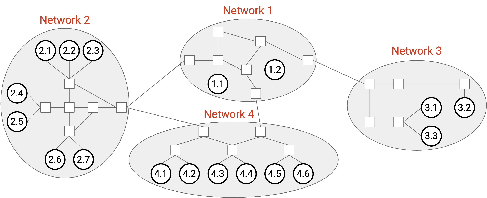

考虑 R9 的转发表。原来需要分别为网络 1 的每台主机建立表项，下一跳全是 R6；现在只需一条 `1.* → R6`，其中星号匹配任意主机号。其他网络也能同样聚合。

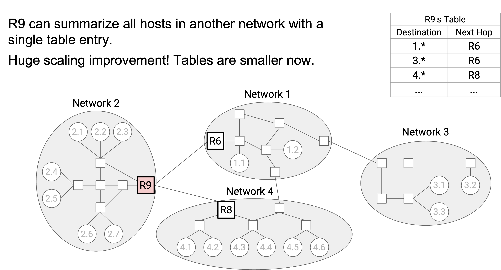

这样既缩小了表，也让表更稳定。局部网络内部发生变化，不一定需要修改外部 R9 的表。主机加入等内部变化通常远比新铺地下线缆等网络之间的变化频繁，所以把变化限制在本地非常有价值。

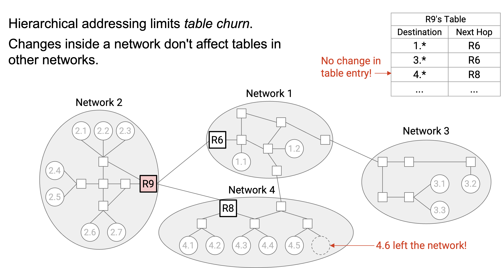

一般地，地址包含**网络 ID**和**主机 ID**。域间协议关注网络 ID，解决网络间路径；域内协议处理网络内部目的地。这使外部协议不必为每次内部主机变化重算，本网络也无须了解其他网络内的所有细节。

不过，R9 对本网络内部的主机仍需较细的路由。同样，未直接连接外部网络的内部路由器 R4，也需要内部主机表项以及指向外网的聚合项。表的规模由“本地内部目的地数量 + 外部网络数量”决定，而不再是全网主机数。

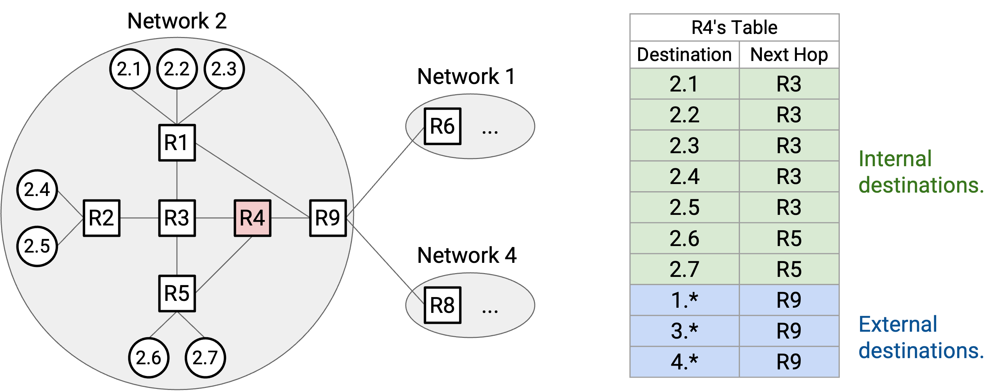

**图文勘误：**固定原文在此附近把 R4 所在网络写为 network 3、又把 R9 的另一聚合项写成 2.*；图中 R4、R9 实际位于 network 2，R9 的 `4.*` 才经 R8。译文按图中一致的编号解释，原图完整保留。

## 默认路由

既然表项能够表示范围，还可以进一步聚合。R4 到外网 `1.*`、`3.*`、`4.*` 的下一跳全为 R9，不必分别记录。保留本地 `2.1`、`2.2` 等具体表项，再规定：其余没匹配的目的地全部交给 R9。

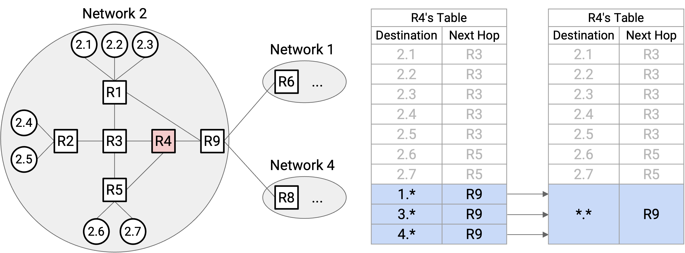

R2 甚至能更激进：除了外网，内部 2.1、2.2、2.3、2.6、2.7 也都经 R3。因此只需保留直连的 2.4、2.5，其余一律交给 R3。

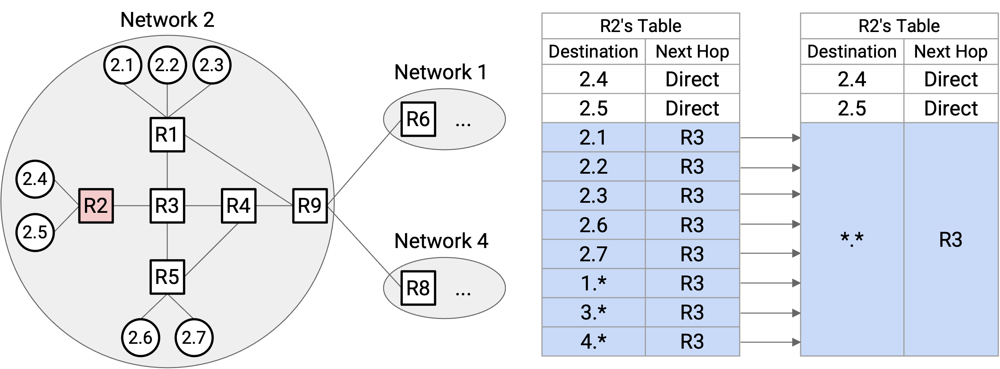

可以用匹配一切的 `*.*` 表示剩余目的地。转发时先尝试具体主机或更具体范围，找不到时才落到 `*.*`，这就是**默认路由**。

大多数普通主机只需要一个硬编码默认出口。例如 2.4 把外发流量交给 R2；家用电脑把需离开本地的流量交给家庭路由器。正因为不必独立选择复杂网络路径，主机通常不用参与动态路由协议。实际主机仍可有直连子网等其他本地表项，这里是课程的简化模型。

## 早期互联网的地址划分

要利用层次聚合，地址本身必须含有位置结构，让附近的主机共享某些地址位。早期 IPv4 使用 8 位网络 ID 和 24 位主机 ID。


教材举例：AT&T 使用网络号 12，Apple 使用 17，美国国防部拥有 13 个网络号。8 位网络 ID 只能区分 256 个网络，但现实组织远不止 256 个。与此同时，每个网络得到 $2^{24}=16,777,216$ 个地址；只有 10 名员工的小公司根本不需要这么多。互联网扩大后，必须改进分配方式。

## 分类寻址

第一次改进是**分类寻址（classful addressing）**：按照规模需求划分三类地址，不同类别给网络和主机分配不同位数，开头 1–3 位表示类别。

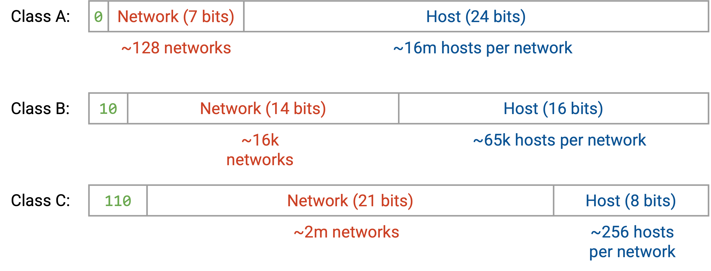

| 类别 | 开头固定标志 | 网络编号位 | 主机位 | 课堂近似规模 |
|---|---|---:|---:|---|
| A | `0` | 接下来 7 位 | 24 | 128 个网络，每个约 1600 万地址 |
| B | `10` | 接下来 14 位 | 16 | 约 1.6 万网络，每个约 6.5 万地址 |
| C | `110` | 接下来 21 位 | 8 | 约 200 万网络，每个 256 地址 |

因此可以容纳约 200 万 + 1.6 万 + 128 个网络。大组织分 A 类，小组织可分 B 类或 C 类。同一网络的类别位和网络号相同，主机号不同。

问题在于规格太粗：A 类通常过大，C 类对许多组织又过小，于是大量组织都需要 B 类，而 B 类网络号只有约 1.6 万个。到 1994 年，B 类地址已接近用尽，再次需要新办法。现代互联网已不采用这种分类作为路由前缀长度的限制。

还有一个细节：传统 IPv4 子网中，全 0 主机号和全 1 主机号有特殊用途。因此若讨论可用普通主机地址，通常需要从总数减去 2，例如传统 C 类子网可用 254 而不是 256。特殊前缀的例外不能机械套用这个减二规则。

## CIDR：无类别域间路由

现在使用的是 **CIDR（Classless Inter-Domain Routing）**。网络 ID 仍可变长，但不再只能选 A、B、C 三种长度，而是允许任意前缀位数。

前面只有 10 名员工的公司，若按 C 类得到 256 个地址，浪费很大。用 28 位网络前缀，就剩 4 位主机号，即 16 个地址；若用 29 位前缀，只剩 3 位，即 8 个地址，又不够。不能恰好分 10 个，但分 16 个比 256 个节约得多。教材按总地址数计算为“闲置 6 个”；若扣除传统网络／广播地址，则另有相应可用数限制。

另一个组织需要 450 个主机地址。C 类 256 不够，B 类约 6.5 万又太多。CIDR 可给 23 位网络前缀，剩 9 位主机号，共 512 个地址，明显减少浪费。

## 多层次分配

现实层次不止两层。一个组织内部还可以把不同地址范围分给部门、校区或子网络。地址分配会利用组织与地理层次。

教材把顶层协调概括为 ICANN 管理全球地址，再向各区域互联网注册机构（RIR）分配地址块；RIR 再向大组织或 ISP 等本地注册机构分配；最后本地机构向小组织、子网络和主机继续分配。

教材列出的区域机构包括 RIPE NCC、ARIN、APNIC、LACNIC 和 AFRINIC，分别服务欧洲及相邻地区、北美、亚太、拉丁美洲与加勒比、非洲等区域。**编者注：**原文将 RIPE 简化为欧盟、LACNIC 简化为南美，并用“拥有全部地址”描述 ICANN；这些是课堂示意，实际应理解为 IANA／RIR 的分级协调与分配，不是这些地区的精确行政边界或财产所有权陈述。

举一个纯粹用于说明前缀的例子：顶层给 ARIN 所有以 `1101` 开头的地址；ARIN 再给 AT&T 所有以 `1101 11001` 开头的地址；AT&T 可以继续划出更长前缀交给大学，大学再分给楼宇和主机。

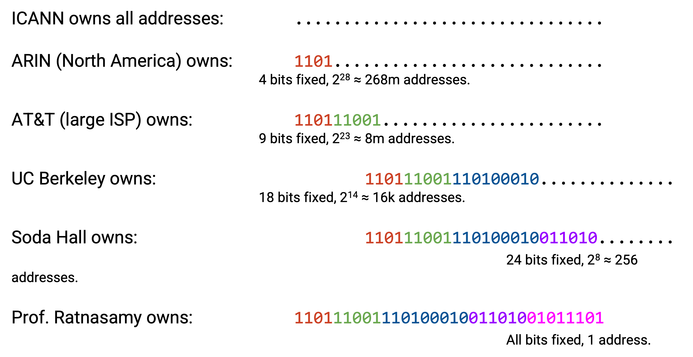

每一级多固定几位，取决于要分多少地址。例如要给 AT&T 约 800 万地址，可以固定 9 位，剩 $2^{23}$ 个地址。ARIN 原先已经固定 4 位，所以再固定 5 位。AT&T 再分前缀 `1101 11001 110100010`，总长 18 位，留下 $2^{14}=16,384$ 个地址。子机构的前缀永远继承父机构已经固定的位。

## 怎样写 IP 地址

IPv4 可以写成 32 个二进制位或一个大整数，但为便于阅读，通常每 8 位转换成一个 0–255 的十进制数，用点隔开。

例如：

```text
00010001 00100010 10011110 00000101
17.34.158.5
```

这种写法叫点分十进制（dotted quad）。

表示地址范围时，使用**斜线记法**：先把固定前缀之后的所有未固定位补 0，转换成 IPv4 地址，再在斜线后写固定的位数。

例如前缀 `11000000` 补零后为 `11000000 00000000 00000000 00000000`，即 `192.0.0.0`；固定 8 位，因此范围写作 `192.0.0.0/8`。单个地址可以写 `192.168.1.1/32`，默认路由则是 `0.0.0.0/0`。

十进制分组每 8 位一组，而前缀长度却可以任意，因此表面上有时难以看出关系：

- `192.0.0.0/8` 与 `192.0.0.0/12` 的地址部分相同，但表示不同范围。
- 4 位前缀 `1100` 写为 `192.0.0.0/4`；其子前缀 `11001` 写为 `200.0.0.0/5`。从十进制外观不容易立即看出后者属于前者，转回二进制就清楚了。

也可以用**网络掩码（netmask）**表示哪些位固定：固定位置写 1，其余写 0，再转点分十进制。例如 `192.168.1.0/29` 的掩码有 29 个 1、3 个 0：

```text
11111111 11111111 11111111 11111000
255.255.255.248
```

所以也可写“地址 192.168.1.0，掩码 255.255.255.248”。教材主要使用更简洁的斜线记法。掩码在实现中也很方便：IP 与掩码按位 AND 后，主机位清零，只保留网络前缀。

## 用 CIDR 聚合路由

只有网络 ID／主机 ID 两层时，能把一个网络内部的主机汇成一个路由。多层前缀进一步允许把多个网络聚成一条路由。

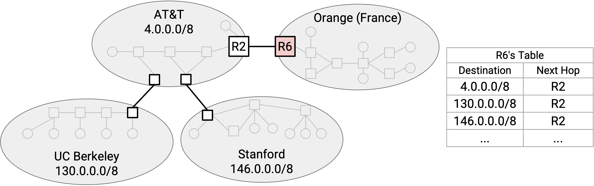

若 UCB 的 `4.12.0.0/16` 与 Stanford 的 `4.29.0.0/16` 都由 AT&T 的 `4.0.0.0/8` 范围划出，它们就属于同一个更大前缀。R6 到它们都经 R2 时，可以只保留 `4.0.0.0/8 → R2`。

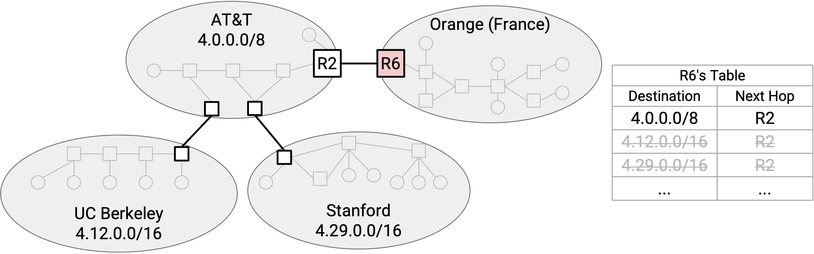

这里的前提不只是“数字看起来相近”，还包括聚合覆盖的地址空间及转发行为由相应运营者正确负责。扩大前缀不能凭空声称对没有分配或不可达的额外地址负责。

## 多宿主与最长前缀匹配

聚合并非总能涵盖所有选择。若 R6 新增直接通往 Stanford 的链路，原来的大范围路由仍说“所有 AT&T 范围都经 R2”，却不表达 Stanford 应走 R7 的例外。

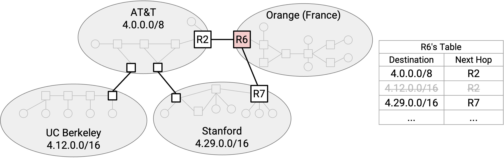

因此增加 `4.29.0.0/16 → R7`，保留 `4.0.0.0/8 → R2`。两条范围重叠，一个地址可能同时匹配它们。解决办法是**最长前缀匹配（longest prefix matching，LPM）**：选择匹配目的地址的最具体范围，也就是固定位数最多的那一项。

Stanford 地址匹配 /16 与 /8，应选 /16；UCB 地址不匹配 Stanford 的 /16，却匹配 AT&T 的 /8，因此仍经 R2。

**原文勘误：**这一段途中出现 UCM、19 位和 9 位，与实际图中的 Stanford /16、AT&T /8 不一致，应是遗留示例文字。这里按图的完整具体例子翻译，不拼接成另一个不存在的拓扑。

## IPv6 简史

IPv4 的 32 位空间约有 40 多亿个地址。这够吗？

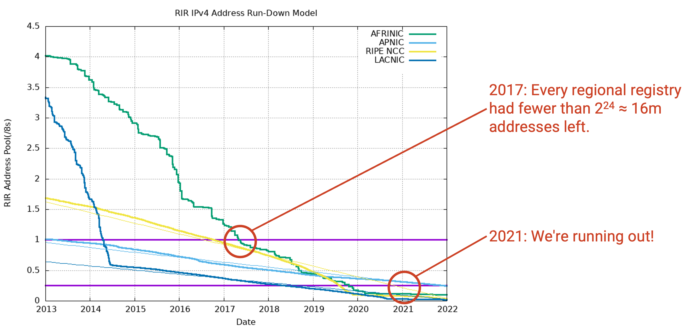

图的纵轴是剩余未分配地址数量，以 /8 块为单位。教材用它说明：到 2017 年，各区域机构剩余空间已少于一个 /8，即 $2^{24}$、约 1600 万地址；原先留作储备的地址也开始被使用，到 2021 年连储备也在接近耗尽。原文还提到，2011 年 2 月最后一批中央 /8 分配曾举行仪式，并发放纸质证书。这些是教材回顾的历史，不是本页对当前库存的实时统计。

互联网增长带来的耗尽问题很早就被注意到，IPv6 在 1990 年代开发，1998 年形成重要标准版本。其寻址结构在本质上仍然是层次前缀，但地址长度增加到 128 位，约有 $3.4\times10^{38}$ 个可能地址。

教材用“给宇宙存在的每一秒分一个地址仍只用极小比例”说明空间巨大，并写宇宙年龄为 $10^{21}$ 秒、占比约 $10^{-15}\%$。**数值勘误：**$10^{21}$ 秒不是通常所说的宇宙年龄；此类比不应当作精确天文数据。即使只按原文假设，$10^{21}/(3.4\times10^{38})\times100\%\approx2.9\times10^{-16}\%$，也只是强调数量级很小。

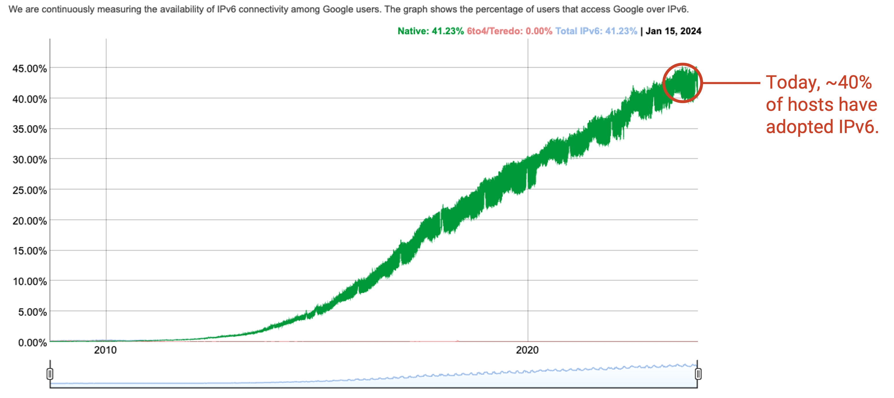

IPv6 并未在提出后立即全面采用。教材叙述约 2010 年使用仍很少，到 2024 年终端采用率约 45%，并指出采用与 IPv4 耗尽相关。图本身标注的 2024 年 1 月采样约为 41%，因此 45% 是正文的概括，不是图中那一天的精确值，也不能当作所有互联网主机或今天的普及率。

为什么迁移缓慢？用户、服务器和运营者都要升级软件、路由器、设备驱动等，路由器需要处理 IPv4 与 IPv6 两套地址的转发状态。服务如果只有 IPv6 地址，只有 IPv4 的客户端就不能直接使用它。IPv4 与 IPv6 是不同地址体系，不存在把任意 IPv4 地址直接一一改写成全局可路由 IPv6 地址就自动互通的办法；实践中服务往往同时支持二者，还可能使用翻译或隧道等过渡机制。

双栈机器还需决定优先使用哪一个。原文概括“IPv6 更快”，但实际性能会受路径、部署与实现影响，不是地址位数本身保证 IPv6 必然更快。

## IPv6 地址写法

IPv6 通常写十六进制，每 4 个十六进制数字（16 位）用冒号分组。例如：

```text
2001:0D08:CAFE:BEEF:DEAD:1234:5678:9012
```

一共 32 个十六进制数字，正好 128 位。每组开头的 0 可以省略：

```text
2001:0DB8:0000:0000:0000:0000:0000:0001
2001:DB8:0:0:0:0:0:1
```

一整段连续全零组可以缩写为 `::`，得到 `2001:DB8::1`。双冒号表示把缺少的 16 位组补成全零；**一个地址最多使用一次**，否则无法知道两段分别该补多少组。

IPv6 也使用斜线前缀：单个地址为 /128；32 位网络前缀可写作 `2001:0DB8::/32`。

空间足够大，使常见子网可以把前 64 位作为子网前缀、后 64 位作为接口标识。教材进一步提到自动配置：主机可生成自己的接口标识并检查地址冲突，而无需管理员逐台分配。

**重要边界：**原文把这一过程概括成网络和主机能自行挑选任意 64 位网络 ID／主机 ID。这不能解释为可以任意创造全球可路由前缀。主机自动配置使用网络所通告的有效前缀；接口标识的自生成与公共前缀的注册分配是两回事。

教材给出的常见分配层次是：RIR 向 ISP 分配 /32，ISP 向组织分配 /48，组织向子网分配 /64。这些标准化长度有助于形成规模直觉，但都是常见实践而非所有部署必须严格遵守的定律；/127 点到点链路、/128 单地址等更长前缀确实存在。

原文最后一句把 IPv4／IPv6 混写，并保留了未核实提示。其要表达的对比是：IPv4 的任意长度前缀不直接说明组织级别，而 IPv6 的常见 /32、/48、/64 习惯能提供一定线索。此处明确保留“教材末段尚未完成核实”的来源边界，不把它当作正式协议保证。

## 引用与来源

- 原著：Peyrin Kao，依据 Sylvia Ratnasamy、Rob Shakir 等人的课程讲授，*CS 168 Textbook*。
- 指定阅读：[Link-State Protocols](https://textbook.cs168.io/routing/link-state.html) 与 [Addressing](https://textbook.cs168.io/routing/addressing.html)。覆盖两章全部正文小节、例子、推理与图 2-090–2-113；原图保留，中文图注及“编者”说明为新增。
- 固定版本：[0b8208742d31df7fc3d53a0cd94fdd4e04f8d47e](https://github.com/berkeley-cs168/textbook/tree/0b8208742d31df7fc3d53a0cd94fdd4e04f8d47e/routing)，2026-10-01，不是 2025 历史版本。原教材地址末段有未核实标记，图文不一致处已显式说明。
- [教材许可](https://textbook.cs168.io/#license)为 [CC BY-SA 4.0](https://creativecommons.org/licenses/by-sa/4.0/)；本译文同许可。修改包括翻译、表格化、中文图注和区分原说法的勘误；不构成原作者背书。
- 本页不是课堂译稿；视频、slides 的版权与教材许可分别处理。

- 显示修改：教材透明原图采用白色底衬，确保深色主题中的黑色文字与连线可读；原图文件字节未更改，白底不是新绘制的课堂画面。
