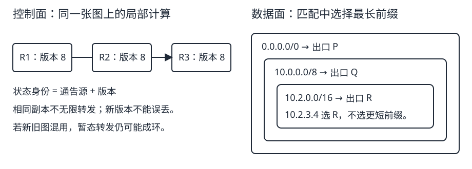

# 核心问题：学会全图后就万事大吉了吗？

链路状态把复杂性从“相互依赖的路径计算”移到“让大家学到足够一致的拓扑”。寻址又处理另一种规模问题：即便算得出路径，也不应该为全球每台主机存一行表。

本讲的两条主线不能混为一谈：**LS 解决路径事实怎样传播，层次地址解决哪些目的地能够共同描述。**

图为编者自拟。左边的版本必须区分来源；右边的前缀包含关系不代表时间先后。

## 1. 先分清“本地计算”与“局部信息”

DV 使用局部邻居信息，合作得到全局答案；LS 尝试收集全局图，再由每个节点独立计算。LS 的路径算法可以是普通单源最短路，但分发拓扑仍然是分布式系统问题。

一个完整控制流程至少包括：

1. **发现邻居：**hello 确定是谁与我直接相连；周期确认与超时判断可用性。
2. **形成链路状态：**把邻接、链路代价、目的前缀等事实标明来源与版本。
3. **可靠传播：**新的状态向外扩散，同时抑制已见过的同一副本。
4. **计算与安装：**在当前图上算路径，取第一跳写进本地转发表。

从“图已更新”到“转发表已安装”还可能有延迟。故障检测、传播、计算、安装是四种不同延迟，不能只加速 Dijkstra 就声称已经解决收敛。

## 2. 为什么相同正权图上的最短路相容？

设 $D(u)$ 为同一图上节点 $u$ 到固定目的地的最短距离。如果 $u$ 选择最短路下一跳 $v$，则：

$$D(u)=c(u,v)+D(v).$$

因为 $c(u,v)>0$，所以 $D(v)<D(u)$。真实最短距离沿每一步严格下降，不可能回到出发点。因此即使存在多个等价下一跳，各节点各自选其中一个，仍不会由此形成环。

教材和课件提出统一平局规则，是为了更一致的路径选择；它是比上述无环证明更强的约定。**不能把“不同 tie-break”直接当成同一正权图上最短路环的来源。**

真正危险的是不同图：例如 U 仍相信 V 有直达 D 的旧链路，V 已知道该链路断开，于是改经 U。各自计算在自己的图里可能都合理，组合却是 `U↔V`。这时不存在大家共同严格下降的同一个 $D$。

## 3. 泛洪为何需要身份与版本？

假设三角形中的每次接收都会产生两份新发送，旧事实就会指数复制。最基本的修正是：每个节点只对同一份通告做一次首次传播。

但“内容相同就永远不发”也不对：链路今天断了、明天恢复、后天再断，可能再次出现相同内容，却是不同事件。常见抽象身份是 `(origin, version)`，而不是全网共享一个随意整数。

**实现边界：**来源重启、计数器回绕、旧消息滞留、重发可靠性都需要具体协议的版本规则。这里说明不变量，不虚构 OSPF／IS-IS 完整规范。新版本不能被旧副本去重误删，同一版本也不能无限回送。

## 4. 计算路径之外，还要压缩变化范围

若全球每台主机都占一行，主机加入、离开会引起全网表项抖动。层次地址让一个外部路由器只需知道“某个范围经某个入口”，不必知道范围内每台机器的状态。

聚合有两个好处：减少表项；把许多局部变化屏蔽在网络边界以内。但它依赖地址分配与可达拓扑相容，而不是任意编号都能无损汇总。

CIDR 中，IPv4 `/p` 有 $2^{32-p}$ 个地址。分给 450 个传统 IPv4 主机的子网，可用 /23：512 个总地址，通常 510 个可用主机地址；/24 只有 256 个总地址，不够。前缀长度控制范围，不是“网络等级”编码。

## 5. 用按位运算判断，不凭十进制外观猜

自拟例子 `172.16.40.0/21`：掩码 `255.255.248.0`，第三字节固定前 5 位。40 的二进制为 `00101000`，主机部分可让第三字节在 40–47 之间变化，所以范围到 `172.16.47.255`，共有 $2^{11}=2048$ 地址。

`172.16.45.9` 与掩码按位 AND 得到 `172.16.40.0`，因此匹配。`172.16.48.1` 不匹配。注意 /21 的第三字节起点必须按 8 对齐；不能把任意“2000 个地址”随便写成一条对齐的 CIDR 前缀。

最长前缀匹配例子：

| 前缀 | 出口 |
|---|---|
| `0.0.0.0/0` | P |
| `10.0.0.0/8` | Q |
| `10.2.0.0/16` | R |
| `10.2.3.128/25` | S |

`10.2.3.200` 选 S；`10.2.3.7` 选 R；`10.9.0.1` 选 Q；`192.0.2.1` 选 P。这里的“最长”是**匹配位数最多**，不是数字最大、路径最长或表中最后一行。

## 6. 多宿主怎样打破整齐的聚合？

某客户原来完全通过供应商接入，供应商的大前缀能代表它。客户增加第二条独立出口后，其他路由器可能需要一个更具体前缀指向新出口；大前缀继续处理其余地址。LPM 正是让“默认聚合 + 明确例外”共存的机制。

代价是更具体路由增加，表不可能永远只保留最粗粒度。聚合是基于当前拓扑与政策的压缩，不是免费消除所有信息。

IPv6 仍使用同样的前缀思想，只把地址宽度改为 128 位。`::` 每个地址最多使用一次；常见 /64 子网不代表所有前缀必须 /64，更不意味着主机可随机挑一个公共网络前缀。接口标识自动生成与公网前缀分配是不同过程。

## 7. 自测

① 两台路由器使用同一正权图，分别选择不同的等价最短路，是否必然形成环？

不会。每一步都使同一目的地的最短距离严格下降。统一平局规则可增强路径一致性，但不是该无环证明必需条件。

② 去重只记录版本号，不记录通告源，会有什么错误？

R1 的版本 8 与 R2 的版本 8 是不同事实，可能被误认为同一消息而丢弃。消息身份必须包含来源等区分信息。

③ 172.16.40.0/21 能否恰好用两个 /22 覆盖？

可以：172.16.40.0/22 与 172.16.44.0/22。两个子块大小相同、边界对齐、连续，且合起来正好覆盖原块。

④ /0 与 /32 分别匹配多少 IPv4 地址？

/0 固定零位，匹配全部 $2^{32}$ 个；/32 固定全部位，只匹配一个。`0.0.0.0/32` 不是默认路由。

⑤ 两个前缀下一跳相同，是否一定能用它们的公共短前缀替代？

不能。较短前缀可能额外覆盖别的地址。只有对额外覆盖也满足正确的转发与通告责任，或精确合并对齐连续的子块，才可安全处理。

## 课堂回看索引

| 时间 | 实际内容／核心问题 |
|---|---|
| 00:00–10:52 | 开头 7.680 秒无字幕；LS 总览、全图计算与逐跳一致性 |
| 10:52–23:02 | hello、泛洪、重复抑制、可靠更新与问答 |
| 23:02–28:26 | 为什么 LS 暂态仍会出错？与 DV 比较 |
| 28:26–43:47 | 层次地址怎样减少表项与变化？默认路由 |
| 43:47–59:31 | 早期划分、分类地址、CIDR、多级分配 |
| 59:31–72:05 | 点分记法、掩码、聚合、多宿主与 LPM |
| 72:05–82:00 | IPv6 表示、自动配置边界、迁移与结束语 |

重点：**06:01–10:52** 是路径一致性讨论；**64:47–72:05** 是聚合、多宿主与最长匹配。边界取自字幕并取整；自拟 /21 和多级 LPM 表不是课堂实例。

## 引用与来源

- [官方课表](https://sp25.cs168.io/)，本片时长 4920 秒。2068 条自动字幕全文读完，含提问和片尾；最后 cue 到 82:01.719，超过时长 1.719 秒，显示已裁剪，原件不改。未看视频／听音轨，缺口不能视为静音。
- [L7 完整教材材料](#/c/berkeley-cs168-2025/lec/lec07?v=materials)：Peyrin Kao 等，*Link-State Protocols*、*Addressing*，固定 commit `0b8208742d31df7fc3d53a0cd94fdd4e04f8d47e`，CC BY-SA 4.0；2026 固定快照并非 2025 原貌。材料页保留全部图，列出网络标签、IPv6 历史数据与未核实原文的边界。
- [L7 slides](https://docs.google.com/presentation/d/12Zl53GNXpSC-tXg8Jk5hKHCUrvukJ_PbG7fOhfe-7D0) 59 页可提取文本全部阅读；课件视觉未独立核验。本页严格下降证明及自测为编者推导。
- 未获视频完整再利用授权；对应课堂整理采用原创时序摘记而非全文译本。
