# 路由器硬件

## 路由器做什么？

路由器先运行路由协议，生成转发表。随后数据包到来，读取目的 IP，在表中选择应当发出的链路。转发表不一定逐一列出每个主机，也可能包含整个地址范围。

此前我们把路由器画成图中的方框。现实中，它是一台专为路由和转发优化的计算机。本章研究这个方框内部的硬件。

## 路由器在哪里？

家庭和办公室有小型路由器，把终端接入互联网。那么来自各处的路由器在哪里相互连接？

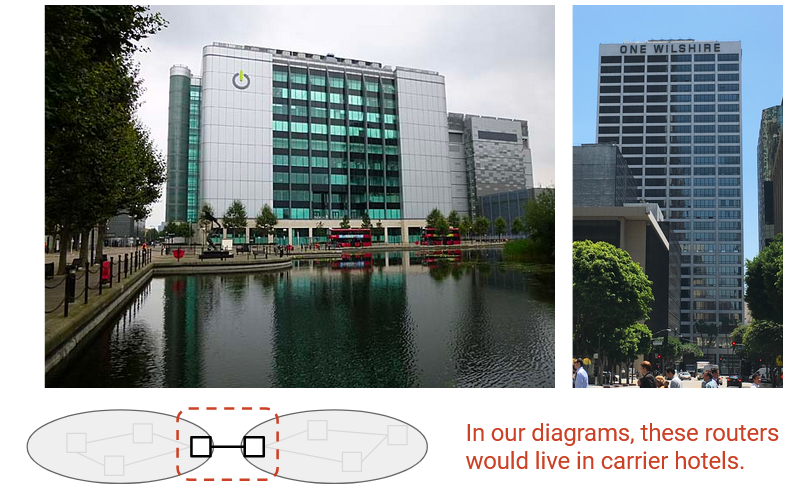

**托管机房（colocation facility）**，也称 **carrier hotel**，是多个 ISP 安放路由器并互联的建筑。这里专门配备供电和冷却基础设施；ISP 租用空间安装设备，并连接同一建筑中的其他运营商设备。

机房中的设备堆叠安装在机架里；典型机架约 6–7 英尺高、19 英寸宽。

## 大小与容量

路由器尺寸取决于使用需求。家用路由器只服务少数用户，向外通常使用一条默认路由；工业级设备可能服务数千客户，拥有很大的转发表。

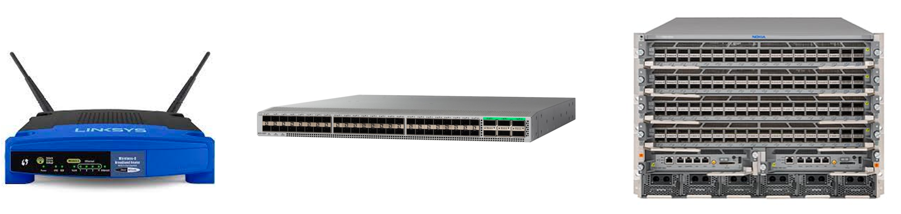

可以从物理尺寸、端口数或带宽等不同维度衡量设备大小。若所有端口速率相同，**容量 = 物理端口数 × 每端口带宽**。端口速度也称**线速（line rate）**。端口速率不必相同，此时应逐端口求和。例如四个 100 Mbps 端口和一个 1 Gbps 端口，总容量为 1.4 Gbps。

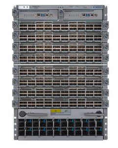

教材举出的高端设备每端口可达 400 Gbps。设备由可拆卸**线卡（line card）**组成，每张线卡承载若干端口。例如 8 张线卡、每卡 36 端口，总计 288 端口；若每端口 400 Gbps，则总容量为 $288\times400=115,200$ Gbps，即 115.2 Tbps。这种设备可能超过 100 万美元。模块化线卡让运营者可以随容量需求增长逐步加装，而不是一开始买满全部端口。

教材还讨论下一代 800 Gbps 端口。机房空间有限，很难只靠增加端口数扩容；把更多端口塞进同样空间也受供电、散热约束。因此，主要进步来自提高每端口速率。

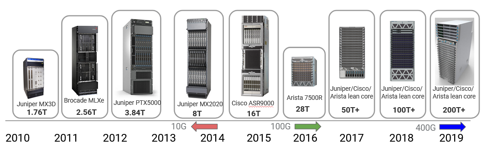

用户需求不断增加，例如视频由 720p 演进到 8K，推动路由器容量增长。教材回顾 2010 年约 1.7 Tbps 的设备，并以随后约百倍的增长说明趋势：端口速率从 10 Gbps 到约 2016 年的 100 Gbps，再到 400 Gbps。摩尔定律放缓与高速信号传输的物理困难使增长速度受限；从 400 到 800 Gbps 只是 2 倍，而此前阶段分别是 10 倍、4 倍。

**编者注：**这些“当前／下一代”是教材写作时的例子，不是本页对 2026 年产品的市场调查。原文把 8K 写成“8000p”不准确；8K 通常描述约 8000 像素的横向分辨率，不能与 720p 的纵向命名直接等同。

## 数据、控制与管理三个平面

路由器的硬件、软件可以概念上分成三个平面。

**数据平面（data plane）**主要负责转发。每到一个需转发的包，就执行读取首部、查表和发送等操作。这是本地工作，不需要为每个包与其他路由器协商。

**控制平面（control plane）**主要负责与其他路由器通信，运行路由协议。它计算出的状态（如转发表）交给数据平面使用。网络增加或删除链路等拓扑变化时，需要控制平面作出反应。

数据包到达通常比拓扑变化频繁得多；两者时间尺度与算法复杂度不同。因此，数据平面优化的是非常快速地执行简单工作，控制平面优化的是重新计算网络路径等复杂工作。

**管理平面（management plane）**供人和外部系统配置、观察设备。运营者在这里决定链路代价、使用哪种协议，以及设备应如何工作；也通过管理接口查看每条链路的流量、组件是否故障等监控信息。即便是程序而不是人手动操作，只要它从外部配置、监视设备，也通常归入管理平面。

教材以纳秒级数据处理、秒级控制处理、几十到几百秒的管理变更作为数量级直觉。例如运营者提交配置后，设备可能先校验、处理，再完全应用。它们不是所有设备必须满足的固定时间。

**网络管理系统（NMS）**是运营者使用的软件。它可能结合人工输入计算网络配置，再调用路由器发布的 API，把配置应用到设备。NMS 还读取遥测，即统计数据和运行状态。它的复杂程度取决于运营者希望达成什么目标。

三个平面缺一不可：只有数据平面固然可以按表转发，但若没有任何方式生成或配置表，就不知道应把包发到哪里。静态配置是控制信息的一种来源，而不是表凭空存在。

## 路由器里面有什么？

路由器虽然是一台计算机，内部实际上有许多协作的小计算机与芯片。工业设备的物理外壳称为**机箱（chassis）**；机箱里装多张线卡，每张线卡上有多个物理端口，每个端口可用于输入或输出。

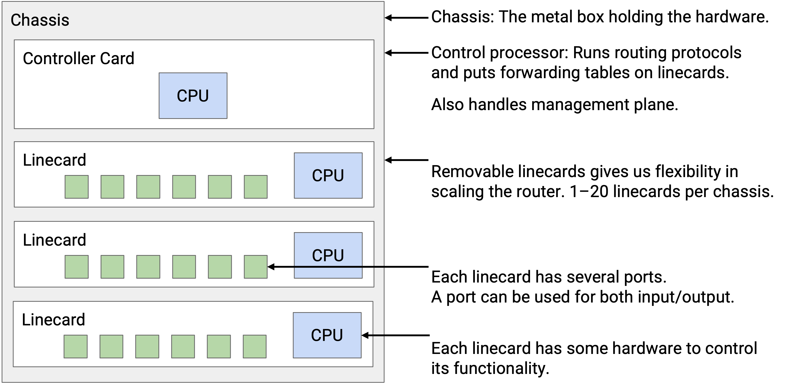

每个端口都需要能够把包送到其他端口，包括同卡和跨卡端口。从一个端口进来的包，可能要由另一张卡上的端口发出。

若在每一对端口之间都单独布线，效率很低。因此设备使用**交换结构（fabric）**连接线卡；每张卡还有专门芯片负责接入交换结构。

除线卡外，还有带 CPU 的**控制卡（controller card）**。它与其他路由器运行路由协议，计算路径，然后把正确的转发表项写入转发芯片。

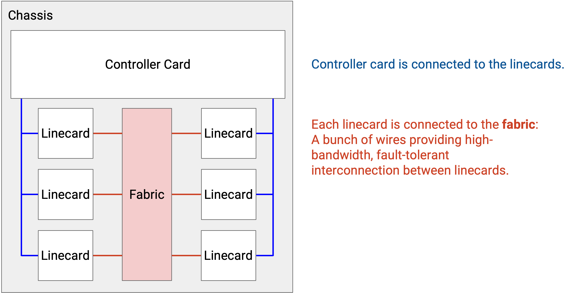

每张线卡也有本地 CPU，负责控制线卡功能，例如安装表项。卡上硬件还执行基本包处理，例如发包前更新 TTL；一张卡包含一颗或多颗专门针对转发优化的芯片。

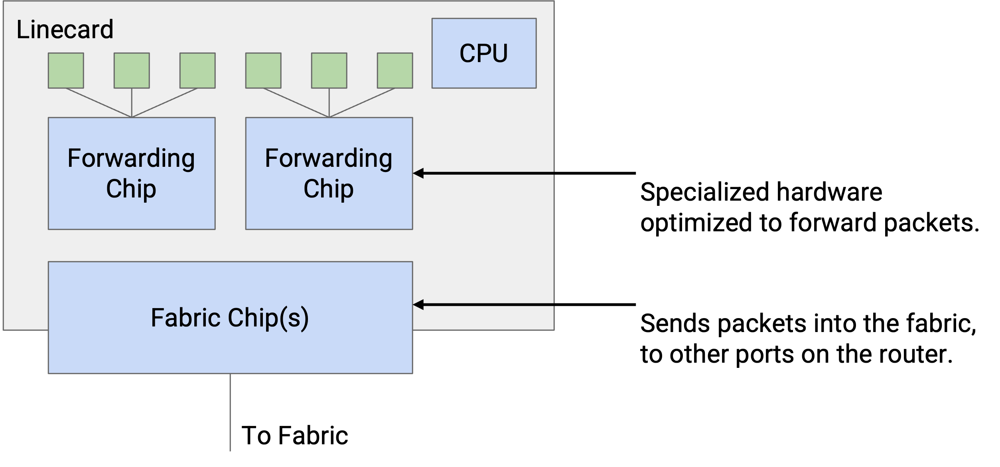

按平面分类，线卡转发芯片、交换结构及连接交换结构的芯片属于数据平面；控制卡承载控制与管理平面。

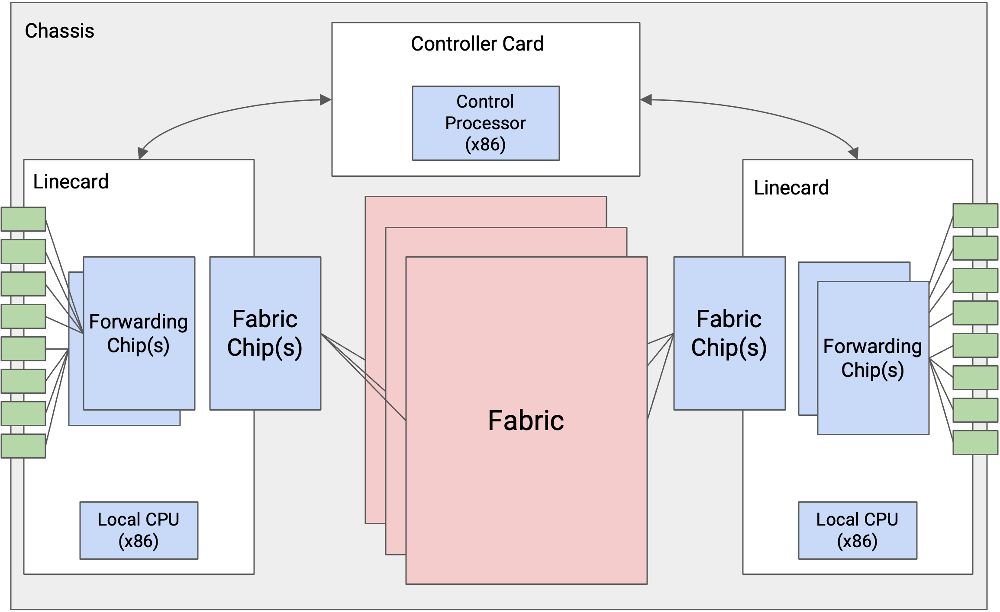

下图是真实设备：6 个槽位中，4 个装线卡，2 个装控制卡；还有风扇托盘用于冷却。连接线卡的交换结构位于后部，照片中没有显示。

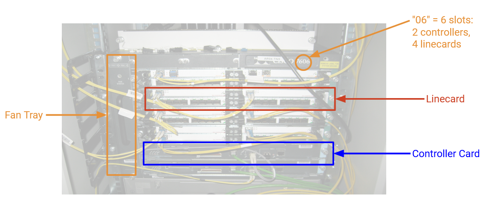

## 三种数据包

最常见的是**用户包（user packet）**，包含终端用户的数据。包进入设备后，转发芯片读取首部目的地址并查询出口。如果出口在另一张线卡上，便通过 fabric 把包送到相应线卡，然后从正确端口发出。

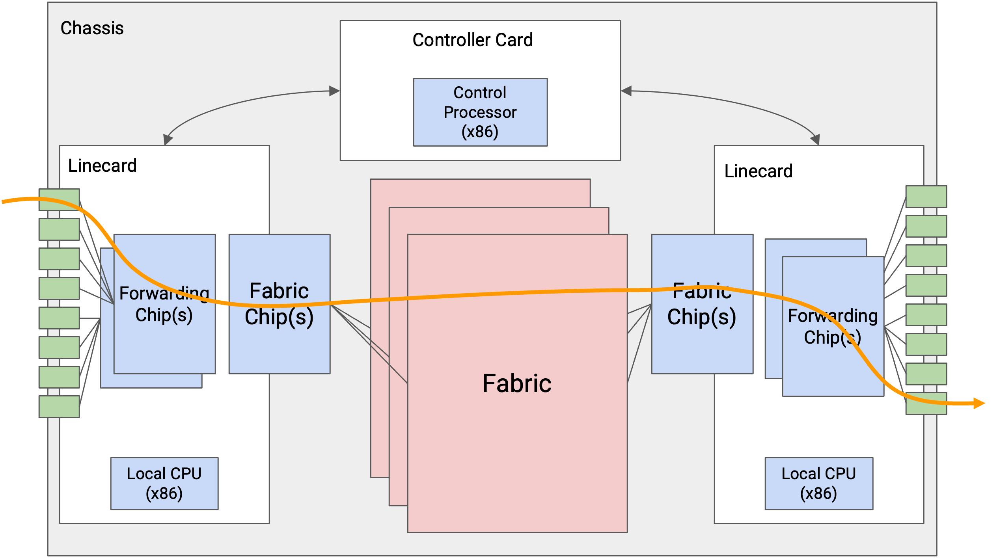

第二类是**控制平面流量**，其目的地就是路由器自身。例如路由协议通告是发给设备处理的，不是让它继续作为用户数据转发。转发芯片识别后，将包送到控制卡 CPU 执行协议逻辑。

第三类是 **punt 流量**：它原本是用户包，但需要额外特殊处理。例如收到 TTL 为 1 的包，不能继续转发，还可能需要向源端产生错误消息。转发硬件会把这种需要慢路径处理的包“踢上去”（punt）给控制卡。

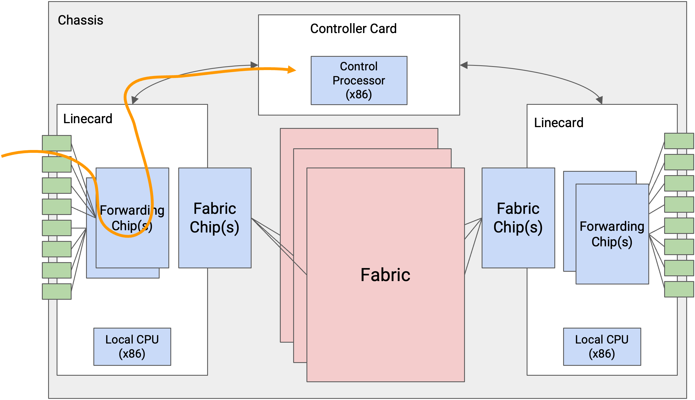

## 为什么要这样扩展路由器？

为什么不把所有功能都放在通用 CPU 的软件里？因为高端路由器需要处理的速率极大。

以单端口 400 Gbps、每包 64 字节计算，忽略链路额外开销时：

$$
\frac{400\times10^9}{64\times8}=781,250,000\ \text{包/秒}。
$$

教材原文接着写“36 端口需要每秒 560 亿包”，但这与前面的乘法不符。**编者核算：**单向 36 端口应为 $36\times781.25$ Mpps，即 **28.125 Gpps**；若另有双向计数口径才可能接近 56.25 Gpps，原文没有说明这种口径。真实包较大或加入线上开销时，具体包率也会变化。

原文用软件每包约 10 微秒（$10^{-5}$ 秒）与硬件纳秒级处理作数量级比较，说明普通 CPU 难以用逐包通用代码实现同等总体吞吐。它又举“每包约 10 纳秒”的概括，不应把该数字与上面的单端口包间隔混成一个精确预算：上述单端口计算对应约 **1.28 纳秒/包**。设备可以用多流水线、并行硬件承载总吞吐，并非必须让一颗串行处理器在一次时钟中完成全机所有工作。

将数据平面线卡与控制平面 CPU 分开，形成了**快路径（fast path）**和**慢路径（slow path）**。绝大多数包只经过优化过的转发硬件；只有必要时才调用控制 CPU。这样的专用组件能在功耗、价格和物理空间方面比同等规模通用计算更有效率。

## 线卡的具体工作

收到包时，线卡先把光或电信号解码成比特。这是 **PHY** 部分，承担第一层物理层功能。

得到比特后，还要解析它们、定位协议首部，并完成必要的链路层工作。例如共享链路可能还需进行相应媒体访问处理。线卡的 **MAC** 部分承担第二层功能。

识别出 IP 包后，需要继续解析：是 IPv4 还是 IPv6？目的地址在哪里？查表应选择哪个出口？还是必须 punt？

还可能要修改 IP 首部。TTL 应递减；IPv4 首部改变后需更新其校验和。选项、分片等字段有时也需特殊处理，后续 IP 首部章节会详细讨论。**编者注：**IPv6 基本首部没有 IPv4 式首部校验和，不能把这个动作不加区分地套用于 IPv6。

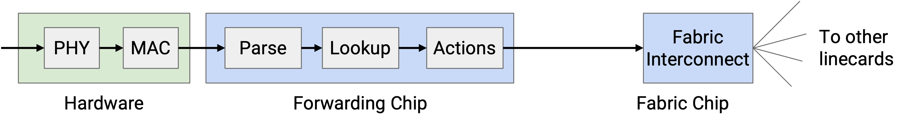

这些工作必须在非常短的时间预算内连续处理大量包。原文举出“即使一周期完成也需 0.2 GHz”的估计，用意是说明需要硬件化；由于未给出与它一一对应的端口数、包长与并行度，它不应作为所有线卡的固定频率结论。实际每个处理过程可能跨多个周期，而且一颗转发芯片往往支持多个端口。

转发芯片针对有限操作高度专门化，例如读取首部和查表，不能像通用 CPU 那样随意运行任意程序。若包要求硬件不支持的功能，可以交给控制卡 CPU。

TTL 递减这类简单动作容易硬件化；特殊选项等复杂操作常需慢路径。现代互联网尽量避免不必要的特殊选项，让更多流量留在快路径；若全部 punt，控制卡很快就会过载。

连接 fabric 的芯片也高度专门化，负责把包送往其他线卡，往往是整个设备中性能要求最高、专用性最强的组件之一。

## 数据包排队：原教材正文缺口

固定版本的 **Packet Queuing** 小节没有写成文字解释，只有一张图和作者的未完成标记。这里完整保留已经存在的图，不制造一段冒充原作者正文的译文。

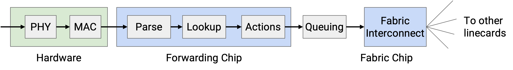

**编者图注：**这张图能直接支持的事实是：本章所画流水线增加了 Queuing 阶段，位置在 Actions 之后、Fabric Interconnect 之前。它没有单独给出队列分类、调度、丢弃策略的文字定义。有关这些概念的独立学习解释见 [L8 笔记](#/c/berkeley-cs168-2025/lec/lec08?v=notes)，不是本小节不存在的原文翻译。来源状态登记为 `upstream_incomplete`。

## 高效查找转发表

高速转发意味着必须高速查表。困难之一是表项可能表示 IP 地址范围，如 `192.0.1.0/24`，这些范围还可能重叠。

最理想的精确匹配办法，是表里每个目的地址一行，查目标地址即可。如果把一个 /24 展开，就得到 256 行。例如下面的 `2.1.1.0/24 → 5` 会展开为 2.1.1.0 到 2.1.1.255 的 256 个相同出口表项。

这浪费硬件存储空间；而且路由变化时需要更新大量条目。因此不能靠把范围全部展开来解决。

正确的查表语义仍是**最长前缀匹配**：多个范围都匹配时，选固定前缀最长的。若没有更具体匹配，则使用默认路由；如果默认路由也没有，丢弃数据包。**原文勘误：**此处原文把默认路由写成 `0.0.0.0/32`，应为 **`0.0.0.0/0`**；/32 只表示一个精确地址。

怎样高效实现它？先把表项与目的地址写成二进制，逐位检查匹配情况。

原文随后描述了另一个尚未与图同步的四行例子：前 21 位四行都匹配；第 22 位为 1，淘汰该位为 0 的第一行；第 23 位仍为 1，淘汰第二、三行，只剩第四行，其 23 位前缀全部匹配。继续检查更长前缀，最后从所有完整匹配中选最长的。

**编者核对图示：**该文字与固定图 2-128 不一致，源文件也明确标注需要重写。实际图中第一行与第二行匹配，第三行在首字节就不同，第四行也在较早位置不同；第一行比第二行更长，因此选端口 5。两者表达的共同算法是逐位淘汰不匹配项，并记住已完全匹配的前缀；不能把原文第 21–23 位的推演强套到当前图中。

若朴素实现为“每检查一位都扫描所有表项”，运行时间仍随表项数量增长。能否利用数据结构避免每次扫描整张表？

## 用 trie 高效匹配

数据结构中的**前缀树（trie）**适合存储字符串键的映射。这里字符串就是地址比特串。树把键逐字符（逐比特）展开，因此很适合最长前缀匹配。

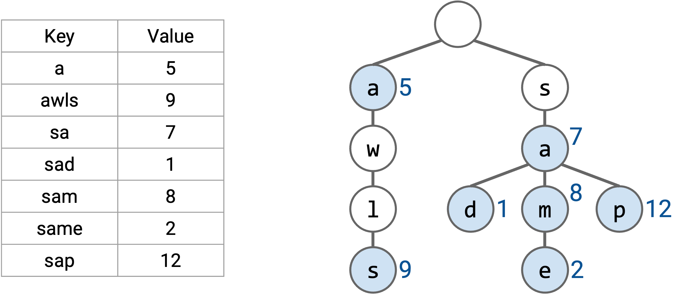

图中存储 `a→5`、`awls→9`、`sa→7`、`sad→1`、`sam→8`、`same→2`、`sap→12`。若查询某个单词的最长前缀，就从根开始按字母走；沿途带有值的节点是可用前缀，选其中最深的。

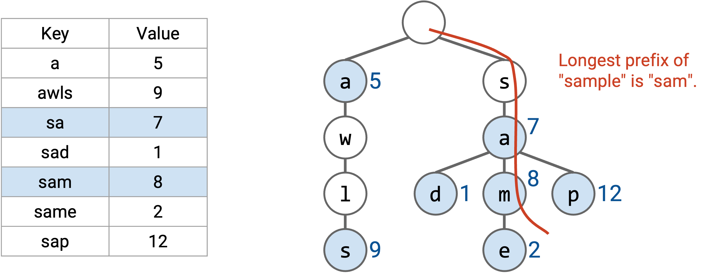

转发表采用同样思路：根节点表示空串，第 1 层表示第一位，第 2 层表示前两位，依次类推。每个节点代表一个前缀。例如第二层的 `11*` 表示两位前缀，第三层 `100` 表示三位前缀。某前缀属于转发表，就在相应节点记录出口；不属于转发表的节点不记录值，图中用白色表示。

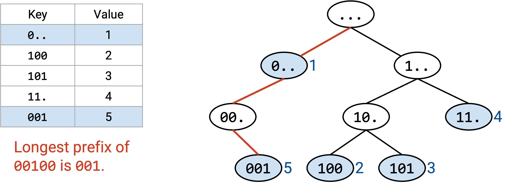

每读取地址的一位，只访问树上一个节点。对于固定 32 位 IPv4 地址，至多考察 32 层；即使表中有几百万项，也不会逐一扫描几百万行。更一般地说，复杂度随地址宽度 $W$ 为 $O(W)$；把 IPv4 的 $W=32$ 视为常数时，才称查找时间不依赖表项数。

若前缀范围互不重叠，可把有效项放在叶节点；若范围重叠，内部节点也可能有值。查询沿地址位向下走，遇到缺失分支便提前停止，从已访问的有值节点中选最长者。

实现时，可以一路维护“目前最长匹配”。越往下前缀越长，所以每遇到一个有值节点就覆盖记录；走不下去时返回最近记录，不必再反向扫描整条路径。

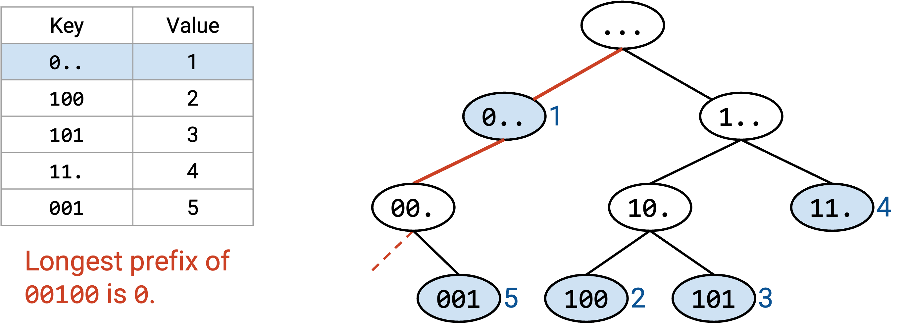

**图像勘误：**图 2-132 标出的查询文字仍为 `00100`，但所画虚线走向 `000` 的缺失分支，才会退回 `0*`；按图 2-131 的树真正查询 `00100` 应命中 `001`。这里保留原图并明确区分“回退算法”与不一致的示例标签。

默认路由位于根节点，因为它的前缀长度是 0。只有沿查询路径找不到更具体的有效项，才最终采用根节点的值。

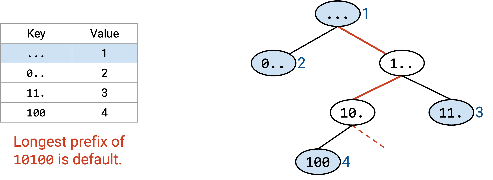

所有路由器都需要某种最长前缀匹配能力，但具体实现可有更高级的优化。例如热门目的地可更高效地缓存，同一端口对应很多范围时可压缩结构，还可利用互联网常见前缀长度和更新模式优化。教材举 IPv4 域间路由通常不接收比 /24 更具体的前缀作为实践约定；这不是说硬件或 IP 地址本身不能处理 /25–/32，本地网络仍可能使用它们。

## 引用与来源

- 原著：Peyrin Kao，依据 Sylvia Ratnasamy、Rob Shakir 等人的讲授，*CS 168 Textbook*，指定阅读 [Router Hardware](https://textbook.cs168.io/routing/router.html)。本文翻译全章现有文字及全部图 2-114–2-133；原教材没有写成的排队正文明确单列，不冒充已存在的原文。
- 固定版本：[0b8208742d31df7fc3d53a0cd94fdd4e04f8d47e](https://github.com/berkeley-cs168/textbook/blob/0b8208742d31df7fc3d53a0cd94fdd4e04f8d47e/routing/router.md)，2026-10-01。现有源还包含逐位匹配解释未与图同步的问题，已保留其论述并单独纠正图示。
- [教材许可证据](https://textbook.cs168.io/#license)、[CC BY-SA 4.0](https://creativecommons.org/licenses/by-sa/4.0/)。译文和中文图注同许可；修改包括中文翻译、显式勘误、计算量纲说明与来源缺口说明。硬件照片来自教材，不是课堂视频截图，也未独立核查图中设备的产品参数。
- 本页不声称给未写成的小节补出了作者原文，不声称验证了运行时硬件性能；视频／slides 的许可另行记录。

- 显示修改：教材透明原图采用白色底衬，确保深色主题中的黑色文字与连线可读；原图文件字节未更改，白底不是新绘制的课堂画面。
