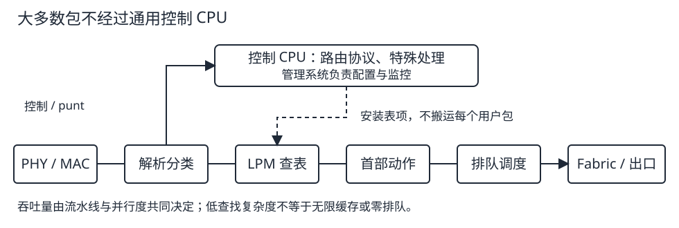

# 核心问题：算法只需查表，为什么还需要专用硬件？

路由器既要在网络变化时计算复杂路径，又要连续处理海量数据包。把这两类工作放进同一条通用软件路径，会让每个普通包都承担不必要的控制开销。

本讲的主线是**分工、数量级与正确查找**：控制面决定规则，数据面高速执行，管理面让运营者配置并观察整个设备。

## 1. 不要把三平面误当成三个互不相干的盒子

| 平面 | 主要问题 | 典型动作 |
|---|---|---|
| 数据面 | 这个包现在从哪里出去？ | 解析、查表、修改首部、排队、转发 |
| 控制面 | 表应该怎样改变？ | hello、路由通告、最短路、下发表项 |
| 管理面 | 运营者希望设备怎样工作？实际是否如此？ | 配置策略、链路代价、读取遥测、故障监控 |

“控制面慢”指常见工作频率与逐包快路径不同，不意味着可以不顾收敛时间。数据面与控制面也不是完全分离：控制面会向转发芯片安装新状态；特殊包可能由数据面转交控制 CPU。

图为编者自拟的功能图，不是厂商电路图，也不是课堂截图。实际设备可有多级流水线、多个缓冲位置和多种并行结构。

## 2. 从每秒比特推导每秒包

单端口 400 Gbps、64 字节包，忽略前导码、帧间隙等额外线上开销：

$$R_{pps}=\frac{400\times10^9\ \mathrm{bit/s}}{64\ \mathrm{byte}\times8\ \mathrm{bit/byte}}=781.25\ \mathrm{Mpps}.$$

平均包到达间隔约 $1/R_{pps}=1.28$ ns。若同口径下有 36 个这样的端口，总输入需求约 28.125 Gpps；288 个端口的比特率总和为 115.2 Tbps。

这些是**流量预算计算**，不是实测芯片性能。不同端口方向的统计口径、包长分布和以太网开销都会改变数值。

课件／教材的“781 Mpps × 36 = 56 Gpps”缺少能解释翻倍的口径，直接乘法不成立；课件“10 ms = 0.00001 s”也有单位错误，后者是 10 μs。教材已有微秒写法。本页保留正确计算，不把来源笔误解释成新硬件能力。

高吞吐不要求每个包的总处理延迟都小于包间隔：流水线可以让很多包同时处在不同阶段。要区分**流水线吞吐间隔**与**一个包走完整条流水线的延迟**。

## 3. 用户、控制、punt 三种处理路径

普通用户包：入口端口 → PHY/MAC → 转发芯片 → 必要时跨 fabric → 出口端口。一般无需每包经过控制 CPU。

控制包：如路由协议消息，其目的就是设备本身，交给控制逻辑处理。

Punt 包：本来是用户流量，却需要快路径未支持的特殊处理。例如某些设备遇到 TTL 即将耗尽，需要丢弃并产生错误响应。具体哪些动作硬件完成、哪些上送 CPU，依赖实现；不能把教材例子推广成所有厂商的强制电路。

关键工程限制是：慢路径资源有限。即便支持任意复杂处理，也不表示可以把线速全部流量都 punt 而仍不丢包。

## 4. 排队不是一个“等待”按钮

以下是依据课堂约 35:59–38:56 的分类／缓存／调度主题作的**编者独立推导**。固定教材 Packet Queuing 只有图，没有写成正文；这里不是把不存在的原文补译出来。

排队至少有三个决定：

1. **分类：**这个包进入哪个队列？例如按出口或业务类别区分。
2. **缓存管理：**容量不够时保留谁、丢谁？Tail drop 是队列满时拒绝新到包的简单策略。
3. **调度：**出口空闲后选哪个包／队列？FIFO 是按先来先服务，多个队列还需额外选择规则。

自拟简化模型：队列当前有 $Q$ bit，本轮到达 $A$ bit，出口可服务 $S$ bit，容量为 $B$。不考虑事件次序细节的粗粒度余额为

$$Q' = \min\{B,\max(0,Q+A-S)\}.$$

超出容量的部分无法无限保存，必须由具体丢弃规则处理。持续到达速率大于出口能力，增加有限缓存只会推迟溢出，不会凭空增加链路容量。

同一出口前已经排了 $Q$ bit，速率为 $C$ bit/s，则仅这些数据造成的等待数量级为 $Q/C$。这解释了为什么“芯片查表很快”仍可能有很大排队时延。

## 5. 最长前缀匹配的正确性比结构名字重要

逐地址展开一个 /24 会产生 256 项；展开 /8 会产生约 1600 万项。空间大，路由改变时还要同步更新大量重复记录。保持前缀结构更合适。

朴素方法检查所有前缀，确认哪些匹配并选择最长者。若有 $N$ 项、地址宽度 $W$，逐位比较的简单实现可能付出 $O(NW)$ 工作。

Trie 用共享前缀组织这些键：沿目标地址的位走树。最重要的不变量是：

> 读完前 $k$ 位后，`best` 保存已走过路径上、确实带有路由值的最深节点；不是刚走到的任意节点。

自拟 5 位地址表：`*→P`、`0*→Q`、`001*→R`、`11*→S`。

- 查询 `00101`：先匹配根 P，再匹配 0 的 Q，最后匹配 001 的 R，返回 R。
- 查询 `00011`：走到 00 后缺少相应分支，返回此前的 Q，不能返回没有表项的 00。
- 查询 `10101`：路径上没有比根更具体的有效项，返回 P。
- 如果根也没默认路由、整条路径没任何有效项，应判无路由，而不是随便选某个叶子。

固定 IPv4 位宽时至多读 32 位；更准确的复杂度是 $O(W)$，与 $N$ 不线性相关。它不意味着空间、更新成本也与 $N$ 无关，更不意味着一次内存访问就完成了全部查找。

## 6. 自测

① 查表过程只沿地址走到最后一个节点并返回，错在哪里？

最后节点可能只是结构节点，没有路由；应保存沿途最近的有效匹配，并在缺失分支或读完地址时返回它。

② IPv4 /0 放在 trie 哪里？/32 呢？

/0 在根上，是最不具体的默认项；/32 在读完全部 32 位的位置，精确匹配一个地址。

③ 单包有 50 ns 处理延迟，是否一定不能支持 1.28 ns 平均包间隔？

不一定。若流水线及并行资源允许很多包在途，单包延迟可以明显大于吞吐间隔。必须看各阶段吞吐能力和争用，而不只看端到端延迟。

④ 数据面能继续转发，是否证明控制面失效没有影响？

只能说明旧表仍在使用。拓扑变化后，不能更新的表可能过时，最终可达性与恢复能力会受影响。

⑤ 一个出口持续收到 12 Gbps，而只能发 10 Gbps；加大队列能长期避免丢包吗？

不能。净积压为 2 Gbps，有限缓存最终满；更大缓存只增加可承受突发时长与可能的等待时间。

## 课堂回看索引

| 时间 | 实际内容／核心问题 |
|---|---|
| 00:00–08:40 | 开头 3.320 秒无字幕；课程安排、真实设备与容量 |
| 08:40–24:06 | 三平面、机箱、线卡、fabric 与组件问答 |
| 24:06–30:38 | 用户／控制／punt 包，为什么需要快慢路径？ |
| 30:38–38:56 | 转发流水线、分类、缓存管理与调度 |
| 38:56–46:17 | 专用硬件取舍与组件进一步问答 |
| 46:17–54:56 | 范围查找、LPM、朴素扫描为何昂贵？ |
| 54:56–60:51 | 字符串 trie、地址区间与对齐问题 |
| 60:51–74:07 | IP trie、课堂修正例子、默认根与复杂度 |
| 74:07–76:29 | 总结、课程提醒和最后的 trie 轶事 |
| 76:29–76:32 | 末尾无字幕记录，未核验音画 |

重点：**35:59–38:56** 补足教材未写成的排队主题；**60:51–69:53** 为 IP trie 和默认路由。时间取整到秒，实际最后 cue 到 76:28.920，剩余 3.080 秒无字幕。

## 引用与来源

- [官方课表](https://sp25.cs168.io/)，视频 4592 秒；1912 条自动字幕按顺序全部读完，含问答、修正例子及片尾。未听音轨、未观看视频、未制作截图，不能确定每个口误是讲者还是 ASR 引入。
- 指定阅读 *Router Hardware*，Peyrin Kao 等：[完整现有正文翻译与全部原图](#/c/berkeley-cs168-2025/lec/lec08?v=materials)，固定 commit `0b8208742d31df7fc3d53a0cd94fdd4e04f8d47e`，CC BY-SA 4.0。源教材的 Packet Queuing 正文未写成、逐位匹配例子与图不一致，均标为来源限制而非隐瞒。
- [L8 slides](https://docs.google.com/presentation/d/1XmAVR1WizmgTzua_36Yq_YQRXI2m2eqOpejtu7XWTeI)，42 页提取文本全文读取；课件图像未单独观看。教材硬件图另已查看，但不据此宣称视频中画面已验证。
- 本页数量级计算、队列余额模型、trie 小例及 SVG 为编者原创分析；没有运行硬件性能测试。视频许可未知，课堂整理不是全文翻译。
