# 一、域间路由模型

## 域间路由

互联网是网络的网络。我们已经研究距离向量和链路状态协议，知道它们怎样在一个局部网络内部计算路径。现在建立一个模型，描述不同局部网络之间怎样路由，并理解域内、域间协议怎样合作，让包到达任意网络中的主机。

## 自治系统的定义

**自治系统（autonomous system，AS）**是同一运营者管理的一个或多个网络。例如 Google 内部可能既有员工网络，也有数据中心网络；它们可以同属一个管理实体，由其部署域内协议，实现各局部网络之间的内部通信。有时人们把 AS 非正式地叫作 domain，但 domain 在其他协议中也有含义，因此本文尽量称 AS。

研究 AS 之间的路由时，可以把 AS 内的路由器和主机暂时隐藏，把整个 AS 当作一个节点。两个 AS 之间的边表示它们有互联关系。得到的图称为**域间拓扑**或 **AS 图**。

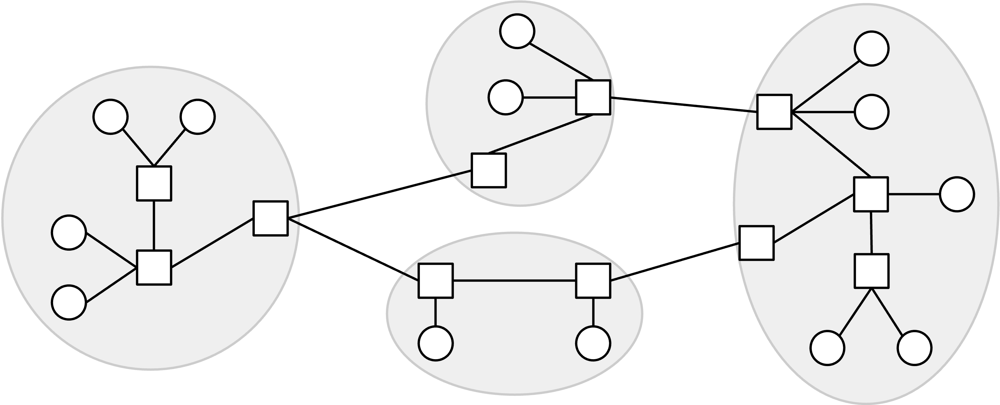

## 自治系统简史

全球 ASN 分配体系由 IANA 协调；组织申请并获得唯一的**自治系统号（ASN）**。教材以“向 IANA 注册”概括流程。**编者注：**现实中的具体分配通常通过区域互联网注册机构等分级体系完成，不应理解成每家组织都直接向 IANA 办理。

早期 IANA 的工作曾由 Jon Postel 一人手工管理，想登记新 AS 的人需要获得他的批准。教材历史数据中已有超过 90,000 个 AS，美国拥有最多的 AS。

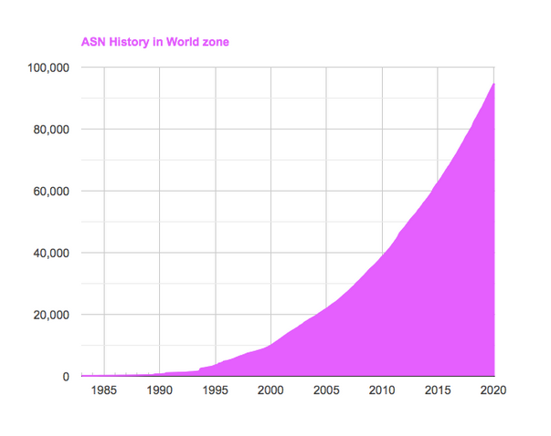

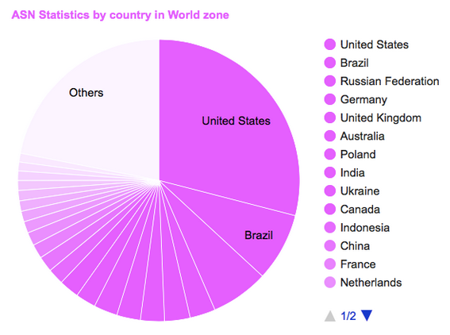

伯克利的 ASN 是 25。在如此多编号中，这个数很小，反映它在 1980 年代互联网早期便获得了编号。图和数量是原教材历史说明，不是本次对当前 AS 总数的统计。

## Stub 与 Transit

域内模型区分终端主机和路由器，域间模型也有相似区分。

**末梢自治系统（stub AS）**只为自己内部的主机提供互联网接入，代表内部主机发送、接收数据，不替其他两个 AS 中转流量。它类似只收发自己数据、不转发他人数据的终端主机。例子包括为员工提供网络的银行、为学生员工提供网络的大学。世界上绝大多数 AS 属于这类。

**传输自治系统（transit AS）**为其他 AS 转发流量，可以在两个其他 AS 之间接收、转发数据。它们对应出售互联网连接服务的公司，例如 AT&T、Verizon。规模可以是全球性的，也可以是区域性的，例如教材中服务加州的 Sonic。

Transit AS 自己当然也能有收发数据的主机，但它在模型中的核心角色类似域内路由器：替别人中转。

现实分类并非总是清晰。Google、Microsoft、Amazon 运营规模很大的 AS，承载的流量可能不亚于传统 transit。因为主要收发自己服务的数据，它们可被视为 stub；近年来又提供其他 AS 间的传输服务，因此也可能表现出 transit 特征。这里采用简化分类，不把它当成所有公司的固定标签。

## 商业关系决定 AS 图的边

为什么一家银行与 Verizon 同意互相交换流量？AS 之间的边不只是物理电缆，也体现商业关系。本章使用两类关系。

- **客户—供应商（customer–provider）：**客户付费，供应商出售连接服务。例如银行向 Verizon 付钱，以便与互联网其他部分通信。
- **对等互联（peering）：**两个 AS 根据合同交换流量，通常希望双方量级相当，并在常见的无结算对等模式下不互相付传输费用。

**编者注：**这是课程商业模型；现实中也有付费对等、复杂结算与关系例外，协议本身并不强制所有对等关系免费。

## 带商业关系的 AS 图

图中，有向边从**供应商指向客户**；无向边连接对等 AS。同一张图可以同时包含这两类边。

Stub AS 只是客户，所以有来自供应商的入边，没有向其他客户出售服务的出边。Transit AS 可以作为供应商，出箭头表示向哪些组织提供连接。

最重要的是：**箭头不是数据包方向。**客户付费通常同时购买向外发包与从外收包的能力，所以有向商业边上的数据包可以双向传输。

## 无环性

在本模型中，客户—供应商构成的有向关系图无环。不能出现 A 付 B、B 付 C、C 又付 A 的依赖圈，也不能绕一圈变成某 AS 为自己提供上游连接。

类比是：你向伯克利交学费，伯克利向 UC 系统付钱，而 UC 系统又向你交学费。这种环状服务关系不符合模型所想表达的商业层次。

无环条件**只约束客户—供应商有向边**。A–B、B–C、C–A 全为对等关系的环是允许的，因为没有形成上述付款／服务依赖环。也不能据此断言互联网物理图没有环。

## 供应商层次与 Tier 1

有向无环关系可以按层次摆放，使所有 provider→customer 箭头朝下：服务从上往下提供，钱由下往上支付，stub 通常处在最底层。

顶层是 **Tier 1 AS**，它没有供应商，因此没有这种商业入边。在课程的连通性模型中，所有 Tier 1 之间两两对等。

模型里，每个非 Tier 1 至少有一个供应商。从任意 AS 沿“客户到供应商”的上行链最终到达某个 Tier 1；顶层再通过对等连接互通。这样避免出现两个互不连通、各自只能在内部通信的“互联网”。要在该模型下保证全网可达，必须有相应上行可达性和顶层连接条件。

教材原文在这一解释之后留有一个未完成配图标记，没有对应的额外图文件；这里不伪造所谓缺失原图，现有图 2-139 已完整保留。

原文举 AT&T、Verizon、France Telecom、Telecom Italia、NTT Communications 等作为 Tier 1 或近似顶级运营者示例，并给出约 20 家的数量级。这些公司常拥有跨洲基础设施，例如海底光缆。它们属于教材历史语境，不是实时认证名单。

这种拓扑层次来自商业和政治选择。理论上可以只有一个全球顶级供应商，形成一棵以它为根的树，但那意味着一个实体控制全世界的互联网接入，政治上未必可取。

## 基于策略的路由

域内路由希望路径有效（无环、无死路）且便宜。域间仍需有效性，但每个 AS 有独立商业目标，与别的 AS 有客户、供应商、对等关系。因此，“好”不能再只用一项全局最小代价描述。

域间协议允许每个 AS 配置自己的**策略（policy）**，计算出的路径应尊重这些偏好。策略原则上可以任意，例如：

- “我不愿替 AS#2046 中转流量。”
- “我自己的流量更愿经过 AS#10，而不是 AS#4。”
- “除非必要，不要让我的流量经过 AS#54。”
- “工作日偏好 AS#12，周末偏好 AS#13。”

协议无须知道这些偏好的原因。例如不愿服务某 AS，可能因为它是竞争对手，协议无需判断理由是否合理。

最小代价算法无法直接表达这些任意策略。最小代价是大家共同求解同一全局目标；策略路由中，各 AS 只负责自己的偏好，不再一定存在所有参与者共同优化的一个数值函数。

## Gao–Rexford 商业规则

虽然协议允许任意策略，许多运营者遵循基于常见商业关系的惯例，课程称其为 **Gao–Rexford 规则**。直觉是组织喜欢挣钱、不喜欢无偿劳动。

第一条决定**选哪条路**：有多个可用路径时，优先选下一跳为客户的路径；没有客户路径时选对等路径；只有前两种都没有时，才选供应商路径。

客户支付服务费；对等通常不用付上游费用；供应商则需要自己付钱。因此次序是“客户优先，其次对等，最后供应商”，不一定是最短路径。

第二条决定**愿意参加哪些中转路径**：只有有客户为连接服务付费时，AS 才愿意转运。与距离向量“向每个邻居都通告”不同，AS 只对愿意承担的路径发出通告。

对一条穿过某 AS 的路径而言，路径两侧的相邻 AS 中，**至少一侧必须是它的客户**。逐项看六种组合：

**客户—本 AS—客户：允许。**两侧都是付费客户。

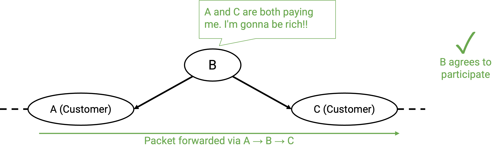

**客户—本 AS—对等：允许。**虽然对等不付费，客户付费。

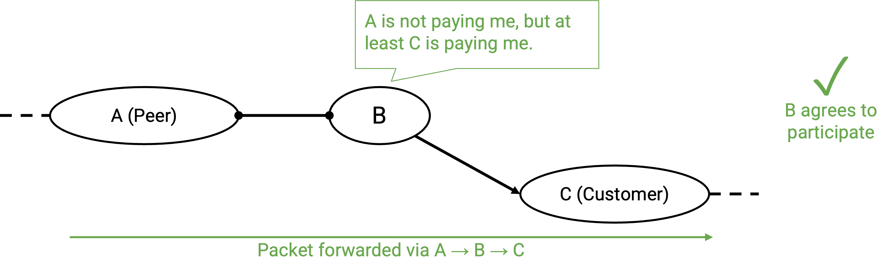

**客户—本 AS—供应商：允许。**可能看起来是客户把钱给我，我又付给上游，不一定净赚，但提供外部连接正是我的服务义务。如果拒绝这种路径，许多客户就无法访问互联网，自己的服务也失去价值。

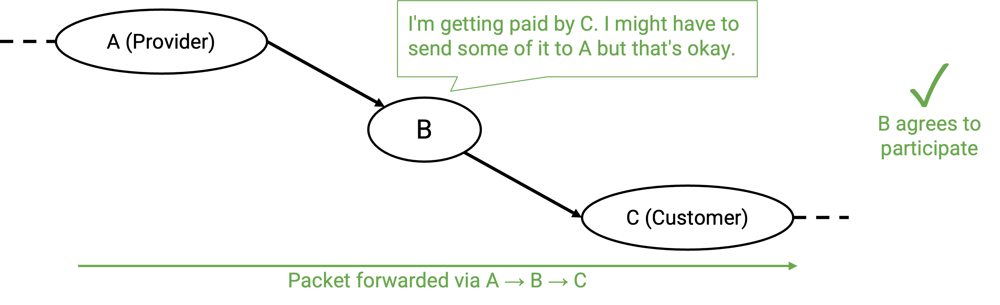

**对等—本 AS—对等：不允许。**没有一侧是付费客户，因此不愿给两个对等方免费做 transit。从层次图看，这禁止路径连续横向经过多条对等边。

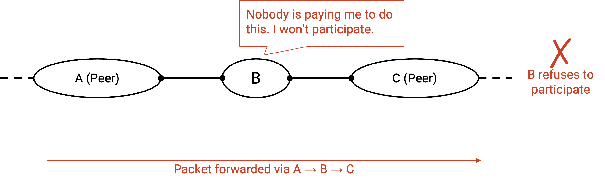

**对等—本 AS—供应商：不允许。**没有客户付款，还可能需要向上游付钱。更一般地，对等链路主要用来交换本 AS 及其客户锥的流量：从 peer 进来的中转流量只能继续发给客户，不能转给另一 peer 或 provider；来自客户的流量则可以转给 peer。

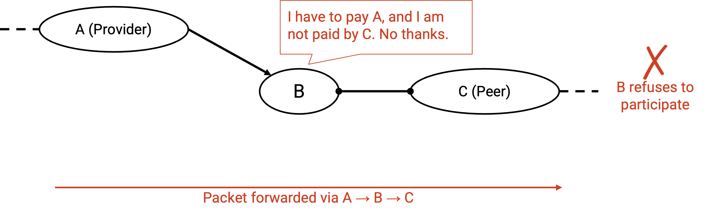

**供应商—本 AS—供应商：不允许。**自己要向两侧付钱，却没有客户为此购买服务。

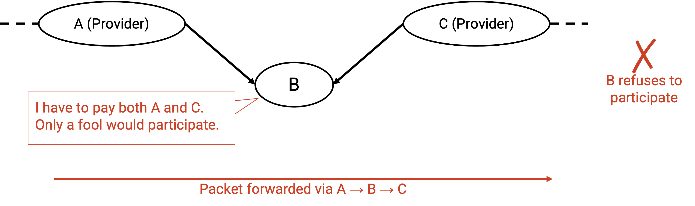

## 规则的完整例子

选路偏好与中转意愿是两件不同的事。虽然尚未介绍计算协议，但已经可以对一条候选路径逐节点检查策略。

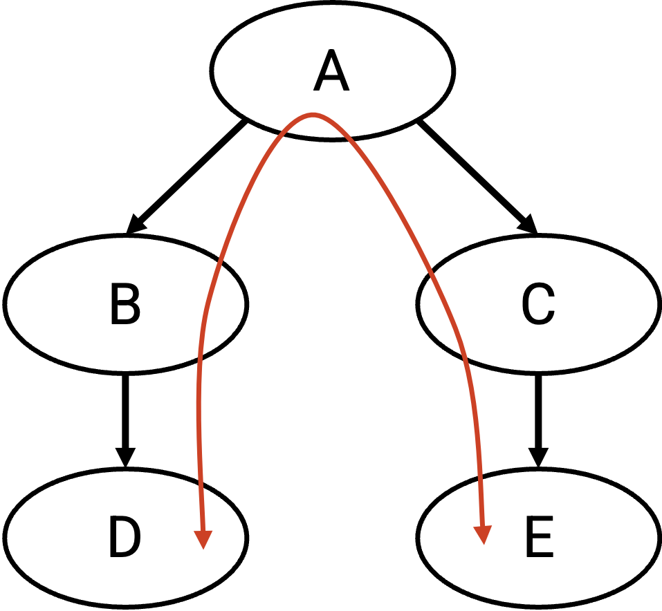

假设 stub D 的主机想与 stub E 通信。一条路径是 `D–B–A–C–E`，反向通信可以沿反向路径。谁付给谁？D 付 B，E 付 C，B、C 各自付 A。

A 两侧都是客户，所以愿意参与。B 的两侧是客户 D 和供应商 A，因为有客户 D，愿意参与。C 同样有客户 E，所以也愿意参与。

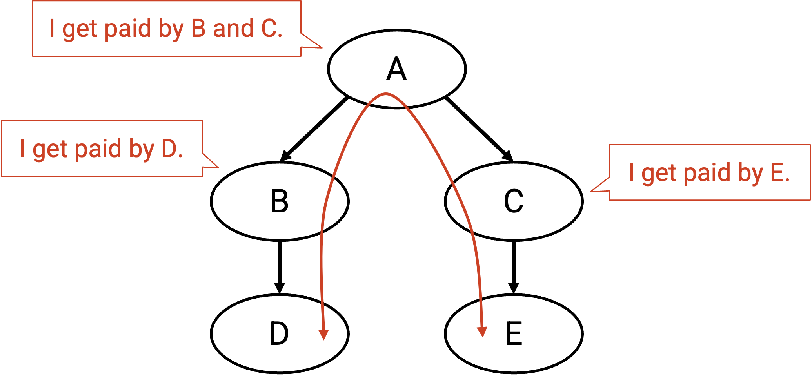

B、C 也许不想彼此通信还要都付给 A，于是建立对等互联，AS 图改变。

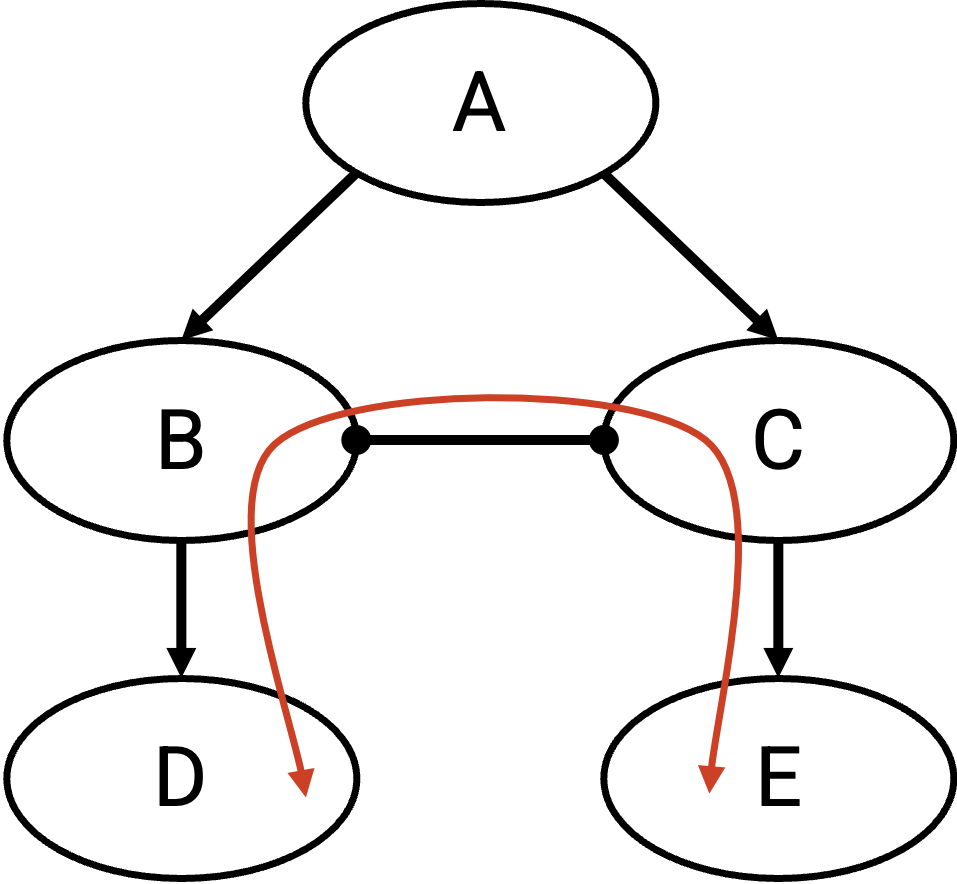

新的路径 `D–B–C–E` 中，D 仍付 B，E 仍付 C；B、C 不需为这部分互通向 A 付费，也不互相付费。

B 的邻居是客户 D 与对等 C，仍有客户；C 的邻居是对等 B 与客户 E，也有客户。双方都愿意参与。

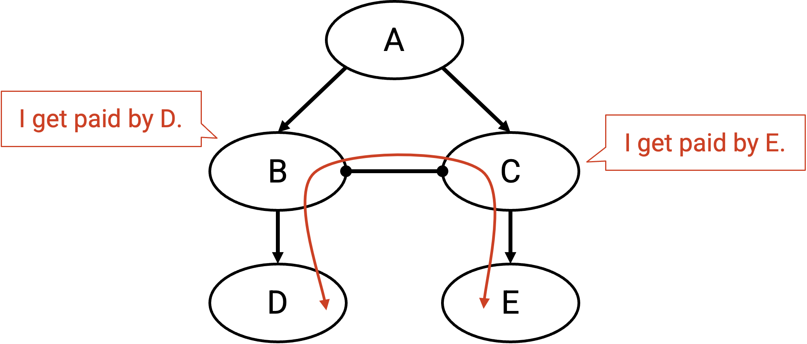

**原文勘误：**新增对等关系后的那一段把 C 称为 B 的 provider，与前后文及图不符，应为 peer。

现在 B 在 `B–A–C–E` 与 `B–C–E` 中选择。前者下一跳 A 是供应商，后者下一跳 C 是对等。按照偏好，对等胜过供应商，所以选择 `B–C–E`，得到最终 `D–B–C–E`。这个结论来自商业排序，不是单纯数跳数。

既然对等能省钱，为什么所有 AS 不都两两对等？建立连接也有成本，可能涉及设备、机房接入、铺设电缆等；运营者需要权衡建设成本与节省的传输费用。

## 路径必须无谷

将层次图中的客户→供应商称为“上坡”，供应商→客户称为“下坡”，peer 边称为“横向”，可以推导合法路径的形状。

走过一条对等边后，下一个中转节点只有继续向客户下坡才有人付费；不能再横向走向 peer，也不能上坡走向 provider。

走过一条下坡边后，到达的节点是从自己的 provider 收到流量，也必须继续向客户下坡；不能横向，也不能再上坡。由此可知：**一旦开始下坡，后面的中转边必须一直下坡直到目的地。**

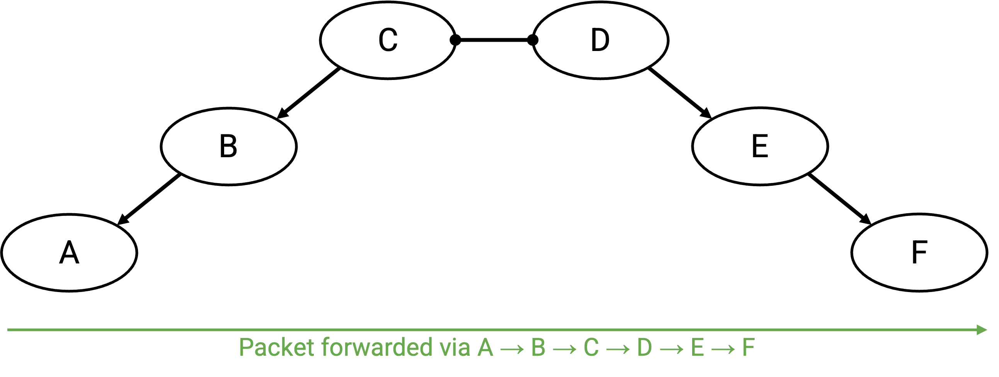

三条局部规则是：

- 上坡之后可以继续上坡、横向或下坡，因为上一跳是付费客户。
- 横向之后只能下坡，因为上一跳没有付费，下一跳必须是客户。
- 下坡之后只能继续下坡，因为上一跳是自己付费的供应商，下一跳必须是客户。

所以路径形状为：零条或多条上坡边，接着零条或一条对等边，再接零条或多条下坡边。它只有一个峰，没有先下后上的“谷”，横向移动也只能发生在峰顶，且最多一次。

这些不是要死记的几何规则，而是“中转节点至少有一侧客户”的直接结果。它们描述符合本商业模型的路径，不是说 BGP 从语法上禁止配置违反规则的策略。

## 自治与隐私

设计域间协议还要尊重每个 AS 的**自治（autonomy）**：AS 能独立选择策略，无须与所有其他 AS 协调，也不应被协议强制只能采用某一种商业规则。实践中通常遵循上述惯例，不等于协议禁止其他策略。

还要尊重**隐私（privacy）**：AS 不必向全网明确公开自己的偏好、策略，以及谁是客户、供应商或对等。竞争公司通常不想完整暴露自己的商业关系。

这不是“别人永远推断不出来”的绝对保密。AS 必须交换路由信息，其他人也可以观察数据路径，信息泄漏不可避免，存在反向推断拓扑和策略的方法。要求只是：协议不应强制每个 AS 公布“我为什么更喜欢这条路”或完整合同关系。

# 二、边界网关协议 BGP

## 历史背景

最小代价路由与图论最短路密切相关，后者在互联网出现前已有研究。教材追溯 Dijkstra 算法至 1956 年、Bellman–Ford 至 1958 年；早期路由可以直接借鉴这些思路。

早期互联网是政府资助、集中控制且规模较小的项目，还没有今天的自治系统结构。后来网络扩大并转向商业运营，不同公司需要即时发展适合各自独立策略的域间协议。

与已有成熟最短路理论不同，“每个 AS 都有自己的私有策略”并没有一个可以直接拿来部署的现成设计。BGP 在约 1989–1995 年间逐步形成，带有响应实际需求演化的特征。若今天从头设计，结果未必完全相同；但它已经表现出有效性与韧性，至今仍是互联网域间路由协议。因为网络间必须互通，不能各自采用彼此不兼容的域间语言。

## 以距离向量为起点

选择 BGP 的算法基础时，距离向量与链路状态哪个更合适？

链路状态要求参与者公开足以让全网独立计算的状态；若把任意政策也放进全局计算，就需要公开大量策略信息，不利隐私。它还依赖各节点使用相容的优化目标，如统一的最小代价，不符合每个 AS 自主选择策略的要求。

距离向量则允许各 AS 自己决定接受哪些邻居通告、拒绝哪些通告，以及向哪些邻居继续通告。每个 AS 无须知道其他所有 AS 的策略，只根据收到的消息计算自己的决定，因此是更合适的起点。

许多 DV 的核心思路仍然适用：通告针对目的地；可以先分析单一目的地，实际同时维护多个；节点不需要全局拓扑，只使用邻居信息；协议持续接收、处理更新，直到路由稳定。

术语有所变化：通告路径称为**导出（export）**，接收并选择路径的过程称为**导入（import）**。不过 DV 原来选择最短路，BGP 要按本地策略选择，这部分必须修改。

## 按策略导入、导出

BGP 中，每个 AS 只把愿意提供的路由导出给相应邻居；收到多条同目的地通告时，也不一定选最短，而是选策略上最优的路径。

记住方向：路由信息从目的地向外传播，真正的数据朝目的地转发。若 S 从 A、B、C 都听到某目的地的路径，S 的 import 选择决定自己的外发数据走向哪一个下一跳。

DV 的基础版本安装新路后向所有邻居通告。BGP 不这样要求。如果我不愿承担 C 的流量，就可以不把某条路径导出给 C。原因可以是商业关系，也可以是其他策略。

Export 关系到自己愿意接受什么入站中转流量：向邻居通告“我能到 D”，就意味着愿意让它把发往 D 的包交给我。因此导出不是单纯传播事实，也是参与路径的服务承诺。

一个后果是：**物理图连通，不保证策略图可达。**即便节点间存在链路路径，某些 AS 不愿导出必要路线，也可能使两个 AS 无法通信。要建立更强保证，需要对策略和图结构作额外约定。

## 实现 Gao–Rexford 规则

BGP 允许任意政策，但不能对任意政策保证全网互通。Gao–Rexford 是更有约束的一组商业规则；没有协议机制强制所有 AS 遵循它。若各 AS 同意遵守，可以获得更强的可达性与收敛性质。

规则以 Lixin Gao、Jennifer Rexford 命名。教材介绍两位研究者在 1990 年代运营环境中调查政策、提炼常见规则并分析保证的背景。

导入时优先客户路由，再选对等，最后供应商。相同关系类别内还需要平局规则，例如在两条客户路由之间再考虑性能或路径长度。商业类别优先不等于详细 BGP 决策过程已经只有这一条规则。

导出时应用“中转路径至少一侧为客户”：

**从客户学到的已选路径：可以向所有关系类别导出。**下一跳已经是付费客户，不管另一侧是客户、peer 还是 provider，均有一侧客户。

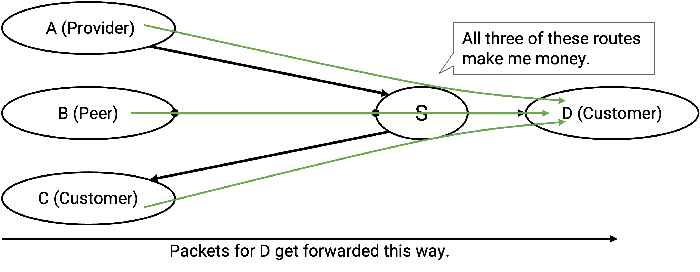

**从 peer 学到的已选路径：只向客户导出。**目前下一跳不付费，另一侧必须是客户；若导给 peer 或 provider 并被采用，自己就在两侧均非客户的情况下中转。

**从 provider 学到的已选路径：同样只向客户导出。**provider 不会为自己提供转运付钱，因此也必须让另一侧是客户。

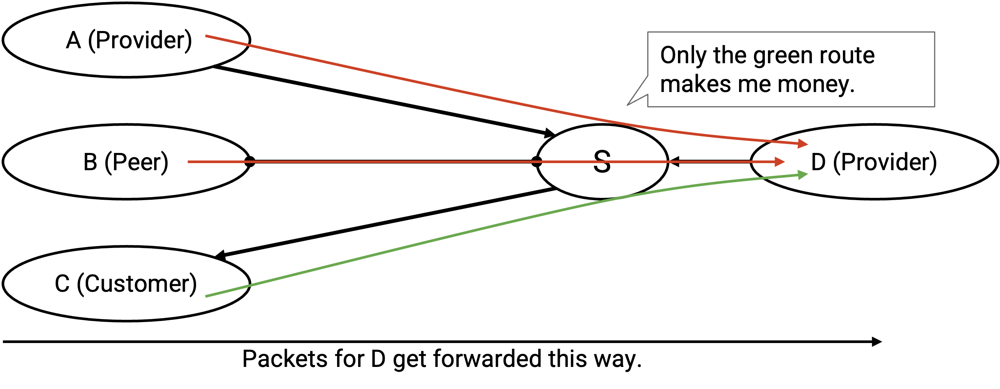

教材给出的结论是：若 AS 图具有上述无客户—供应商有向环的层次结构，并满足顶层互联等连通性假设，且所有 AS 遵循这些规则，则在固定环境下可以保证最终到达具有有效路径的稳态。

其中，**可达性**指模型中的 AS 可以互相通信；**收敛**指路由更新最终停止改变选择，得到稳定路径；“稳态”不意味着变化瞬间就正确，拓扑改变后仍可能需要重新收敛。层次意味着沿供应商链到达顶层，无环指商业有向关系不形成环；顶层对等连接是全局可达性讨论的一个额外关键前提。

如果节点采用任意政策，上述保证就不再自动成立；也不能把保证解释为故障链路会被算法修好，或任意物理分区仍然可达。

## 修改一：聚合目的地

DV 示例里，每个目的地用一个地址表示，表中记录下一跳与距离。BGP 则把目的地表示成 **IP 前缀**，可以用一条通告表达整个地址块。

教材先把一个 AS 简化成一个前缀，但实际一个 AS 可以起源多个前缀，前缀与 ASN 不是一一对应的两种写法。供应商若有许多客户，逐一通告每个小范围会产生很大的表；因此 BGP 允许适当聚合多个目的前缀，通告包含它们的更大范围。

**重要图例边界：**图中把 `12.1.0.0/16`、`12.2.0.0/16`、`12.3.0.0/16` 直接换成 `12.0.0.0/8`，后者还包含大量未列出的地址。仅凭“三条路下一跳相同”不足以证明这种扩大是等价的。必须保证对额外覆盖空间的通告权和转发责任正确，并处理更具体例外；不能据此把任意若干相似地址无条件汇总为 /8。原图保留，本注区分示意与有效聚合前提。

互联网常见实践也会限制接收的前缀大小。例如 IPv4 域间通告中 /24（256 个地址）通常是常见最小块，逐个主机地址通告往往被过滤。这是部署约定，不是 BGP 消息语法从根本上禁止更长前缀。

## 修改二：从距离向量变成路径向量

正权图上的稳定最小代价路径不会包含环，因为绕环只会增加代价。而按各自政策选路后，失去共同的距离下降目标，例如 B 喜欢经 C，C 又喜欢经 B，可能互相依赖。

**编者辨析：**原文用“DV 不必担心环”引出本节，这仅适用于正确收敛后的正权最短路；上一章已经展示 DV 在变化过程中会成环，不能否定那些反例。

为检测路径中的自身，BGP 通告携带完整 **AS 路径（AS_PATH）**，不再只是距离数字。因此它是**路径向量（path-vector）**协议。

例如 DV 中 A 说“到目的地代价 1”，B 接着说“代价 2”；路径向量中 A 说“路径 `[A]`”，B 向外通告“路径 `[B,A]`”。

收到路径后，AS 检查路径中是否包含自己的 ASN。如果包含，再把自己接到前面就会绕回自己，因此拒绝这条路径，不接受也不继续通告。只要节点按这个规则扩展路径，就不会发布因再次加入自己而形成的重复 AS 环。

路径向量还支持更细的策略。例如想尽量避开 AS#2063，如果只收到“距离 12”，不知道途中有没有它；若得到完整 AS_PATH，就能检查并决定接受或拒绝。

前面“客户优先于 peer、peer 优先于 provider”的常见导入规则只看直接下一跳关系，不必查看整个路径，但 AS_PATH 对环检测和更一般政策仍很重要。

**边界：**拒绝包含自身的通告，不等价于在任意异步状态中保证所有数据包无瞬态环，更不等价于任意政策必然收敛。后两者是另外的问题。

## 单上游 Stub 使用默认路由

并非每个 AS 都必须亲自运行 BGP。若一个 stub **只有一个供应商**，所有外部目的地的数据都应发给它，stub 可以只配置一条默认路由。

反方向怎么送到 stub？供应商可以安装一条指向 stub 的静态路由，再通过 BGP 把该前缀通告给互联网其他部分。Stub 请求上游代为发布，自己无须为了单一出口运行完整 BGP。

教材把许多小型网络概括为这样的末梢网络。它们类似域内模型的终端：收发自己的数据，不为别的 AS 中转。后续讨论常暂时忽略这些不参与选路的末梢，只考虑运行 BGP 的 transit 节点。

**编者注：**“只用默认路由”依赖单上游这一条件，不能推广成所有 stub 都不运行 BGP。多宿主 stub 也可能运行 BGP 选择出口，却仍不愿意给其他 AS 做 transit。

## 引用与来源

- 原著：Peyrin Kao，依据 Sylvia Ratnasamy、Rob Shakir 等人的讲授，*CS 168 Textbook*。指定阅读：[Model for Inter-Domain Routing](https://textbook.cs168.io/routing/autonomous-systems.html)、[Border Gateway Protocol](https://textbook.cs168.io/routing/bgp.html)。本页完整覆盖两章的模型、商业规则六种情形、D–E 完整例子、无谷推导、隐私自治、import/export 三种情况、聚合、路径向量与默认路由，并保留全部现有原图 2-134–2-164。
- 固定版本：[0b8208742d31df7fc3d53a0cd94fdd4e04f8d47e](https://github.com/berkeley-cs168/textbook/tree/0b8208742d31df7fc3d53a0cd94fdd4e04f8d47e/routing)，2026-10-01，非历史 2025 快照。AS 章节的一个额外配图位置尚未完成，正文及已有图全部可读。
- [教材许可证据](https://textbook.cs168.io/#license)、[CC BY-SA 4.0](https://creativecommons.org/licenses/by-sa/4.0/)。本中文译文、中文图注和明确标记的勘误同许可；没有把新解释伪称原作者补写。原图保留，错误或过度简化的例子旁给出边界。
- Gao–Rexford 原始论文未作为本页已阅读全文的来源；这里翻译并分析的是指定教材给出的商业模型，不把课堂简化定理当作完整论文证明。视频、slides 不继承教材再利用许可。

- 显示修改：教材透明原图采用白色底衬，确保深色主题中的黑色文字与连线可读；原图文件字节未更改，白底不是新绘制的课堂画面。
