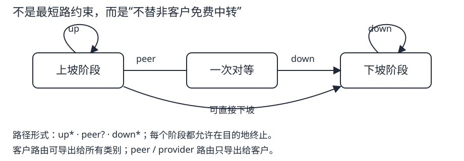

# 核心问题：为什么一条更短、物理可用的路径也可能不该走？

域内路由的节点通常服从同一运营者，可以共同最小化某种代价。域间路由却把多个独立组织连接起来：它们可能不愿为某些流量免费中转，也不愿公开全部内部信息。

BGP 因此不只是“大号最短路”。它把问题拆成**接收并选择哪些路线（import）**、**愿意向谁提供这些路线（export）**，再用路径向量携带检测环与执行政策所需的信息。

## 1. 先读懂商业边的方向

本课程用 `provider → customer` 表示服务关系，付款方向与箭头相反；peer 用无向边表示。**数据本身可以双向走**，因为客户购买的通常是收发两方向的连接能力。

Stub 只服务自己的终端，不愿替其他 AS 中转；transit 为别的 AS 提供中转。一个 AS 可以有多个前缀，也可以横跨多个物理地点，不能把 ASN、IP 前缀和单台路由器当成同一种对象。

客户—供应商关系在课堂模型中是有向无环的；这不禁止 peer 环，不禁止冗余物理链路，也不声称所有现实商业安排都能被两种关系完全刻画。

## 2. Import 与 export 分别影响哪一侧？

若 S 从 A、B、C 都收到“可到 D”的通告：

- **Import 选择**决定 S 发往 D 的数据从哪个下一跳出去。
- **Export 选择**决定 S 是否向某邻居承诺“你可以把发往 D 的数据交给我”。它影响哪些来包愿意经过 S。

路由通告从目的地向外传播，数据沿反方向流向目的地。只记住“进口／出口”字面含义而不先画数据方向，很容易把政策作用颠倒。

## 3. 不背表格，从服务义务推导导出规则

在 Gao–Rexford 商业模型中，一条**穿过自己**的路径，两侧直接邻居至少有一侧是客户，才有为其服务的理由。

因此：

- 如果当前所选路径从客户学到，下一跳已是客户，另一侧无论是什么关系都满足要求，可以导出给客户、peer、provider。
- 如果当前所选路径从 peer 学到，下一跳不是客户，只有把它导出给自己的客户才合规。
- 如果当前所选路径从 provider 学到，同理也只能导出给客户。

这里讨论的是在该模型中愿不愿做 transit，不是数值上的“每个包必定正利润”。客户付费、我再向上游付费，仍可能是履行完整互联网接入的服务义务。

自己的本地前缀是自己提供的目的地，而不是“从 provider 学到”的路径；通常会向需要得知它的邻居起源通告。不要把中转导出矩阵机械套到所有本地起源情形。

## 4. 从导出规则推导无谷路径

将客户→供应商记为 `up`，供应商→客户记为 `down`，peer 边记为 `peer`。

- 从客户收到包，说明自己处于一次 up 之后，可以向任何关系继续提供服务。
- 从 peer 收到包，若继续中转，只能发给客户，因此下一步 down。
- 从 provider 收到包，若继续中转，也只能发给客户，因此之后仍 down。

所以合法的路径形状为：

$$\mathrm{up}^{*}\;\mathrm{peer}^{?}\;\mathrm{down}^{*}.$$

原创图中的箭头是“下一条边类型”的状态推进，不是商业关系箭头。每一阶段都可以在目的地结束；不要求每条路径必须经历全部阶段。

为什么不允许 `down→up`？中间 AS 的前一跳和后一跳都是其供应商，没有客户付费。为什么不允许 `peer→peer`？中间 AS 在给两个 peer 免费做 transit。这比单纯背“路径只能一个峰”更容易检查复杂图。

## 5. 自拟完整选路例子

设 A 是 B、C 的供应商；B 是 D 的供应商，C 是 E 的供应商；B 与 C 另有对等连接。目的前缀位于 E。

1. E 起源自己的前缀，C 从客户 E 学到。
2. C 可以把客户路由导出给 provider A 和 peer B。
3. B 从 peer C 得到 `C–E`，也可能从 provider A 得到 `A–C–E`。
4. 商业导入偏好为客户优先、peer 次之、provider 最后，因此 B 选 peer C 的路径。
5. B 可以把这个 peer 路由导出给客户 D，但不能再把它导出给自己的 provider A，免得替 peer 与 provider 免费中转。
6. D 最终走 `D–B–C–E`：up、peer、down，符合无谷规则。

若拿掉 B–C peer，仍可走 `D–B–A–C–E`：up、up、down、down。若出现一条更短但需要某节点承担 provider→peer 中转的物理路径，它仍可能不被通告，不能只用最短路把它强行选出来。

商业类别优先通常先于 AS 路径长度。若客户提供五跳路径、provider 提供两跳路径，按该模型仍可优先选客户。具体 BGP 还有更多属性与同类平局规则，不能把本讲的简化排序冒充完整决策过程。

## 6. AS_PATH 解决环检测，不解决所有政策问题

纯 DV 只告诉邻居“距离几跳”，隐藏了实际依赖。路径向量通告如 `[B,C,E]`，使接收者知道将经过哪些 AS。

如果 C 收到路径 `[B,C,E]`，发现自己已在其中，就不应选择后再发布 `[C,B,C,E]`。常规扩展是在路径头部加入自己，检查自身可防止这类 AS 重复环。

还可以据此实现“尽量避开 AS X”这类策略；只知道距离无法判断是否经过 X。

但必须分开三个结论：

1. 通告的路径中没有自身重复；
2. 所有节点当前转发表拼起来没有瞬态问题；
3. 任意政策组合最终一定收敛。

它们不是同一件事。AS_PATH 自检不自动证明后两项。商业收敛结论需要固定拓扑／政策、无客户供应商环、合适偏好及导出约束；全局可达还依赖连通性、起源传播与顶层互联等条件。

## 7. 聚合与单上游默认路由的边界

同一下一跳的若干前缀可以被适当聚合，但聚合必须尊重地址空间。`12.1.0.0/16`、`12.2.0.0/16`、`12.3.0.0/16` 的并集**不是** `12.0.0.0/8`；后者覆盖更多地址。若无法对额外地址负责，不能把图上的缩写当成等价变换。

若只是希望精确压缩这三个块，可以保留 `12.1.0.0/16`，把第二、第三块合为对齐的 `12.2.0.0/15`。是否进一步发布更大的供应商聚合，则需额外的授权、可达性与更具体例外处理。

只有一个供应商的 stub 可以用默认路由发外部流量，让上游用静态路由和 BGP 代为传播自己的前缀。**多宿主 stub 仍可能运行 BGP**，但不因此自动成为愿意替别人中转的 transit。

## 8. 自测

① S 从 provider 学到 D，把它通告给另一个 provider，违反哪条商业条件？

一旦后者采用，经过 S 的路径两侧都是 provider，没有客户购买 S 的中转服务。按本模型不应导出。

② 一条路径的边类型是 up、peer、down、down，是否合法？down、peer 呢？

前者符合无谷形状；后者不符合，转折节点两侧为 provider 与 peer，没有客户。这里以中转节点检查，不把目的地自身终止当中转。

③ “客户优先”是说包只会发往自己客户的终端吗？

不是。它说在同一个目的前缀的多个候选路径之间，优先选直接下一跳是客户的那一条；客户可能进一步提供到其他网络的路径。

④ AS 7 收到路径 [4,9,7,12]，即使它很喜欢 AS 4，能接受吗？

常规 AS_PATH 自身检测应拒绝，因为路径已经包含 7。不能用偏好越过避免路径重复的基本检查。

⑤ 物理图连通是否充分保证 BGP 可达？

不充分。导出过滤可能使必要路线不可见；路径也可能被导入政策拒绝。可达性依赖政策与图结构的组合。

## 课堂回看索引

| 时间 | 实际内容／核心问题 |
|---|---|
| 00:00–07:02 | 开头 4.400 秒无字幕；AS、ASN、stub／transit 与提问 |
| 07:02–19:48 | 商业关系、箭头、无有向环、Tier 1 |
| 19:48–30:35 | 自治隐私目标、政策与商业选路偏好 |
| 30:35–47:27 | 哪些转运愿意承担？付款问答、无谷形状 |
| 47:27–55:05 | 可达／收敛的条件，故障与 Tier 1 问答 |
| 55:05–61:01 | BGP 背景、DV 起点、import／export 术语 |
| 61:01–70:37 | 导入导出推导及收费边界提问 |
| 70:37–74:42 | 聚合、多宿主与额外覆盖的质疑 |
| 74:42–78:58 | AS_PATH 自身检测与策略过滤 |
| 78:58–81:36 | 单上游 stub、总结与结尾邀请提问 |
| 81:36–81:37 | 最后 1 秒无字幕，不假造课后回答 |

重点：**61:01–70:37** 推导 export；**72:26–72:50** 的提问涉及聚合额外范围。边界依据完整字幕取整到秒。本页精确 CIDR 合并和逐步 AS 传播是编者整理，不宣称逐句对应课堂。

## 引用与来源

- [官方 Spring 2025 课表](https://sp25.cs168.io/)，视频时长 4897 秒，1991 条字幕全文按顺序阅读，包含政策、故障问答与片尾。音轨／画面未核验；没有已确认的实际课后问答在邀请之后出现。
- 教材 *Model for Inter-Domain Routing*、*Border Gateway Protocol*，Peyrin Kao 等：[L9 完整中译](#/c/berkeley-cs168-2025/lec/lec09?v=materials)。固定 commit `0b8208742d31df7fc3d53a0cd94fdd4e04f8d47e`，CC BY-SA 4.0，非历史 2025 版。材料页逐项保留全部现有图、peer 标签勘误和聚合前提。
- [L9 slides](https://docs.google.com/presentation/d/1Drzjne2Z-BfRmPN1irR-1fRuUTSdY4AQxLx91g376mI) 65 页可提取文本已全文读取，未逐页核验课件图形。Gao–Rexford 原论文未阅读全文，此处不冒称完成原论文定理证明。
- 本页是原创推导与自测，不是课堂逐字译文。视频／课件许可未知，不能套用教材许可。后续实现与 IP 首部内容由 L10 负责，不在此重复。
