# BGP 实现与问题

## 1. 边界路由器与内部路由器

到这里，我们已经对 AS 之间的 BGP 运作方式有了直观认识。本章把这个模型落实到一台台路由器，并说明 BGP 如何与前面介绍的域内路由协议协作。

此前的域间路由模型把整个 AS 看成一个导入、导出路径的实体。

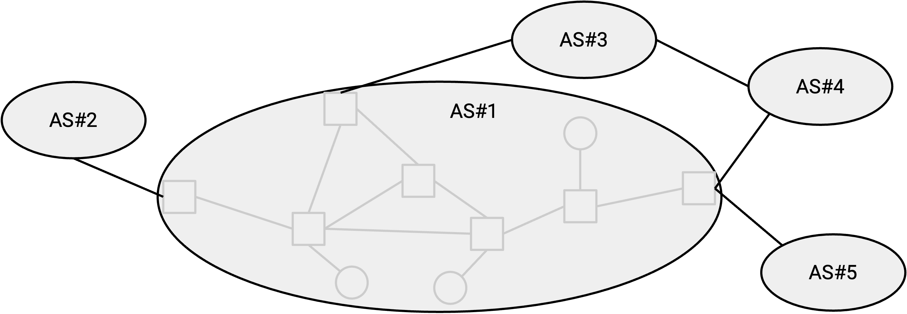

实际上，一个 AS 内有许多通过链路连接的路由器和主机。

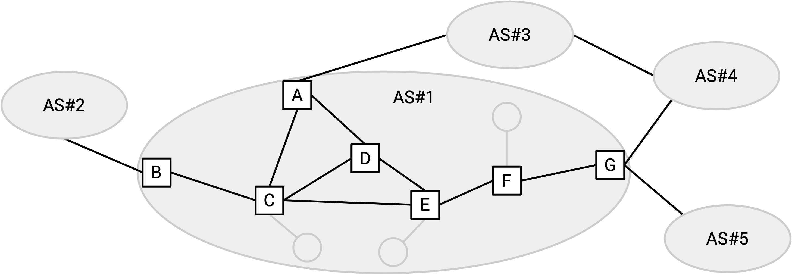

要实现 BGP，就要让 AS 内所有路由器协同工作，对外表现得像一个节点。我们把路由器分成两类：**边界路由器**至少有一条链路通往其他 AS 的路由器；**内部路由器**的链路只连接同一 AS 内的路由器。

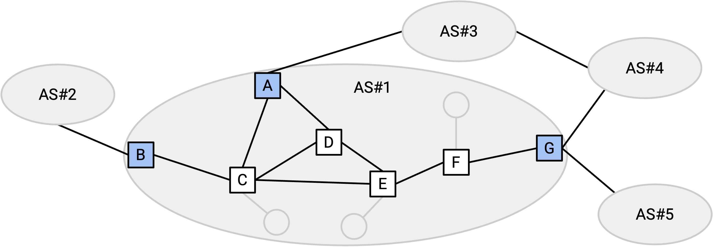

只有边界路由器需要向其他 AS 通告路由。发送 BGP 路由通告的路由器有时也叫 **BGP speaker**。它们必须理解 BGP 的语法和语义：怎样读取和生成通告、收到通告后应做什么，等等。

## 2. 外部和内部 BGP 会话

**BGP 会话**是两个路由器之间交换信息的关系。

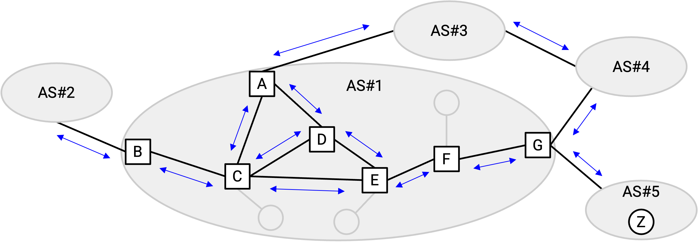

**外部 BGP（eBGP）会话**连接不同 AS 的两个路由器，用来跨 AS 交换通告、学习到其他 AS 的路径。按照这里的边界模型，只有边界路由器参加 eBGP。

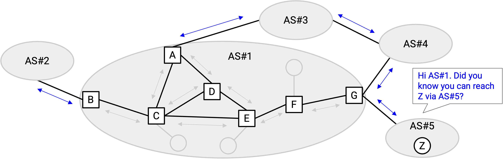

**内部 BGP（iBGP）会话**连接同一个 AS 的两个路由器，它们不必有直接物理链路。边界路由器学到新路径后，可以通过 iBGP 把它分发给 AS 内其他路由器，使大家协调一致地对外工作。边界路由器和内部路由器都可以参加 iBGP。

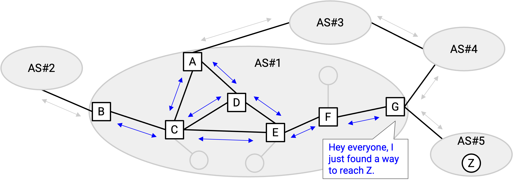

eBGP、iBGP 都不同于 **内部网关协议（IGP）**。IGP 是部署在一个 AS 内、用于在域内转发分组的路由协议，例如距离向量或链路状态。

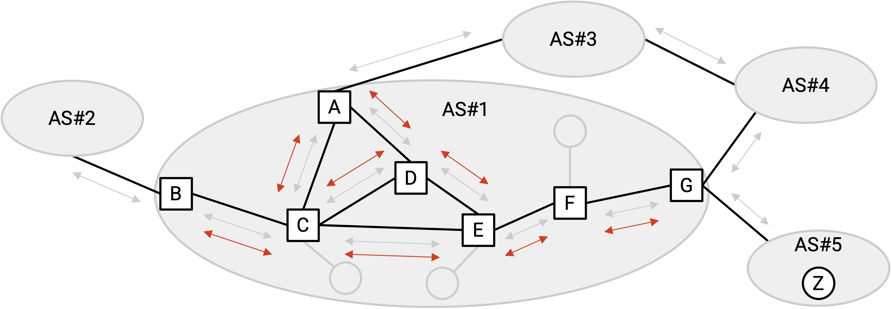

iBGP 和 IGP 很容易混淆：它们都在一个 AS 内交换消息，但 iBGP 是域间协议的一部分，让路由器知道到其他 AS 的路径；IGP 是域内协议，让路由器知道到本 AS 内目的地的路径。

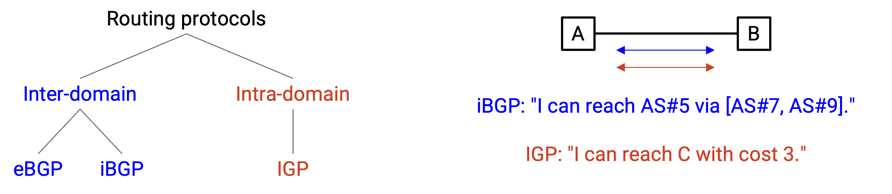

这三者共同建立从任一路由器到互联网任意其他路由器的路径，即使两者不属于同一个 AS。先让每个 AS 运行 IGP，学习任意两个内部路由器之间的最低代价路径。

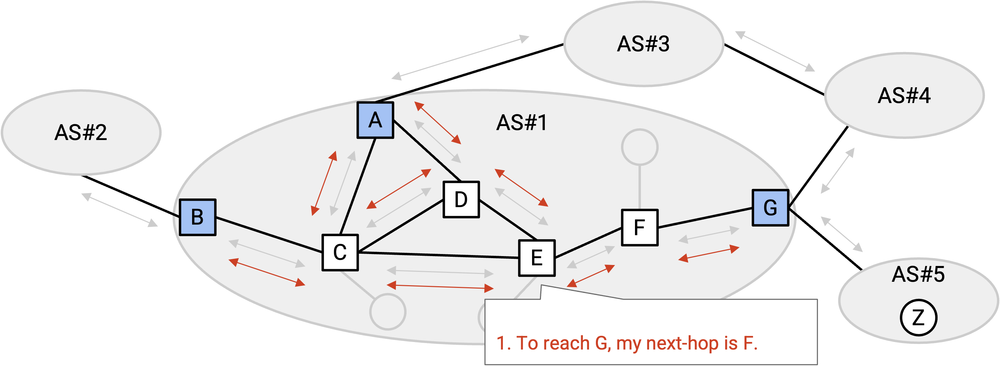

接着，各 AS 运行 eBGP，互相通告，学习其他 AS 的路径。

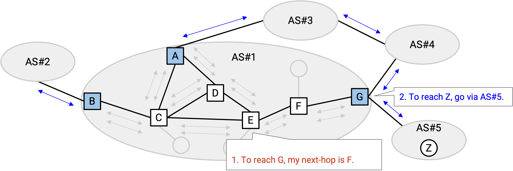

最后运行 iBGP，使学到外部路径的路由器能把路径分发到同 AS 的其他路由器。

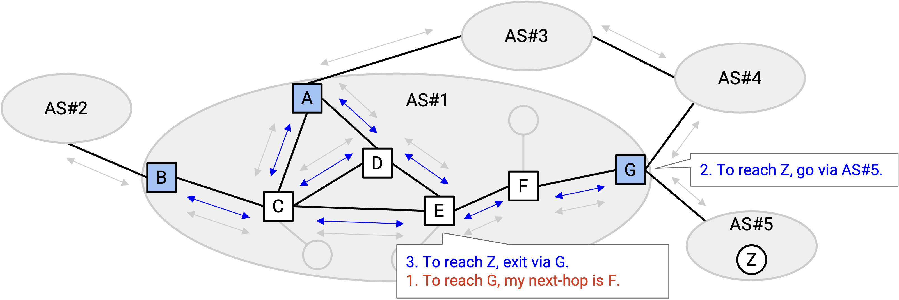

由 eBGP、iBGP、IGP 学到的路由可以配合起来，发送分组到互联网各处。若目的地在同一 AS，使用 IGP 学到的路线。若目的地在另一个 AS，则先利用 iBGP 分发的信息，找出能到达该外部目的地的边界路由器，再用 IGP 把分组送到它，由它送入下一个 AS。

> 编者注：原文把“同一 AS”括注为“同一 IP 前缀”，把不同 AS 括注为不同前缀。这不是严格等价关系；一个 AS 可以包含多个前缀。本段按域内／域外的实际含义翻译。

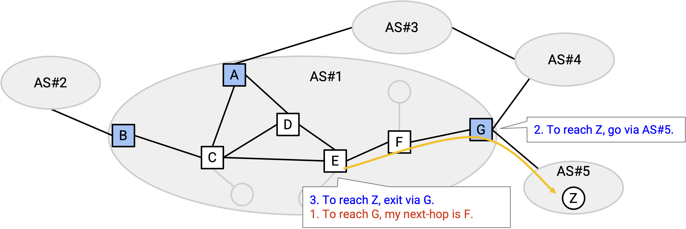

具体地说，若 E 要向 Z 发包，首先 E 所在 AS 的所有路由器运行 IGP，知道内部路由。随后 AS5 中某路由器经 eBGP 通告到 Z 的路径，此时只有 G 知道自己能到 Z。最后 G 用 iBGP 告诉本 AS 内所有路由器。

E 已经从 iBGP 知道同 AS 的 G 能到达 Z，便用 IGP 路线把包送到 G，第一跳先给 F。G 再利用 eBGP 学到的路线向 Z 转发。

通告某个外部目的地路径的边界路由器，也称该目的地的**出口路由器（egress router）**。它帮助分组离开本地网络，进入更接近目的地的其他网络；上述例子中，G 是 Z 的出口。

这一模型可以理解为每台路由器有两张转发表：一张把内部目的地映射到下一跳，由 IGP 填入；另一张把外部目的地映射到出口路由器，信息源于 eBGP。

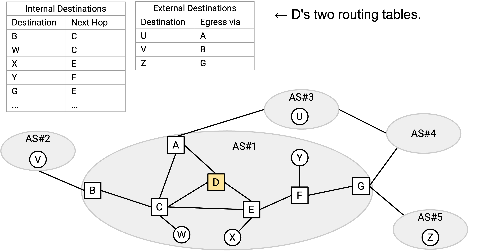

注意，外部表中的出口不一定是直接下一跳。出口可能隔着好几个本地跳，需要 IGP 帮忙抵达。

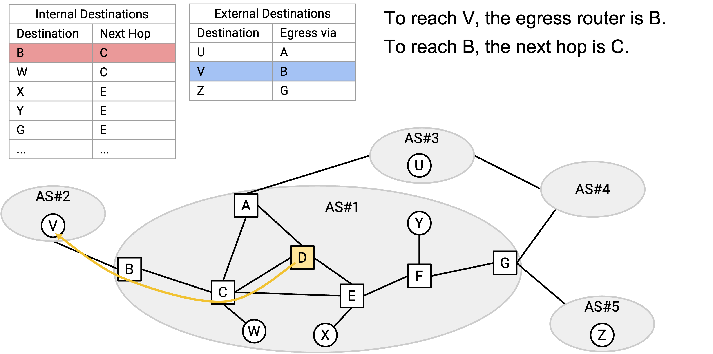

> 编者注：这里的“两张表”是递归解析的教学模型，不要求设备必须执行两次独立硬件查表；内部设备的外部路由还需由 iBGP 分发，不能把表名理解成每台设备都直接参加 eBGP。

前面已经介绍过 eBGP 的路径向量通告算法，以及 IGP 的距离向量或链路状态算法。那么 iBGP 如何实现？边界路由器安装新的目的地路由时，必须通知本 AS 的其他路由器。最简单的方法，是直接分别告诉每一个路由器。

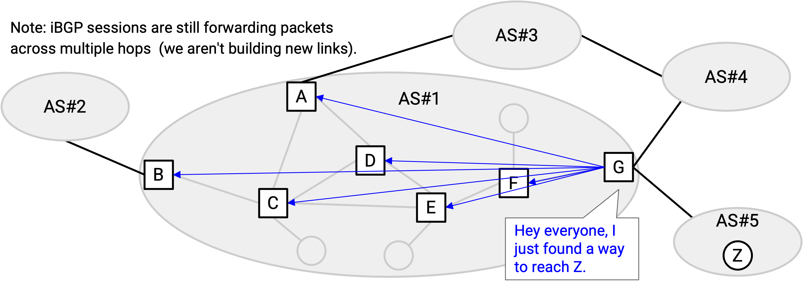

这个办法简单，但要求每个边界路由器都与其他路由器建立 iBGP 会话。如果有 B 个边界路由器、总计 N 台路由器，原文将连接规模写作 BN；网络扩大时可能扩展不佳。

> 编者注：BN 表示这里的数量级估计，不是排除自连接和重复计数之后的精确无向连接数。实际结合域间和域内路由还有其他方式，例如 route reflector（路由反射器），不在本课程范围。

## 3. AS 之间的多条链路：热土豆路由

此前的 AS 图只在相连的两个 AS 之间画一条边。现实中每个 AS 包含很多路由器，所以两个 AS 可以有多条互连链路。

这对大型 AS 很有用。例如 Verizon 和 AT&T 都在美国各地拥有设施。如果只在西海岸互连，两家网络位于东海岸的路由器想互通，包就必须先横穿 Verizon 的全国网络，在西海岸换网，再横穿 AT&T 返回东海岸。

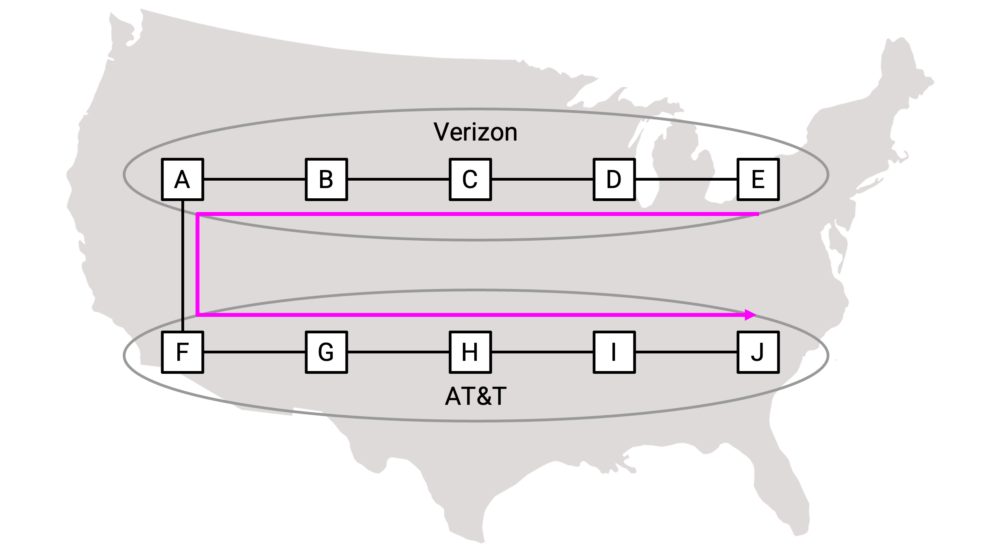

多条互连也意味着，两台路由器之间可能有多条经过相同 AS 序列的路径。在 AS 层面它们无法区分；更细的模型中，两条路径都要导出，再由接收方选择导入哪一条。

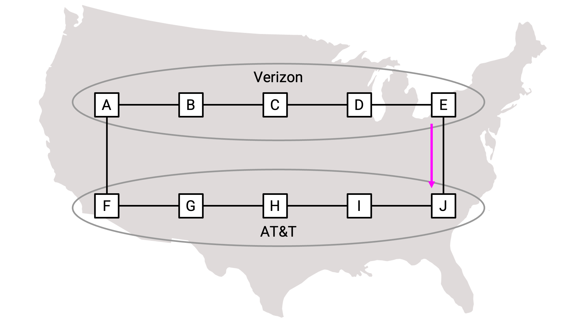

有两条路线时，导入方更喜欢哪条？

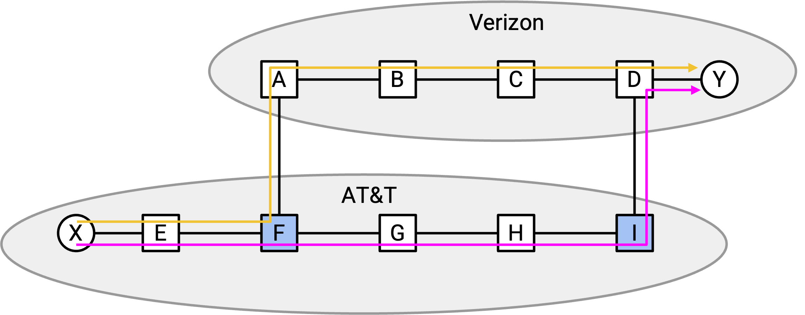

带宽有成本。导入方希望尽量让流量走在别人拥有、别人付费的设施上，尽量少占用自己的设施，所以 AT&T 更喜欢金色路径，即尽早从西岸离开本 AS。

形式化地说，导入 AS 从西岸、东岸分别收到通告。

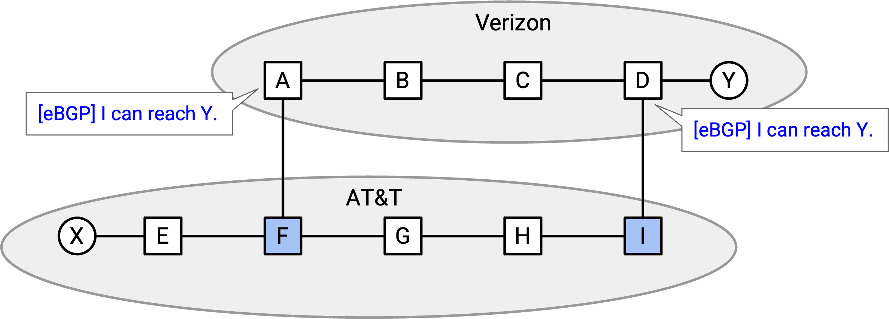

通过 iBGP，本 AS 内各路由器都能看到两条通告：一条以西岸路由器为出口，另一条以东岸路由器为出口。各路由器要决定导入哪一条。

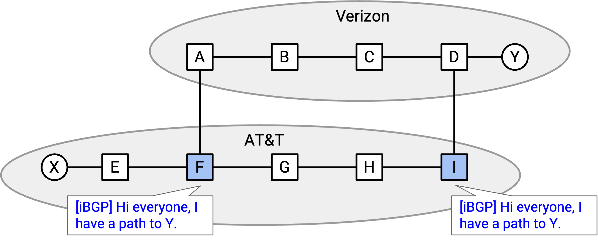

以 E 为例，它通过 IGP 得到去西岸出口 F 和东岸出口 I 的距离。F 更近，经 F 转发耗用本 AS 的带宽更少，所以 E 选 F。靠近 I 的另一台路由器则可能选另一条。

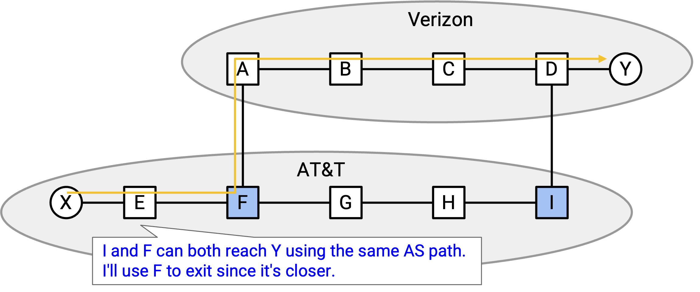

选择最近出口的策略叫 **热土豆路由（hot potato routing）**：尽快把包送出自己的 AS，让它尽早开始占用别人的链路。

## 4. 多出口鉴别器 MED

如果一台路由器到两个候选出口一样近呢？

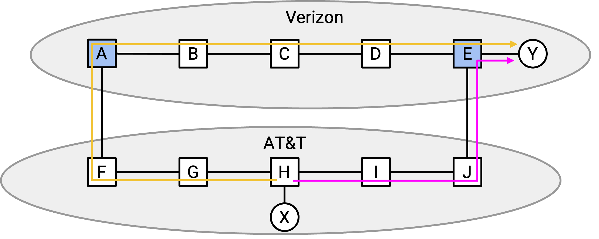

导出 AS 可以在通告里表达自己偏好的入口。既然带宽有成本，导出方 Verizon 更喜欢粉色路径，因为它在自己的 AS 内更短。通告粉色路线时可以说“希望你走这条”，通告金色路线时可以说“希望你避免走这条”。

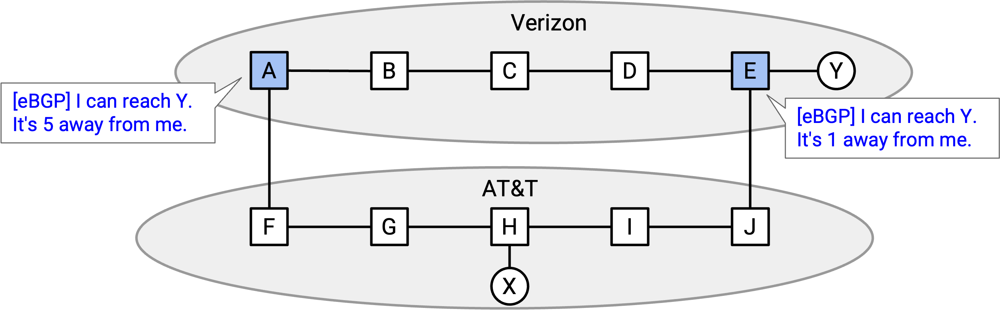

到两个出口同样近的内部路由器，通过 iBGP 看到了这个额外信息。

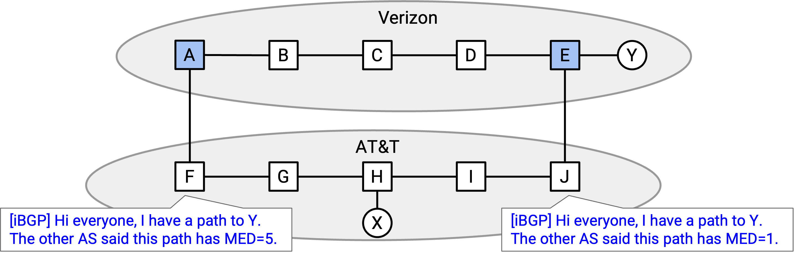

于是它可以选择粉色路径上的出口，满足导出方的偏好。

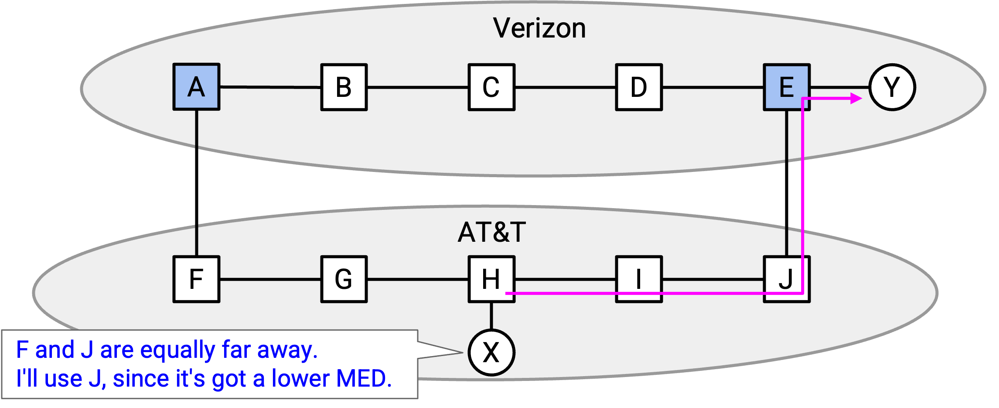

这个附加信息就是 **Multi-Exit Discriminator（MED，多出口鉴别器）**。对导出方而言，它表示希望别人从哪个路由器进入自己的网络；对导入方而言，它表示另一个 AS 希望自己从哪个出口离开、进入对方。

也可以把 MED 理解成“通过该路由器，到目的地还有多远”。导出方可以说西岸距目的地 3 跳、东岸距目的地 12 跳。更小的 MED 更优，因为导出方希望只用自己的 3 条链路，而不是 12 条。

> 编者注：上一句是原文另设的数字例子，方向与图187的目的地位置不同；不能把它代入图187。MED 是可配置的度量，也不必真的等于物理跳数。

## 5. 导入策略优先级

允许多个互连出口后，除 Gao–Rexford 规则外，我们还需要额外的导入规则。收到同一目的地的多个通告时，教材按以下顺序选择：

1. **Gao–Rexford 规则**：客户路线优先于 peer 路线，peer 优先于供应商路线。
2. 若商业关系优先级相同，例如都来自客户，选择**经过 AS 更少的路径**。
3. 若 AS 路径长度相同，使用 IGP 找到**更近的出口路由器**。
4. 若出口距离相同，选择通告中 **MED 更小**的路线。
5. 若 MED 也相同，**任意打破平局**，例如选 IP 地址更小的路由器。

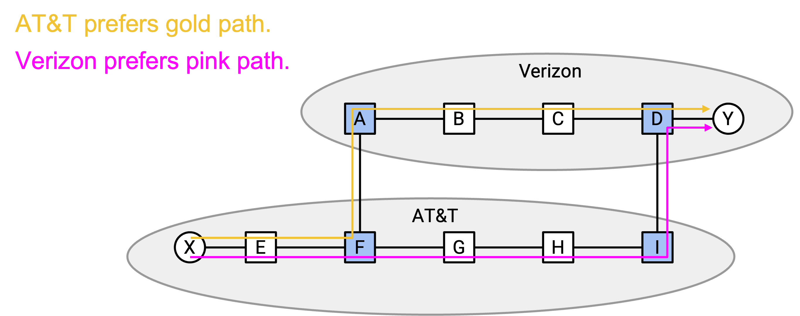

> 标准边界：这是本教材的简化优先级，并非所有真实 BGP 实现的默认排序。RFC 4271 §9.1.2.2 先在适用候选之间比较 MED，再考虑后续项目及到 NEXT_HOP 的内部代价；MED 的可比范围也有限制。课程题按题设，设备配置按具体实现，二者不可混用。

最近出口与 MED 经常矛盾，因为各 AS 都希望少用自己的带宽、多用别人的带宽。

导出方希望包尽可能靠近目的地才进入自己，因此希望导入方承担较长的域内传输。

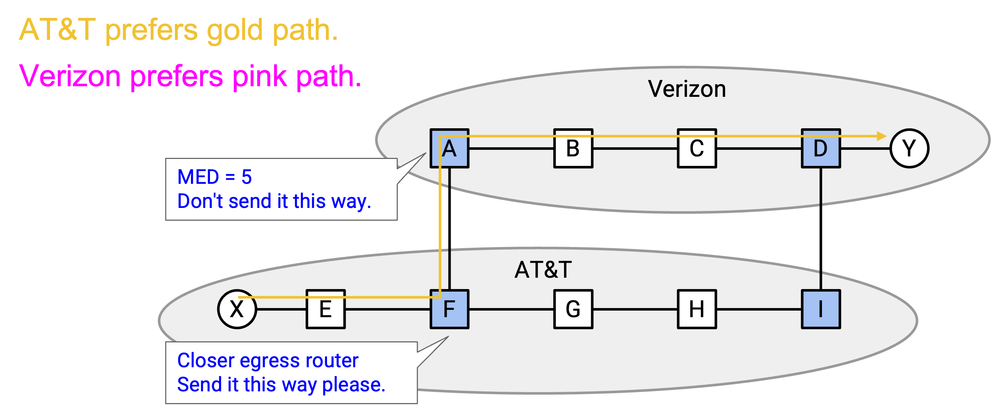

相反，导入方想少搬运，便希望包在离目的地较远处就进入对方，让对方完成更多工作。

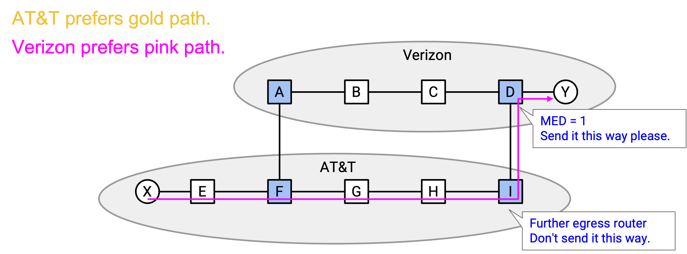

这造成一个后果：互联网路径往往**不对称**。两台主机往返的分组可能走不同路线。

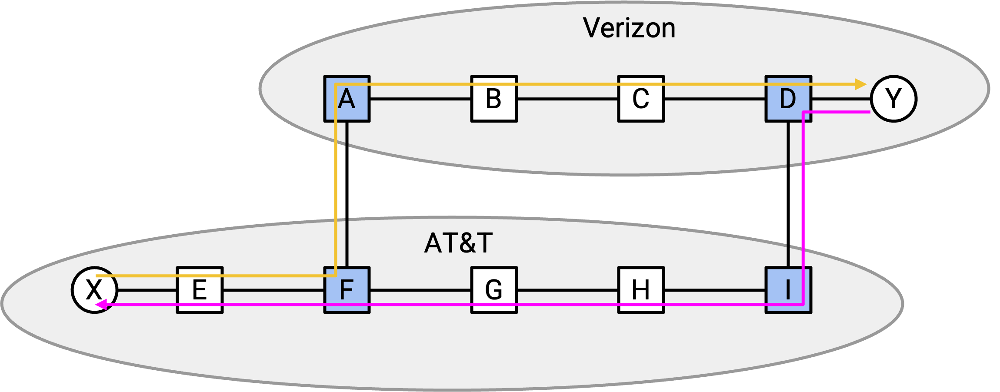

图中向东的包，发送方选择西岸出口，把大部分路程留给另一方；向西时，另一方选择东岸出口，反过来让对方承担大部分传输。BGP 允许这种行为，根本原因是每个 AS 都有权设置自己的策略，这里采用的就是热土豆策略。

实践中，有些 AS 还会使用更巧妙的策略，让其他 AS 多搬运一些；带宽更充足的 AS 也可能收取额外费用，承诺替你把流量送得更远。

## 6. BGP 消息类型与路由属性

协议必须规定语法与语义：消息长什么样，路由器收到消息后做什么。

BGP 有四类消息。**OPEN** 用来启动两个路由器之间的会话；**KEEPALIVE** 即使近期没有其他消息，也能确认会话仍然存活；**NOTIFICATION** 用来处理错误。原章不进一步展开这三类。

第四类也是重点是 **UPDATE**：通告新路由、改变已有路由，或删除不再有效的路由。

UPDATE 包含以 IP 前缀表示的目的地，也包含对应前缀的**路由属性**。属性由名称和值组成，可以编码有用信息。以非网络例子来说，`color=red`、`shape=triangle` 中，名称是 color、shape，值是 red、triangle。

有些属性只在 AS 内部有效，仅在 iBGP 中交换；另一些是全局属性，可以放进 eBGP 通告。属性有很多，这里重点介绍用于导入平局处理的三种。

### LOCAL_PREF：本地偏好

**LOCAL PREFERENCE** 在某个 AS 内编码 Gao–Rexford 的导入规则，也就是最高优先级的选择。AS 可给更喜欢的客户路线较高数值，给不那么喜欢的供应商路线较低数值。它是本地属性，只在 iBGP 中传播；其他 AS 无须知道本 AS 的偏好，所以不经普通 eBGP 通告给它们。

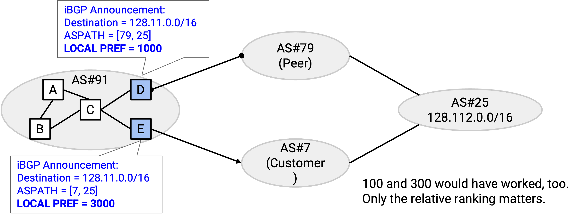

例如，E 从 AS7 收到 eBGP 通告，本 AS 知道 AS7 是客户，E 就可在 iBGP 消息中设置本地偏好 3000。其他路由器由此知道：E 能沿 ASPATH 所给路径抵达目的地，偏好值为 3000。

相反，D 从 peer AS79 收到通告，就可设置较低的 1000，再把这条偏好较低的路径传播给本 AS。

具体数字是任意的，只有相对次序重要。把 3000、1000 换成 300、100，行为不变。这些值常由运营者手动配置。

> 源文勘注：原文说“E 收到通告，A 知道 AS7 是客户”，存在指代跳转；此处译成“本 AS 知道”，不凭空增加 A 到 E 的协议步骤。图194把目的 AS 标为 128.112.0.0/16，但通告写 128.11.0.0/16；这不是同一前缀。保留原图以便审计，讨论属性比较时应让各候选的目的前缀相同。

### AS_PATH：经过的 AS 序列

**ASPATH** 包含所通告路线上的 AS 列表；原文称其为反向顺序，即相对于通告向外传播的方向而言。它是全局属性，可出现在 eBGP 通告中。

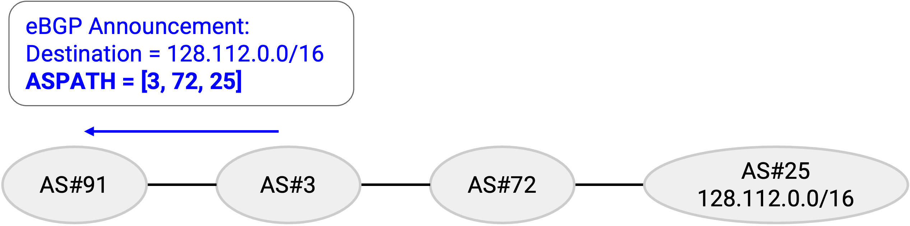

例子中，目的前缀是 128.112.0.0/16，ASPATH 是 `[3, 72, 25]`。它支持导入路线时的第二级选择：两条通告的 LOCAL_PREF 相同，例如都来自客户，就选 AS_PATH 更短者。路径长度按经过的 AS 数计量。

如果本地偏好和 AS 路径长度都相同，第三级就是到出口的 IGP 代价。这个值存在路由器本地表里；例如域内距离向量协议保存到同 AS 各路由器的代价。

### MED：导出方的偏好

**MED** 编码导出方的偏好；在本章的解释里，它可表示从导出路由器到目的地的距离，数值越低越好。

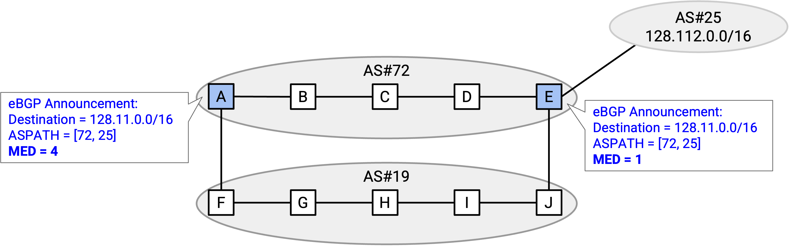

如果两个 AS 有两条互连，导出方的两个边界路由器都会通告路径。它们的 AS_PATH 和目的地相同，因为 AS 序列一样；但可设置不同 MED，表达“如果条件允许，请从靠近目的地的入口把包交给我”。若本地偏好、路径长度和出口距离都相同，按本教材顺序，再比较 MED。

> 源文勘注：原文该段说西岸 MED 更低，但图196明确画西岸 A=4、东岸 E=1，目的地也在东侧；此处依图解释为东岸更低。图中通告再次误写 128.11.0.0/16，而目的 AS 是 128.112.0.0/16。MED 也不是像 AS_PATH 那样任意跨 AS 传播的属性；RFC 4271 §5.1.4 规定其为 optional non-transitive。

## 7. BGP 的问题

**没有内建的安全保证。** 恶意 AS 可以谎报到某目的地的路径，即使它根本到不了；也可谎报不存在的便宜路径，诱使别人把流量交给它。攻击者随后可能丢弃或修改经由自己的分组。这类问题包括**前缀劫持**。原文指出有研究用密码学增强 BGP 安全，并描述这类协议尚未广泛部署。

> 编者注：这是固定教材快照的概述，不是截至阅读当天的部署统计；不能从这句话推断所有网络均未采取路由验证措施。

**策略优先于最低代价。** BGP 用 AS 数计算路径长度也可能误导：一个 AS 内可能经过 2 台路由器，也可能经过 200 台。包不一定走全局最低代价路径，互联网性能因而较难推理。不过，这不只是缺陷，也可以理解为有意的设计取舍：优先保留策略自治、隐藏 AS 内部拓扑，代价是性能不一定最优。

**实现复杂。** 许多微妙细节没有在本章展开。即便只是 LOCAL_PREF、MED，也常需运营者手工设置；配置错误可能让错误路径扩散并引发互联网故障。因此有研究开发工具来验证 BGP 配置。

**保证依赖假设。** 要保证可达与收敛，教材需要大家遵守 Gao–Rexford、AS 图形成层级、客户—供应商关系无环等前提。若某 AS 自定违反规则的策略，可能发生路线不收敛、环路或死路。

# IP 首部

## 8. 设计目标

IP 这样的协议包含语法与语义：语法规定首部有哪些字段，语义规定如何处理这些字段。

IP 分组由首部和载荷组成。首部含 IP 能处理的元数据；载荷含交给更高层的数据，IP 本身不解析其内部含义。沿协议栈向下时添加首部，向上时移除首部。两端主机和每台中间路由器都会处理 IP 首部。

首部应尽可能**小**。互联网上的每个 IP 包都要带它，即便只多一个字节，也会显著增加整个互联网的总带宽开销。

首部也应尽可能**简单**。所有路由器和端主机都要处理它；处理复杂会拖慢整个网络。理想情况下希望完全由硬件处理，所以不能假定处理过程中总能使用通用 CPU 操作。

## 9. 基本字段的职责

IP 要完成四项基本工作：

1. **解析包。** 主机和路由器都必须理解比特的含义。因此需要 4 位的 **Version**、4 位的 **Header Length**，以及 16 位的 **Total Length**。首部长度以 4 字节字为单位，因 IPv4 首部不是固定长度而必需；总长度以字节计。
2. **转发到下一跳。** 路由器需要 32 位的**目的 IP 地址**来选择下一跳。
3. **向上交付。** 目的主机需要 8 位的 **Protocol**，确定由哪个上层协议处理载荷。6 表示 TCP，剩余载荷开头应解释为 TCP 首部；17 表示 UDP。
4. **向来源回复。** 主机和路由器需要 32 位的**源 IP 地址**，以便回送响应。

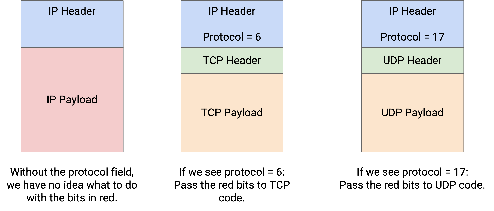

> 编者注：这里“路由器转发、主机上交”描述包的角色，不排除路由器作为某个包的终点、或主机自身也要选择出接口。Protocol 的值也不仅限于 TCP、UDP。

## 10. 错误处理和特殊处理

### TTL：给循环分组一个终点

IP 包可能陷入路由环，例如路由协议尚未收敛。可以设想让它一直绕到收敛，但转发可能在纳秒级发生，而路由收敛要毫秒乃至秒；这会浪费大量带宽。

所以首部有 8 位 **Time to Live（TTL）**，每一跳递减。减到 0 时丢包，并向源发送错误消息。原文说明 IP 规范要求相应错误报告，但现实中不一定总能收到。

### 校验和：只检查首部

电气等过程可能破坏线上比特。IPv4 首部中的 16 位 **Header Checksum** 用于检测首部损坏；校验不正确就丢弃。

它**只覆盖 IP 首部，不覆盖 IP 载荷**。因此不能检测载荷错误。这体现了端到端原则：载荷完整性由端系统负责，而不是交给所有中间路由器。

每台路由器都会修改 TTL，所以还必须更新首部校验和。另一种可能的协议设计是把 TTL 排除在校验范围外，以节省工作；但这不是 IPv4 采用的做法。

### 分片：包超过链路 MTU 时

每条链路有**最大传输单元（MTU）**，表示该链路能作为一个单元承载的最大包大小，单位是字节。例如，链路设备在发送比特时能记住整包的内存可能有限。

发送主机不知道包将经过哪些链路，可能发出超过其中某条链路 MTU 的包。IPv4 路由器可做**分片**，拆成多个片段。首部中 **Identification（16 位）**、**Flags（3 位）**、**Fragment Offset（13 位）**支持这个过程。

> 源文勘误：原文称“链路另一端的路由器必须重组”。普通 IPv4 分片由最终目的主机重组，不要求下一台路由器重组；见 RFC 791 §3.2。若 DF 禁止分片，不能强行分片，应丢弃并在适用条件下报告错误。

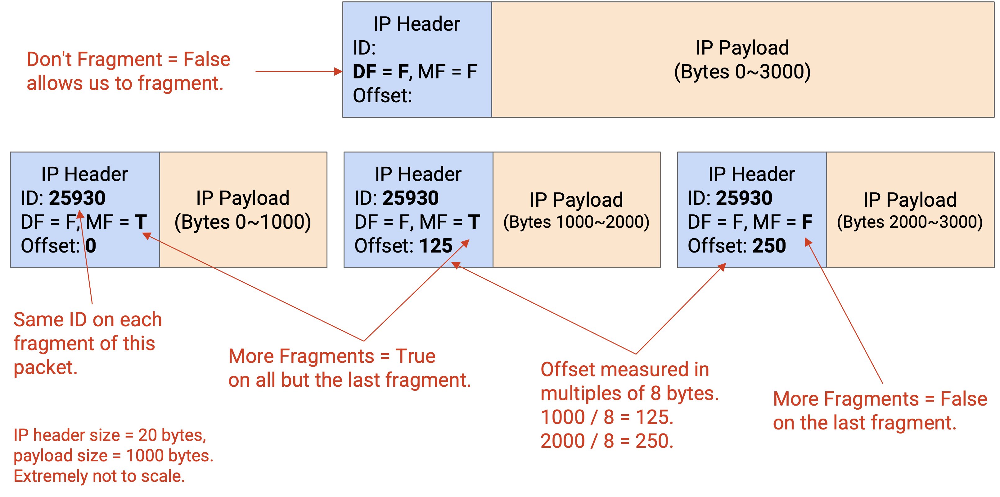

图中各片的 Identification 相同，帮助判断它们来自同一个原包。偏移以 **8 字节**为单位：1000/8=125，2000/8=250。除最后一片外，More Fragments 都为真；最后一片为假。Don't Fragment 为假才允许这里的分片。

分片可由硬件实现，例如路由器能快速拆包而无需转交特殊的软件处理，但仍会增加开销。现代互联网尽量避免分片，例如尽量统一 MTU；1500 字节是常见值。

### ToS 与选项

早期 IP 设计者没有完全坚持尽力而为，认为应用可能需要不同类型的交付服务，所以设置了 8 位 **Type of Service（ToS）**。包可以标记为时延敏感或高优先级。随着时间推移，这些位的定义变了，原始 ToS 已不再以最初形式存在。现在它们承载与业务分类、拥塞信号等有关的信息，例如 **DSCP** 定义流量类别，**ECN** 支持显式拥塞通知，后面的拥塞控制章节会讨论。

原始设计还允许在 IP 首部添加**选项**，请求更高级处理。例如记录包经过的路由以作诊断；由发送方提供源路由、要求包沿指定路线走；或携带时间戳。现代实现中这些选项通常禁用，因为它们增加实现和逐包处理开销。选项还让 IPv4 首部变长，变长结构比定长结构难处理。

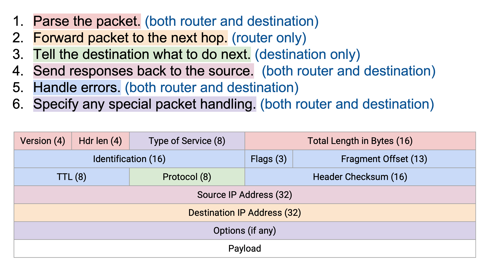

图199按 32 位一行排列：Version 4 位、IHL 4 位、ToS 8 位、Total Length 16 位；下一行 Identification 16 位、Flags 3 位、Offset 13 位；再下一行 TTL 8 位、Protocol 8 位、Checksum 16 位；随后源地址 32 位、目的地址 32 位，最后是可选选项和载荷。

## 11. IPv6 首部有哪些改变？

IPv6 的直接动机是担心 32 位 IPv4 地址耗尽，因此把地址**扩展到 128 位**，地址空间巨大。原文用“宇宙原子数量”作量级类比，强调几乎不可能用完。

> 编者注：类比不可当成数值等式。IPv6 地址数是 $2^{128}\approx3.4\times10^{38}$；分配策略及地址结构也不等于可以任意使用全部位组合。

设计者也利用这次机会清理过时字段。IPv6 最初曾计划引入更有野心的寻址功能，但大多没有成为最终实现；实际结果主要是清理旧特性、使协议更优雅，而不是彻底改变 IP。原文附注：IPv5 于 1990 年发表，早于 1998 年的 IPv6，是未广泛实施的实验协议。

### 移除首部校验和

IPv6 **不再包含 IP 首部校验和**。支持校验和的一方认为，若损坏的包未被及时检测，就会继续占用下游带宽；逐跳检测能及早丢弃。原文给出的取舍理由是现代带宽不像过去那样紧张，即使少量损坏包走到端点，也未必值得每个路由器都承担此项工作。

### 把分片工作移到端系统

IPv6 **取消路由器分片**。包太大时，路由器丢弃，并向源报告允许的 MTU；原发送方负责改成更小的包后再发送。端主机处理的包通常比核心路由器少，把工作从路由器移到端点更利于扩展。

> 源文边界：原文简写“eliminates fragmentation”，不能理解成 IPv6 完全没有分片。RFC 8200 §4.5 仍定义源端 Fragment 扩展首部；被取消的是中间路由器分片。

### 定长基本首部与 Next Header

IPv6 用改造后的 Protocol 字段替代 IPv4 的可变长选项机制。基本首部定长，因此可以删除 **Header Length**。

为了保留可选处理能力，IPv6 把 Protocol 推广成 **Next Header**，允许载荷在到达传输层之前先交给特殊处理协议。IPv4 的 Protocol 例如用 6、17 指定 TCP、UDP；IPv6 的 Next Header 还可以指定某个扩展首部。

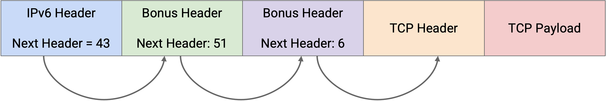

若希望其他协议处理包，就把其编号放进 Next Header。协议设计者、使用者需要约定编号，并由标准机构管理。处理程序读 IPv6 首部之后、第四层首部之前的附加首部，做完工作再把剩余载荷交给后续协议。

没有附加处理时，Next Header 就像以前的 Protocol，直接指向第四层。

这个思路还能推广为链：IPv6 指向某个特殊处理首部，该首部也含 Next Header，再指向另一个特殊首部或传输层。这样可以加入尚未发明的新协议，而不用改动 IPv6 基本首部。

### Flow Label 和保留字段

IPv6 新增 **Flow Label（流标签）**。网络层原则上独立发送各个包，但现实中许多包具有联系，例如同一对应用之间的视频流。防火墙、入侵检测系统等**中间盒**可能关心这些包属于同一条流或连接：防火墙可能要结合多个包才决定允许还是阻断。

如果每个包都是独立对象，中间盒只能根据源、目的地址等信息推测它们是否相关。IPv6 的流标签提供一种显式表示关联的方法。

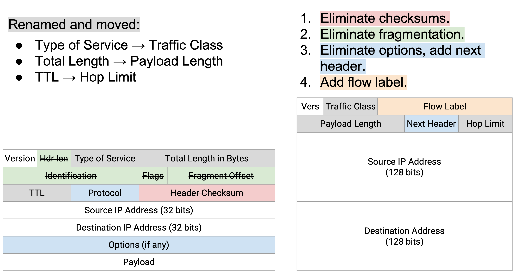

**Version** 仍是版本字段；**Total Length** 改为 **Payload Length**；TTL 更名为 **Hop Limit**，仍执行逐跳递减。ToS 更名为 **Traffic Class**，仍可表达业务类别等信息。

> 源文勘误：原文说“version number is unchanged”，如果指取值便是错误；不变的是 4 位字段宽度，值从 4 变为 6。原文又说包长“不变，只改名”，也不准确：IPv4 Total Length 包含 IPv4 首部，IPv6 Payload Length **不含 40 字节基本首部，但包含扩展首部**。见 RFC 8200 §3。Flow Label 为 20 位，不是经过认证的会话身份。

总的来说，IPv6 更强调端到端原则：尽可能让端主机做分片、完整性检查，以及由相应上层协议处理损坏后的恢复。Hop Limit／TTL 则是根本的网络层问题，不能只靠端主机实现——端点无法逐跳约束已陷在环中的包。

IPv6 同时追求简单与可扩展：移除基本首部内的变长选项，用 Next Header 和 Flow Label 等机制保留演进空间。

## 12. IP 首部安全

IP 本身没有内建的攻击者身份验证。攻击者可以填写错误的源地址，冒充他人，导致被冒充的主机遭到错误归责，或让响应被送给被冒充者。谎报源 IP 地址称为 **IP spoofing（源地址伪造）**。

伪造可以用于 **DoS（拒绝服务）**：大量分组淹没服务器，耗尽其资源乃至使其崩溃。若攻击包全来自同一源，服务器可以按该 IP 丢弃；若攻击者伪造多个源地址，就更难把攻击流量与合法流量区分开。原文指出还有更复杂的伪造攻击，并指向 CS161 的安全材料，但本章不展开。

ToS 允许发送者请求优先级。如果任何人都能随意设高优先级，恶意用户会使网络优先处理攻击流量。如果高优先级需要额外付费，伪造来源的高优先级包还可能让被冒充者承担费用。

原始互联网设计没有阻止这些攻击。现代 ISP 加入了缓解机制。原文概括称 ISP 不允许端用户自行决定 ToS，并且很多 ISP 能检测、阻断伪造包。

> 编者注：这是一种运营实践概述，不是所有 ISP 的无例外承诺；端用户能设置字段，也不代表网络会信任或兑现它。

IPv4 攻击者还可能故意发大包，迫使路由器做分片；或加入选项，迫使路由器承担额外处理。这些都可能用于耗尽路由器处理能力。

TTL 可以用来了解拓扑。发送 TTL=1 的探测包，它在第一跳到期；第一台路由器回错误消息，就暴露了自己的地址。

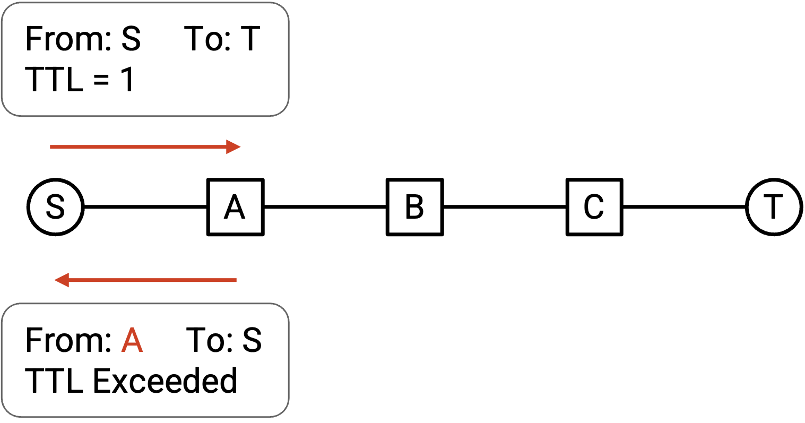

再发 TTL=2 的包，它在第二跳到期，第二台路由器的错误响应揭示第二跳身份。

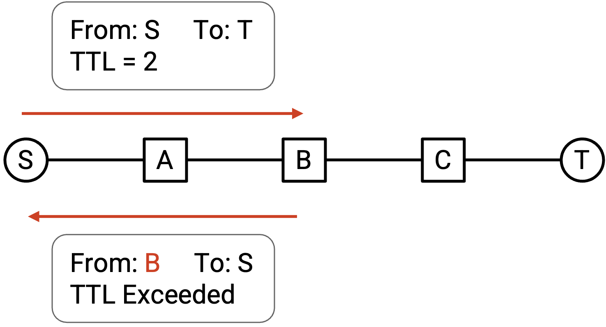

重复 TTL=3、4……就能逐步探测路径上的路由器。原文把这种行为称为 traceroute “攻击”，同时明确指出，也有人认为它不是攻击，而是有用的诊断工具。

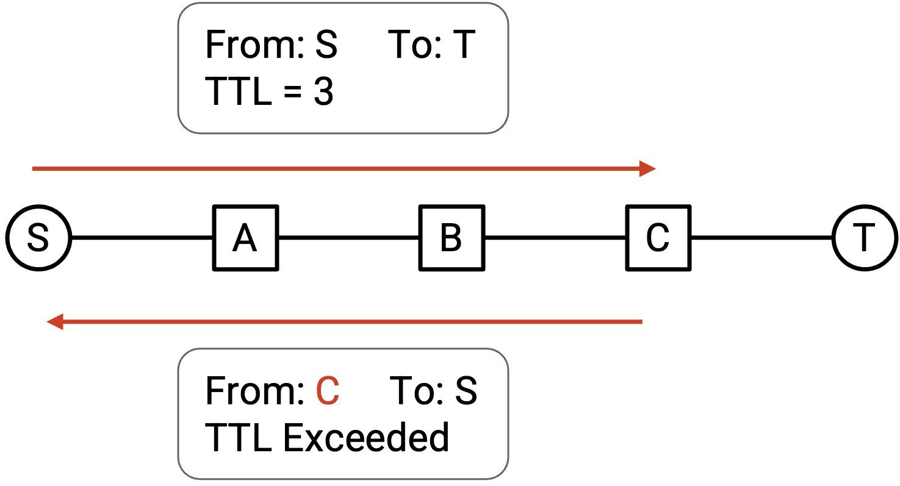

从不同源向不同目的地重复探测，可以了解更多拓扑。某些路由器不发 TTL 超时响应，会限制可观察性。

> 编者注：traceroute 本身是诊断机制，不应把正常使用自动等同于攻击；无响应不证明没有该路由器，且负载均衡、路径变化也会影响观察。实验操作请参阅[Traceroute 实验](#/c/berkeley-cs168-2025/lab/traceroute?v=zh)，此处不重复其完整材料。

原文最后讨论 Protocol 和 Checksum：攻击者理论上可篡改它们，但无效协议号或无效校验通常会导致丢包，因此本章没有给出利用这两个字段的实用攻击。

> 边界勘注：这不是“这些字段没有任何安全风险”的证明；校验和也不是密码学认证，攻击者可在修改首部后重新计算。

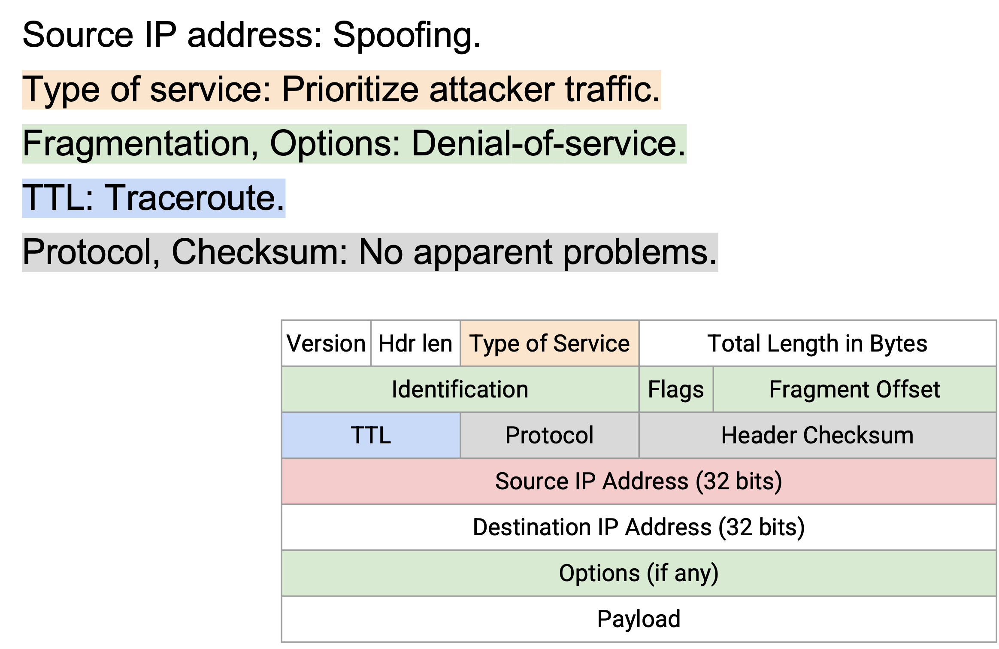

## 引用、版本与许可

- 原作者：Peyrin Kao；教材基于 Sylvia Ratnasamy、Rob Shakir 等人的授课。
- 完整翻译：[BGP Implementation and Issues](https://textbook.cs168.io/routing/bgp-implementation.html)，全部 7 节及图165–196；[IP Header](https://textbook.cs168.io/routing/ip-header.html)，全部 5 节及图197–205。共 41 张原图均已阅看；图内文字的关键含义见中文图注与相邻正文。
- 固定教材提交：

```text
0b8208742d31df7fc3d53a0cd94fdd4e04f8d47e
```

- 这是 2026 当前教材快照，不冒充 Spring 2025 历史原貌。课程与视频仍按官方 Spring 2025 编排。
- 教材及本页翻译采用 [CC BY-SA 4.0](https://creativecommons.org/licenses/by-sa/4.0/)。修改包括中文翻译、图注、明确标注的技术勘注，以及给透明原图添加白色显示背景；原图文件字节不变。
- 编者核对资料：[RFC 791](https://www.rfc-editor.org/rfc/rfc791) §3.1–3.2（字段、分片重组）；[RFC 8200](https://www.rfc-editor.org/rfc/rfc8200) §3、§4.5（IPv6 字段、源端分片）；[RFC 4271](https://www.rfc-editor.org/rfc/rfc4271) §5.1.3–5.1.5、§9.1.2.2（NEXT_HOP、MED、本地偏好及决策顺序）。这些是针对勘误读取的标准节，不声称全文译读三个 RFC。
- 商业关系与 Gao–Rexford 的前置教材归 [L9 阅读材料](#/c/berkeley-cs168-2025/lec/lec09?v=materials)，不在本页重复翻译。
