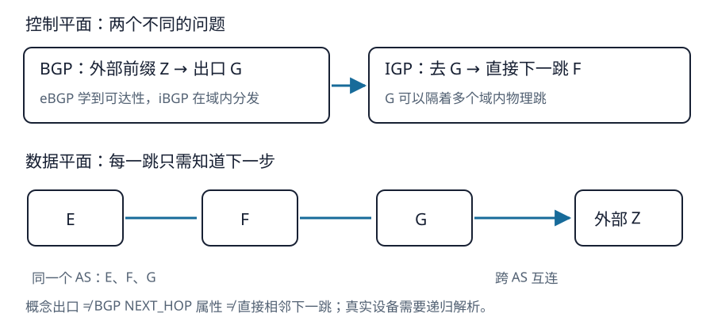
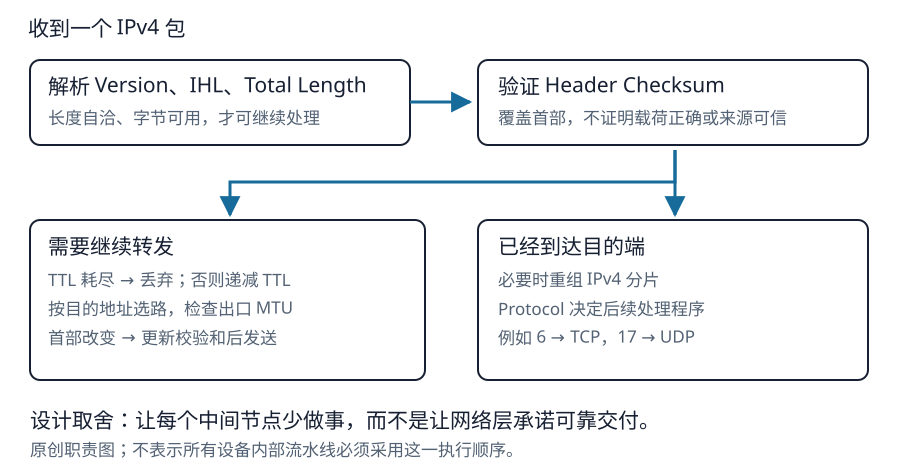

# 两个问题：该从哪里离开？这一跳该怎样处理包？

一条 BGP 路线告诉我们“某个外部前缀可以怎样到达”，但路由器最终必须做的是：**把一个具体的 IP 包从一个实际接口送出去**。从前者走到后者，需要跨过三层区别：

1. **AS 级政策**：愿意使用哪家邻居提供的路线？
2. **本 AS 内的出口选择**：同一邻居有多个互连点时，从哪里出去？
3. **直接下一跳与逐包处理**：怎样到出口？TTL、长度、校验和、MTU 是否允许这个包继续走？

前置商业规则见 [L9 笔记](#/c/berkeley-cs168-2025/lec/lec09?v=notes)。本讲可以直接连续阅读[官方文字教材中文译文](#/c/berkeley-cs168-2025/lec/lec10?v=materials)，不必把 19 个短视频当成 19 节独立课程。

## 连续阅读路线

两篇指定文字资料已经合在本讲「课程资料」中。先沿三条主线读正文，再用本页推导和自测检查理解；需要听讲时才按分 P 主题回看。

|阅读主线|课程资料中的位置|相关分 P|
|---|---|---|
|把 AS 展开成实际路由器：出口怎样变成下一跳|§1–2：边界路由器、eBGP/iBGP 会话|P1–5|
|多出口如何选择，策略怎样编码，哪里会失效|§3–7：热土豆、MED、导入优先级、消息与属性、BGP 问题|P6–13|
|路由选好以后，一个 IP 包怎样被逐跳处理|§8–12：IPv4 字段、错误处理、IPv6、IP 安全|P14–19|

## 1. P1–5：iBGP 不是 IGP，出口不是下一跳

### 给每个协议一个明确的问题

- **eBGP**：别的 AS 能为哪些前缀提供路径？哪些外部通告符合我的导入政策？
- **iBGP**：本 AS 某个边界路由器知道的外部路线，怎样让本 AS 的其他路由器也知道？
- **IGP**：在本 AS 内，怎样到达某台路由器，代价是多少？

关键不是消息是否在 AS 内传输。iBGP 的通信双方虽然都在域内，讨论的却仍然是域间可达性。IGP 才负责内部基础设施的路线。

BGP **会话**是逻辑通信关系，而不是一根新电缆。iBGP 双方可以相隔多个路由器，其消息仍需沿现有网络传输。课程的简单实现让每个边界路由器分别通知其他路由器；B 个边界、N 台总路由器带来约 $O(BN)$ 的会话规模。不能把 BN 当成去除自连接、重复计数后的精确数。

### 手算一次递归解析

假定 E 的信息如下：

- 外部前缀 Z：选中的出口为 G。
- 内部目的 G：最短路线下一跳为 F。

收到目的地址落在 Z 中的包时，E **不是直接把包“交给 G”**，而是先查出如何去 G，再把它交给邻接的 F。F 也必须具有与转发相容的信息，之后包到 G，才真正跨域。

*原创概念图，依据指定教材的 E–F–G–Z 例子重绘；不是课堂截图。*

这里有一个重要实现边界：教材用“外部前缀→出口→内部下一跳”解释两级信息。实际 BGP 还定义 **NEXT_HOP 属性**，它不必自动等于发来 iBGP 通告的那台路由器。RFC 4271 §5.1.3 要求通过路由表递归解析 NEXT_HOP，找出真正的出接口和直接相邻下一跳；iBGP 传播外部路由时也不默认把 NEXT_HOP 改成自己。

**排错不变量：**“收到一条 BGP 通告”不等于“这个数据包已有可用出口”。至少还要确认路线被选中、下一跳能解析且可达、数据平面已安装相应结果。

## 2. P6–10：先问谁付钱，再问谁搬运

### 同一个 AS_PATH，可以对应不同物理路径

甲、乙两个全国性网络若只在西岸互连，即使两端都在东岸，流量也可能横穿两次全国。增加东岸互连可以减少这种绕路，但同时产生新决策：从哪个互连点交换？

AS_PATH 只描述经过哪些 AS，不描述在每个 AS 内跑了多远。两条同长的 AS_PATH，可能在时延和域内带宽占用上相差很大。

### 热土豆与 MED 在争取相反的目标

假设我的路由器到西出口代价为 2，到东出口为 8。邻居说，从西入口到目的地代价为 12，从东入口到目的地为 1。

- **我想选西口**：本 AS 只承担 2，而不是 8，这就是热土豆路由。
- **邻居想让我选东口**：它只承担 1，而不是 12，可以用较小 MED 表达这一偏好。

这不是谁算错了最短路，而是双方优化的目标函数不同。没有额外协议约束时，邻居的请求也不是对我的命令。

### 按课程模型逐级淘汰，而不是把指标相加

本课程教材的简化顺序是：

$$
\begin{aligned}
&\text{LOCAL\_PREF 大}\succ\text{AS\_PATH 短}\\
&\quad\succ\text{到出口的 IGP 代价小}\succ\text{MED 小}.
\end{aligned}
$$

其中 $\succ$ 表示比较优先级，不表示指标数值之间存在可加的权重。

**原创练习例：** 同一目的前缀有三条候选路线。

| 路线 | LOCAL_PREF | AS 数 | 到出口代价 | MED |
|---|---:|---:|---:|---:|
| A | 300 | 4 | 9 | 10 |
| B | 100 | 1 | 1 | 0 |
| C | 300 | 4 | 2 | 100 |

先比较 LOCAL_PREF，B 虽然更短也被淘汰。A、C 的 AS 数相同，再比较内部出口代价，选 C。此时不应以 A 的 MED 更小推翻结果，因为在课程排序下还没有轮到 MED。

**现实边界：** 不要把上面的教学顺序写成“所有设备的 BGP 默认算法”。RFC 4271 §9.1.2.2 包含 ORIGIN、eBGP/iBGP 来源等更多比较项，并在可比的邻居路线之间先比较 MED，后比较内部代价。做题遵守题设，部署遵守设备与配置。

### 为什么去程、回程可能不一样？

A 向 B 发送时，让包尽早离开 A；B 向 A 发送时，也让包尽早离开 B。若互连点分布在两端，这两个“尽早”会选中不同互连点。

因此，观察到去程从西口跨域，不能推断回程也从西口跨域。AS 的自治和策略是非对称性的原因之一；IP 并没有提供“自动沿原路返回”的承诺。

## 3. P11–13：把政策变成消息，别把消息当成安全保证

### 消息是动作，属性是路线的描述

OPEN 建立会话语境；KEEPALIVE 表示邻居仍活着；NOTIFICATION 处理错误；UPDATE 携带新增、改变或撤销路线的信息。收到 KEEPALIVE 只说明会话层面的存活，不证明每个外部目的地当前都能收到包。

三类核心属性要分清“谁决定”和“谁看见”：

| 属性 | 谁表达偏好或事实 | 比较意义 | 传播边界 |
|---|---|---|---|
| LOCAL_PREF | 本 AS 自己 | 较大更好；常编码商业关系 | 本 AS 的 iBGP 内部 |
| AS_PATH | 路线经过的 AS 序列 | 支持环检测、比较 AS 数 | 随域间通告传播 |
| MED | 相邻导出 AS | 较小表示其偏好的入口 | 可向本 AS 内传播，但非任意跨 AS 转发 |

把客户标为 3000、peer 标为 1000，并不意味着客户链路带宽是三倍；LOCAL_PREF 是排序工具。把 MED 当成能强制远端选择入口的权力，同样会出错。

### 四种不同的失败，不要用一个“BGP 坏了”概括

1. **错误可达性**：恶意或错误通告说某前缀可达，实际上不可达。
2. **不理想的性能**：策略选中的路径并非全局最短，不代表协议没有遵守政策。
3. **配置错误**：一处错误的 LOCAL_PREF、过滤或传播规则，可能扩散到很多节点。
4. **不收敛**：任意策略不保证存在稳定结果；Gao–Rexford 的结论依赖其商业层级和导入／导出假设。

“AS_PATH 能拒绝包含自己的路由”只解决一类显式 AS 路径环，不等于验证通告真实性，也不等于任意策略都能收敛。

## 4. P14：从每个字段必须解决的问题出发

看 IPv4 首部时，先问谁需要这个字段，而不是先背排列顺序。

- **Version**：采用哪一种首部解释规则。
- **IHL**：首部多长、载荷从哪里开始；单位是 4 字节，不是字节。
- **Total Length**：这个 IPv4 包总共多大，包括首部与载荷。
- **Destination Address**：按哪个最终目的地址选路，而不是写“这一跳的邻居地址”。
- **Source Address**：错误与响应可往哪里送；它不是身份证明。
- **Protocol**：目的端应该把载荷交给哪个下一层处理程序，6 为 TCP、17 为 UDP。
- **TTL**：阻止转发循环无限占用资源。
- **Header Checksum**：检测首部误码，不替代载荷校验或身份认证。

*原创职责图；不要求所有设备内部流水线按图逐条串行执行。*

### 长度算例

若 IHL=6、Total Length=84，则首部长 $6\times4=24$ 字节，IP 载荷长 $84-24=60$ 字节。不能固定从第 20 字节开始读 TCP 首部，因为此包含 4 字节额外首部空间。

若包声称首部长 24 字节，但实际只收到 18 字节，就没有足够数据完成解析。若总长小于首部长，也不自洽。网络解析器不能在检查长度之前相信所有偏移。

### TTL 与校验和为什么耦合？

首部校验和覆盖 TTL，而每次转发都要修改 TTL。因此，验证输入包正确之后，不能把旧校验和原封不动地带着转发；必须使它与修改后的首部相符。

RFC 791 的算法把首部切成 16 位字，将校验和字段置零后计算一补和，再取一补。接收方验证的是首部，不是应用内容。即便应用数据被改坏，只要首部未变，IPv4 首部校验也可能通过。

**TTL=1 的转发包**应在该转发节点耗尽，不再进入下一条链路。TTL 并不是“路由算法最多迭代几次”，也不是“收到这个包的程序运行多少秒”。TTL 超时响应还可能因策略或其他条件不可见，不能把没有响应直接等同于链路不存在。

## 5. P15–16：MTU、分片与特殊处理都有成本

### 分片的三个问题

接收方要知道：

1. 哪些片属于同一个原包？Identification 配合源、目的、协议等信息帮助区分。
2. 片里的数据该放到哪里？Fragment Offset 以 8 字节为单位定位原载荷位置。
3. 原包到哪里结束？最后一片 MF=0，其余片 MF=1。

**原创算例：** IPv4 首部 20 字节，原载荷 3000 字节，出口 MTU=1500，且 DF=0。非末片的载荷需是 8 字节整数倍，所以可分成：

- 第 1 片载荷 1480 字节，偏移 0，MF=1，总长 1500。
- 第 2 片载荷 1480 字节，偏移 $1480/8=185$，MF=1，总长 1500。
- 第 3 片载荷 40 字节，偏移 $2960/8=370$，MF=0，总长 60。

这是假设无额外选项的算例，不是声称课堂演示了这组数字。分片后的首部也需要反映各自长度、偏移、标志和校验和。

**重组在最终目的端，不是下一跳路由器。** 中间链路可能继续要求分片；要求每跳先重组会重新制造大包及缓存负担。原教材对重组位置的错误已在“阅读材料”中标注。

### 特殊待遇不是免费能力

ToS 的历史愿望是让应用请求时延或优先级等服务；现在相关位用于 DSCP／ECN 等机制。设置字段与网络兑现承诺是两回事。

记录路由、源路由、时间戳等选项看似灵活，但会扩大首部、引入变长解析和额外处理分支。基础协议每多一个必须逐包执行的步骤，所有中间设备都可能付出代价。这解释了为什么设计经常偏向简单的公共路径。

## 6. P17–18：IPv6 的简化不是“只把地址变长”

把 IPv4 与 IPv6 放在一起时，区分三类改变：

- **删除逐跳负担**：IPv6 基本首部无首部校验和；路由器不进行 IPv6 分片。
- **固定基础结构**：IPv6 基本首部 40 字节，不需要 IHL；可选处理通过 Next Header 指向扩展首部。
- **扩大表达能力**：地址变为 128 位，新增 20 位 Flow Label，Next Header 可形成扩展链。

两个常见误记必须纠正：

1. Version 的**宽度**仍为 4 位，**值**由 4 变成 6。
2. IPv4 Total Length 包含其首部；IPv6 Payload Length 不含 40 字节基本首部，但包含扩展首部。

所以一个 IPv6 包若 Payload Length=100，且不是特殊大包扩展情形，则其基本首部加其后内容合计 140 字节。不能直接拿它与 IPv4 Total Length 的数值互换。

Next Header 的重点是“接下来按谁的格式解释”，不保证下一段一定是 TCP。可能先遇到一个扩展首部，由它再指向后面的首部，直到传输层。Flow Label 帮助标记关联包，但本身不是可信的用户身份或完整的会话授权。

IPv6 也没有禁止源端使用 Fragment 扩展首部；准确说法是**不允许沿途路由器替发送方分片**。这把包大小适应的责任更多地交给端系统。

## 7. P19：字段有用，不等于字段可信

一个字段能帮助系统工作，也可能暴露信任边界：

- Source Address 可以帮助回复，也可以被伪造。
- 优先级标记可以区分业务，也可能被恶意滥用，因此网络不应盲目信任端用户标记。
- 分片、选项可以提供功能，也可能制造额外缓存和处理成本。
- TTL 与超时响应能防止无限循环，也能帮助 traceroute 观察路径。
- 校验和能发现许多意外误码，却不阻止攻击者重新计算合法校验和。

**诊断工具与攻击用途应分开。** Traceroute 是正常网络诊断工具；从“可能用于收集拓扑”不能推出“执行它就等于攻击”。操作要求和实验约束见 [Traceroute 指导](#/c/berkeley-cs168-2025/lab/traceroute?v=guide)。

## 8. 自测：把抽象层级分清楚

1. iBGP 已经告诉 E，G 可以到 Z。为什么 E 还需要 IGP？

因为知道“从 G 出去”不等于知道怎样到 G。IGP 提供本 AS 内到 G 或相应 NEXT_HOP 的路径和直接下一跳。逻辑会话和物理链路不是一回事。

2. 两条路线 AS_PATH 相同，选路还可能不同吗？

可能。它们可以对应不同的本地出口，不同路由器到出口的 IGP 代价不同，还可能携带不同 MED。AS_PATH 隐藏了域内细节。

3. 为什么 MED=1 不一定胜过 MED=100？

只有比较进行到 MED，并且这两条路线在所用模型中可比较时，较小 MED 才起作用。前面的 LOCAL_PREF、路径条件等可能已决定结果；真实设备和本课程简化排序也不同。

4. 一台 IPv4 路由器只改 TTL，没有改源、目的地址。它需要更新校验和吗？

需要。TTL 属于首部校验范围。没有改地址不意味着首部完全没变。

5. IPv4 第三片的 offset=370，代表它从第370字节开始吗？

不是。以 8 字节为单位，表示从原始 IP 载荷的第 2960 字节偏移处开始；不是从整个带首部包的第 370 字节开始。

6. IPv6 不再有首部校验和，是否意味着应用不用校验，也不会丢包？

都不是。网络仍是尽力而为，载荷完整性与必要的恢复仍由相应的端到端机制负责。删除一个网络层字段不会自动创造可靠传输。

7. traceroute 没收到第4跳响应，能断定第4跳不存在或坏了吗？

不能。错误响应可能被限速、过滤、不生成或在返回路上丢失；路径也可能变化。观察不到消息不等于没有设备。

## 引用与来源：全 19 P 索引

每行的零点独立。以下边界仅表示**该 P 的完整元数据时长**，标题对应官方分段标题；不是依据字幕划分的内部章节，也不声称读过该范围内的发言、片尾或问答。由于字幕下载受阻，不能再细分成虚构的“重点发生时间”。

| P | 本 P 范围 | 官方标题对应主题 |
|---:|---|---|
| [1](https://www.youtube.com/watch?v=9zCXuyShtUs) | 00:00–05:53 | Combining Intra- and Inter-Domain Routing：展开 AS 模型 |
| [2](https://www.youtube.com/watch?v=VtmI_Dw_8X4) | 00:00–05:54 | eBGP, iBGP, and IGP：三类职责 |
| [3](https://www.youtube.com/watch?v=b5VyoL-ZoYM) | 00:00–04:19 | Learning Internal and External Routes：学习内部与外部路径 |
| [4](https://www.youtube.com/watch?v=9z8rki3abCY) | 00:00–05:04 | Forwarding to Internal and External Destinations：落实转发 |
| [5](https://www.youtube.com/watch?v=fUFqvZflCPc) | 00:00–02:52 | Implementing iBGP Sessions：会话实现 |
| [6](https://www.youtube.com/watch?v=6fZGXIOZv-0) | 00:00–04:19 | Multiple Links Between ASes：多条跨域链路 |
| [7](https://www.youtube.com/watch?v=rXvKlBfyZnY) | 00:00–04:17 | Hot Potato Routing：尽早离开本 AS |
| [8](https://www.youtube.com/watch?v=Tk0O_243ITo) | 00:00–05:55 | MED：导出方的入口偏好 |
| [9](https://www.youtube.com/watch?v=ZieVWvK7BGs) | 00:00–04:42 | Summary of Tiebreaking Policies：比较顺序 |
| [10](https://www.youtube.com/watch?v=7U_c4Bd5b9Y) | 00:00–04:06 | Hot Potato Routing and MED are Contradictory：利益冲突 |
| [11](https://www.youtube.com/watch?v=gzj8D3Zo4kk) | 00:00–03:56 | Implementing BGP: Message Types：消息类型 |
| [12](https://www.youtube.com/watch?v=ghihHWSWfWE) | 00:00–08:20 | Implementing BGP: Route Attributes：路线属性 |
| [13](https://www.youtube.com/watch?v=6cebaE_XcTE) | 00:00–05:09 | BGP Issues：安全、性能与收敛边界 |
| [14](https://www.youtube.com/watch?v=LSpHWn5d524) | 00:00–11:18 | IPv4 Header: Basics, Checksum：字段与校验和 |
| [15](https://www.youtube.com/watch?v=X530OUkRLSE) | 00:00–04:18 | IPv4 Header: Fragmentation：分片 |
| [16](https://www.youtube.com/watch?v=bX4NFl_xFRA) | 00:00–04:25 | IPv4 Header: Options, Type of Service：选项与服务类型 |
| [17](https://www.youtube.com/watch?v=UlGI76Zt5CE) | 00:00–07:17 | IPv6 Header: Removed Fields：移除的字段 |
| [18](https://www.youtube.com/watch?v=ojnjZjXFKWQ) | 00:00–06:11 | IPv6 Header: Added Fields：新增的字段 |
| [19](https://www.youtube.com/watch?v=qGaoJMNKM5o) | 00:00–08:11 | IP Security：IP 安全 |

全 19 P 的逐视频元数据合计 **6386 秒，即 1:46:26**。官方频道为 CS 168 (Internet Architecture) at UC Berkeley；19 条视频上传日期均为 2025-03-04。课程课表日期为 2025-02-26，上传日期不等于上课日期。规划时 flat playlist 的 6413 秒与逐视频数据差 27 秒，本页采用逐条核实的值，不用首 P 代替全讲。

### 阅读与访问边界

- 课程身份依据 [Spring 2025 官方课表](https://sp25.cs168.io/) 的 L10 及其官方 19 P 列表；全部 ID、原题、顺序、频道、日期、独立时长保存在本讲来源元数据中。
- 本文是基于完整指定教材及针对性标准阅读的原创学习笔记，按官方分 P 标题安排学习顺序，**不是课堂逐字稿或完整字幕近义改写**。
- 全19P均未取得人工字幕；首选 en-orig 自动字幕经 visionOS 官方 player 路径下载均返回 HTTP 429。一次官方 web client 替代中，P9、P15 仍为 429，其余 17P 因未提供 PO token 而没有可下载字幕。未使用 cookies、登录凭证、音轨下载或绕过限制。
- 因而字幕正文、首尾发言、Q&A、内部时间点均未核验；不生成假课堂整理。音轨、画面与截图也未核验。视频许可字段均为空，不适用教材的 CC 许可。
- 教材：[BGP Implementation and Issues](https://textbook.cs168.io/routing/bgp-implementation.html)、[IP Header](https://textbook.cs168.io/routing/ip-header.html)，固定提交与完整译文、41 图、源文勘误及 CC BY-SA 4.0 归属见本讲阅读材料。
- 编者补充核对：[RFC 4271](https://www.rfc-editor.org/rfc/rfc4271) §5.1.3–5.1.5、§9.1.2.2；[RFC 791](https://www.rfc-editor.org/rfc/rfc791) §3.1 字段定义、§3.2 重组位置；[RFC 8200](https://www.rfc-editor.org/rfc/rfc8200) §3、§4.5。这里的手算例、排错不变量和自测为原创，不冒充视频中出现的例子。
