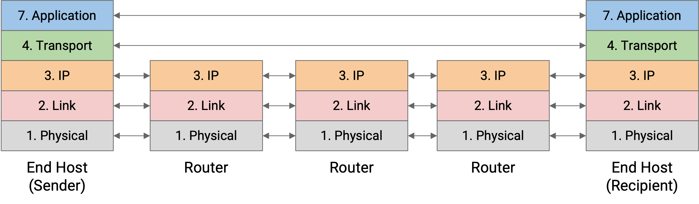
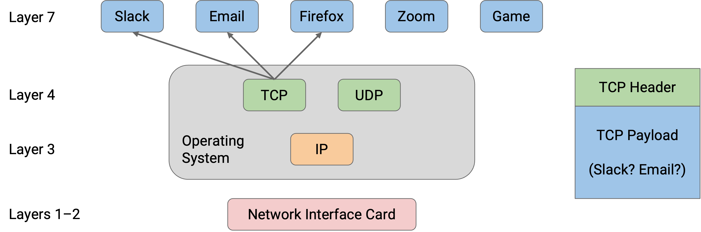
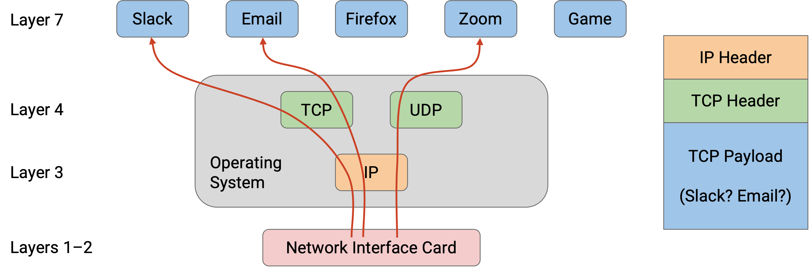
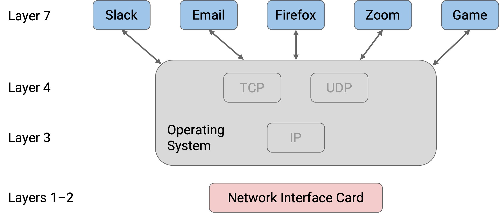
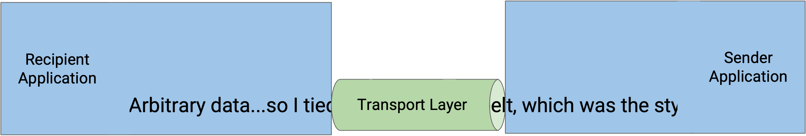
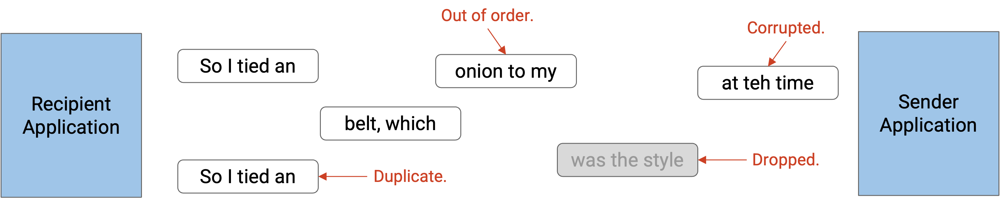
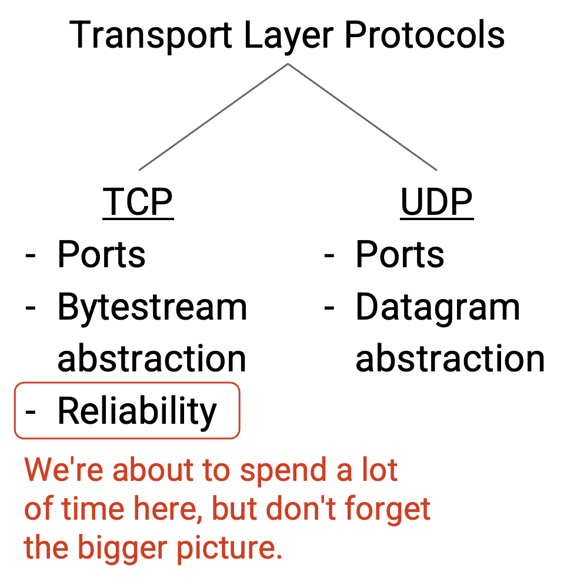

# 传输层原理

## 可靠性抽象与目标

许多应用需要可靠性。例如，在互联网上发送文件时，我们希望接收方收到的字节与发送方发送的完全一致，顺序也相同。

但是，第 3 层只提供不可靠的、尽力而为的分组投递。分组可能丢失、损坏、乱序——发送次序与收到次序不同——也可能延迟，例如困在队列里等待经过某条链路。

在罕见情况下，分组甚至会被复制：发送方只发了一份，接收方却得到多份。通常这是路径上某台路由器发生某种错误造成的，实际中很少出现。一个趣闻：加州大学伯克利分校的 Vern Paxson 是最早发现并报告链路层分组复制现象的人之一。

我们用第 4 层，即传输层，填补这个差距：设计依赖网络尽力而为分组抽象的协议，向应用开发者提供可靠抽象。

出于实际原因（其他章节讨论），可靠性在端主机实现，而不是在中间路由器实现。为了方便，它通常实现于操作系统，让各个应用不必重复实现可靠性。

我们用**至少一次投递**形式化可靠性：目的地必须至少收到每个分组的一份无损副本，但允许收到多份重复副本。传输层利用尽力而为投递实现至少一次投递，再在此基础上删除重复内容，向应用提供恰好一次投递。

注意，可靠投递并不保证一定能把分组发送成功。一台没有联网的计算机，不管用什么可靠性协议，都不能把数据发给目的地。可靠性协议可以放弃，报告发送失败；但它必须把失败通知应用，不能谎称已经成功投递。

协议还应高效：尽快交付数据，减少带宽消耗，避免无谓发送。例如，把每个分组重发几百遍有助于它到达，却违反高效利用带宽的要求。

> 编者边界：这里的“恰好一次”是同一传输连接内向应用交付字节的抽象，不是跨连接重试的数据库操作或远程调用恰好执行一次。

## 传输层的目标

传输层要提供方便的抽象，让应用开发者更容易编程。开发者可以按**连接**思考，而不必逐个考虑跨网络发送的分组。理想情况下，长数据如何拆包、丢包如何重发、何时超时等底层细节都不需要应用处理。

可靠性只是传输层可能承担的多个目标之一。

传输层通过引入端口号，在端主机上的不同进程之间进行**解复用**：每条流或连接可与不同的进程关联。

它还实现流量控制和拥塞控制，限制分组发送速率，分别避免接收方和网络过载。

## 用端口解复用

假设我的个人电脑上有两个应用，同时与同一台服务器通信。到达电脑的分组具有相同的源 IP 地址（服务器）和相同的目的 IP 地址（我的电脑）。怎样知道哪个分组属于哪个应用？

为了区分，也就是**解复用**面向不同应用的分组，传输层首部包含额外的**端口号**，用于标识端主机上的特定应用。

传输层收到分组时，可以用端口号决定把负载交给哪个上层应用。传输层实现于操作系统，因此这些端口——也称**逻辑端口**——是应用接入操作系统网络栈的连接点。应用知道自己的端口号，操作系统知道各应用对应的端口号，双方匹配这个号码，就能无歧义地传递数据，不与其他应用的数据混淆。

端口号长 16 位。现代互联网常用客户端—服务器设计：客户端访问服务，服务器提供服务。服务器通常在众所周知的端口（0–1023）监听请求，客户端知道这些端口，从而请求服务。例如 HTTP 使用端口 80，SSH 使用端口 22。

相反，客户端可以自行随机选择端口号（原文给出通常为 1024–65535）。可以随机选择，是因为客户端主动发起连接，没有人依赖客户端提供固定端口的服务。客户端端口是**临时的**：连接结束后可弃用，无须永久保留。

> 编者边界：这是教学范围描述，不表示所有操作系统实际采用整个 1024–65535 区间作为临时端口池。端口也不是进程的永久唯一身份；同一服务器端口可服务许多连接。

## 字节流抽象

传输层实现可靠性后，应用开发者不必再按大小受限的独立分组思考，而可以使用**可靠、有序的字节流**。发送方有一个不受协议固定总长度限制的字节序列，把它交给传输层；接收方会收到完全相同的字节序列，顺序相同，没有字节丢失。

可以把字节流想成管道：发送方把字节逐个放入管道，同样的字节逐个出现在接收端。双方不需要考虑丢失分组的重发或乱序分组的处理，因为传输层协议会替开发者实现这些功能。

## UDP 与数据报

有时应用不需要可靠性。例如，家中的水压传感器每分钟向公用事业公司发送一次读数，消息很小、长度固定，包含时间和水压。这个系统可能不要求按序到达（读数已经包含时间戳），也不需要把长消息拆成分组（每条读数都很小）。只要大多数读数能够到达，它甚至可能不需要可靠性。

不需要可靠性的应用，可以在传输层使用 **UDP（User Datagram Protocol，用户数据报协议）**，而不是 TCP。UDP 不提供可靠性保证。如果应用要求某个分组必须到达，就必须自行处理重发；传输层不会替它重发。原文的教学模型把 UDP 消息限制为单个分组：若应用希望发送更长消息，就要自行拆分并重组。不过，UDP 仍然具有端口的概念，仍然进行解复用。

在传输层，可以按需要选择 UDP 或 TCP，但不能把同一份传输层封装同时当作两者。TCP 与 UDP 是现代互联网的标准传输层协议。

> 编者勘注：原文“不能选择两者”应理解为某个传输实例的协议选择，不禁止一个应用同时使用不同的 TCP 与 UDP 套接字。原文单分组模型省略了 IP 分片；UDP 不替应用提供任意长消息的可靠分段与重组服务。

## 其他可靠性设计

原文把 TCP 的最初实现归于 Vint Cerf 和 Bob Kahn，并称他们当时是 UCLA 学生；他们后来因相关贡献获得图灵奖、总统自由勋章等奖项。TCP 最初的设计与今天使用的设计仍相当接近，经受住了时间考验。核心思想简单，设计优雅，虽不完美；但实现正确并不容易，而且大量现代互联网通信依赖它，出错影响很大。

> 编者勘注：上述“两人当时都是 UCLA 学生”的历史说法不准确，不应作为可靠史实引用；此处保留原文论述的位置并明确标错，不用它推导协议性质。

自最初创建以来，TCP 的许多组成部分不断演进，例如更好的定时器估计算法、更聪明的确认、更好的初始序号选择和拥塞控制；但核心架构决定与抽象——面向连接的字节流、窗口——保持不变。

TCP 是互联网上的标准可靠性协议，但还有原理完全不同的方案。例如，可以利用纠错码或 RAID 所体现的**冗余**思想，更可靠地发送数据。发送方不直接发送原始用户数据，而是编码出更多分组，在每份分组内有意加入冗余。

例如，用户有 10 个分组，某算法将其编码成 20 个分组，并保证只要收到其中任意 15 个，就能恢复原始的 10 个。

更形式化地说，编码算法可将 $k$ 个分组编码为 $n$ 个分组，其中 $n>k$；只要收到任意 $k'$ 个分组，就能恢复原始 $k$ 个，其中 $k<k'<n$。

编码方案是很深的主题，有喷泉码、Raptor 码等众多算法，本章不再展开。实际视频流平台中可以见到这种思想。

## 引用与来源

- Peyrin Kao，基于 Sylvia Ratnasamy、Rob Shakir 等人的讲授，[*Transport Layer Principles*](https://textbook.cs168.io/transport/reliability.html)，完整章节译文，包含全部 7 幅原图。
- 固定教材 commit：`0b8208742d31df7fc3d53a0cd94fdd4e04f8d47e`。这是 2026 当前快照，不是对 Spring 2025 原貌的声明。
- 原教材与本译文遵循 [CC BY-SA 4.0](https://creativecommons.org/licenses/by-sa/4.0/)。修改：中文翻译、中文图注、显式编者勘注；图像字节不变，显示时加白底以保障透明黑字在深色界面可读。
- 原创推导与自测在本讲 notes。视频字幕获取及一次官方替代均返回 HTTP 429，当前未取得字幕，未生成 draft，也未核验片尾或问答；教材许可不延伸至视频。
