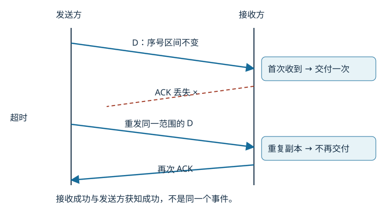

# 核心问题：没有收到回复，能证明数据丢了吗？

不能。可能是数据丢失，也可能是确认丢失、路径变慢、接收方尚未处理，甚至确认已经在回程上。可靠传输协议的工作不是神奇地识别全部原因，而是让这些不确定性最终表现为**正确交付，或明确失败**，不能把没把握的交付谎称成功。

本页把抽象、证据与效率拆开推导；协议例子用于理解，不是 Transport 项目的可提交实现。

## 连续阅读路线

不必在 15 个短视频之间来回切换。先读[本讲「课程资料」的传输层原理](#/c/berkeley-cs168-2025/lec/lec11?v=materials)，再接着读 [L12「课程资料」第一章：TCP 设计](#/c/berkeley-cs168-2025/lec/lec12?v=materials)。当前文字教材把具体可靠性机制放在后一章；它不是本讲缺失的另一份字幕，也不用重复翻译一份。

|阅读主线|文字资料中的位置|
|---|---|
|先确定服务：可靠性、端口、字节流与 UDP|L11「传输层原理」全章|
|从丢包、损坏、重复推导确认、超时与序号|L12 第一章「可靠地投递一个分组」「可靠地投递多个分组」|
|从停等走向流水线，并确定发送上限|L12 第一章「基于窗口的算法」及填满管道、流量控制、拥塞控制三个窗口小节|
|用 ACK 表达接收状态，并更早发现缺口|L12 第一章「更聪明的确认」「更早检测丢失」|

读到 L12 资料中的「第二章：TCP 实现」时，再进入下一讲的字节序号、连接状态、握手与关闭。本页负责提炼这些机制之间的关系，不再把完整正文按每个短视频拆开。

## 1. 三种“收到”不是一回事

1. **网卡或 IP 层收到一个分组**：不说明传输层校验通过，也不说明它属于当前连接。
2. **TCP 接受一段字节并发 ACK**：说明传输端的接收状态，不等于应用已经读走，更不等于业务操作已经提交。
3. **应用完成操作**：需要应用协议自己的响应、持久化与去重语义。

因而“文件发送成功”“对方 TCP 确认”“数据库事务提交”不能互相替代。TCP 的可靠性有条件：网络和对端永久不可达时，它可以报告失败；它不保证无穷等待必然成功。

## 2. 为什么 ACK 丢失必然带来重复风险？

设发送方交付数据 $D$ 后等待 ACK。若 ACK 不来，有两个外观完全相同的世界：

- 世界 A：$D$ 丢失，接收方什么都没有。
- 世界 B：$D$ 到达，但 ACK 丢失，接收方已经持有 $D$。

发送方没有额外证据，无法区分。若不重发，A 不可靠；若重发，B 可能重复。于是可靠性设计自然分两步：

$$\text{重传提供至少一次到达}\quad+\quad\text{序号去重}\quad\Rightarrow\quad\text{连接内有序、不重复交付}.$$

图为编者自拟：数据到达与发送方知道其到达是两件事。虚线不是已确认成功，而是丢失的 ACK。

**不能把纯 ACK 也当成需要逐个确认的数据。**否则 ACK 的 ACK 又需要 ACK，确认链会无限延伸。真正需要可靠交付的序号空间，由数据及 SYN/FIN 等控制事件占据；普通纯 ACK 不消耗序号。

## 3. 每种机制只解决一个问题

| 现象 | 所需机制 | 不足以解决什么 |
| --- | --- | --- |
| 比特损坏 | 校验和，损坏内容不交付 | 校验和不修复内容，也不保证数据抵达 |
| 数据或 ACK 丢失 | ACK、超时与重传 | 超时不是“已证实丢包” |
| 数据重复 | 字节序号、连接状态、去重 | 不能仅凭 payload 相同判断重复，应用可能合法发送相同内容 |
| 数据乱序 | 按序号暂存并等待连续前缀 | 不能把后到缺口之前的数据直接跳过 |
| 长数据 | 分段与接收端重组 | TCP 不保留应用一次 write 的边界 |

例：应用连续发送两次字符串 `OK`，合法字节流是 `OKOK`。如果用“内容相同”去重，就会误删第二次；必须区分它们占据的不同字节位置。

## 4. 从停等推导窗口，而不是背名词

若每段负载为 $L$ 字节，发送一段后必须等待一个 RTT $R$ 才能继续，在忽略串行化等细节的近似下：

$$T_{\mathrm{stopwait}}\lesssim\frac{L}{R}.$$

设 $L=1000$ 字节，$R=0.1$ 秒，吞吐约不超过 10,000 byte/s，也就是 80 kbit/s。即使接入链路很快，停等仍可能把大多数时间花在等待。

允许 $W$ 字节同时未确认，则近似上界变成：

$$T\lesssim\min\left(B,\frac{W}{R}\right),$$

这里 $B$ 必须用 byte/s。要把无竞争的管道填满，需要 $W\gtrsim BR$。

自拟例：瓶颈 20 Mbit/s，RTT 40 ms，则往返带宽时延积为：

$$20\times10^6\times0.04/8=100{,}000\ \text{byte}.$$

约 100 KB 的在途窗口才能接近填满这个理想化管道。若窗口只有 10 KB，窗口限制的吞吐约为 250 KB/s，即 2 Mbit/s。

**在途不是“还在前向链路上”。**数据已经到了，但它的 ACK 尚未回到发送方，也仍在发送方的未确认账本里。只计算单向传播路径中的数据，会把窗口估小。

## 5. 接收重排：网络已经送到，不等于现在能交付

假设按教学包编号接收到了 1、2、4、5，却缺 3：

- 1、2 可以交付；4、5 先保存在接收端。
- 应用看见的连续前缀停在 2，不能变成 1、2、4、5。
- 3 到达后，可以一次把连续前缀推进到 5。
- 如果 4 又来一份，只增加重复证据，不应再向应用交付一次。

这就是可靠有序抽象的代价之一：**后续数据已经到达，仍可能被前面的缺口阻挡**。流量控制因此不能只看链路是否空闲，还要看接收缓冲区是否有空间。

接收方慢也可能是应用读取慢，而不是网络乱序。两者都会占用缓冲，均不能靠更快重传解决。

## 6. 累计 ACK：一个边界，压缩一整个前缀

先分清两种约定：

- 本讲的按包模型“累计确认到 5”，表示包 1–5 都到达。
- 真实 TCP 的 **ACK=5** 表示下一个期待的字节序号为 5，即已经收到的是此前的连续字节，不包括 5 本身。

如果混用这两种约定，几乎每一道序号题都会差一。

累计确认的优点是后续 ACK 能补偿先前 ACK 丢失，而且信息长度固定。代价是无法表达全部乱序集合：收到了 4、5、7 还是 4、6、8，可能生成相同累计边界。重复 ACK 是缺口线索，不是精确的缺失列表。

快重传利用这种线索：在课本简化条件下，原始 ACK 后再来三个相同的重复 ACK，可触发重传最左未确认段。但网络也可能重排或复制，因而这是判断策略，不是关于“必然丢失”的数学证明。超时仍是不能丢掉的兜底路径，例如尾部丢包可能根本没有足够后续包产生重复 ACK。

## 7. 两个窗口约束，两个不同的保护对象

- **rwnd**：接收方告诉发送方，自己的接收能力还有多少；保护接收端。
- **cwnd**：发送方从网络反馈形成的拥塞约束；保护共享网络。

在教材的常用表达下，有效窗口受 $\min(\mathrm{rwnd},\mathrm{cwnd})$ 限制。二者都按数据量理解，不把窗口字节数直接叫作“速率”。同一窗口在不同 RTT 下可产生不同吞吐。

接收方缓冲很大，不代表网络不拥塞；网络很空，不代表接收方能无限接收。它们需要分别考虑。

## 8. 端口与字节流：两个容易被可靠性话题掩盖的抽象

IP 主要回答到哪台主机；端口帮助操作系统把数据送到哪个通信端点。一个服务器端口可以服务多个客户端连接，不能把“端口 80”理解成整台机器只允许一条 HTTP 连接。

TCP 是字节流：一次写入 100 字节，另一端可能分多次读取，也可能与后一次写入一起读出。应用需要长度字段、分隔符或其他 framing 来识别消息。

UDP 保留数据报边界，但不提供 TCP 的可靠按序字节流。传感器定期上报、数据本身有时间戳且允许少量丢失时，UDP 可以是合理选择；若业务需要可靠性，应用仍要承担相应机制或选择其他协议。

## 9. 自测：先画证据，再算数

### 问题一：对方已经收到数据，为什么我还可能重发？

展开答案

因为发送方只能依据回到自己这里的证据。ACK 可能丢失或延迟，接收端事实不自动等于发送端知识。接收方必须把重复数据识别为同一序号范围，不重复交给应用。

### 问题二：接收端收到教学包 1、2、4、5，累计确认能不能写“到 5”？

展开答案

不能，3 是缺口。按包约定只能确认截至 2；若是真实字节序号题，还需先把每段转换成字节区间，再写最早缺失字节，不能直接套包号。

### 问题三：1 Gbit/s、RTT 80 ms，理想 BDP 是多少？

展开答案

$10^9\times0.08=80$ Mbit，除以 8 为 10 MB，使用十进制单位。忘记除以 8 会把字节窗口算大八倍；这还只是理想网络容量，不取消 rwnd/cwnd 约束。

### 问题四：只有最后一段丢了，快重传一定能救吗？

展开答案

不一定。后面没有数据触发足够重复 ACK，仍需超时机制。可靠性不能建立在“总有三个后续包到达”这个前提上。

### 问题五：TCP ACK 能证明对方应用把文件落盘了吗？

展开答案

不能。TCP 确认的是传输层字节接收状态，不是应用读取、业务执行或磁盘持久化。文件协议需要另外定义成功响应与失败恢复。

## 引用与来源

- 指定阅读：Peyrin Kao 等，[*Transport Layer Principles*](https://textbook.cs168.io/transport/reliability.html)，完整译文见本讲 materials。
- 为贯通设计所用教材：[*TCP Design*](https://textbook.cs168.io/transport/tcp-design.html)、[*TCP Implementation*](https://textbook.cs168.io/transport/tcp-implementation.html)，唯一完整译文在 [L12 materials](#/c/berkeley-cs168-2025/lec/lec12?v=materials)。固定版本与勘误均列在译文页底。
- 编者规范补充：W. Eddy 编，[RFC 9293](https://www.rfc-editor.org/rfc/rfc9293.html)，2022，§3.1、3.4–3.6、3.8，核对 ACK、序号和关闭语义。本页原创例子、推导与自测，不是视频近义改写。
- 全 15 P 的 en-orig 自动字幕在默认获取及一次 visionOS 官方替代中均返回 HTTP 429；人工字幕列表为空。未取得字幕正文，故没有 draft，也不提供猜测的片段时间、片尾或 Q&A，不声称已核验音画。视频许可字段逐条均为空，不能套用教材许可。

### 官方 15 P 元数据索引

频道均为 **CS 168 (Internet Architecture) at UC Berkeley**，各分 P 上传日期均为 **2025-03-05**；这是上传日期，不是官网课表日期。下表题名保留官方 `[CS168 SP25] Lecture 11.N` 前缀，时长来自每条视频的独立元数据。每 P 都有自己的零起点，不把它们拼成单视频时间轴。

| P | 官方原题名及原视频 | 独立视频时长 |
| --- | --- | --- |
| 1 | [[CS168 SP25] Lecture 11.1 - Transport Layer Demultiplexing](https://www.youtube.com/watch?v=UCb4lpWFPGs) | 07:35（455 秒） |
| 2 | [[CS168 SP25] Lecture 11.2 - Transport Layer Abstractions](https://www.youtube.com/watch?v=FTpUy_SRuS0) | 07:58（478 秒） |
| 3 | [[CS168 SP25] Lecture 11.3 - Defining Reliability](https://www.youtube.com/watch?v=mLObHQZkjIA) | 05:31（331 秒） |
| 4 | [[CS168 SP25] Lecture 11.4 - Dropped Packets](https://www.youtube.com/watch?v=bndlazP9UiM) | 07:37（457 秒） |
| 5 | [[CS168 SP25] Lecture 11.5 - Corrupted, Delayed, Duplicated Packets](https://www.youtube.com/watch?v=fbz77gx1w70) | 08:16（496 秒） |
| 6 | [[CS168 SP25] Lecture 11.6 - Window-Based Algorithms](https://www.youtube.com/watch?v=AJ-0jB0R1CI) | 11:03（663 秒） |
| 7 | [[CS168 SP25] Lecture 11.7 - Setting W: Filling the Pipe](https://www.youtube.com/watch?v=Gu1Dt3ZBHHg) | 10:20（620 秒） |
| 8 | [[CS168 SP25] Lecture 11.8 - Setting W: Flow Control](https://www.youtube.com/watch?v=nG5Lx0rD5os) | 05:18（318 秒） |
| 9 | [[CS168 SP25] Lecture 11.9 - Setting W: Congestion Control](https://www.youtube.com/watch?v=hC5KoZt-rmE) | 06:42（402 秒） |
| 10 | [[CS168 SP25] Lecture 11.10 - Ack Strategies: Individual, Full-Information](https://www.youtube.com/watch?v=qWXjYRUYpwk) | 06:32（392 秒） |
| 11 | [[CS168 SP25] Lecture 11.11 - Ack Strategies: Cumulative](https://www.youtube.com/watch?v=nfcMoApQGq8) | 04:36（276 秒） |
| 12 | [[CS168 SP25] Lecture 11.12 - Ack-Based Loss Detection](https://www.youtube.com/watch?v=h2hD87mWCMU) | 09:23（563 秒） |
| 13 | [[CS168 SP25] Lecture 11.13 - Responding to Loss: Individual Acks](https://www.youtube.com/watch?v=z2qO_lKvriw) | 06:00（360 秒） |
| 14 | [[CS168 SP25] Lecture 11.14 - Responding to Loss: Cumulative Acks](https://www.youtube.com/watch?v=zVTTkavw04w) | 10:02（602 秒） |
| 15 | [[CS168 SP25] Lecture 11.15 - Alternate Designs](https://www.youtube.com/watch?v=KAoKPIJAlH4) | 07:38（458 秒） |

独立元数据合计 **6871 秒，即 1:54:31**。播放列表 flat 元数据合计 6882 秒，比逐视频多 11 秒；这里采用逐视频值，不沿用规划时的 1:54:42。该差异是元数据来源差异，不能据此推断片尾剪辑了什么。以上只是已核实的身份与总时长索引，不是已经阅读全文字幕的覆盖表。
