# 第一章：TCP 设计

## 可靠地投递一个分组

分组从发送方到接收方所用的时间称为**单向时延**。从发送方到接收方，再加上回复分组从接收方回到发送方的时间，称为**往返时间（RTT）**。

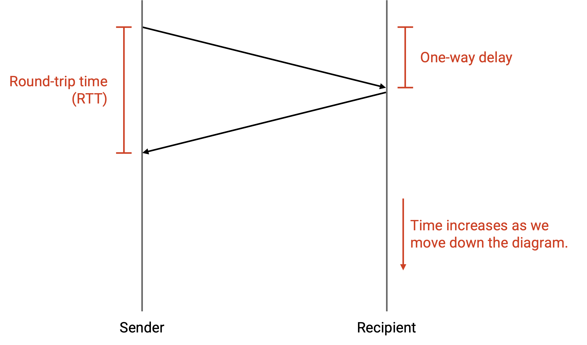

先设计一个可靠发送单个分组的简化协议，建立直觉。发送方发出分组后，怎样知道对方是否成功收到？

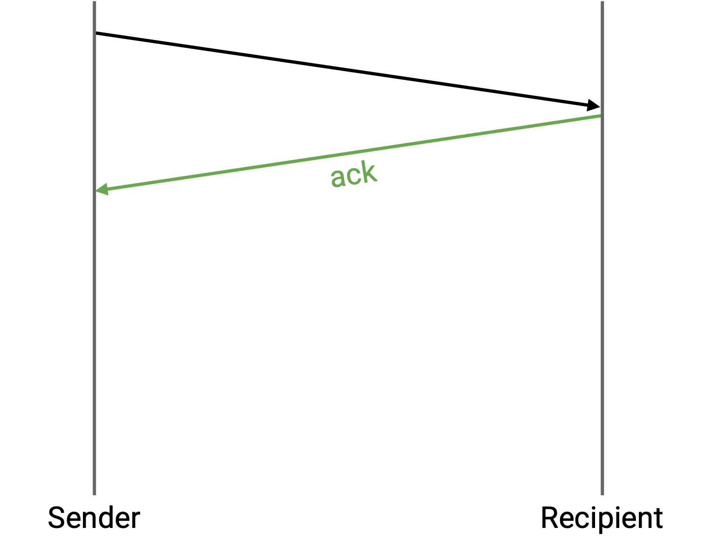

接收方可以发送**确认（acknowledgment，ACK）**消息，证实分组已收到。如果分组丢了怎么办？可以重发，但怎样知道什么时候重发？

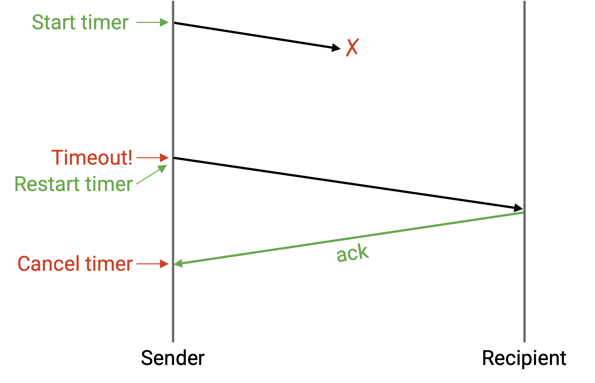

发送方维护一个计时器，到期时重发分组。收到 ACK 后取消计时器，不再重发。

如果丢的是 ACK 呢？

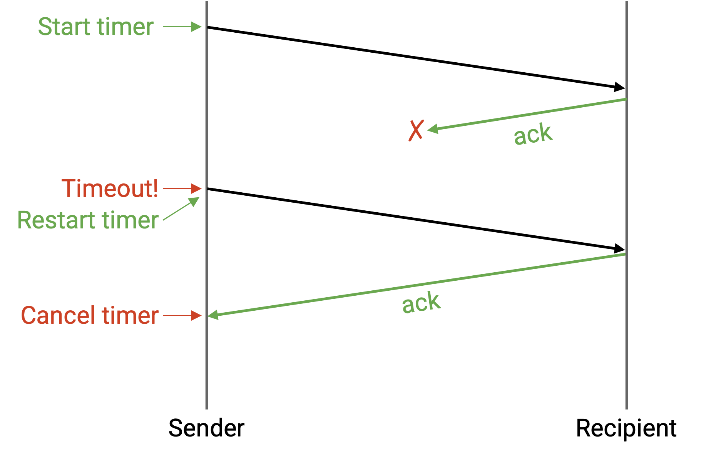

协议无须修改：发送方收不到 ACK 就超时重发，直到 ACK 成功回来。在这种情况下，目的地收到两份相同分组，但这没有关系，它可以识别并丢弃重复副本。

计时器应该设多长？太长会让本可更快完成的发送等待过久；太短会产生不必要的重发。两种错误都影响效率。一个有用的起点是 RTT：发送方预计此时收到 ACK，如果没有收到，就在此时重发。

实际估计 RTT 很困难。不同网络路径的 RTT 不同；即便路径固定，负载和拥塞也会改变 RTT。可以测量发包到收到该包 ACK 的时间，每个包提供一个样本，再用某种算法（例如指数移动平均）合成为一个估计值。算法还得处理重发带来的测量问题与时延变化。

实际通常宁可把计时器设长一些。若设得太短、不断超时，连接就可能不停无谓地重传，表现很差。

如果比特损坏呢？

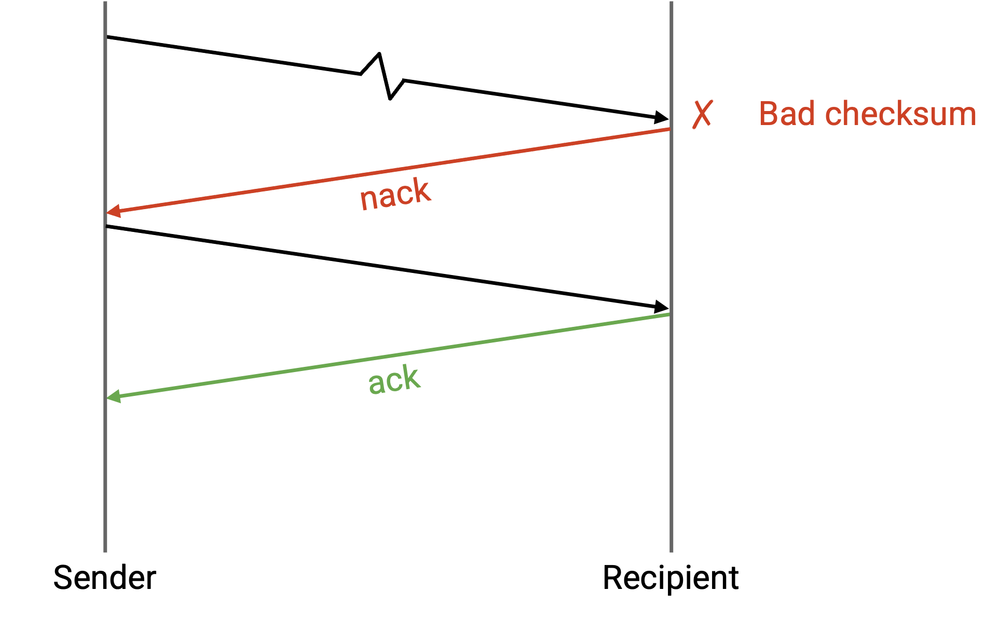

可以在传输层首部加入校验和，它不同于 IP 层的校验和。收到损坏分组后有两种选择：一种是明确发送**否定确认（NACK）**，要求重发；另一种是直接丢弃，不发 ACK 也不发 NACK，让发送方超时后重发。

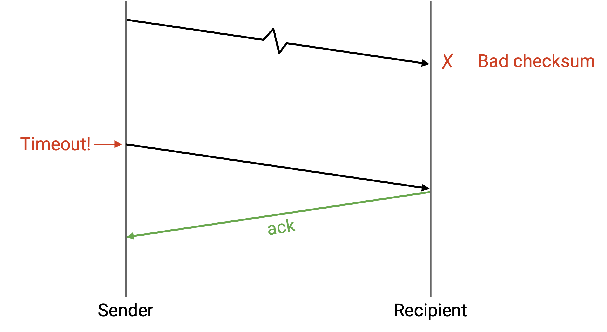

这两种方案都可行，但 TCP 使用后者，不实现这里的显式 NACK。

如果分组被延迟呢？

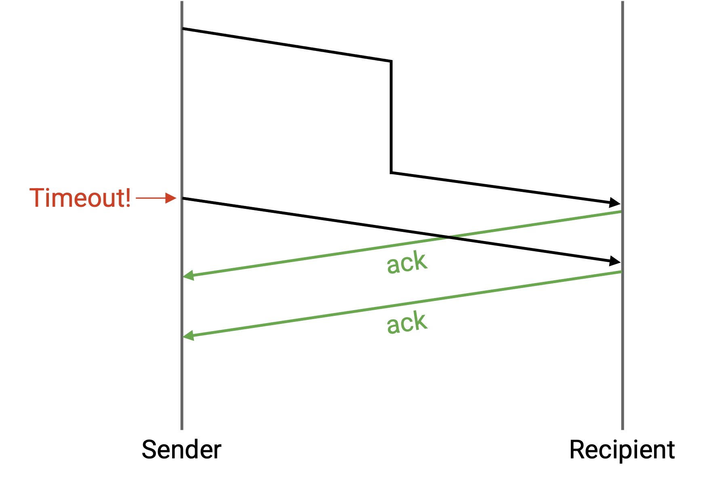

无须修改协议。延迟过长时，发送方可能在 ACK 回来前就超时，因而重发。接收方可能收到两份数据，发送方可能收到两份 ACK，但重复可以安全处理。

如果发送方只发了一份，网络却复制成两份送到接收方呢？

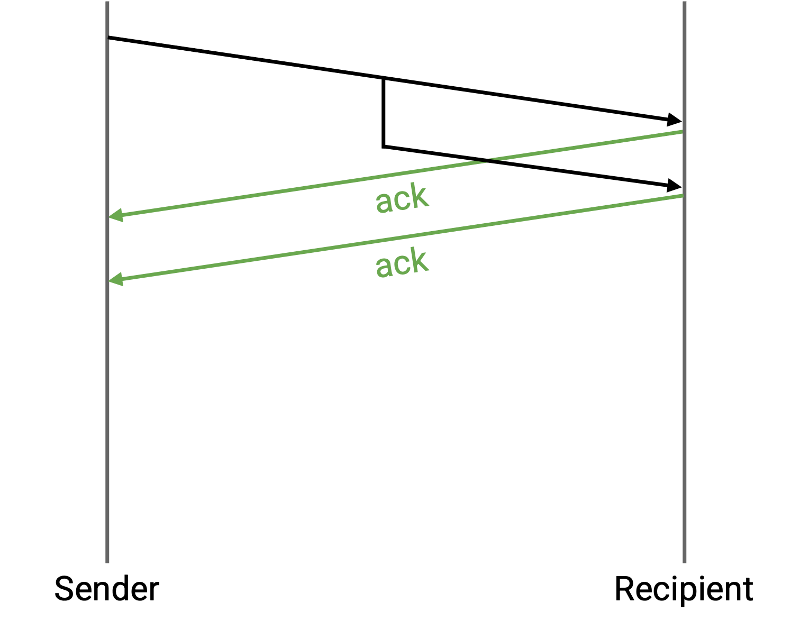

同样无须修改。接收方会发两份 ACK，两端都能安全处理重复。

这个简化协议还解释了网络复制的一种原因：假设某条链路自己实现可靠性，链路接收端可能收到两份副本；通常它会丢掉重复，只转发一份。但若路由器在两份副本到达之间崩溃并重启，就可能失去去重状态，把两份都转发到目的地。

单分组可靠性协议可归纳如下：

- **发送方**：发送分组并启动计时器；若计时到期还没有 ACK，重发并重启计时器；收到 ACK 就停止并取消计时器。
- **接收方**：收到无损分组就回复 ACK。若多次收到同一分组，可能多次发 ACK。

校验和（处理损坏）、确认、重发、超时，是后续协议继续使用的核心思想。这一协议提供**至少一次投递**，因为重复副本仍可能存在。

## 可靠地投递多个分组

如何把协议扩展到多个分组？

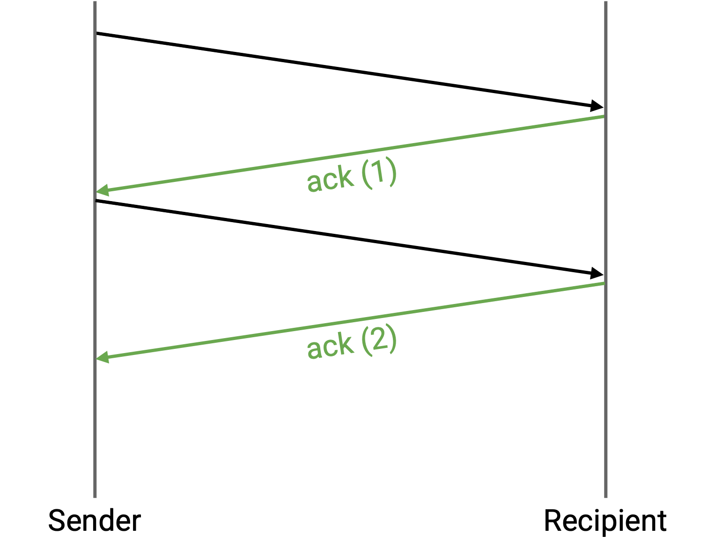

对每个分组都执行相同的发送规则——计时器到期就重发。为区分分组，给每个分组附加唯一的**序号**；每个 ACK 与某个特定分组关联。序号也有助于对乱序到达的分组重新排序。

何时发送各个分组？最简单的是**停等协议**：收到分组 $i$ 的确认后，才发分组 $i+1$。它能正确提供可靠性，但很慢：每个分组至少要花一个 RTT，若丢失或损坏则更久。

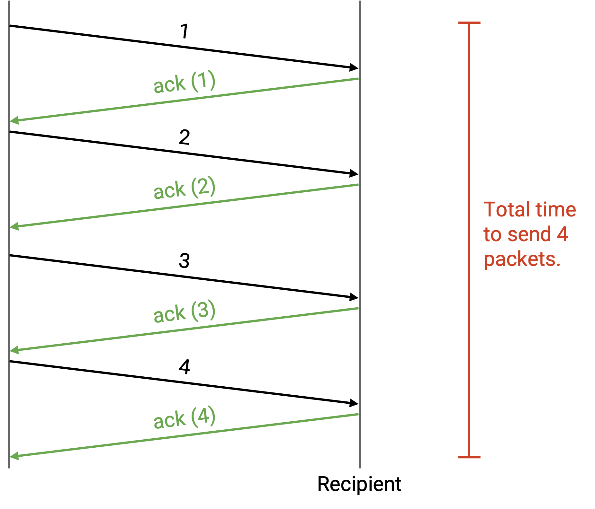

在效率要求不高的小环境里，停等可能足够，但互联网不能接受这样的速度。怎样更快？

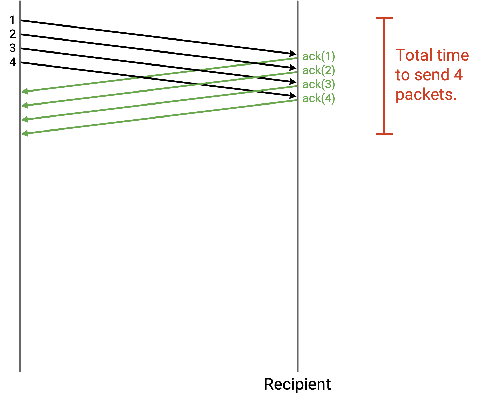

可以并行发送：在等待 ACK 时继续发其他分组。已经发送、对应 ACK 尚未收到的分组叫作**在途（in flight）**分组。

最直接的办法是立刻发出所有分组，但可能使网络过载，例如本机接入链路的带宽有限。

## 基于窗口的算法

一个一个发太慢，一次全发又会压垮网络。因此设上限 $W$：任意时刻最多有 $W$ 个分组在途。这就是**窗口协议**的关键思想，$W$ 是窗口大小。

如果允许最多 $W$ 个分组在途，发送方开始时可以连发 $W$ 个；每收到一个 ACK，再发送队列中的下一个分组。

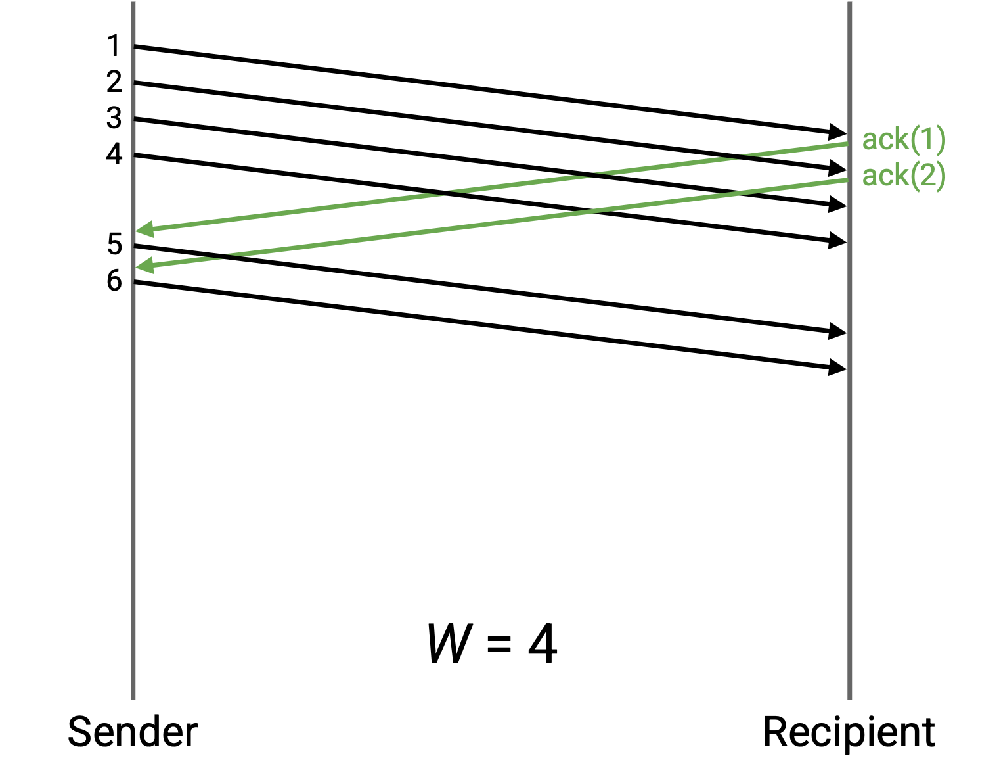

怎样选择 $W$？我们希望充分利用网络容量，即“填满管道”；$W$ 太小，带宽就用不完。同时不能让链路过载，因为别人也可能在使用它——这是拥塞控制；也不能压垮需要接收和处理数据的接收方——这是流量控制。

## 窗口大小：填满管道

先只看第一个 RTT，即发出第一个分组到收到第一个 ACK 的时间。假设为 5 秒；再假设出口链路每秒可发 10 个分组。这两个数只为举例，不是实际典型数值。第一个 RTT 内可以发送 50 个分组，因此窗口 50 能让发送方持续发送，不必空闲。

若 $W<50$，发送方会在第一个 ACK 返回前发完初始窗口，被迫闲等，从而浪费带宽。一般而言，我们希望整个 RTT 内都能发送。

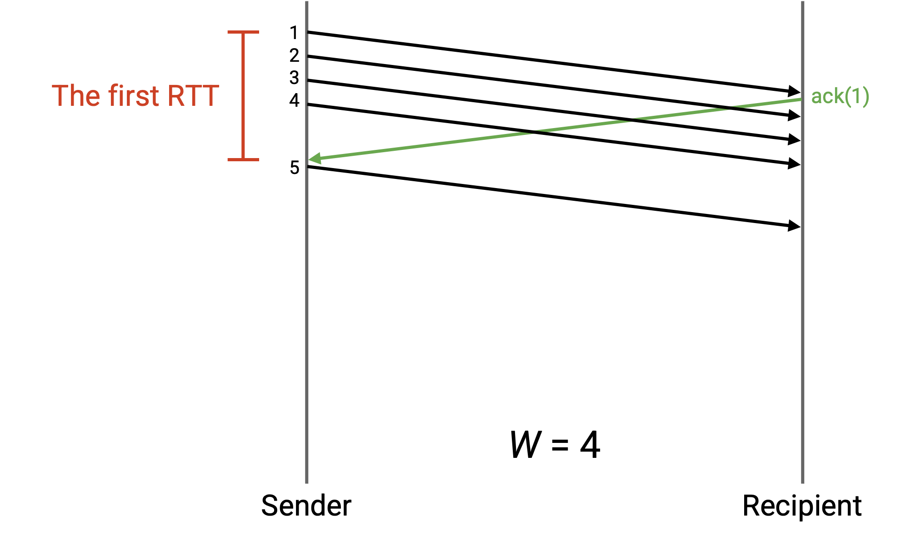

图中的 $W=4$；发送完四个分组后，发送方闲置，等待首个 ACK。

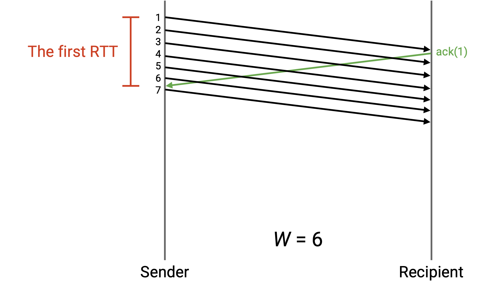

增大 $W$ 后，发送方可以连续发送。第一个 ACK 返回时，刚好接近窗口在途上限，随后可随着 ACK 持续到来继续发。

到达目的地的路径可能有多条容量不同的链路。用 $B$ 表示路径中最小的、即**瓶颈链路**的带宽。发送速度不应超过 $B$，否则过载；也不希望低于 $B$，否则没有充分利用容量。

设往返时间为 $R$。若 $B$ 的单位是分组/秒，$RB$ 就是一个 RTT 内能发送的分组数，也就是应有的窗口分组数。

现实中 $B$ 通常以 bit/s 计。$RB$ 因而首先得到**比特数**。换成字节后，关系为：

$$W\times L=\frac{RB}{8},$$

其中 $W$ 是分组数，$L$ 是每个分组的数据字节数。如果 $B$ 已用 byte/s 表示，则右侧直接是 $RB$。左边是一个窗口内的数据量，右边是一个 RTT 内可传的数据量。

> 编者勘注：原文先说 $B$ 以 bit/s 计，随后把 $RB$ 直接称为字节数，量纲不一致；上式显式补上除以 8。原文文字公式为“窗口乘分组大小 = RTT 乘带宽”，必须统一单位后使用。

具体例子：RTT 为 1 秒，$B=8$ Mbit/s，则 $RB=8$ Mbit，即 1 MB，也就是 1,000,000 字节。如果每包 100 字节，就需要 $W=10,000$ 个分组，才能在一轮 RTT 内发送 1,000,000 字节，充分使用带宽。

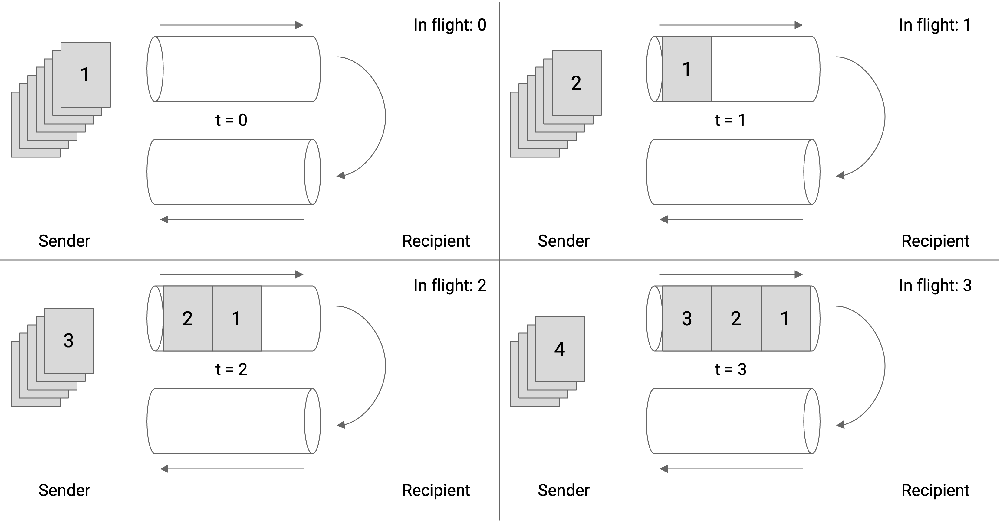

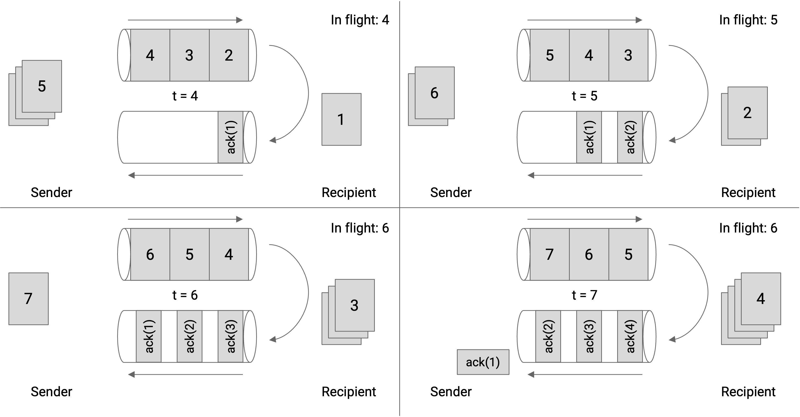

也可以从链路本身画窗口。图中分别画出某条链路的去程和回程。发送方以最大容量持续推入数据，第一个 ACK 恰在发完第六个分组后到达，所以窗口应该是 6。

注意不是 3：发第六包时，虽然前向路径上只有三个分组，另外三个包的 ACK 尚未回来，仍属于在途，总共六个。

如果窗口仅为 3，在分组 1、2、3 的 ACK 返回途中，前向管道就会闲置。

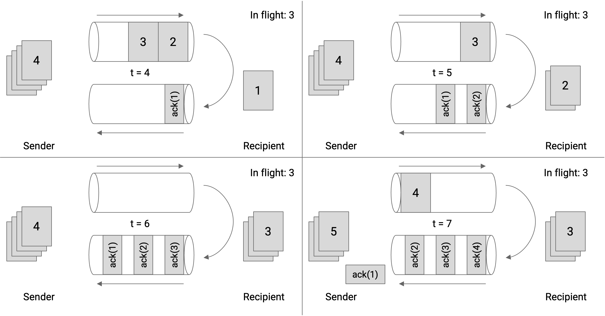

ACK 没有填满整个回程管道，因为它们只携带确认信息，不含实际应用数据。

## 窗口大小：流量控制

接收方操作系统中的传输协议可能收到乱序分组，但字节流抽象要求按序交付。因此，必须把乱序分组**缓冲**在内存里，等轮到它们时才能交付。

例如，接收方已经收到并处理分组 1、2，随后收到 4、5。传输层此时不能把 4、5 交给应用，必须等 3 到达，同时把 4、5 保存在传输层内存中。

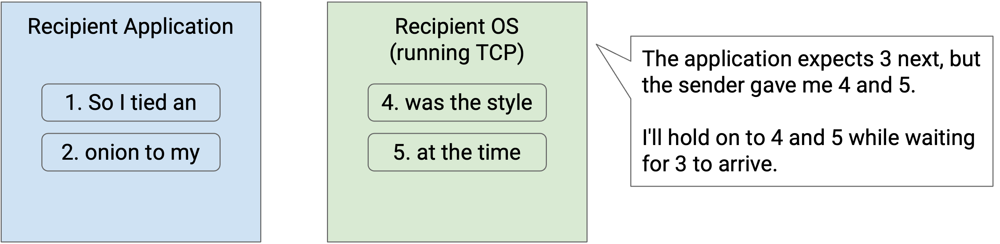

内存并非无限。乱序分组的缓冲区大小有限，缺口补齐前都必须保存；若丢包和重排很多，接收方可能耗尽内存。

**流量控制**保证接收缓冲区不被压垮。办法是由接收方告诉发送方还有多少空间，这个剩余空间称为**通告窗口（advertised window）**。ACK 同时表达：“这些分组已经收到，另外还有 $X$ 字节可用于接收。”

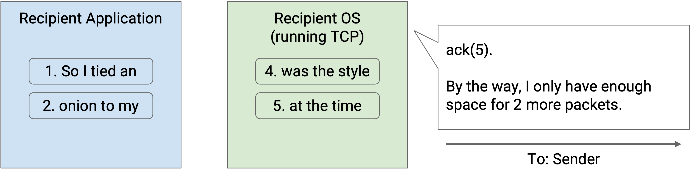

发送方得知通告窗口后，调整自己的窗口：在途分组数不能超过接收方提供的容量。如果接收方说还可放 5 个分组，就必须把窗口限制在至多 5 个，即便链路带宽允许更多分组在途。

> 编者边界：实际 TCP 的窗口按字节计；缓冲区还可能被应用尚未读取的有序数据占用，不只是乱序数据。

## 窗口大小：拥塞控制

为了充分利用带宽，我们曾按瓶颈链路容量设置窗口。例如瓶颈为 1 Gbit/s，就让发送方在整个 RTT 中持续以 1 Gbit/s 发送。

实际这条链路很少只服务一个连接；其他连接也会占用容量。因此，发送方只能使用自己的那一份，而不是全部带宽。

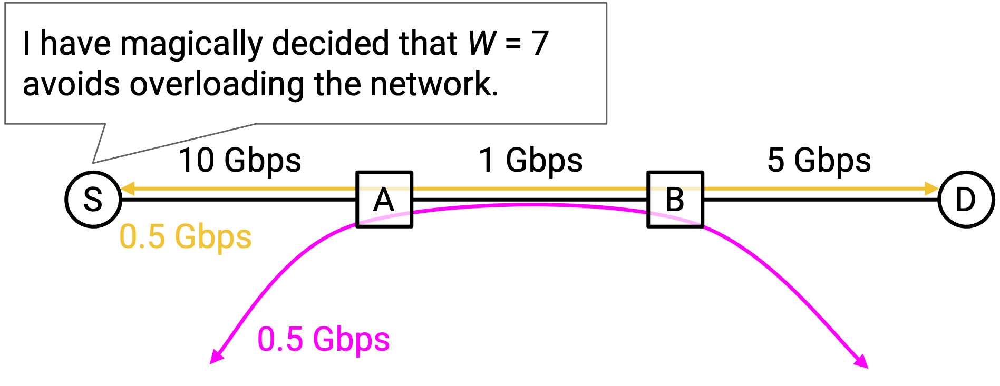

各连接应该分到多少？原文给出例子：两个连接分别占 400 MB/s 与 250 MB/s，第三个连接加入，或许给它剩下的 350 MB/s；也可以认为这样不公平，让三个连接各用约 333 MB/s。

> 编者勘注：原文这一段的 MB/s 与前文 1 Gbit/s 不一致。保留 400、250、350、333 的分配例子时，应把总容量独立理解为 1000 个相同速率单位；不能把 1000 MB/s 当成 1 Gbit/s。

确定和计算各连接可用带宽份额，就是拥塞控制的目标。其算法是后续章节的完整主题。这里先抽象为：发送方运行某个拥塞控制算法，动态计算本连接在瓶颈链路上的份额。

算法给出发送方的**拥塞窗口（cwnd）**。目前只需知道，它是为了获得较好性能、不压垮链路并与其他连接合理共享容量而形成的窗口约束。

于是三个目标对应三个限制：为了充分使用容量，按 RTT 与瓶颈带宽决定窗口；为了不压垮接收方，受接收通告窗口限制；为了不压垮链路，受拥塞窗口限制。原文先把实际窗口写成三者最小值。

在原文的理想化解释中，拥塞控制允许的份额不会超过全部瓶颈容量：没有竞争时可以全部使用，有竞争时只用一部分。因此第三个限制不大于第一个。另一方面，瓶颈带宽很难直接发现——发送方无法轻易遍历拓扑、查出每条链路容量。于是实现上不必单独取得第一个数，使用后两者最小值即可：

$$W=\min(\mathrm{cwnd},\mathrm{rwnd}).$$

> 编者勘注：cwnd 是窗口数据量，不是带宽本身。原文“拥塞窗口永不超过填满管道所需窗口”是理想化份额解释，不是现实算法的严格不变量；探测、队列和估计误差都可能使窗口超过无排队 BDP。这里的取最小值规则仍成立，但不能从它推出“绝不会排队”。

## 更聪明的确认

目前每份 ACK 对应一个分组。能否比逐包确认更好？逐包确认有什么问题？

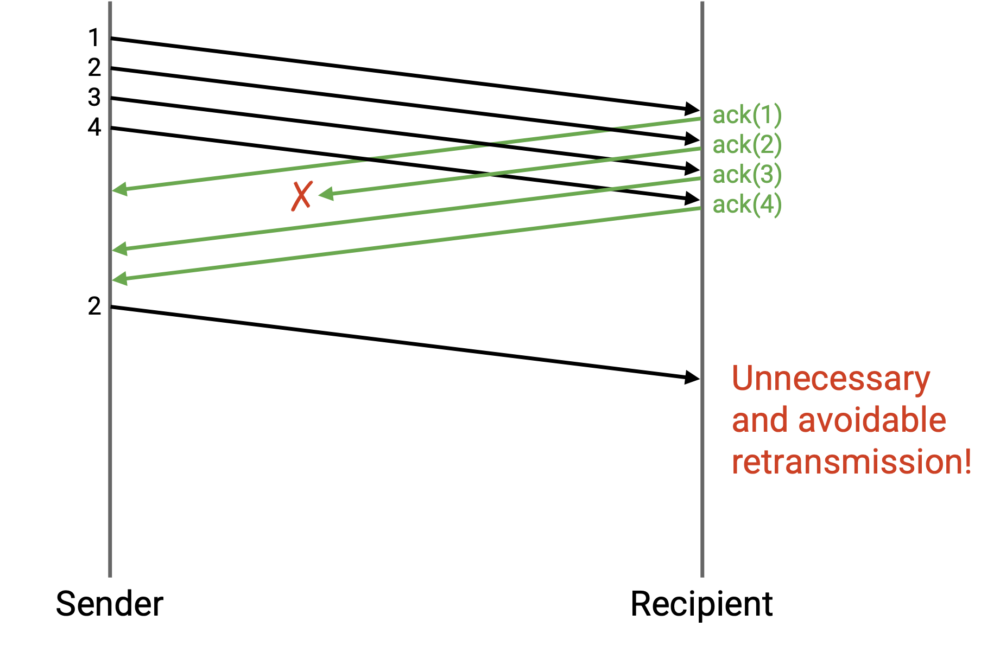

图中接收方已经收到全部四包，但一份 ACK 丢失，迫使发送方重发分组 2，虽然完全没有必要。

可以让每份 ACK 列出目前收到的所有分组，而不是只确认某一包，这称为**全信息 ACK**。

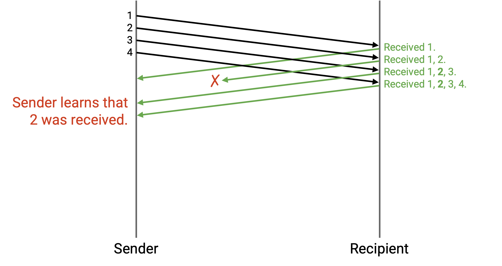

例中确认依次为“收到 1”“收到 1、2”“收到 1、2、3”“收到 1、2、3、4”。第二份 ACK 虽然丢了，第三、第四份仍让发送方知道 2 已收到，无须重发。

随着发送量增加，完整列表会很长。可以缩写成“12 及以前全部收到，另外收到 14、15”。形式上，就是最高累计确认号——所有小于等于它的分组均已收到——再加额外收到的分组列表。

即便如此仍可能很长。例如所有偶数分组都丢失，累计前缀始终只能到 1，其余已收分组需列为 3、5、7、9……，列表不断增长。

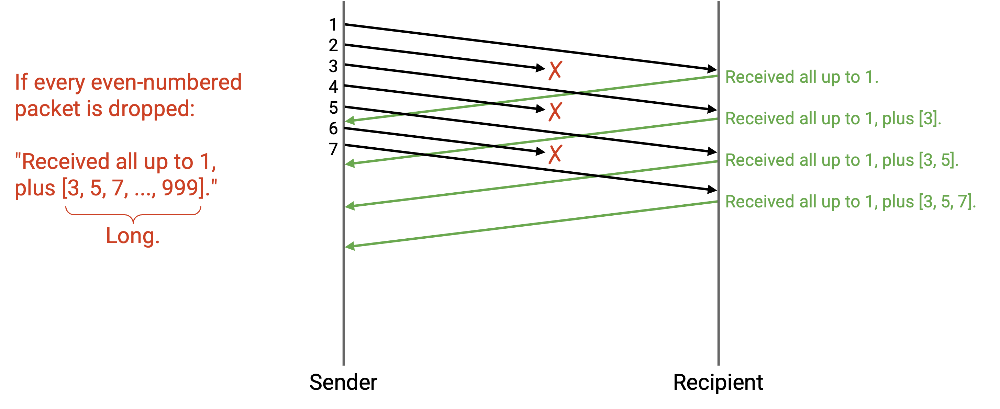

**累计 ACK**在逐包确认与全信息确认间折中：只保留最高连续确认号，丢掉额外列表。此处按包编号的约定是：报告截至哪个序号的所有包都已到达。

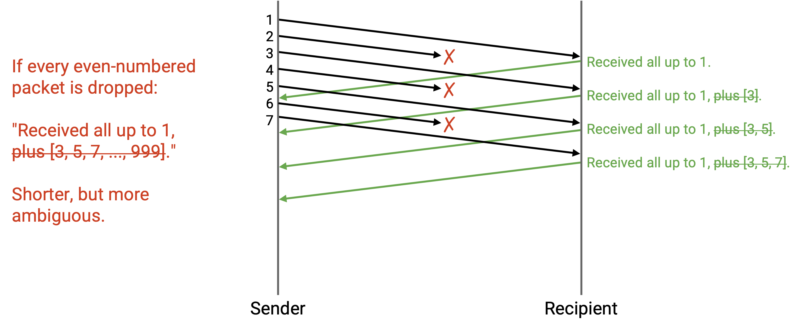

所有偶数包丢失时，每份累计 ACK 都说“截至并包括 1 全部收到”。即便 3、5 到了，也不会编码它们的信息，因为确认仅覆盖从 1 开始的连续前缀。

累计 ACK 的长度不随连接长度增长——始终只发一个数，不发列表——但会有歧义。例中发送方看到三份“截至 1”的 ACK，在这个一包一确认、ACK 不复制的模型中，可推知收到了三个包，却不能知道除 1 以外的另外两个到底是什么。

> 编者边界：这里“截至并包括第 $n$ 包”的教学编号，与真实 TCP 首部“下一个期待的字节号”不是同一个约定。现实中 ACK 还可能延迟、丢失或复制，不能无条件把 ACK 份数等同于不同数据包到达数。

## 更早检测丢失

能否不等超时，而利用收到的其他信息更早重传？逐包确认模型中，若收到 1、3、4、5、6 的 ACK，就可能推测 2 丢了，在计时器到期前重发。

设一个与窗口无关的阈值 $K$：如果缺失包之后已有 $K$ 个包被确认，就认为它丢失，即使还未超时。例如 $K=3$，等待 5 的 ACK 时收到 6、7、8 的 ACK，就判断 5 丢失。

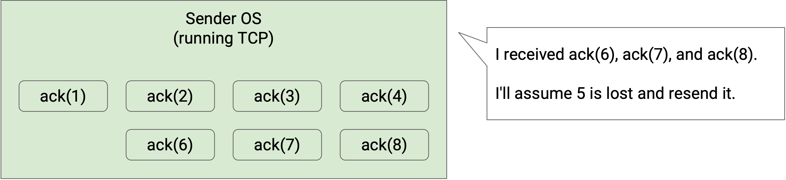

依靠后续 ACK 判断，实际常比等待超时快得多。按 RTT 计算的超时可能达到秒级，而现代带宽下 ACK 可每几微秒到达一份。

这个策略随确认方式不同而变化。上面是假设逐包确认；全信息 ACK 的处理相似，而且缺失位置更明确。

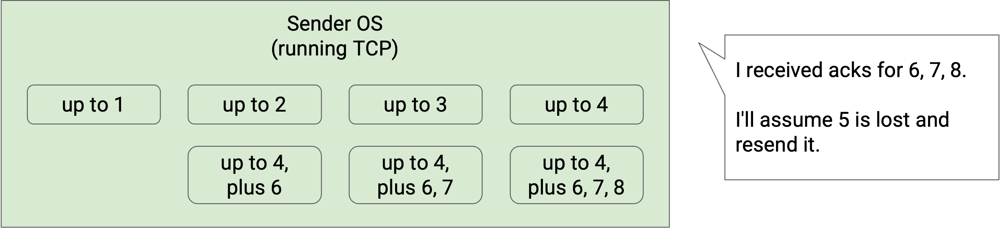

若 5 丢失，ACK 依次为“截至 4”“截至 4，另有 6”“截至 4，另有 6、7”“截至 4，另有 6、7、8”。$K=3$ 时，5 之后已有三个分组被确认，可以判定 5 丢失。

累计 ACK 则更含糊。若 5 丢失，确认 4、6、7、8 的四份 ACK 都只写“截至 4”。因为连续前缀存在缺口，发送方看到**重复 ACK**。$K=3$ 时，初次 ACK 之后再来三个重复 ACK，就触发重传；相同确认值总共出现四次。

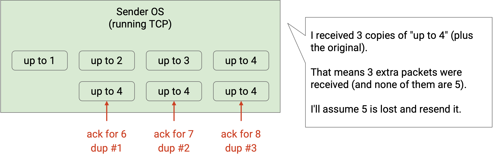

> 编者勘注：原文此处把总数说成“4 duplicates”，容易混淆。应是 1 份原始确认加 3 份重复确认，总共 4 份，不是再等待第 4 个重复 ACK。

逐包确认和全信息确认能明确看出缺哪一包；累计确认下，特别是多包同时丢失时，重传哪一包更含糊。

考虑 $W=6$、$K=3$，1、2 已确认，3–8 在途，3 和 5 丢失。先用逐包 ACK：

1. 4 到达，接收方确认 4，发送方可发 9。
2. 6 到达，确认 6，可发 10。
3. 7 到达，确认 7，可发 11。此时 3 之后已有 4、6、7 三包被确认，可重发 3。
4. 对 7 的 ACK 同时促成发送 11 与重发 3，但仍只有六个不同的在途分组，因为 3 本来已计入在途，重发不是新增序号。
5. 8 到达，确认 8，可发 12；5 之后的 6、7、8 已全部确认，也可重发 5。
6. 9 到达，确认 9，可发 13。

再改用累计 ACK：

1. 4 到达，只能回复“截至 2”。发送方知道有包到达，不知道是 4。按此处的包数模型，它仍可发 9：虽然表面上有七个尚未累计确认的编号，重复 ACK 表示其中一个已到达，实际模型中仍只有六包在途。
2. 6 到达，又回复“截至 2”。发送方推知又到一包，可发 10。
3. 7 到达，仍回复“截至 2”。发送方再推知一包到达，继续发后续包。
4. 此时初次对 2 的 ACK 之外，已收到三份重复“截至 2”。最早未确认的是 3，于是重发 3。
5. 当 8、9、10 到达时，又产生三份“截至 2”。这里假设重发的 3 尚未到达，因为它发出晚于 9、10。
6. 发送方按此模型还可以发 12、13、14，但下一次究竟重传 3、4、5 还是其他包？累计 ACK 没有给出答案。

> 编者勘注：原文第三步把下一个新包再次写成 10，与前一步重复；按其逐步序列应为 11。这里保留流程并标明该笔误。更重要的是，本例允许依据重复 ACK 推断离开网络的包数并继续发新包，是概念性的包计数模型，不是下一章真实字节滑窗的直接发送规则；不能把它照搬成 Transport 实验代码。

这个例子说明：累计 ACK 不总能明确指出收到了哪些分组；在上述简化条件下，ACK 数量可帮助估计多少包到达，从而维持包数窗口；但重复 ACK 太多时，究竟重传哪个包就会出现歧义。

# 第二章：TCP 实现

## TCP 段

此前我们按独立分组讨论 TCP，但应用不会提供可直接交给第 3 层的现成分组。应用依赖字节流抽象，交给我们的是连续字节。因此要实现 TCP，就必须把序号、窗口等概念从“包”改为“字节”。仍应能在这两个层面理解设计选择。

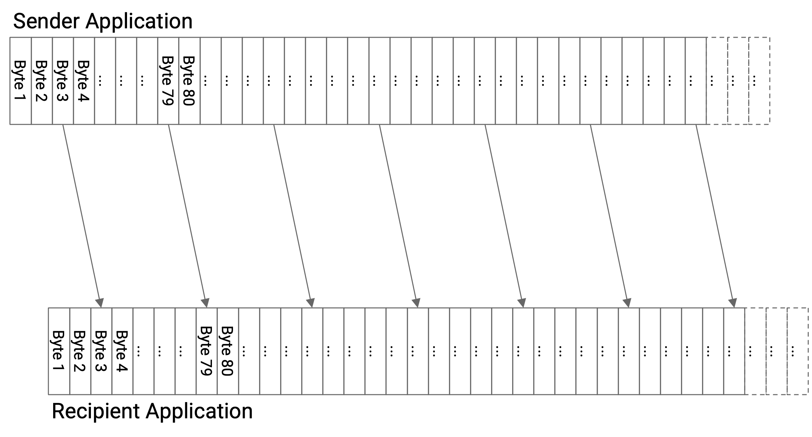

为把字节流组成分组，引入数据单位 **TCP 段（segment）**。发送端 TCP 从字节流逐个收集字节，放入一个段；达到固定的最大段大小时就发送，再开始新段。

有时发送方的数据少于最大段大小，不能永久等待永远不会来的更多字节。原文的简化办法是：每次开始填充空段就设一个计时器，到期时即使没填满也发送。

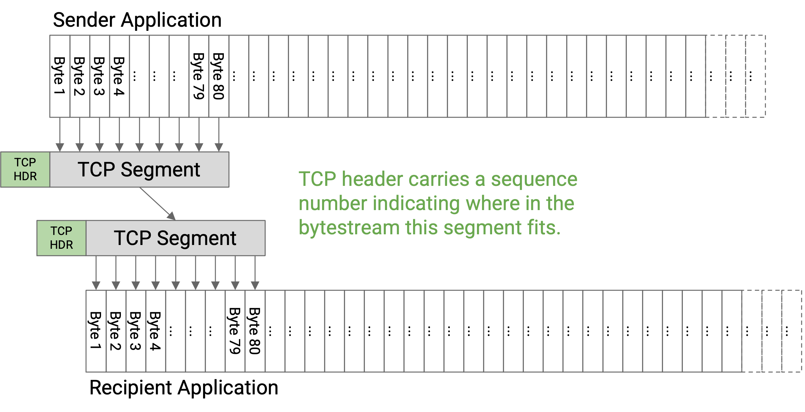

发送之前加上 TCP 首部，携带序号、端口等元数据；然后交给 IP 层，由它加 IP 首部并通过网络发送。TCP 段连同 TCP 与 IP 首部，有时称为 **TCP/IP 分组**；也就是负载包含 TCP 首部和数据的 IP 分组。

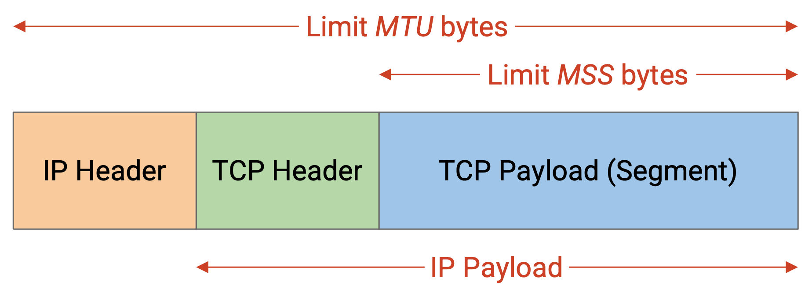

怎样设置**最大段大小 MSS**？IP 分组受到链路最大传输单元 MTU 限制，同时还必须容纳 IP 与 TCP 首部，所以：

$$\mathrm{MSS}=\mathrm{MTU}-\text{IP 首部大小}-\text{TCP 首部大小}.$$

> 编者边界：这是教材的分段模型，不意味着真实 TCP 对每次应用写入都无条件启动一个“填段计时器”；真实发送策略与缓冲、延迟确认、Nagle 等机制有关。本章不展开，也不把该教学模型当作实验必做要求。

## 序号

此前我们给每个分组编号，帮助接收方恢复次序。实际 TCP 不给每段单独编号，而是给字节流中的**每个字节**编号。段首部的**序号**是该段第一个字节的编号；接收方据此确定段在字节流的位置并重组。

每个字节流从一个**初始序号 ISN** 开始。发送方选择 ISN，把第一个数据字节标为 ISN+1，下一字节为 ISN+2，再下一个为 ISN+3，以此类推。

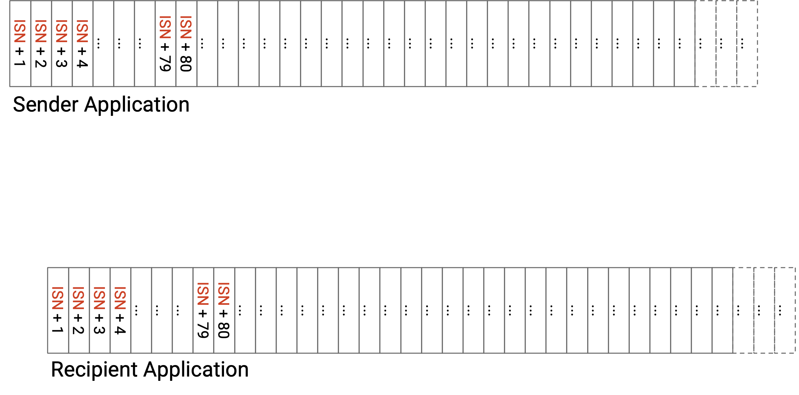

既然按字节编号，确认号也必须按字节表达。确认号表示：**我已经收到此前全部字节，但不包括这个编号的字节**。等价地，它是下一个期待、尚未收到的字节号。TCP 使用累计确认，而不是全信息确认或逐字节独立确认。

例如 ISN 随机取 50，前几个数据字节编号为 51、52、53……。某段包含 140 至 219（包含两端）这 80 个字节，段序号为 140。如果此前全部字节都已收到，就回复 ACK 220，即下一个尚未收到的字节号。

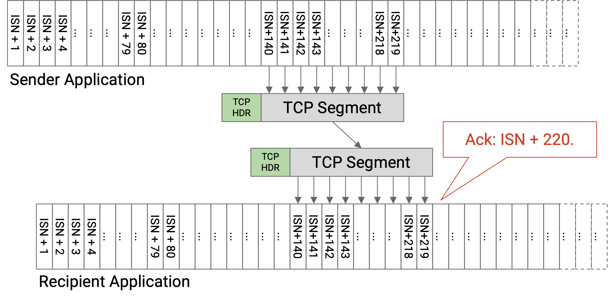

> 编者勘注：上述文字例子使用绝对序号 140–219；原图使用相对偏移 ISN+140–ISN+219。两种表示都可成立，但不要把文字的 ISN=50 再加到已经是绝对值的 140 上。

一般地，首字节序号为 $X$、长度为 $B$ 的段包含 $X,X+1,\ldots,X+B-1$。若这段及此前所有数据都收到，ACK 为 $X+B$。如果这段没收到，或者虽然收到它但前面有缺口，累计 ACK 就停在更小的编号。

再考虑多个段，每段 $B$ 字节，停等窗口只允许一段在途，且无丢失。若第一段首字节为 $X$，则依次为：第一段 seq=$X$，ACK=$X+B$；第二段 seq=$X+B$，ACK=$X+2B$；第三段 seq=$X+2B$，依此类推。没有丢失时，ACK 恰等于下一段首字节序号。

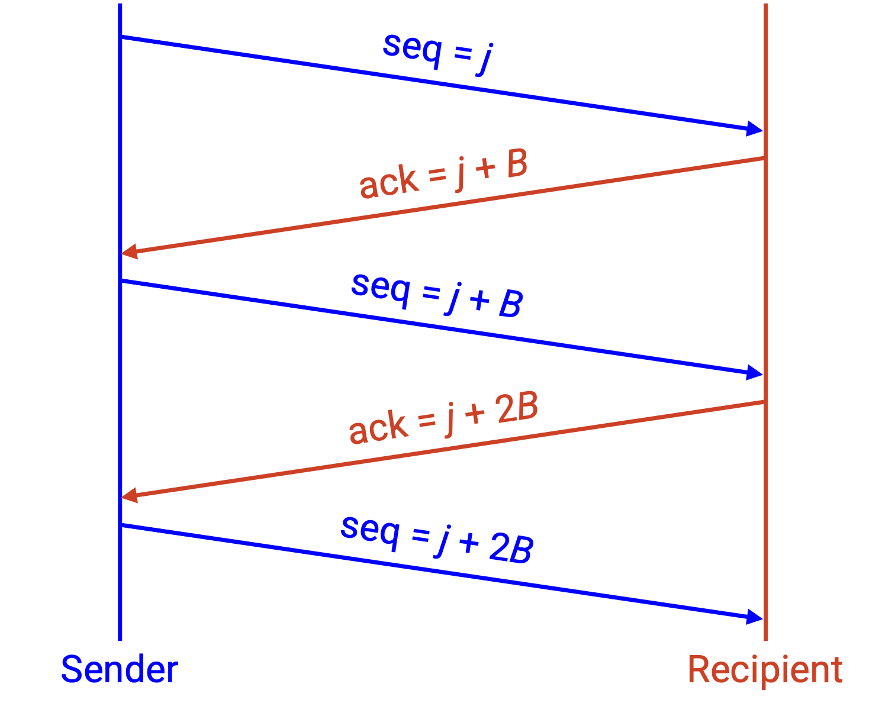

> 编者勘注：原文这一段把 $X$ 同时称作 ISN 和第一段数据序号，与前文“首字节 ISN+1”矛盾；这里明确把 $X$ 作为首个数据字节号。若 $X$ 指 SYN 的 ISN，则所有数据序号必须再加 1。

历史上选择不同 ISN，是为了避免所有字节流都从 0 开始所产生的歧义。假设一条连接从 ISN=0 发送，发送方崩溃后又建立一条从 0 开始的新连接；接收方看到序号 0 的包，就可能无法区分它属于崩溃前还是崩溃后的连接。

实际随机选择 ISN 还有安全原因。可预测的 ISN 让攻击者更容易猜出序号，伪造看似来自发送方的分组；随机化能提高猜测难度。

## TCP 状态

发送方与接收方都要保存状态，状态位于实现 TCP 的端主机，不在中间网络。

发送方记住哪些字节已发但未确认，并维护各种计时器，例如发送不足一段的数据的计时器、重传计时器。接收方记住那些尚不能交给应用的乱序字节。

由于要维护状态，每个这样的通信上下文称为**连接**或**会话**，TCP 是面向连接的协议。不同于可独立处理每个分组的第 3 层，TCP 要在发送数据之前先建立连接、初始化状态，也需要拆除连接并释放两端所占内存的机制。

## TCP 是全双工的

目前我们把 TCP 看作发送方到接收方的一条字节流，但双方往往都需要发送消息。TCP 连接是**全双工**的：不是固定一端只发、一端只收，而是双方可在同一连接中同时发送和接收。

因此每条 TCP 连接包含两条字节流，一条 A→B，一条 B→A。每个分组可以同时携带数据和确认信息。序号对应发送方自己的流——“我发给你的字节”；确认号对应相反方向的流——“我从你那里收到的字节”。

## TCP 握手

TCP 面向连接，必须明确创建与销毁连接；两条字节流各有随机 ISN。所以新建连接时，要让双方就两个方向的起始 ISN 达成一致。

两端通过**三次握手**完成这个过程。

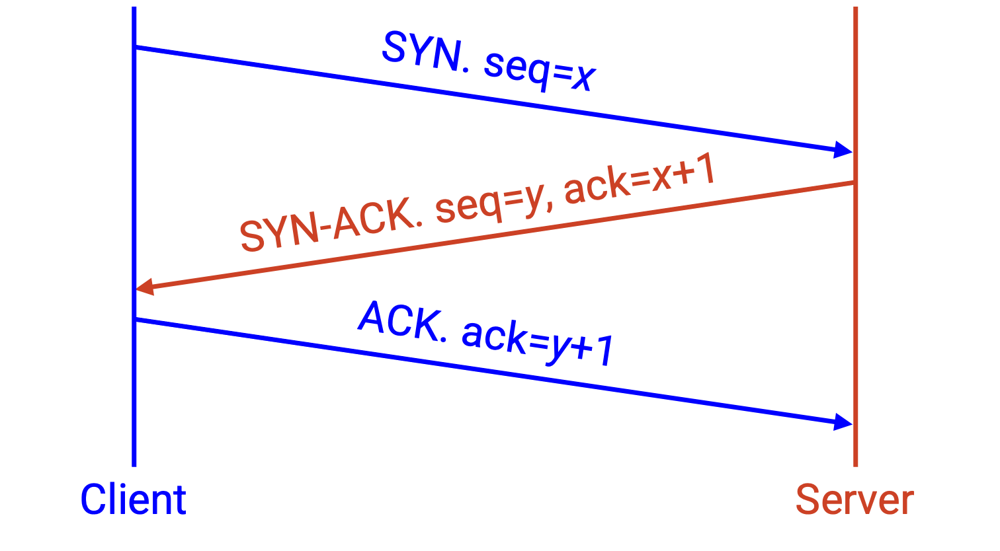

第一包 A→B 是 **SYN**，序号字段带 A 的 ISN。第二包 B→A 是 **SYN-ACK**，序号字段带 B 的 ISN，确认号同时确认收到 A 的 ISN。第三包 A→B 是 **ACK**，确认 A 已收到 B 的 ISN。

这解释了数据为什么从 ISN+1 开始：发出的 SYN 占据 ISN，确认它时 ACK 是 ISN+1，表示下一项、也就是首个数据字节应从 ISN+1 开始。

三次握手结束后，B 可以开始发送数据。

## 结束连接

结束连接有两种方式。

正常情况下，发送完消息的一端发特殊的 **FIN**：“我不会再发数据，但如果你还有数据，我会继续接收。”此时连接**半关闭**。FIN 像其他需要可靠传递的内容一样会被确认。

最终，另一端也发完数据，发出自己的 FIN。这个 FIN 被确认后，双方方向的关闭过程完成。

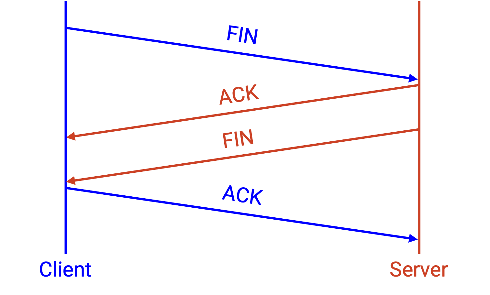

有时需要在未取得对方同意时突然终止连接，可以发送 **RST**：“我不再发送，也不再接收。”RST 不需要 ACK；发送方可立即拆除本地连接。

RST 常用于遇到错误、无法继续通信的情形。如果发生 RST，端主机又崩溃并丢失状态，尚在途的数据会丢失。如果我已经发 RST，但对方继续发数据，在有能力时我会继续回复 RST，尝试让对方终止。

攻击者也可能伪造、注入 RST，让连接中断，用于审查或干扰通信。

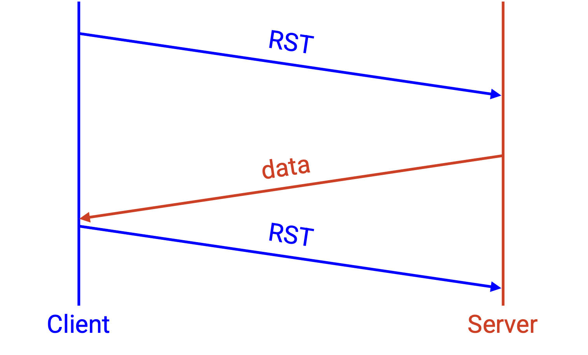

完整 TCP 状态图很复杂，建立与关闭过程中有许多中间状态，例如“已经发 SYN，正在等 SYN-ACK”，或“已经收到 FIN 并发出自己的 FIN，正在等自己的 FIN 被确认”。大多数连接的大多数时间处于 **ESTABLISHED**，即已经建立、尚未结束、正在双向交换数据的状态。本教材不要求完全掌握这张完整状态图。

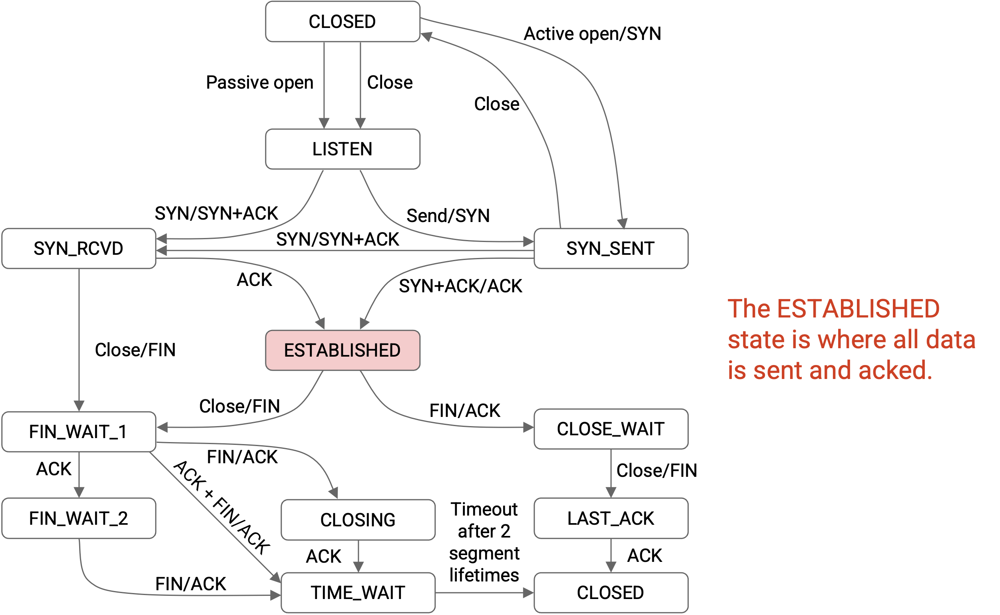

简化图中，从 CLOSED 开始，发 SYN，收到 SYN-ACK 后回 ACK，进入 ESTABLISHED。发送结束时发 FIN、收 ACK；之后收到对方 FIN、回 ACK，并经历图中的 TIME_WAIT 等待后回 CLOSED。

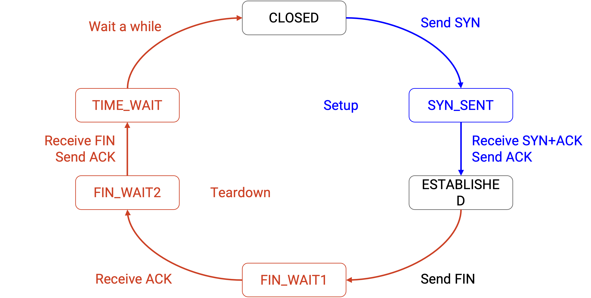

> 编者边界：原文段落把末尾简写为“收到 FIN 后再次关闭”，但原图仍画出 TIME_WAIT；不可把它误读为最后一份 ACK 发出便无条件立即释放所有关闭状态。FIN 的序号消耗在 notes 中依据 RFC 单独说明，不冒充本段未展开的原文。

## 捎带确认

TCP 是全双工的，所以一个分组可以同时确认已收到的数据和发送新数据。

收到分组而暂时没有数据要发送时，可以立即发一个无数据 ACK，也可以等自己有数据后把 ACK 一起发出；后者称为**捎带确认（piggybacking）**。

实际不能总等着捎带，一个原因是 TCP 在操作系统中实现，与应用分离。操作系统不知道应用代码什么时候会有新数据，甚至不知道以后还会不会有数据，可能等很久也无法捎带。

反过来，应用使用字节流抽象，不思考分组，因此也没法直接考虑把哪个 ACK 捎在哪个包上。

调度又使问题更复杂：操作系统不是同时运行所有程序。回想计算机组成课程（如 Berkeley CS 61C），CPU 根据工作需要在进程间切换。如果每来一个 TCP 包就打断正在做的事，把数据交给应用并专门让它运行一阵以便回复，会很不合理。因此，TCP 包到达后，操作系统可能在应用有机会准备捎带数据之前已经发出 ACK。

总能看到捎带思想的例子是握手中的 SYN-ACK：除了确认对方，还带上自己的 ISN。它没有上述应用调度问题，因为握手完全由操作系统执行；应用不需要思考 SYN 或 SYN-ACK。

> 编者边界：SYN-ACK 捎带的是建立连接所需的控制信息，不应据此说普通三次握手必然携带应用负载。

## 滑动窗口

按包讨论时，窗口是在任意时刻允许在途的分组数。按字节实现时，把**滑动窗口**定义为一个连续的、长度受限的可发送字节区间。

连续性与先前不同。按包计数的模型允许 5、7、8 等不连续包在途；真实字节窗口则划出字节流中的一个连续范围。

窗口左边界是第一个未获累计确认的字节，由接收方 ACK 决定。从这里开始的接下来 $W$ 个字节，直到窗口右边界前，都允许在途。

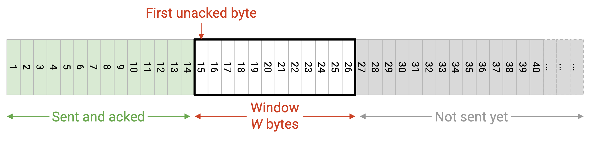

即使窗口内部某些字节已经被其他信息表明收到了，也不能因此越过窗口发送新字节。只有窗口向右滑动，即累计 ACK 增大、左边字节被确认，才能发送更右侧的数据。

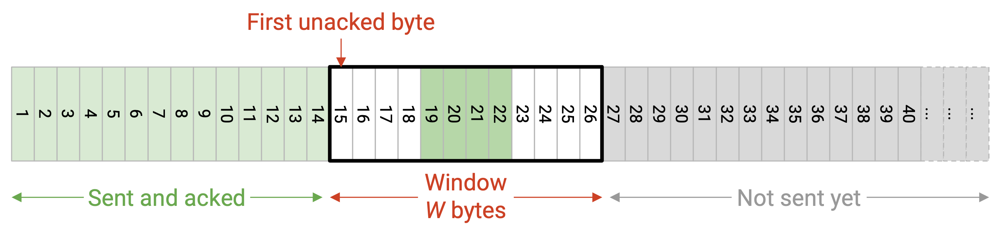

窗口大小受流量控制与拥塞控制限制。流量控制的窗口由接收方通告，依据其可用缓冲空间决定。

> 编者边界：连续的是**允许发送的序号范围**，不表示网络中每一个字节此刻都必定存在，也不表示窗口必须填满；丢失、未发送和乱序都可以使实际状态存在空洞。

## 检测丢失与重发数据

重传有两个触发条件，满足其中一个即可，不要求同时满足。

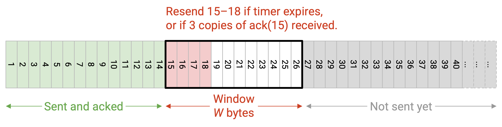

第一个触发是**计时器**：数据发出一段时间仍未确认。按包的简化模型中，每个包都有计时器，超时就重发该包。

按字节的 TCP 中，不是每个字节或每个分组各有一只计时器，而是仅用一只重传计时器，关联第一个未确认字节，即窗口左边界。到期时，重发最左的未确认段。计时长度依赖 RTT；RTT 通过发送到收到确认的间隔估计。新的、推动窗口的 ACK 到达时，重置计时器。

第二个触发是根据后续到达推测丢失。按包且采用累计确认时，收到 $K$ 个重复 ACK 会重发，常见 $K=3$，在教材模型中意味着后续三个包到达。

按字节实现时，收到 $K$ 个重复 ACK，同样重发最左端的未确认段。

> 编者勘注：这里“新 ACK”指确认了新数据、使累计边界前进，不是随便收到一份相同 ACK 就无限重启计时器。图中“3 copies”也需结合上一章理解为三份**重复** ACK，而不是包含原始 ACK 在内总共三份。

## TCP 首部

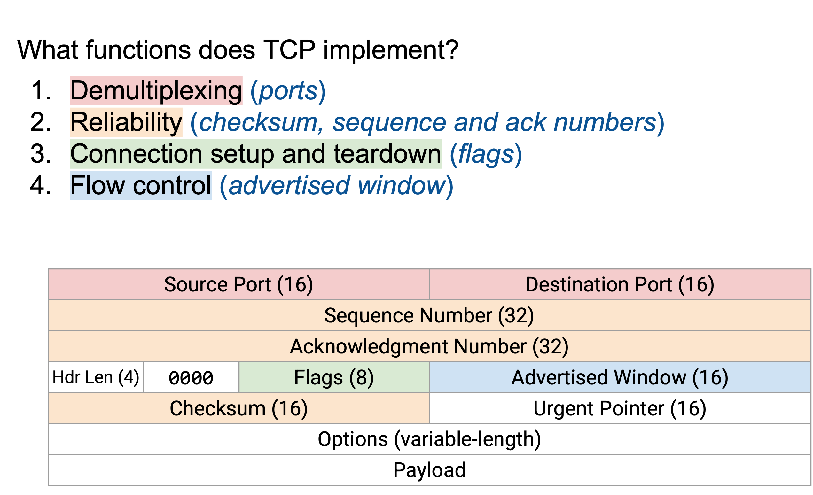

TCP 首部包含 16 位源端口与 16 位目的端口；32 位序号，表示该包首字节的偏移；32 位确认号，表示已收到的最高连续序号加一。

校验和覆盖数据，而不仅是首部，用来检测损坏。首部携带通告窗口，参与发送窗口约束。

> 编者勘注：原文称通告窗口支持“flow control and congestion control”，不够准确。通告窗口直接表达接收端流量控制；拥塞窗口 cwnd 是发送端状态，不是这个首部字段。TCP 校验和实际还覆盖 TCP 首部及 IP 伪首部，而不只是应用数据。

首部长度以 4 字节字为单位；没有额外选项时，其值为 5，即 20 字节。

标志位是一组可设为 0 或 1 的比特，置 1 表示相应功能启用。双方都知道每个位的语义。本教材涉及的四种主要标志是 SYN、ACK、FIN、RST；后两者已在连接关闭部分说明。

**SYN** 表示发送本端 ISN，通常只在三次握手前两条消息中置位。

**ACK** 表示确认号字段有效、正在确认数据；原文说，如果发数据却没有需确认的数据，可以关闭该位，让对方忽略确认号。

> 编者勘注：后一句不是已建立 TCP 连接的通用发送规则。同步后的正常 TCP 段使用有效 ACK，即使确认号没有前进；不能因为暂时没有新收到的数据就随意清 ACK。请把原文当作解释字段“有效位”的入门描述，而不是完整协议要求。

原文还说首部长度后有 6 个保留位，总为 0，可以忽略。紧急指针用于标记某些紧急字节，提示接收方尽快交给应用；这是历史字段，本章不展开。

> 编者勘注：保留位数量是历史首部布局描述，原图却画了 4 个 0 加 8 位 flags，已不完全匹配原文“6 位”说法；现代 RFC 布局应以实际规范为准，不据此手写位偏移。紧急机制也不等于任意打破普通字节流顺序的应用消息机制。

首部末尾可以附加选项，使首部更长。本课不展开这些选项。例如，可用**选择确认（SACK）**选项携带额外已收范围，实现比纯累计 ACK 更丰富的确认信息。

## 引用与来源

- Peyrin Kao，基于 Sylvia Ratnasamy、Rob Shakir 等人的讲授：[*TCP Design*](https://textbook.cs168.io/transport/tcp-design.html)，全文及全部 27 图；[*TCP Implementation*](https://textbook.cs168.io/transport/tcp-implementation.html)，全文及全部 16 图。
- 固定 commit：`0b8208742d31df7fc3d53a0cd94fdd4e04f8d47e`，2026 当前快照，不冒充 Spring 2025 原版。
- 原教材与本译文采用 [CC BY-SA 4.0](https://creativecommons.org/licenses/by-sa/4.0/)。修改为中文翻译、中文图注与显式编者勘注；保留原图字节，以白色显示背景改善透明黑字可读性。
- 编者协议边界另参考 W. Eddy 编，[RFC 9293: Transmission Control Protocol](https://www.rfc-editor.org/rfc/rfc9293.html)，2022，§3.1、3.3、3.4、3.5、3.8；具体阅读范围登记于 sources。标准补充不冒充课堂原话，原创例题在 notes。
