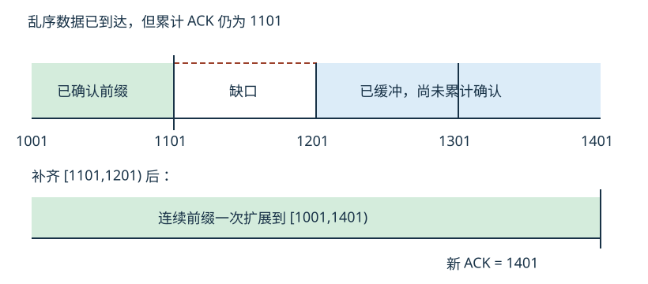
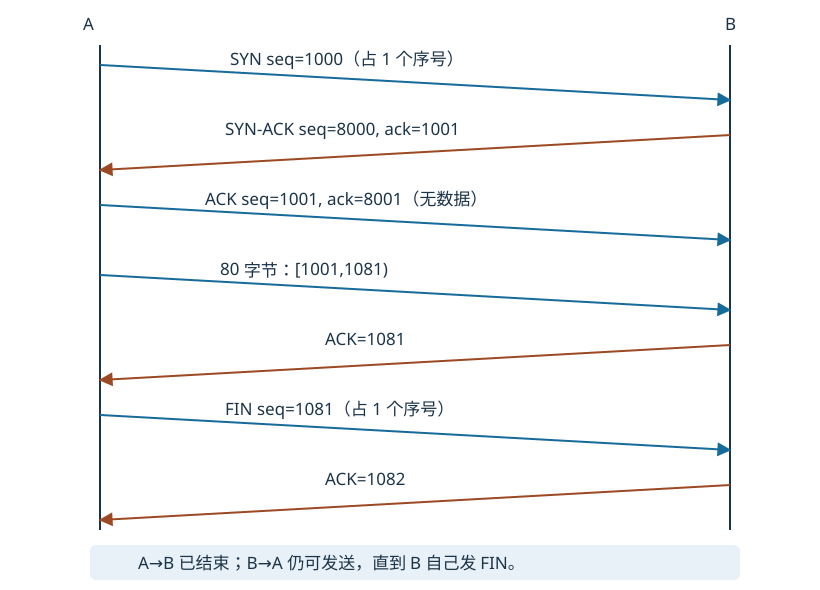

# 核心问题：一份 ACK 到来，到底允许哪条边界移动？

做 TCP 题时，先别画“第几个包”。先给每个方向单独画一条字节轴，写出**首字节、长度、半开区间、下一个期望字节**。序号、重排、窗口、重传和关闭便能使用同一套账本，减少差一错误。

## 1. 数据按字节编号，分段只是包装

普通数据段首字节为 $s$，数据长度为 $n$，占据：

$$[s,s+n)=\{s,s+1,\ldots,s+n-1\}.$$

如果此前全部字节都已收到，确认号是 $s+n$；它不是最后收到的字节，而是**连续前缀之后的第一个字节**。

自拟例：ISN=1000，则 SYN 占据 1000，首个数据字节为 1001。发送 80 字节，占据 $[1001,1081)$；若此前无缺口，收到 ACK=1081 后，这 80 字节全部确认。

重新分段不会改变字节身份。原来一个 80 字节段可以重新包装为两个 40 字节段，但仍覆盖同一段序号空间；重传不是把数据分配一组新序号。

**MSS 是数据上限，不是整个 IP 包的长度。**若 MTU=1500 字节、IPv4 与 TCP 首部都为 20 字节且无选项，教材模型给出 MSS=1460 字节；首部变大时不能继续无条件使用这个数。

## 2. 用一个乱序例子区分“持有”与“确认”

假设数据从 1001 开始，每段 100 字节：

| 事件 | 接收端已持有的数据范围 | 累计 ACK | 可按序交付的新数据 |
| --- | --- | --- | --- |
| 收到第一段 | [1001,1101) | 1101 | 100 字节 |
| 第二段丢失，第三段到达 | [1001,1101)、[1201,1301) | 1101 | 无 |
| 第四段到达 | 再加 [1301,1401) | 1101 | 无 |
| 重传第二段到达 | 连成 [1001,1401) | 1401 | 第二至第四段，共 300 字节 |

ACK 从 1101 跳到 1401，不代表最后一个重传段有 300 字节；它表示这个段填上了缺口，让此前缓存的连续部分一起被确认。

图为自拟字节轴：绿色代表已累计确认前缀，虚线缺口阻止左边界推进，蓝色乱序数据不能独自拉动累计 ACK。

接收重排要维护“收到哪些范围”和“最早缺哪个字节”两个概念，不能只保存最大的已见序号。收到末端很靠右的一段，并不能证明中间全部收到。

## 3. 发送窗口不是剩余包数，而是一个区间

令：

- $U=\mathrm{SND.UNA}$：最早未确认的序号；
- $N=\mathrm{SND.NXT}$：下一个新数据序号；
- $W$：当前采用的窗口字节数，在教材模型中受 rwnd 与 cwnd 的较小值限制。

对无回绕、窗口未缩小的简化例子：

$$\text{已发未累计确认范围}=[U,N),\qquad\text{允许发送范围}=[U,U+W).$$

因此还能发送的新数据量至多为：

$$\max(0,U+W-N).$$

例如 $U=1101$，$N=1401$，$W=500$，当前右边界为 1601，还可发 $[1401,1601)$ 共 200 字节，不能发送字节 1601。半开区间让边界一目了然。

若又收到 ACK=1101，累计边界没变；不能仅凭“又来一份 ACK”就把 $U$ 增加一个 MSS。若收到合法的新 ACK=1401，才可把 $U$ 推进到 1401。接收窗口通告本身也可能变化，所以“ACK 值没变”不等于收到的全部信息毫无意义。

**三个界限：**

1. ACK 小于当前累计边界，可能是旧确认，不倒退已经确认的事实。
2. ACK 大于尚未发送到的位置，不能凭空证明那些数据已经到达。
3. 序号是 32 位循环空间，真实比较必须考虑回绕；上面的普通整数轴只是避开回绕的教学示例，不是可直接提交的序号比较代码。

所谓“连续窗口”，指允许的**序号范围连续**，不是要求每个字节此刻都真实位于网络中。窗口内可以有未发送部分、丢失部分、已乱序到达部分。

## 4. rwnd 和 cwnd：字段与本地决策不可混淆

接收端通过 TCP 首部的 Window 字段通告愿意接受的数据量，即 rwnd；实际使用扩展时还要解释窗口缩放。cwnd 是发送方根据网络拥塞反馈维护的本地状态，不是把 Window 字段改名后的同一件东西。

应用读取慢，可能使 rwnd 变小；路径中多个流竞争，可能使 cwnd 变小。两者都能限速，诊断原因却不同。

“收到 ACK”也不等于“接收缓冲立即腾空”：数据可能已被 TCP 接收和确认，但应用还没读取。不要把应用消费进度和累计接收进度混为一谈。

## 5. 全双工：同一包里有两个方向的坐标

A→B 和 B→A 各有一套独立序号。一个 A 发出的包：

- seq 描述 A→B 中本包携带的内容；
- ack 描述 B→A 中 A 已连续收到哪里；
- window 表示 A 对 B→A 数据的接收能力。

因此，同一个包的 seq=1101、ack=9001 完全正常，它们不需要数值接近。画图时给两个方向不同的轴，不要把相反方向的 ACK 错当成当前方向的数据长度。

## 6. 三次握手：同步两个起点，而不是发送三份应用数据

设 A 的 ISN 为 1000，B 的 ISN 为 8000：

| 方向 | 标志 | seq | ack | 对序号空间的影响 |
| --- | --- | --- | --- | --- |
| A→B | SYN | 1000 | 不作为有效 ACK 使用 | A 的 SYN 占 1 个序号 |
| B→A | SYN, ACK | 8000 | 1001 | B 的 SYN 占 1 个序号，同时确认 A |
| A→B | ACK | 1001 | 8001 | 若无数据，纯 ACK 不再消耗序号 |

第三包之后，A 的首数据仍可从 1001 开始，B 从 8001 开始。不能“每发一包都 +1”：增加的是数据及特定控制事件占据的序号空间，而不是网络包数。

SYN 占一个序号，让它能像数据一样得到明确确认与重传；纯 ACK 不占序号，避免无穷确认链。随机 ISN 除了降低旧连接数据混淆，也增加攻击者猜测难度；它不是连接认证机制。

图为自拟例；握手后 A 发了 80 字节再 FIN，B 保持发送方向开放，说明 FIN 关闭的是一条流，而不是把整个双向连接立刻关掉。

## 7. FIN 的“加一”不是应用多收一个字节

继续前例：A 已发送并确认 $[1001,1081)$。若不再有数据，FIN 使用 seq=1081。它占据一个序号，B 确认 FIN 时发 ACK=1082。

这个 +1 表示“流结束事件已收到”，不是给应用追加了一个神秘数据字节。若段同时携带 $n$ 字节数据及 FIN，且无 SYN，则占据的序号长度为 $n+1$；FIN 位于本段数据之后。

关闭方向分开：

- A 发 FIN：A 不再发送新应用数据，但仍能接收 B 的数据。
- B 确认 A 的 FIN：只说明 A→B 的结束已被接收，不说明 B 已发完。
- B 后来发自己的 FIN：关闭 B→A；A 需要确认。

主动关闭路径通常还经过 TIME_WAIT，不能把最后一个 ACK 发出当作立刻抹掉全部状态。RST 则表示异常中止，不是保证把尚未送达的数据可靠排空；应用应能区分正常结束与被中止。

接收方若在更早数据缺失时先看到 FIN，不能跳过缺口把结束立即暴露给应用。FIN 也必须放回正确的序号次序来理解。

## 8. 两条重传路径：缺口线索与时间兜底

**快重传**利用重复 ACK。教材常用阈值为三份重复 ACK，即已有原始确认，再收到三份相同累计值。它重传最左未确认段，不要求同时发生超时。

**超时重传**处理没有足够后续证据的情况。教材的一只计时器关联最早未确认位置；到期重传最左未确认段。不要因为已经有快重传，就删除计时器。

RFC 6298 的管理规则进一步澄清：

- 有未确认数据且计时器未运行时启动；
- 全部在途数据被确认时停止；
- **确认了新数据**的 ACK 到来时，重新计时；重复 ACK 不是同一个条件；
- 超时后重传最早未确认段，把 RTO 加倍，再启动计时器。

重传不会让新数据边界凭空前进。它重新发送原来那一段序号，不是再向应用字节流追加一份内容。

## 9. 为什么 RTO 不能直接等于最近一次 RTT？

路径延迟会抖动，最近一个样本可能偏小；如果每次稍微变慢就重传，反而加重网络负担。RFC 6298 §2–5（编者补充，不是课堂时间索引）维护平滑 RTT 与变化量：

$$\mathrm{RTO}=\mathrm{SRTT}+\max(G,4\mathrm{RTTVAR}).$$

其中 $G$ 是时钟粒度。变化量先用**旧 SRTT** 更新，再更新 SRTT；常用平滑参数为 $\alpha=1/8,\beta=1/4$。初始测量 $R$ 使 SRTT=$R$、RTTVAR=$R/2$。规范还给出保守的初始值、下限建议与退避条件，不能只抄一个等式便声称实现完整计时策略。

特别重要的是 **Karn 歧义**：若同一段先发送又重传，收到的 ACK 究竟对应哪一次？在没有能消除歧义的 TCP 时间戳机制时，不应拿这种 ACK 随意测 RTT。否则可能把本来很长的 RTT 错估为“从最近重传算起”的很短值。

本节只解释设计约束，不提供实验计时器或状态机的可提交实现。

## 10. 读首部的最小核对表

- 源/目的端口各 16 位；序号与确认号各 32 位。
- ACK 标志表示确认字段有效；已建立连接的正常段携带当前确认信息，不因“没有新数据需确认”就随意清掉 ACK。
- 校验和覆盖 TCP 首部、数据，以及用于计算的 IP 伪首部，不只是 payload。
- 首部长度以 4 字节为单位；无选项时 5 表示 20 字节，不是 5 字节。
- Window 字段是接收通告，不是 cwnd。
- SYN、FIN 占序号；无数据的纯 ACK 不占序号；重传同一内容不分配新序号。

## 11. 自测：用区间回答

### 问题一：seq=500、len=120，无前序缺口。ACK 是多少？

展开答案

数据覆盖 [500,620)，最后一个字节为 619，ACK 为 620。若存在更早缺口，ACK 可以小于 500，不能只看当前段就断言 620。

### 问题二：ACK=1101 时收到了 [1301,1401)，可以改 ACK=1401 吗？

展开答案

不能。[1101,1301) 仍有缺口。接收端可缓存新段，但累计边界仍为 1101。最大已见序号不是累计确认号。

### 问题三：U=200、N=500、W=400，还能发多少？

展开答案

窗口 [200,600)，还可发 [500,600)，共 100 字节。字节 600 不在当前窗口内。这里假设当前窗口有效且无序号回绕，不处理真实规范的窗口缩小等边界。

### 问题四：seq=900 的段含 40 字节和 FIN，若全部按序收到，ACK 是多少？

展开答案

数据为 [900,940)，FIN 占 940，故 ACK=941。不能回答 940，也不能把 FIN 当作额外应用数据。

### 问题五：收到自己的 FIN 的 ACK 后，能不能继续接收？

展开答案

可以。确认自己的 FIN 只关闭自己的发送方向；对方的发送方向可继续工作，直到对方也发送 FIN。全双工意味着两个结束事件分开管理。

### 问题六：每来一份重复 ACK 就重启 RTO，有什么危险？

展开答案

最早缺失的数据可能一直得不到确认，却被连续的重复 ACK 无限推迟超时。RFC 6298 的重启条件是 ACK 确认了新数据，不是任意 ACK 报文到来。

## 引用与来源

- 指定教材：Peyrin Kao 等，[*TCP Design*](https://textbook.cs168.io/transport/tcp-design.html)、[*TCP Implementation*](https://textbook.cs168.io/transport/tcp-implementation.html)。完整中文译文、全部 43 图、固定 2026 快照与源错误勘注见本讲 materials。原创例子与自测和教材译文分开。
- W. Eddy 编，[*Transmission Control Protocol*, RFC 9293](https://www.rfc-editor.org/rfc/rfc9293.html)，2022；实际核对 §3.1 首部前半、§3.3.1 状态变量、§3.4 序号、§3.5 握手主体、§3.6–3.6.1 关闭、§3.8–3.8.2 数据与重传/拥塞、§3.8.6 窗口主体。用于纠正教材简化，不宣称通读整份 RFC。
- V. Paxson、M. Allman、J. Chu、M. Sargent，[*Computing TCP's Retransmission Timer*, RFC 6298](https://www.rfc-editor.org/rfc/rfc6298.html)，2011，实际全文阅读 §2–5，编者补充。
- 官方 L12 元数据时长 4816 秒，即 1:20:16。字幕 en-orig 在默认获取与一次 visionOS 官方替代中均返回 HTTP 429；正文、片尾、问答和音画均未取得可核验内容。故不创建课堂 draft，不猜测时间片段，也不把教材内容冒充课堂覆盖。
- 相关实验见 [Transport 指导](#/c/berkeley-cs168-2025/lab/transport?v=guide)；实验是指定子集，不把完整 TCP 或后续拥塞控制全部追加为实验要求。
