# 拥塞控制原理

## 拥塞为什么有害

回顾一下：如果许多包同时到达路由器，例如流量突发，而路由器需要把它们从同一条链路发送出去，它就先发送一个，把其余包放进队列，稍后再发。

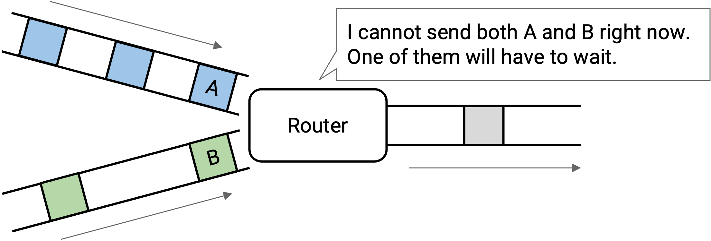

更一般地，如果包的输入速率超过链路能够持续承受的输出速率，路由器就跟不上到达速度。这时路由器发生了**拥塞**：包必须排队等待发送。排队引入延迟；如果队列也满了，而新包还在到来，就会丢包。

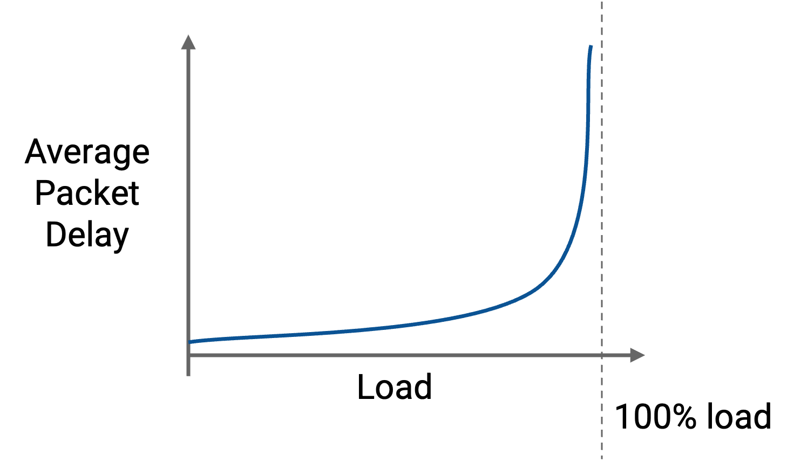

图示是突发到达下排队系统的性能。虚线表示链路容量，即最大负载；负载越高，包的延迟越大。对于突发到达，我们不能指望既实际用满链路容量，又没有延迟代价，必须在负载与包延迟之间找到合适的折中。

曲线在到达虚线之前就已经向上弯曲。这说明即使尚未丢包，排队也已经增加延迟。等到利用率达到最大、开始丢包时，队列造成的延迟已经很大了。

## 拥塞简史

20世纪80年代的 TCP 没有拥塞控制。发送速率只受流量控制限制，也就是受接收者缓冲区容量限制。

包丢失后，发送者会以同样快的速率反复重传，直到包到达。更聪明的做法应当是减速，避免继续丢包，也减少堵塞网络的副本，但早期实现没有这样做。

1986年10月，互联网开始出现一系列拥塞崩溃，可用容量显著降低。加州大学伯克利分校与劳伦斯伯克利实验室之间的一条链路，两端相距约400码，吞吐量从32 Kbps，也就是32,000 bps，降到了40 bps。

Michael Karels（伯克利本科生）和 Van Jacobson（劳伦斯伯克利实验室研究员）当时在开发 Berkeley Unix 的网络协议栈。这个系统是早期很有影响力的操作系统。他们发现网络里有同一个包的成千上万个副本，因为每个人都在重传被丢掉的包。

他们设计的修复算法后来演变成现代 TCP 拥塞控制：修改 TCP 本身，让决定发送速率的窗口大小根据丢包情况动态调整。TCP 在操作系统里实现，因此无需升级路由器或应用程序。

这也是互联网设计采用临时、务实修补的例子。最初补丁只是在 BSD 的 TCP 实现中增加几行代码；有效，所以迅速被采用。此后拥塞控制得到广泛研究，并出现许多改进，但原始补丁的核心思想仍然保留。教材称，此后互联网未再出现同样的拥塞崩溃，原始修复经受住了时间考验。

> 编者注：这里保留教材的历史叙述；“未再出现拥塞崩溃”不应理解为所有网络、所有时期都不可能发生局部拥塞崩溃。

## 为什么拥塞控制很难

看下面的网络：主机 A 应该以多高速率发送？

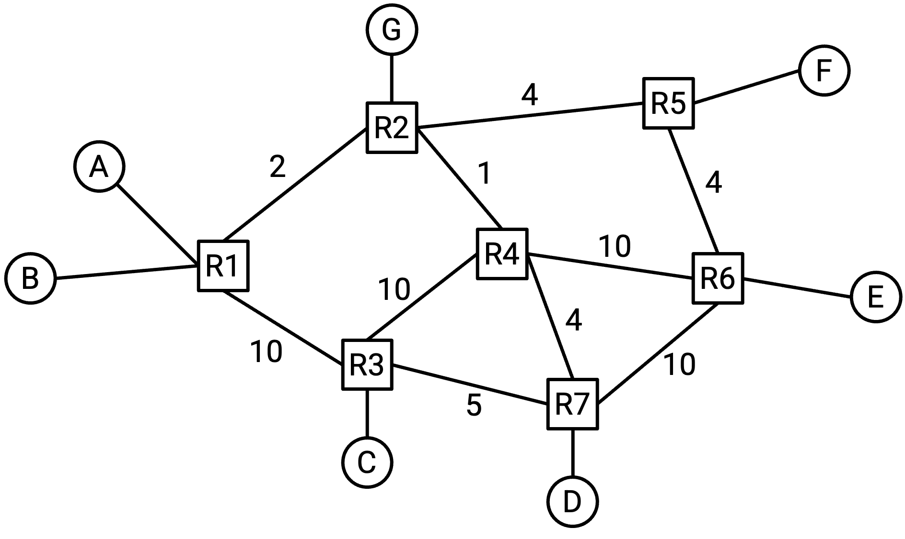

答案依赖目的地，不能为所有目的地设一个固定速率。A 与 C 通信时，可以使用10 Gbps；如果与 F 通信，路径上容量最小的瓶颈链路只有2 Gbps，所以可能应以2 Gbps发送。

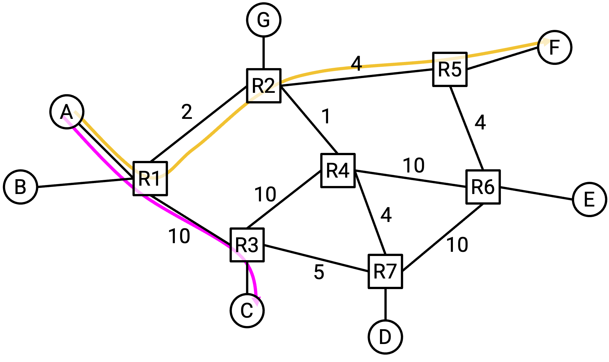

如果 A 与 E 通信呢？还取决于走哪条路径。走下方经过 R3 的路径，可以达到10 Gbps；走上方经过 R2 的路径，就只能达到1 Gbps。

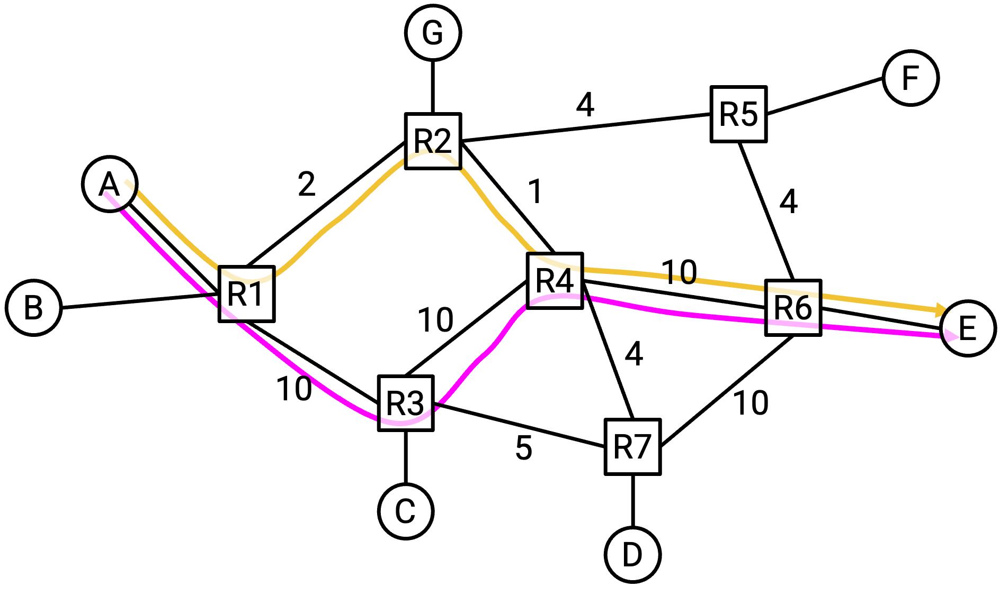

因此，算法必须以某种方式了解实际路径上的带宽与瓶颈。网络图还会随链路新增、故障而改变，一次学习不够，算法必须能够适应拓扑变化。

目前我们假定只有 A 在发送，可以独占每条链路；如果还有其他连接呢？

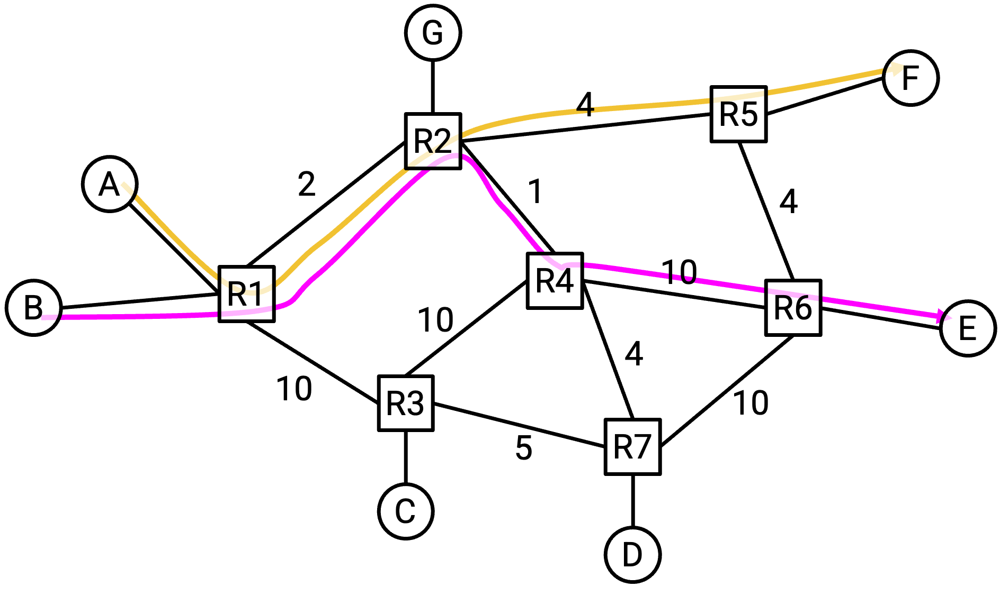

这里 A–F 与 B–E 看起来是完全独立的连接，发送者和接收者都不同，实际路径却共享一条链路。要公平分享这条链路，也许 A、B 应各发1 Gbps。

若 G–D 又建立连接，A 的1 Gbps需要改变吗？先不用正式算法，只考虑合理利用带宽。

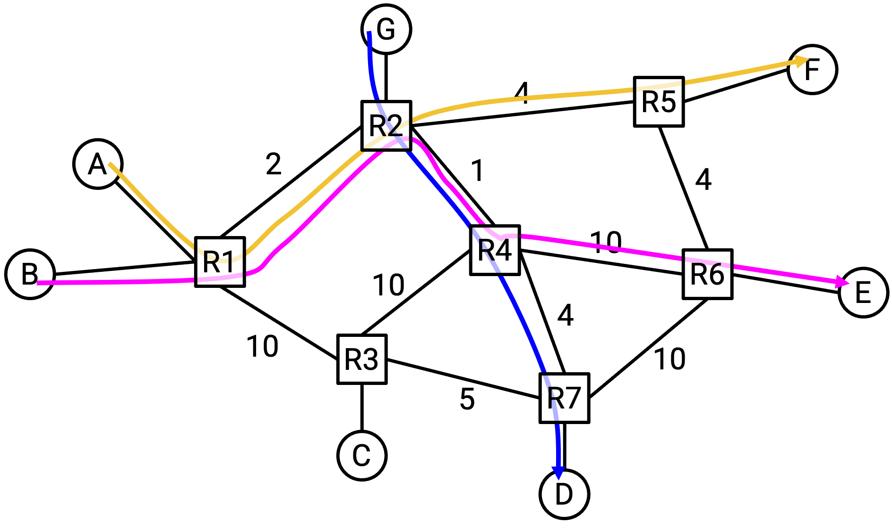

G–D 与 B–E 共享1 Gbps链路，因此两者要降到各0.5 Gbps。再看 A–F、B–E 共同使用的2 Gbps链路：B–E现在只用0.5 Gbps，A便可以升到1.5 Gbps。

G–D 的路径与 A–F 没有任何共同链路，却使 A–F 可以加速。连接即便不直接共享链路，也能相互影响。

所以，发送者决定速率时，需要考虑目的地、实际路径、与自己共享链路的连接、与这些连接共享链路的其他连接，以及不断延伸的间接竞争。所有连接的最优速率彼此依赖，这就是问题难的原因。

更本质地说，拥塞控制是资源分配问题：带宽有限，每个连接有需求，必须决定各自能得到多少。资源分配是计算机科学的经典问题，例如 CPU 调度、内存分配。但这里，一个连接的分配变化可能影响整个网络；每次建立、关闭连接，又需要改变分配。因此它比传统资源分配复杂。教材还指出，甚至连问题本身的正式建模都不容易。

传统资源分配算法可能预先知道资源（如 CPU 时间）和工作（如进程）。这里没有能够观察整个网络并统一分配的全知控制者。解法必须分布式：每个发送者自己决定分配，即使彼此的决定高度相关。

## 好算法的目标

从资源分配角度，有三个目标。分配应当高效：链路不应过载，包延迟和丢失应尽可能少，同时尽量充分利用链路。分配还应当公平：稍后会正式定义，大意是连接应当合理分享可用容量。

必须在这些目标之间折中。只优化一个目标会产生坏方案：让每个人极快发送，可以声称追求最大利用率，却导致拥塞；让每个人极慢发送，可以把丢包降到很低，却浪费容量。

从系统实现角度，方案应当可扩展、去中心化，并适应拓扑变化及连接的建立与销毁。

## 方案设计空间

Karels 与 Jacobson 修改了操作系统里的 TCP。若能从头设计互联网，还有哪些可能？

一种是**预留**：发送前申请带宽，连接结束后释放。前面已经讨论过，在全网维持预留存在技术困难，而且这种办法假定发送者预先知道自己需要多少带宽，实际未必如此。

另一种是**定价**。高速公路收费快车道就是类比：平时车少，收费低；堵车时，收费高。节假日机票更贵也是拥塞定价。

应用到互联网，ISP 可以在浏览器里提供付费提速按钮，费用随拥塞程度变化。路由器优先发送付费较多者的包，丢弃未付费者的包。有人研究过这种办法；经济学家有时认为，对于稀缺带宽，市场结构能产生最优分配。但拥塞定价没有得到广泛部署，因为需要把支付与拥塞连接起来的商业模式。

教材所讨论的现代算法采用**动态调整**：主机学习当前拥塞程度，再调整发送速率。这个方法易于推广，不需要定价所需的商业模式，也不要求用户像预留方案那样预先知道带宽需求。

不过动态调整依赖“良好公民”式合作：新连接开始使用链路时，已有连接应减速让出份额。

动态调整又分两大类。**基于主机**的算法由发送者监测性能并调整速率，全部在端系统实现，不要求路由器提供特殊支持；TCP 的修改属于这一类，已经广泛部署。**路由器辅助**算法由路由器明确向发送者报告拥塞。拥塞发生在路由器，它们很适合提供相关信息；近年来这类方案特别在数据中心得到部署。

路由器可能只给出一个拥塞位，也可能给出详细信息，例如精确的建议发送速率。两类方案中路由器都在“传递信号”，区别在于：前者由发送者从丢包、延迟等隐含现象推断；后者由路由器明确发消息报告。

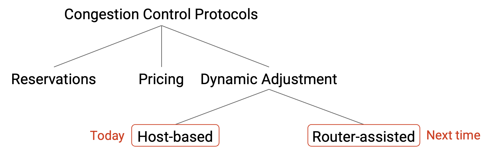

# 拥塞控制设计

## 基于主机的算法轮廓

大多数基于主机的算法都有相同骨架，区别在三个选择点。每个发送者独立重复执行：以速率 $R$ 发送一段时间；判断这段时间是否拥塞；若拥塞，减小 $R$；否则增大 $R$。还缺少初始值：最开始以多高速率发送？

三个关键问题就是：怎样选初始速率，怎样发现拥塞，每次增加或减少多少。

## 检测拥塞

常见方法有两种。第一种检查丢包，也是传统 TCP 常用的方法。信号的判定相对明确：通过超时或重复 ACK，把某个包认定为丢失，或者没有认定为丢失。TCP 为了重传，本来就需要检测丢包，所以可以复用。

缺点是丢包可能来自数据损坏、校验失败，而不是拥塞。链路并不拥塞，却频繁损坏数据时，TCP会错误减速。包乱序也可能把迟到误认成丢失。另一个重要缺点是发现得晚：等到丢包时，路由器队列已经满了，包已在承受排队延迟。

另一种是检查**延迟**。发送者测量发包与收到对应 ACK 的间隔；若延迟增大，可能表示拥塞。历史上人们认为准确测量延迟很难，因为队列大小、其他流量都会使它变化。很长时间里，这类方法没有广泛部署。教材以 Google 2016年的 BBR 为近年来采用延迟信息的例子，一些服务已经采用相关算法。

> 编者注：BBR不仅是“延迟升高就减速”的算法，而是结合瓶颈带宽与最小 RTT 的模型；这里保留教材分类，不把这种简化当作完整 BBR 规格。

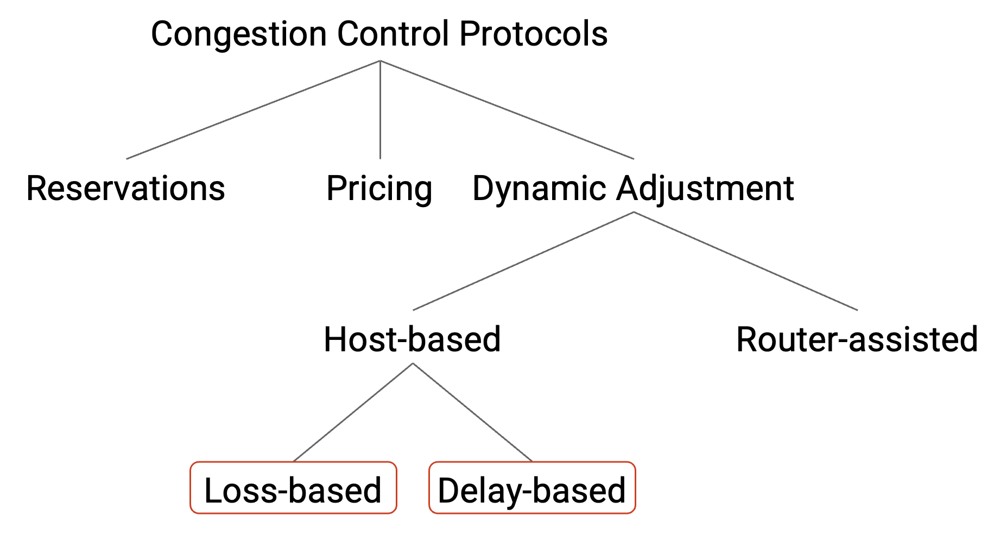

## 发现初始速率

连接刚开始时，可以试几个速率，估计可用带宽。发现过程要安全，因此从低速开始，不能马上用大量包淹没网络；同时又要高效，迅速找到可用容量。

例如每100 ms增加0.5 Mbps，直到丢包。若带宽为1 Mbps，只需两轮，也就是200 ms；若带宽为1 Gbps，即1000 Mbps，却需要2000轮，也就是200秒，太慢了。互联网链路速率跨度很大，两种情形都可能出现。

为了兼顾低起点与快速增长，每轮使用乘法而不是加法。这叫**慢启动**，名称其实不很直观：起始速率很小，通常远低于实际带宽；然后指数增加，例如每轮翻倍，直到丢包。丢包前一轮的速率被当作安全速率。若在 $R$ 发生丢包，就取 $R/2$。

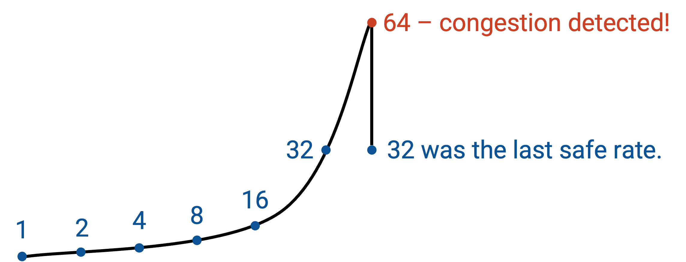

## 调整：如何响应拥塞

发现阶段之后仍要不断调整，因为网络和可用带宽一直变化。最后一个选择是：拥塞时减多少，不拥塞时加多少。

它决定适应速度，继而决定利用效率。如果很慢才找到新速率，会长时间处于次优状态；还可能不公平。例如我原来独占链路，新连接出现后，我必须迅速减速，才能让别人共享。

目标仍是效率与公平。概括而言可以快变或慢变；更具体地，乘法变化较快，例如翻倍、减半；加法变化较慢，例如加1、减1。四种组合是：

- AIAD：加性增加、加性减少。
- AIMD：加性增加、乘性减少。
- MIAD：乘性增加、加性减少。
- MIMD：乘性增加、乘性减少。

> 原文勘注：原始列表把 MIMD 后半误写成“multiplicative increase”；其缩写、后文与例子均为乘性减少，译文据此明确。

这四种中，AIMD最能同时实现效率与公平。直觉是发送过多比发送过少更糟：前者引起拥塞、丢包，后者只是没有用满容量。因此没有拥塞时缓慢接近最大带宽，超过容量后迅速退让。大多数时间略低于上限；一旦过高，快速回落。

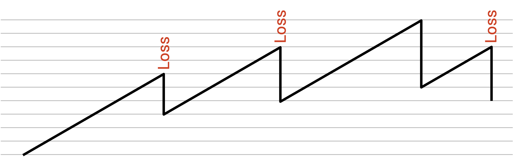

## 调整模型

为什么选 AIMD？四种规则都能在低于适合速率时增加、高于适合速率时减少，因而长期在高效点附近摆动。但在下面的简单模型中，只有 AIMD 朝公平靠近。

设两条连接共享容量 $C$ 的链路，速率为 $X_1,X_2$。总和大于 $C$ 时拥塞，小于 $C$ 时未用满。效率要求 $X_1+X_2=C$；公平要求 $X_1=X_2$。

用二维平面表示，横轴是用户1速率，纵轴是用户2速率，每个点是一种分配。令 $C=1$，效率线就是 $X_1+X_2=1$。

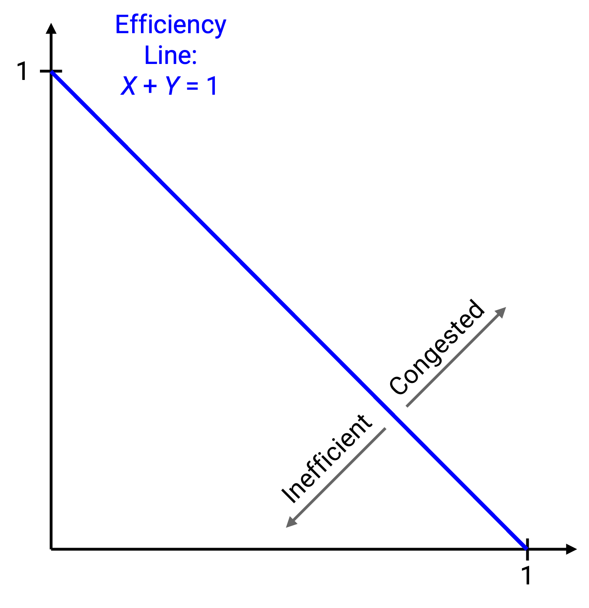

线上方的半平面满足总速率大于1，表示拥塞；下方表示不足。公平线为 $X_1=X_2$；其上各点两人速率相同，其他点不公平。

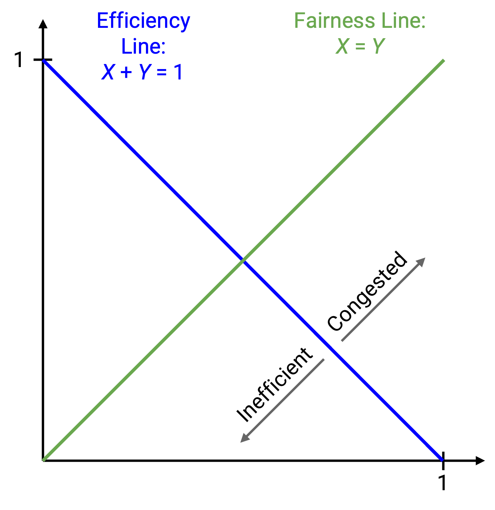

理想点是交点 $(0.5,0.5)$，既公平又高效。$(0.2,0.5)$只用了0.7，不高效；$(0.7,0.5)$总和1.2，拥塞；$(0.7,0.3)$用满容量，但不公平。

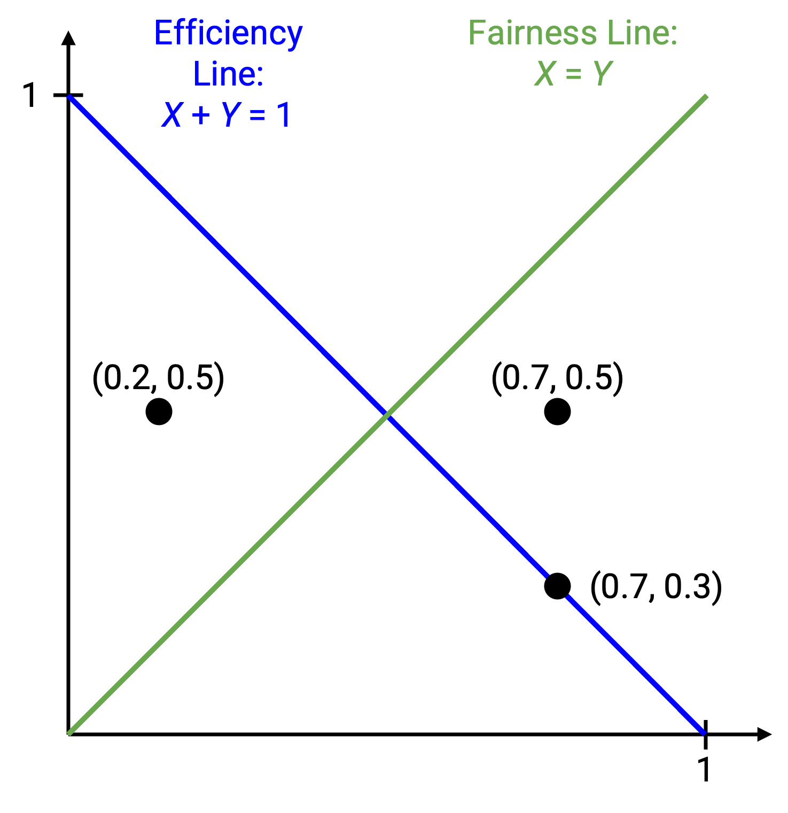

每个发送者独立运行同样算法。因此两个用户发现容量未用满时，按同一种规则增加；发现拥塞时，按同一种规则减少。

两者都增加 $b$，点从 $(x_1,x_2)$ 变成 $(x_1+b,x_2+b)$；都减少 $a$，则变成 $(x_1-a,x_2-a)$。加性变化沿斜率为1的直线移动。

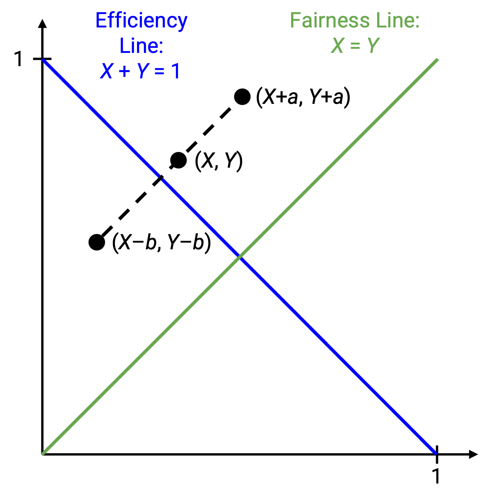

乘以 $c$ 得 $(cx_1,cx_2)$，除以 $d$ 得 $(x_1/d,x_2/d)$。乘性变化沿斜率 $x_2/x_1$ 的直线移动，也就是经过当前点和原点的射线。

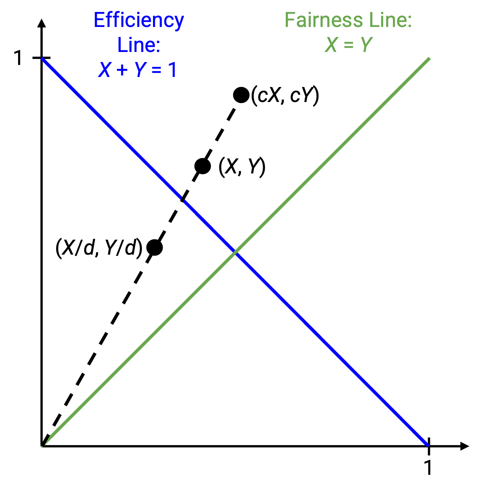

下面用这个模型检查四种组合是否接近公平线。

## AIAD 的动态过程

每次增加1，减少2，容量 $C=5$。从 $(1,3)$ 开始：

| 分配 | 总速率与下一步 |
|---|---|
| $(1,3)$ | 4小于5，增加 |
| $(2,4)$ | 6大于5，减少 |
| $(0,2)$ | 2小于5，增加 |
| $(1,3)$ | 回到起点 |

初始不公平，几步后还是原来的不公平分配。两者差值始终为2，既不改善也不恶化。图中始终沿斜率1的直线移动，无法靠近公平线。

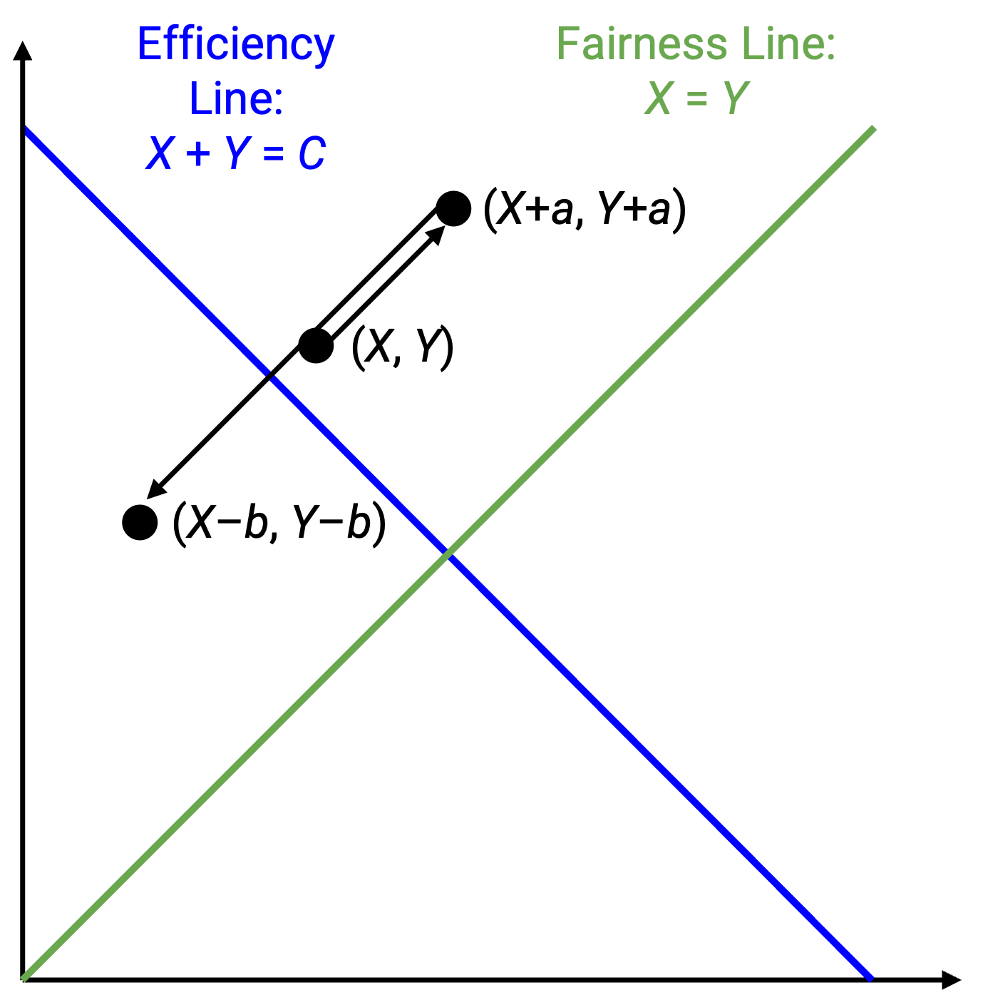

不过它确实围绕效率线摆动，这一点四种规则都有。代数上，如果最初相差5，同时加或减同一个数后仍相差5，因此初始不公平会持续。

能否让 $X_1$ 加2、$X_2$ 加1？分布式设计要求大家运行相同算法；主机也没有途径知道自己相对别人该增加多少。

## MIMD 的动态过程

每次翻倍、减少时除以4，仍令 $C=5$：

| 分配 | 下一步 |
|---|---|
| $(0.5,1)$ | 总和1.5，增加 |
| $(1,2)$ | 总和3，增加 |
| $(2,4)$ | 总和6，减少 |
| $(0.5,1)$ | 回到起点 |

仍然没有改善公平性。所有点在连接起点与原点的同一射线上，不能改变比例。

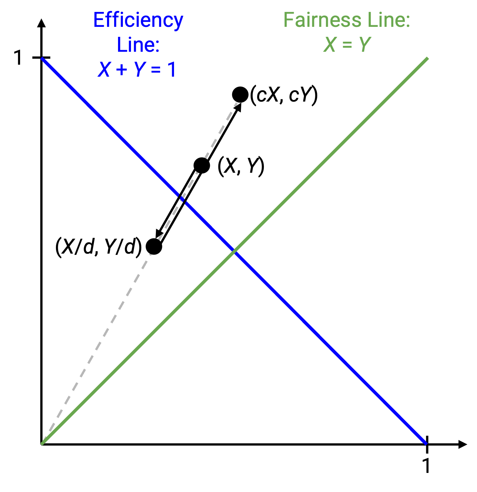

代数上，公平要求 $X_2/X_1=1$，但本例始终为2。给两者乘、除同一个常数不会改变比值。

## MIAD 的动态过程

每次翻倍、减少时减1，$C=5$：

| 分配 | 下一步 |
|---|---|
| $(1,3)$ | 总和4，增加 |
| $(2,6)$ | 总和8，减少 |
| $(1,5)$ | 总和6，减少 |
| $(0,4)$ | 总和4，增加 |
| $(0,8)$ | 第一条连接仍为0 |

第一条连接到0后，再怎么翻倍也仍是0，最终形成一方占有所有带宽的极端不公平情况。一般地，初始不公平会越来越严重。

看差值就知道：翻倍把 $X_2-X_1$ 变成 $2(X_2-X_1)$；同时减1不改变差值。差值只会增大或不变，经过足够多轮后，可能到达一方长期为0的极端状态。

## AIMD 的动态过程

每次增加1、减少时减半，$C=5$：

| 分配 | 下一步 |
|---|---|
| $(1,2)$ | 3小于5，增加 |
| $(2,3)$ | 5不大于5，增加 |
| $(3,4)$ | 7大于5，减少 |
| $(1.5,2)$ | 3.5小于5，增加 |
| $(2.5,3)$ | 5.5大于5，减少 |
| $(1.25,1.5)$ | 2.75小于5，增加 |
| $(2.25,2.5)$ | 4.75小于5，增加 |
| $(3.25,3.5)$ | 6.75大于5，减少 |
| $(1.625,1.75)$ | 小于5，增加 |
| $(2.625,2.75)$ | 两者差距继续缩小 |

> 原文勘注：最后一行把两个变量都标成 $X_2$；第一个应为 $X_1$。教材说趋向 $(2.5,2.5)$，准确理解是差值趋近0、在公平线附近围绕效率边界振荡，不是有限步后停止在交点。

同时加一个常数，差值不变；同时减半，差值也减半：

$$X_1/2-X_2/2=(X_1-X_2)/2.$$

随着增减交替，差距不断减半，趋近0。

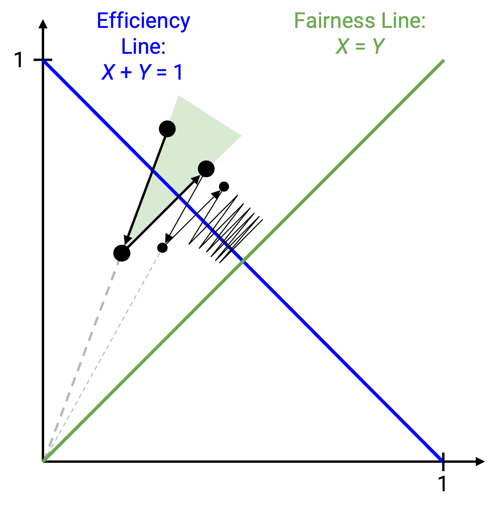

图形上，乘性减少沿经过原点的射线向下，缩小到公平线的距离；加性增加与公平线平行，既不靠近也不远离。两种操作要么改善、要么不恶化，反复进行就逐渐接近公平。

总结：AIAD、MIMD保留不公平；MIAD加剧不公平；AIMD趋向公平。

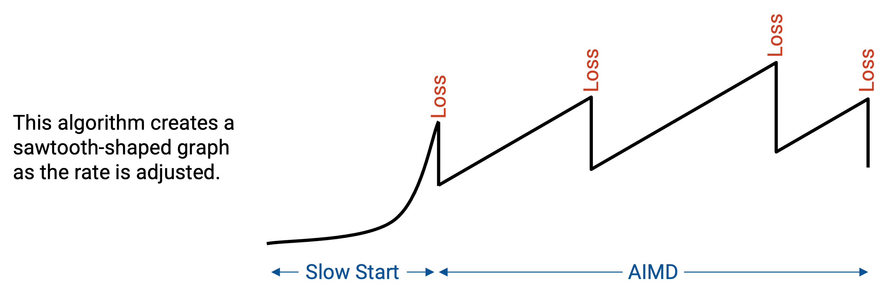

# 拥塞控制实现

## 回顾 TCP 窗口

我们已经设计出基于主机、动态调整的概念算法：各发送者独立运行同样逻辑，得到高效、公平的份额。先慢启动，从低速开始指数增加，发现初始速率；随后每轮若丢包就乘性减速，否则加性增速。

现在看 TCP 如何实现。由于历史上是在 TCP 可靠性代码上打补丁，拥塞控制与可靠性紧密交织；下面的实现同时完成这两项功能。

TCP 发送者维护一个由连续字节或包组成的滑动窗口，限制在途数据。窗口大小由流量控制和拥塞控制共同决定。接收者通告的 **RWND**（接收窗口）表示还能接收多少字节而不溢出缓冲区；发送者维护的 **CWND**（拥塞窗口）由拥塞控制动态调整，限制不使网络链路过载的在途数据量。

最终窗口是两者的最小值。本章假设 RWND 大于 CWND，瓶颈在网络而非接收内存；实践中通常如此，但并非总是。

> 量纲勘注：原文有时把 CWND 称为“速率”。CWND实际是字节数或教学模型中的包数，速率需再除以 RTT。

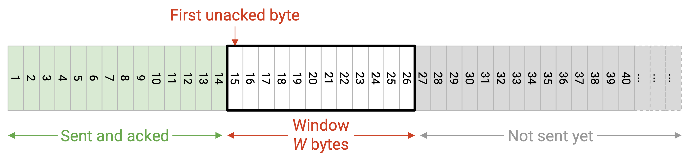

窗口左端是第一个未确认字节，左边数据都已发送并确认；右端由窗口长度决定，只有窗口内的数据允许在途。左端数据得到确认，窗口右移，新数据才可以发送。

用一个定时器监测最左边的未确认包；到期还没确认就重传它。另一个丢失判据是三个重复 ACK，也重传最左包，这叫**快速重传**。

## 窗口与速率

两者通过以下关系相连：

$$\text{rate}\times\text{RTT}=\text{window size}.$$

直觉上它们像同一个量的两种表示：窗口越大，发送越快。第一个 RTT 内，在 ACK 尚未回来前最多能发送一个窗口，所以平均速率是窗口除以 RTT。

概念模型为简单起见按包计算；真实 TCP 按字节计算。每个满长包的数据量是最大报文段大小 MSS，因此：

$$\text{字节数}=\text{MSS}\times\text{包数}.$$

> 编者注：窗口/RTT是持续有数据、窗口受限等条件下的近似关系，不是瞬时发包速率的恒等式；实际也受应用、接收窗口和链路容量限制。

## 事件驱动的更新

概念算法每轮调整一次，但“轮”还没正式定义。大致可取一个 RTT，不过 RTT 本身动态变化，不容易精确测量。更方便的是利用现有 TCP 实现响应的事件来更新窗口，这就是**事件驱动**。

三个关键事件是新 ACK、三个重复 ACK、超时。

- 新 ACK 确认先前未确认的数据，说明数据通过网络；在丢包式模型中把它当作可以增大窗口的信号，可发生在慢启动或 AIMD 中。
- 三个重复 ACK 表示孤立丢包：有一个包丢了，但后续包仍在到达。它通常被视为较轻拥塞，因此缩小窗口。
- 超时表示更严重的问题。若窗口有100包，却既没有最左包的新 ACK，也没有足够的重复 ACK，说明很少有包成功到达，甚至没有。因此不再信任原窗口，回到慢启动重新发现速率。它也可能意味着网络发生变化；这不是唯一可能设计，但 TCP 选择了这种保守做法。

> 编者注：这些是算法使用的启发式解释，不是对拥塞程度的严格测量。尾部丢包、小窗口、ACK丢失也可能导致超时。

## 事件驱动的慢启动

目标是每 RTT 将窗口翻倍。教材模型从1包开始；按字节是1 MSS，初始速率约 MSS/RTT。每收到一个新 ACK，就把窗口加1包。

开始发1包，过一个 RTT 收到1个 ACK，窗口变2；发2包，收到2个 ACK，窗口变4；发4包，收到4个 ACK，窗口变8。

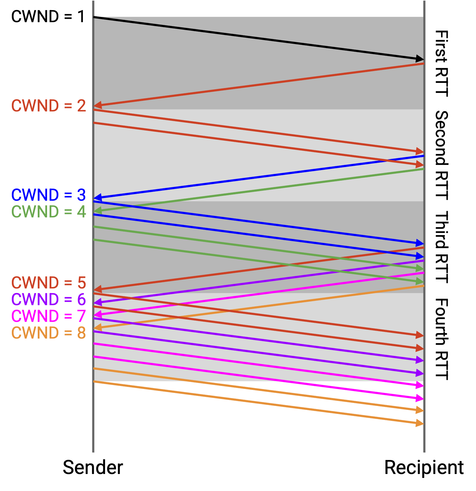

上面把同一轮的包和 ACK 想成同时发生，真实滑动窗口则逐个处理：先发 A；A 的 ACK 使窗口变2，在途为0，于是发 B、C。B 的 ACK 使窗口变3，仍有 C 在途，于是再发 D、E。C 的 ACK 使窗口变4，D、E仍在途，又可发 F、G。

无丢包、无乱序时，一个 ACK 一方面推进窗口，释放一个旧位置；另一方面把窗口加大，再增加一个位置，因此可发两个新包。某 RTT 收到16个 ACK，便可发32包；下一 RTT 的32个 ACK 又触发64包，产生翻倍效果。

不断翻倍后最终会丢包。用新参数 **SSTHRESH**（慢启动阈值）记住估计安全值：发现丢包时设为当前窗口的一半。例如16包不丢、32包丢，就记16。

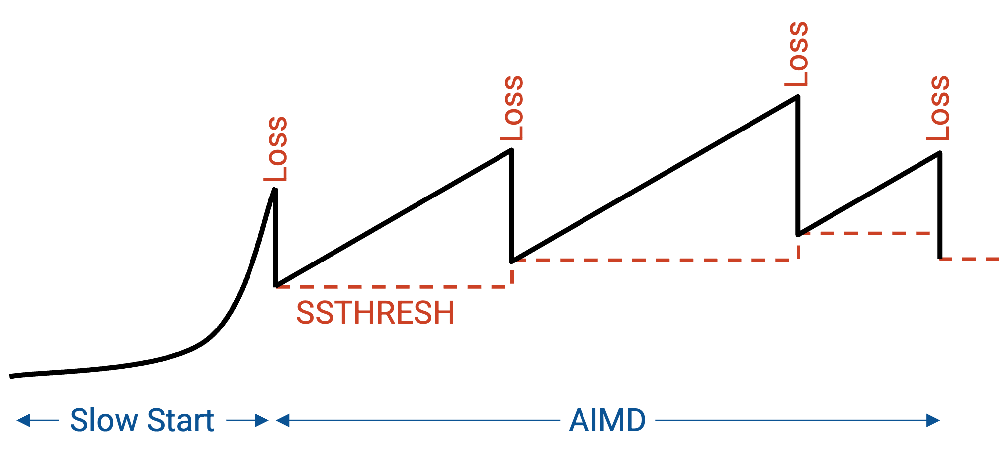

此后虽然窗口继续按 AIMD 改变，SSTHRESH仍记住最近一次估计的安全值。

## 实现加性增加

慢启动后，无丢包时希望每 RTT只增加1包。虽然不知道准确 RTT，却知道一轮大约确认一个窗口的数据。窗口10包，一 RTT约有10个 ACK；每 ACK增加1/10包，合计约1包。

按包计的规则为：

$$CWND\leftarrow CWND+\frac1{CWND}.$$

按字节计，则是：

$$CWND\leftarrow CWND+\text{MSS}\frac{\text{MSS}}{CWND}.$$

其中 MSS/CWND 是一个窗口中单包所占的比例，无量纲；再乘 MSS，才得到每次要增加的字节数。不能只把 $1/CWND$ 直接用于字节窗口。

例如 MSS=50字节，窗口3包=150字节。包视角每次增加1/3包，三次约加1包。字节视角先算50/150=1/3，再乘50字节，每次加50/3字节，三次约加50字节。

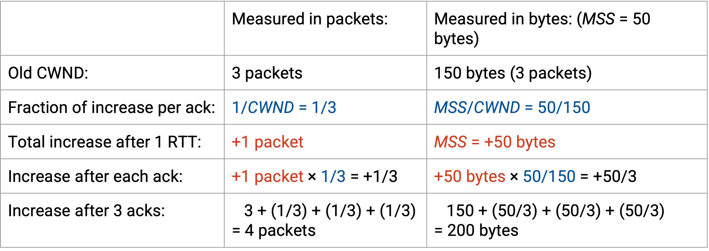

增长并非完全线性，因为分母随窗口改变。例如从4开始，第一次变4.25，第二次约4.49，四次后约4.92，而精确按轮加1的目标是5；这个近似已经足够用于该模型。

## 实现乘性减少

三个重复 ACK 检出丢包时，窗口减半。

重传定时器超时则认为可能丢了多个包，当前窗口可能很不合适，因此谨慎地重新发现速率。先将 SSTHRESH设为当前窗口的一半，记住最近的安全估计；再把窗口重置为1包，重新慢启动。

重新慢启动不能又一路冲回刚刚导致超时的危险速率。利用 SSTHRESH，一旦窗口超过它，就从乘性增长改为加性增长。第一次慢启动时阈值未设，可看作无穷大。

总之：慢启动每新 ACK加1包，近似每 RTT翻倍；拥塞避免每 ACK加窗口的倒数包，近似每 RTT加1包；三个重复 ACK减半；超时回到1包。窗口不应小于1包，否则连探测性数据也无法发送。

## TCP 锯齿

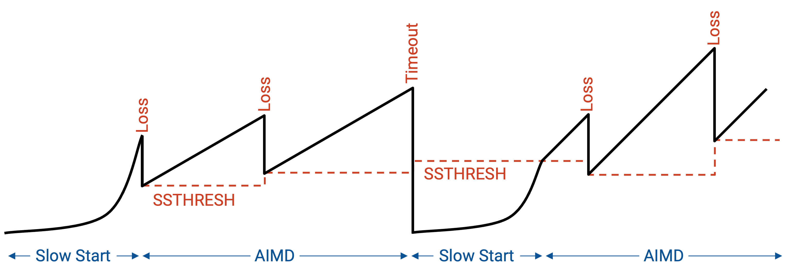

速率随时间先指数增长；第一次丢包后减半并进入 AIMD。随后线性增加到下一次丢包，再减半。超时则启动更保守的重新发现。

## 快速恢复：贯穿示例

还有一个问题：孤立丢包时窗口按要求减半，但可能意外地让发送者停顿很久。

设发送10包，编号101至110，101丢失。接收者收到102至110后，都回复 ACK(101)，因为下一个期望位置仍是101。102、103、104引出的第三个重复 ACK 到达后，发送者重传101。等重传的101到达，接收者已有102至110，于是回复 ACK(111)。

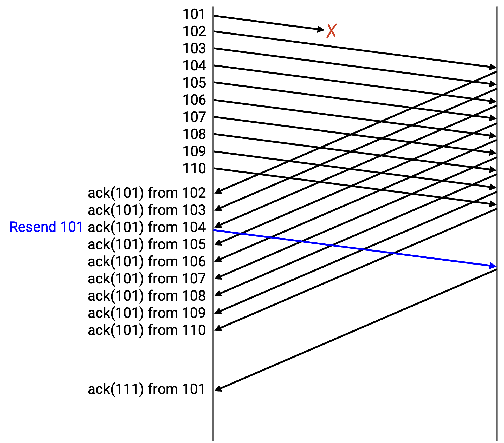

从发送者看：先发101至110，收到三个 ACK(101)，重传101，再继续收到105至110对应的 ACK(101)，最终收到 ACK(111)。从接收者看：先到102至110，每次报告仍缺101；补齐后报告下一期待位置111。

窗口始终从第一个未确认位置开始，再向右延伸 CWND 长度。只有累计确认越过左端，窗口才能右移；后面的数据到达，不能单独推进左端。

## 快速恢复：问题在哪里

初始 CWND=10，窗口覆盖101至110，全部发出，101丢了。

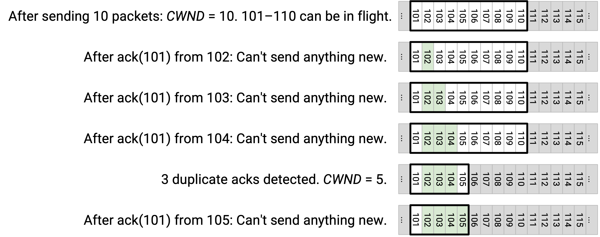

102产生的 ACK(101)到达时，最早未确认仍是101，不能发111。103产生的重复 ACK同样如此。104产生第三个重复 ACK，CWND减为5，窗口成101至105；仍不能发送新数据，但立即重传101。

105产生的 ACK(101)到来，窗口仍是101至105，不能发新包。106到达产生的 ACK也不能改变这个事实。

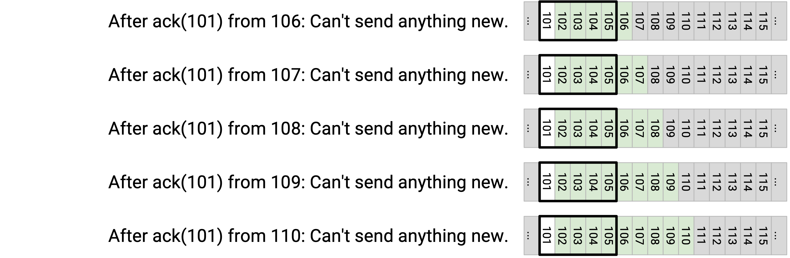

107、108、109、110产生的四个重复 ACK都一样：左端仍是101。只丢一个包，却导致发送者长时间完全停止发送。虽然102至110已到达，窗口仍被101卡住。

最终重传101引出 ACK(111)，窗口跳到111至115，CWND仍为5，这时才可以发送这5个新包。

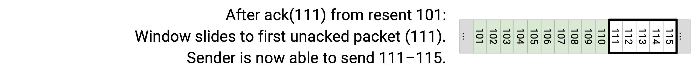

这又产生第二个问题：此前一直不发，现在突然一起发111至115，然后还要等整整一个 RTT，才能得到这些包的确认并继续发116及以后。

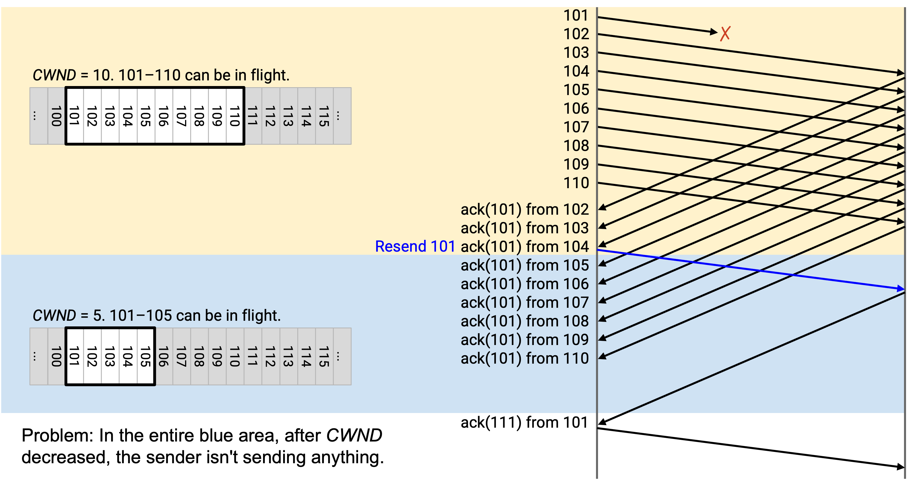

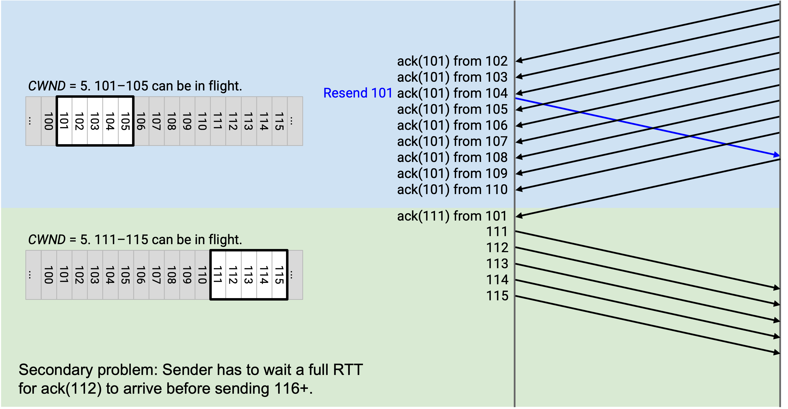

总结：孤立丢包卡住窗口，造成停顿；补齐后窗口猛跳，造成突发；随后又得等待一轮确认。

这个问题更多来自 TCP 的累计滑动窗口，而不只是拥塞控制。即使没有缩小窗口，左端不动仍会阻止新包发送。

画图时可以把102、103、104标成“已到达”，帮助理解，但发送者并不知道究竟是哪几个包到达。它只看见累计 ACK，最多推断窗口内有三个不是101的包到达，不能确定具体编号。

此外，同一串 ACK(101)达到第三个重复时重传101一次；后续更多相同重复 ACK，不会每收到一个就再次重传101。

## 快速恢复：核心想法

理想情况是不停顿：即使101丢了，也能继续发111及后续数据。

收到102引起的 ACK(101)，虽然不能认定到的是102，却知道有一个非101包到达了，所以原来的10包中还剩9包未排除在途。再收到103引起的重复 ACK，就剩8包。依次为：

| 由哪个包触发重复 ACK（观察者知道） | 原10包中估计剩余在途数 |
|---|---:|
| 102 | 9 |
| 103 | 8 |
| 104 | 7 |
| 105 | 6 |
| 106 | 5 |
| 107 | 4 |
| 108 | 3 |
| 109 | 2 |
| 110 | 1 |

九个重复 ACK后，只剩101未被排除。孤立丢包后真正希望保持的是5包在途。因此107引出的 ACK到来时，原批次只剩4包，应该允许发111补到5包。然而按连续序号定义的窗口还停在101至105，阻止了它。

解决思想是：**为每个重复 ACK给予临时额度**。它证明一个包已离开网络，因此临时把窗口向右扩展1包，抵消累计确认尚未前进造成的限制。

## 快速恢复：应用到示例

仍从窗口101至110开始，发出10包。

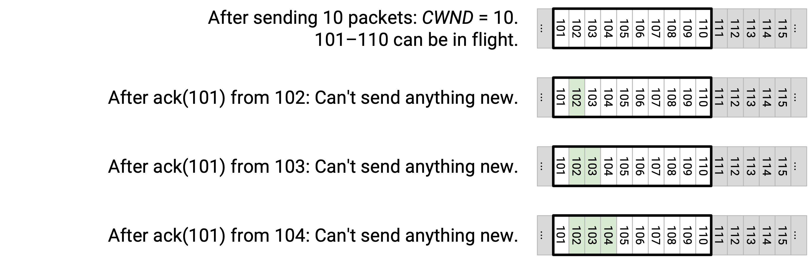

102、103引出的两个重复 ACK不改变窗口。收到104引出的第三个重复 ACK时，先计算目标窗口5，再为已经收到的三个重复 ACK加3，实际临时 CWND=8。

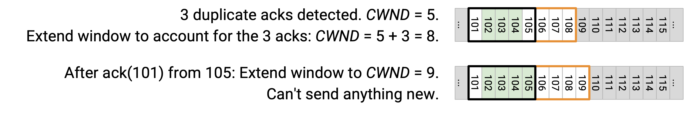

收到105对应 ACK，窗口加到9，覆盖101至109，仍不能发新包。收到106对应 ACK，加到10，覆盖101至110，仍不能发新包。

收到107对应 ACK，加到11，覆盖到111，终于可以发111；收到108对应 ACK，加到12，发112；109对应 ACK使它加到13，发113；110对应 ACK使它加到14，发114。

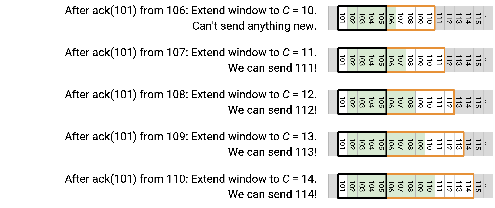

最终重传101引出 ACK(111)，临时额度可以取消，CWND回到目标5，窗口为111至115。111至114已经发过，只需再发115。

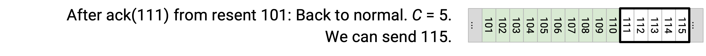

这样不必等101确认后才发新数据，发送者在恢复过程中就能继续工作。

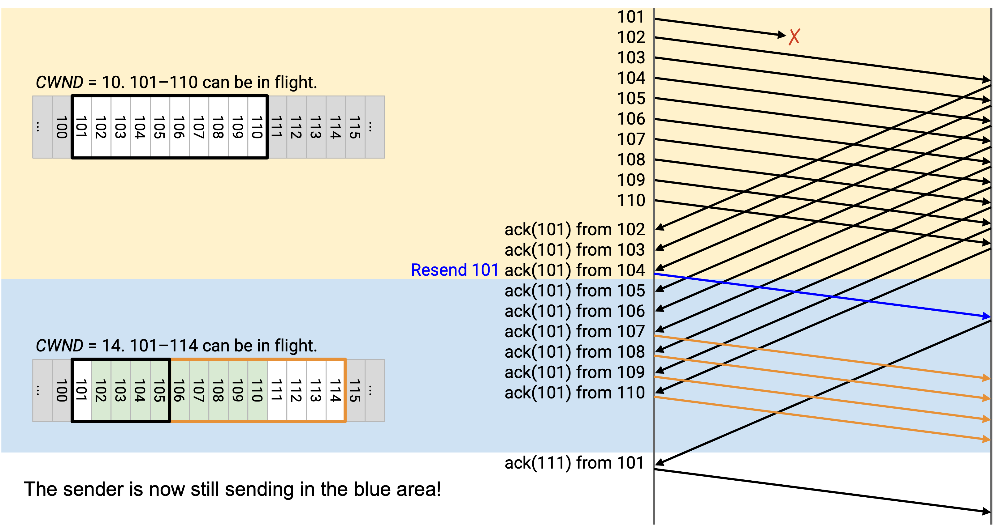

第二个突发问题也解决了：窗口跳到111时只需发115，不必突然一起发五包。111至114提前发出，也会更早得到确认，因此不再额外停一个完整 RTT才能发116以后。

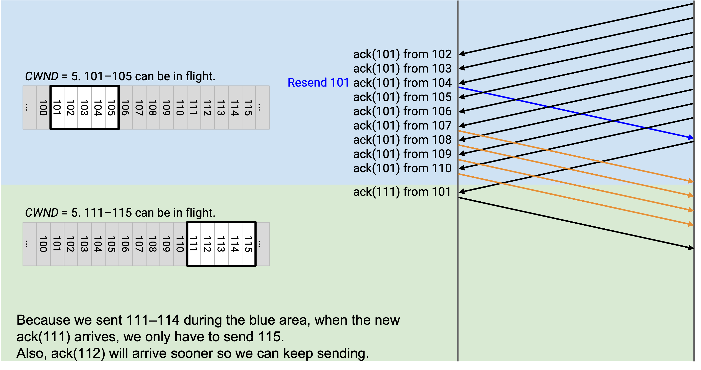

还可以从扩展窗口的构成理解：第三个重复 ACK时，目标窗口为5，临时窗口为8，里面有3个已经到达的包和5个允许在途的名额；下一重复 ACK后窗口9，包含4个已到达名额和5个在途名额；再下一次窗口10，包含5个已到达名额和5个在途名额。发送者不知道具体哪些包到达，但可以估计数量。

收到107对应 ACK后，扩展窗口为11，已有6个到达名额，另外5个允许在途。原先发了10包、已有6个到达，只剩4个，因此能发111。收到108对应 ACK，又有一个包离开网络，窗口扩到12，便可发112。

> 编者注：这里“恰有5包在途”指扩展窗口中的目标名额，不是说刚减半时网络里所有已经发出的包立即只剩5个；先前发出的超额数据仍需排空。重复ACK与一个包离网的对应关系也是本例的简化假设。

## 快速恢复：实现规则

三个重复 ACK使发送者进入**快速恢复**。把旧窗口的一半保存为 SSTHRESH，再设临时 $CWND=SSTHRESH+3$（包单位），并快速重传最早未确认包。

恢复期间，每个额外重复 ACK把 CWND再加1。收到新的、非重复 ACK后退出快速恢复，将 CWND设回 SSTHRESH；阈值始终保存真正希望恢复到的减半目标。

> 编者注：必须先从旧 CWND计算阈值，不能先膨胀窗口、再把膨胀后的值减半。

## TCP 状态机

现在把可靠性与拥塞控制组合起来。发送者维护五项状态：重复 ACK计数，初值0；一个丢包检测定时器；流量控制的 RWND；拥塞控制的 CWND，初值1包；记忆安全估计的 SSTHRESH，初值无穷。

接收者维护乱序包缓冲区。发送者响应新数据 ACK、重复 ACK、超时；接收者收到包后，回复 ACK与 RWND。

**新 ACK：**慢启动中 CWND加1；快速恢复中设回 SSTHRESH并退出恢复；拥塞避免中增加 $1/CWND$。还要重置定时器、清零重复 ACK计数，并在窗口允许时发送新数据。

**重复 ACK：**计数加1。恰好到3时，重传最左未确认包，设置 SSTHRESH为旧 CWND的一半，设置 CWND为 SSTHRESH+3，进入快速恢复。超过3的后续重复 ACK使 CWND每次加1。

**超时：**重传最左未确认包，把 SSTHRESH设为旧 CWND的一半，CWND设为1，回到慢启动。

快速恢复内额外重复 ACK保持当前状态，新 ACK转入拥塞避免，超时转慢启动。慢启动内通常的新 ACK或尚未累计到三个的重复 ACK不改变模式；窗口超过阈值进入拥塞避免，三个重复 ACK则转快速恢复。拥塞避免中，新 ACK维持该模式，三个重复 ACK转快速恢复，超时转慢启动。

## TCP 拥塞控制变体

变体都在端主机操作系统里实现，许多名称来自 BSD。

教材列举：Tahoe在三个重复 ACK时把 CWND重置为1，而不是减半；Reno在三个重复 ACK时减半、超时重置为1；教材把“在Reno基础上加入快速恢复”的版本称为 New Reno，并称之为刚才的实现。另有 TCP-SACK，通过选择确认提供更详细的信息，例如“13以前都到了，18也到了”。

> 重要勘注：教材这里对 Reno/NewReno 的历史区分不准确。Reno已经包含快速恢复；NewReno的重要区别是快速恢复中对部分确认和同一窗口多处丢失的处理。本页保留原文所列观点并明确指出问题，不能把上面的简化三态机直接当成完整 NewReno 规范。

不同变体为什么能共存？拥塞控制由发送者决定，网络和另一端只看到按某种速率发送的 TCP包，不关心速率怎么算；基础包格式没有因此改变。

但涉及确认格式时就有互操作需求。教材举例：一方期待SACK、另一方只提供累计ACK时，就不能直接按选择确认的假设工作。

> 编者注：真实SACK使用能力协商，不能据此认为SACK主机与非SACK主机完全不能建立TCP连接；未协商支持时不能依赖SACK信息。

## 引用与来源

- 作者：Peyrin Kao，基于 Sylvia Ratnasamy、Rob Shakir 等人的讲授及教材贡献。完整翻译章节：[Principles](https://textbook.cs168.io/transport/cc-principles.html)、[Design](https://textbook.cs168.io/transport/cc-design.html)、[Implementation](https://textbook.cs168.io/transport/cc-implementation.html)。
- 固定源码：[教材仓库快照](https://github.com/berkeley-cs168/textbook/tree/0b8208742d31df7fc3d53a0cd94fdd4e04f8d47e/transport)。这是2026年当前固定快照，不是对2025教材原貌的断言。
- 原教材与本翻译采用 [CC BY-SA 4.0](https://creativecommons.org/licenses/by-sa/4.0/)。修改：全文中文翻译、中文图注、显式编者勘注、原图以白底显示便于深色主题阅读；原图字节未改。
- 正文与全部38幅引用图已阅读；图中英文标签的含义由相邻中文正文及图注承接。课堂视频不适用这项教材许可。
