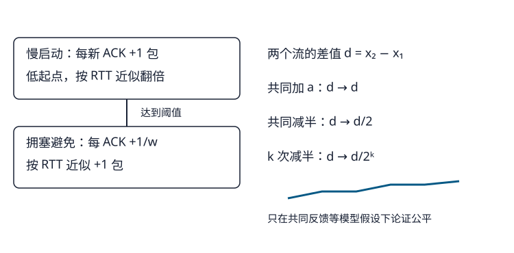

# 核心问题：不知道网络容量，怎样既不堵塞又不浪费？

发送端没有全网地图，也不知道其他连接何时开始、结束。拥塞控制不是为网卡找一个固定发送速率，而是根据**实际路径当前可分得的份额**持续调整。

接收窗口解决“对方放不下”，拥塞窗口解决“网络承受不了”。这两件事不能相互替代：接收机内存很多，也不能保证中间链路有空闲容量。

## 1. 两道窗口约束，一个在途预算

令 $A$ 为最早未确认序号，$S$ 为下一个待发序号。在简化的累计窗口模型中：

$$W=\min(rwnd,cwnd),\qquad\text{可发送新数据量}=\max(0,A+W-S).$$

若 $rwnd=64$ KB、$cwnd=12$ KB，已经发出但尚未累计确认8 KB，最多再发4 KB。接收者把 rwnd提高到128 KB仍不会增加这4 KB预算；若 cwnd升到20 KB，预算才变为12 KB。

这里的窗口是**数据量**，不是速率。对于持续发送、窗口受限且RTT近似稳定的流：

$$R\approx\frac{W}{RTT}.$$

例如窗口100 KB、RTT100 ms，对应约1 MB/s，而不是100 KB/s。实际还要受到应用供给、接收窗口和链路容量的限制。

## 2. 为什么“收到ACK”和“没拥塞”不是同义词

丢包式控制把新ACK作为可以增加窗口的触发事件；它不证明队列为空。路由器可以一边排很长的队，一边正常交付包。

| 观察 | 可作出的保守推断 | 不能据此证明 |
|---|---|---|
| 新累计ACK | 更多字节已到达 | 没有排队或拥塞 |
| 三个重复ACK | 后续数据到达，前面的洞值得重传 | 一定由拥塞造成，且只丢一个包 |
| 超时 | 当前恢复证据不足，应保守重试 | 一定发生严重拥塞 |
| RTT升高 | 往返路径出现额外延迟 | 额外延迟一定来自前向瓶颈 |

损坏、乱序、ACK丢失、小窗口和尾部丢包，都可能影响这些解释。**控制算法使用的是信号与启发式，不是全知诊断。**

## 3. 慢启动为何增长快

小初始值是为了安全；指数增长是为了不让高速路径等待太久。在教材的1包初始、每包一个ACK模型中，每个新ACK既释放一个旧名额，又新增一个窗口名额，因此能发两个包。按RTT观察，窗口约为1、2、4、8、16……

如果每100 ms只增加0.5 Mbps，探测1 Gbps要约200秒；翻倍则需要对数级轮数。慢启动中的“慢”指起点保守，不指增长斜率小。

SSTHRESH不是路由器宣布的真实容量。它只是发送者把最近一次丢包时的窗口减半后保留的历史估计，网络变化后也可能过时。

## 4. AIMD公平性：一个差值证明

考虑同样RTT、同样更新规则、共享同一瓶颈且同步感知拥塞的两个发送者。设差值 $d=x_2-x_1$：

- 同时加 $a$：$d'=d$。
- 同时乘 $0<\beta<1$：$d'=\beta d$。

经过 $k$ 次共同减速，差值变成 $\beta^k d_0$。加性增加不扩大差距，乘性减少不断压缩差距，所以趋向公平线。

图为本页原创示意。左侧是状态响应，右侧以差值展示公平性；不是课堂截图，也不是对不同RTT、不同算法或多瓶颈全网公平的证明。

为什么不能用MIMD？两者始终乘同一个系数，比例不变；原先2:1，之后仍为2:1。为什么AIAD不行？差值不变。MIAD则乘性增大差距、加性减速不消除差距，可能把较小流推到0。

## 5. 从每RTT更新变成每ACK更新

用 $w$ 表示包数窗口，用 $c$ 表示字节窗口：

| 模式 | 每个新ACK的近似更新 | 每RTT效果 |
|---|---|---|
| 慢启动 | $w\leftarrow w+1$ | 约翻倍 |
| 拥塞避免 | $w\leftarrow w+1/w$ | 约加1包 |
| 拥塞避免，字节单位 | $c\leftarrow c+MSS^2/c$ | 约加1 MSS |

不要把 $1/c$ 直接加进字节窗口。单位检查可以立刻发现错误：$MSS^2/c$ 的单位才是字节。逐ACK分母不断变化，所以“每RTT加1”是近似，不是每轮都严格相等。

## 6. 快速重传与快速恢复分别修什么

**快速重传**缩短发现丢失的等待，不必总等超时。**快速恢复**避免累计ACK卡住窗口左端后，把发送端也卡死。

教材例子中发101至110，101丢失。第三个重复ACK后，长期目标窗口从10降到5，但累计窗口左端仍停在101。只设窗口5，会使后续数据虽然不断到达，发送者仍不能发111。

恢复方法是把目标值存入 SSTHRESH=5，临时 CWND设为5+3=8；每个额外重复ACK加1。到第六个重复ACK时，临时窗口11覆盖到111，终于能发送一个新包。收到ACK(111)后，取消膨胀，把CWND还原为5。

“临时变大”不是放弃减速，而是对累计确认尚未前进的到达数据给额度。目标在途规模已经减半；临时序号跨度和目标在途量不能混为一谈。

## 7. 实现时必须守住的边界

1. 先用旧窗口算SSTHRESH，再设置临时膨胀窗口；不能把膨胀值又减半当阈值。
2. 同一串重复ACK达到第三个时快速重传一次，不是每个重复ACK都重传同一包。
3. 新ACK、重复ACK、超时是不同事件；不要让一个事件重复触发互相矛盾的状态迁移。
4. 发送许可仍受到rwnd限制；拥塞算法不能越过接收者的内存边界。
5. 教材的1包初始值、阈值越界规则、简化快速恢复是教学模型，不是完整现代TCP实现要求。
6. 教材把NewReno说成“Reno加快速恢复”不准确。Reno已有快速恢复，NewReno重点还包括部分确认处理；不要把本页三态模型当成完整标准。

## 自测

cwnd=16包，第三个重复ACK到达，教材恢复模型中阈值和临时窗口是多少？

先保存SSTHRESH=8，再设临时CWND=11。收到一个额外重复ACK变12；新ACK结束恢复时回到8。字节实现需要分别乘MSS。

两个流采用相同AIMD，为什么仍不保证真实网络里各得一半？

简单证明依赖相同更新时间尺度和共同反馈。RTT不同，每秒加性增加次数不同；路径有其他瓶颈、丢包不同步、应用需求不足、算法参数不同，都可能打破条件。

超时后窗口降到1，接收窗口是否也必须降到1？

不必。cwnd是发送端拥塞状态；rwnd由接收者剩余缓冲区决定。最终发送预算取两者较小值。

## 引用与来源

- [本讲教材全文翻译](#/c/berkeley-cs168-2025/lec/lec13?v=materials)：完整阅读 Principles、Design、Implementation及38幅图后编写本页。固定快照与许可见材料页。
- [L14：吞吐量模型与边界](#/c/berkeley-cs168-2025/lec/lec14?v=notes)；[L15：路由器辅助与公平](#/c/berkeley-cs168-2025/lec/lec15?v=notes)。
- 官方Spring2025视频标题为“Lecture 13 - Transport 3: Congestion Control I”，频道为CS 168 (Internet Architecture) at UC Berkeley，上传2025-03-13，实际元数据时长 **1:19:23（4763秒）**。来源URL、取证日志与许可状态保存在本讲sources。
- 视频无人工字幕轨，元数据列出英文自动字幕，但timedtext及yt-dlp请求均HTTP429；父级官方页面reader也未取得文本。**未读字幕、未听音轨、未看画面，首尾与提问未核验**，不提供猜测时间索引，不创建占位课堂译稿。本页是教材驱动原创笔记，课堂覆盖仍为partial。
