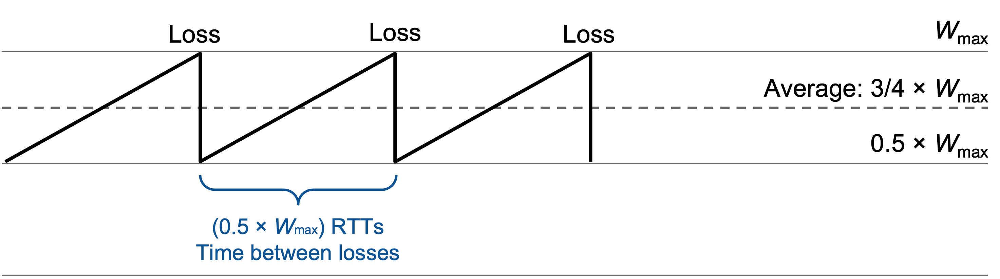
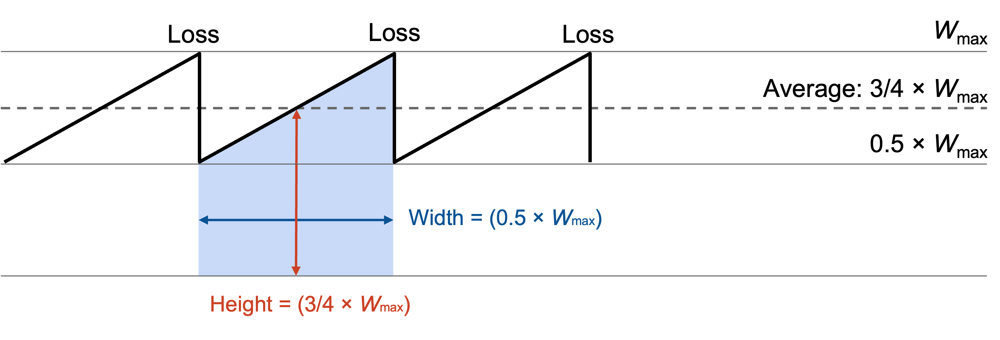
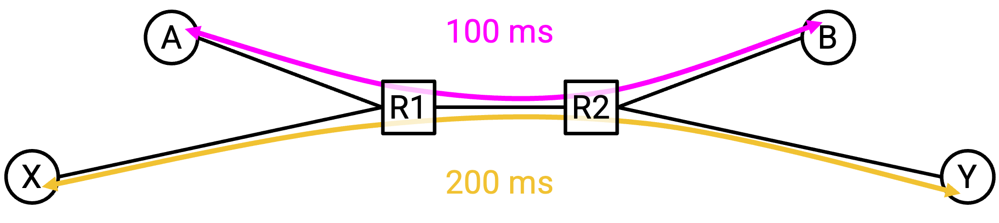
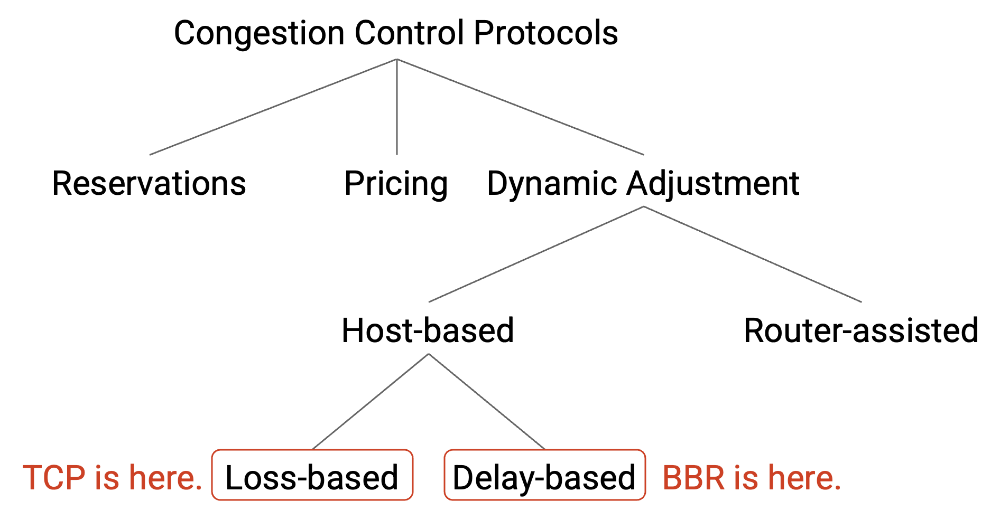
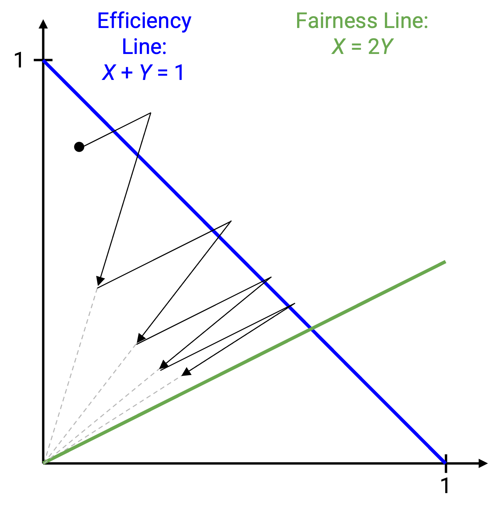
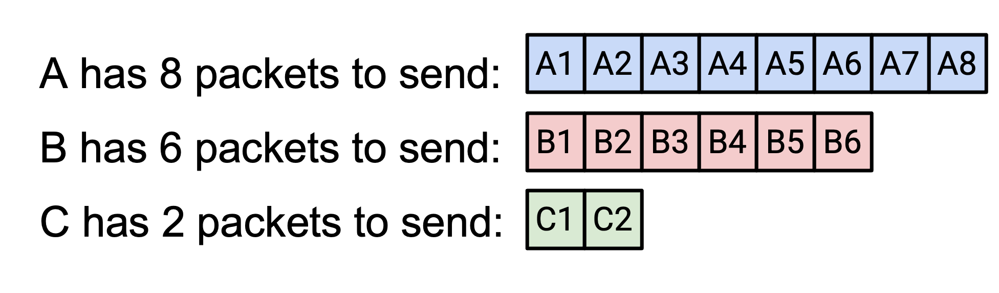
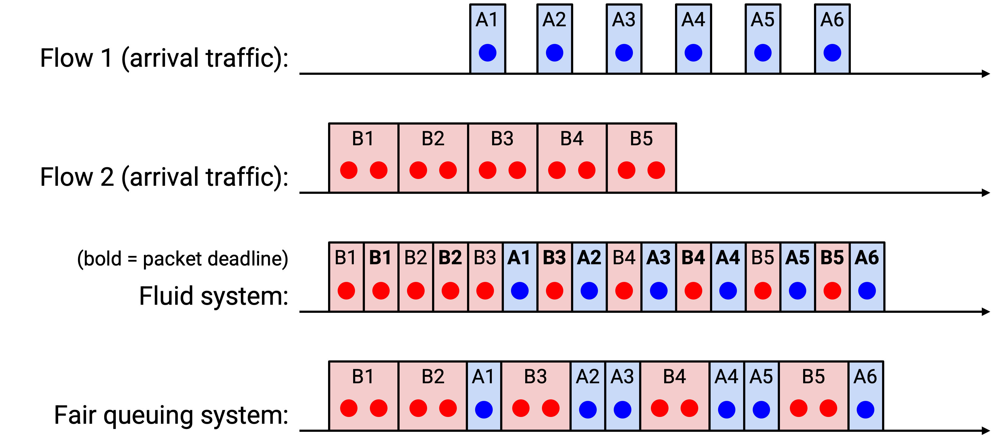

# TCP 吞吐量模型

## 建模假设

前几节建立了拥塞控制算法，说明如何根据拥塞调整速率，却没有直接告诉我们最终速率是多少。本节为特定路径上的 TCP连接建立吞吐量估计：希望只用路径 RTT与丢包率，就得到一个简单公式，帮助运营者与用户估算连接速率。

为了简化，假定只有一条 TCP连接，忽略慢启动，RTT固定。窗口达到某个常量 $W_{\max}$ 时，恰好丢一个包；因为只丢一个，所以靠重复 ACK发现，不发生超时。

> 原文量纲勘注：教材把 $W_{\max}$ 称作“最大瓶颈带宽”，但后面的计算明确把它当作**发生丢包时的最大窗口，单位为包**，不是 bits/s。整个模型是假定周期锯齿的近似，不是任意 TCP实现或任意路径上的精确公式。

## 用窗口表示吞吐量

窗口达到 $W_{\max}$ 时丢包，随后减为 $W_{\max}/2$。每过一个 RTT增加1包，依次为 $W_{\max}/2+1$、$W_{\max}/2+2$、$W_{\max}/2+3$，直到再次达到 $W_{\max}$，再减半，循环往复。

从一半爬回最大值，需要 $W_{\max}/2$ 个 RTT。因此相邻两次丢包之间也相隔这么多轮。

一个周期的平均窗口取上下界的中点，即 $3W_{\max}/4$。这里单位是包，因为每轮增加1包。每个包包含 MSS字节，因此平均字节窗口为 $3W_{\max}\mathrm{MSS}/4$。

窗口表示每 RTT可以发送的数据量，除以 RTT得到平均速率：

$$T\approx\frac34W_{\max}\frac{\mathrm{MSS}}{\mathrm{RTT}}.$$

> 编者注：原文写作等号，并有一句“每个RTT内的平均窗口”。这里指**跨一个完整锯齿周期**的平均值；离散端点、逐ACK更新与恢复过程被忽略，因此用近似号明确范围。

## 用丢包率表示吞吐量

目前公式仍依赖 $W_{\max}$，目标却是 RTT与丢包率 $p$，所以要消去最大窗口。

已知每 $W_{\max}/2$ 个 RTT丢一个包。只要算出这期间发了多少包，就能算出丢包比例。

图形上就是曲线下面积，也就是速率对时间的积分。平均每 RTT发送 $3W_{\max}/4$ 包，持续 $W_{\max}/2$ 个 RTT，因此总包数约为：

$$N\approx\left(\frac12W_{\max}\right)\left(\frac34W_{\max}\right)=\frac38W_{\max}^2.$$

每个周期丢一个包，丢包率就是1除以周期包数。例如每100包丢一个，比例约为1/100。于是：

$$p\approx\frac1{(3/8)W_{\max}^2}=\frac8{3W_{\max}^2}.$$

在这个近似模型内，代数变形为：

$$
\begin{aligned}
p&=\frac8{3W_{\max}^2},\\
3W_{\max}^2p&=8,\\
W_{\max}^2&=\frac8{3p},\\
W_{\max}&=\frac{2\sqrt2}{\sqrt{3p}}.
\end{aligned}
$$

代入吞吐量式：

$$
\begin{aligned}
T&\approx\frac34W_{\max}\frac{\mathrm{MSS}}{\mathrm{RTT}}\\
&=\frac34\frac{2\sqrt2}{\sqrt{3p}}\frac{\mathrm{MSS}}{\mathrm{RTT}}\\
&=\sqrt{\frac32}\frac{\mathrm{MSS}}{\mathrm{RTT}\sqrt p}.
\end{aligned}
$$

## 公式意味着什么

吞吐量与丢包率的平方根成反比。丢包更多，窗口更频繁减半，所以吞吐更低。

吞吐量也与 RTT成反比。较短 RTT意味着 ACK更快返回，单位时间内窗口能增加更多次。这在不同 RTT的多个连接之间可能造成问题。

短 RTT连接更快收到 ACK，更快增加窗口、发包。图中100 ms连接在该模型条件下可获得200 ms连接的两倍带宽。

> 条件勘注：两倍结论依赖相同 MSS、相同丢包率及该模型成立，不能仅由“共享一条链路”就推出任意实网流量比恰为2。

因此传统 TCP在 RTT不同的连接之间并不公平。短 RTT不只减少传播等待，也加快速率爬升。教材把这视为 TCP的一个既有特性，并说通常接受它，而不在这里另加修复机制。

## 基于速率的拥塞控制

上述算法造成起伏的吞吐量：速率反复在窗口一半与最大窗口对应的水平间摆动。有些应用，例如流媒体，更希望稳定地发送。

一种方法是**基于公式、或基于速率的拥塞控制**：不逐步执行窗口增减规则，而是测量 RTT和丢包率，代入吞吐量公式，按算出的速率平滑发送。因为使用的带宽不超过同等条件下 TCP会使用的水平，所以希望能够公平共存。教材指向 RFC 5348了解更多。

能够与 TCP良好共存、必要时降低速率的替代实现，被称为 **TCP-friendly（TCP友好）**。它们可以包括基于速率的方案，也可以有其他方案，使不同端系统采用不同算法时仍合理共享带宽。

> 编者注：这是教材对思想的解释，不是 RFC 5348的完整实现规定；仅把本页简式代入并固定速率，并不足以覆盖超时、反馈周期、丢包事件估计等实际要求。本次未把该 RFC作为已全文阅读的来源。

# 拥塞控制的局限

## 混淆损坏与拥塞

TCP用丢包检测拥塞，但拥塞并非唯一丢包原因。包可能损坏、校验失败而被丢弃，TCP却无法仅凭丢失区分原因。即使网络并不拥塞，损坏导致的丢包也会使它减速。

> 原文勘注：该段第二句把本应说明的“corruption”再次写作“congestion”，与小节标题及后一句矛盾；这里明确其要表达的是损坏与拥塞两种原因。

吞吐量公式也显示了这一点：即使丢失不是拥塞造成，吞吐仍随丢包率升高而下降。因此公式可以帮助估计有损链路，例如频繁发生数据损坏的无线链路，对 TCP的影响。

> 原文勘注：本节称“吞吐量与丢包率成反比”，精确对应前章应为与**丢包率平方根**成反比。

## 短连接

教材给出的统计是：现实中多数 TCP连接很短，50%的连接发送不到1.5 KB，80%不到100 KB；有些只发一个或很少几个包。这些数字按原文保留，不能据此断言它们是2025或2026年的普遍实测结果。

假设总共只需发3包。初始窗口为1，先发第一包，等其 ACK后窗口变2，再发剩余两包，收到确认后结束。

3包用了两个 RTT，吞吐仅1.5包/RTT。一般而言，短连接可能始终停留在慢启动，尚未达到公平份额就结束，传输时间因而过长。

短连接还有丢包恢复问题：没有足够后续数据产生三个重复 ACK。例如只发4包，第二包丢了，后续包不够触发三个重复 ACK，必须等超时。教材举约500 ms的典型超时量级，这也会显著拖长短连接。

部分修复是扩大初始窗口，例如从1包改为10包；这样10包以内的数据可以一开始就发完。

> 编者注：上述数值是教材示例，不是所有实现的当前默认值。更大的初始窗口也不能保证任何尾部丢包都有足够重复 ACK，因此原文称它为“部分修复”。

## TCP会填满队列

丢包式 TCP主动增加速率，直到触发丢包；若丢包来自队列溢出，就意味着先把队列填满。这会引入影响网络中其他连接的排队延迟。

设一个大连接正在传10 GB文件，之后启动只发一个包的小连接，两者共享瓶颈。大连接不断增速直到瓶颈队列填满；小连接的新包只能排在大连接的数据后面等待。

路由器队列特别大时，问题更严重。这种过多缓冲引起的长队列叫 **bufferbloat（缓冲膨胀）**。家用路由器可能配有很大队列，却只有家中少数连接使用；其中一个连接就可能让其他连接遭遇大排队延迟。

要避免填满队列，可以不用故意丢包来探测拥塞。例如 RTT开始增大时，就把它当作排队信号。教材以 Google 2016年的 BBR举例，描述为学习最小 RTT，并在 RTT高于最小值时降低速率。

> 编者注：这是教学简化。BBR是结合瓶颈带宽与最小RTT估计的模型式算法，不能把“RTT超过最小值就减速”当作其完整控制规则。

## 不合作与作弊

没有东西强制发送者遵守 TCP拥塞控制。发送者可以修改算法，争取不公平的大份额。例如每 RTT窗口加2而不是加1；在一个作弊者和一个诚实者的二维模型中，AIMD会趋向一条不同的“公平线”，作弊者约得诚实者两倍带宽。

还有其他方式，例如采用极大的初始窗口。由于传统 TCP在操作系统中实现，修改它通常要改系统代码，多数用户不会这么做。

少数人作弊可能取得更多带宽；但如果大量人都这么做，例如一个广泛部署的操作系统都采用激进算法，这些用户仍相互竞争，很可能谁也得不到更多。

不改 TCP也能争取更多：多开连接。TCP公平性通常按连接计算；一个发送者开10条，另一个只开1条，前者可能得到10倍总份额。许多应用确实利用多连接提高带宽。

既然能作弊，为什么没有再次出现早年的全网拥塞崩溃？教材指出研究者也没有确定答案。一个可能解释是：即使份额不公平，只要仍遵守拥塞时减速等基本原则，就未必持续压垮网络。80年代的问题则是完全没有调速，不断高速重传。

现实里有多少作弊，也很难知道：我们难以观测每个发送者采用的窗口等内部状态。

## 拥塞控制与可靠性纠缠

两者机制紧耦合，拥塞控制最初正是通过修改可靠性代码里的少数几行实现。窗口在 ACK与超时事件上更新，因为可靠性代码本来就响应这些事件；用重复 ACK推测丢包，也源于累计确认设计。

合并两项功能是一种设计选择。好处是可以用小补丁迅速部署，处理80年代的危机。代价是之后演进困难：改拥塞控制可能要改可靠性代码；把累计确认换成更完整的确认，也可能迫使拥塞控制跟着改变。

从设计角度，这是**模块化失败，而不是分层失败**。两项功能都适合传输层，只是在同一层内部没有清楚分开。

因此在 TCP这套实现中，想保留拥塞控制却不要可靠性很难。例如有的流媒体应用不需要重传可靠性，却仍需要节制发送。反过来，若一个轻量连接每10分钟只发一个包，可能不需要复杂拥塞控制，却仍难以只对这一连接关闭它而保留可靠性。

> 范围勘注：这里谈的是 TCP功能耦合，并不是说其他传输协议在原则上不可能独立提供其中一种功能。

# 路由器辅助拥塞控制

## 为什么让路由器参与

基于主机的方法存在许多问题：混淆损坏与拥塞、填满队列、速率起伏、短流性能差。这些都与主机必须反复试探有关。若路由器直接报告拥塞，甚至直接给出理想速率，就能缓解许多问题；若路由器强制公平分享，主机也更难作弊。

从设计上看，拥塞发生在路由器，它通常比端主机知道更多，因此参与控制很自然。路由器辅助方案可以取得接近理想的高利用率和低延迟，但部署困难：路由器要增加功能，有时相当复杂，某些方案甚至要求所有路由器共同支持。

## 强制公平排队

路由器怎样保证每条连接的份额？原先它只把到达的包排队，按 FIFO先来先服务，不关心包来自哪条连接。

新模型要先分类。暂时假定都是 TCP连接，路由器读取源、目的 IP和端口，识别连接；再为每条连接维护独立队列。包到达时放入相应队列，每次挑一个队列，发送队首包。如果挑选队列的方式公平，就能在连接间强制公平服务。

若包都一样大，可以**轮转**：第一个队列发一包，再第二个，依次循环。不同连接需求不同也能适用；低需求连接的队列会更慢积累，空队列无需占住服务机会。

例如链路每秒能发10包，A、B、C分别希望每秒发8、6、2包。

轮转后各能发多少？把它看作资源分配问题。

总容量10，若先平均，每人3.33。但 C只要2，应只给2，不多给。还剩8，分给仍未满足的 A、B，各4。两者虽没得到全部需求，却已经取得可以提供的相等份额。

正式地，设容量为 $C$，连接 $i$ 的需求为 $r_i$，分配为 $a_i$。**最大最小公平**的分配写作：

$$a_i=\min(f,r_i),\qquad\sum_i a_i=C.$$

$f$ 是所有连接共同使用的公平份额。最小值保证不会分配超过需求，总和条件保证不浪费容量。直观上存在一个共同的份额上限：需求小于上限，给它需要的数量；需求超过上限，就封顶，但其他未满足连接也不会拿得更多。本例 $f=4$，A、B各4，C得2。

> 原文勘注：解释段误写“需求小于公平份额时，得到公平份额”，与公式和示例矛盾，应为“得到自己的需求”。另外总需求若小于容量，$\sum a_i=C$不能成立；更完整的条件是 $\sum a_i=\min(C,\sum r_i)$。全部需求都能满足时，$f$也未必唯一。原文公式隐含总需求足以用满链路。

这保证：如果你还没有得到全部需求，别人不会得到比你更多的分配。等长包轮转实现这样的最大最小公平。

现实包长可能从40字节到1500字节不等。按包轮转就不等于按带宽公平。理想方式是**逐比特轮转**，每次从每条连接轮流发一个比特；实际网络不能这样交错发包，但可以理论模拟，记录每包最后一比特在理想系统中发送的时刻，称为该包的截止时刻。然后实际按这个时刻的先后发送整个包，近似理想公平服务。

教材补充：研究这种公平排队模拟的论文很有影响力，共同作者包括伯克利教师 Scott Shenker和当时的 EECS博士生 Srinivasan Keshav。

下面是两条连接的逐比特公平排队例子；若截止时刻相同，选择更早到达的包。

图中蓝色 A包长度为一个单位，红色 B包为两个单位；流体系统可把 B包拆成两个交替服务的单位，粗体标出包完成时刻；真实公平队列不拆包，而按这些完成时刻发送整包。它说明公平比较的是服务比特数，不是轮到的包数。

## 实践中的公平排队

优点是连接之间得到隔离，不合作连接难以抢走别人的份额。连接不必采用 TCP或 TCP友好方案，可以选择自己的拥塞控制。它对作弊和 RTT差异有抵抗力：在这一条链路上，每个连接获得规定的公平服务。

但端主机仍需发现并适应自己的份额。如果请求太多，仍应减速。

缺点是比 FIFO复杂得多：计算截止时刻不简单，本节没有给出完整算法；路由器还要维护多个队列，每包多做解析。完美模拟在高速路由器上代价太高，实践中使用近似，例如 Deficit Round Robin。现代路由器往往只维护较少队列，因此隔离可能是每客户一队列，而非每连接一队列。

公平排队**不能消除拥塞**，只是另一种管理方式。例如某瓶颈给两条连接各0.5 Gbps，但上方连接的下一条链路只有0.1 Gbps，那么它刚获得的0.5中会有0.4在下游被丢弃。更合理的是上方发0.1、下方发0.9。

> 图源缺口：教材正文引用“这个瓶颈链路”，但固定源码此处没有附对应网络图片。上述0.5、0.4、0.1、0.9均来自正文，未补造缺失原图。

根本原因是当前路由器不知道更下游会发生什么；必须让发送主机减速，单靠本地队列调度不够。

最后还要问：按连接公平，是正确的公平单位吗？一个人开更多连接仍能多拿带宽。是否应按源—目的对，或者按发送源分配？使用更多拥塞链路、消耗更多稀缺资源的连接，是否应该付出更大代价？这些是公平目标本身的问题。

## 路由器向发送者提供信息

公平排队强制某条链路上的公平，却没有告诉发送者任何东西。若路由器还能反馈信息呢？

一种办法是直接报告建议速率：包中增加速率字段，路由器填入该连接的公平份额，反馈送回发送者后，发送者按字段设置速率，不必只靠动态试探。

另一种是只报告拥塞，不给精确速率。这就是 **ECN（显式拥塞通知）**的思想。教材把它简述为 IP首部中的一个拥塞位：包经过拥塞路由器时，路由器将其标记；接收者收到带标记的包后，在 ACK中回显，发送者就知道出现拥塞。

何时标记，有多种选择。频繁、保守地标记可能降低延迟，却导致链路利用不足；很少标记可能提高利用率，但让延迟增大。主机如何响应也有选择，例如像观察到丢包那样降低窗口。

ECN的优点是提供明确拥塞证据，避免把这种拥塞信号与链路损坏混淆；还可以在队列填满前预警，减少延迟；实现相对轻量。

教材指出，有效部署需要路径中的相关路由器支持并恰当地标记。互联网并非所有路由器都支持，但在数据中心这类能协调所有路由器的小网络内更容易发挥效果。

> 协议边界勘注：真实 IP ECN字段为两位，区分不支持、具备能力和拥塞经历等状态；TCP通过相应标志回显，而不是简单把同一个 IP位复制到ACK。ECN给出明确的拥塞标记，不意味着剩余的未标记丢包都能被识别成损坏。局部增量部署也可能有收益，不能把教材的部署提醒读成“少一台支持就完全无效”。

## 引用与来源

- 作者：Peyrin Kao，基于 Sylvia Ratnasamy、Rob Shakir 等人的讲授及教材贡献。全文翻译：[Throughput](https://textbook.cs168.io/transport/throughput-model.html)、[Issues](https://textbook.cs168.io/transport/cc-issues.html)、[Router-Assisted](https://textbook.cs168.io/transport/router-based-cc.html)。正文99、80、93行及全部9幅引用图已完整读取。
- 固定源码：[教材快照](https://github.com/berkeley-cs168/textbook/tree/0b8208742d31df7fc3d53a0cd94fdd4e04f8d47e/transport)。这是2026当前快照，非2025历史版本的复原。
- 原教材及本翻译：[CC BY-SA 4.0](https://creativecommons.org/licenses/by-sa/4.0/)。修改包括中文翻译、中文图注、白底显示原图与明确标出的勘注，未修改原图字节。
- [L15学习笔记](#/c/berkeley-cs168-2025/lec/lec15?v=notes)共用本页，不另复制材料。课堂视频许可不由教材许可推定。
