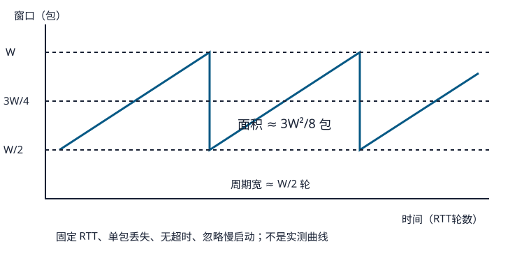

# 核心问题：知道RTT与丢包率，能估算多少吞吐量？

一个拥塞控制算法可以告诉你下一次ACK后怎样改窗口，却不直接告诉你长时间平均能发多快。要回答后者，需要把控制过程抽象为可计算的周期，再诚实地列出省略了什么。

本讲只分析教材的Reno式AIMD锯齿，不把它推广到所有现代TCP变体。

## 1. 先写假设，再画面积

假定单条持续有数据的长流，接收窗口不限制发送；RTT与MSS固定；忽略慢启动；窗口达到 $W$ 包时恰丢一包，由重复ACK恢复，不出现超时；之后窗口减半，再每RTT加1包。

图为原创模型示意，不是实测曲线。横轴使用RTT轮数，因此面积的单位是包，不是字节。

一个周期的宽为 $W/2$ 轮，平均高为 $3W/4$ 包/轮，所以发包数近似：

$$N\approx\frac W2\cdot\frac{3W}4=\frac{3W^2}8.$$

每周期丢一个包，因此 $p\approx1/N=8/(3W^2)$；解得 $W\approx\sqrt{8/(3p)}$。平均字节吞吐为：

$$T\approx\frac{3W}4\frac{MSS}{RTT}=\sqrt{\frac32}\frac{MSS}{RTT\sqrt p}.$$

量纲检查：$p$无单位，MSS是字节，RTT是秒，最终得到字节/秒。要变成bits/s，还需要乘8。

## 2. 用一个数字例子检查直觉

取MSS=1000字节、RTT=0.1秒、丢包率 $p=10^{-4}$。模型给出：

$$W\approx163.3\text{包},\quad\bar W\approx122.5\text{包},\quad T\approx1.225\text{ MB/s}\approx9.80\text{ Mb/s}.$$

窗口可以出现非整数，是因为这里计算连续近似的平均值，不是在要求协议发送0.3个包。

- RTT翻倍，其他条件不变，预测吞吐减半。
- 丢包率变为4倍，其他条件不变，预测吞吐减半。
- 目标吞吐翻倍，RTT与MSS不变，模型要求丢包率降到原来的1/4。

如果路径物理瓶颈只有5 Mb/s，不能因为公式算出9.8 Mb/s就超过物理容量；那意味着所给RTT、丢包率与模型稳态假设不能全部独立成立，或者其他约束已经先起作用。

## 3. 三个特别容易写错的地方

**第一，$W$不是带宽。**它是最大窗口的包数。只有乘MSS、除RTT后才是吞吐。教材相关措辞已有勘注。

**第二，平均窗口不是每个时刻都等于 $3W/4$。**这是跨完整周期取平均。离散端点、ACK驱动近似和恢复过程使面积公式不是逐包精确计数。

**第三，丢包率不是丢包事件率。**本模型把每周期一次事件、一次事件一个丢包放在一起；成批丢包或超时会破坏这个简单对应。

## 4. 为什么短RTT更占便宜

AIMD的“每轮加1包”中，轮的长度是RTT。100 ms的流每秒约有10轮，200 ms的流每秒约有5轮。即使每轮规则相同，按真实时间看增长速度仍不同。

在相同MSS、相同丢包率和上述模型条件下，100 ms流的预测吞吐是200 ms流的两倍。这个结论不是“任何两个共享链路的TCP都严格按RTT反比分配”；不同瓶颈、丢包过程和需求都可能改变份额。

L13的二维公平性论证使用同步更新；这里正好揭示它隐含的时间尺度条件。

## 5. 不要拿长流公式解释短流完成时间

3包连接从1包窗口开始：第一轮发1包，第二轮发2包，约两RTT完成数据交换（本例不另算握手）。它根本没进入稳定锯齿。把极低丢包率代进长流公式，不能让这3包突然在零时间内完成。

短流还可能没有足够后续包生成三个重复ACK，导致恢复靠超时。提高初始窗口可以减少启动轮数，却不能保证所有丢包都能快速重传。

分析任务先选指标：长流关心稳态goodput，短流往往更关心完成时间以及尾延迟。

## 6. 队列、缓冲膨胀与错误信号

丢包式算法持续探测上限，往往需要先把队列填满。大缓冲能吸收突发，却也可能让持续拥塞隐藏成很长的等待。

例如出口10 Mb/s，排队数据1 MB，单看序列化排空就需约0.8秒；新来一个很小的交互包也可能排在它后面。这是本页自拟数量级例子，不是视频测量。

损坏造成的丢包也会使丢包式TCP减速。公式随 $\sqrt p$下降，并不检查丢失原因。因此“带宽高”不等于“有损路径上的TCP吞吐也高”。延迟信号和显式标记提供额外信息，但也有各自测量、部署和控制问题。

## 7. 平滑速率与合作边界

基于公式的发送器可以估计RTT、丢失，再平滑发送，而不直接复制锯齿窗口。这是TCP友好的目标：在可比条件下，不比TCP长期占用更多。

它不意味着永远固定一个速率，也不意味着只代入本页简式就实现了完整协议。反馈、启动、无反馈与超时等行为仍要有规则。

所谓公平还依赖大家合作。一个流每RTT加2而别人加1，会改变份额；一个用户开10条连接，也可能比只开1条的用户取得更多。**按连接公平不等于按用户公平。**

## 自测

MSS不变，RTT从50 ms变100 ms，丢包率降到原来的1/4，预测吞吐怎么变？

RTT使分母乘2，平方根丢包项使分母乘1/2，两者抵消，模型预测吞吐不变。必须强调其他假设仍成立。

为什么每周期发包数与最大窗口的平方成正比？

最大窗口增大，平均每轮发包数线性增大；每轮仍只加1包，爬回最大值所需轮数也线性增大。高度乘宽度，因此是平方。

加大路由器缓冲一定提高应用体验吗？

不一定。可能减少突发丢包，却增加持续排队延迟；大流goodput与交互流延迟是不同指标。应区分吸收短突发与维持长期积压。

## 引用与来源

- [L14–15唯一教材全文翻译](#/c/berkeley-cs168-2025/lec/lec14?v=materials)，覆盖Throughput、Issues与Router-Assisted；本页推导和例题为基于完整阅读的原创学习内容。
- [L13控制机制](#/c/berkeley-cs168-2025/lec/lec13?v=notes)；[L15路由器辅助](#/c/berkeley-cs168-2025/lec/lec15?v=notes)。
- 官方视频“Lecture 14 - Transport 4: Congestion Control II”，CS 168 (Internet Architecture) at UC Berkeley，上传2025-03-18，实际元数据时长 **1:21:41（4901秒）**，许可未说明。
- 未提供人工字幕轨；虽列出自动英文字幕，实际请求均HTTP429。未读字幕、首尾及问答未核验，音画未核验。不能从教材生成视频时间表；draft缺失并标blocked，而不是伪装成已完成的课堂整理。sources保存具体失败日志。
