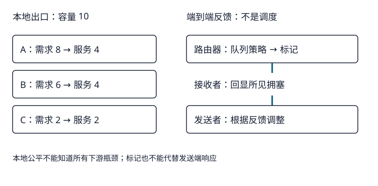

# 核心问题：把控制放到拥塞发生处，能解决什么？

发送者只看到端到端结果，路由器则直接看到本地排队。路由器可以做两件不同的事：**决定谁先获得出口服务**，或**把拥塞信息告诉发送者**。前者是调度与隔离，后者是反馈；两者不能混称为同一种机制。

本讲与L14共用[唯一教材材料页](#/c/berkeley-cs168-2025/lec/lec14?v=materials)，不重复生成materials。以下是教材驱动的独立深化笔记，不声称对应未取得字幕的课堂先后顺序。

## 1. FIFO、按流队列与公平的单位

FIFO只看到达先后，激进发送者可以把队列大部分空间占住。按流排队先依据连接标识分类，再对各队列提供公平服务，使一个流的积压不直接吞掉另一个流的服务机会。

但“每轮每队列一包”只在等长包时近似按带宽公平。如果A每包1500字节、B每包500字节，同样每轮一包，A获得的是B三倍的字节服务。

应当先确定想公平分配的是包数、字节数、连接、客户还是用户。算法再精确，也无法修复目标单位选错的问题。

## 2. 最大最小公平，用逐步填水来算

单链路容量10，需求为8、6、2。先试每人10/3，需求2的连接已经足够，固定给它2；剩余8由另外两条平均分，所以结果是4、4、2。

一般写作：

$$a_i=\min(r_i,f).$$

需求足够大时选 $f$ 使 $\sum_i a_i=C$。若总需求本来就小于容量，只需满足全部需求，不必为了“用满”而强行多给，正确的总和是 $\min(C,\sum_i r_i)$。

原创图把单链路分配与端到端反馈分开；4、4、2来自教材需求例子，不是课堂截图。

再做一个自拟例子：容量12，需求1、3、20。平均4时前两条已可满足，固定1与3，剩余8给第三条，结果1、3、8。低需求者不是“吃亏”，而是已经得到了全部所需。

## 3. 不等长包为什么需要虚拟完成时刻

理想的逐比特轮转会交替给每条活跃流一个比特服务。但真实链路不能发半个IP包后插入另一包，再回来续发。可以模拟理想服务过程，为每包算出最后一比特应完成的虚拟时刻，再按这个次序发送整包。

这让长包不会仅凭“轮到一次”就拿走过多资源。不过整包不可抢占，真实服务仍是理想流体模型的近似，不能要求每一个瞬间都完全相同。

教材没有给出计算虚拟时钟和所有完成时刻的完整实现算法；本页不以几行伪代码冒充完整公平排队实现。高速路由器常使用更便宜的近似，例如Deficit Round Robin，或者按客户聚合成较少队列。

## 4. 局部公平不等于端到端合理

设第一条共享链路容量1 Gbps，给两条连接各0.5 Gbps。上方连接下游还有一条0.1 Gbps链路，若它仍以0.5发送，则0.4 Gbps最终只能积压或丢弃。更合理的是上方0.1、下方0.9。

当前路由器只知道本地队列，不自动知道下游瓶颈。因此公平排队不能替代发送者的端到端调速；它管理本地拥塞，而不是消灭拥塞。

这个例子也解释了为何多瓶颈网络的公平分配比单链路公式更复杂：一条连接在别处受限，会影响其他连接可利用的剩余份额。

## 5. ECN：把“丢了”与“有拥塞标记”分开

丢包反馈会把损坏、乱序误判等现象混入拥塞推断。显式拥塞通知允许路由器在包仍能交付时标记拥塞，接收者再把信息反馈给发送者。

因果链是：

1. 发送端与接收端具备相应能力。
2. 拥塞点依据队列策略给可标记的包写入拥塞标记。
3. 接收端回显所见标记。
4. 发送端执行拥塞响应，减少注入流量。

如果第4步不合作，只有标记而没有实际控制效果。标记本身也不保证公平，它主要提供更明确、更早的信号。

教材用“一个ECN位”的抽象说明思想；真实IP字段是两位，TCP回显也使用自己的标志，不能实现成随意复制同一个位。ECN并不让所有未标记丢包自动变成“可确认的损坏”。

## 6. 标记早晚是控制参数，不是越早越好

太晚标记，队列已很长，反馈回来前还有一个往返传播过程，延迟和溢出风险仍大。太早、太频繁且发送端反应过强，可能使链路长期用不满。

因此应同时看队列策略、反馈延迟和发送端响应。数据中心容易统一部署，并不意味着互联网必须每台路由器都支持才会产生任何收益；也不能把局部部署成功推广成端到端性能保证。

## 7. 显式速率与公平排队的区别

公平排队告诉出口调度器“这个时刻服务谁”，并不直接给发送者一个速率。显式速率反馈则在协议中携带建议速率，让发送者少走试探弯路。

显式速率需要回答路径上多个瓶颈怎样协调、变化多久才能反馈、发送者是否遵守，以及新状态和计算能否在线速完成。教材提供设计方向，没有完整算法；本页也不捏造具体协议。

## 8. 公平不能只靠一句“大家一样”

按连接公平抵抗单个连接任意增速，却不天然防止同一用户开100条连接。按客户排队可改变这个激励，但需要可靠分类与业务政策。RTT、公平单位、是否考虑路径所占稀缺资源，都是定义的一部分。

一个好的分析应当同时说明：资源在哪里、按什么身份分组、对需求不足者怎么办、如何处理下游瓶颈、哪些行为由设备强制、哪些依赖端点合作。

## 自测

容量9，三个连接需求为1、2、10，最大最小公平结果是多少？

先满足1与2，剩下6给第三条，所以1、2、6。不能强行每条3，因为前两条不需要那么多。

两条流各轮到一个包，包长分别1000与100字节，这公平吗？

按包数公平，按字节服务并不公平，第一条取得10倍字节份额。必须先明确公平单位；可用逐比特模型或其整包近似分析。

使用公平队列后，还需要拥塞控制吗？

需要。公平队列提供本地隔离，却不使发送量自动等于全路径可承受份额。超出本地份额会积压或丢弃，下游还有别的瓶颈；发送端必须适应。

ECN标记和公平队列谁负责惩罚不合作发送者？

单靠ECN依赖发送端作出响应；公平队列能强制限制该分类单位获得的出口服务。但按连接隔离仍不能自动处理多开连接的用户级作弊。

## 引用与来源

- [L14–15教材全文翻译及勘注](#/c/berkeley-cs168-2025/lec/lec14?v=materials)：Throughput、Issues、Router-Assisted完整正文和9幅图。教材公平份额说明的笔误、总需求不足时的边界、缺失的下游瓶颈图均明确记录。
- [L14模型](#/c/berkeley-cs168-2025/lec/lec14?v=notes)；[L13机制](#/c/berkeley-cs168-2025/lec/lec13?v=notes)。
- 官方视频实际标题为“Lecture 15 - Transport 5: Congestion Control II (continued)”，而课表标题沿用Transport 4；视频ID匹配官方课表，不据标题差异换成其他年份。频道CS 168 (Internet Architecture) at UC Berkeley，上传2025-03-20，时长 **1:19:55（4795秒）**。
- 无人工字幕轨，自动英文字幕请求均HTTP429。未读字幕、首尾或课堂提问，未核验音画；无可靠时序证据，因此不生成draft、不虚构时间表。本页为教材驱动的原创笔记，课堂覆盖标partial。许可未知，不能套用教材CC许可。
