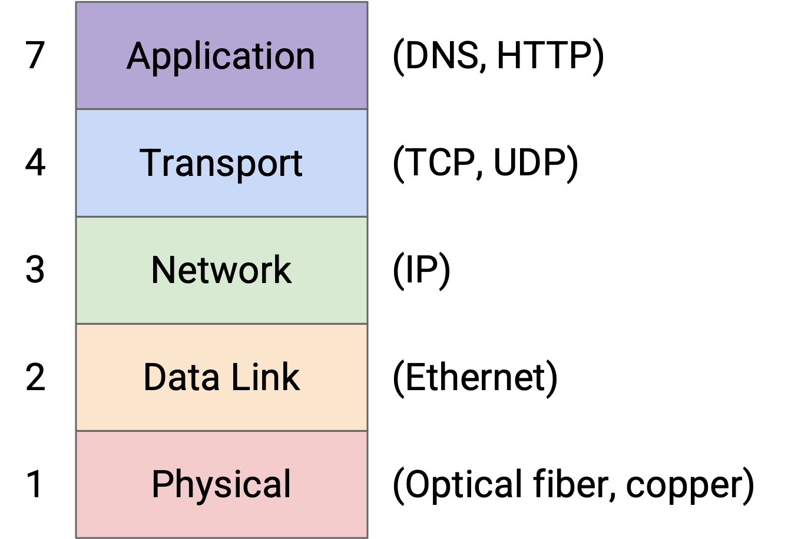
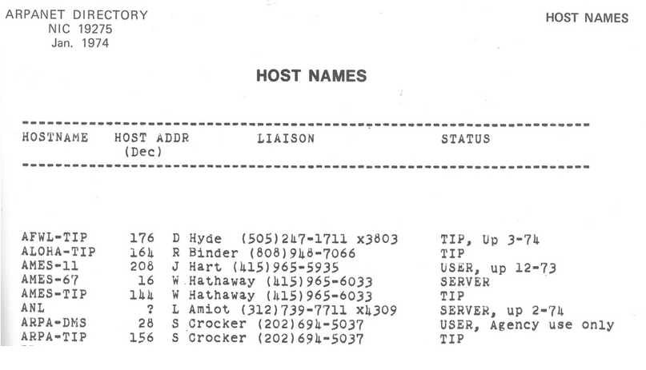
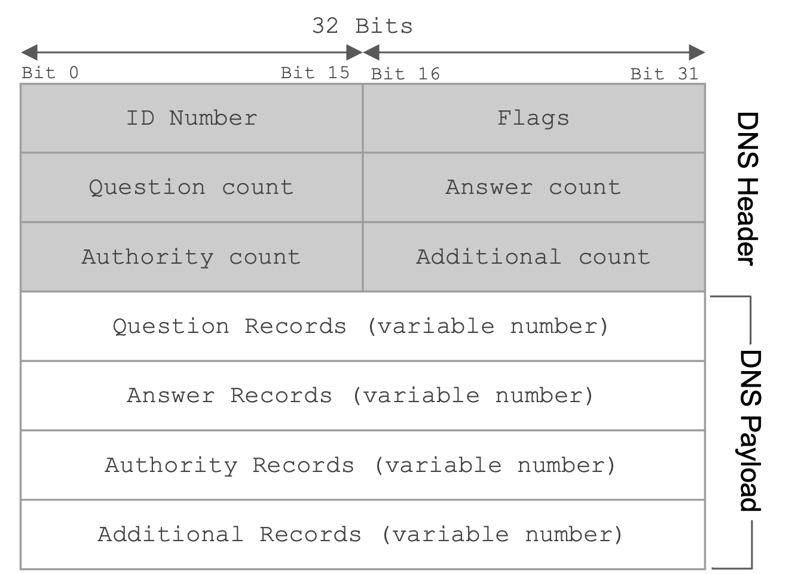
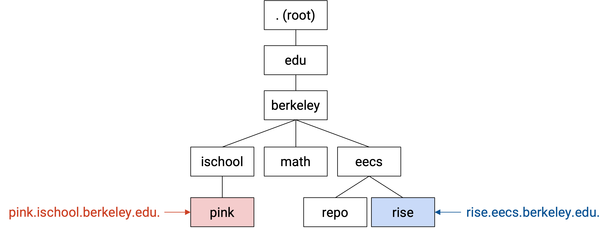
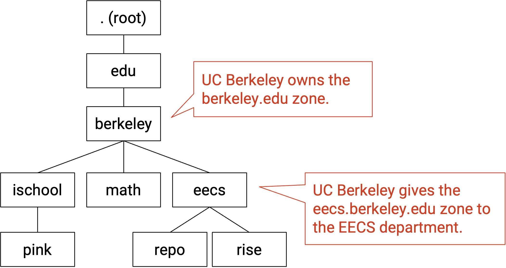
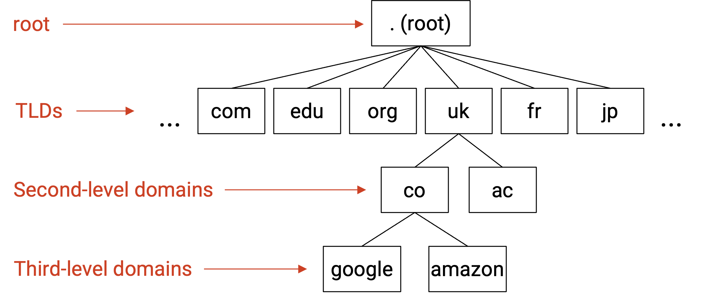
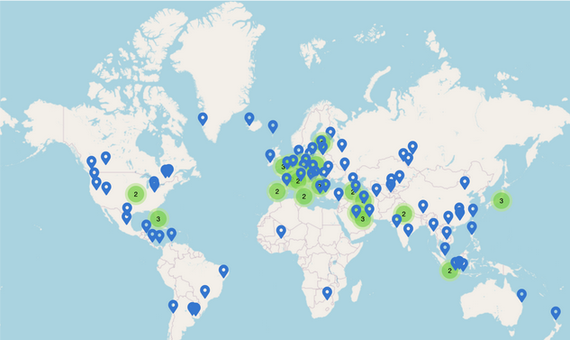

# DNS：名字如何变成地址

## DNS 用来做什么

本节开始研究运行在此前各层之上的第七层应用。DNS 建立在第 1—4 层之上，为网络提供名字解析功能。



图：层次关系：DNS、HTTP 属于应用层；下方依次为传输、网络、链路与物理层。

互联网通常有两套索引：人使用 `google.com`、`eecs.berkeley.edu` 这样的可读名字；计算机使用 `172.217.4.174`、`23.195.69.108` 这样的 IP 地址。域名系统 DNS 在两者之间转换。


图：DNS 将 www.google.com 这样的名字映射为一个 IP 地址；图中地址是教材示例。

## 简史

理解设计，先看它解决的历史问题。早期互联网及其前身 ARPANET 尚无万维网与浏览器，主要应用在命令行中运行。远程终端 telnet 让用户连接另一台机器并执行命令，SSH 是现代安全替代；文件传输允许本地与远端交换文件，FTP 是相应的应用层协议；电子邮件允许用户交换消息。现代邮箱常有网页界面，最初却可能要输入 `mail alice@46.0.1.2`：地址指接收机器，alice 是那台机器上的用户。

三类应用都必须指定远程主机，而 IP 地址难记。最早的办法是为每个 IP 分配主机名，让每台电脑保存 `hosts.txt`，收录所有名字—地址映射。例如把 `ucb-arpa` 映射到 `10.0.0.78`，就能把 `mail mosher@10.0.0.78` 改成 `mail mosher@ucb-arpa`。这一概念今天仍在：本机服务常使用回环地址 `127.0.0.1` 和名字 `localhost`。

不同机器上的 hosts 文件必须一致，否则换台电脑发给同一个名字，可能发给不同的人。最初由 Elizabeth Feinler 一人维护，并通过复制纸质文档传递。纸质表不只列名字与地址，还包括用户全名、使用的 TCP/FTP 等协议以及电话号码。



图：1974 年 ARPANET 纸质主机目录局部：主机名、地址、联系人、电话和状态等字段；本图是历史文献样本，不是现行主机表。

1973 年 RFC606 已指出这种方式荒谬：拿到纸后还得手工录入，而且纸本可能过期。第一步改进是机器可读，这样至少能用 FTP 分发。但仍不能永远由一人维护；文件变大后下载慢，网络中断还可能只得到一部分。1983 年 RFC882 提出 DNS，此后虽有修改，基本体系沿用至今。一个趣闻：1984 年伯克利开发的 BIND 是最早的 Unix DNS 服务器软件，今天仍常见。

## 设计目标

DNS 必须可扩展：主机数量巨大、每秒查询很多，而且主机频繁加入和离开。它还要高可用、轻量、快速。许多互联网连接先查名字，查询慢就拖慢后续连接；也不能存在一个失效就导致所有解析停止的单点。

## 名称服务器与层次

如果一台中央服务器能存下所有映射并回应全球查询，使用起来很简单，但规模与吞吐难以承担。DNS 因而使用许多专门回答查询的名称服务器。每台服务器只负责一个区域 zone。例如负责 `.com` 的服务器不必保存 `wikipedia.org` 的信息，负责 `berkeley.edu` 的不必保存 `stanford.edu`。

名称服务器本身也是普通互联网服务器，有名字与 IP，例如 `a.edu-servers.net` 和 `192.5.6.30`。服务器名字与所管区域不是一回事：名字以 `.net` 结尾，完全可以服务 `.edu`。

仍有两个问题：`.com` 也太大；客户端又如何选对服务器？关键是**转介**：服务器不一定直接给出最终 IP，也可以告诉查询者去问另一台负责更小区域的服务器。例如 `.edu` 只需知道 `berkeley.edu` 的服务器，不必知道 `eecs.berkeley.edu`、`math.berkeley.edu` 的每次变更。


图：根之下有 edu、org、com；各分支继续委派给 berkeley.edu、mit.edu、cs161.org、piazza.com、google.com 等区域。

服务器按所管区域构成树状层次。顶端是根，通常写为 `.`；向下区域越来越具体。这里“根覆盖所有名字”指层次的起点，不是根保存全球全部主机记录。

## 概念上的查询

在无缓存的概念模型里，先问根，再根据转介询问子区域，一直走到知道答案的服务器。父服务器要给出子区域、子服务器名字，以及帮助联系它的地址。实际转介并不保证每次都附齐所有地址；必要时解析器还需解析服务器名字。


图：一次冷查询：查询者与根、edu、berkeley.edu 服务器依次交换请求和回答。

查询 `eecs.berkeley.edu` 的示例：

1. 问根：“请告诉我该名字的 IP。”
2. 根：“我没有最终答案；去问 `.edu`，例如 `a.edu-servers.net`，地址 `192.5.6.30`。”
3. 向该 `.edu` 服务器询问同一个完整名字。
4. 它：“去问 `berkeley.edu` 的 `adns1.berkeley.edu`，地址 `128.32.136.3`。”
5. 向该服务器仍然询问 `eecs.berkeley.edu`。
6. 它给出示例答案 `23.185.0.1`。

得到答案后可以缓存，以免以后重复查询。

## 桩解析器与递归解析器

早期由终端主机逐个联系名称服务器。如今主机通常把任务交给 DNS 递归解析器：本机的桩解析器发一次请求，让递归解析器完成工作，再接收最终结果。


图：桩解析器只与递归解析器交换请求和结果；后者依次联系各级名称服务器。

解析器地址可在联网时获知，也可手工设置。Cloudflare 的 `1.1.1.1` 和 Google 的 `8.8.8.8` 是知名例子，使用好记的 IP 可避免“为找解析器先做解析”的循环。ISP 也把解析服务作为上网服务的一部分；家用路由器可充当解析器或转发入口，距离近能减少往返延迟。

递归解析器的重要收益是共享缓存：它服务许多主机，比单个主机积累更多记录。别人刚问过 `eecs.berkeley.edu`，你的请求就可能直接命中。桩解析器仍可有独立缓存，某些查询连递归解析器都不必访问。

> 编者边界：**递归**是客户端要求解析器代办获得结果；解析器向各权威服务器逐步跟随转介通常是**迭代**查询。不能把树有多层就叫“递归服务器层层替你问”。“每次从根开始”只适用于无可用缓存的简化过程。

## 冗余

实际每个区域不止一台名称服务器；对外提供同一区域信息，可互相替代。某台停机，其他仍可回答。教材说惯例要求至少两台，实践中常见三台以上。通常一台主服务器负责管理区域，其余是保存副本的辅助服务器。因而转介可能是：“`.edu` 有 13 台服务器，以下是各自名字与地址。”解析器可以选择其中一台。

## DNS API

开发者使用的是简单、稳定、跨语言相近的接口，不必手工管理层次。C 标准库的 `gethostbyname("foo.com")` 可查询 IPv4，但已经过时；仍可能在旧代码看到。新接口例如 `getaddrinfo("example.com", NULL, NULL, &result)`，把结果保存到 result，支持 IPv6 等地址族。本节不深究额外参数。这些调用通常通过操作系统解析设施访问桩解析器。

## UDP 与 TCP

DNS 本质是客户—服务器问答：客户可能是终端主机或递归解析器，服务器可能是名称服务器。常见查询使用 UDP，无需先完成 TCP 三次握手。问题与答案往往各装进一个报文，也没有需要跨多个数据包排序的长字节流。UDP 服务器无需维护 TCP 那样的每连接缓冲状态，单个报文可以独立处理，适合高查询量。

UDP 丢包时靠超时重试；各操作系统超时不同，有些较慢。因此可靠、附近的解析器很重要，也可配置备用解析器，例如家用路由器和 `8.8.8.8`。

区域传送是显著例外：辅助服务器向主服务器索取整区记录，响应较大，通常使用 TCP。安全扩展等也可能使消息更大。传统 DNS 服务器的知名 UDP 端口是 53。

> 编者勘注：原节标题“DNS uses UDP, Not TCP”过于绝对。DNS 也支持 TCP 53，截断的大响应等可转 TCP，区域传送并非唯一情形；加密 DNS 还有其他承载方式。是否使用 TCP 与记录真实性也不是同一问题。

## 报文格式



图：DNS 报头含 ID、flags、问题数、答案数、权威记录数、附加记录数；后接四个可变长度区段。

前 16 位是每次查询随机选择的标识 ID，用于关联请求和响应；回应必须带回同一 ID，因为 UDP 没有连接状态。接着的 16 位是标志等控制字段：QR 为 0 表示查询、为 1 表示响应；RD 表示请求递归服务。opcode 可表示查询类型，但 IQUERY 已废弃、STATUS 未有常用定义，通常使用 QUERY。响应状态 NOERROR 表示无错误，NXDOMAIN 表示所问名字不存在。

随后是问题数量，实际通常为 1；再后面三个计数字段分别表示答案、权威、附加区的资源记录数。资源记录 RR 可按键值理解：键是 `<Name, Class, Type>`，Name 是名字；Class 通常为互联网类 IN（少量诊断查询例外）；Type 指定记录类型。值可理解为 `<TTL, Value>`：TTL 是允许缓存的秒数，Value 是数据。

A 把域名映射到 IPv4，AAAA 映射到 IPv6，NS 把区域映射到负责它的名称服务器名字。CNAME 用于别名，值也是域名，后续需继续解析规范名字，并非 HTTP 重定向。

要记住随机 ID、元数据、四区段，以及 A/AAAA/NS 等记录的类型化含义。

> 编者勘注：问题区项并不是完整 RR，没有 TTL、RDLENGTH 和 RDATA；“问题的值为空”只是教学类比。NOERROR/NXDOMAIN 是响应码值，不是各自独立的一位开关。缓存 TTL 是有效期，不是 IP 的逐跳 TTL；权威更新也不会强迫所有已有缓存立即刷新。

## 具体查询实例

原文用 `dig +norecurse` 手工跟随转介。以下保留教材的请求及响应例子，未在本次执行。解析器有 root hints 文件，记录根的名字和地址。示例根 `a.root-servers.net` 的 IPv4 是 `198.41.0.4`。

```text
$ dig +norecurse eecs.berkeley.edu @198.41.0.4
;; Got answer:
;; ->>HEADER<<- opcode: QUERY, status: NOERROR, id: 26114
;; flags: qr; QUERY: 1, ANSWER: 0, AUTHORITY: 13, ADDITIONAL: 27
;; QUESTION SECTION:
;eecs.berkeley.edu.          IN   A
;; AUTHORITY SECTION:
edu.                172800   IN   NS   a.edu-servers.net.
edu.                172800   IN   NS   b.edu-servers.net.
edu.                172800   IN   NS   c.edu-servers.net.
...
;; ADDITIONAL SECTION:
a.edu-servers.net.  172800   IN   A    192.5.6.30
b.edu-servers.net.  172800   IN   A    192.33.14.30
c.edu-servers.net.  172800   IN   A    192.26.92.30
...
```

报头 ID 为 26114，状态为 NOERROR，并给出各区数量。问题是对 `eecs.berkeley.edu` 的 A 查询；答案为零，说明根没给最终地址。权威区 13 条 NS，第一条说 `.edu` 可问 `a.edu-servers.net`；同一名字出现多个 NS 合法，代表可选服务器。附加区 27 条记录，第一条把这个服务器名映射到 `192.5.6.30`。两区合起来给出区域、服务器名、服务器地址，保持类型化键值结构。TTL `172800` 秒即 48 小时；IN 是互联网类，AAAA 则表示 IPv6 地址。

原文顺带说字母或编号最前的服务器“通常是主服务器”。**这不能作为协议判断规则：NS 名字的字母顺序不编码主从身份。**

自查：下一步问谁、地址从哪来、问题变了吗？答：可问附加区提供地址的 `a.edu-servers.net`，仍查询 `eecs.berkeley.edu` 的 IP。

```text
$ dig +norecurse eecs.berkeley.edu @192.5.6.30
;; Got answer:
;; ->>HEADER<<- opcode: QUERY, status: NOERROR, id: 36257
;; flags: qr; QUERY: 1, ANSWER: 0, AUTHORITY: 3, ADDITIONAL: 5
;; QUESTION SECTION:
;eecs.berkeley.edu.           IN   A
;; AUTHORITY SECTION:
berkeley.edu.        172800   IN   NS   adns1.berkeley.edu.
berkeley.edu.        172800   IN   NS   adns2.berkeley.edu.
berkeley.edu.        172800   IN   NS   adns3.berkeley.edu.
;; ADDITIONAL SECTION:
adns1.berkeley.edu.  172800   IN   A    128.32.136.3
adns2.berkeley.edu.  172800   IN   A    128.32.136.14
adns3.berkeley.edu.  172800   IN   A    192.107.102.142
...
```

答案仍为空；权威区 NS 和附加区 A 指向 `berkeley.edu` 的服务器。

```text
$ dig +norecurse eecs.berkeley.edu @128.32.136.3
;; Got answer:
;; ->>HEADER<<- opcode: QUERY, status: NOERROR, id: 52788
;; flags: qr aa; QUERY: 1, ANSWER: 1, AUTHORITY: 0, ADDITIONAL: 1
;; QUESTION SECTION:
;eecs.berkeley.edu.         IN   A
;; ANSWER SECTION:
eecs.berkeley.edu.  86400   IN   A   23.185.0.1
```

最终答案区一条 A 记录给出地址，TTL 为 86400 秒。实际递归解析器尽量缓存答案和转介，常能跳过根及顶级域等前几步，既减少延迟，也减轻高层服务器负载。接下来讨论这套机制如何映射到管理权和商业实践。

## 三种层次：名字、基础设施、管理权

同一棵树包含三种层次。名字的点号分层解释了 `eecs.berkeley.edu` 的组成；基础设施层次让各服务器只负责树的一部分。



图：名字树从根、edu、berkeley 延伸到 ischool、math、eecs，再到 pink、repo、rise 等名字。



图：伯克利管理 berkeley.edu，并可把 eecs.berkeley.edu 委派给 EECS 部门。

第三种是管理权：谁有权定义名字。`.edu` 的管理者可把 `berkeley.edu` 及其下属部分交给 UC Berkeley；此后 `.edu` 不必知道伯克利每次新增或改动。伯克利又可创建名字或继续委派给部门。


图：区域管理实例：伯克利区域由 adns1.berkeley.edu 服务，管理 www、calcentral、systemstatus；信息学院由 is-dns.berkeley.edu 服务，管理 pink、blue；EECS 由 cs-dns.berkeley.edu 服务，管理 repo、rise。各主机名均补接图示所属区域后缀。

严格地说，图中每个节点代表一个管理区域。名字视角下，`eecs.berkeley.edu` 区可含同名节点及 `iris.eecs.berkeley.edu`，不能含 `math.berkeley.edu`；基础设施视角下，一个或多个服务器回答该区查询；管理权视角下，组织从父区获授权，可进一步委派。一个域名子树不一定全部属于同一个 zone：已委派出去的子区形成管理边界。

## 现实中的区域



图：根、顶级域、二级域和三级域；uk 下可按用途划分 co、ac，再委派给具体组织。

根区管理由 ICANN 体系协调，向顶级域 TLD 委派。互联网最早发展于美国，最初按用途有 `.com` 商业、`.gov` 政府、`.edu` 教育、`.mil` 军事；后来有国家代码 `.fr`、`.jp` 等。原文称新 TLD 注册价为 15 万美元并需持续维护费，截至 2024 年已有 1500 多个，包括 `.google`、`.travel`、`.pizza`。这些是教材的历史叙述，不是当前报价或数量核验。

每个 TLD 的运营组织可决定内部结构，如 Nominet 管理 `.uk`，其下有 `.co.uk`、`.ac.uk`。`example.com` 是二级域，`blog.example.com` 是三级域。组织向上级申请或购买名称使用权，同时提供名称服务器信息，才能让上级把查询转介过来。

原文以域名注册商说明下层名字托管：例如支付费用使用 `blog.foo.com`，服务商可把对应映射加入名称服务器。企业如 Google 也会自行维护 `maps.google.com` 等记录；AWS 的 Route 53 则提供托管 DNS 服务。

> 编者边界：注册商、注册局、DNS 托管商与网站托管商是不同角色，可由同一公司兼营，但不能据此把“注册商”定义成拥有所有客户 zone 的组织；购买域名也不等于必须向同一公司购买网站托管。

## 任播与根的可用性

根若不可用，空缓存解析器难以启动查询，已有缓存也会逐渐到期。因此需冗余。根系统有 13 个具名根服务器标识，并非世界上只有 13 台物理机。教材把它简写为“13 个 IP 地址”；实际各标识还有 IPv4/IPv6 地址。

**任播 anycast** 的办法是部署许多实例，对外使用同一服务地址。联系 `k.root-servers.net` 时，可以到达它的任一实例。原文举 `f.root-servers.net` 有 3000 多实例为例，这是快照中的数量说法，未做实时复核。不同网络运营者可帮助部署实例。

各实例在路由中宣告相同前缀，普通路由选择把报文送往其中之一；一个实例失效后，可改选仍在宣告的路径。实例增减不必改变服务地址，因此根提示记录可有很长 TTL，原文举 42 天。



图：教材展示 k.root-servers.net 实例分布地图，欧洲较密集；运营者为 RIPE。路由选择的近不一定等于地理距离最短。

Google 的 `8.8.8.8` 等公共递归解析器也使用任播提高可用性。

## 邮件与 MX

DNS 不只保存主机地址。发信到 `evanbot@berkeley.edu` 时，要知道该域的邮件由谁接收。MX 记录把 `berkeley.edu` 映射到 `aspmx.l.google.com` 等邮件服务器名；邮件服务器位于不同 zone 完全合法，示例中由 Google 接收伯克利邮件。

历史上邮箱可能就是某台机器上的用户，如今用户希望从任何电脑访问邮箱，因此 MX 指向收信服务而非用户当前设备。MX 的值还带优先级；有多条时，先尝试数字最小、优先级最高者。

## DNS 负载均衡

一个名字可以返回多个 A 记录。它们没有协议保证的先后偏好，服务器可能打乱顺序，客户端可挑一个，实践中常先试第一个。这可分摊负载、提供冗余。

权威服务器还可按查询来源返回不同地址，把热门网站的用户导向附近实例。决定逻辑可能是专有的：看递归解析器是谁；借助扩展获得客户端网段信息；利用 MaxMind 等商业数据库推测地理位置。地理位置只是线索：网络路径和带宽性能未必随直线距离变化。


图：教材查询图：California 得到 142.251.46.238；Oregon 得到 74.125.135.113。图中只展示这两次 dig 结果。

原文还叙述对返回 IP 反向查询得到 PTR 记录，将 IP 映射回服务器名字；旧示例中旧金山得到名字含 `sfo03s25` 的服务器，若 sfo 表示旧金山，就符合就近意图。原文说从旧金山访问本地答案延迟为 20 ms，访问俄勒冈答案为“35 seconds”。**编者勘注：图只展示两次地址查询，没有 PTR 或延迟测量；35 秒很可能是单位笔误，但无原始测量不能擅改成 35 ms，也不能把这段当成本次实测。**


## 引用与来源

- [DNS](https://textbook.cs168.io/applications/dns.html)，固定源码 `applications/dns.md`。

原作者 Peyrin Kao，基于 Sylvia Ratnasamy、Rob Shakir 等人的课程讲授。原教材及本中文翻译按 [CC BY-SA 4.0](https://creativecommons.org/licenses/by-sa/4.0/) 发布。采用 2026-10-01 的固定快照，不是 Spring 2025 历史教材。固定 commit：

```text
0b8208742d31df7fc3d53a0cd94fdd4e04f8d47e
```

修改：全文中译、中文图注与独立勘注；原图字节不变，仅加白底显示以保持深色主题可读。历史数值、服务名称和示例地址保留原文语境，不代表当前测量。课件与视频不适用本教材许可。
