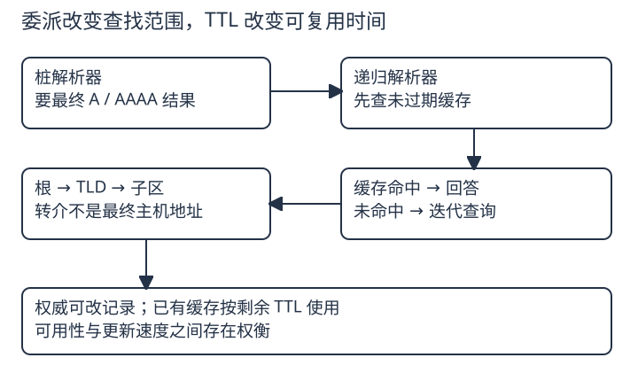

# 为什么一次名字查询需要三种不同的信任？

把 DNS 想成全球电话簿容易漏掉核心：谁能定义名字、谁替你查询、谁回答地址，是三种角色。首先把它们拆开，才能解释为什么修改了权威记录，有些用户仍看见旧地址。

## 核心问题一：委派是在转发请求，还是在转移管理责任？

设机构得到 `example.edu` 的管理权，又把 `lab.example.edu` 委派给实验室。

- 名字是层次化的：标签从右向左越来越具体。
- 管理边界不等于每一个点号：没有委派的 `www.example.edu` 仍可属于父区；已经委派的 lab 子树则由新区域管理。
- 父区只需保存到子区权威服务器的转介关系，不需复制子区每台主机的地址变更。

因此 NS 的关键不是“这个名字的 Web 地址”，而是“关于这个区去问谁”。附加区中的地址帮助把名字服务器名落到可联系地址；它不自动变成对原问题的最终答案。父子分权使更新规模跟管理范围走，而不是每次更新都通知全球根。

**反例：** 根返回 NOERROR、ANSWER=0，并不表示名字已经解析失败；可能只是正常转介。反过来，某个回答带一个 A 记录，也要看它属于哪个 owner name、哪个区段，不能见 IP 就当最终目标。

图：编者自拟，区分管理层次和解析器的缓存决策；不是视频时间图。

## 核心问题二：为什么叫递归解析器，查询却常是迭代的？

桩解析器委托递归解析器：“替我获得最终结果。”递归解析器对权威服务器问：“你能回答吗？不能就给转介。”于是它自己沿树走。这是递归服务与迭代查询的组合。

把查询成本按依赖拆开。若桩缓存命中，网络查询可为零；桩未命中而递归缓存命中，只需与递归解析器交互；所有相关缓存都冷，才会出现根、TLD、子区等顺序依赖。设每段往返时间为 $r_i$，忽略处理和重试：

$$
T_{\mathrm{cold}}\approx
r_{\mathrm{stub}}+\sum_i r_i
$$

这个式子是**串行依赖**模型，不是“所有 DNS 必定走固定三个 RTT”。缓存可从中间层开始，别名可增加查询，丢包可增加等待，多个服务器也可提供替代路径。

## 核心问题三：TTL 是更新承诺，还是缓存上限？

假设在 12:00 缓存了一条 TTL=300 秒的记录，权威在 12:01 改地址。正常缓存可继续使用原条目至原有有效期结束，并不会每次命中就重新获得权威授予的 300 秒。到期后的重新获取才可能带来新值。

从此可推导迁移权衡：

1. 长 TTL 减轻查询负载、在短时权威故障中继续提供旧答案。
2. 长 TTL 同时使撤销/迁移传播较慢。
3. 临迁移才降低 TTL，不会 retroactively 缩短早已发出去的缓存寿命；应提前准备。
4. NS 委派、服务器地址、最终 A 记录可能分别缓存，各自到期；不能只盯最终 A 的 TTL。

缓存不是强一致数据库副本，也不是“任意保留旧值”。普通策略要遵循有效期；故障时特殊 serve-stale 行为属于额外机制，本讲未据此假设。

## 故障定位：按缺失信息，而非按工具名字

- 有 IP 能连接、名字不行：先看解析路径，但仍要考虑目标名是否用于 TLS/HTTP 虚拟主机；直接输 IP 不是完全等价对照。
- 根可达、子区不行：转介或该区权威可达性可能有问题，不应宣告“整个互联网坏了”。
- 改记录后部分用户旧值：比较缓存及 TTL，不要先归因于路由随机送错服务器。
- 同名多地址：可能是负载均衡或冗余，答案不同不自动等于遭攻击。
- 任播切换实例：影响的是联系某个服务地址的路径；不改变 DNS 的名字管理权。

随机查询 ID 用于关联事务，并非单独的密码学真实性保证。传统 DNS 的可达、回答存在与服务端身份可信是三回事；连接 HTTPS 时仍需 TLS 验证目标域名身份。

## 易错边界

DNS 不只 A/AAAA，还有 NS、CNAME、MX 等；CNAME 别名不等于 HTTP 301。DNS 不永远 UDP，TCP 53 也是正常承载。13 个根标识不等于 13 台机器。递归解析器的共享缓存带来速度，也让基于查询来源的 CDN 选址可能只看见解析器而非最终用户。

## 自测

某响应 NOERROR、答案区空、权威区为 NS。能否直接说所问主机不存在？

不能。它可能是转介，应解析/使用 NS 指定服务器继续问同一个完整名字；不存在通常需看明确的否定回答语义，不能拿空答案替代。

同一区一台权威失效，为什么不必立刻更换所有域名？

同一区可有多台权威；解析器可改问另一台。名字和管理权没有因某台机器失效而自动消失。实例冗余与缓存又是不同层面的可用性来源。

父区已经改好委派，是否足以保证所有客户端马上访问新服务器？

不保证。客户端或递归解析器仍可持有有效的旧委派、地址及最终答案。新权威内容、转介可达性、TTL 迁移窗口都要成立。

本地解析器换成远方公共解析器，必然更快吗？

不必然。共享缓存更丰富可能受益，但到解析器的 RTT、丢包、CDN 选址观察到的来源都可能变化，不能只按品牌或缓存容量判断。

## 引用与来源、课堂覆盖边界

- 教材依据：[本讲唯一材料页](#/c/berkeley-cs168-2025/lec/lec16?v=materials)。原作者 Peyrin Kao，基于 Sylvia Ratnasamy、Rob Shakir 等人的讲授；采用 2026-10-01 固定快照，不是 2025 历史教材。正文为编者以已读教材为基础的独立问题推导，不是课堂复述。教材译文、原图及许可见材料页。
- 课程归属依据：[Spring 2025 官方课表](https://sp25.cs168.io/)。官方指定视频 ID `BTqZzOujdy0`，个体元数据时长 **79:10**，上传日期 **2025-04-01**；上传日期不是课表上课日期。频道为 CS 168 (Internet Architecture) at UC Berkeley。
- 字幕主路径及一次不同官方 timedtext 通路均返回 HTTP 429。未读到字幕，也未核验音轨、画面、片头、片尾或 Q&A；没有可据以建立的讲解时间索引。因此不生成占位 draft，不宣称全片覆盖。
- 视频 license 元数据为空，许可未知；教材 CC BY-SA 4.0 不扩展到视频或课件。本页 SVG 为编者原创概念图，不是课堂截图。没有执行示例命令、抓包、学生实验、构建或测试。
