# HTTP：资源、消息与分发

## 简史

1989 年，Tim Berners-Lee 在瑞士 CERN 工作，需要让科学家交换信息。FTP 已能传文件，但一个文件往往还链接其他资源。他希望同时设计协议与文件格式，使页面能互相链接并能被取回。HTTP/0.9 于 1991 年发布，HTTP/1.0 于 1996 年标准化，HTTP/1.1 于 1997 年标准化。本章除特别说明外采用 HTTP/1.1；原文说它是“今天最常用版本”，这里保留其教学范围，不把这句话当作 2025 或当前流量统计。后来的版本改变了传输方式，但许多基本语义持续沿用。

## 基础

HTTP/1.1 运行于 TCP 上。两端先建 TCP 连接，再借助可靠字节流交换任意长度的数据，不必自己处理分组乱序与丢失。

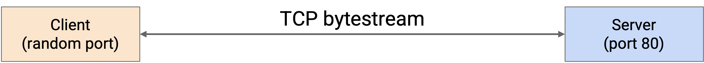

图：客户端使用临时端口，经 TCP 字节流与监听 80 端口的服务器交换 HTTP 消息。

HTTP 是客户—服务器协议：终端用户一方为客户端，例如浏览器 Firefox、Chrome，也可以是命令行程序；Google 或银行网站等为服务器。普通 HTTP 的默认服务器端口是 80，HTTPS 默认是 443。客户端选临时端口，服务器向此端口回包。

HTTP 也是请求—响应协议：客户端请求一个操作，服务器返回对应响应。原文概括为每个请求恰好一个响应；严格说可以有若干 1xx 临时响应，再有一个最终响应，连接异常则不保证最终响应送达。

## 请求

HTTP/1.1 请求的文本格式可直接在终端输入。请求行包含方法、请求目标和版本，随后是可选或必要的头字段、空行以及视情况存在的内容。原文把它概括为“method, URL, version, optional content”，并以回车换行 CRLF 说明行结束。

版本如 HTTP/0.9、1.0、1.1。URL 指定服务器上的资源，可类比文件路径。例如：

```text
http://cs168.io/assets/lectures/lecture1.pdf
```

其中主机是 `cs168.io`，资源路径是 `/assets/lectures/lecture1.pdf`。服务器不必真的按磁盘目录实现，只是这个直觉常有帮助。

方法表示要做什么。最初只有 GET，用于取回指定页面；后来加入 POST，让客户端提交信息，例如填写表单并点击提交。HEAD 请求只取响应头而不取响应体；PUT、CONNECT、DELETE、OPTIONS、PATCH、TRACE 等让协议适用于修改、查询和其他交互，不再局限于只读网页。即使是 POST，也必须带目标路径以确定如何解释数据：银行的 `/send-money` 与 `/request-money` 即使收到同一个姓名，也可能执行不同动作。

GET 请求通常没有正文，POST 的正文则承载要提交的数据。方法语义与正文是否存在、HTTP 消息如何定界是不同问题。

## 响应

HTTP/1.1 响应的起始行给出版本、状态码和可选原因短语，随后有头与可能的正文。正文可放 GET 请求的网页；状态码告诉客户端请求结果，原因短语使人易读。

- **1xx 信息性响应。**
- **2xx 成功。** `200 OK` 的具体成功含义依赖方法与应用，不限于 GET；`201 Created` 表示成功创建新资源，常见于 POST、PUT。
- **3xx 重定向。** `301 Moved Permanently` 表示永久迁移；`302 Found` 常表示暂时迁移。状态码本身不足以告诉新位置，通常要附上目标 URL。细分状态帮助客户端决定今后是否仍尝试旧地址。
- **4xx 客户端相关错误。** `401 Unauthorized` 表示需要有效身份凭据，登录可能解决；`403 Forbidden` 表示服务器拒绝执行。原文用“已经认证但无权限”解释 403，这是常见场景，但 403 并不保证用户已认证。浏览器对 401 可能提示认证，对 403 可能直接显示拒绝。
- **5xx 服务器相关错误。** 常见 `500 Internal Server Error`、`503 Service Unavailable`；客户端往往只能稍后重试，但重试是否安全还取决于方法与应用。

`404 Not Found` 和 `503 Service Unavailable` 是熟悉的错误。具体应选哪个码有时不唯一：原文举用 HTTP/0.9 请求 Google，可能期待 `505 HTTP Version Not Supported`，实际演示得到 `400 Bad Request`。重要的是类别与行为能表达正确意图；这不是本次实时请求结果。

## 头字段

头字段是额外元数据。Location 可在重定向响应中指明新位置；User-Agent 可说明客户端程序，使服务端按浏览器或终端区别处理；Content-Type 告诉浏览器是 HTML、图像还是视频；Host 可区别同一服务器上的不同网站。

请求头例子还有 Accept，表示愿意接收的内容类型，如 HTML 或 JSON；Referer 表示请求来源，例如从 Facebook 链接点入。响应头 Date 表示生成时间；Content-Encoding 表示内容编码，如 gzip。表示头如 Content-Type 可同时出现在 POST 请求与 GET 响应中，说明所承载表示的类型，让 HTTP 服务于多种应用。

> 编者勘注：原文“HTTP/1.1 没有必需头，可全部省略”不正确；HTTP/1.1 请求必须提供合规 Host。Content-Encoding 不表示 Unicode/ASCII 字符集，字符集通常通过 Content-Type 的 charset 参数表达。头字段是元数据，但并不意味着所有字段都可忽略。

## 请求与响应例子

教材演示在终端使用 `telnet google.com 80` 建连接，然后输入：

```http
GET / HTTP/1.1
User-Agent: robjs
```

这是对根路径的 GET，User-Agent 是 robjs。**上例按原文保留，但缺少 HTTP/1.1 必需的 Host，也未完整展示空行终止；不能作为合规请求模板。** 教材显示的响应为：

```http
HTTP/1.1 200 OK
Date: Sat, 16 Mar 2024 18:33:08 GMT
Content-Type: text/html; charset=ISO-8859-1

<!doctype html><html lang="en"><head><meta content="Search the world's information, including webpages, images, videos and more. Google has many special features to help you find exactly what you're looking for." name="description">...
```

第一行是版本与成功码，随后给出日期和内容类型，正文是原始 HTML，由浏览器解释成页面。下面是教材的另外两个简化示例：

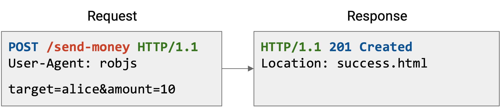

图：POST /send-money HTTP/1.1，User-Agent 为 robjs，正文 target=alice&amount=10；响应 201 Created，Location 为 success.html。

```http
POST /send-money HTTP/1.1
User-Agent: robjs

target=alice&amount=10

HTTP/1.1 201 Created
Location: success.html
```

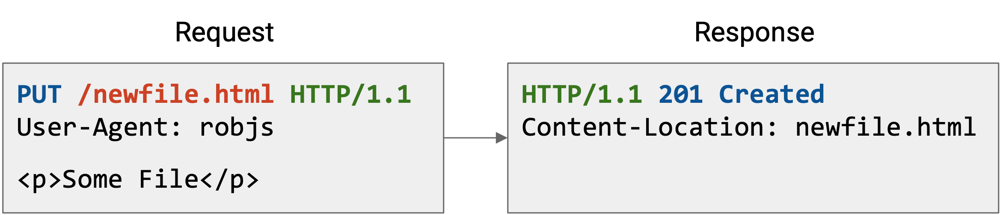

图：PUT /newfile.html HTTP/1.1，提交一段文件内容；响应 201 Created，Content-Location 为 newfile.html。

```http
PUT /newfile.html HTTP/1.1
User-Agent: robjs

<p>Some File</p>

HTTP/1.1 201 Created
Content-Location: newfile.html
```

这些图旨在说明 GET 请求通常无正文而响应有正文，POST/PUT 可提交正文、示例响应则没有正文；这不是所有 POST/PUT 响应必须无正文的规则。`201 Created` 指出资源创建成功，位置相关头帮助定位资源。**这些图省略 Host 与完整消息定界；Content-Location 也不能普遍替代指示新建资源位置的 Location。** 以上均为教材示例转录，未执行。

## 连接复用与流水线

加载一页往往触发很多请求，例如 YouTube 页面需要视频、含标题评论的 HTML、相关推荐缩略图等，许多请求发往同一服务器。朴素做法每请求都重新三次握手，响应后关闭，下一请求再握手。

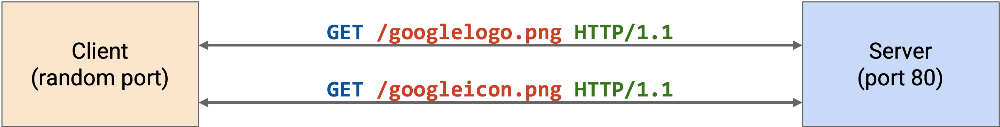

图：不复用时，不同 GET 分别消耗不同 TCP 连接及其建立开销。

HTTP/1.1 允许在一个连接中承载多个请求与响应，避免每次建连。

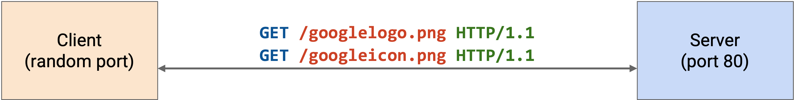

图：同一 TCP 字节流承载多条 GET 请求，减少独立握手。

服务器因此要保持更多同时打开的连接，需要超时回收策略；过载时可能返回 503，攻击者也可能消耗连接资源造成拒绝服务。

> 编者边界：**持久连接**是多次请求复用一条连接；**流水线 pipelining**是不等前一个响应完成就发送后续请求。复用不要求流水线；HTTP/1.1 流水线响应仍按请求顺序输出，会产生应用层队头阻塞。原文把两者合称 pipelining，不能因此混淆二者。

## 缓存的三类位置

缓存相同响应能避免重复请求。无缓存时，所有请求都到源站。

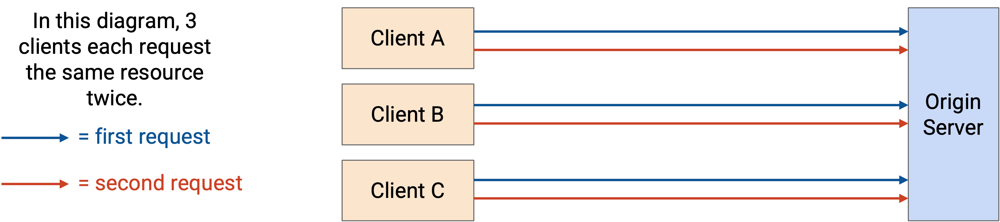

图：三个客户端分别请求同一资源两次，无缓存时六次请求都访问源站。

**私有缓存**依附单个客户端，如浏览器缓存。该用户再次请求可本地命中，但其他用户不能共享它。

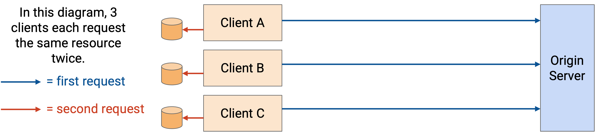

图：每位客户端第一次请求源站，第二次命中自己的缓存。

**代理缓存**在网络内，由网络运营者而非应用提供者管理，可供多个用户共享；某用户第一次请求也可能命中别人已经填入的缓存。

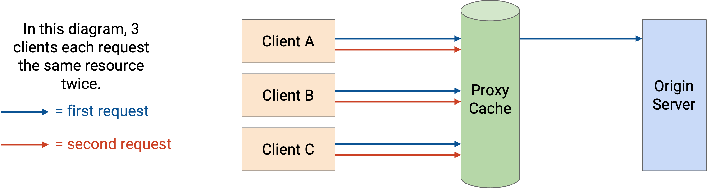

图：多个用户共享网络代理缓存，只有未命中的对象需向源站请求。

困难之一是怎么把客户端导向代理。源站不一定知道运营者的缓存，运营者必须通过某种方式控制客户端配置。教材举一种历史办法：同时控制递归解析器与代理时，解析器把源站名字回答成代理地址 `1.2.3.4`。命中时代理直接响应，未命中则向源站取回再转交。另一困难是源站必须信任独立代理会遵守过期策略、返回正确内容。

> 编者边界：篡改 DNS 并不能让透明代理合法解密 HTTPS；没有适用于该域名的可信证书和相应授权，TLS 身份校验会阻止冒充。这里不能把明文 HTTP 的历史方案套到现代 HTTPS。

**受管缓存**同样在网络内，但由应用提供者控制，与源站是不同服务器。这让应用掌握一致策略与引流方式。

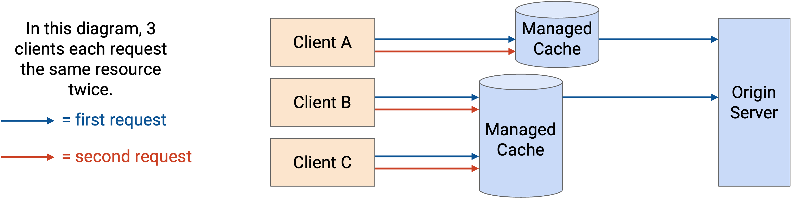

图：应用管理分布式缓存，各缓存可服务一组用户，未命中再回源。

例如源站返回视频标题、评论等 HTML，但让视频和图片链接指向 `static.youtube.com` 而非 `www.youtube.com`，使客户端直接联系缓存。

## 缓存的收益与限制

用户减少重复请求并访问更近副本，网页更快；ISP 需要承载的数据更少，可节省带宽基础设施；源站处理的请求更少。三方都在意体验：用户想看高清，ISP 和应用想凭良好表现留住客户。更近的缓存减少 RTT；在此前 TCP 模型中，RTT 越短通常越有利于吞吐，对视频等大对象尤其有用，但不是排除带宽等其他瓶颈的保证。

缓存必须考虑资源是否变化。Google 标志等静态资源跨请求可相同；搜索结果等动态资源随用户或时间变化。一次搜索的 HTML 可由源站动态生成，而其中标志图片来自受管缓存。较大的图像、视频往往可积极缓存；个性化 HTML 常较小。于是远处源站提供小的动态内容，附近缓存提供大的静态内容。静态或动态本身并不替代明确的缓存授权。

## 缓存实现

头字段让原来没有缓存功能的 HTTP 得以扩展。HTTP/1.0 的 Expires 指定过期时间，HTTP/1.1 的 Cache-Control 提供更细策略。兼容服务器可能同时返回二者：旧客户端忽略不懂的新字段，新客户端按规则优先采用 Cache-Control 的指令。

若内容因用户不同而不同，但同一用户一天内不变，可返回：

```http
Cache-Control: private, max-age=86400
```

这允许私有缓存保存、设置一日新鲜期，禁止共享缓存存储该响应。原文写成 `max-age:86400`，此处勘正为指令正确的等号语法。不能保存的数据可使用 `Cache-Control: no-store`。Expires 是绝对 HTTP 日期，不能直接把它当作秒数。

原文指出服务器无法强迫恶意或不合规代理遵守头：私有缓存通常由用户浏览器掌管，受管缓存可由同一提供者执行策略，第三方代理则存在额外信任风险。**对合规缓存而言，支持的缓存指令有规范语义，不是因为头可省略就可随便忽略。**

更复杂的策略还可允许存储、但要求使用前验证。教材用“先 HEAD 取头再判断变化”作概念例子；常见实现是带验证器的条件请求，例如 ETag 配合 If-None-Match，未修改时响应 304。`no-cache` 与 `no-store` 不同：前者通常要求复用前验证，后者要求不存储。

## 内容分发网络

受管缓存兼具共享与应用可控两项优势：第一次访问的用户也能命中，应用能规定缓存策略、把用户导向所选缓存。将这类服务器部署到整个网络，就形成 CDN（内容分发网络）。

为了性能，服务器尽量靠近用户，既指地理近，也指网络路径近。CDN 减少长距离流量、带宽与基础设施需求，提高内容交付表现；扩展时可增加许多小服务器，不必只把单个源站做得越来越大、越来越宽；某个副本失效还能导向其他副本，提高冗余。需要源站参与的动态功能并不自动因静态副本存在而免故障。

## CDN 部署位置与成本

回顾网络模型：客户端经过 ISP 的广域网和互联点，再进入应用提供者的互联点、广域网、数据中心，最后到源站。无 CDN 时每次都走到底，延迟高、所需带宽多，源站还要处理全部请求。

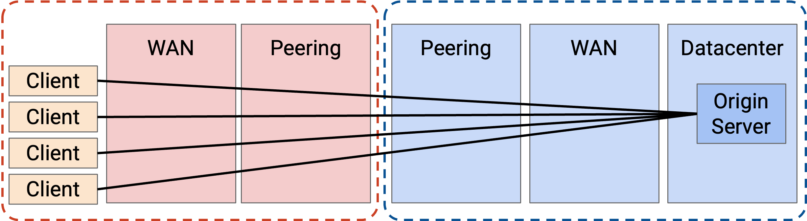

图：无 CDN：客户端穿过 ISP WAN、双方 peering 与应用 WAN，到数据中心源站。

第一步可在应用网络边缘放缓存，例如 Google 与 ISP 在纽约互联的位置。源站把视频发给 CDN 一次，CDN 服务许多用户，应用 WAN 流量大幅减少；增加缓存还能帮助扩容与冗余。

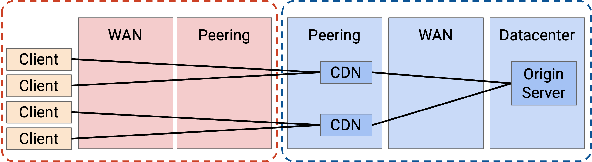

图：CDN 位于应用提供者互联边缘，节省其内部 WAN 的重复传输。

进一步把缓存放入 ISP 网络，离用户更近。

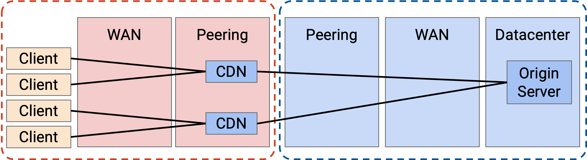

图：CDN 深入 ISP，用户—缓存的大流量留在 ISP 内部，减少跨 peering 的重复传输。

ISP 为什么同意？客户体验更好，大流量留在自己网络里，跨互联链路同一内容只需传一次。实践中双方合作：应用免费提供服务器，ISP 免费提供连接；也可能因部署地点、服务器与连接成本而协商由任一方向另一方付款。双方仍有共同收益。

再向用户家里推进并非无限有利。极端地每户装一个 CDN，部署成本可能大于收益。缓存被许多用户共享时更有效：一次部署覆盖更多人，集体需求使缓存有价值。

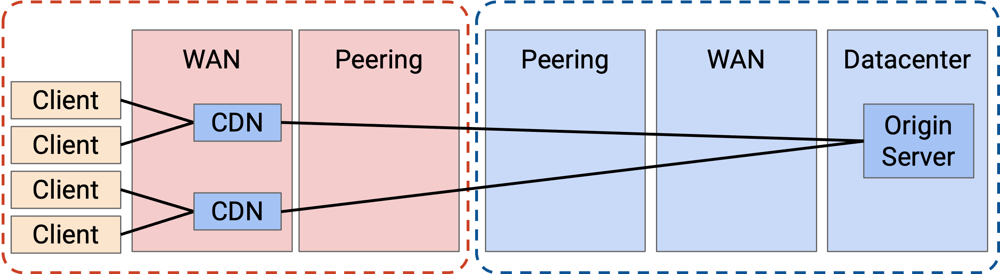

图：把缓存进一步推至接近每个用户时，应比较新增服务器成本与节省带宽，而非只追求距离最小。

总体权衡是新增 CDN 成本与节省网络容量的金额。原文引用 2023 年 Sandvine 报告：Netflix 占流量 15%、YouTube 11.4%、Disney+ 4.5%，并举只部署三家就“可能少建 25% 容量”。这些数字为原文引述，未独立核验；流量占比不能直接等同于峰值容量节省。

Google、Netflix、Amazon、Facebook 等既在自己的网络也在 ISP 内部署 CDN。小应用负担不起自建，可购买 Cloudflare、Akamai、Edgio 等公司的现成服务；这是教材所列服务商，不保证各品牌当前经营状态。ISP 自己也可能提供电视、直播、点播，并用自己的 CDN。CDN 服务器本质仍是互联网内容服务器，但可针对大容量存储、大对象吞吐或大量小对象并发优化。

## 如何把用户导向缓存

很多地方有相同内容，客户端该联系哪台？

**任播**：多台服务器宣告相同 IP 前缀，让路由选择其中一条路径。

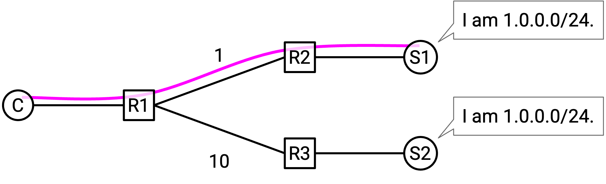

图：S1、S2 都宣告同一前缀；初始经 R2 的较短路径把客户端导向 S1。

难点是长连接。客户端已与 S1 建立 TCP，途中链路故障后，路由器认为相同地址的 S2 同样有效，于是改送 S2；但 S2 没有 S1 的 TCP 连接状态，不能自动继续原字节流。DNS 的常见单报文 UDP 请求受这一问题影响小，因为事务很短。

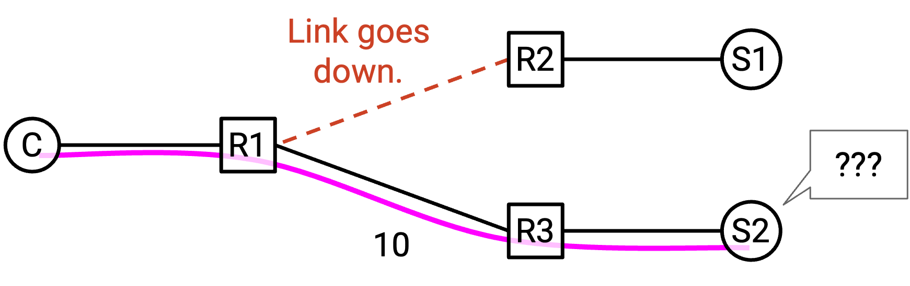

图：通往 S1 的链路失效后，任播路径改指 S2，原 TCP 状态却不随路由迁移。

**DNS 负载均衡**：各服务器地址不同、名字相同；名称服务器按查询来源回答不同地址。固定了连接目的地址后，普通路由变化不会把它无意改送另一台不同地址的服务器。问题是粒度：若 Comcast 所有用户共用一个递归解析器，权威端可能只看见解析器，给它一个答案，遍布各地的用户便共享同一选择。


图：旧金山、悉尼、伦敦、东京客户端共用递归解析器，权威服务器只见解析器来源时无法逐客户端精准引流。

**应用层映射**：源站收到 HTTP 请求后，按来源在 HTML 中给不同服务器链接，例如 `static1.google.com`、`static2.google.com`，或用 3xx 重定向。它可见连接对端来源，粒度比只看递归解析器细，各目标又有独立地址，避开前述任播状态切换问题。它仍需估计哪个目标网络上最合适；NAT、代理也会限制“来源地址=真实用户位置”的精度。

应用层还可按内容细分：热门视频复制到很多服务器，少见视频只放少数地方，稀少访问者走更远一些，以权衡存储与性能。

## 较新版本

HTTP 通用性使越来越多应用采用它，安全因此更重要。银行不希望中间路由器和攻击者读到明文。HTTPS 在 HTTP 下加入 TLS：协商密钥、加密字节流，基本 HTTP 语义不变。本章主要讨论 TLS-over-TCP；原文称截至 2024 年超过 85% 网站默认 HTTPS，这仍是原文历史陈述。

2015 年 HTTP/2 成为 1997 年以来第一次大改版，目标是降低延迟、加快页面。它加入服务器推送：服务器可预测浏览器需要什么，不等后续请求就发，例如返回搜索 HTML 的同时推送 Google 标志，省掉浏览器解析 HTML 后才请求图片的等待。该能力的标准存在不等于当前浏览器一定启用。

HTTP/2 还压缩头、支持优先级与更高效的并发多路复用。若第一个响应 4 GB、第二个只有 1 KB，朴素串行会让小响应等很久；多路复用可更灵活地交错不同流。现代客户端与 CDN 广泛采用 HTTP/2。但共享 TCP 丢包仍可能阻塞同一连接的多个流。

2022 年推出 HTTP/3，时间间隔比 1.1 到 2 短得多。它保留 HTTP 语义，改用 QUIC 而非直接使用 TCP 字节流。QUIC 源于 Google，并由 IETF 标准化；原文把缩写扩成“Quick UDP Connections”，不应当作 IETF 协议名称的正式展开。

教材把 HTTP/3 描述为为了效率“放弃分层”：传输和应用联合设计确实能优化，但应理解为跨层协同，而非 HTTP/3 完全没有分层。QUIC 提供可靠流并集成 TLS 安全机制，底层承载是 UDP；不能从“用 UDP”推断它不可靠或没有拥塞控制。


## 引用与来源

- [HTTP](https://textbook.cs168.io/applications/http.html)，固定源码 `applications/http.md`。

原作者 Peyrin Kao，基于 Sylvia Ratnasamy、Rob Shakir 等人的课程讲授。原教材及本中文翻译按 [CC BY-SA 4.0](https://creativecommons.org/licenses/by-sa/4.0/) 发布。采用 2026-10-01 的固定快照，不是 Spring 2025 历史教材。固定 commit：

```text
0b8208742d31df7fc3d53a0cd94fdd4e04f8d47e
```

修改：全文中译、中文图注与独立勘注；原图字节不变，仅加白底显示以保持深色主题可读。历史数值、服务名称和示例地址保留原文语境，不代表当前测量。课件与视频不适用本教材许可。
