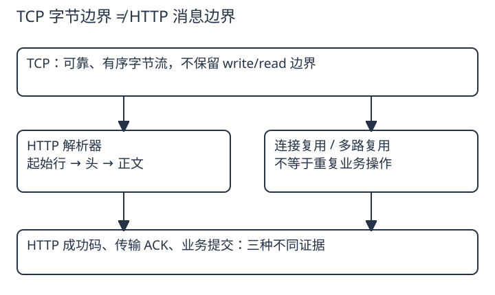

# TCP 已经可靠，HTTP 还要解决什么？

可靠字节流只保证按序交付字节，并不知道一条请求从哪里结束、这些字节代表查询还是付款、缓存是否可以复用。HTTP 的价值在于把字节变成可理解的资源操作与响应。

## 一个边界错误为什么能跨越多层？

假设应用一次 write 发出请求头和正文，接收方一次 read 只得到前半段头。这不是 TCP 失败：TCP 不保留 write 的边界。HTTP/1.1 解析器须逐层完成请求行、头、空行、正文定界，才能知道下一请求从哪开始。

正文中有换行并不结束响应；Content-Length 描述字节长度而非字符数量，分块编码则有自己的块定界。多字节字符、压缩和传输分段都会让“按文本行猜长度”出错。HTTP/2 和 HTTP/3 又有各自帧/流结构，不能直接把 1.1 的线格式套过去。

图：编者原创，强调字节、HTTP 消息与业务语义的三层证据。

## 为什么“重试一次”可能扣款两次？

从客户端看，没有收到响应至少有两种可能：请求没到，或请求已成功处理而响应丢了。TCP 的可靠性无法消除“业务已经完成但调用者不知道”的窗口。

方法有自己的语义：GET 的意图是取表示，POST 常用于提交处理；PUT 表示替换目标资源等。安全性与幂等性是方法语义的重要约束，不能仅看请求有没有正文。应用若把改变余额的操作偷偷放进 GET，缓存、预取与自动重试都可能与业务冲突。

对于支付等操作，需要应用设计去重标识、事务与结果查询，而不是期待每个 TCP ACK 都表示“扣款只执行一次”。`200 OK` 也只证明服务器用 HTTP 报告成功，不自动证明外部银行或后续异步任务已经完成。

## 性能问题：别把复用、流水线、多路复用叫成一件事

考虑同一服务器的 $n$ 个小请求，忽略 DNS、TLS、传输大小与处理时间，RTT 为 $R$：

- 每次新建 TCP 后串行发一个请求，粗略是 $2nR$。
- 一次建连、持久连接串行请求，粗略是 $(n+1)R$。
- 若请求互不依赖，流水线可减少等待前一个响应再发送的串行轮次，但 HTTP/1.1 响应必须保持顺序。

这些是教学下界模型，不是测量结果。页面可能先取 HTML 才知道资源名，因此即使服务器支持并发，也不能消除尚未知资源的依赖。

HTTP/2 把不同流的帧交错，能避免大响应独占应用层输出顺序；共享 TCP 遇到丢段，TCP 有序交付仍可能拖住多个流。HTTP/3 使用 QUIC 的多流机制改进这一边界，但不是“取消可靠性换速度”。

## 缓存命中不是只有快慢，还有正确性

缓存判断至少分两问：**能否保存？能否不验证就复用？**

- `no-store`：不应存储。
- `no-cache`：不是禁止保存，而是复用前通常需要验证。
- `private`：不允许共享缓存保存这一响应，不等于加密内容。
- `max-age=60`：给新鲜期，不表示服务器承诺内容在这 60 秒内绝不会改变。

假设个人账户页面误被共享缓存按 URL 缓存，下一用户可能得到前一用户数据。这个错误不是 TCP 顺序错、DNS 地址错，而是缓存键/授权/策略错。静态文件也不能仅凭扩展名就认定可共享；动态内容同样可能在明确规则下缓存。

条件验证与完整重传成本不同：服务器可证明已有表示仍可用，避免重复发送正文。缓存的收益同时包含客户端延迟、骨干流量与源站负载，不能只看命中率。

## CDN 选择哪台服务器，由谁看见什么决定

任播让路由选择相同服务地址的实例；优点是网络层就可引流，难点是长连接改路时状态不一定随行。DNS 引流返回不同地址，建立连接后目标较稳定，但权威可能只见递归解析器。HTTP 重定向或页面链接能按请求及资源决定目标，粒度更细，却可能增加一次重定向往返。

“离用户最近”还要考虑网络路径、负载、内容是否存在，不是只看地图距离。源站把 HTML 与大静态资源分开服务，可以把高频、可复用对象推近用户，而不是把每个动态数据库事务复制到每个缓存。

## 易错点

HTTP/1.1 的 Host 必须合规；缺 Host 的教材 telnet 例子不是完整模板。401 与 403 不能简单等同“没登录/已登录”，403 不证明身份已认证。Content-Encoding 的 gzip 不等于字符集 UTF-8。HTTPS 的加密通道不能被“改 DNS 指向缓存”自动合法终止；缓存代理需要相应信任与证书配置。

## 自测

一个 read 返回两条完整响应的一部分，是否违反请求—响应模型？

不违反。read 边界由字节流交付决定，应用按 HTTP 定界规则累积并解析；不能把每次 read 当成一个响应。

同一 TCP 连接串行发送两次 GET，是否已经使用 HTTP/1.1 流水线？

只是连接复用。若等首个响应后才发送第二请求，就不是流水线；流水线的关键是不等前一响应就发后续请求。

为什么一个 1 KB 响应可能被 4 GB 响应拖住？

HTTP/1.1 流水线要求按请求序输出响应，前面的大响应可阻塞后面的小响应。HTTP/2 流复用改善应用层序列约束，但并未消除 TCP 连接层的丢包队头问题。

服务器执行了 POST 但响应未到，客户端是否能仅凭超时判定没执行？

不能。需要应用级幂等/去重和状态查询机制来处理结果未知；重新建一条 TCP 连接也不会抹掉前一次业务效果。

## 引用与来源、课堂覆盖边界

- 教材依据：[本讲唯一材料页](#/c/berkeley-cs168-2025/lec/lec17?v=materials)。原作者 Peyrin Kao，基于 Sylvia Ratnasamy、Rob Shakir 等人的讲授；采用 2026-10-01 固定快照，不是 2025 历史教材。正文为编者以已读教材为基础的独立问题推导，不是课堂复述。教材译文、原图及许可见材料页。
- 课程归属依据：[Spring 2025 官方课表](https://sp25.cs168.io/)。官方指定视频 ID `WDkTLnYGhA8`，个体元数据时长 **80:12**，上传日期 **2024-10-29**；上传日期不是课表上课日期。频道为 CS 168 (Internet Architecture) at UC Berkeley。
- 官方 Spring 2025 课表指定的是标题标注 **FA24** 的旧录像，上传于 2024-10-29；不是声称它在 Spring 2025 录制。
- 字幕主路径及一次不同官方 timedtext 通路均返回 HTTP 429。未读到字幕，也未核验音轨、画面、片头、片尾或 Q&A；没有可据以建立的讲解时间索引。因此不生成占位 draft，不宣称全片覆盖。
- 视频 license 元数据为空，许可未知；教材 CC BY-SA 4.0 不扩展到视频或课件。本页 SVG 为编者原创概念图，不是课堂截图。没有执行示例命令、抓包、学生实验、构建或测试。
