# 以太网与二层路由

## 一、以太网

### 局域网

本节关注家中电脑与家用路由器之类的局域网络，而非跨越长距离的广域网。重点是第二层的地址与转发：本地主机怎样把包交给路由器？同一局域网的主机怎样不经过三层路由器而直接通信？以太网是主要的二层协议之一。

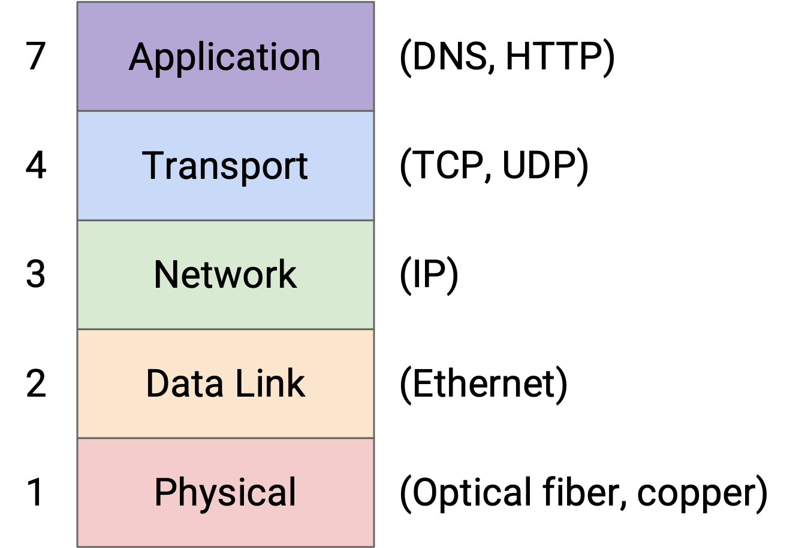

图：以太网位于数据链路层，在 IP 之下、物理层之上。

### 如何连接本地主机

此前常画一条链路只连两台机器，每台主机各有线连接路由器。实际一条共享线路可接多台机器，主机和路由器都可挂在其上。对二层来说，路由器也只是普通机器，不过在更高层额外执行路由协议；导线不关心连接者怎样使用数据。

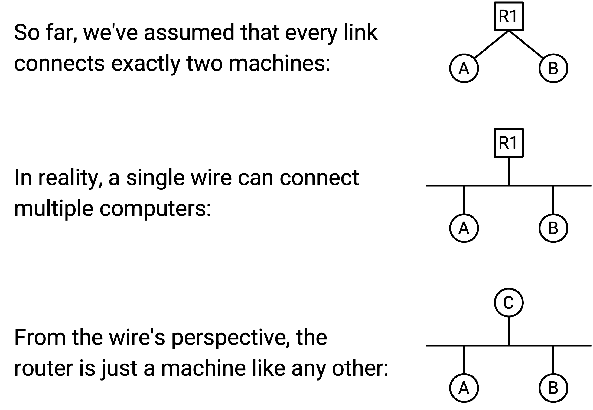

图：从每条链路连接两机的画法，改成多机共享一条线；路由器在二层没有特殊物理身份。

全球网络不能让所有主机全互连，也不能全挂在一条线，于是引入路由器。局域网可重新考虑这些拓扑：全网状仍难扩展，每新增主机要接到所有其他主机；总线则把所有电脑接在一条线上，在早期局域网中实用且常见。

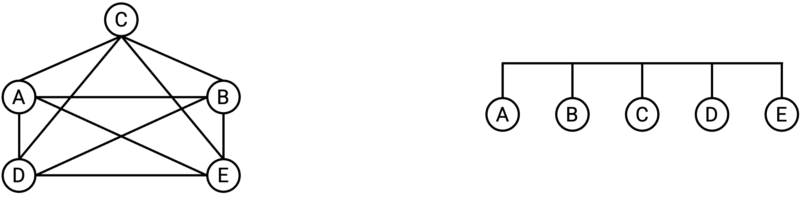

图：左为两两连接的网状，右为共享总线；前者线路多，后者共享一份传输资源。

总线引入共享介质：A 到 C、B 到 D 可能同时发送，线上的电信号不能同时无歧义承载两份重叠发送。


图：A 与 E 同时往共享导线发送时，其他接收者看到重叠信号，无法正常解码。

这像多人共用一个电话会议频道：任意两人能说话，但两组同时对话就听不清。图用导线简化，实际共享介质还包括无线电频谱。

### 协调式多路访问

共享介质上同时传输会干扰或碰撞，接收者无法解码，也可能无法知道谁发的。因此需要多路访问协议，使多个节点共享链路。

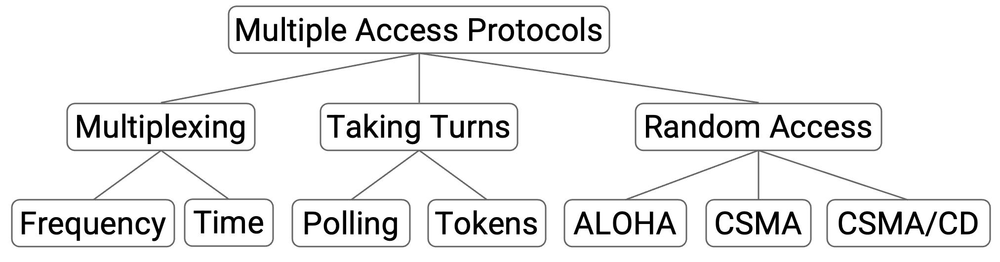

图：多路访问分为固定复用、轮流访问、随机访问；细分为频分/时分、轮询/令牌、ALOHA/CSMA/CSMA-CD。

第一类给每个节点固定资源份额。频分复用给不同频段，类似广播电台频道；时分复用把时间切成固定时隙并逐节点分配。缺点是时间和频谱有限，节点并不总有话说，空闲节点的份额却不能让忙碌节点使用，因而浪费。

第二类不固定份额，而是动态轮流：节点只用自己需要的时间。轮询协议由协调者逐个询问，有数据就允许发送一段时间，没有则立即问下一个。教材以 Bluetooth 的协调方式为例。

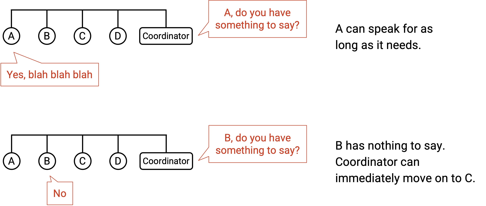

图：协调者问 A，A 有数据就发送；问 B，B 无数据则马上转到下一节点。

令牌传递不需要中央逐一发问，而是在节点间传递一个虚拟令牌；只有持有者能发。有数据则持有并传输，结束后交给下一个；没有则立即传递。IBM Token Ring 与 FDDI 是历史实例。

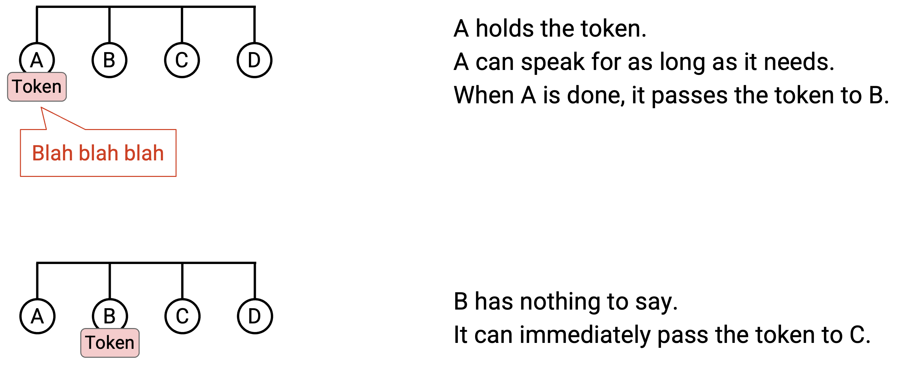

图：A 持令牌发送，完成后交 B；B 无数据则立即继续传递。

轮流方案的代价是协调复杂：要可靠地传令牌、防止两节点都误以为持有令牌，可能需要额外控制信道；轮询要选协调者并实现其与各节点的通信。蓝牙中手机可协调附属设备，其他网络里谁当协调者未必显然。

### 随机访问

第三类让节点有数据就发送，发生碰撞再处理，无需节点预先协调，简单是主要收益。原文先给通用随机访问模型：接收成功后回 ACK，碰撞损坏报文便没有 ACK，发送者超时后随机等待再重传，随机性避免立即重发再次相撞。**这段是一般模型，不表示传统以太网为每个数据帧发送链路 ACK。**

朴素随机访问很“粗鲁”，不先听就说。载波侦听多路访问 CSMA 更“礼貌”：先检测介质上有无信号，安静才发。但传播并非瞬时：一端 A 开始发送，另一端 B 在信号到达前也听见安静，于是仍会碰撞。

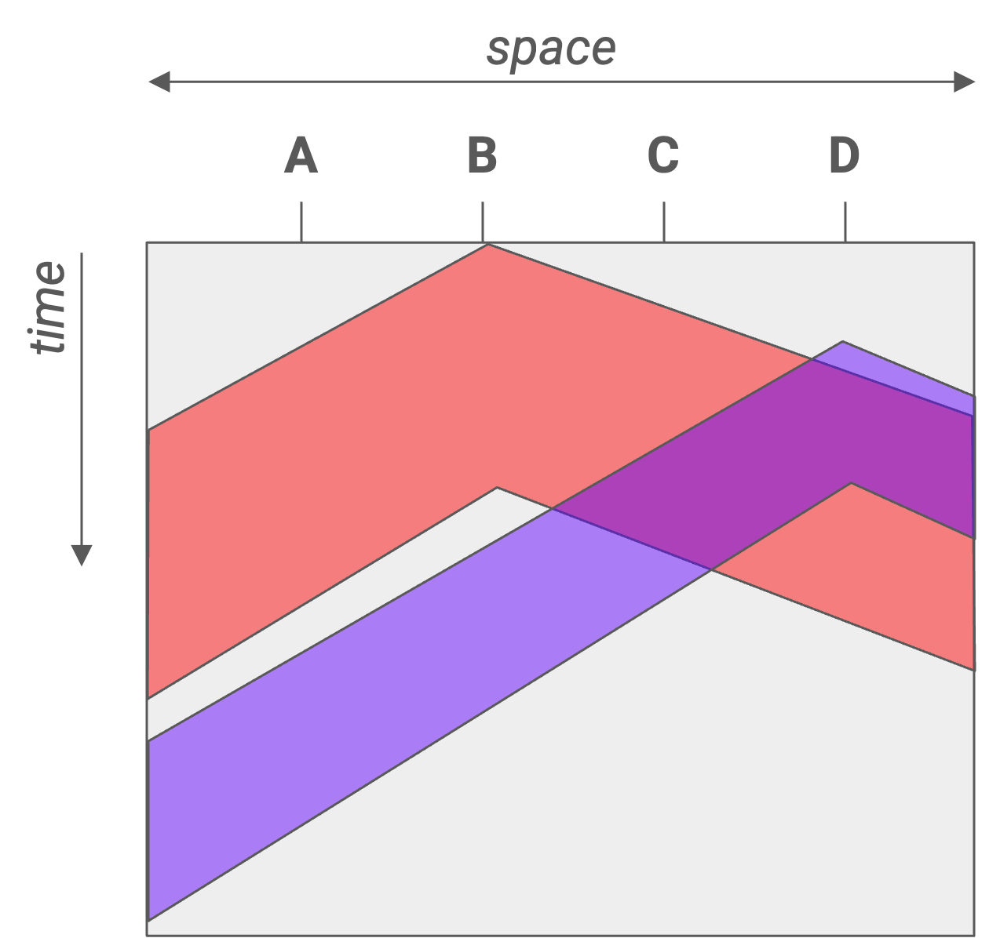

图：空间—时间图：横切线表示某时刻整条线的信号分布，竖切线表示某位置随时间变化；两端都先听到空闲仍可能在传播途中冲突。

CSMA/CD 在发送前和发送中都侦听，检测碰撞后停止当前发送，较早发现冲突，但不能让碰撞从此消失。只有一个发送者时各随机方案都很好；少量发送者时偶尔冲突可重试；大量发送者同时争用时，固定小范围随机等待仍可能连续碰撞。

二进制指数退避在每次碰撞后扩大随机等待范围，下一次上限约为此前两倍。例如前次从 `[0,4]` 选，碰撞后从 `[0,8]` 选。人少时很少反复冲突，等待短；人多时窗口指数增长，把部分重传推迟到未来，减少当前竞争。因此只在负载大时明显放慢，而不是总按最坏负载等待。真实以太网还规定时隙、上限与重试次数，本段不是完整标准算法。

> 编者边界：总线、碰撞检测主要描述历史共享/半双工以太网。现代交换式全双工点到点链路不运行这种共享碰撞竞争。不能把“局域网”一律看成一条总线，也不能把碰撞域与广播域等同。

### ALOHANet 简史

1968 年，夏威夷大学 Norman Abramson 希望其他岛屿的计算机能访问中央计算机，由此设计的 ALOHANet（Additive Links On-line Hawaii Area）影响了后来二层协议。它是共享无线网络，但拓扑不对称，因此混合固定分配与随机访问。

中心向外发有专用频率，所有远端监听；只有中心一个发送者，不会发生发送者之间碰撞。远端向中心发则共用另一频率，中心监听；这避免中心与远端互撞，但远端之间仍会碰撞。中心通常要发送更多信息，所以不对称配置合理。

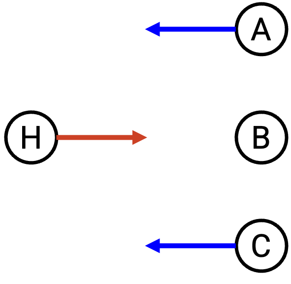

图：中心 H 的下行使用独立频段，远端 A/B/C 共用上行频段。

ALOHANet 是最早用随机访问处理碰撞的系统之一，采用不先侦听的朴素方式。后来的以太网采用 CSMA/CD，发送前/中侦听并在冲突后指数退避。

### MAC 地址

同一链路上的主机可只用二层互发消息，无需 IP 转发，像同一房间里直接递信。共享介质上的每个节点都会收到信号，要只给一人，就需二层地址标出目标。

MAC（Media Access Control）地址常为 48 位，用冒号分隔每两个十六进制数字，例如 `f8:ff:c2:2b:36:16`，也称链路地址、以太地址。硬件 NIC 通常带出厂地址，操作系统往往允许软件覆盖。原文按“两个标志位、22 位厂商、24 位设备”解释常见厂商分配形式；实际有不同分配方案以及本地管理地址，不能当作所有 MAC 的完整格式约束。

为什么不只用 IP？链路上的设备即使没有互联网连接、没有配置 IP，也可能需要通信。MAC 通常随接口而非网络位置变化，IP 则与所接入的网络前缀有关；原文称其与“地理位置”有关，更准确是拓扑和管理分配。全局唯一的设计意图使设备可插入不同网络，避免本链路地址冲突；软件改写、随机 MAC、配置失误意味着唯一性仍不能无条件保证。

### 单播、广播、组播与帧

单播给一个接收者；广播给局域网所有机器；组播给加入某组的机器。广播也可理解成所有人自动加入的一种特殊组。类似概念出现在其他层；前面三层任播则是给同一地址服务组的任意一个成员。

以太网数据包叫帧，部分字段与 IP 类似，但有自己的功能。

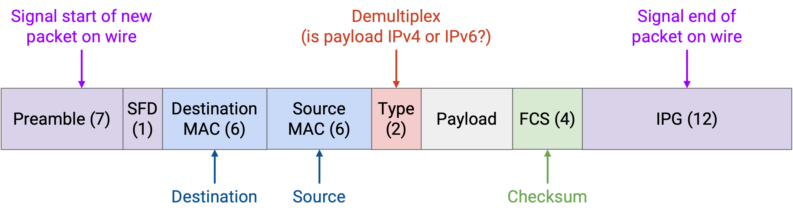

图：线上结构示意：7 字节前导码、1 字节 SFD、6 字节目的 MAC、6 字节源 MAC、2 字节类型、负载、4 字节 FCS，之后有帧间间隔 IPG。

前导码帮助接收同步，SFD 标记帧起始。目的与源 MAC 指明通信两端；两字节 EtherType 把负载分用给 IPv4、IPv6 等，类似 IP 的协议字段或 TCP/UDP 的端口承担的分用功能。FCS 校验帧内容，不像 IPv4 首部校验只覆盖首部，因为负载未必是 TCP/IP。严格说 CRC 覆盖从目的 MAC 到负载/填充的帧字段，不包括前导码、SFD 或 IPG；图中的 IPG 也不是帧内字段。

单播时填目标机器的 MAC；共享介质上其他机器看见信号但地址不匹配便忽略。广播时填 `FF:FF:FF:FF:FF:FF`，大家都知道应接收，这个广播地址在每个以太网相同。组播时填组地址；第一字节的最低位，即最先在线路发送的 I/G 位，为 1 表示组地址，为 0 表示单独地址。加入组的设备监听相应地址，组成员管理还需其他协议，本节不展开。

### 多链路二层网络

二层不必只是一条共享链路：可用交换机连接多条链路，完全按 MAC 转发。三层路由算法原则上也可用于二层，但 MAC 依厂商/接口分配，难按拓扑聚合；IP 前缀则便于聚合，因此不适合只靠平面 MAC 构建全球互联网。

跨多条链路广播需要交换机向相关输出端口复制；在有生成树时只沿允许转发的端口，不能不加限制地越过阻塞端口。多链路组播还需其他机制。Bonjour/mDNS 是有用的局域网发现例子：设备监听约定组，手机询问有没有可播放音乐的设备，Apple TV/HomePod 等回答能力；DNS 风格的 SRV 记录帮助描述服务。这个例子不表示协议只供 Apple 使用，也不表示“所有能力”均编码在一个 MAC 地址里。

历史上可把只做一、二层的设备叫交换机、同时做三层的叫路由器。二层交换机只需解读到以太网就可转发，不必每跳解读 IP；三层转发则重新封装下一链路。原文称如今几乎所有交换机也支持三层，所以常混用称呼；实践中仍存在大量纯二层产品，应按所讨论功能而非产品名字区分。

## 二、二层路由与生成树

### 多链路二层网络回顾

此前把二层协议画成许多电脑挂在同一条链路上，但也可以连接多条链路，完全用二层构成网络；分组逐跳转发，设备也可只使用 MAC 地址运行路由协议。

我们在 IP 层使用的路由算法原则上也能用于二层。困难之一是 MAC 无法像 IP 前缀那样按网络拓扑聚合：IP 的分配反映网络位置，MAC 的常见分配反映厂商。因此平面 MAC 路由难以承担全球互联网的扩展规模。

当同一个局域网含多条链路时，某台机器广播，交换机需要把帧向其他适用链路传播。原文简写成“所有输出端口”；结合本章后面的生成树，应排除入端口以及不能转发用户数据的阻塞端口。跨多链路的组播更复杂，需要额外协议，原文把深入讨论留到后续专题。

Bonjour/mDNS 是局域组播的一个用途。教材以 Apple 的手机、平板、电视等设备为例：它们监听一个约定的本地组，手机若想找播放音乐的设备，就向组询问谁能播放；组内 Apple TV、HomePod 等可组播回答自己的能力。协议还使用 DNS 风格的 SRV 等服务记录。这不表示 mDNS 只适用于 Apple，也不表示组播 MAC 本身编码了服务能力。

历史术语上，交换机常指只处理一、二层的设备，路由器还处理三层。回顾首部的封装与解封装：此前每个路由器都解析到 IP，再向下一跳转发；二层网络中的交换机只需处理以太网首部，就可把帧交给下一交换机。

原文以“现在几乎所有交换机也实现三层”说明课程中常混用两个名字，并把历史区分归因于以太网早于全球互联网普及。这个产品概括不能推广到所有设备；下文按实际执行二层交换还是三层路由来区分。接下来讨论二层转发表如何产生，以及如何消除环路。

### 拓扑与泛洪

单条线只有一条链路的总容量，大家要轮流，可能碰撞；全网状给每对主机独立链路却难扩展。加入交换机可在一般拓扑中逐跳转发，但也带来“应往哪走”的路由问题。本节方法针对局域二层，不意味着可以直接扩展到全球三层网络。

最朴素策略是泛洪：收到帧便向所有其他端口复制；不向入端口回发，因为上一跳已经有这份帧，再送回只会重复同样决策。

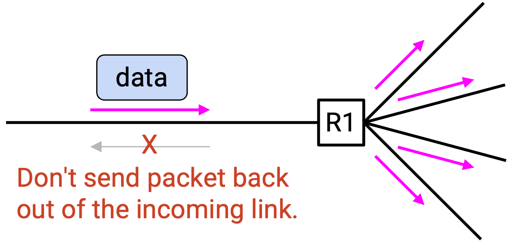

图：交换机复制帧到多个输出，但排除入端口。

它有两大问题：无关机器收到多余副本，浪费带宽；存在环时，副本会不断循环，淹没网络。

### 学习交换机

先解决浪费。无需完整路由协议，交换机可观察源地址学习反向位置。假设 R2 表空，西端口收到“From A, To B”，可推知 A 在西边，但不知道 B 在哪。因此只新增 `A→西端口`，不能根据目标字段学习 B。

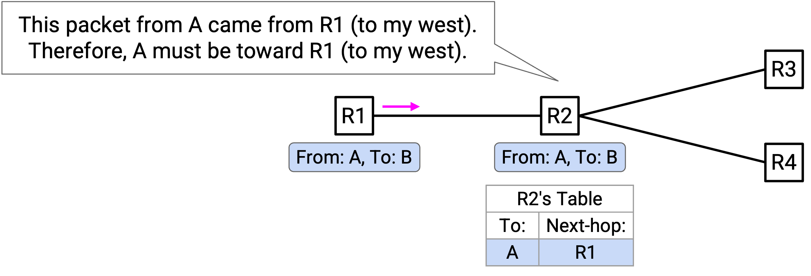

图：R2 从西侧 R1 收到 A→B，只能推出到 A 应向西。

以后发往 A 可直接向西；B 尚未知，本帧仍向除西侧外的端口泛洪。观察更多源地址后，表逐渐填满，未知目的才需泛洪。

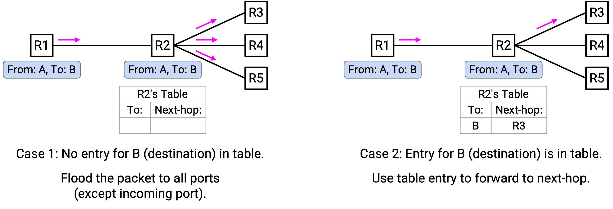

图：目的 B 未知时泛洪；若 B 已知，查表只走所学端口；学习依据始终是源 A。

两条规则：收到帧，更新源 MAC 与入端口的关联；查询目的，已知则定向转发，未知则向其余允许端口泛洪。若已知目的端口正是入端口，正常交换机会过滤而非原路回发；广播/需泛洪的组播也按相应规则处理。

完整例子：所有交换机开始表空，A 向 B 发帧，先交 R1。

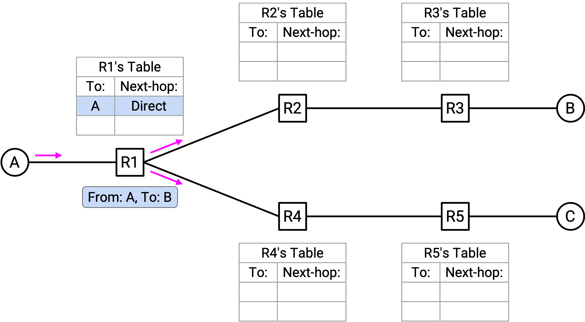

图：R1 从端口 1 收到 A→B，学习 A 在直连端口；B 未知，向 R2、R4 泛洪。

R2、R4 收到后都学习 A 在通向 R1 的端口，仍因 B 未知继续泛洪。

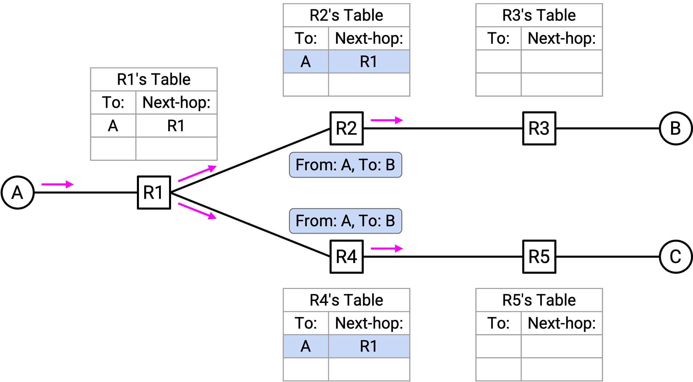

图：R2 和 R4 各自新增到 A 的记录，再向 R3、R5 传播未知目的帧。

R3、R5 再学习 A 的方向，继续向主机一端转发。

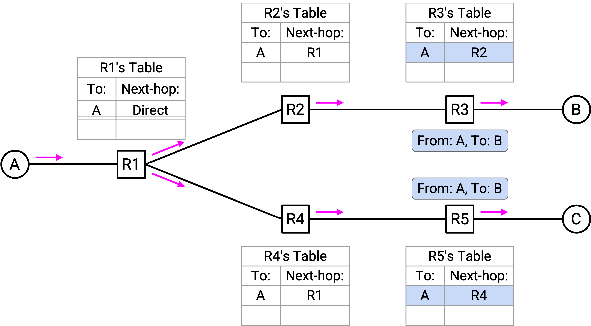

图：R3 学到 A 经 R2，R5 学到 A 经 R4，然后分别转发给 B、C。

C 检查目的不是自己，丢弃；B 检查目的匹配，接收处理。

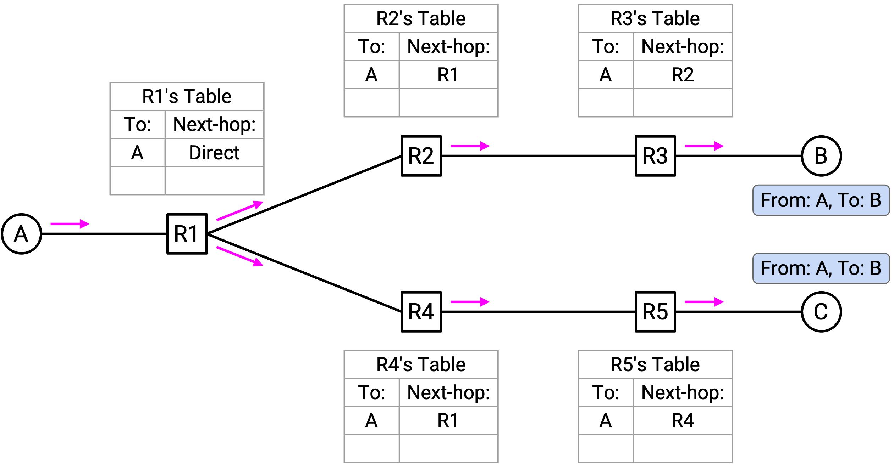

图：B 接收，C 丢弃；泛洪也让非目标看见了帧。

接着 B 回 A。R3 从 B 来的帧学到 B 直连；因先前已学 A，单播往 R2，不再泛洪。

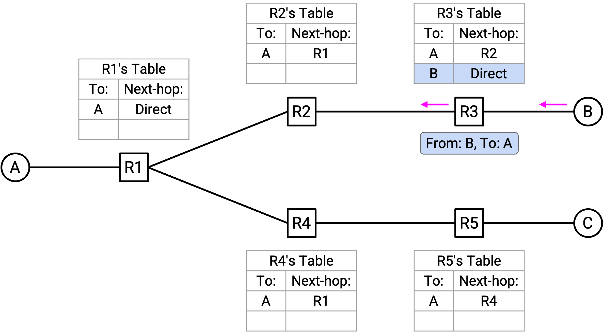

图：B 的回帧使 R3 学到 B；到 A 使用已有条目向 R2 转发。

R2 学到 B 经 R3，查 A 条目向 R1。

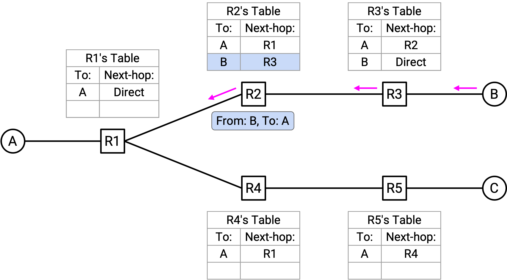

图：R2 更新 B 的位置，再按 A 的已知路径转发。

R1 学到 B 经 R2，查 A 条目送给 A。

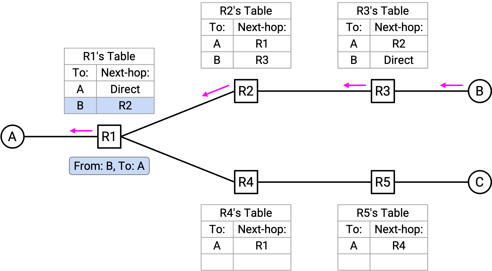

图：R1 学到 B 的方向，最终向 A 的直连端口交付；未经过的 R4/R5 不会凭空学到 B。

通信越多，表越全，泛洪越少。但条目要有老化时间：主机、链路、交换机失效后，旧位置不能永存。原文称给表项 TTL；这是表项有效期，不是帧内逐跳 TTL。例如 B 离网后，B 的表项最终过期。

### 学习不能消除环路

学习解决部分带宽浪费，不解决环路。考虑 A—R1，R1 分别连 R2/R3，R2/R3 又都连 R4，B 在 R4 后面。表空时 A 发往 B。

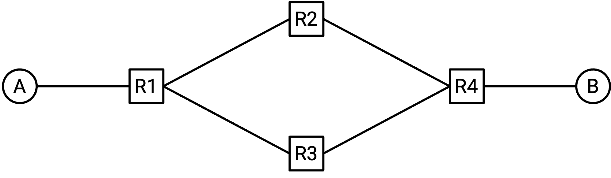

图：R1、R2、R4、R3 构成环；未知目的的两份泛洪副本可反向绕环传播。

R1 不知 B，发给 R2 和 R3；一份经 R2→R4→R3→R1，另一份经 R3→R4→R2→R1，然后反复。全程大家只在学 A，没人从该帧学到 B，未知目的不会因循环自动变已知，源位置还可能来回摆动。这常被统称广播风暴，虽然起因也可以是未知单播泛洪。

希望逻辑上删除冗余链路，使剩余拓扑无环，学习交换机就可正常工作。

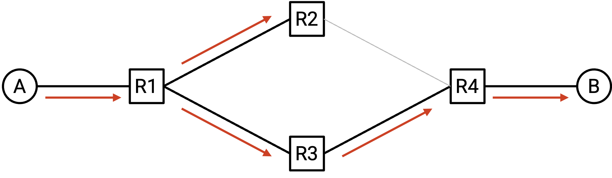

图：逻辑禁用环中的一条冗余链路，使泛洪沿无环结构传播。

为何不在帧加 TTL 或记住“见过此帧”？传统以太网首部没有逐跳 TTL，也没有通用唯一分组 ID/时间戳可据此做重复检测。改协议可另设计机制，但不能假定现有帧已经提供这些字段。

### 根交换机选举

STP（生成树协议）禁用部分转发端口以去环。终端主机不参与，交换机协作，所以图中暂时忽略主机。

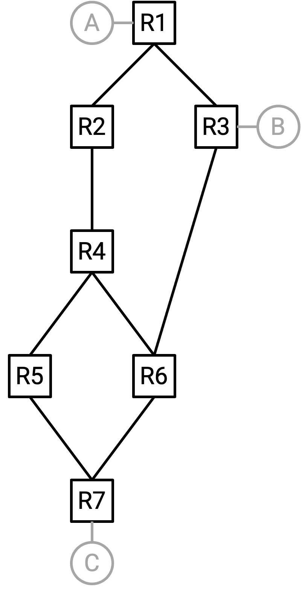

图：保留 R1—R7 的交换拓扑，主机不参与生成树选举。

先假设知道全局图，再考虑如何分布式得到相同结果。每个交换机有 ID，包含管理员配置的优先级和 MAC。先比较优先级，数值小者 ID 小；相同再比较 MAC，最小 ID 者为根。管理员可调优先级选根；全部默认时由 MAC 决定。本节不讨论哪个根性能最好，只要求选举无歧义。

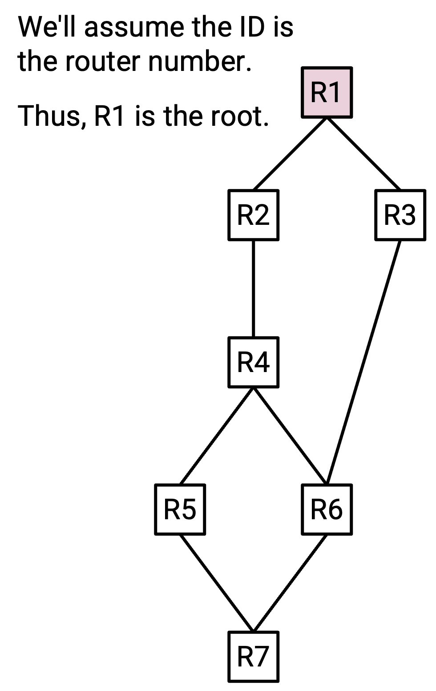

图：示例把 R 编号当作 ID 次序，故 R1 当选根。

### 端口角色

教材用三类角色：指定端口 DP 朝远离根方向；根端口 RP 是本交换机通往根的最佳路径端口；阻塞端口 BP 是其余朝根但不是最佳路径的端口。

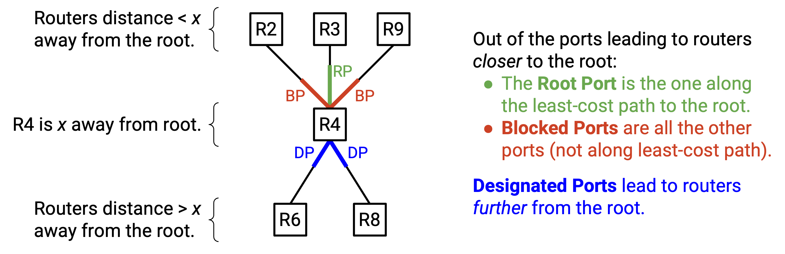

图：对 R4 而言，通向较近节点的若干口中选一个 RP，其余 BP；通向较远节点的口为 DP。

这是连通点到点、正代价教学图的直观描述。完整 STP 通过每个 LAN 的优劣 BPDU 比较选指定端口，实际还涉及端口 ID 和协议状态机；DP/RP 是角色，不能等同全部标准状态。

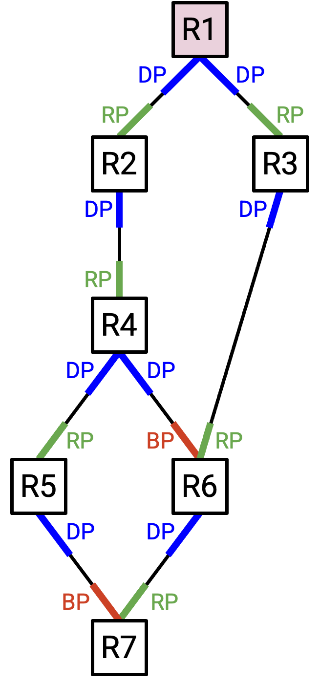

图：R1 的端口皆 DP；R2 向上为 RP、向下为 DP；R6 到 R3 为 RP、到 R4 为 BP、向 R7 为 DP。

R2 只有一条朝根方向路径，因此向上是 RP。R6 经 R3 到根代价 2，经 R4 代价 3，前者 RP、后者 BP。R6 向下远离根，所以是 DP。

代价相等时按邻居 ID 打破平局。

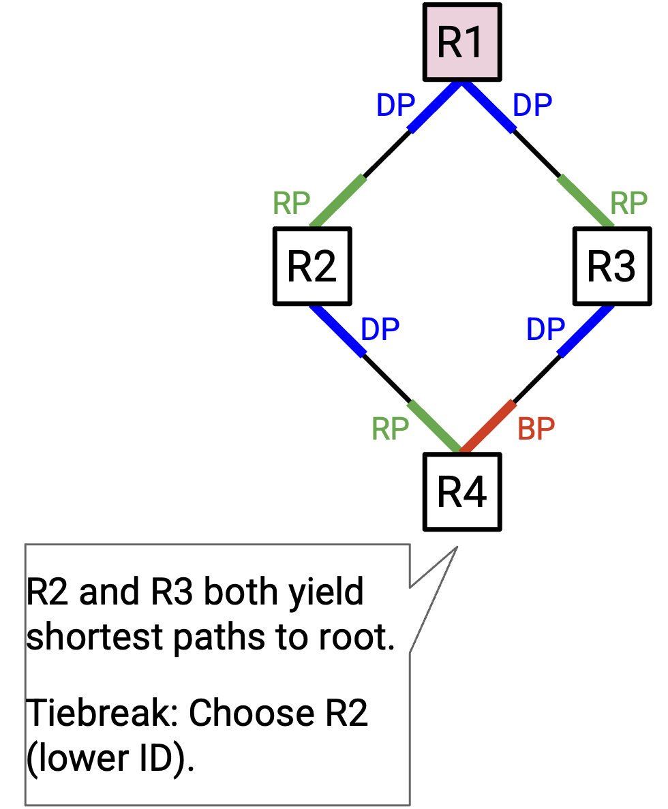

图：R4 经 R2、R3 均以代价 2 到根，选较小 ID 的 R2；到 R2 是 RP，到 R3 是 BP。

若链路两端到根距离相等，则比较两端 ID，把通向较大 ID 一端视作远离根，反向视作朝根。

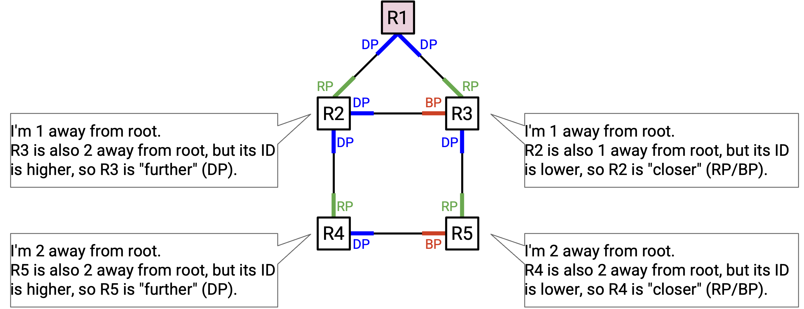

图：R4 与 R5 同距根且 R4 ID 更小，R4 向 R5 的口为 DP，R5 向 R4 的口为 BP；其他同距链路同理。

### 禁用链路及正确性直觉

将所有 BP 对用户数据视作不存在：不从该端口发送，也不通过该端口接收用户帧；但控制面的 BPDU 仍需处理，以便拓扑变化时重算。不能把阻塞理解成拔掉物理线或拒绝一切控制信息。

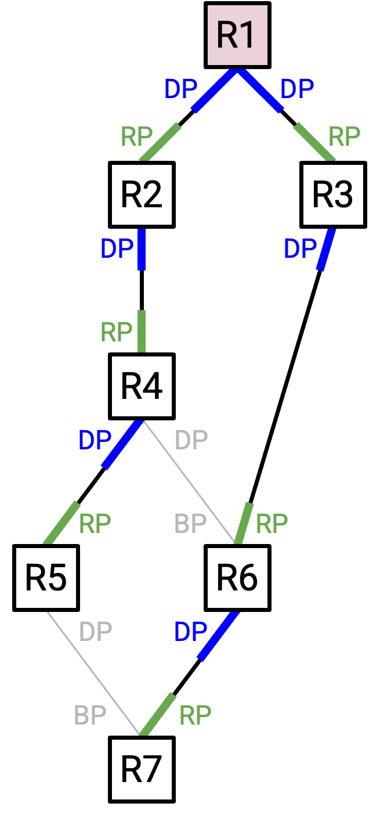

图：任一端有 BP 的链路不承载用户数据，剩余的 RP—DP 链路构成树。

RP 是本节点到根最好路径，BP 则是冗余但较差路径。阻塞后会不会害别人必须经自己到根？不会：在此教学排序中，BP 的另一侧已更接近根，它若反而经你走就是远离根，不是它需要的向根路径。DP 则不可由近侧随意关掉，因为远侧可能需要经你到根；近侧把决定权留给远侧，远侧若选它作 RP 就保留，否则标 BP 禁用。每条非树链路由不需要它的较远侧禁用，每个非根交换机仍保留一个最佳根方向。


图：近侧保留 DP，把是否禁用交给远侧；远侧只保留所需的 RP，其他冗余朝根口阻塞。

### 为什么叫指定端口

链路不一定只连两个交换机，也可能还有许多主机挂在同一共享介质。若一端指定、一端阻塞，本段主机的数据由指定端口进入树；阻塞端口不再把同样的用户帧送入另一路，避免重复路径。

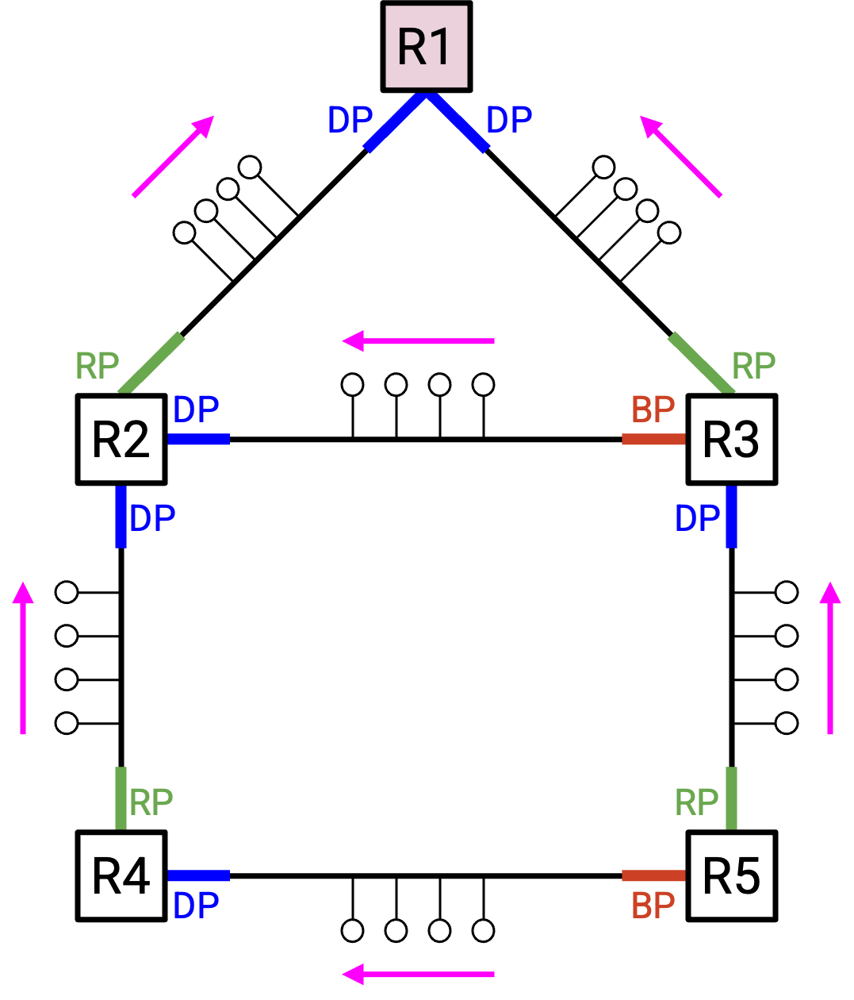

图：共享 LAN 上也有主机；指定端口是该段进入生成树的选定入口，而阻塞端口不接收转发用户数据。

从交换机视角，DP 朝远离根；从这条 LAN 上的主机视角，交给 DP 则进入到根及树其他部分的路径。主机并不运行 STP 来主动选择交换机；图表示交换机的转发控制效果。

### BPDU：从局部信息得到树

全局视角知道根和各节点距离，真实交换机没有这张图，于是交换 Bridge Protocol Data Unit（BPDU）。这是控制平面消息，不是用户数据帧。

初始每台交换机都以为自己是根，距离为 0。随后持续维护当前根、最佳到根路径及其代价。

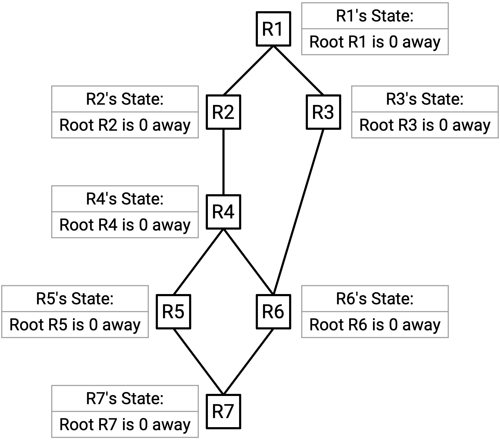

图：初始 R1 至 R7 分别认为自己是根，根距离均为 0。

教学 BPDU 至少传播“我认为根是谁”“我到根多远”，例如根是 R2、距离 7；实际消息还有发送者与端口等标识。收到更优信息有两种原因：根 ID 更小，则改用新根，即使新距离更大；根相同但提供更小总代价，则换路径。相同代价再按 ID 等规则比较。

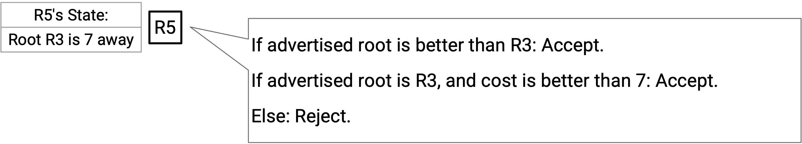

图：先比较根 ID，再比较同根路径代价；较小根永远优先于较大根。

到根代价与距离向量相同：本机到邻居链路代价，加邻居宣告的到根代价。状态更新后把新状态告诉邻居。收敛后每台知道 RP，知道邻居到根代价，就可判断 DP/BP。持续周期交换，让网络变化后重新形成树。

### BPDU 完整例子

实际各交换机并行发送，以下只是所选消息的讲解顺序，不表示全网必须按此串行执行。

1. R3 宣告“根 R3，距离 0”。R1 认为自己的根 R1 更好，拒绝；R6 原来选 R6，发现 R3 更小，于是接受，距离为 `0+1=1`，并触发后续宣告（图未展示）。

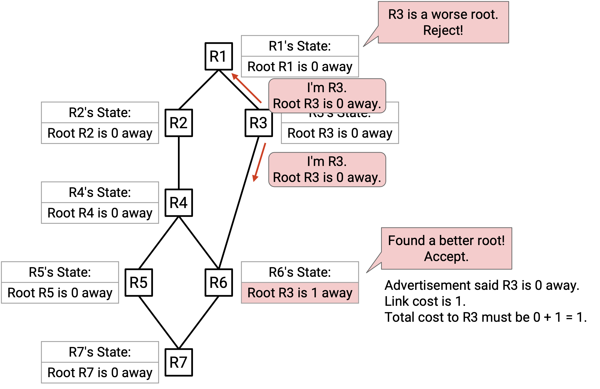

图：R3 的宣告被 R1 拒绝、被 R6 接受；R6 临时使用根 R3。

2. 稍后 R1 宣告“根 R1，距离 0”。R2、R3 都发现更小根，改为根 R1，距离 `0+1=1`，随后向邻居宣告。

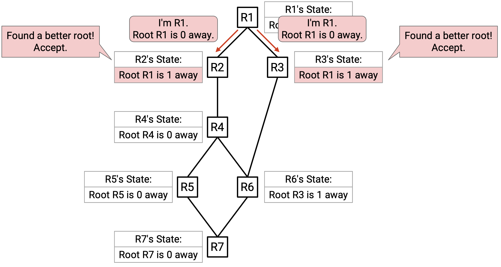

图：R2 与 R3 接受根 R1，均得到距离 1。

3. R4 从 R2 学到根 R1，距离 `1+1=2`。R6 从 R3 学到根 R1，距离也为 2。R6 先前到根 R3 距离 1，虽然新距离更大，根 ID 更小，所以仍必须接受。

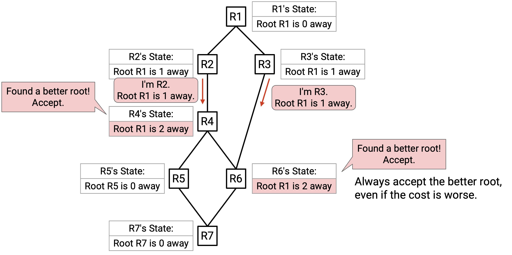

图：R4、R6 都更新为根 R1、距离 2；根优先级高于距离。

4. R4 宣告根 R1、距离 2。R5 原来根 R5，于是接受，得到 `2+1=3`。R6 已有同根距离 2，经 R4 将是 3，故拒绝。R5 更新后再宣告。

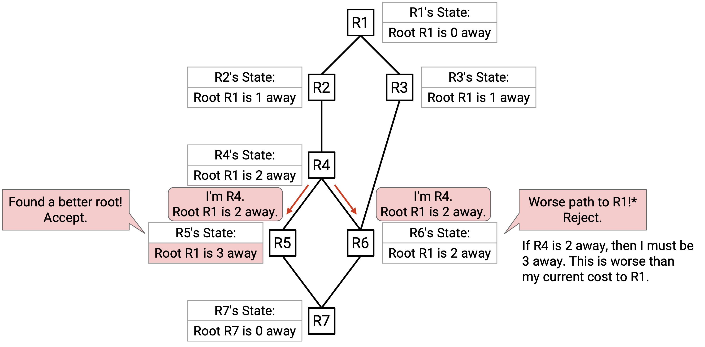

图：R5 接受 R4 的更小根，R6 拒绝同根但较长的路径。

5. R7 收到 R5 的宣告，发现根 R1 优于原根 R7，接受并暂得距离 4。R7 还会宣告，R6 会因该路径更长而拒绝，图中未画。

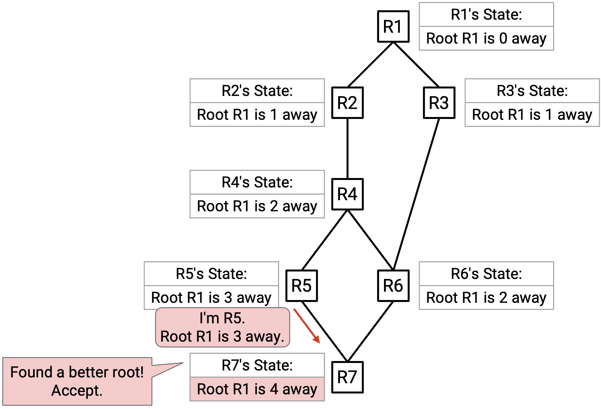

图：R7 暂经 R5 得到根 R1、距离 4。

6. 回到此前 R6 的宣告：R7 收到同根距离 2，若经 R6，总距离 `2+1=3`，优于现有 4，所以**接受**并更新为 3。

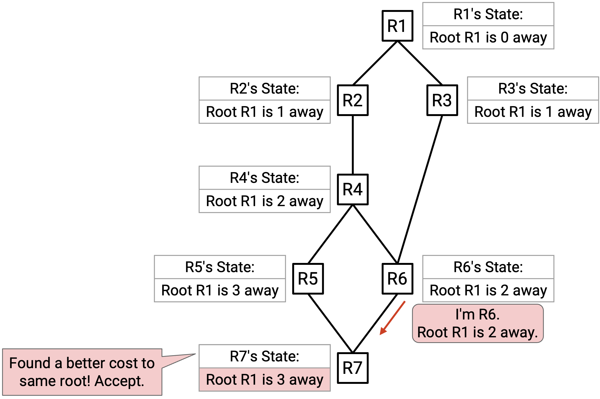

图：R7 改经 R6，距离由 4 减至 3。原图也标明接受更优路径。

> 原文勘误：该处文字写“rejects the advertisement (3 is better than 4)”却接着更新距离，逻辑自相矛盾；依据算式、后句与图，应为 accepts，而不是 rejects。

7. 未展示的其他周期宣告继续传播，最终大家都选 R1，知道自己的距离及邻居的距离，再确定每个端口角色。

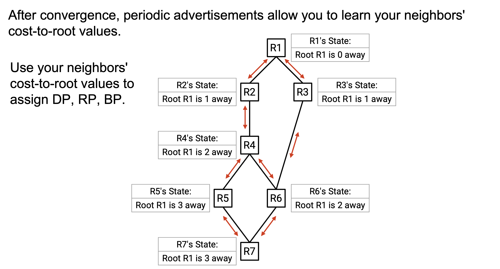

图：收敛结果：R1 距离 0；R2/R3 为 1；R4/R6 为 2；R5/R7 为 3，周期 BPDU 用于获知邻居信息并标记端口。

STP 得到的是一棵以所选根为中心的生成树，不是保证全网总权重最小的最小生成树，也不保证任意主机对走原图最短路。冗余物理链路仍可用于故障后的重算，但同一树的用户数据不同时利用所有环路路径。


## 引用与来源

- [Ethernet](https://textbook.cs168.io/end-to-end/ethernet.html)，固定源码 `end-to-end/ethernet.md`。
- [STP](https://textbook.cs168.io/end-to-end/l2-routing.html)，固定源码 `end-to-end/l2-routing.md`。

原作者 Peyrin Kao，基于 Sylvia Ratnasamy、Rob Shakir 等人的课程讲授。原教材及本中文翻译按 [CC BY-SA 4.0](https://creativecommons.org/licenses/by-sa/4.0/) 发布。采用 2026-10-01 的固定快照，不是 Spring 2025 历史教材。固定 commit：

```text
0b8208742d31df7fc3d53a0cd94fdd4e04f8d47e
```

修改：全文中译、中文图注与独立勘注；原图字节不变，仅加白底显示以保持深色主题可读。历史数值、服务名称和示例地址保留原文语境，不代表当前测量。课件与视频不适用本教材许可。
