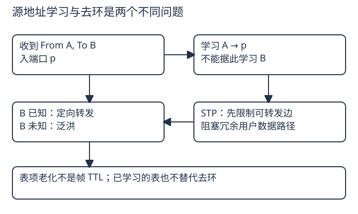

# 为什么已经会学习的交换机，还需要生成树？

学习和去环回答两个不同问题。学习问“这个源从哪个口来”；生成树问“哪些物理连接暂时不能用于数据转发”。把两者混成一个算法，就会误以为表填满后环路自然消失。

## 先分清三种范围

**链路**是直接连接关系；**碰撞域**是共享半双工发送可能互相干扰的范围；**广播域**是二层广播会被传播到的范围。交换机的点到点全双工端口不再共用老式总线的碰撞竞争，但多个端口仍可属于一个广播域。路由转发边界通常不会把收到的二层广播原样扩散到另一网络；VLAN 则可在同一交换设备内分隔二层域。

因此“换成交换机就没有广播”错误，“没有碰撞就没有广播风暴”也错误。广播风暴来自逻辑转发环，不要求物理碰撞。

## 一个源地址到底能证明什么？

自拟树形网络：A—S1—S2—B，S1 还有分支到 C。所有表空。

1. A→B 到 S1：S1 学 A 在 A 的入端口；B 未知，向 S2 与 C 泛洪。
2. S2 学 A 朝 S1，B 未知，送向 B。
3. C 收到但目的不匹配，丢弃；B 接收。
4. B→A 的回复让 S2 学 B 在 B 端口，并沿已有 A 条目转发。
5. S1 学 B 朝 S2，定向送 A。C 所在分支未经过回复，不能凭空学 B。

**不变量：一帧只提供关于源位置的新证据。** 目的字段是发送者的意图，不是目的位置的证明。表项老化后未知单播又会泛洪，这是正确性代价，不必然是故障。

图：编者自拟的两个决策过程，学习用源、转发查目的、STP 限定可用边。

## 为什么一个环能放大成持续故障？

把 S1、S2、S3 接成三角，A 向未知 B 发。S1 发给 S2/S3，两份副本相向绕环；每次到一个交换机都从源 A 更新表，却仍没有 B 的信息。以太网帧没有普通 IP 那种逐跳 TTL，因此不能指望“绕几次自然死亡”。

严重后果不仅是多份帧：同一源的副本从不同端口回来，A 的表项还会反复移动，已知单播也可能受影响。**表项老化计时器**控制知识保留多久，**分组逐跳寿命**控制一个包能走多远，它们不是同一种 TTL。

## 生成树为什么保连通又去环？

教学模型为连通图、正链路代价、唯一 ID。先选最小根 ID，每个非根节点只保留一个最佳朝根父方向；同代价按 ID 等确定性规则选。

沿父指针到根，根距离严格减小，所以不可能在父指针中绕回原点。每个非根节点又都有父路径，故不会孤立；结果是一棵连接所有节点的树。共享 LAN 的实际 STP 还要选每段指定桥/指定端口，不能把点到点图的直觉当成完整标准。

根端口是本节点的父方向，指定端口为下游保留入口，其余冗余端口阻塞用户数据。阻塞端口仍需参与控制信息处理，否则拓扑改变后无法知道何时恢复。

**代价权衡：** 保留物理冗余提高可恢复性，却不把所有链路同时用于同一棵树的数据转发。生成树不是最小生成树算法，也不保证 A 到 B 的树路径是原图最短路径。去环、最短路、最大吞吐是三个不同目标。

## BPDU 比较是有顺序的

收到邻居宣告时，不能只挑数字最小的距离。应先比较根 ID，再比较同根的累计路径代价，再用发送者/端口等标识消除平局。

假设当前“根 R8、距离 1”，收到经邻居到 R1 的总距离为 9。R1 ID 更小，应该接受，虽然距离变大。否则不同区域会永久保留自己的小树，无法选出共同根。相同根下若当前距离 4、新候选 3，则接受更短路径；教材 R7 这一行误写 rejects，材料页已勘正。

## 不要把稳态证明当作故障切换实现

上面的无环论证针对收敛后的选定结构。实际协议还需要定时器、端口状态迁移、信息老化和拓扑变化处理；不能凭“我算出的树无环”就推断异步过渡阶段任意立即开口都安全。本笔记不补造未阅读的完整标准状态机。

二层学习也不提供身份认证。攻击者伪造源 MAC 可以污染学习结果；ARP 又在主机上维护另一类映射。理解这些状态归谁管理，是后续端到端排错的前提。

## 自测

从端口 4 收到 A→B，为什么不能写 B→4？

帧确证 A 的方向；它只声明希望到 B，不证明 B 在来路。应学习 A→4，再按原有 B 条目转发或泛洪。

目的已知且表中端口就是入端口，应再原路发回吗？

通常过滤，目的位于同一来路，回发只会制造冗余；这与未知目的排除入端口的原则一致。

关闭一条环边是否等于设备再也不能利用这根线？

不是。物理链路仍在，阻塞的是当前树的用户数据转发；控制面感知拓扑变化后可能重新选它进入树。

全双工网络没有碰撞，为什么仍会因接错一根线风暴？

全双工解决链路收发竞争，不解决多个交换节点复制帧形成的逻辑环；没有逐跳寿命的泛洪仍可持续。

## 引用与来源、课堂覆盖边界

- 教材依据：[本讲唯一材料页](#/c/berkeley-cs168-2025/lec/lec18?v=materials)。原作者 Peyrin Kao，基于 Sylvia Ratnasamy、Rob Shakir 等人的讲授；采用 2026-10-01 固定快照，不是 2025 历史教材。正文为编者以已读教材为基础的独立问题推导，不是课堂复述。教材译文、原图及许可见材料页。
- 课程归属依据：[Spring 2025 官方课表](https://sp25.cs168.io/)。官方指定视频 ID `efWtZ8bzBOM`，个体元数据时长 **79:02**，上传日期 **2025-04-03**；上传日期不是课表上课日期。频道为 CS 168 (Internet Architecture) at UC Berkeley。
- 字幕主路径及一次不同官方 timedtext 通路均返回 HTTP 429。未读到字幕，也未核验音轨、画面、片头、片尾或 Q&A；没有可据以建立的讲解时间索引。因此不生成占位 draft，不宣称全片覆盖。
- 视频 license 元数据为空，许可未知；教材 CC BY-SA 4.0 不扩展到视频或课件。本页 SVG 为编者原创概念图，不是课堂截图。没有执行示例命令、抓包、学生实验、构建或测试。
