# 从本地链路到应用连接

## 一、ARP：连接第二层与第三层

### 下一跳的 MAC 从哪里来

向下经过协议栈时，数据不断被包上新的首部。发送 IP 包先填目标 IP，再交给二层加以太网首部。此时目标 MAC 应该填谁？


图：源 MAC 为本机，三层源/目的 IP 已知，但二层目的 MAC 尚待确定。

先查转发表判断目的在不在本地子网。例如 `192.0.2.0/24 → direct` 表示这段地址在本地链路，其他目的走默认路由交给路由器。如果目的在本地，需找到目的主机的 MAC；如果在外地，需找到下一跳路由器的 MAC，绝不是去求遥远服务器的 MAC。

朴素做法可把每个包都二层广播，让目标主机或路由器自己接收。但这样每个节点都得解析 IP 判断是否相关，多链路局域网还会到处泛洪。更好的办法是解析目标主机或本地下一跳的 MAC 后单播。

### ARP 协议

ARP（地址解析协议）把本链路上的 IPv4 地址映射成 MAC。查询者广播：“我的 MAC 是 `f8:ff:c2:2b:36:16`，IP 为 `192.0.2.1` 的机器 MAC 是多少？”其他主机忽略，不匹配者不回答；拥有此 IP 的机器向查询者 MAC 单播：“我是 `192.0.2.1`，我的 MAC 是 `a2:ff:28:02:f2:10`。”机器还可在没人询问时广播自己的映射。

收到映射可加入本机 ARP 表缓存，并设置过期时间，因为 IP 不永久属于某台机器：同一 IP 可重新分给别的设备，原设备也可换 IP。原文这里有未完成的“interfaces?”备注；严谨地说，映射与本地链路/接口作用域有关，不能把不同接口的邻居状态不加区分地混用。

完整图例用 Alice、Bob 和 IP `1.2.3.4`：

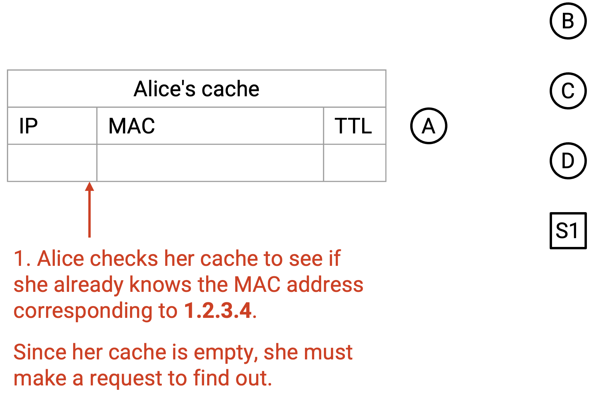

图：第 1 步：Alice 检查缓存，找不到 1.2.3.4 的 MAC，所以必须询问。

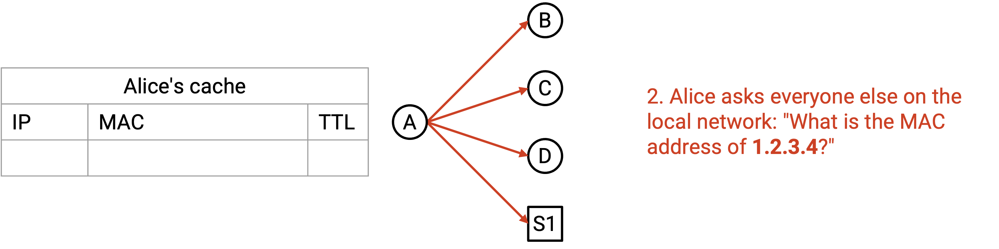

图：第 2 步：Alice 广播询问本链路上谁拥有 1.2.3.4，B、C、D、S1 都能收到。

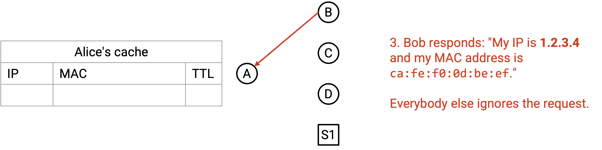

图：第 3 步：Bob 回答自己的 IP 为 1.2.3.4、MAC 为 ca:fe:f0:0d:be:ef；其他主机不回答。

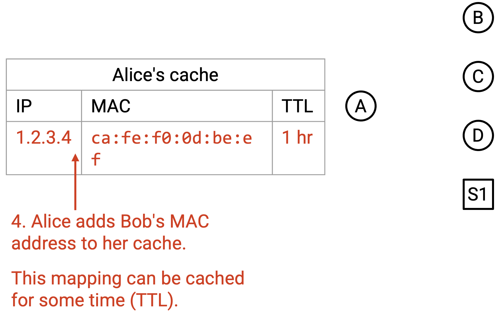

图：第 4 步：Alice 缓存 IP—MAC 映射，图示有效期为 1 小时，非协议统一固定寿命。

ARP 直接由以太网承载，不是先装进 IP。


图：ARP 请求的目的 MAC 是全 1 广播地址，回应目的 MAC 是 Alice 的地址；ARP 不是 UDP/IP 报文。

### ARP 与转发表的分工

以前可把“主机 A 直连端口 1”写进路由表，实际通常一个子网共用一条 direct 路由。路由器收到目的属于该子网的包，就在对应接口用 ARP 解析目的主机，再二层单播。因此即使很多主机共用端口所连的一条 LAN，也不必每个 IP 都有单独路由表项。

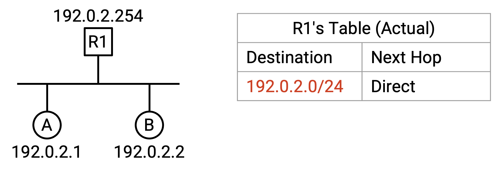

图：R1 的路由表只需 192.0.2.0/24→Direct；同一链路上的 A、B 用各自 MAC 区分。

如何判断某地址属于 `/24`？子网掩码把固定前缀位设为 1、主机位设为 0，得到 `255.255.255.0`。对候选地址逐位 AND，清零主机位；结果若等于网络地址 `192.0.2.0`，就匹配这个前缀。

$$
\operatorname{IP}\mathbin{\&}\operatorname{mask}
=\operatorname{network}
$$

逐跳三层转发时，每条新链路的目的 MAC 换成该链路的下一跳；通常源 MAC 也随重新封装而变。普通 IP 路由不改变最终目的 IP，但 NAT 等是例外。

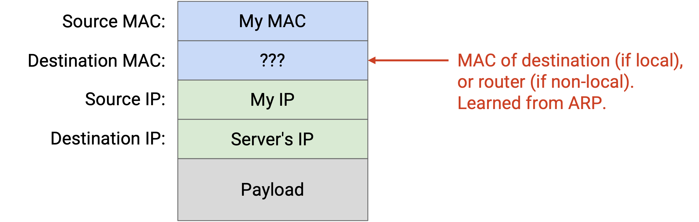

图：二层目的填本地目的主机或本地路由器的 MAC；三层目的仍是最终服务器 IP。

### IPv6 邻居发现

ARP 用于 IPv4；IPv6 用邻居发现 ND。不是向所有节点广播，而是请求发送到与目标地址相关的组。例：IPv6 地址低 24 位为 `12:3456` 的节点监听以太网组地址 `33:33:FF:12:34:56`，低位 `78:90AB` 的监听 `33:33:FF:78:90:AB`。想找低位 `12:3456` 的邻居，就用这些位构造相应组地址；目标一定监听，其他低位相同节点也可能收到。

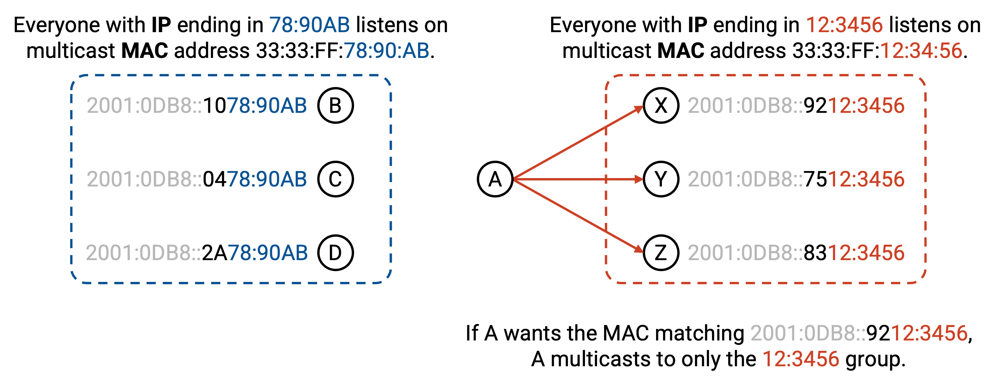

图：按目标 IPv6 低 24 位构造 solicited-node 组播对应的 MAC，缩小收到请求的节点集合。

请求叫 Neighbor Solicitation，回复叫 Neighbor Advertisement。ND 是由 ICMPv6/IPv6 承载的协议，不像 ARP 直接作为独立以太网负载。

## 二、DHCP：加入网络

### 初次接入需要什么

电脑知道接口自己的 MAC，通常有出厂值，也可能由软件选择。要联网，还需自己的 IP 地址、子网掩码、默认网关及 DNS 递归解析器地址。IP 随接入网络前缀分配；掩码与自身 IP 按位 AND 可得到本地网络前缀；网关负责转发非本地目的；解析器负责名字查询。

用户可手工配置，但每换一个网络就重配既耗时又不适合普通用户。路由器等不常移动的设备有时适合静态配置。新主机则需要自动获得这些参数的协议。

### 四步过程

DHCP（动态主机配置协议）的初始获取可概括为 Discover、Offer、Request、ACK：

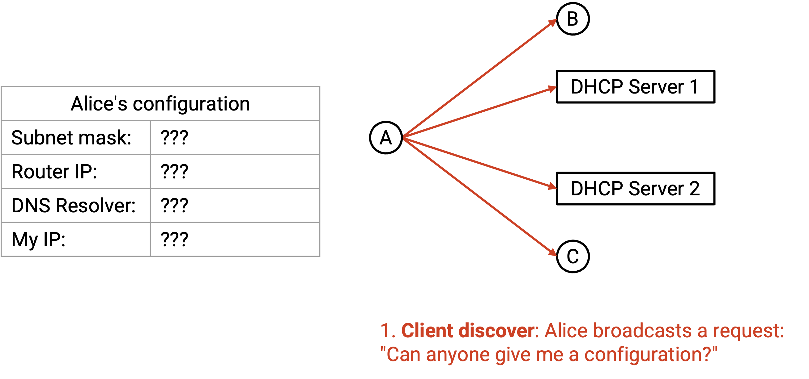

图：Discover：Alice 广播“谁能给我网络配置？”，此时 IP、掩码、网关和解析器均未知。

1. 新客户端广播 Discover 请求配置。

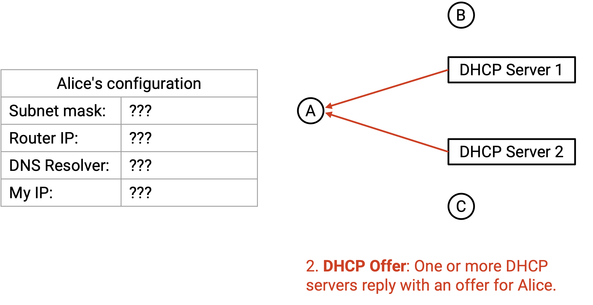

图：Offer：一个或多个 DHCP 服务器提出地址及配置方案。

2. 能提供服务的服务器发 Offer，包含可用 IP、网关、DNS 等。教材此步画成单播，后文也说明可以广播，并非总能在此阶段 IP 单播。

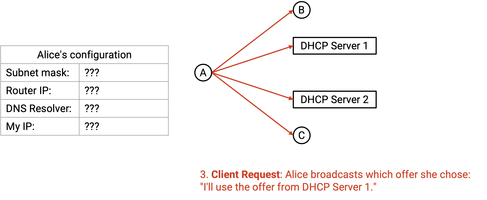

图：Request：客户端广播选择的服务器，其他服务器获知自己的 offer 未被接受。

3. 客户端广播 Request，表明接受哪个 offer；其他服务器可释放未被选择的预留资源。

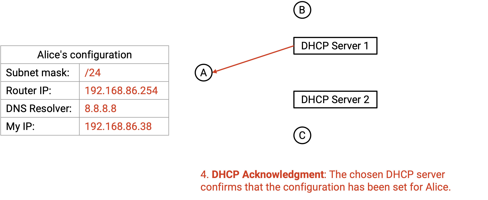

图：ACK：所选服务器确认租约。图中示例配置为 /24、网关 192.168.86.254、DNS 8.8.8.8、客户端 192.168.86.38。

4. 所选服务器发 ACK，确认分配获准。

### 服务器与租约

小网络中家用路由器常兼 DHCP 服务器；大网络可用独立服务器。客户端广播限于本地链路，若不想每个路由器都运行完整服务，可由本地 DHCP relay 把请求转交远端集中服务器。因此“服务器必须在同一局域网”只适用于没有中继的直达情形。

DHCPv4 服务器监听 UDP 67，预配置好网关、DNS 与地址池。客户端端口为 UDP 68。

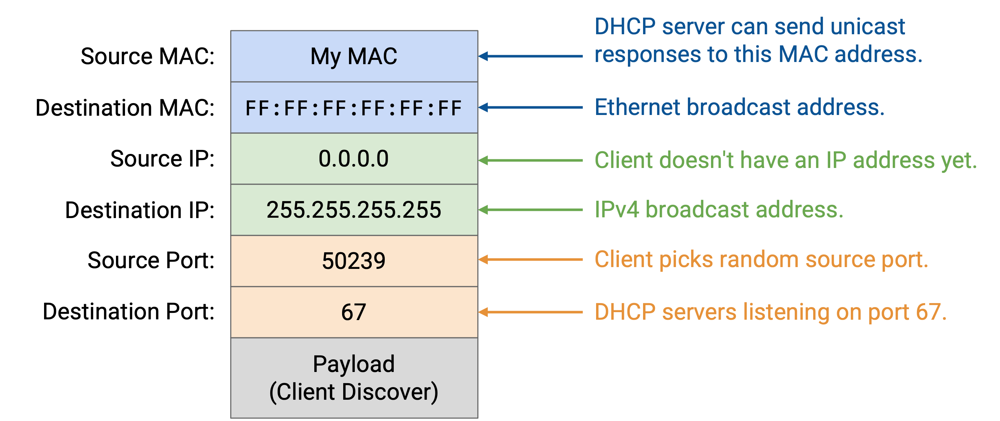

图：初始 DHCP Discover：源 IP 0.0.0.0、目的 IP 255.255.255.255，目的 MAC 为全 1，UDP 目的端口 67。原图源端口画作 50239，是教材错误；DHCPv4 客户端应使用 68。

IP 是有限期租约，例如数小时或数天；想继续使用必须续租。在某地址仍有效租给一台主机时，服务器不能再租给另一台。地址分配不是“收到一次 Offer 就永久拥有”，且续租过程不一定重新广播完整四步。

### 没有 IP 如何发送 DHCP

DHCP 是应用层协议，在 UDP/IP 上运行。第一次请求把目的 IP 写为 `255.255.255.255`，这是 IPv4 有限广播地址；下交二层时直接使用全 1 以太网广播地址，不用先 ARP。源 IP 尚未知，填 `0.0.0.0`。这两个约定值打破了“先要地址才能请求地址”的循环。

服务器怎样回复还没有 IP 的客户？可广播回复，或按客户端硬件地址二层单播，具体依客户端能力、标志和中继场景。初始发现、租约选择、续租不应被简化成永远同一种地址组合。

### IPv6 自动配置

IPv6 也有 DHCP，但更长地址允许另一种无状态地址自动配置 SLAAC，不必由中心地址池逐个租出主机位。教材的经典思路是获得本地通常 64 位前缀，再由自身 MAC 派生接口标识：别的网络前缀不同，同网接口标识理应不同，因此组合成地址。

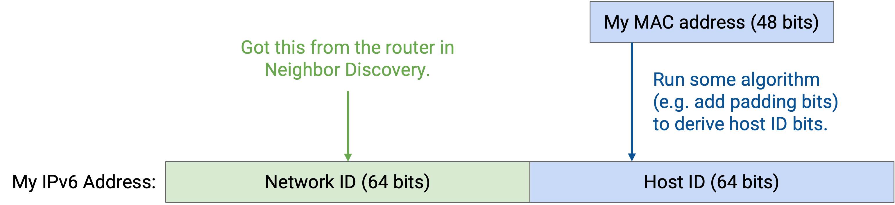

图：路由器公告提供网络前缀，主机生成 64 位接口标识，组合为 128 位 IPv6 地址；图示用 48 位 MAC 经算法扩展。

本地信息通过 ND 中的 Router Solicitation 与 Router Advertisement 交互获取。原文说广播请求，**IPv6 没有广播，这里是组播等规定方式**；RA 可提供前缀、默认路由相关信息，DNS 还取决于具体选项/配置方式。SLAAC 有重复地址检测，不能仅凭“MAC 全球唯一”就保证绝不冲突。现代接口标识也常用稳定或临时隐私生成方式，而非直接暴露硬件 MAC。

## 三、NAT：网络地址转换

### IPv4 地址不足

IPv4 只有 $2^{32}$ 个地址，不足以让所有设备各占一个全球唯一地址。IPv6 是长期方案，但采用较慢。RFC1918 私有段 `192.168.0.0/16`、`10.0.0.0/8`、`172.16.0.0/12` 可在不同私网重用。家庭设备通常也在这些私网中，但仍希望访问互联网，该怎么办？

### 先看地址改写

目标是让多个内网主机共享一个公网地址。网关将发出的私有源地址改成公网地址，再把回复的公网目的地址还原到正确内网机器。

Joe's Tire Shop 的 Alice、Bob、Chuck 分别用私有地址 A、B、C，全球不可唯一识别；对外只有公网地址 R1。

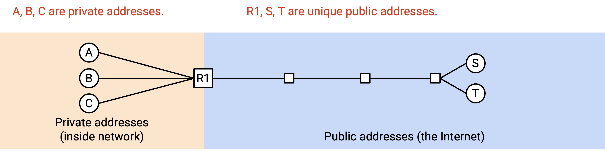

图：A/B/C 是可重复使用的内网地址；R1、外部 S/T 是公网可路由地址。

Alice 发 `From A, To S`。若原样发出，S 不知道怎样把回复送回非全局唯一的 A。

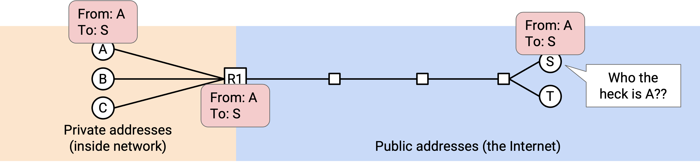

图：不转换时，服务器 S 收到源地址 A，无法据此确定全球回程目的。

网关将其改为 `From R1, To S`，记下“来自 S 的回复应给 A”。

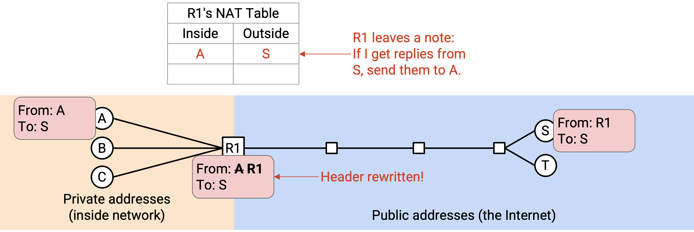

图：R1 改写源 IP，并保存内外对应关系。

S 回复 `From S, To R1`；网关查记录，改为 `From S, To A`，交回内网。

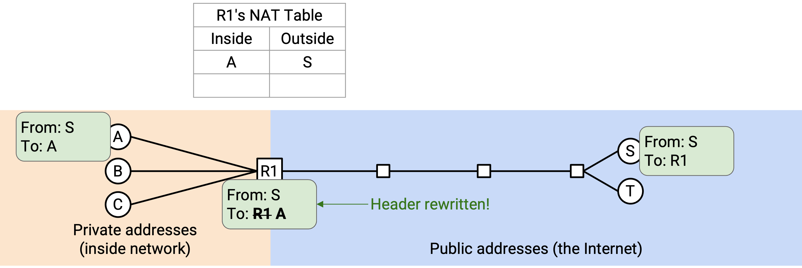

图：回程依表把目的公网地址 R1 还原为 A。

Bob、Chuck 也可如此访问外部。最朴素的表按外部目的记内部发起者，比如 B 发给 N 后，来自 N 的回复给 B。但若 A、B 都联系 S 就有歧义。

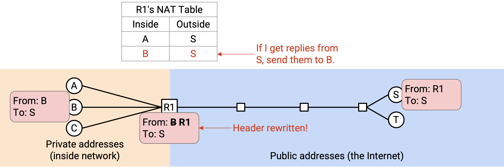

图：A 和 B 都联系 S，仅保存“外部 S→内部谁”不足以区分。

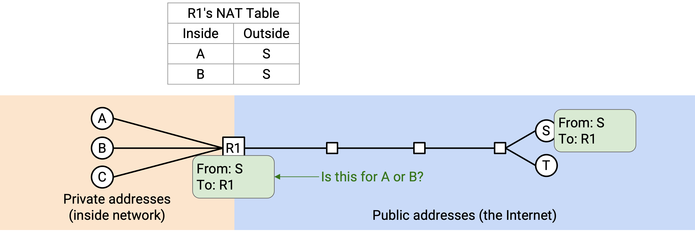

图：S 回复到 R1 时，单靠两个 IP 地址无法确定回给 A 还是 B。

加入第四层端口即可区分部分情况：Alice 用 A:50000 联系 S:80，改成 R1:50000→S:80，表记回到 R1:50000 的相应回复应交 A。

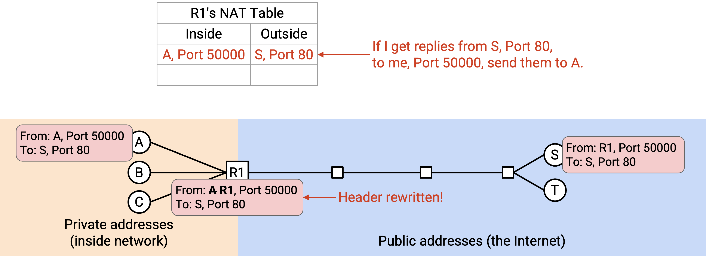

图：A 的源端口 50000 被保留，回程目的端口帮助选中 A 的连接。

Bob 用 B:60000 联系 S:80，改成 R1:60000→S:80，回到 60000 的回复应交 B。


图：B 的源端口为 60000，与 A 的映射区分。

更一般地，跟踪协议、源/目的 IP、源/目的端口的五元组；出站改源 IP 并记状态，入站查对应连接，再改目的地址送给正确内网主机。这里是教学连接跟踪模型，实际 NAT 的映射键、端点依赖性与过滤策略各有不同。

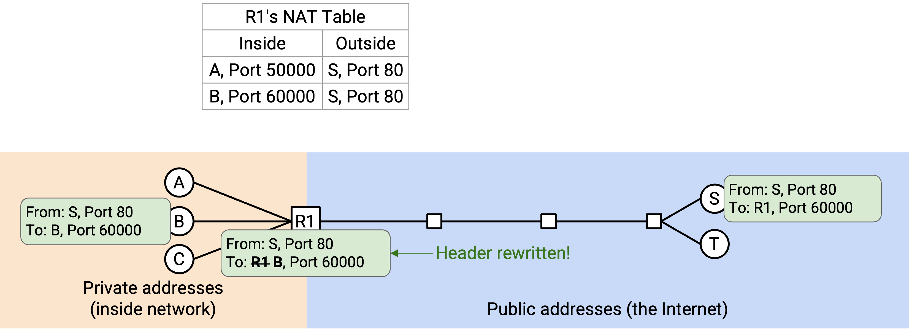

图：五元组及端口让同时访问相同外部服务的不同内网连接可被正确分用。

### 端口冲突与 PAT

还有一个问题：Alice、Bob 都可能独立选择 50000。

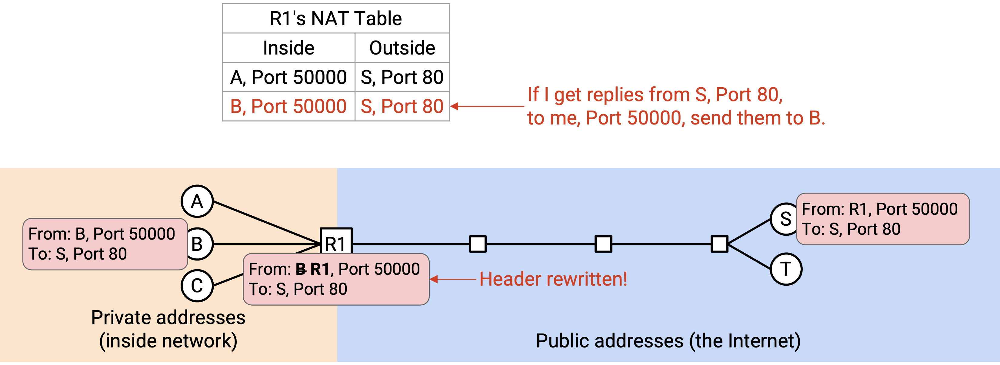

图：两内网主机同以 50000 访问 S:80，直接保留端口会使公网连接标识冲突。

网关虽知道内部有 A:50000 与 B:50000，收到 S:80→R1:50000 时却仍无法选择。

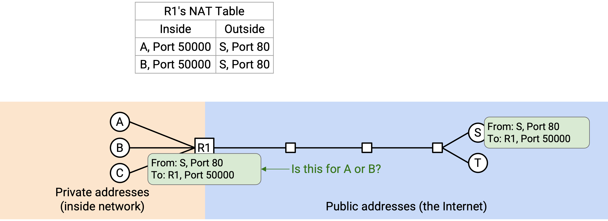

图：回程目的都是 R1:50000，公网侧无法区分两个连接。

于是允许同时改写端口。Alice 仍用外部 50000；Bob 的 50000 在公网侧临时改成 60000。表保存内部 B:50000 与外部 R1:60000 的映射，以及相应协议/远端信息。

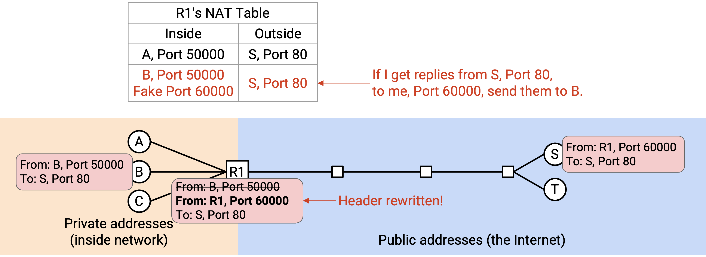

图：Bob 出站被转换为 R1:60000→S:80，内部原端口 50000 也留在状态表中。

现在回到 R1:50000 的回复属于 Alice，回到 R1:60000 的属于 Bob。

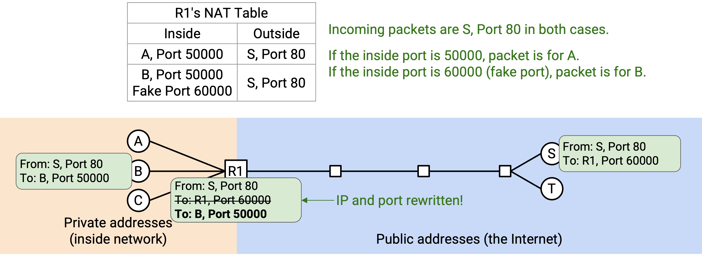

图：回复给 Bob 时，网关还原目的为 B:50000；Bob 不必知道外部曾使用 60000。

透明性要求主机仍看到自己选择的地址和端口。**原文此处误把转换后的目的写成仍为 R1:60000；正确的回程是 S:80→R1:60000 改成 S:80→B:50000。**

### 实现及类型

家用路由器的外网接口接入 ISP 时，也可作为 DHCP 客户端获分一个地址；若拿到公网地址，它就是全家共享的外部身份。路由器既可向 LAN 提供 DHCP，又可在 WAN 充当 DHCP 客户端。

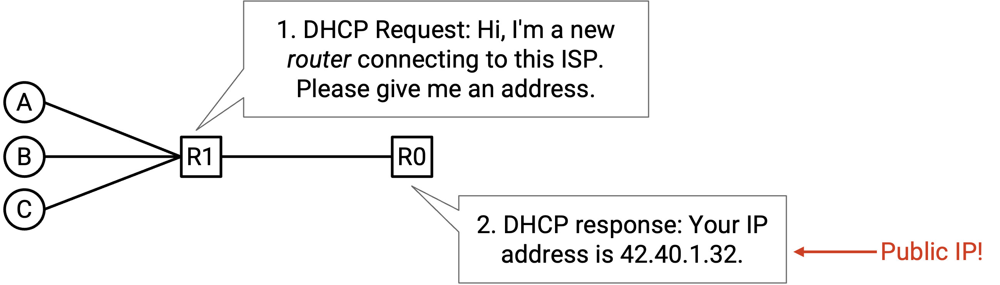

图：家用 R1 向 ISP 的 R0 请求配置，教材例子获得 42.40.1.32 作为外部地址。

刚才允许改端口的模式叫 PAT（Port Address Translation），也常归入 NAPT。它要求网关理解传输层以解析、跟踪并改写首部。更简单的一对一 NAT 也存在，例如 `10.0.0.1→42.0.2.1`、`10.0.0.2→42.0.2.2`、`10.0.0.3→42.0.2.3`。这种模式不节省公网地址数量，但可能用于其他管理目的。

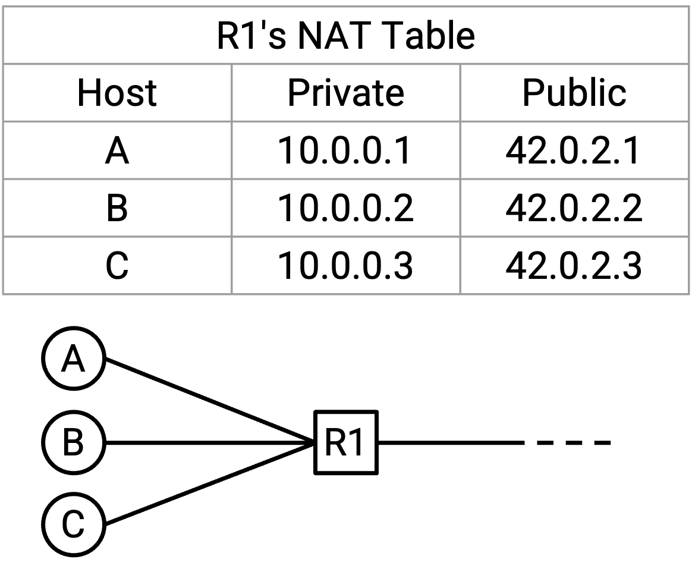

图：一对一映射表将 A/B/C 各自私有地址转换成独立公网地址，不进行多主机共享。

### 部署位置

NAT 增加路由器复杂度：不只解析三层，还要理解四层；修改首部并维护流状态，消耗每包 CPU 与每流内存。改写相关字段还必须正确更新受影响校验和，而不是只改显示出来的地址文字。

为控制规模，通常尽量在网络边缘做：家用路由器连接较少，较容易；高吞吐骨干或数据中心转发路径上增加状态则代价高。家庭和办公 IPv4 网络常用 NAT。公网地址进一步不足时，ISP 还会采用运营商级 CGNAT，位置更深、承载更多连接；因此家用路由器外网口也不保证拿到真正公网地址。IPv6 地址足够，通常不需为节约地址而做 NAT。

### 外部主动入站

前面的连接都由内网发起，先有出站包建立状态，符合普通浏览网页。但若内网想运行服务器，外部不能直接访问私有地址；对 R1:28 发第一个包，网关又没有既有映射，不知道应交哪台机器。

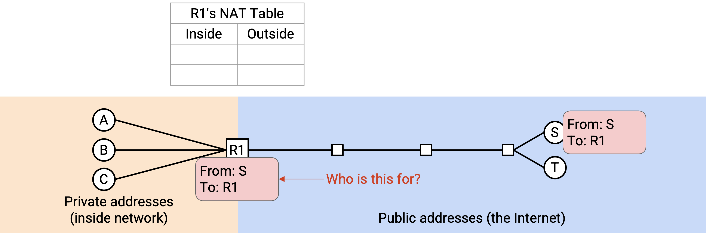

图：外部主动联系 R1，NAT 表没有已建立条目，无法确定内部目的。

可配置端口映射：“R1 的 28 端口对应 Alice 的服务端口”。网关收到相应入站包就有确定目的。映射可手工设置，也有 UPnP、NAT-PMP 等动态配置协议，在线游戏等需要入站联系的应用可能使用。是否允许映射应由安全策略决定。

### 安全与端到端可达性

NAT 改变了理想的端到端可达性：内网共享公网地址，外部不能无配置地主动选择每台机器，需要网关状态或端口映射。原文称其“破坏端到端原则”，这里主要指地址透明性及可达性，不应把这句话当作端到端论证的全部内容。

默认没有入站映射常能阻挡未经邀请的入站连接，表面像防火墙，但这主要是转换机制的副作用，不是完整、明确的安全策略，更非万无一失。端口映射、已有连接和内部恶意流量仍需单独防护。

共享地址也让服务器不能单凭源 IP 分辨 Alice、Bob、Chuck，但不等于匿名：账号、cookie、应用标识等仍可关联用户。原文说不用 NAT 服务器可知道“准确身份”，这过度简化；IP 是网络端点线索，不是人的身份凭证。某些早期 IPv6 地址从 MAC 派生会暴露接口线索，现代临时/隐私地址等可减少这种关联。

## 四、TLS：安全字节流

### TCP 为什么不够

TCP 自身不防网络攻击者。恶意路由器或窃听者可读取乃至修改传输中的字节。连接成功也不证明对端是真网站：若攻击者篡改 `www.bank.com` 的 DNS 响应为自己的 `6.6.6.6`，客户端可能把银行密码发给冒充者。

因此在 TCP 之上加入 TLS（Transport Layer Security）。教材把它比作“4.5 层”：位于 TCP 与 HTTP 等应用之间，这只是教学位置编号，不是正式 OSI 层号。TLS 使用 TCP 字节流，不自己处理底层分组丢失/乱序；向应用仍提供字节流，却增加针对网络攻击者的安全属性。HTTP/1.1 或 HTTP/2 在 TLS/TCP 上就是 HTTPS，核心 HTTP 语义仍相同。

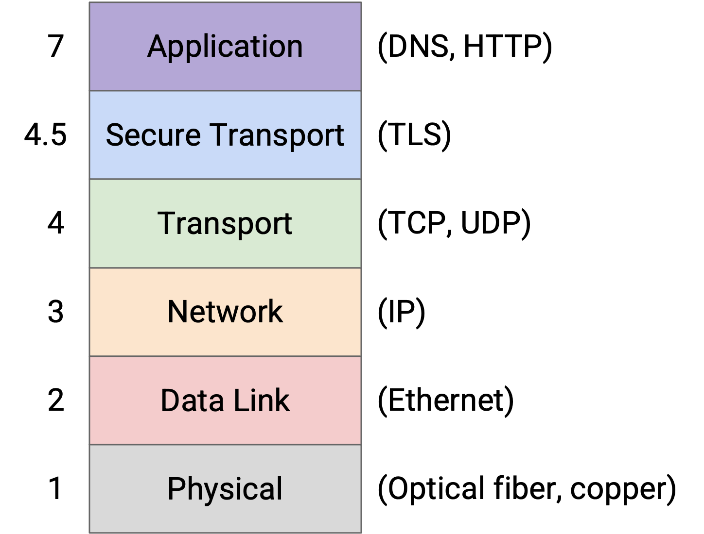

图：TLS 位于应用与 TCP 字节流之间，4.5 是教学标签。

HTTP 默认 80，HTTPS 默认 443。服务器可对 80 的请求回应 HTTPS 重定向，但首次明文重定向本身仍可被攻击者干扰，不能单靠它证明从未降级；HTTPS 使用也不由端口号单独保证。

### 握手的概念步骤

TLS 用密码学加密内容，并用认证机制防篡改。开始前要协商密钥并验证服务器身份。以下是教材的简化、偏旧版 RSA 密钥交换示意，**不是 TLS 1.3 的逐包规范**。

先正常完成 TCP 三次握手，得到尚不安全的可靠字节流，之后 TLS 控制消息也不必思考单个 TCP 包。

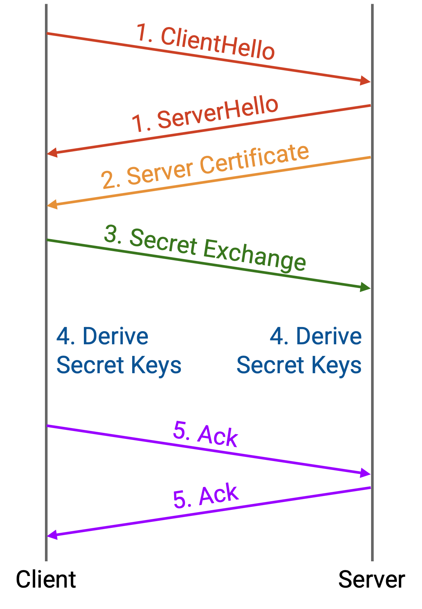

图：示意依次为 hello 协商、服务器证书、秘密交换、本地派生密钥与 Finished 类确认；不是当前各版本统一的精确消息序列。

1. 客户端与服务器交换 hello，带随机数，使每次握手导出的密钥不同；客户端列出支持的密码方案，服务器选定组合。总用同一密钥会扩大泄露后的危害。
2. 服务器发证书，客户端据此验证身份，避免与冒充者通信。教材略过具体验证机制；实际需校验证书链、目标主机名、有效期及相应认证证明，不能“收到证书就信”。
3. 双方建立只有自己知道的共享秘密。教学例子用 RSA：客户端用服务器公钥加密秘密，只有相应私钥持有者能解密。TLS 1.3 不采用这种 RSA 密钥传输；现代握手常使用临时 (EC)DHE 或 PSK 等机制。
4. 双方各自在本地从秘密与随机值派生密钥。秘密使旁观者无法计算，随机值使不同会话有不同密钥；最终流量密钥不直接在网络上传送。这个说法以密码算法、实现与端点没有泄露为前提，不是“密钥不直接传输所以绝对不会被窃取”。
5. 交换 Finished 类确认，验证双方派生状态一致，握手到此未被悄悄改写。

之后应用数据以密钥加密并认证，获得安全字节流。原文称用消息认证码，现代常用 AEAD 把加密与完整性认证结合。安全目标是机密性、完整性与对端认证；TLS 不自动防止端点被攻陷、不保证应用业务正确，也不隐藏所有 IP、时序与长度信息。客户端证书认证不是所有普通 HTTPS 会话的默认要求。

## 五、端到端连通：一次网页访问

### 假设与起点

现在走完整流程：开电脑，接入以太网，在浏览器输入 `www.berkeley.edu`。不从零启动全球互联网，假设路由器已运行路由协议并建立转发表。

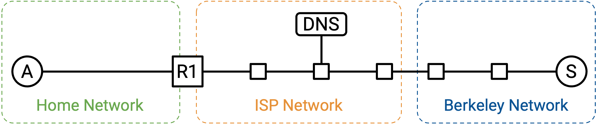

图：本地主机 A 经家庭路由器、ISP 与伯克利网络访问服务器 S；DNS 解析器在路径之外可单独访问。

### 第一步：DHCP

新机器不知道网络参数，先广播 DHCP Discover。原文把第一条泛称 request，后面又有正式 Request；这里明确区分消息类型。假设家用路由器兼 DHCP 服务器，发 Offer 提供地址、掩码、默认网关、DNS；客户端再 Request 接受，服务器 ACK。

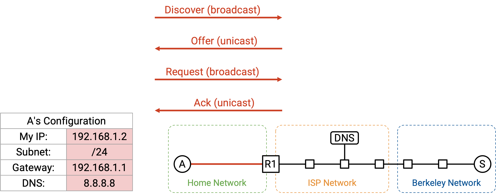

图：DORA 后主机取得 192.168.1.2/24、网关 192.168.1.1 与解析器 8.8.8.8；图画 Offer/ACK 单播只是该例。

### 第二步：找出路由器的二层地址

DHCP 给出了网关 IP，转发表将非本地包交给它；即将访问的 DNS 和网页服务器可能都不在本地。先确认 `192.168.1.1` 属于本机 `192.168.1.2/24` 所在的 `192.168.1.0/24` 网络，然后 ARP 广播询问网关 MAC，接收回应后缓存，以后外网包可复用该映射。

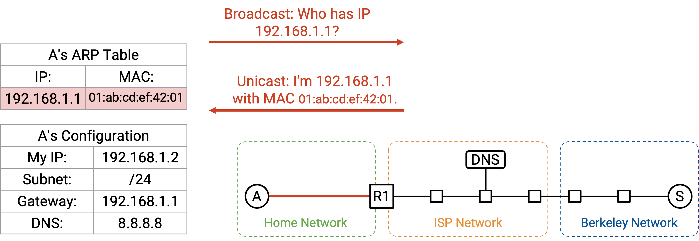

图：ARP 询问 192.168.1.1，网关回答后主机缓存映射。原图用 01:ab:cd:ef:42:01 当网关 MAC，仅能视作有误的示意值。

> 原图地址勘误：`01` 首字节最低位为 1，是组地址位，不能作为普通单播网关 MAC。后续原图沿用它，保留原图不等于认可其有效性；本机示例 `23:45:67:89:ab:cd` 也有相同组地址位问题。真实接口单播地址必须满足单播位条件。

### 第三步：DNS

浏览器通过 `getaddrinfo` 一类 API 触发解析。已知解析器 `8.8.8.8` 不在本地，所以 DNS 包的下一跳是网关。自上而下构造：

- 第 7 层：问题区查询 `www.berkeley.edu` 的 A 记录，填 ID 和计数。
- 第 4 层：UDP 源端口为临时端口，目的 53。
- 第 3 层：源 IP 为 DHCP 分得的 `192.168.1.2`，目的为解析器 `8.8.8.8`。
- 第 2 层：源 MAC 为自己的接口地址，目的为 ARP 学到的网关 MAC。
- 第 1 层：沿物理介质发送比特。

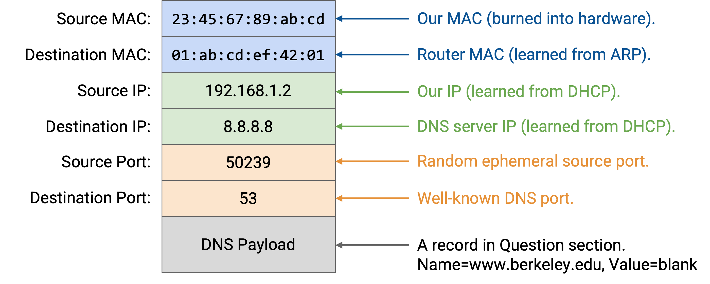

图：DNS 封装例子：临时 UDP 源端口 50239、目的 53；IP 目的为 DNS，MAC 目的为下一跳网关。原图 MAC 值有前述组地址位错误。

经过 NAT 网关时，私有 IP 及可能的 UDP 端口被转换，但主机不必主动替网关改写。递归解析器若无缓存则向权威服务器继续查询，最终回送 A 记录。

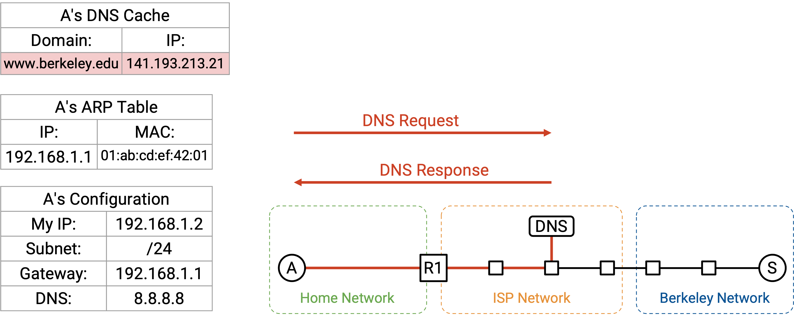

图：主机收到 www.berkeley.edu→141.193.213.21 的教材示例答案，DNS、ARP、接口配置是三类不同状态。

### 第四步：连接网站并交换 HTTP

取得网站 IP 后，HTTP/1.1 需要先建立 TCP 连接。浏览器调用 socket 的 connect，操作系统处理 SYN、SYN-ACK、ACK，得到到服务器的字节流。

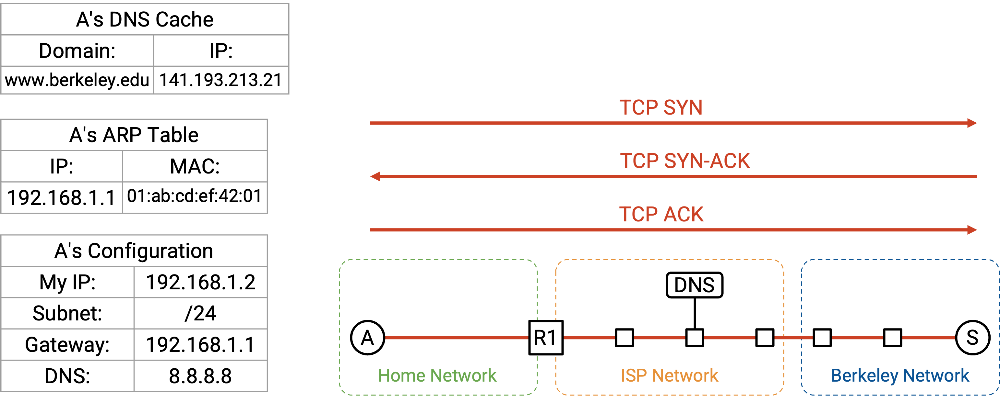

图：TCP 三次握手目的为网站服务器；它与此前到 DNS 解析器的 UDP 事务不同。

然后构造请求：方法 GET，资源 `/`，版本 HTTP/1.1。TCP 源端口可以由应用指定，或通过请求操作系统分配空闲临时端口；“Port 0”是相应 API 场景中的自动选择约定，不是在线路上用源端口 0。目的端口为普通 HTTP 的 80。IP 源仍是本机，目的改为 DNS 返回的 `141.193.213.21`；二层仍给本地网关，缓存可复用。

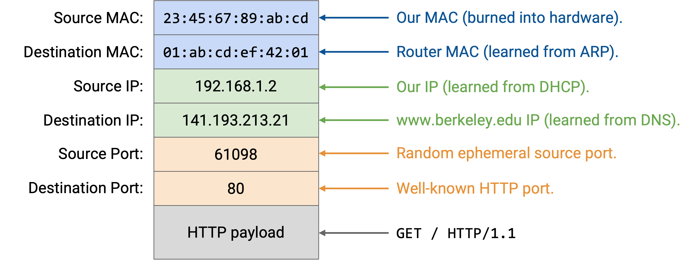

图：HTTP/TCP 使用示例临时源端口 61098、目的 80；目的 IP 是网站，目的 MAC 仍是网关。图中的 GET 只是请求行，完整 HTTP/1.1 还需 Host 等。

网站返回 `200 OK` 与 HTML。浏览器从 socket 读字节，解析状态、头与正文。HTTP 用消息定界把字节流划成请求/响应：CRLF 终止行，空行终止头，正文则根据 Content-Length、分块编码等规则定界，特定情形也以连接关闭结束。**不是遇到任意换行就结束整个响应。** 已知长度也有助于安排接收缓冲，但不意味着必须一次分配或一次读完所有正文。

HTML 里的 `` 会引发新的图片请求；用户点击 `/about.html` 又触发新请求。

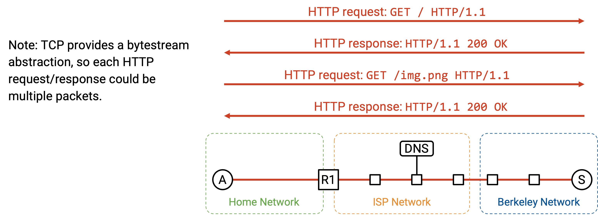

图：一个响应可能触发更多资源请求，同一连接可承载多次 HTTP 交互。

可保持 TCP 连接复用，提高效率；是否进一步流水线发送是另一选择。最后任一端决定关闭，双方各发送 FIN，对方各予 ACK，正常完成连接关闭。

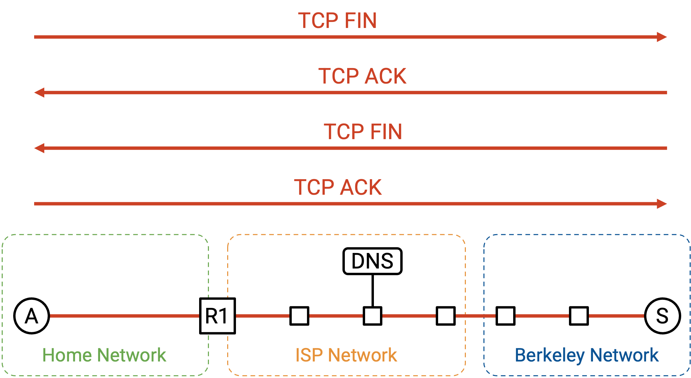

图：示例画出双向 FIN 及相应 ACK；具体实现可能合并部分控制报文，图不是唯一包数规范。

HTTP 消息不一定恰好一个 TCP 包，可能跨许多分段。整条请求/响应只有一套 HTTP 消息结构，TCP 按序号重组；每次 socket read 也不对应一条完整 HTTP 消息。原文说这些包的一至三层首部相同，只能理解为通常同属相同端点和路径的封装模型：实际 IP 标识、长度、TTL 等可能变化，换链路 MAC 也会变，不能说首部逐位一样。

### Socket 抽象

用户浏览网页不用手写网络代码；应用开发者则通过软件 socket 接口访问网络。教材列出五类基本操作：create 新 socket；connect 发起 TCP 连接；listen 让指定端口准备接受连接；write 发送字节；read 请求读取字节。对象语言中创建可表现为构造函数。

这些接口让应用不必每次重写 TCP、IP、以太网。原文把“read(N)”表述成读 N 字节，**实际常可能返回少于 N，必须按协议处理短读、EOF 与错误**。listen 不直接得到每个已连接 socket，通常还需要 bind/accept 等操作，教材列表是抽象，不是完整 API 使用步骤。

操作系统用端口帮助分用，但不能只靠一个端口区分所有 TCP 连接：同一服务器监听端口可服务多个远端，连接身份需要协议与本地/远端地址、端口等信息。socket 创建也不等于 TCP 已连接。

### 操作系统与硬件分工

典型模型中，一、二层由 NIC 及驱动配合，三、四层在操作系统网络栈，应用层在应用软件。把 IP/TCP 放在系统里可供许多程序复用。应用侧主要处理数据和连接，NIC 侧主要处理帧与信号，网络栈把二者连接起来。硬件卸载、用户态协议栈等实现会改变具体分工，这里是教学模型。

### 观察实际报文

tshark、Wireshark 可用于查看和调试报文；浏览器开发者工具的 Network 面板可观察请求响应。真实网络还会有本例略去的复杂性：HTTPS 的 TLS 加密，或 HTTP/3 使用 QUIC 而非 TCP。QUIC 是基于 UDP 承载、提供可靠流和拥塞控制等功能的独立传输协议，不只是“不可靠 UDP 的别名”。本次未运行抓包或网络实验。

### 再看分层

完整流程说明分层为何有用：可在某层解决特定问题，而不必同时理解所有层。教材指出课堂没有深入讲物理层的电气与物理实现，仍能在它的抽象上构建高层。

HTTP 上方也可继续抽象。许多应用都需要更复杂、重复的功能，不应人人从 HTTP 开始重写。RPC 库允许调用看似普通函数、实际在远端执行；Apache Thrift、gRPC 等帮助隐藏协议细节。

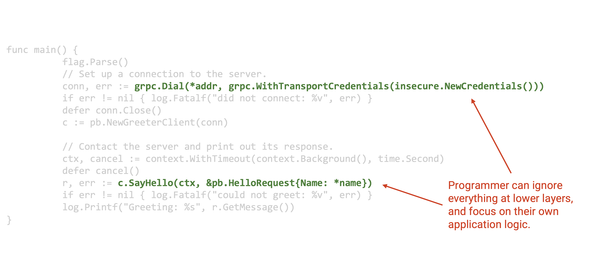

图：gRPC 客户端示例突出建连接与 SayHello 两个调用，其余低层协议被库隐藏。原图使用 insecure.NewCredentials，仅是无 TLS 的演示，不可照搬为生产安全配置。

图中程序先解析参数，用 `grpc.Dial` 连接服务器，错误则记录退出，延迟关闭连接；构造 Greeter 客户端，建立一秒超时 context 并安排取消；调用 `SayHello` 发送包含 Name 的请求，检查错误并打印 Greeting。关键两处（仅转录片段，不执行）：

```go
conn, err := grpc.Dial(*addr,
    grpc.WithTransportCredentials(insecure.NewCredentials()))
r, err := c.SayHello(ctx, &pb.HelloRequest{Name: *name})
```

图想表达程序员可专注应用逻辑，无需逐项编写 HTTP、TCP、IP、以太网、ARP、DHCP。了解下层仍有价值：出错时可定位，优化时能理解协议代价；但分层抽象让正常应用不必重复实现它们。

### 与第 20 讲的共享关系

[第 20 讲独立笔记](#/c/berkeley-cs168-2025/lec/lec20?v=notes)复用本页五章，不另复制材料。这是课表指定阅读的归属，不表示上述顺序已经在第 19/20 讲录像中核实。


## 引用与来源

- [ARP](https://textbook.cs168.io/end-to-end/arp.html)，固定源码 `end-to-end/arp.md`。
- [DHCP](https://textbook.cs168.io/end-to-end/dhcp.html)，固定源码 `end-to-end/dhcp.md`。
- [NAT](https://textbook.cs168.io/end-to-end/nat.html)，固定源码 `end-to-end/nat.md`。
- [TLS](https://textbook.cs168.io/end-to-end/tls.html)，固定源码 `end-to-end/tls.md`。
- [End-to-End](https://textbook.cs168.io/end-to-end/end-to-end.html)，固定源码 `end-to-end/end-to-end.md`。

原作者 Peyrin Kao，基于 Sylvia Ratnasamy、Rob Shakir 等人的课程讲授。原教材及本中文翻译按 [CC BY-SA 4.0](https://creativecommons.org/licenses/by-sa/4.0/) 发布。采用 2026-10-01 的固定快照，不是 Spring 2025 历史教材。固定 commit：

```text
0b8208742d31df7fc3d53a0cd94fdd4e04f8d47e
```

修改：全文中译、中文图注与独立勘注；原图字节不变，仅加白底显示以保持深色主题可读。历史数值、服务名称和示例地址保留原文语境，不代表当前测量。课件与视频不适用本教材许可。
