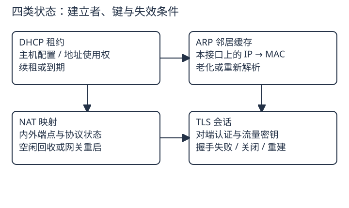

# 同样叫“连不上”，究竟丢了哪一种状态？

主机有 IP 不代表知道网关的 MAC；网关有 MAC 不代表 NAT 还有映射；TCP 建连不代表 TLS 信任对端。把状态的键、持有者和寿命分清，才能从现象推到原因。

## 问题一：启动为什么没有无穷依赖？

“拿 IP 要先用 IP 通信”似乎循环。DHCP 用受约束的初始值打断它：源 0.0.0.0、目的有限广播地址，二层直接广播，不先查 DNS 或 ARP。拿到地址、掩码、默认网关和解析器后，才有普通 IP 路由所需的配置。

ARP 解决另一个循环：知道下一跳 IP，却不知道如何在以太网上找它，于是直接用二层广播询问 IP—MAC 映射。它不依赖一个已知的目标 MAC，也不运行在 UDP 上。

**关键差别：DHCP 给配置和有时限的地址使用权；ARP 给本地邻居的可达映射。** 拿到 DHCP 租约不会自动生成全部 ARP 表。

图：编者原创。箭头提示依赖可能存在，不表示所有协议总按固定时间顺序执行。

## 问题二：访问远端为什么只问网关的 MAC？

自拟地址：主机 `192.168.10.23/24`，网关 `192.168.10.1`，远端 `203.0.113.20`。

先做路由选择：远端不匹配直连前缀，下一跳是网关。然后只对 `192.168.10.1` 做 ARP。封装时三层目的填远端，二层目的填网关。远端并不在本广播域，它也收不到这个 ARP 广播。

若本地目标为 `192.168.10.40`，才直接解析 `.40`。这不是 DNS 和 ARP 二选一：DNS 解决名字→IP，路由解决 IP→下一跳/接口，ARP 解决本接口下一跳 IP→MAC，三个阶段输入输出不同。

路由器向下一链路转发时重新封装二层，普通 IP 目的仍指最终端点。NAT 修改三层/四层标识，是这个普通转发模型的明确例外。

## 问题三：为什么 PAT 不改端口就不够？

两台内网主机都从 50000 访问同一服务 S:443。若网关只把源 IP 都改成公网 R，外部看到的两条 TCP 四元组完全相同，不可能知道哪个回复属于谁。

可建立两条映射（自拟表）：

| 内部端点 | 公网端点 | 远端 |
|---|---|---|
| A:50000 | R:40001 | S:443 |
| B:50000 | R:40002 | S:443 |

出站 A 的源被改成 R:40001；入站 S:443→R:40001 必须还原目的为 A:50000。反向改写忘记恢复端口，会把正确 IP 的包交给错误 socket。实际键还要含协议，UDP 与 TCP 的相同数字端口不是一条连接。

这要求状态保留到回复到达。网关重启、空闲超时或状态容量耗尽，都可能让外网回复无处可交，而主机仍以为 TCP 连接存在。NAT 状态不是持久事务记录；TCP 与 NAT 的生命期也不自动同步。

## 问题四：TLS 为什么必须检查名字，而非只检查地址？

DNS 可能错误或遭篡改，IP 路由也只负责送到一个网络端点。若服务器提供一张证书，客户端还必须判断这张证书是否对**原本要访问的主机名**有效、信任链和有效期是否成立，并验证对端持有相关秘密。否则攻击者拿自己的有效证书仍可冒充银行。

握手中的随机数与秘密派生会话密钥；临时密钥交换可提供特定条件下的前向安全。这不等于所有旧 TLS 方式都有相同属性：教材的 RSA 密钥传输示意不适用于 TLS 1.3，也不提供与临时 DH 相同的前向安全保证。

TLS 保护应用字节的机密性与完整性并认证对端，但网络仍可丢包、延迟、断开；它不保证可用性，也不把恶意网页变成安全业务。NAT 的“没有入站映射”更不是 TLS 的替代：一个限制路径，另一个保护通信与身份。

## 用状态失效解释现象

| 现象 | 首先区分的状态问题 |
|---|---|
| 没拿到地址或租约到期 | DHCP/接口配置，不是先查网页状态码 |
| 同网段 IP 存在却发不出二层帧 | 下一跳判断、ARP/ND、二层转发 |
| 新连接正常、某旧连接突然失效 | 可能有 NAT/端点会话状态失配，不能仅归因 DNS |
| TCP 成功但 TLS 拒绝 | 名字、证书、时钟、密码协商等安全前提 |
| 只外部主动访问失败 | 入站映射和防火墙策略，与内网主动连接不同 |

这是分析方向，不是仅凭现象就确诊。一个故障可同时影响多种状态，排错证据也要按层解释。

## 易错点

DHCP 客户端端口是 UDP 68，不是教材某图的临时端口；Offer/ACK 不保证始终单播。IPv6 ND/SLAAC 不用 IPv4 式广播，接口标识不总从 MAC 派生。MAC 通常属于接口，且可改写；IP 与真实人的身份也不能画等号。NAT 可配置映射，因而不是原则性“只出不进”的安全保证。

## 自测

DNS 回答了网站 IP，为什么 ARP 表却只增加网关 IP？

网站在远端，需要在本链路交给网关，ARP 缓存的是本地下一跳而非远方目的。DNS 与 ARP 的作用域不同。

两台主机端口相同，是否说明客户端程序写错？

不是。端口分配在各主机的本地上下文中进行，独立选择相同端口正常。共享公网身份的 PAT 必须解决冲突，不能要求全球客户端协调端口。

知道服务器 IP，能否跳过 HTTPS 主机名验证？

不能。IP 可变化或被错误解析，身份检查应围绕应用期望的名字与可信证据，不能将“某处接受 TCP”作为认证。

NAT 挡住了外部首个包，是否就无需防火墙？

否。转换的可达性副作用不等于覆盖协议、服务、方向、授权和已有连接的安全策略；显式映射与应用行为还会改变暴露面。

## 引用与来源、课堂覆盖边界

- 教材依据：[本讲唯一材料页](#/c/berkeley-cs168-2025/lec/lec19?v=materials)。原作者 Peyrin Kao，基于 Sylvia Ratnasamy、Rob Shakir 等人的讲授；采用 2026-10-01 固定快照，不是 2025 历史教材。正文为编者以已读教材为基础的独立问题推导，不是课堂复述。教材译文、原图及许可见材料页。
- 课程归属依据：[Spring 2025 官方课表](https://sp25.cs168.io/)。官方指定视频 ID `AgoxhLdLQSQ`，个体元数据时长 **80:43**，上传日期 **2025-04-08**；上传日期不是课表上课日期。频道为 CS 168 (Internet Architecture) at UC Berkeley。
- 字幕主路径及一次不同官方 timedtext 通路均返回 HTTP 429。未读到字幕，也未核验音轨、画面、片头、片尾或 Q&A；没有可据以建立的讲解时间索引。因此不生成占位 draft，不宣称全片覆盖。
- 视频 license 元数据为空，许可未知；教材 CC BY-SA 4.0 不扩展到视频或课件。本页 SVG 为编者原创概念图，不是课堂截图。没有执行示例命令、抓包、学生实验、构建或测试。
