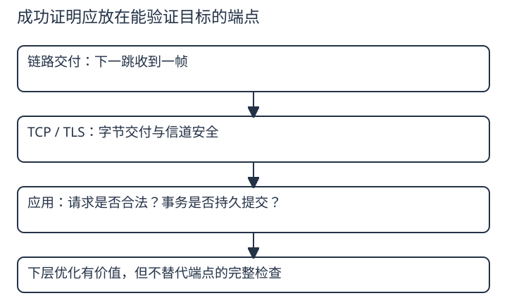

# “网络已经成功”为什么仍不足以证明任务完成？

用户关心的是网页可用、文件正确或转账完成；链路只知道帧，TCP 只知道字节，TLS 只知道安全通道。把业务目标交给不具备完整上下文的下层，常会得到一个过弱的“成功”。

本页以[第 19 讲唯一材料页](#/c/berkeley-cs168-2025/lec/lec19?v=materials)的五章为基础，独立推导端到端边界与跨层故障。它不复制材料，也不按照未经核验的第 20 讲视频顺序编排。

## 把一次网页访问画成依赖图，而非背固定清单

冷启动的典型路径是：

1. 接口配置让主机知道自身地址与下一跳。
2. 到下一跳的二层映射让 IP 包离开本地。
3. 名字解析得到目标服务地址。
4. 传输建立连接，安全层验证对端并建立密钥。
5. HTTP 交换资源，浏览器再根据内容触发新请求。

这不是每次访问都必须完整重复的串行流程。接口可能静态配置；ARP、DNS 可能命中缓存；TCP/TLS 可能复用；浏览器可能直接使用新鲜缓存而根本不访问源站。IPv6、HTTP/3 等还会改变具体协议。

因此优化前应问：**这次请求真正等待的依赖是什么？** 把 DNS 缓存命中时间再减半，无法解决服务器处理几十秒的瓶颈；增加链路带宽也不能消除远距离握手的传播延迟。

## 一个端到端论证的成立条件

端到端原则不是“网络里永远不能有状态”或“所有事情都只能在应用做”。更精确的工程判断是：

- 某项正确性目标需要最终端点的知识或验证。
- 单靠通信子系统的局部机制无法完整满足该目标。
- 那么端点仍需做完整检查；下层重复机制可以为性能、早期恢复或局部效率服务，但不能替代端点责任。

例如文件传输：逐链路检错能减少坏帧传播，TCP 保证字节序，但源端读错文件、目标端写盘失败等并不由链路机制发现。若目标是“目标文件与期望内容一致并已保存”，就需要端点结合预期摘要与存储结果验证。具体是否使用摘要、事务、确认，取决于威胁模型和失败模型，而不是机械地每层重复同一算法。

这是编者基于分层和教材端到端案例的原则化推导，**教材 end-to-end 章本身主要是连通流程，不是一篇完整端到端原则论文的翻译**。

图：编者自拟。越接近业务目标，所需上下文越不能被低层“收到”替代。

## “已收到”的四种不同含义

- 链路接收：下一跳收到或检验了这一帧，不证明最终主机收到。
- TCP ACK：对应字节被对端 TCP 接收确认，不证明应用已 read，更不证明事务提交。
- TLS 记录验证：字节来自持有会话密钥的一端且未被篡改，不证明服务端业务结果正确。
- 应用确认：按协议定义某项操作成功；若需要跨故障持久化，还得定义确认发生在什么提交点之后。

假设用户提交一次付款，连接突然断开。可能请求未到，也可能银行已提交、响应未到。此时“再发一个一样的包”没有唯一正确结果。需要业务级请求标识、去重与结果查询；这不是要求学生在本课程实验里实现支付系统，而是用反例说明抽象的边界。

## 网络中间状态何时合理？

DHCP 维护租约、ARP 缓存邻居、交换机学习 MAC、NAT 保存转换、CDN 缓存内容，都是有用状态。问题不在“有无状态”，而在状态如何影响端点可见语义与故障。

NAT 为共享 IPv4 地址引入中间映射，减少地址压力，却让端点连接依赖网关保存相应状态，也让外部主动入站不再自动可达。CDN 将内容放近用户，减少时延与流量，却必须遵守表示、授权、新鲜性等语义；HTTPS 终止位置还明确划定安全信任边界。

如果一个中间设备只应优化性能，失效后却让应用无法分辨“未执行”与“已执行”，就应把这些失败情形纳入应用协议设计，而不是只在网络图上多画一条线。

## 自拟故障推演：缓存都命中为何仍失败？

主机地址租约有效，DNS 与 ARP 都命中，一个 HTTPS 长连接也一直保留。家用网关重启后丢失 NAT 状态。

1. 本机仍有连接，不代表中间映射仍在。
2. 后续包是否能恢复映射取决于具体 NAT、TCP 状态和过滤策略，不可默认无缝。
3. 原连接失败后重建 TCP/TLS 可能恢复网络通道。
4. 但重建通道不回答此前那个业务请求是否已经完成，仍须应用处理结果未知。

这个例子把可达性恢复与业务恢复分离。相反，若 TLS 证书不匹配，反复重建 TCP 也不会修复身份错误；把安全校验关掉只是掩盖问题，不是修复。

## 用反事实缩小故障范围

若只访问某个名字失败，比较名字解析与目标服务；若所有外网失败而本地通，比较默认路由和网关；若 TCP 可建立而 TLS 不通，比较安全前提；若 HTTP 返回正确状态但页面缺图，继续看后续资源请求与缓存，而不是把整个网页当成一个包。

反事实必须控制语义变化：直接使用 IP 访问会影响 HTTP Host 与 TLS 名字校验，不能把它当完全相同请求。换 DNS 解析器还可能改变 CDN 返回地址；换网络则同时改变路由、NAT、MTU 等条件。排错应注明改变了哪些变量。

## 自测

既然端点需要校验，为什么链路层 CRC 不是多余？

它可以尽早发现局部损坏，减少无效流量与远端重试代价。端点的完整正确性责任不排斥下层为效率提供局部检查。

TCP ACK 到了，能否告诉用户“文件已经安全写入磁盘”？

不能。ACK 的语义是传输接收，不涵盖应用读取、内容验证、文件写入或持久化。需要应用在相应提交点之后发出有明确定义的确认。

NAT 状态恢复是否意味着此前的业务效果也回滚？

不是。网络映射与远端事务是不同状态，前者丢失/恢复不自动改变后者。业务必须独立解决重复与结果未知。

端到端原则是否证明任何代理或 CDN 都是不好的设计？

不证明。它要求知道谁掌握完整正确性知识、哪个中间机制只是优化、信任边界在哪里。代理/CDN 可以有显著收益，但不能隐去其一致性、安全与故障语义。

## 引用与来源、课堂覆盖边界

- 教材依据：[本讲唯一材料页](#/c/berkeley-cs168-2025/lec/lec19?v=materials)。原作者 Peyrin Kao，基于 Sylvia Ratnasamy、Rob Shakir 等人的讲授；采用 2026-10-01 固定快照，不是 2025 历史教材。正文为编者以已读教材为基础的独立问题推导，不是课堂复述。教材译文、原图及许可见材料页。
- 课程归属依据：[Spring 2025 官方课表](https://sp25.cs168.io/)。官方指定视频 ID `fWoO4SmlF3g`，个体元数据时长 **79:57**，上传日期 **2025-04-10**；上传日期不是课表上课日期。频道为 CS 168 (Internet Architecture) at UC Berkeley。
- 官方课表把本讲列作 ARP/DHCP/NAT/TLS 续讲，但指定 ID 的实际视频标题是 **[CS168 SP25] Lecture 20 - Datacenter Topology**。保留官网 ID，不把本页教材顺序冒充录像主题或擅自更换录像。
- 字幕主路径及一次不同官方 timedtext 通路均返回 HTTP 429。未读到字幕，也未核验音轨、画面、片头、片尾或 Q&A；没有可据以建立的讲解时间索引。因此不生成占位 draft，不宣称全片覆盖。
- 视频 license 元数据为空，许可未知；教材 CC BY-SA 4.0 不扩展到视频或课件。本页 SVG 为编者原创概念图，不是课堂截图。没有执行示例命令、抓包、学生实验、构建或测试。
