# 数据中心拓扑与拥塞控制

## 一、数据中心是什么？

此前的互联网模型让端主机相互发送分组。端主机可能是你的个人电脑，也可能是 YouTube 这样的服务器。但 YouTube 真的是一台为全世界提供视频的机器吗？


实际上，YouTube 背后是整座建筑中的互联机器，它们协作向客户端提供视频。这些机器处于同一个本地网络，可以彼此通信来完成请求，例如用户请求的视频可能存储在不同机器上。

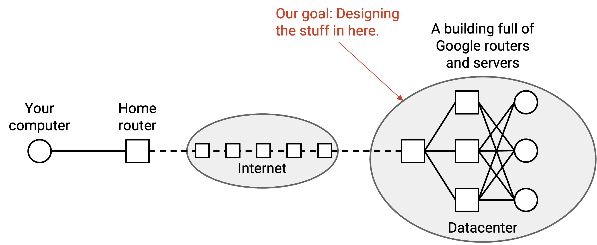

在互联网的“网络之网络”模型中，各运营者可以自行管理本地网络。本章关注专门连接数据中心服务器的本地网络，而非连接个人电脑等用户的网络；讨论其独特挑战，以及适用于该环境的拥塞控制、路由等专门方案。

现实中的数据中心通常位于一个物理地点，有时占据专门园区。除服务器等计算设施外，它还需要供电和冷却系统。本章聚焦连接服务器的本地网络。

数据中心承载 YouTube 视频、Google 搜索等应用，是用户希望与之通信的端主机基础设施。这不同于前面介绍的运营商机房（carrier hotel）：后者让不同公司拥有的网络通过大型路由器互联，属于转发分组的路由基础设施，通常不承载这些应用。

数据中心通常由 Google、Amazon 等单一组织拥有；同一组织可以在其中运行 Gmail、YouTube 等多种应用，因此能控制内部网络的全部基础设施。这里重点讨论大型科技公司的现代超大规模数据中心。大规模带来特殊挑战，但本章概念也适用于较小规模。

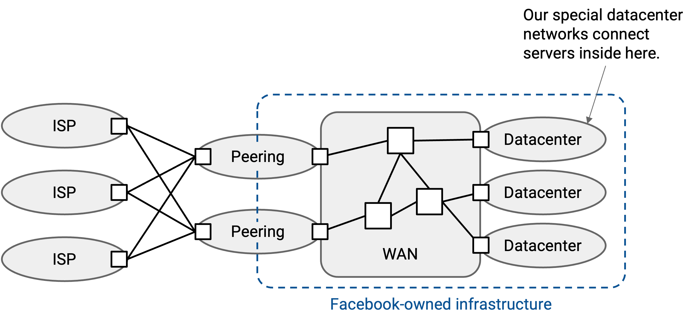

这幅图展示一家大型科技公司所拥有网络的广域网（WAN）。对等互联点（peering location）把 Google 与互联网其他部分连接起来，其中主要是 Google 自己的路由器，与其他自治系统相连。

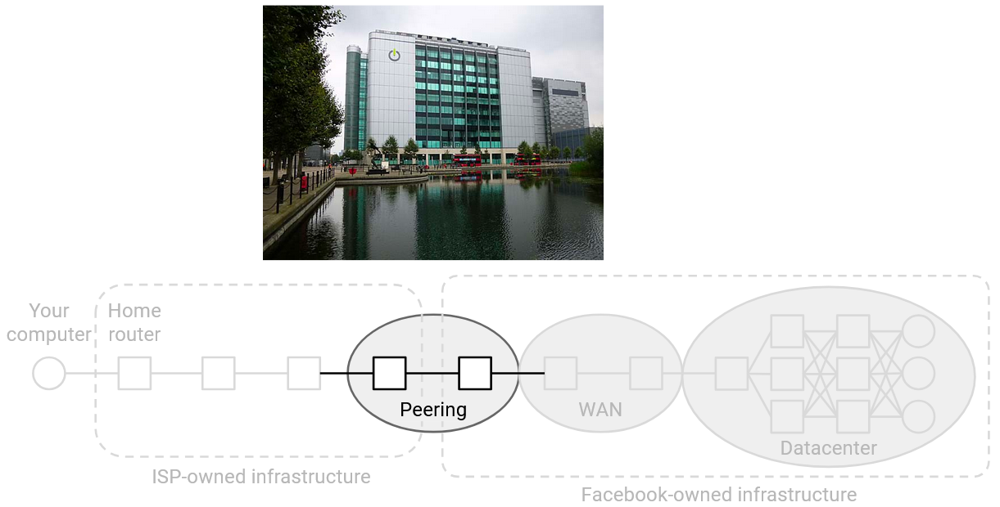

除对等互联点外，Google 还运营许多数据中心。数据中心中的应用可以通过互联点与外界通信；数据中心与互联点之间，由 Google 管理的路由器和链路组成 WAN。

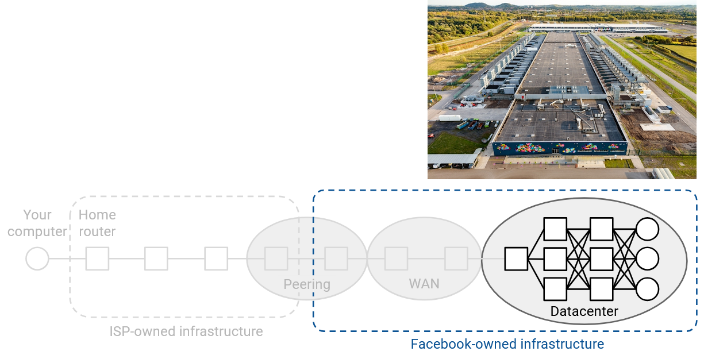

互联点和数据中心追求不同的性能目标，因此往往不在同一地点。互联点重视靠近其他公司和网络，所以运营商机房常在城市中，以接近客户和其他企业。数据中心则不那么依赖这种邻近关系，更重视空间、电力和冷却，因而常建在人口较少的地方，可能靠近河流以便冷却，或靠近电站。其用电量可能是互联点的数百倍。

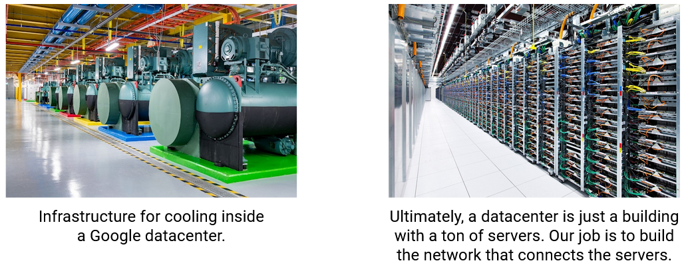

## 二、数据中心为什么不同？

与互联网其余部分的通用广域网络相比，数据中心有以下特点。

首先，网络由一个组织运营，对网络和主机具有更强的控制力。可以采用定制硬件、软件，并要求每台机器遵循同一套定制协议；通用互联网很难做到这一点。

其次，数据中心往往比较同质：服务器、交换机的构造和运维方式相近。不必像互联网那样同时兼顾无线与有线链路、新旧不一的计算机。教材用“同一代机器、整个数据中心同时升级”描述这种同质性。

> 编者注：后一说法是用于对比互联网异构性的简化，并非运维定律。现实数据中心可以混合多代设备，也可以分批升级。

最后，网络位于一个物理地点，无须处理海底电缆那样的长距离链路，却必须在这个地点内支持极高带宽。

## 三、数据中心的流量模式

用户发往应用的请求经过通用互联网中的路由器，最终到达 Google 的路由器，再被转发到数据中心边缘路由器，最后交给某台服务器。

这一台服务器大概没有处理请求所需的全部信息。例如生成 Facebook 信息流，需要其他服务器共同提供广告、照片、帖子等内容；要求每台机器都了解整个 Facebook 才能独立回答请求，并不实际。

为了协调，入口服务器会触发很多后端请求，收集所需信息后再回复用户。一个用户请求可能触发数百个后端请求；教材引用一篇 2013 年 Facebook 论文，给出的平均数为 **521**。一般而言，服务器之间的后端流量显著多于与用户之间的外部流量。

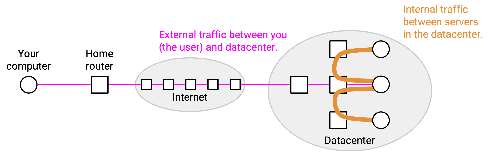

多数现代应用的流量以机器间内部通信为主。例如运行 MapReduce 等分布式程序，各服务器需要相互通信，才能共同完成大型查询。有些应用甚至没有面向用户的网络流量，例如定期备份会让服务器互相传数据，却不产生用户直接可见的结果。

通向网络外部的连接，如连接终端用户或其他数据中心，称为**南北向流量**；本地网络内部机器之间的连接称为**东西向流量**。教材指出，东西向流量可能高出若干数量级，并随着机器学习等应用增长。

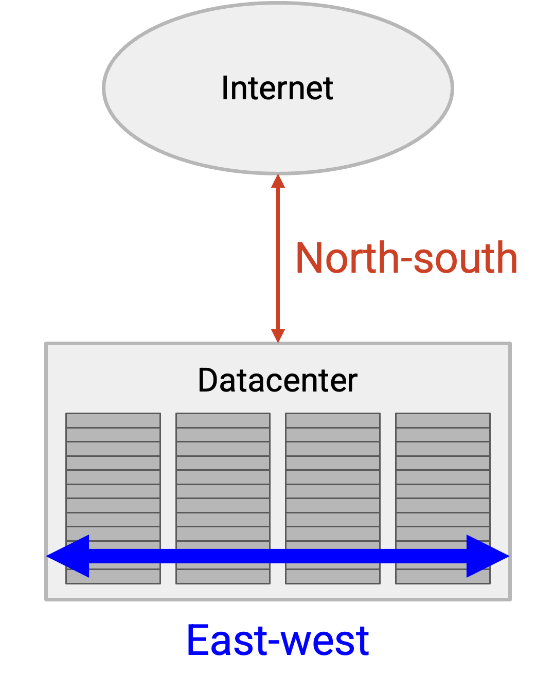

## 四、机架与机架顶交换机

数据中心由许多服务器组成，服务器安装在物理机架中。一个机架有约 **40–48 个机架单位（槽位）**，每个单位可放 **1–2 台服务器**。

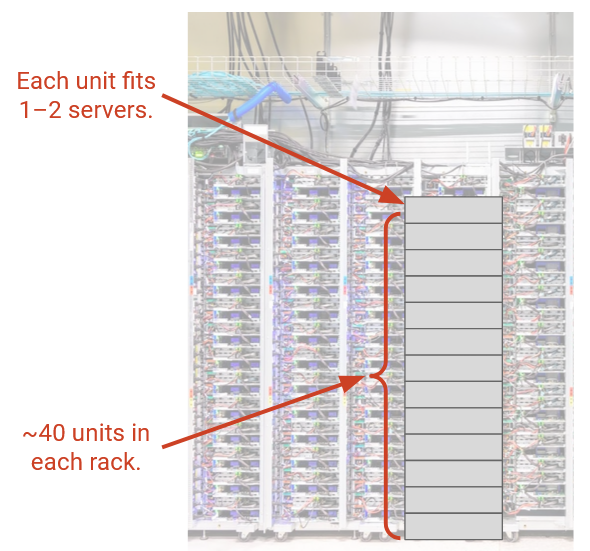

要让所有服务器互通，就需要选择合适的链路和交换机布局。先考虑单个机架：每个机架有一个**机架顶交换机（TOR）**，各服务器通过**接入链路或上行链路**连接它。TOR 是相对小型的转发设备，具有一个转发芯片和连接机架内服务器的物理端口。教材给出的服务器上行容量典型值约为 **100 Gbps**。

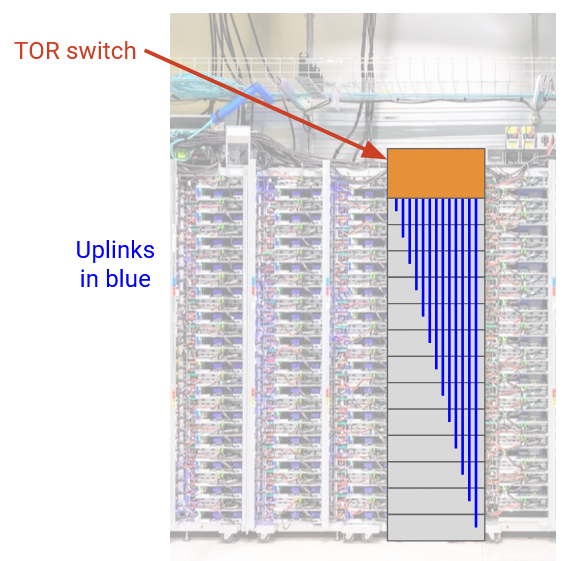

下一步要连接不同机架。理想目标是任意服务器都可以用完整线速，即全部上行带宽，与其他服务器通信。

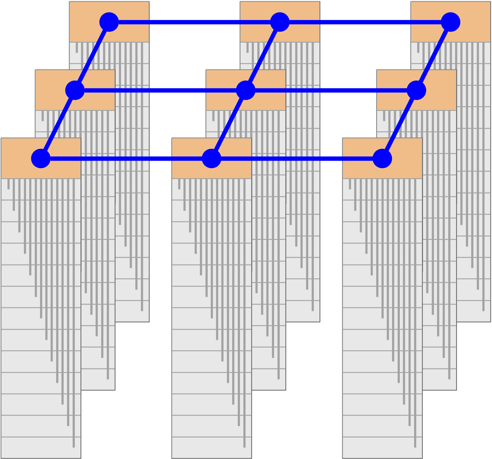

## 五、二分带宽与过订阅

先建立一个衡量网络互联程度的指标。

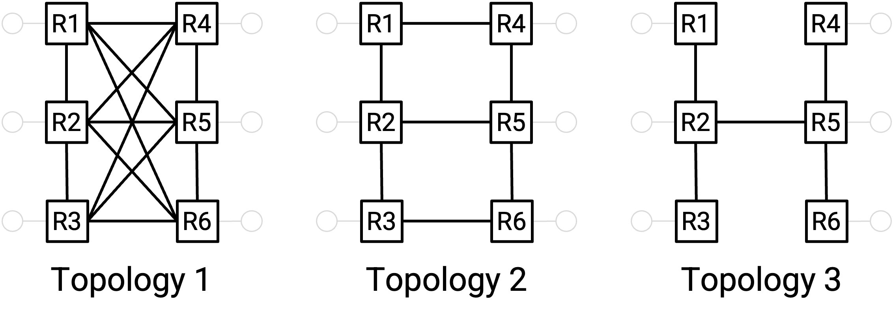

虽然三个网络都连通，直观上左侧互联程度最高，中间其次，右侧最低。例如左侧和中间可让 1→4、3→6 同时以完整线速通信，右侧不行。

可以用“要切断多少条链路才能让网络断开”说明冗余程度：需要切断的链路多，说明有更多冗余，可支持更多并发高带宽连接。右侧只需切断 2–5 就会断开，暴露了瓶颈。原文此处把 disconnect 误写成 connect，译文按“断开”处理。

**二分带宽（bisection bandwidth）** 把这个直觉量化：将网络划分为节点数量相等、彼此断开的两半，计算需要切断的链路带宽之和，并在所有等分方案中取最小值。

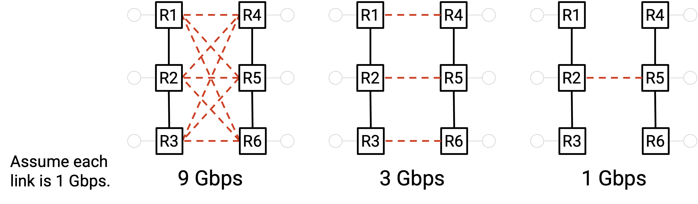

原文用右图的单链路切分，与左图的九链路切分比较。另一种描述是：把节点分成两半，一侧每个节点同时向另一侧对应节点发送数据，考察所有划分中的最差聚合带宽；取最差情况是为了暴露瓶颈。

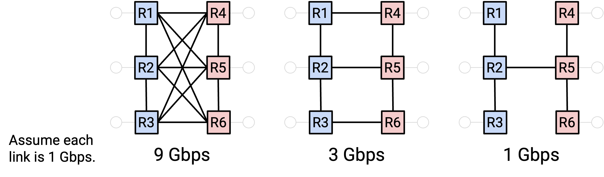

> 勘注：图13–14给出的是**所画切口**的容量。按图中全部边计算，左图改用 `{R1,R2,R4}` 与 `{R3,R5,R6}` 划分只切断7条边，因此不能把9 Gbps直接称为全局最小二分带宽。并且一般多商品网络中，某个切口容量大，不自动证明每一种端到端配对都能达到线速；还须证明可行的路由分配。

**完整二分带宽**表示不存在限制这种同时通信的瓶颈：无论如何划分，两边的节点都能配对并同时按完整速率通信。若有 $N$ 个节点，每个以速率 $R$ 发送，一侧有 $N/2$ 个节点，则完整二分带宽为：

$$
B_{\mathrm{full}}=\frac{N}{2}R.
$$

**过订阅（oversubscription）** 衡量距离完整二分带宽还有多远，也可以理解为瓶颈在满负载时会被超额使用多少。

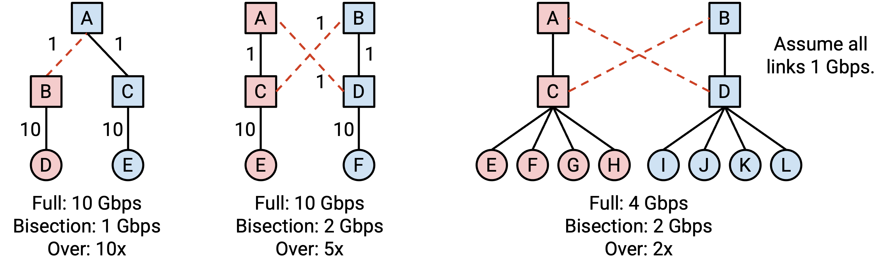

以最右图为例，各链路均为 1 Gbps。左右各四台主机之间的二分带宽为 **2 Gbps**；四台左侧主机同时满速发送需要 **4 Gbps**。因此实际容量与完整容量之比为 $2/4=50\%$；换一个方向表达，网络是 **2 倍过订阅**，即 4 Gbps 的需求压在 2 Gbps 链路上。

> 勘注：原文先把过订阅称为“实际二分带宽／完整二分带宽”，随后又用2倍表示其倒数。为避免混淆，本文把前者称为**容量满足率**，把常用的过订阅倍数写为 $O=B_{\mathrm{full}}/B_{\mathrm{actual}}$。图中的10、5、2倍均采用后者。

## 六、如何选择拓扑？

二分带宽是拓扑的函数。数据中心运营者可以选择电缆连接方式，应该怎样提高二分带宽？

一种方法是把所有机架连到一台巨大的交叉开关交换机。左侧机架同时满速输入，交换机再向右侧满速输出，可得到完整二分带宽。

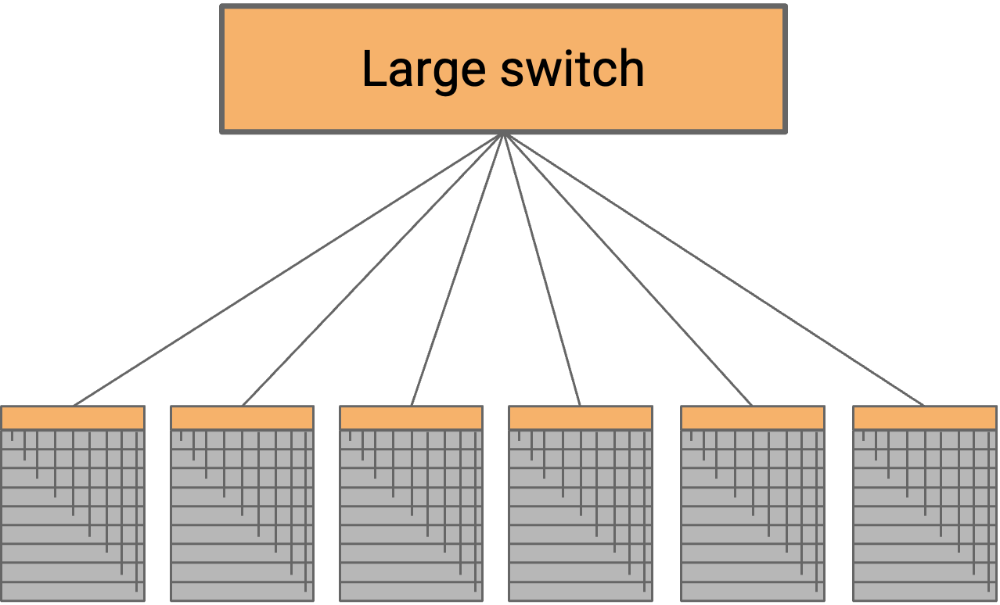

问题在于它需要给每个机架提供物理端口，可能达到 **2500 个端口**。外部端口数称为交换机的 **radix**，这里所需 radix 很大；总容量还可能达到 **每秒拍比特**量级。因此这种交换机难以制造，即使可造，成本也极高。教材提到，2000年代 Google 曾向厂商要求一台 **10,000端口**交换机，厂商认为做不到，而且几乎没有其他客户有同样需求，缺乏商业动力。

它还是一个单点故障：交换机损坏，整个数据中心网络便停止工作。

另一种方案是把交换机排成树形，降低单台设备的端口要求及单条链路容量要求。

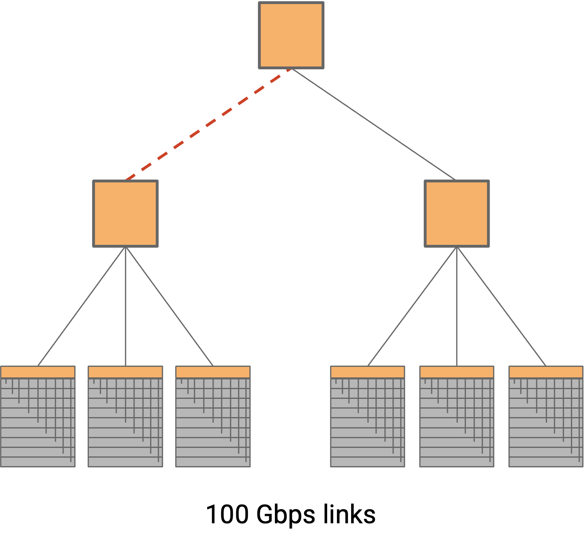

代价是二分带宽下降。树的两半之间仅有一条瓶颈链路。可以把越往上的链路做得越粗。

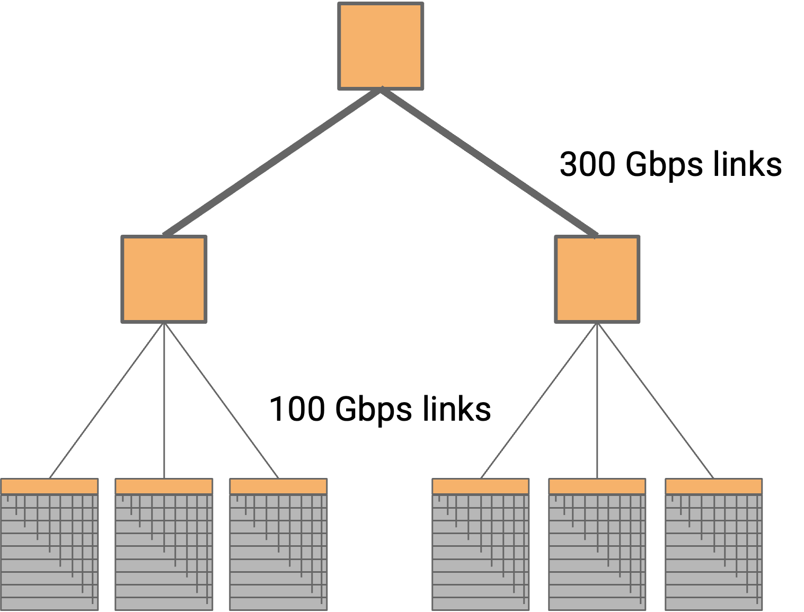

原文说“下方四条链路100 Gbps、上方两条300 Gbps”可以消除瓶颈、恢复完整二分带宽。这种拓扑能够使用，但仍未解决顶层交换机昂贵、扩展不良的问题。

> 勘注：图18每侧画三个机架，总共六条100 Gbps接入链路，故每侧300 Gbps与图吻合；正文“四条”与图不一致。按正文四条理解，300 Gbps上联也足够，但不是图中的计数。

## 七、Clos 网络

此前方案依赖定制交换机，可能要求极高容量或端口数，成本仍然很高。能否用大量廉价、现成、端口数相同且较小、链路速率一致的交换机，得到高二分带宽？

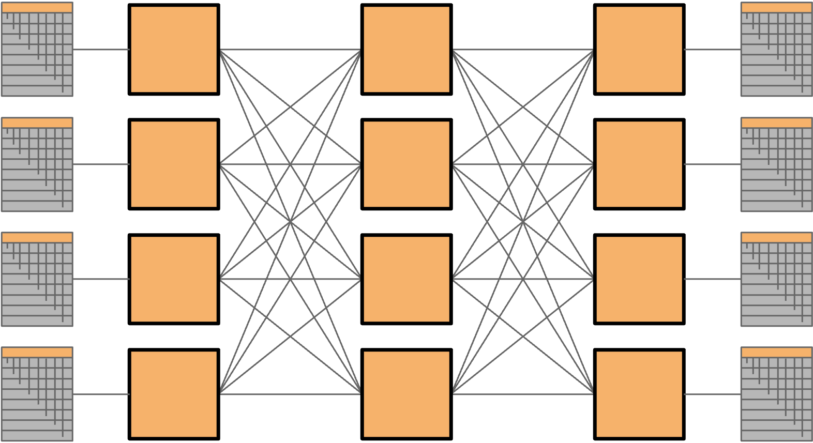

**Clos 网络**通过在节点之间提供大量路径，以通用部件实现高带宽。大量链路与路径让不同节点可以沿不同路径发送，从而取得高二分带宽。

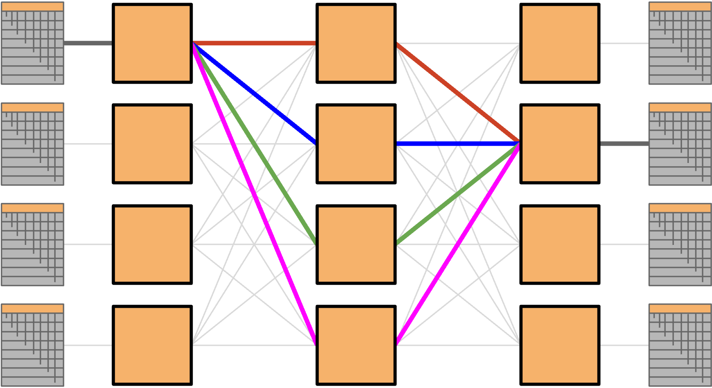

定制设备的扩容方式是造更大的交换机；Clos 的扩容方式则是增加更多同样的交换机，因此具有成本和扩展优势。Clos 也用于其他领域，名称来自其提出者 **Charles Clos（1952）**。

经典 Clos 把左侧机架视为发送方，右侧机架视为接收方。但数据中心机架既发送也接收，因此可把这两层合并：所有机架放在同一层，分组深入网络后再返回目的机架。这就是**折叠 Clos（folded Clos）**。

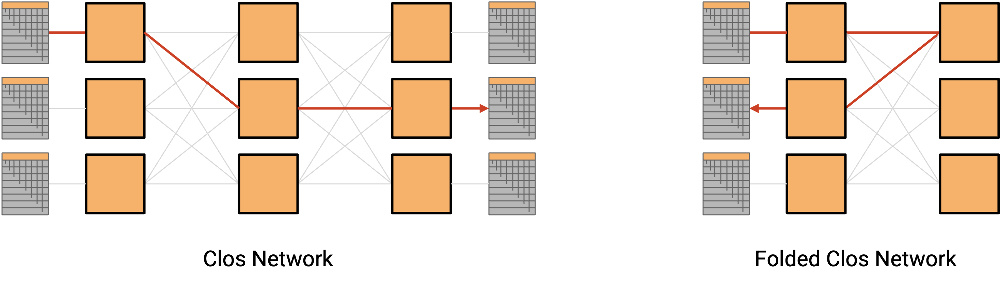

## 八、Fat-tree Clos 拓扑

加粗树可以用较低端口数获得完整二分带宽，但顶层交换机仍昂贵、难扩展且有单点故障。Clos 则可用通用交换机扩展网络。结合两者，就得到由通用部件构成的可扩展拓扑。本节介绍的方案来自2008年 SIGCOMM 论文 *A Scalable, Commodity Data Center Network Architecture*，作者为 Mohammad Al-Fares、Alexander Loukissas、Amin Vahdat。

### 8.1 Pod 内部

在 **$k$ 元 fat-tree** 中创建 $k$ 个 pod，每个 pod 有 $k$ 台交换机：上方**汇聚层**有 $k/2$ 台，下方**边缘层**有 $k/2$ 台。这里要求 $k$ 为偶数，才能均分。

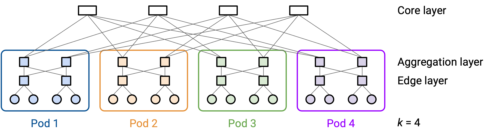

每台交换机有 $k$ 条链路，一半朝上，一半朝下。汇聚层交换机的 $k/2$ 条上联通向核心层，另 $k/2$ 条下联分别通向 pod 内全部边缘交换机。边缘交换机的 $k/2$ 条上联分别通向 pod 内全部汇聚交换机，另 $k/2$ 条下联连接主机。

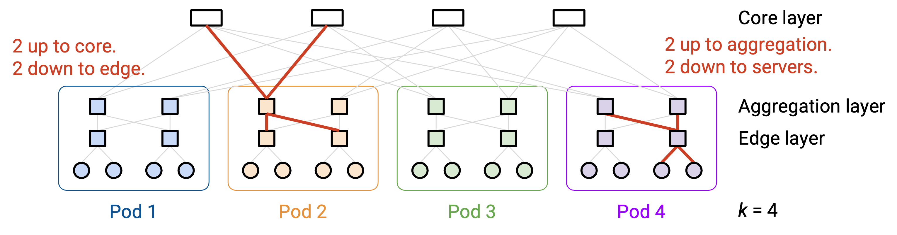

### 8.2 核心交换机与主机数量

核心层连接不同 pod。每台核心交换机有 $k$ 条链路，分别连接 $k$ 个 pod；核心交换机总数是 $(k/2)^2$。

推导如下：全网共有 $k\times(k/2)=k^2/2$ 台汇聚交换机，每台有 $k/2$ 条上联，因此核心层必须提供 $k^3/4$ 个向下的链路端口。每台核心交换机提供 $k$ 个，所以需要：

$$
\begin{aligned}
L_{\mathrm{agg\to core}}&=\frac{k^2}{2}\frac{k}{2}=\frac{k^3}{4},\\
N_{\mathrm{core}}&=\frac{k^3/4}{k}=\frac{k^2}{4}.
\end{aligned}
$$

每个 pod 有 $k/2$ 台边缘交换机，每台连接 $k/2$ 台主机，所以每 pod 主机数为 $(k/2)^2$。每台主机仅连一台边缘交换机，不是多归属连接；全网主机数是 $k(k/2)^2=k^3/4$。

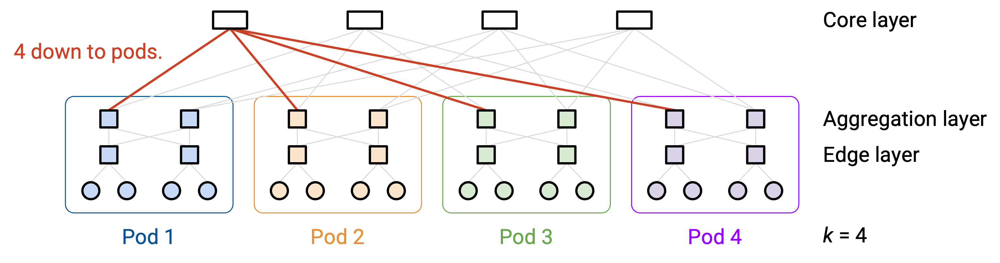

### 8.3 $k=6$ 的完整例子

原文把 $k=4$ 称为“最小例子”，但这个例子的一些数值碰巧相同，如 $(k/2)^2=k=4$，容易混淆，因此改看 $k=6$。

- 每个 pod 有6台交换机：3台汇聚、3台边缘。
- 每台边缘交换机下连3台主机，上连本 pod 的3台汇聚交换机。
- 每台汇聚交换机上连3台不同核心交换机，下连本 pod 的3台边缘交换机。
- 每 pod 有 $3\times3=9$ 台主机；6个 pod 合计 **54台主机**。
- 核心层有 $3^2=9$ 台交换机，每台6条下联，分别连6个 pod。
- 核心层的下联总数是 $(k/2)^2k$；汇聚层的上联总数是 $k(k/2)(k/2)$。两式相等，在这里都等于 **54**，因此两层端口能完整配对。

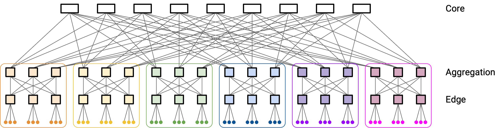

> 编者注：数学上 $k=2$ 也能形成退化结构；“最小例子”应理解为教材选用的最小非平凡展示，而非公式只从4开始成立。

### 8.4 完整二分带宽

这种拓扑能实现完整二分带宽。将 pod 分成左右两半，每台左侧主机都可与右侧某台主机配对，分配不形成瓶颈的专用路径，所有配对同时通信。

每台交换机无论位于哪一层，radix 都为 $k$；所有链路也可使用相同带宽，例如1 Gbps。扩展能力来自可为并发配对分配不同路径，而不是把某台交换机做得特别大。

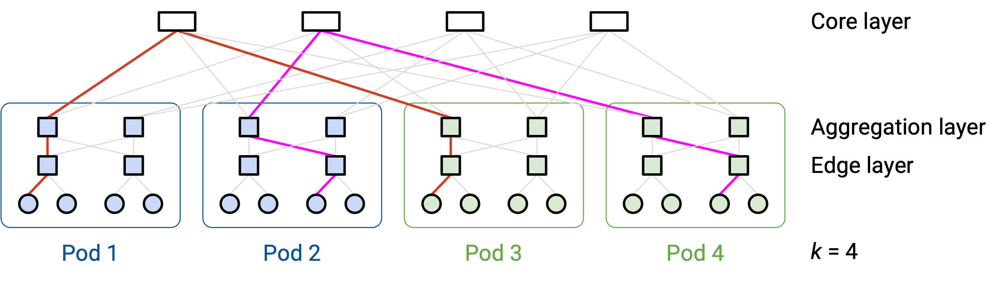

还可通过切断链路来观察。每台核心交换机分别有 $k/2$ 条链路连左侧 pod、$k/2$ 条连右侧。要隔离左侧，对每台核心交换机切掉 $k/2$ 条链路；共有 $(k/2)^2$ 台核心交换机，总共切掉 $(k/2)^3$ 条链路。

左侧有 $k/2$ 个 pod，每 pod 有 $(k/2)^2$ 台主机，所以左侧主机数也是 $(k/2)^3$；右侧同样如此。每台链路速率为 $R$ 时，两边配对全速通信所需带宽与切口容量相同：

$$
B_{\mathrm{bisect}}=\left(\frac{k}{2}\right)^3R
=\frac{N_{\mathrm{hosts}}}{2}R.
$$

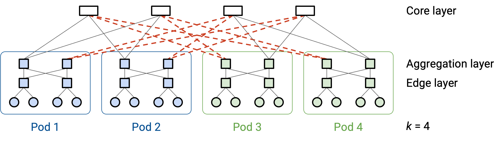

> 勘注：原文这一段把两侧的“主机数”写成了“链路数”，译文按推导区分。完整二分带宽应理解为每台主机总发送率受接入速率限制的并发配对，不是每台主机向所有对端各发一份满线速流量。所画切分说明容量匹配；完整非阻塞能力还依赖正确的路径分配，ECMP散列本身不提供确定性保证。

### 8.5 $k=48$ 时如何放进机架？

对于适当的 $k$，可以把一个 pod 的主机和交换机排列成机架。原论文采用 $k=48$：每 pod 有 **24台汇聚交换机、24台边缘交换机、576台主机**。

可以把48台交换机放在中央的一个机架，周围放12个主机机架，每个48台主机。这样所有机架都容纳48台设备，中央放交换机也减少了布线距离。

中央机架有48台交换机，每台48端口，合计 $48^2=2304$ 个端口：

1. **一半，即1152端口**用于机架内汇聚与边缘交换机互联。24台汇聚各用24个下行端口，共576；24台边缘各用24个上行端口，再占576。因为一条机架内链路的两端都在中央机架，必须计两次端口，不能把链路数当端口数。
2. **四分之一，即576端口**用于连接本 pod 的576台主机；每台主机恰好需要一个交换机端口。
3. **剩下四分之一，即576端口**用于连接核心层。共有576台核心交换机，每台向该 pod 提供一条链路。

总结：$k^2$ 个端口中，一半连接 pod 内的汇聚层和边缘层，四分之一连接主机，四分之一连接核心层。原文总结处说“同一层”互联，与实际跨汇聚／边缘两层的结构不符，译文作了区分。

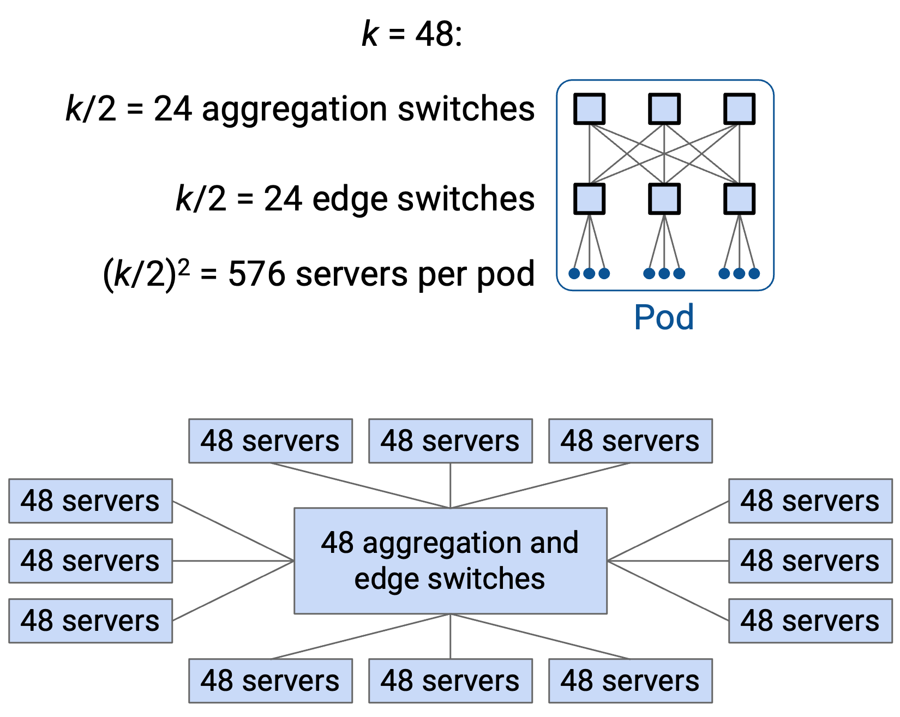

## 九、现实中的拓扑

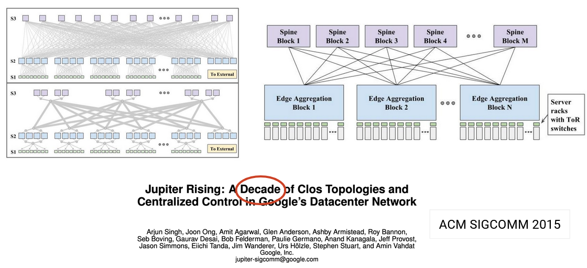

教材把此处例子称为“2008年的例子”，强调任意两台主机之间有很多不同路径。但合成图中同时出现2015年 *Jupiter Rising* 论文标题，不宜把整图都标成2008年。

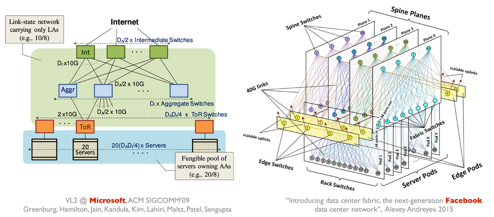

原文指出，2015年的相关工作探索了不同拓扑，也存在2009、2015等年份的多种变体。它们共同追求的是任意两台服务器之间的高带宽。这里仅翻译教材展示，不声称已独立通读这些外链论文。

## 十、为什么数据中心需要不同的拥塞控制？

数据中心相较通用网络有额外约束，例如设备集中在一个地点、归一个运营者所有，因此可以采用利用这些特性的专门协议。本节研究在普通互联网中未必适用、但在数据中心有效的 TCP 拥塞控制思路；这是持续发展的研究领域。

分组延迟包含：把比特放上链路的**传输延迟**、比特沿链路运动的**传播延迟**、以及**排队延迟**。高容量链路使传输延迟较小（本章此处以10 Gbps为例），服务器同处一栋建筑也使传播延迟较小，因此排队往往成为主要延迟。广域互联网可能需要跨越全国，传播延迟会大若干数量级，更可能成为主导项。

基于丢包的传统 TCP 拥塞控制会增速直至队列填满并产生丢包，再据此判断拥塞。其最初设计没有充分考虑数据中心中排队延迟对性能的影响。

数据中心的连接常用两类模型来分析：多数是短小且对延迟敏感的**老鼠流（mice）**，例如搜索查询及结果页，数据不多但希望尽快完成；另一些是体积大、重吞吐的**大象流（elephants）**，例如服务器间备份，长时间持续传输大量数据。

若两者共用传统拥塞控制，大象流会不断增速并填满队列；后来的老鼠流被堵在队列里，延迟增大。因此，面向这种负载的数据中心算法需要避免持续填满队列。

教材举例说，Google于2016年推出 BBR，利用分组延迟而非等待丢包来感知网络状态。

> 编者注：这是高度简化。BBR利用交付速率与最小RTT估计瓶颈带宽和传播时延，并非简单“延迟超过阈值即拥塞”的算法，也不只适用于数据中心。这里保留原文例子，但不把它当作完整BBR定义。

## 十一、DCTCP：来自交换机的反馈

**DCTCP（Datacenter TCP）** 由 Microsoft 于2010年提出，已广泛使用，例如 Linux 内核具有相关实现。

教材把 ECN 描述为 IP 头部中的“一个位”：路由器拥塞时设置它，接收方再在 ACK 中反馈，发送方得知需要减速。DCTCP让交换机在**队列长度超过阈值**时进行ECN标记，从而在队列完全填满前提早反馈。

发送方按照被ECN标记的数据所占比例减少速率。相较简单的“拥塞／不拥塞”二元判断，它可以感知轻微拥塞并适度降低速率，反应更平滑。

教材认为广域互联网中并非所有设备支持一致ECN行为，而数据中心运营者控制全部交换机，可使标记规则一致。在主机与交换机上部署DCTCP所需改动相对较小。

> 编者注：IP ECN字段实际为2位；交换机把具备ECN能力的分组标为CE，TCP接收方通过相关反馈位告知发送方。不能把IP中的CE与ACK头中的反馈混成同一个位。ECN在互联网的部署持续演进，“并非全网一致支持”不等于“全网完全不可用”。

评价指标是**流完成时间（FCT）**：从第一个字节发出到最后一个字节收到的时间。理想基准是假设有一名全知调度器，掌握全网和全部连接的信息，能够最优安排流和带宽。

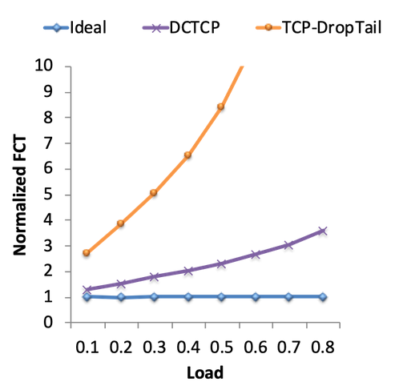

图中纵轴为实际FCT与理想FCT之比，表示距离理想算法有多远。标准TCP约为理想值的3倍，高负载可达10倍；DCTCP显著改善，连接更快完成，排队时间更少。这些是图中实验负载的比较，不是任意网络上的保证。

## 十二、pFabric：按分组优先级调度

既然问题是老鼠流被堵在大象流之后，能否让老鼠流跳到队首？

pFabric给每个分组分配优先级数字，按**流剩余大小，即未确认字节数**计算；数字越小，优先级越高。老鼠流剩余数据少，优先级高；大象流通常低优先级，但接近完成时的最后一些字节会变成高优先级。因此，它优先照顾“即将完成”的连接，即使该连接原本是大象流。

教材联系IP头中用于优先级的字段说明实现思路：每个分组携带一个优先级数字，交换机优先发送最高优先级分组；队列满时丢弃最低优先级分组。这里不能理解为现有IP优先级字段就自动提供任意大小的剩余字节计数，实际格式与硬件能力仍需专门设计。

有了这种调度，发送方可以按完整线速发送和重传，不必像通常的拥塞控制那样持续调节速率；只有极端丢包，例如超时，才需要降低速率。

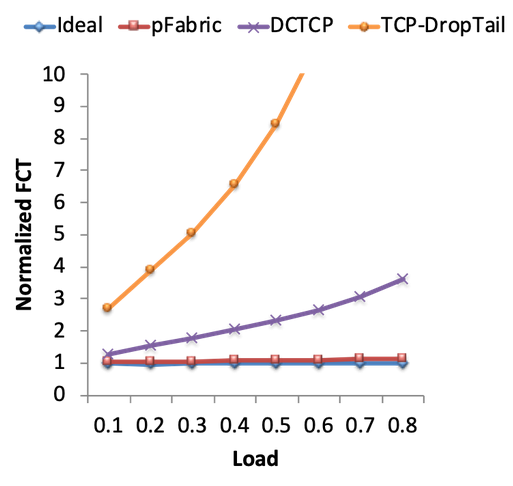

图中的pFabric比DCTCP更接近理想值。其原因是：老鼠流与大象流一起传输，大家按线速发送，保持带宽利用率，不花时间慢启动；大象流的大多数分组优先级低，交换机仍让老鼠流低延迟通过，避免它们被大流压住。

这一方案要求对交换机和端主机作非平凡改动，并且完全控制两者。交换机要实现优先级系统，发送端要改变TCP发送行为。它说明：网络设备与端主机合作，可以获得很好的性能；并不意味着在任意互联网路径上无条件线速发送都安全。

## 引用与来源

- 完整翻译：[Topology](https://textbook.cs168.io/datacenter/topology.html)、[Congestion Control](https://textbook.cs168.io/datacenter/datacenter-cc.html)。正文、例子、数值、公式与32幅原图均保留；勘注与编者解释明确分开。
- 作者 **Peyrin Kao**，基于 **Sylvia Ratnasamy、Rob Shakir 等人**的讲授。教材及本译文依 [CC BY-SA 4.0](https://creativecommons.org/licenses/by-sa/4.0/) 发布。修改：中文翻译、中文图注、公式排版与明确标出的勘注；原图字节未改，显示时加白底。
- 教材固定版本日期 **2026-10-01**，并非Spring 2025历史教材。固定commit：

```text
0b8208742d31df7fc3d53a0cd94fdd4e04f8d47e
```

- 2025官方课程的第21讲指定阅读归属此页。教材许可不推广至课堂视频、课件或外链论文。本页没有声称课堂实际覆盖了教材全部内容。
