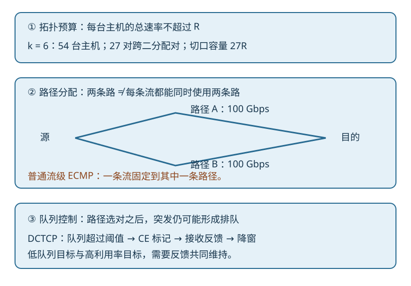

# 第21讲：多路径容量与数据中心拥塞

## 1. 核心问题：服务器已经很快，为什么还要重新设计网络？

把一台服务器的网卡从10 Gbps升级到100 Gbps，只改善它进入网络的入口，不保证它与其他服务器通信时能拿到100 Gbps。一个用户请求还可能触发数百次后端请求，真正的大流量在数据中心内部，因此“连上互联网”远远不够。

要分别回答三个问题：

1. **容量在哪里？** 拓扑是否在关键切口提供了足够链路？
2. **容量用上了吗？** 路由有没有把不同流量分散到多条路径？
3. **容量附近怎么运行？** 拥塞控制能否保持吞吐量，又不让队列拖慢短请求？

图为基于教材概念的原创示例，不是课堂截图。完整的原教材译文、图及勘注见[本讲材料](#/c/berkeley-cs168-2025/lec/lec21?v=materials)。

## 2. 二分带宽不是“网线数量”的同义词

令每台主机接入速率为 $R$，全网有偶数 $N$ 台主机。把主机分成各 $N/2$ 台的两组，左侧每台只需向右侧对应主机发送，总需求为：

$$
B_{\mathrm{full}}=\frac{N}{2}R.
$$

跨切口的链路容量之和，是这种跨组通信的上界；二分带宽在所有等分方案中取最小切口容量。必须注明切分的是端主机，还是抽象图中的全部节点；不要偷偷改变定义。

### 算例：8台服务器与2条瓶颈链路

左右各4台主机，接入均为1 Gbps，跨组只有两条1 Gbps链路：

$$
\begin{aligned}
B_{\mathrm{full}}&=4\ \mathrm{Gbps},\\
B_{\mathrm{cut}}&=2\ \mathrm{Gbps},\\
\eta&=B_{\mathrm{cut}}/B_{\mathrm{full}}=0.5,\\
O&=B_{\mathrm{full}}/B_{\mathrm{cut}}=2.
\end{aligned}
$$

容量满足率是50%，过订阅倍数是2。教材两处用相反方向的比值描述“过订阅”，这里把符号分开，避免把0.5倍与2倍混写。

**不要过度推论：** 一个切口足够大只是必要条件。一般网络里，各流路径还可能在内部其他链路上冲突。完整二分带宽不是“任意两台主机之间都永久独占R”，更不是所有主机对同时各跑R。

## 3. Clos为什么能用小交换机构造大网络？

普通树的问题是上层汇聚：很多接入链路的流量压到很少的上联。只把上层链路做粗，最终又需要昂贵的大型交换机。

Clos改变扩展方法：不单纯增大一台设备，而是增加数量较多的中间交换机，让多对端点存在不同路径。折叠后，发送和接收端在同一边缘层，分组“向上再向下”到目的端。

### 从端口守恒推导，而不是背公式

设 $k$ 为偶数，每台交换机恰有 $k$ 个端口：

1. 有 $k$ 个pod。
2. 每pod有 $k/2$ 台边缘、$k/2$ 台汇聚交换机。
3. 边缘交换机一半端口连主机，一半连汇聚。
4. 汇聚交换机一半连边缘，一半连核心。
5. 每台核心交换机恰好向每个pod提供一条链路，共用 $k$ 个端口。

于是：

$$
\begin{aligned}
H_{\mathrm{pod}}&=(k/2)^2,\\
H_{\mathrm{total}}&=k^3/4,\\
S_{\mathrm{agg}}&=k^2/2,\\
L_{\mathrm{agg\to core}}&=k^3/4,\\
S_{\mathrm{core}}&=k^2/4.
\end{aligned}
$$

最后一步是端口匹配：核心层要接住 $k^3/4$ 条链路，每台有 $k$ 个端口，故有 $k^2/4$ 台核心设备。不是“核心数量与pod数量总相同”；$k=4$ 时恰巧相等而已。

### 路径数不等于可叠加吞吐量

在教材的规则 $k$ 元fat-tree中：

- 同一边缘交换机下的两台主机：最短交换路径只有一条。
- 同pod但不同边缘交换机：可选 $k/2$ 台汇聚，最短路径数为 $k/2$。
- 不同pod：先选源pod的 $k/2$ 台汇聚，再选其 $k/2$ 个核心上联，因此最短路径数为 $(k/2)^2$；核心的连接关系决定目的pod的汇聚，之后向下到目的边缘。

这些路径共享主机接入链路，部分还共享上联，所以不能把路径数乘 $R$ 当成单主机吞吐量。**路径选择自由度**、**端点带宽预算**、**链路不相交数**是三个不同量。

### $k=6$ 自洽核算

6个pod，每pod9台主机，共54台；核心9台；汇聚上联共54条。按pod左右各半切分，每个核心有3条链路连左侧，9台核心合计27条，所以：

$$
B_{\mathrm{bisect}}=27R=54R/2.
$$

左右可形成27对主机的同时满速配对。不同pod的一对主机有9条最短路径，但每台主机的总速率仍不超过 $R$。

### $k=48$ 的布线预算

每pod48台交换机合计2304端口：

- 1152端口用于汇聚—边缘互联，即576条内部链路的两端；
- 576端口用于主机接入；
- 576端口用于核心上联。

这里最容易漏掉内部链路的两个端口。576台主机可以分布在12个48台服务器机架，交换机集中在中间只是论文的摆放方案，不是所有fat-tree的物理必要条件。

## 4. 高带宽为什么仍会让短流很慢？

端到端时延可拆为传输、传播、排队及端点处理。数据中心的传播距离短，链路快，因此排队与端点处理更容易显露出来。

一个1 MB队列在100 Gbps链路上的排队时间约为：

$$
T_q=\frac{8\times10^6}{100\times10^9}
=80\ \mu s.
$$

这还没算其他交换机与主机开销。对几百字节的RPC来说，为前面的大流等80微秒，可能远大于发送自身数据的时间。

多发送者同时回复一个聚合者，还会在最后一跳形成突发汇聚。这里的关键不是“平均流量一定超过容量”，而是短时间内进入队列的速率超过离开速率；即便长期平均低于容量，瞬时队列仍可能很大。

## 5. 三种反馈／调度思想不要混淆

### 丢包：等队列已经很满

传统基于丢包的控制需要从丢失推断拥塞。若丢包由缓冲耗尽触发，反馈可能晚于短流所能容忍的排队。大象流保持队列，后来老鼠流承担延迟。

### DCTCP：在队列溢出前得到量化反馈

交换机在队列超过阈值后对具备ECN能力的分组标记CE，接收端反馈给发送端。发送端关心的是被标记数据所占比例，而不只是“有／没有一次拥塞”。

教材没有展开DCTCP具体平滑系数与窗口更新公式，因此这里不把一套额外公式冒充原文。核心因果链足够明确：

**队列上升 → 标记比例上升 → 发送负载下降 → 队列回落。**

阈值过高反馈晚，过低可能使系统在突发与反馈延迟下更难维持吞吐；“有ECN”本身不保证正确调参或一致部署。

### pFabric：改变谁先离开队列

pFabric根据剩余流大小赋予优先级，小的剩余量先发，满队列时淘汰低优先级包。它直接优化接近完成的流，使小流不必排在大流之后；大流即将结束时也会提高优先级。

这与DCTCP不同：一个主要改善拥塞反馈，另一个把强优先级调度放进网络。pFabric要求交换机和端点配合，不能把“可以积极线速发送”抽离其调度前提用于互联网。

## 6. 常见误区

- **数据中心总是整库同时升级。** 这是教材对同质性的简化，现实可混用多代设备。
- **二分带宽大就不用路由。** 容量可用不代表散列自动找到无冲突路径。
- **两条等价路径让单TCP流带宽翻倍。** 普通流级ECMP会把它固定在一条路径。
- **DCTCP的ACK和IP里是同一个ECN位。** IP的ECN编码与TCP反馈字段属于不同头部。
- **BBR就是看时延阈值。** 它基于带宽和传播时延模型，教材一句话不是完整算法。
- **低平均FCT等于所有请求尾延迟都好。** 平均数、分位数、负载分布及是否饿死某类流，需要分别检查。

## 7. 自测

1. k=8时有多少主机、核心交换机、跨pod最短路径？二分带宽是多少？

每pod16台、全网128台；核心16台；一对不同pod主机之间有16条最短路径；完整二分带宽为64R。路径共享接入链路，单主机总速率仍不超过R。

2. 32台服务器每台25 Gbps，左右各半，切口只有200 Gbps。过订阅是多少？

完整需求为16×25=400 Gbps，容量满足率50%，过订阅2倍。假设所有跨切口流公平共享且无其他瓶颈，单台平均最多12.5 Gbps；公平性本身还需要调度／控制机制。

3. 主机增加一倍但核心链路不变，为什么只看端口够不够会误判？

端口存在只保证可连接；聚合需求增加而切口容量不变，过订阅可能增加。还必须按速率核算每层上、下行以及最坏切口。

4. ECN标记变多，为什么不该说“数据包已经丢了很多”？

CE可以在缓冲未满、没有丢包时标记。DCTCP正是利用这种提前信号。标记比例、丢包比例与队列占用相关，但不是同一个测量量。

5. 如果一条大象流最后只剩2 KB，pFabric会继续把它视为低优先级吗？

不会仅凭它原先很大就保持低优先级。按剩余大小排序时，即将完成的大流也会获得较高优先级。

## 引用、版本与课堂边界

- 本页是基于固定教材Topology、Datacenter Congestion Control的独立学习笔记，推导与原创算例由编者组织；逐章全文及原图见[材料](#/c/berkeley-cs168-2025/lec/lec21?v=materials)。
- 教材作者Peyrin Kao，基于Sylvia Ratnasamy、Rob Shakir等人的讲授，CC BY-SA 4.0；固定版本为2026-10-01，不是2025历史教材。教材许可不覆盖录像。
- 2025官网第21讲视频ID为 **EY4_bLVqtZQ**；逐视频元数据标题为 **[CS168 SP25] Lecture 21 - Datacenters 1: Topology**，时长 **80:19（4819秒）**，官方频道 **CS 168 (Internet Architecture) at UC Berkeley**，上传日期 **2025-04-15**，不是课表授课日期2025-04-14。
- 字幕主路径与一次不同的官方timedtext通路均返回HTTP429。没有取得可读字幕，也未观看音画；**课堂实际覆盖、片头、收尾、问答与具体时间段未核验**。因此没有课堂draft或猜测时间索引。
- 第20讲录像标题也涉及Datacenter Topology这一元数据差异，不足以推断章节在两条录像之间怎样分配。本页按既定唯一owner保存两章教材，不重复到第20讲，也不把教材内容冒充第21讲实录。
