# 数据中心路由、寻址与虚拟化

## 一、为什么原来的单路径路由不够？

前一章设计的 Clos 网络在服务器之间提供了很多路径。服务器可以使用不同路径，以高带宽同时通信。如果直接把此前的标准路由算法放到这种拓扑里，会有什么问题？

此前的简化协议模型只为一对源和目的选择一条路径。若全部流量都使用同一路径，就浪费了 Clos 中额外的链路。我们希望修改协议，使同一对端点之间的不同分组能够使用多条路径。

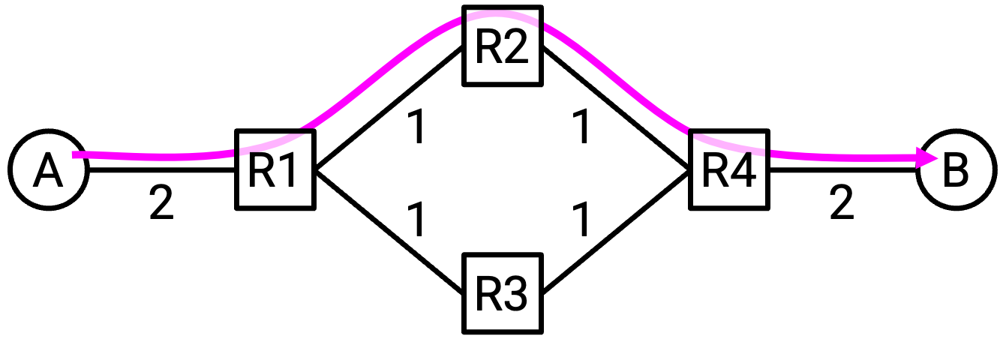

假设 A、B 的上联各为 **200 Gbps**，交换机间链路各为 **100 Gbps**。若 A 到 B 的流量被强制放到同一条路径，另一条就闲置；允许分组走不同路径，才可能用满接入速率。

同样，若存在多个并发连接，我们也希望把它们分散到不同路径上，尽量提高总带宽。

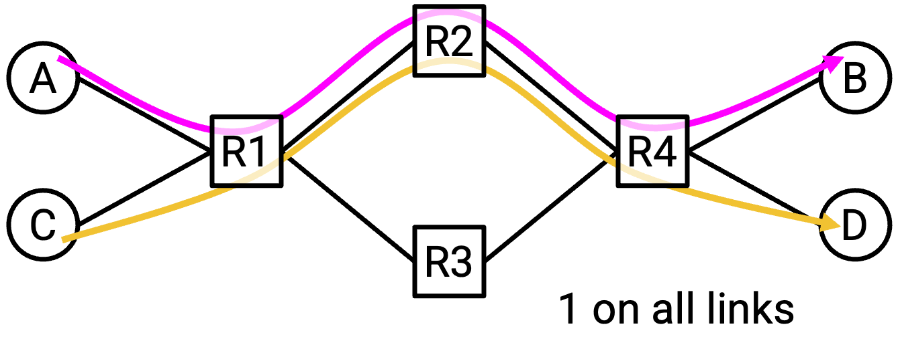

若所有链路均为 **100 Gbps**，A–B、C–D 两个连接选同一路径，就会让 R1–R2、R2–R4 承担 **200 Gbps** 需求，超过100 Gbps容量。让两者使用不同路径，就可能各自满速。

> 编者注：这里的第一例说明“拓扑有聚合容量”，并不表示下文的普通五元组ECMP能把**一条**200 Gbps流拆到两条100 Gbps路径。流级ECMP固定单流路径，多个流才有机会利用多路径。

## 二、等价多路径（ECMP）

**等价多路径（Equal Cost Multi-Path）** 寻找全部等代价最短路径，并把流量分摊过去。分组到达路由器时，若多个出口都属于有效的最短路径，应选择哪一个？需要一个以分组为输入、以出口链路为输出的函数，尽量均衡各条等价路径的负载。

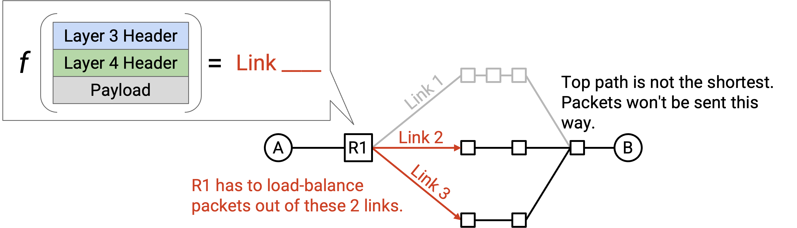

一种策略是**轮询**：有两个出口时，奇数分组走链路1，偶数分组走链路2。问题在于“等代价”不代表“等时延”；代价是运营者选择的指标。若奇数分组走较慢路径、偶数分组走较快路径，TCP接收方可能先收到所有偶数分组，必须暂存它们、等待缺失的奇数分组，损害性能。

更好的策略是读取头部字段，确定性地选择出口。可以读取哪些字段？

### 2.1 只看目的或源地址的问题

可用目的IP选择最短路径出口，路由本来就在读取它。但若很多源都向同一目的发送，全部分组的目的IP相同，就都会映射到同一出口，无法分摊。

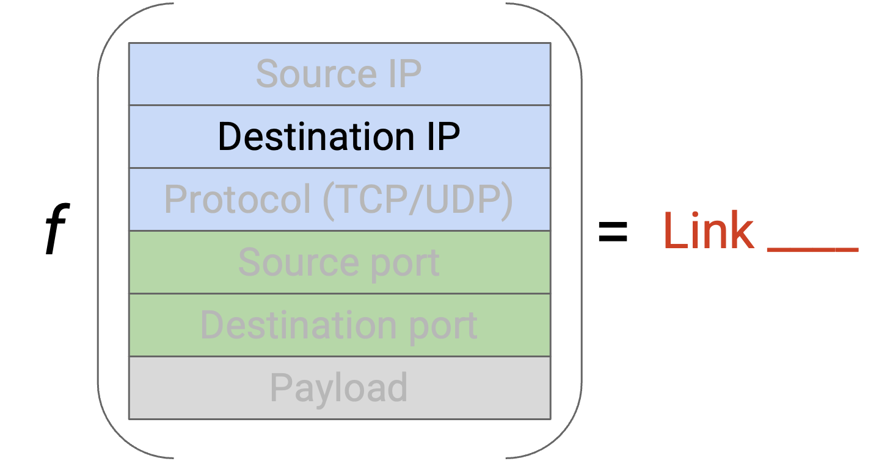

只看源IP也一样：一个源向很多目的发送时，全部分组仍有相同的源地址，仍会聚集。

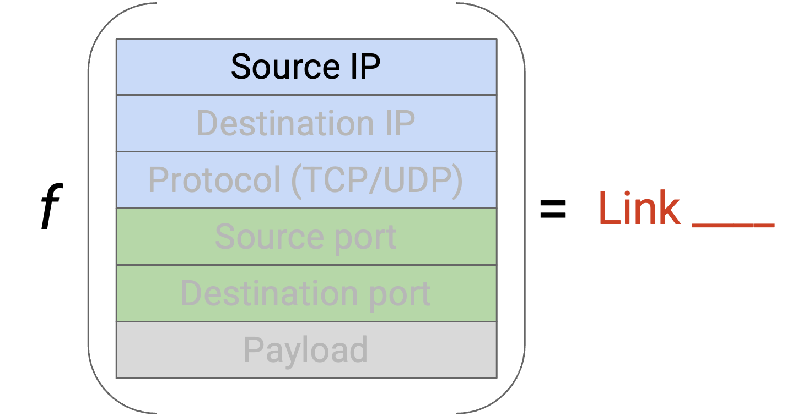

可以把源、目的IP一起散列，再像散列表一样把结果映射到出口。这比只用一个字段包含更多变化信息，缓解“同源”或“同目的”造成的集中。

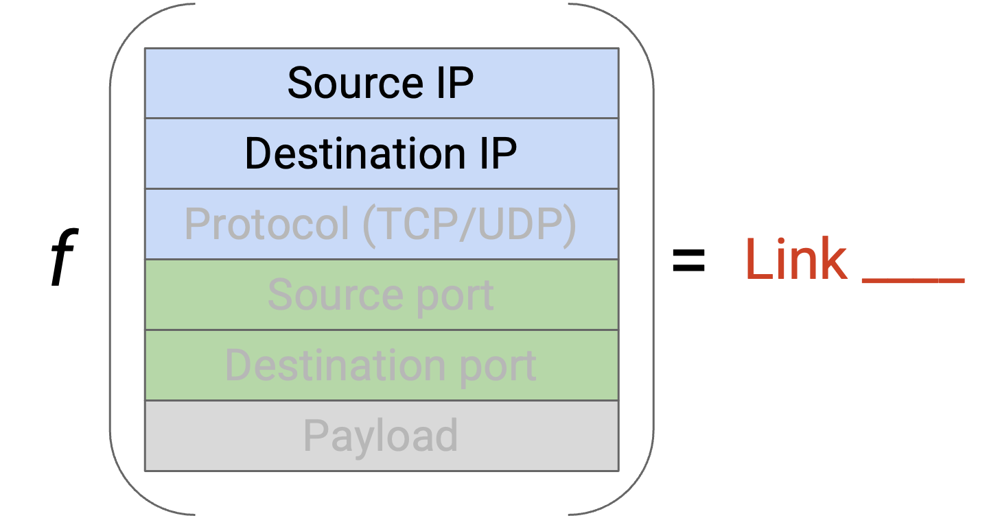

### 2.2 五元组与流级负载均衡

还有一种情况：同一对主机间有多个大连接。我们不希望它们全部走同一链路，所以还要读取TCP或UDP头中的源端口、目的端口。

一般来说，我们希望同一连接保持同一路径，不同连接有机会走不同路径。通常用**五元组**标识一条流：

- 源IP；
- 目的IP；
- 传输层协议；
- 源端口；
- 目的端口。

必须包括协议，否则使用相同IP和端口的TCP、UDP流无法区分。教材在此以相同五元组作为同一连接的识别标准。

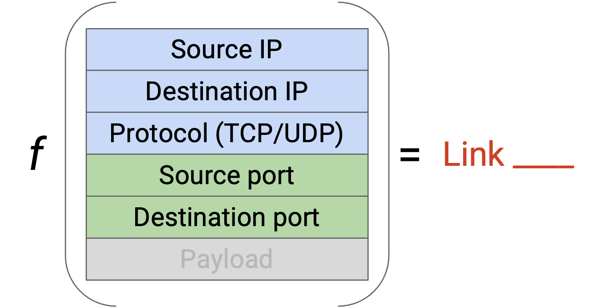

对这五个值进行散列，可以让同一连接的分组使用同一路径，避免由逐包分流主动造成的乱序，同时把不同连接分摊到不同路径。这称为**按流负载均衡**。现代通用路由器通常能直接读取这些字段。

原文说，流级均衡让各链路承载大致相同的连接数，但不考虑连接大小；感知大小在技术上可行，却需要更多处理，而流级散列通常已足够好，因此原文概括为实践中不采用。

> 勘注：散列不是“每个连接独占一个出口”，也不保证连接数完全相等，更不保证字节负载相等。少数大象流碰撞就可能导致严重不均衡。感知负载、流大小或流片段的方案确实存在，不能把原文的“不在实践中采用”理解为普遍事实。五元组也不是跨越无限时间的永久连接ID；端口会重用，非首分片及隧道可能使端口不可直接读到。固定路径仅避免这一类逐包选路乱序，拓扑或成员变化等仍可能造成乱序。

## 三、支持多路径的距离向量协议

为充分利用带宽，即使分组发往同一目的，只要属于不同连接，也应允许它们使用不同路径。因此路由协议必须发现所有等代价最短下一跳，而非只记录一条。

在此前的单路径距离向量模型中，新通告的路径若与最佳路径同价，就不接受替换。支持ECMP时应保留这个等价候选：转发表中一个目的可对应多个下一跳，条件是它们拥有相同的最小总代价。

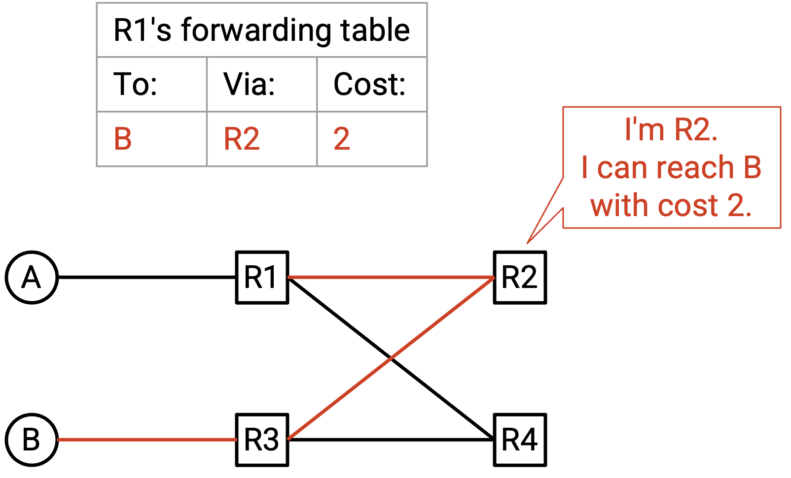

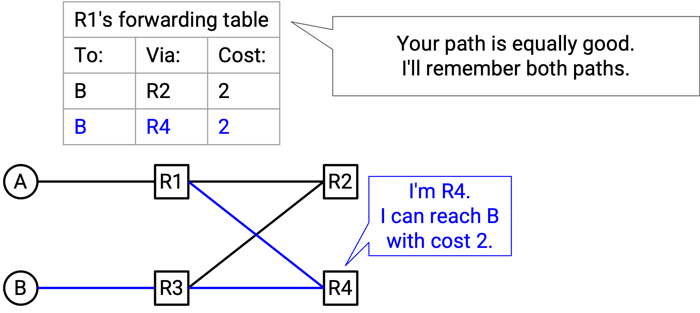

原文叙述说 R1 从“R4和R3”收到到B为2跳的通告，保存两条总代价为3的路径；下一段又说把一半流量交给“R3”，另一半交给“R2”。

> 图文勘误：按图中的实际连线，R1邻居是 **R2与R4**，两者各经R3再到B，通告代价为2；若每条链路代价为1，R1应保存 **经R2代价3、经R4代价3**。原文的R3下一跳与图不符，图表代价2则漏加本地链路。转发时散列五元组，在R2与R4之间大致均分连接。这里保留并明确指出原叙述与原图的错误，而非静默改写原件。

## 四、支持多路径的链路状态协议

链路状态协议通过泛洪让所有节点得到完整网络图。普通单路径模型中，各节点为每个目的计算一条最短路径；支持多路径时，应计算所有等价最短下一跳。

与修改后的距离向量一样，转发表现在可为一个目的保存多个下一跳。选路算法负责得到合法候选集合，分组转发时的散列负责在集合中选择；两件事不应混为一谈。

## 五、为什么需要数据中心专用寻址？

修改后的距离向量、链路状态协议可以计算数据中心中的多条路径，但可能扩展不好。

距离向量必须为各目的通告信息，数据中心可能有 **100,000个以上目的**。链路状态需要沿网络链路泛洪，Clos的链路数很多，代价也很高。数据中心还常采用廉价通用交换机，内存和CPU有限，不能容纳无限大的转发表。

通用网络采用层次化IP寻址缓解规模问题：较高层组织把地址段分配给较小组织，例如国家级机构分配给大学。数据中心没有天然的国家、组织层次可直接使用，但运营者控制物理拓扑，可以按服务器在建筑中的位置分配地址。拓扑本身也有规则结构，例如服务器通常按行、按机架组织，而不是随意堆放。

## 六、拓扑感知寻址

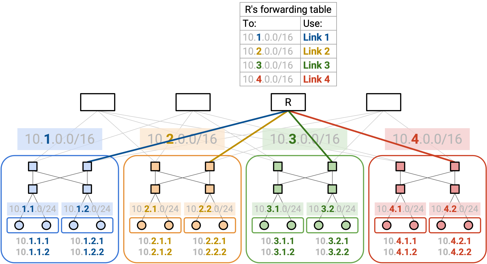

图中机架分属于不同pod。自然做法是为每个pod分配一个地址段，再把子段分配给机架，最后由机架分配单个服务器地址。

运营者知道每架服务器数量、每pod机架数量，因此可以分配大小合适的地址段。例如一个机架拿到 **/24**，它包含 **256个地址值**。

这种分配支持路由聚合，减少转发表项。图中上方的spine路由器不必逐台记录服务器，只需四项，一项对应一个pod；分组到达后，检查前16位即可选择pod。

聚合还提高稳定性。某机架内增加或移除一台主机时，spine不必得知；只要寻址方案不变，原有表项仍正确。因此，路由更新通常由链路或交换机故障触发，而非每次主机变化。

限制是：如果把服务器移到别的位置，就需要改变其地址。

> 编者注：/24确实包含256个地址值，但传统IPv4子网通常还保留网络地址与广播地址，不能无条件等同于256个可分配主机地址。前章的多路径是“等价最短路径”，不是把任意路径全部装进转发表。

## 七、固定物理结构的限制

数据中心具有固定、规则的组织方式：相似服务器进入机架，机架遵循既定拓扑。它有好处，例如自然支持层次化寻址，但给应用部署带来限制。

假设Google推出新服务，要放进现有数据中心。如果把应用直接绑定物理服务器，就可能需要人工安装新服务器并分配地址；服务增长时还要添加服务器；服务器坏了，可能要等待维修。问题是物理设施难以改变，而我们经常希望快速新增主机、扩容或迁移。

直接绑定物理服务器还会浪费资源。例如轻量服务因安全要求需要独立机器，却使用不了整台服务器的算力，其余容量便闲置。

寻址也有问题。若某区域维护，要把服务搬走，除了实际移动服务器外，在层次化地址模型下还需要改成新位置对应的IP。应用更希望无论放在哪里，都能保持相同地址。

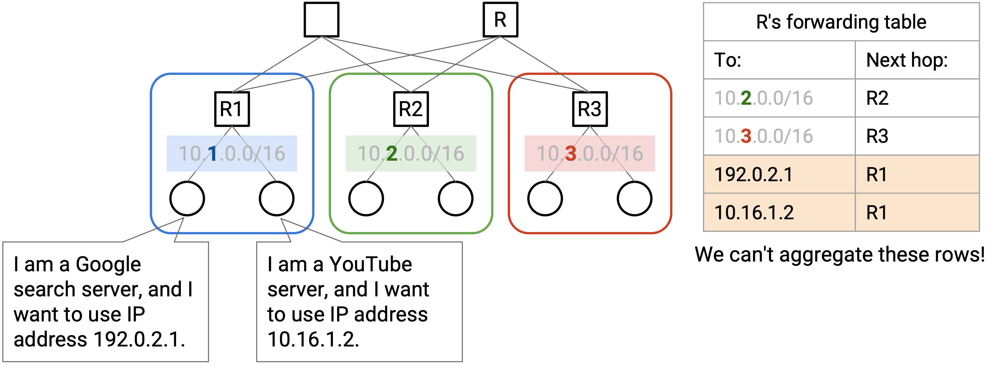

> 编者注：这些是原文用于引出虚拟化的绑定模型；并非每新增一个应用，在任何非虚拟化系统里都必然购买一台新物理机。

## 八、虚拟化

**虚拟化**让一台物理服务器运行一个或多个虚拟服务器，在维持规则物理结构的同时增加应用灵活性。

虚拟服务器让应用以为自己独占一台物理机，实际却可能与其他虚拟服务器共用同一硬件。应用试图访问磁盘、网卡等硬件时，实际与软件中的 **hypervisor（虚拟机监控器）** 交互。监控器给应用呈现类似真实硬件的接口，而它本身运行在物理硬件上，可以将磁盘写入、分组发送等请求交给硬件执行。

新增应用时，让监控器启动新VM即可，不必立即安装新服务器。迁移到另一台物理机也可通过软件完成。

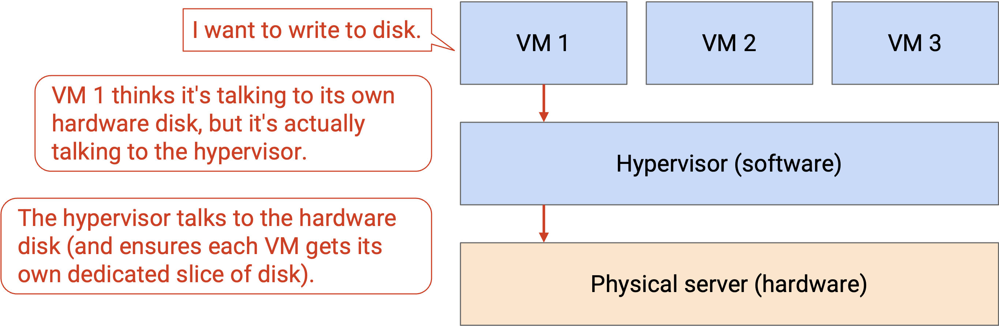

虚拟化让多个应用共享物理服务器，又彼此隔离，并可由不同人管理，从而更充分利用算力。逻辑端主机数量也可以超过物理服务器数量，例如40台服务器的机架可以包含多于40个端主机。

## 九、虚拟交换机

教材先采用“物理服务器有一块网卡、一个物理IP”的简化模型，却需要让每台VM感觉自己有独立网卡与地址；外部交换机的一个物理端口后面也可能连接多台VM。

因此，服务器需要一个**虚拟交换机**。它是运行在主机上的软件，而非实体路由器，但执行类似的分组转发操作。各VM连接虚拟交换机，后者再连接外部网络。

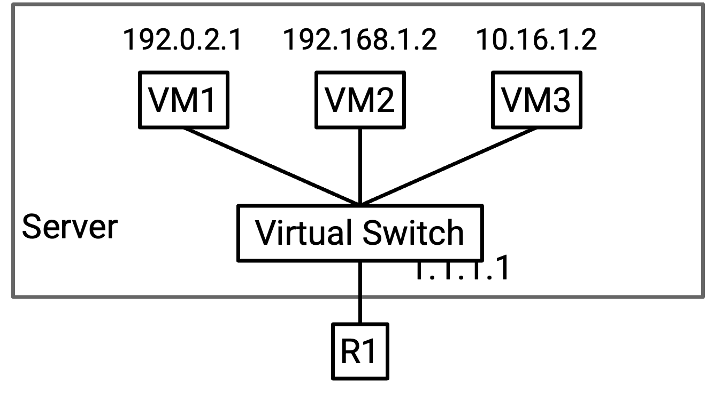

通常交换机使用专用硬件追求效率；教材指出，虚拟交换机仅服务本机较少的VM，所以可在通用CPU上用软件实现，其处理规模不同于大型交换机。现实高性能场景也会把这些功能卸载到网卡，第23讲继续讨论。

## 十、Underlay 与 Overlay

虚拟主机运行在物理服务器之上，可以快速创建、关闭、变更。它们不必采用物理服务器的寻址方式：物理IP按pod、机架等位置分配，虚拟IP则可按国家、组织等现实管理关系分配。同一物理机上的VM不一定共享前缀，因此不能直接套用物理层面的聚合技巧。

若简单地让物理路由系统学习全部VM，表会迅速膨胀。以前可以说“蓝色pod里的服务器都是某个前缀，下一跳都是R2”；现在蓝色pod中的物理机可以容纳数百个地址毫无共同前缀的VM，需要逐VM表项。VM保留IP迁移后，路由协议还要重新发现路径。

核心问题是存在两套IP地址系统：一套用于虚拟主机，一套用于物理主机。两者都在IP层，却形成两个抽象子层。

- **Underlay（底层网络）** 负责物理机器间路由，包括TOR、spine等基础设施。依靠物理拓扑层次化寻址来扩展。
- **Overlay（覆盖网络）** 建立在物理拓扑之上，只考虑VM之间通信。教材假设一台VM通常只与少数其他VM通信，因此不必让它知道全数据中心的每台VM。

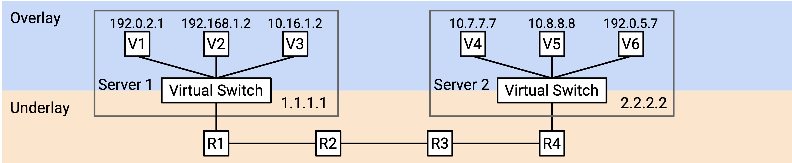

理想情况是两层独立处理地址：underlay不必了解虚拟IP，否则规模太大；overlay不必了解每台物理服务器，每个VM只需关注少数对端。

但若不把虚拟IP告诉underlay，物理交换机直接收到以虚拟IP为目的的分组，就会因表里找不到对应项而丢弃。必须有一种办法桥接两个层次。

## 十一、封装

可以重用互联网分层与头部的思路。原本一个分组只有一个IP头，理解一套IP地址。如今有两套地址，可以增加一个头部：例如使用两个IP头，分别描述overlay与underlay；也可以使用其他类型头部描述overlay，并用常规IP头描述underlay。

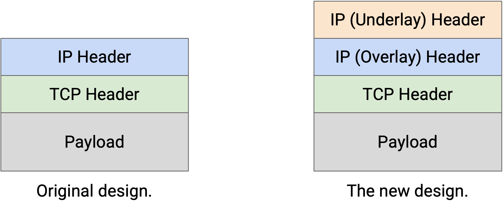

假设VM A要给VM B发送分组。图中具体为V1向V6发送，V6虚拟地址为 **192.0.5.7**，其物理服务器地址为 **2.2.2.2**。

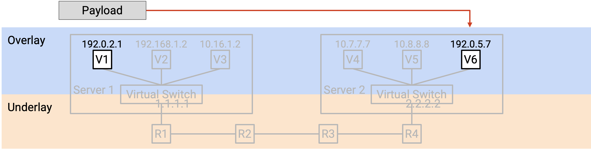

**第一步：VM构造原始分组。** A只认识overlay，因此IP头中填B的虚拟IP，再把分组交给本机虚拟交换机。

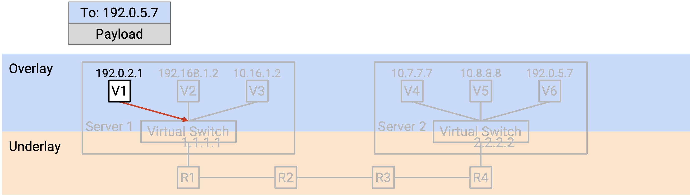

**第二步：虚拟交换机封装。** 它读取B的虚拟IP，查询对应的物理服务器地址；映射如何获得留待后文解释。随后增加一个外层头，填入物理服务器地址。这叫**封装（encapsulation）**。

此时内层头属于较高的overlay层，由VM添加，目的为B的虚拟地址；外层头属于较低的underlay层，由虚拟交换机添加，目的为B所在物理服务器。虚拟交换机按物理地址把分组交给下一跳。

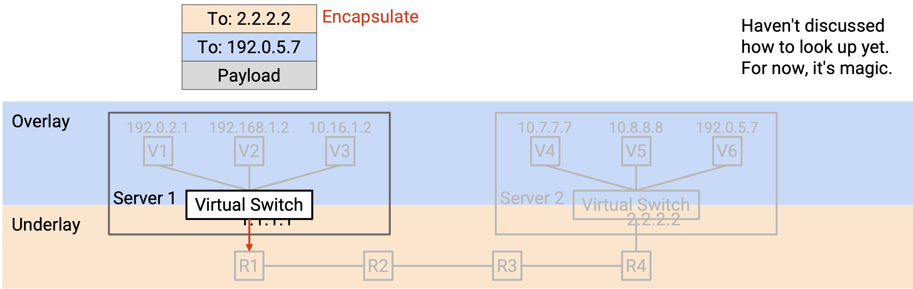

**第三步：underlay转发。** 数据中心交换机只看外层物理地址，决定下一跳，不必知道内层虚拟地址。

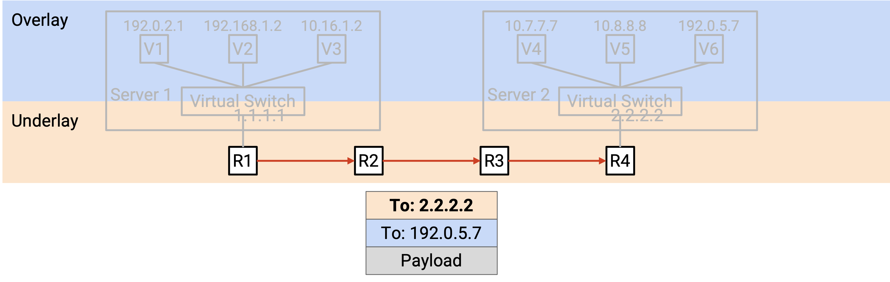

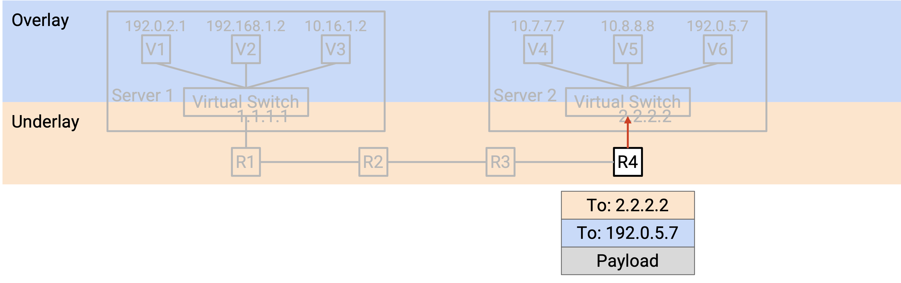

**第四步：解封装。** 目的服务器的虚拟交换机发现外层目的就是自己，移除外层头，让内层头重新露出。这叫**解封装（decapsulation）**。

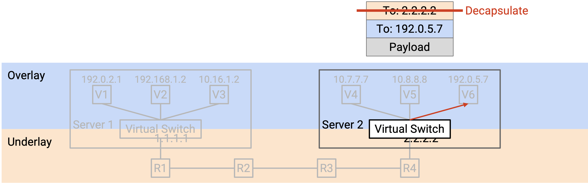

最后，虚拟交换机读取内层目的IP，决定交给本机哪台VM。

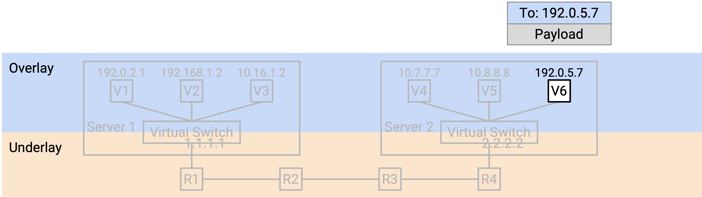

封装使两层各司其职：underlay只按物理服务器寻址，overlay中的VM无须了解物理转发过程。虚拟交换机通过虚拟到物理的映射，以及增加、移除外层头，桥接两层。

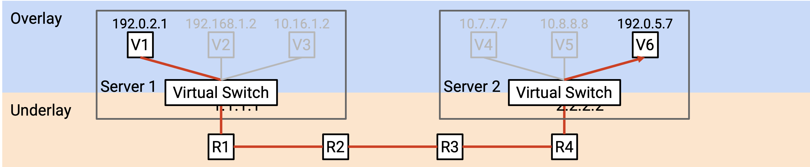

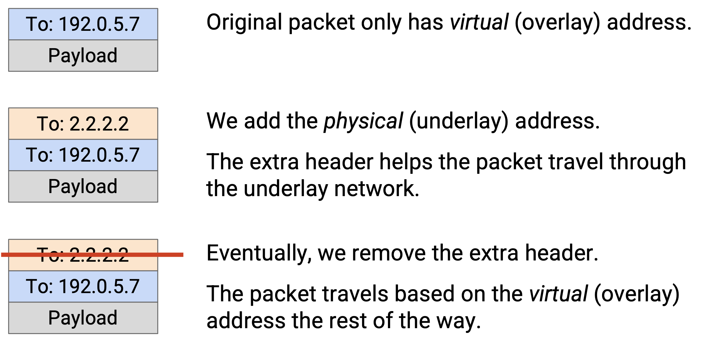

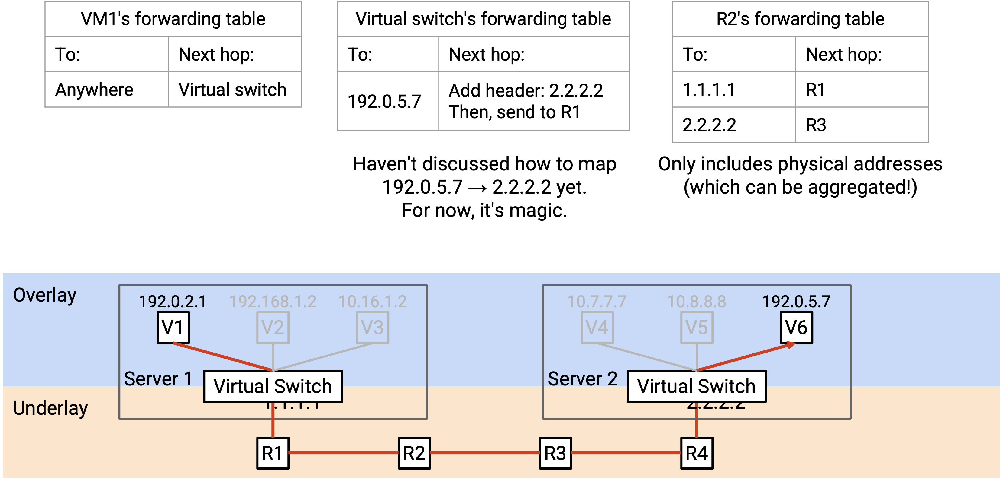

## 十二、使用封装时的转发表

VM只需安装默认路由，把分组交给本机虚拟交换机。

虚拟交换机需要额外功能：看到虚拟目的时，查询对应物理地址并增加外层头。其表项覆盖“本机VM可能需要通信的目的VM”。可扩展性的前提是VM通常不需要与全数据中心所有VM通信；不必像全互通路由那样在每处安装通向所有VM的表项。

虚拟交换机还需要解封装规则：若外层目的为自己，去掉外层头，按内层VM地址交付。该部分状态随本机VM数量增长，通常可管理。

添加这些功能困难吗？虚拟交换机是软件，原则上写代码即可，不必新增硬件。不过封装在实践中非常常见，也可能交给硬件实现。

数据中心内的物理交换机则可以保持原状，转发表只保存可按物理拓扑聚合的地址。

> 编者注：状态不是凭空消失，而是从每个物理交换机学习全部VM，变成控制器／映射服务维护虚拟位置、边缘虚拟交换机缓存所需映射。若实际通信关系接近全互联，教材“只需少数对端”假设就不再适用。

## 十三、多租户与私有网络

数据中心由一个运营者管理，却可能托管不同组织的应用。例如Google的数据中心同时运行Gmail与Google Maps的虚拟服务器。这种在同一数据中心托管多个服务的方式称为**多租户（multi-tenancy）**。

云提供商还为客户提供VM。AWS、GCP的用户可以创建虚拟机，完成工作后再销毁它。

多租户的第一个问题是隔离：客户不应默认能够连接同一数据中心中的全部其他VM。第二个问题是地址不协调。

假设租户是Pepsi和Coke，各自建立私有网络，为内部VM分配IP；这些主机只在内部通信，不直接向公共互联网开放。不同租户可以重复使用私有地址段。原文举例：Pepsi有一台 **192.0.2.2**，Coke也有另一台 **192.0.2.2**。复用地址也有助于缓解IPv4地址不足。

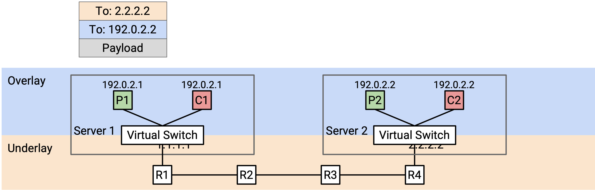

对租户来说，这并不矛盾：Pepsi的192.0.2.2不与Coke的同址VM通信，也不直接从公共互联网访问。但对数据中心来说，若只按目的IP转发，收到目的192.0.2.2就无法知道究竟是哪一台。

重复地址现实中出现，既因为数据中心无法控制租户各自的地址选择，也因为IP私网通常复用相同的特定地址段。

> 勘注：原文先说RFC1918私有地址，例子却用 **192.0.2.0/24**。该段属于文档示例地址TEST-NET-1，不是RFC1918私网段。RFC1918范围为10.0.0.0/8、172.16.0.0/12、192.168.0.0/16。此处保留原例数值以对应原图，只把它作为示例。

## 十四、通过封装区分租户

可再次使用封装：添加包含**虚拟网络ID**的头部，标明租户，例如Pepsi为1、Coke为2。这个新头主要提供上下文，而非物理路由信息；物理服务器上有多个租户的VM时，它帮助选择正确的虚拟网络。

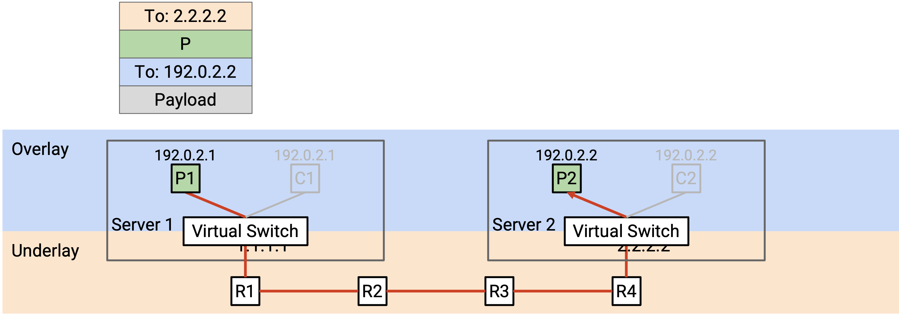

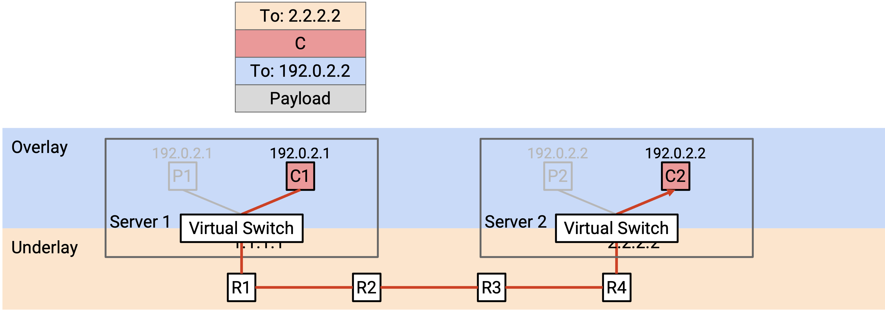

目的虚拟交换机先移除underlay头，再读取新头确定租户，最后读取overlay IP头，在该租户的VM集合中选择目的。

## 十五、叠加多次封装

同一封装思路可反复使用，同时支持虚拟化与多租户。

开始时，VM生成普通TCP/IP分组，目的IP是虚拟地址。第一次封装加入虚拟网络头，标明租户，区分重叠地址，并为避免跨租户误送提供上下文。第二次封装加入underlay头，标明该虚拟目的当前所在的物理服务器。

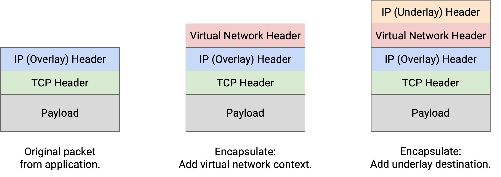

叠加后仍保持抽象边界。underlay无须理解同一数据中心里有多个租户，只读取最外层物理目的并转发。

解封装按反向顺序进行：

1. 到达目的物理服务器后移除最外层underlay头；它已完成定位任务。
2. 读取虚拟网络头，把候选VM范围缩小到正确租户。
3. 读取最内层IP头，交付该租户中的正确VM。

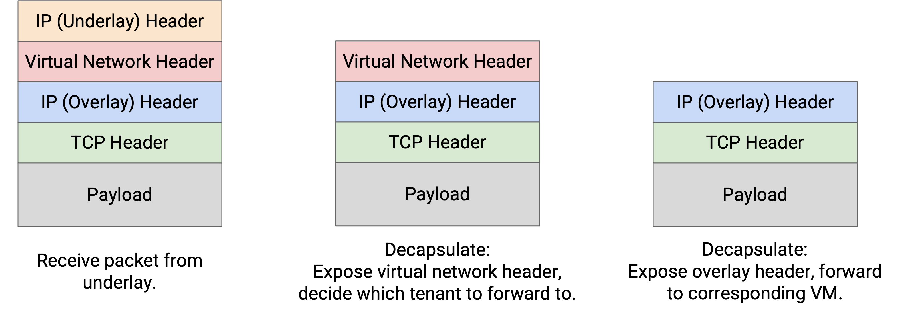

封装后，做多路径负载均衡时必须小心读取五元组：相关IP、端口、协议可能不在最外层。教材指出现代路由硬件具有解析多层头的能力，但具体设备支持哪些封装与哪些层，仍需核对，不能假设全部硬件都会自动散列内层流。

现实中存在很多封装协议：**IP-in-IP**使用两个IP头；**MPLS**用简短标签标识服务，例如虚拟网络或租户，可支持多租户封装。随着数据中心发展，**GRE、VXLAN、GENEVE**等协议也被广泛研究与采用。这里讨论的常见IP承载形式，以普通IP作外层underlay，专用封装及原始业务头位于其内。

> 编者注：虚拟网络ID本身不是加密或身份认证。隔离还依赖可信入口给分组赋予正确租户上下文、阻止伪造，以及对应的转发与访问控制策略。

## 引用与来源

- 完整翻译：[Routing](https://textbook.cs168.io/datacenter/datacenter-routing.html)、[Addressing](https://textbook.cs168.io/datacenter/datacenter-addressing.html)、[Virtualization and Encapsulation](https://textbook.cs168.io/datacenter/virtualization.html)。三章现存正文及30幅图全部保留，并区分源错误与编者补充。
- 作者 **Peyrin Kao**，基于 **Sylvia Ratnasamy、Rob Shakir等人**的讲授。原教材及本译文依 [CC BY-SA 4.0](https://creativecommons.org/licenses/by-sa/4.0/) 发布。修改为中文翻译、中文图注、排版和明确勘注；原图字节未改，仅加白色显示背景。
- 固定教材版本日期 **2026-10-01**，不是2025历史教材。commit：

```text
0b8208742d31df7fc3d53a0cd94fdd4e04f8d47e
```

- 2025官方课程第22讲指定阅读唯一归属本页。未知许可的视频、课件不继承教材许可；本页不代表已核验课堂讲授顺序或覆盖范围。
