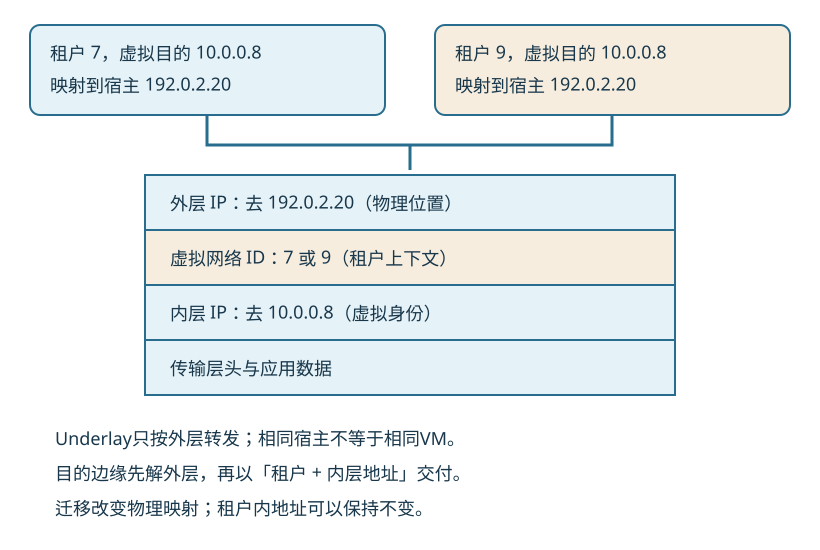

# 第22讲：路径选择、地址聚合与虚拟网络

## 1. 两种扩展性问题，两个不同答案

Clos让网络具有多条路径，却不自动决定每条流走哪条。虚拟化让一台物理机承载很多逻辑主机，却打破了“地址就是物理位置”的简单假设。

本讲围绕两个问题展开：

- **让链路被充分利用：** 控制平面找到多个合法下一跳，数据平面把流量分散过去。
- **让状态规模可控：** 物理网络按位置聚合，虚拟网络保留逻辑身份，边缘封装把两者连接起来。

“改路由”与“多加一个头”不是互相替代的方案：前者选择物理路径，后者定义分组在各层由哪个地址空间解释。

## 2. ECMP先计算候选，再选择成员

对目的 $d$，把合法等价下一跳写为集合：

$$
\mathcal{N}(d)=
\{n: c(v,n)+D(n,d)=D(v,d)\}.
$$

其中 $D(v,d)$ 是最短距离。路由协议负责形成集合，转发算法才对每个到来的流选择其中一个成员。

距离向量不应忽略等价通告，应保留所有总代价相同的候选；链路状态最短路计算也应保留等价下一跳。遇到更差路径并不意味着也加入ECMP——“多路径”在这里仍受**最小代价**限制。

### 原教材例子的纠错

原图中R1邻居是R2、R4，两者各用2跳到B；加上R1到邻居的一跳，R1到B代价均为3。原文混入R3下一跳，图表还漏加一跳。应记住算法不变量，而不是记错图中的名字：

**候选总代价 = 本地到邻居的代价 + 邻居通告代价。**

## 3. 为什么按流，而不是逐包轮流？

设两条等代价路径的实际时延分别为10微秒和30微秒。先发的包1走慢路，后发的包2走快路，就可能出现包2先到。路径代价相同并不约束排队时延相同。

逐包轮询可以均分包数，却容易制造乱序；TCP可能必须缓存后到先发的字节，并触发额外恢复行为。改成五元组散列：

$$
\begin{aligned}
f=&(IP_s,IP_d,\mathrm{protocol},p_s,p_d),\\
\mathrm{nextHop}=&\mathcal{N}(d)[h(f)\bmod m],
\end{aligned}
$$

其中 $m$ 为候选数量。拓扑、散列及成员集合稳定时，同流保持同一出口，不同流有机会分散。

### 为什么五个字段都有用？

只看目的，会把所有用户访问同一服务的流聚集起来；只看源，会聚集同一发送者的全部流；只看源和目的，则同一对主机间不同连接仍无法区分。端口增加连接区分度，协议字段区分TCP与UDP。

**五元组是分类键，不是均衡承诺。** 两条不同流可能碰撞到同一路径；一条大象流与一百条小流也可能产生完全不同的字节负载。

### 一个反例就够了

有两条100 Gbps路径，两条100 Gbps大流恰好散列到同一路径。拓扑总容量200 Gbps，但当前分配只用了100 Gbps；另一条路径空闲。换成“每条路径流数差不多”也不够，因为流大小可以相差很多数量级。

ECMP的优势是少状态、快速、可在通用硬件实现，不是全局最优。负载感知调度改善分配时，还要权衡测量开销、规则更新和顺序问题。

## 4. 地址聚合为什么依赖位置？

把四个pod分成四个/16前缀，每个pod内机架再分/24。上层路由器只需四条pod路由，而不必为十万台服务器逐台存项。

新加主机若仍在原前缀内，只改变更低层状态；上层聚合路由不动。这正是层次化设计的收益：局部事件不必成为全局事件。

但同一地址要保留聚合含义，就必须与位置一致。若把一台使用pod1地址的VM迁移到pod3：

- 改地址：破坏VM稳定身份，现有连接可能受影响；
- 不改地址、让全网学习例外：主机路由不断增加，聚合优势消失。

需要把**身份**与**位置**分开，而不是在两者中硬选一个。

## 5. Overlay和Underlay各自承诺什么？

| 层次 | 主要地址含义 | 需要知道的状态 |
| --- | --- | --- |
| Overlay | 租户内虚拟主机身份 | 哪些虚拟对端可通信、相应映射 |
| Underlay | 物理宿主／隧道端点位置 | 可聚合的物理路由与多路径 |
| 边缘虚拟交换机 | 两层之间的转换 | 租户上下文、虚拟到物理映射、封装／解封装规则 |

图中两个租户都使用10.0.0.8，甚至位于同一物理宿主192.0.2.20。只有目的IP不够，物理IP也不够；必须保留租户上下文。图中的192.0.2.0/24仅作为文档示例地址，不称为RFC1918私网。

## 6. 从一次发送追踪每一层头部

设租户7中的VM A发送给10.0.0.8，后者位于宿主192.0.2.20。

1. **VM构造内层分组。** 目的仍是10.0.0.8，它无需理解对端物理位置。
2. **源边缘查映射。** 查询键至少包含租户7和虚拟目的，得到192.0.2.20。
3. **增加上下文与外层头。** 携带租户7标识，再增加物理目的192.0.2.20。
4. **Underlay转发。** 中间设备只需物理路由，不必存每个VM的地址。
5. **目的边缘解封装。** 外层已完成定位；保留租户7上下文，按内层10.0.0.8交给正确VM。

这里没有把内层IP直接改成外层IP：**封装是保留原分组，再增加外部信封**。这与通常的NAT改写是不同操作。

### 迁移之后变化的是什么？

如果VM迁到192.0.2.30，虚拟身份 `(租户7,10.0.0.8)` 不必变化，但映射必须更新。缓存旧映射的发送端可能暂时把分组送错宿主，说明迁移还需要控制平面传播与一致性处理。

第23讲用SDN解释谁维护映射。这里不把“加头部”当作自动发现位置的魔法。

## 7. 隧道并非没有成本

### 7.1 状态移动，而非状态消失

物理交换机不再学习所有VM；映射服务或控制器仍需知道VM的位置，边缘设备也需缓存通信所需映射。如果应用是真正全互联，不能继续声称每台VM只需要几个对端状态。

### 7.2 MTU预算

若路径MTU为 $M$，新增封装头总长为 $H$，则不希望外层分片时，可容纳的原始分组长度上限为：

$$
L_{\mathrm{inner}}\le M-H.
$$

原创算例：MTU为1500字节、额外封装共50字节，内层完整分组最多1450字节。这里50只是算例，不宣称所有GRE、VXLAN或GENEVE配置头长都相同。还要继续从1450减内层IP、传输层头，才能得到应用载荷上限。

### 7.3 ECMP看见哪一层？

若多个内层流都被包装成相同的外层五元组，而交换机只散列外层，它们可能全部走同一路径。硬件能否解析内层、封装能否携带合适的散列熵，必须按实际设备与协议核对。

### 7.4 虚拟网络ID不是访问控制本身

ID让重叠地址可区分，但不自动防止恶意VM伪造其他租户身份。可信边缘必须根据VM所属端口等上下文赋予租户标签，校验入口并执行隔离策略。

## 8. 自测

1. 两条等价路径分别1跳和2跳，是否矛盾？

不一定。若度量不是跳数，两条路径可以同总代价；若明确每条边代价都为1，则1跳和2跳不等价。必须先知道代价定义。

2. 一条200 Gbps TCP流、两条100 Gbps路径，普通流级ECMP能跑200 Gbps吗？

不能仅靠流级ECMP。该流固定一条路径，受100 Gbps瓶颈限制。要利用两条路径，需多个可独立分配的流，或引入明确处理分流与乱序的其他机制。

3. 租户A与B都使用10.0.0.8，能否只把外层目的改成不同宿主就够了？

不够作为一般设计。两个租户可能位于同一宿主，也可能迁移；必须保留租户上下文，在对应虚拟网络中解释内层地址。

4. 封装后内层目的地址不变，为什么underlay仍能找到机器？

因为它查的是新增外层头。源边缘已把虚拟身份映射到物理隧道端点，目的边缘再移除外层。内层地址负责虚拟交付，外层负责物理可达。

5. 迁移时只更新控制器记录、不更新发送边缘缓存，会发生什么？

控制器知道新位置不等于所有转发节点已知道。旧缓存可能继续向旧宿主发包；实现须规定失效、更新及过渡处理，不能忽视控制到数据平面的传播延迟。

6. “/24有256个地址”是否就是“能直接装256台普通IPv4主机”？

地址值有256个，但传统IPv4子网的网络地址、广播地址通常不分配给普通主机。数量核算应区分地址空间大小与实际分配规则。

## 引用、版本与课堂边界

- 独立笔记基于教材Routing、Addressing、Virtualization；[本讲材料](#/c/berkeley-cs168-2025/lec/lec22?v=materials)保留三章全部现存正文、30幅图及图文错误勘注。MTU算例、散列反例与迁移推导为编者补充。
- 教材作者Peyrin Kao，基于Sylvia Ratnasamy、Rob Shakir等人讲授，CC BY-SA 4.0；固定版本2026-10-01，并非2025历史教材。
- 官方视频ID **LxIY-65Cbn0**，逐视频标题 **[CS168 SP25] Lecture 22 - Datacenters 2: Routing**，时长 **81:34（4894秒）**，官方频道 **CS 168 (Internet Architecture) at UC Berkeley**，上传日期 **2025-04-17**，课表日期为2025-04-16。
- 主路径及一次不同的官方timedtext字幕路径均返回HTTP429。字幕、音画、片头、收尾及问答未核验，课堂覆盖未知；因此未创建draft，也没有推测时间分段。视频许可字段缺失，不能套用教材的CC许可。
