# SDN与主机网络

## 一、为什么需要软件定义网络？

前面已经介绍如何调整路由协议，使它们适应数据中心，例如支持等价多路径。如果还想针对网络特定约束与用途进一步优化，标准路由协议可能不再合适。

**软件定义网络（Software-Defined Networking，SDN）** 是一种重新思考路由与网络管理的架构。在本章的路由场景中，一个集中控制中心计算路径，再把结果分发给各路由器。下面分别讨论数据中心与广域网的应用，以及这种方式的优缺点。

## 二、SDN的简史

虽然本章把SDN作为实现专用路由的新方法，它最初却主要来自**管理平面**的困难。

管理平面对网络运行至关重要。必须有人为路由器配置链路代价、选择路由协议等，设备才知道做什么；还需要报告错误，保障持续运行。这些工作历史上有很大一部分依靠人工。

尽管管理如此重要，其创新速度却较慢。控制平面不断出现路由协议，配置和控制设备的方式演进得相对缓慢。

后来逐渐用脚本以程序化方式与网络交互，把人工操作编码起来，但通常没有太多智能。例如自动添加路由器和链路；修复脚本可能规定：发现设备故障，先检查是否真的故障，再重启，仍不能修复时报告给运维人员。

即便如此，管理系统长期仍是网络运维瓶颈，新增路由器时可能还要等待人工介入。教材引用Albert Greenberg等人2005年的论文观点：数据网络脆弱且难管理，其根源在于控制与管理平面的复杂性。

为解决这些问题，研究者重新思考网络系统，提出从根本上重构路由器的更激进方案。相关概念在2003年已被考虑，但当时没有形成很大推动力；管理上的挫折促进了新范式。到2008年，OpenFlow交换机接口等方案开始受到更多关注。

到2011年，行业趋势更加明显，大型网络运营者Google、Yahoo、Verizon、Microsoft、Facebook，以及Cisco、Juniper、HP、Dell等厂商参与推动Open Networking Foundation（ONF）。原文又把Nicira描述为开发OpenFlow接口、专注SDN的创业公司，并写其在2012年为“4000万美元的创业公司”。

> 编者注：这里保留原文的历史概述与金额，但原文未交代4000万美元是融资、估值还是其他口径，不能把它当作收购价格。OpenFlow、ONF与企业发展的精确历史也不应由这段教学概述单独推断。

## 三、路由器的标准化与垂直整合

如果网络需要路由器，通常会从Cisco、Juniper等设备商购买。为让不同厂商设备互通，各厂商遵循预定义标准。

这种模式可能阻碍新方案的创新和试验。若想到新的路由协议，先要经过标准机构批准，可能耗时数年，然后等待厂商升级制造与实现。

标准化也限制用户定制。若某问题只存在于你的网络，标准机构和厂商可能不愿为极少数客户提供特别方案；厂商更倾向满足多数客户需求。反过来，设备也可能带着你不需要、却为其他客户实现的功能，增加不必要的复杂度。

科研与实验同样困难：想试验新思想时，可能根本买不到能实现它的设备。厂商不愿为单个客户开发不确定有效的实验产品。

另一障碍是**垂直整合**：购买的路由器把管理、控制、数据三个平面的功能作为整体提供，缺乏单独替换控制平面的模块边界。

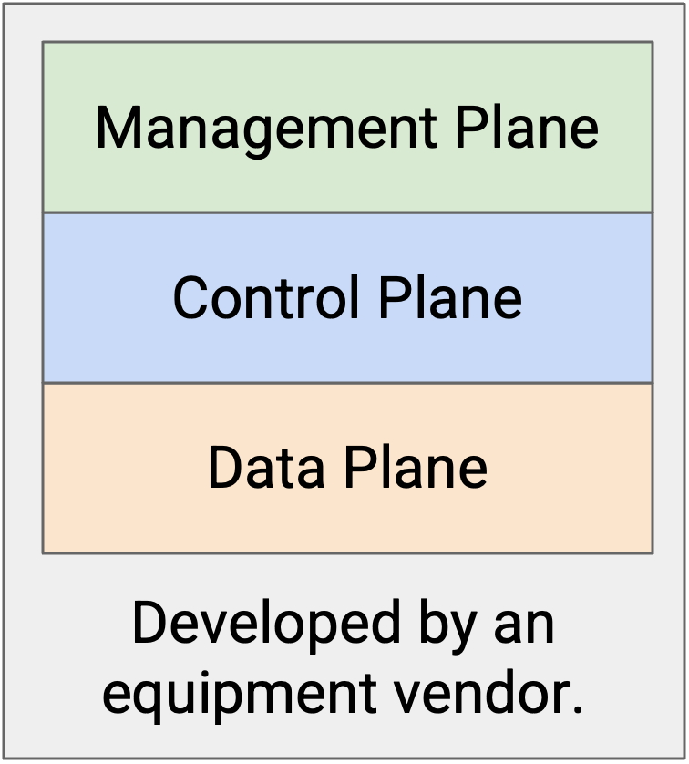

> 编者注：原文说三个平面功能都“接在芯片里”，这是强调产品封闭整合的简化，并不表示管理软件与路由协议必然全以专用硬件逻辑实现。

## 四、各平面的创新受到什么约束？

**数据平面**需要严格的互通标准。例如不同厂商路由器通过物理线连接时，必须用一致格式发送比特；教材以IEEE作为相关标准组织。创新常受更高带宽需求推动，需要解决物理硬件和芯片设计问题，周期可能是 **2–3年**。原文认为核心功能相对稳定，因此当时讨论重点并非新增数据平面功能。

**控制平面**的核心协议通常由IETF标准化；厂商可能添加扩展，但默认不同设备遵循相同路由协议。新协议可能要提交RFC草案，经过社群讨论后才采纳，过程可能持续数年。

**管理平面**也有IETF标准，但标准化程度较弱。运营者可以选择不同配置软件，不必让各厂商采用同一套管理应用，因此存在很多功能不同的方法。

总结原文的取舍：数据平面有标准且基础功能稳定；控制平面有标准但运营者希望尝试不同方案；管理平面的约束相对宽松。

> 编者注：这不是完整标准组织分工表，数据平面也涉及IETF等组织的规范；可编程数据平面也会创新。“不太引入新功能”应视为原文所讨论背景下的概括。

## 五、激进想法：把路由器拆开

标准化与垂直整合阻碍创新，因此可以把各平面分成不同抽象层。与其买一个把三个平面捆在一起的设备，不如把数据平面和控制平面分开购买或开发，让它们独立演进。

为连接这些层，需要清楚的API。在封闭设备中，用户不关心控制、数据平面如何沟通；若单独购买数据平面，再写定制控制逻辑，就必须有接口。

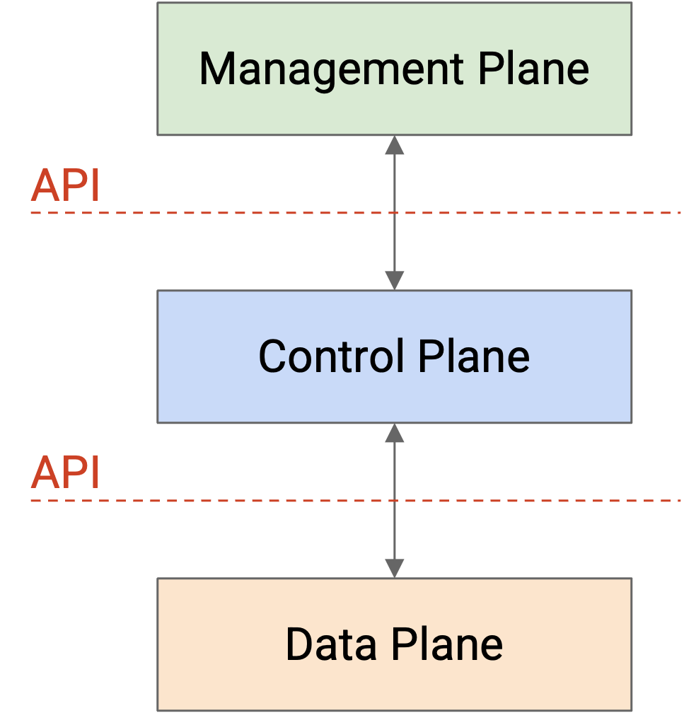

更进一步，不仅拆一台路由器，而是设计整个网络系统的分层架构。

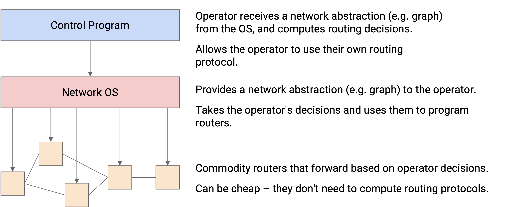

- **底层：通用网络设备。** 可理解为单独购买数据平面。设备通过网络操作系统收到控制程序的指令，按指令转发，不必自行运行本章原来的分布式路由计算，因此可更便宜。
- **中层：网络操作系统（Network OS）。** 它提供连接数据平面与控制程序的抽象接口，例如把网络表示为图交给上层。上层不必了解每台设备的编程细节，网络OS负责把抽象决策安装到具体设备。
- **顶层：控制程序。** 运营者拿到网络图等抽象，可以自行实现专用路径计算，再把结果交给网络OS下发。

## 六、OpenFlow API与流表

**OpenFlow**提供与路由器数据平面交互的接口。运营者在设备之外运行自定义代码计算路径，然后把结果装入转发芯片。

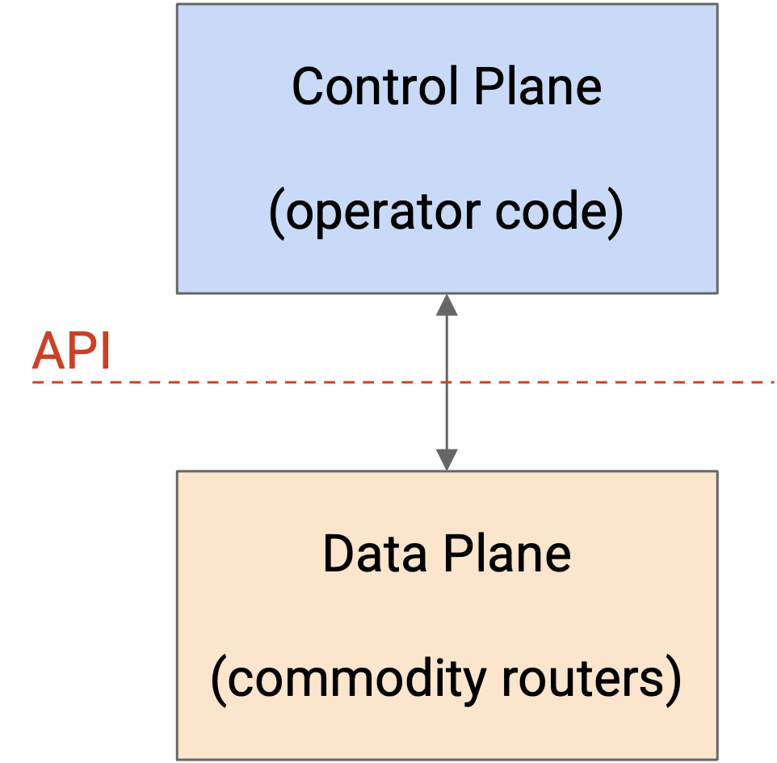

传统封闭路由器把控制逻辑放在设备内部，没有清晰的外部接口供用户安装自定义规则。OpenFlow使用**流表（flow table）** 抽象描述路由与转发行为：控制程序可生成自己想要的规则，只要能表达成流表格式。

流表是普通转发表的推广。每项包含一个**匹配（match）** 与一个**动作（action）**。匹配可以是目的前缀、精确目的地址、五元组或其他较简单的头部条件；动作可以是发往下一跳，也可以是增加额外头部等。

输出可由一张或多张编号流表组成，各表有不同的匹配—动作项，安装到转发芯片。

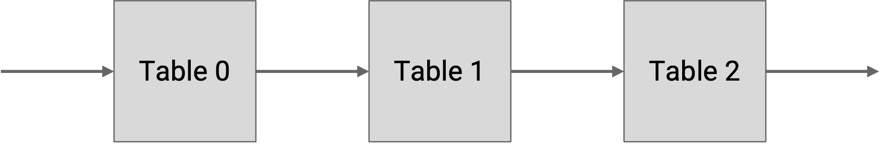

教材采用的简化模型是：分组按顺序检查表0、表1、表2等；匹配后先记录动作，最后统一执行。也可以设置跳到后续表的特殊动作，例如源端口符合某值时跳到表5继续处理。


控制程序可以任意编写，规则也比简单的目的—下一跳表更一般，但最终匹配和动作仍受专用芯片限制。芯片追求线速，通常不能执行“若TCP载荷是英文，就执行某动作”这样的复杂判断。

因此实践中的表仍与此前的转发表相似：常见的是目的IP最长前缀匹配、五元组流匹配、MPLS等封装头精确匹配。既然规则没变得无限复杂，为什么还需要OpenFlow？核心收益是**控制平面的自由**：不再局限于距离向量或链路状态算法。

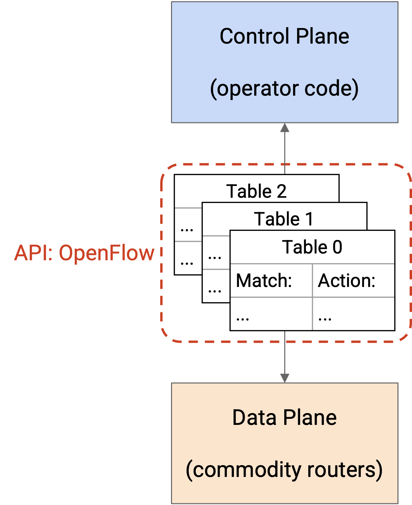

> 编者注：实际OpenFlow流水线有指令、动作集、立即执行动作及goto等区别，未必无条件访问所有编号表。“所有动作都等最后执行”是教材的简化，不应照搬成完整接口语义。

## 七、灵活控制平面的收益

运营者可以实现最适合自身约束的路由算法，不再必须等待标准机构与设备厂商。

还可以简化：若标准协议包含自己不需要的功能，定制版本可以不实现，减少代码量和复杂性，方便开发维护。

更重要的是，路径计算可以集中在控制程序，而不必分散在每台路由器。集中视图有机会做更聪明的决策，提高性能。教材引用Google 2013年报告：集中流量工程在考虑应用优先级和需求的同时，把流量分摊到多条路径，使链路利用率接近100%；也提到Microsoft 2013年以OpenFlow控制器实现软件驱动WAN高利用率的工作。

优化目标不只吞吐量。例如政府网络可以要求路径不经过加拿大的链路；电视广播网络可以要求两条流使用不共享链路的路径，以提高可靠性。一条链路故障时只影响其中一条，另一条作为备份。

集中化也可以简化收敛过程。分布式协议在拓扑变化后需多台路由器协调；集中模型中，检测故障的设备报告给控制器，控制器重新计算并安装路径。

> 编者注：集中化提供全局协调的条件，但不自动保证数学上的全局最优、瞬时收敛或100%利用率。结果仍取决于信息时效、模型、目标函数、算法和部署时序。

## 八、流量工程

**流量工程（Traffic Engineering）** 利用灵活控制平面，更有针对性地安排流量。

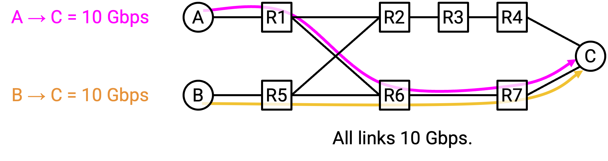

设S1→D、S2→D各需要 **10 Gbps**。普通最小代价路由让两者都走下路，使10 Gbps链路承担20 Gbps需求，上路容量却闲置。

更合理的做法是S1→D走上路、S2→D走下路，即使有些分组走得更远，也能更充分利用全网容量。

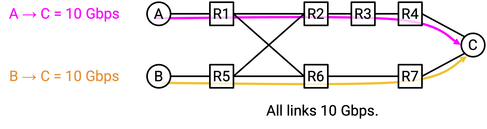

可以把最短路算法改为“在具有足够剩余容量的路径中找最短路”，也可以加入时延等约束。这称为**约束最短路径优先（cSPF）**。

若S1→D需要 **12 Gbps**，S2→D需要 **8 Gbps**，仅把两条流放在不同路径仍不够：S1需要12，而单路径只有10。

进一步可把同一流拆分：S1的10 Gbps走上路，另外2 Gbps走下路，与S2的8 Gbps恰好合计10。这是定制逻辑提高容量利用率的例子。

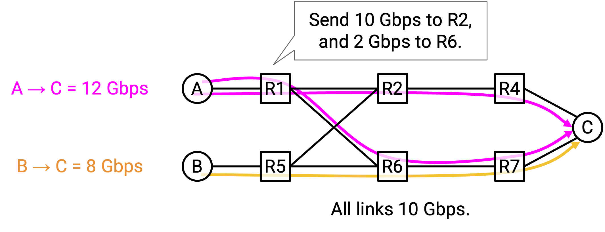

如何用简单流表实现这种分流？可以采用封装。在发送侧给不同分组添加不同路径标签，例如一部分加标签0，其余加标签1；后续设备只需按标签转发。

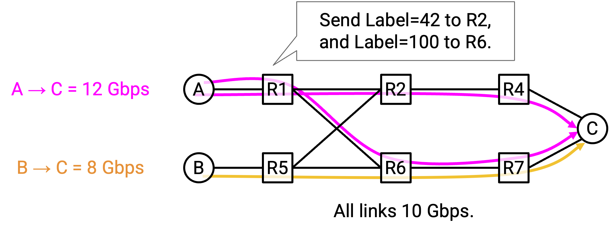

正文抽象例子说，在R1把标签0送向上方R2、标签1送向下方R3；原图实际下方节点为R6。标签规则可以与其他目的或其他流的规则共同存在。

> 勘注：本文保留正文和图中不同命名，并指出对应关系。对单条TCP流逐包分流还会引入第22讲讨论的乱序问题，容量算式成立不代表实现已解决顺序、调度和接收缓冲问题。

## 九、集中流量工程与全局决策

SDN与原来每台路由器独立运行协议的重要差别是：现在可由设备之外的一台逻辑控制器计算路径，再通过流表API安装结果。各路由器独立作出的局部最佳决定，未必组合成全局最佳；集中控制器则有机会统一考虑全网需求。

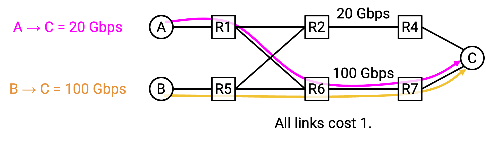

假设不支持拆分单流，S1→D为 **20 Gbps**，S2→D为 **100 Gbps**。若20 Gbps的流先开始，cSPF可能选择下路，因为当时上下两路都能满足它。从S1局部看，这是合理决定。

之后100 Gbps流到达，上路只有20，下路剩80，没有任何一条单路径能满足。根源是两次决策没有协调。

集中控制器掌握全局结构和各流需求，可以把20 Gbps流放上路，把100 Gbps流放下路，提高网络效率。

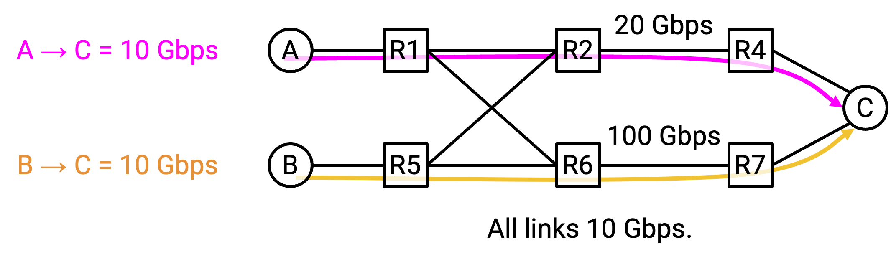

> 图文勘误：图73保留了前例的10 Gbps文字，但本例应沿用20／100需求和20／100容量。不可拿图中残留文字重新做算术。

集中流量工程还可以区分高、低优先级，根据运营者目标同时权衡利用率和应用需求。这里展示的是简单例子中更好的全局配置，不是说任意集中算法天然得到全局最优解。

## 十、SDN用于数据中心Overlay

此前封装需要从虚拟地址查到物理地址，多租户封装还需要知道虚拟网络ID；这些映射从哪里来？

可以用集中SDN控制器管理。教材提出每个租户有自己的控制器：创建VM时，控制器知道其虚拟、物理地址，再更新其他虚拟交换机，安装相应封装规则。

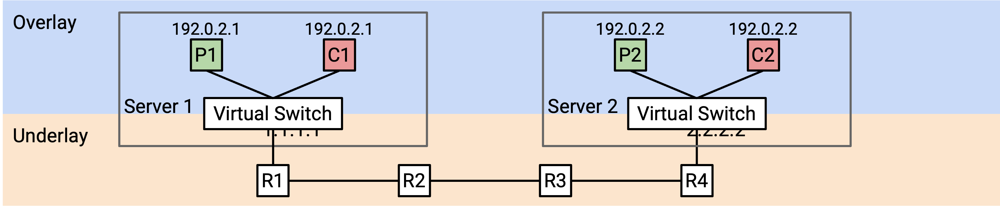

正文举例：新建Coke VM2，虚拟IP **192.0.2.1**，所在物理服务器IP **2.2.2.2**；已有Coke VM1位于 **1.1.1.1**。控制器就在1.1.1.1的虚拟交换机上安装：若Coke网络内的目的为192.0.2.1，添加Coke虚拟网络ID **42**，再添加外层目的2.2.2.2，送入underlay。

> 图文勘注：图76沿用上一章示例，C2标为192.0.2.2，C1标为192.0.2.1，与本段“新VM2为192.0.2.1”不同。两者都是映射机制的示例，不能把不一致数字混成同一张最终配置。匹配规则还必须带有正确租户上下文，不能仅靠一个重叠的目的IP区分租户。

## 十一、Overlay中使用SDN的好处

集中控制让overlay与underlay清晰分离成两套可扩展系统。教材比较的朴素传统方案会让底层路由器处理租户ID等专用封装；使用边缘封装与SDN映射后，underlay可只关心物理网络，不必理解虚拟化和多租户。

集中化还让端主机上的控制逻辑较简单：控制器知道新VM后更新相关主机，无须端点自行运行复杂分布式协议来发现该用什么封装头。

租户控制器只需管理该租户VM，也说明overlay可以分区扩展。相比之下，在未隔离的全局通告方案中，新建Coke VM可能还会被通告给Pepsi等无关租户。

> 编者注：上述收益来自状态范围、封装位置和控制设计的组合，不是“只有SDN才能分离overlay/underlay”；传统分布式控制协议也可以管理覆盖网络。

## 十二、SDN用于数据中心Underlay

Underlay仍是物理网络，只是具有特殊拓扑。提高链路利用率等通用挑战同样存在，因此也可使用SDN。

例如运营者可能让老鼠流走低延迟路径，大象流走高带宽路径。

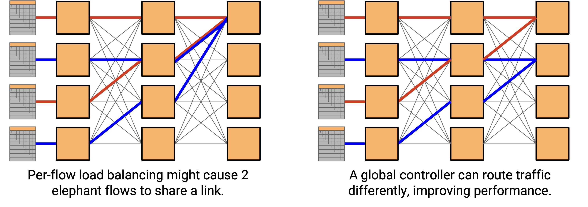

Clos中的五元组散列仍可能把多个大象流分到同一路径；即使路径不同，也可能共享瓶颈链路。SDN控制器可协调流量，把大流放到不重叠路径上。

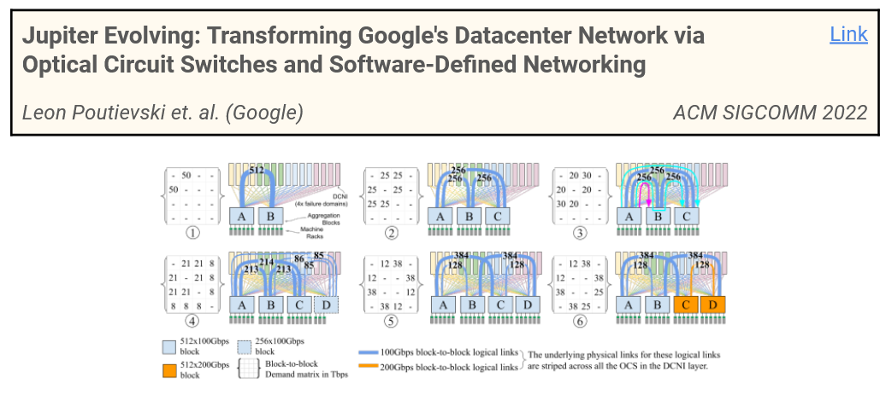

教材指出，这篇2022年的Google论文利用更智能的SDN路由，减少Clos中的某些层次，从而减少链路与成本。这里保留教材所展示的论文及结论，不声称另行通读论文。

超大规模数据中心常在overlay和underlay都采用SDN，通常是两套解耦的系统：一套处理虚拟网络，另一套处理物理网络。

## 十三、SDN用于广域网

SDN不限于数据中心。在广域网中，充分利用带宽可能尤其重要。若前面流量工程例子的10 Gbps链路是海底电缆，就很难低成本增加容量，因此应努力利用已有容量。

## 十四、集中控制的代价

**可靠性。** 传统网络中一个路由器故障，其他路由器通过协议收敛绕开故障。若集中控制器失效，网络就失去更新决策的能力，设备不知如何适应新变化。

图中的一个控制器只是逻辑实体，不必只运行在一台服务器上。控制计算可以跨多台服务器协调，形成**逻辑集中、物理分布**的系统。这与每台路由器独立作分布式决策不同。复制有助于避免单个硬件故障，但整个逻辑控制器仍可能因共同软件错误等原因失败。

**扩展性。** 控制器为全网计算，规模很大时成本很高；传统方案中每台路由器主要为自己计算。

**新的复杂度。** 原来买设备、连线后即可启动标准协议；现在还要考虑控制器放哪里、如何可靠地连接每台设备等额外基础设施问题。

教材指出这仍是活跃研究领域，包括CS168教师Sylvia Ratnasamy、Rob Shakir参与的研究。

> 编者注：控制器失联通常不等于所有已安装的数据平面规则立刻失效；既有流量可能继续转发。真正缺失的是新决策和变化适应能力，具体还受表项超时、本地保护、故障位置等影响。

## 十五、SDN在管理平面与数据平面中的应用：原章未完成

此前把SDN作为新的控制平面实现方式，但最初推动它的困难来自管理平面。控制平面中使用的很多设计范式也能用于管理平面，例如明确、可编程的API，OpenFlow就是一例。

**原文到此结束，并留下“SP24时间不够，未完成”的标记。** 没有可翻译的后续段落。本页保留全部现存正文，不补造原作者未写的管理／数据平面内容；因此整体材料状态标为partial，指的是上游章节未完，不是省略了可达正文。

# 主机网络

## 十六、什么是主机网络？

传统上，网络瓶颈主要在网络基础设施内部，而不是端主机。但现代高性能数据中心的需求不断提高，端主机也难以跟上。

CPU运行TCP等协议时，可能无法以合理成本达到所需性能。CPU昂贵，若大量时间用于协议处理，就少有资源运行真正的应用。教材还指出，现有IP、TCP协议及其传统实现方式也可能不足以满足一些现代高性能需求。

**主机网络（host networking）** 研究端主机上的优化，而不是只优化网络内部。


> 编者注：这不是断言TCP/IP在所有场景下都不再适用。问题取决于速率、分组大小、处理器、实现、协议语义和成本目标。

## 十七、优化一：用户态共享内存

在教材的常规模型中，物理层、链路层由网卡NIC硬件实现；IP、TCP等三四层由操作系统中的CPU软件实现；应用位于第七层。

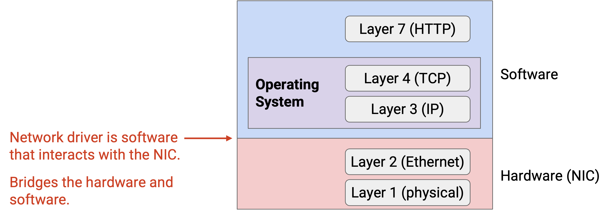

现代计算机用虚拟内存给各应用提供相互隔离的地址空间。第七层应用运行于**用户空间**，操作系统运行于应用不能直接访问的**内核空间**。

在传统发送路径中，数据从用户空间复制到内核空间；接收方向则反过来。频繁来回复制成本高，未必为应用产生额外价值。

另一个问题是内核编程困难。若想修改TCP，需要深入操作系统低层；部署、测试、迭代通常比用户态困难和缓慢。

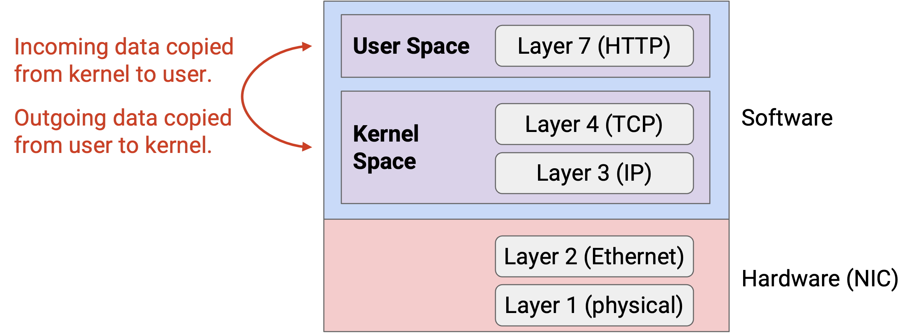

一种解决办法是把三四层协议栈移到用户空间，让三、四、七层访问共享地址空间，减少来回复制，也便于快速迭代。

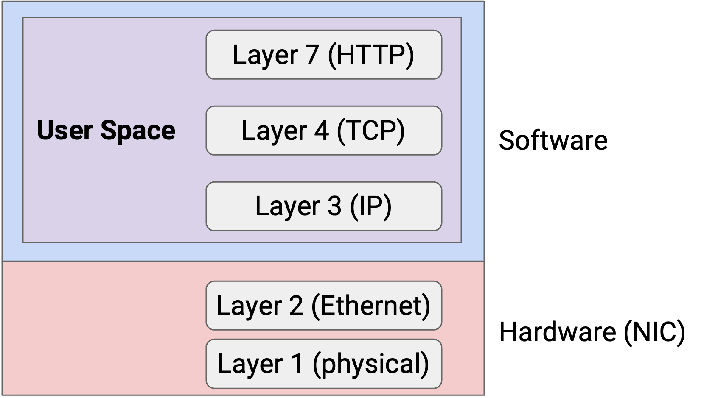

用户态共享内存能减少多余复制，但仍不足以独自解决全部性能问题。

> 编者注：移到用户态并不自动实现零复制或安全的网卡访问。还需要缓冲区所有权、DMA映射、访问隔离、队列和驱动接口等机制；内核也有减少复制的接口，不能把“是否用户态”与“是否发生复制”完全等同。

## 十八、优化二：卸载到NIC

高性能协议处理可能让CPU不堪重负，也挤占应用资源。可以把协议处理从CPU软件移到NIC硬件。

NIC是自然位置，因为每个分组本来就要经过它；让它多做一些工作，可减少CPU工作量。

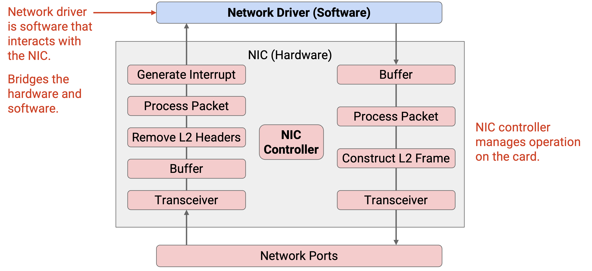

**网络驱动**是操作系统中配置与管理NIC的软件，向上提供接口，是软硬件之间的桥梁。

卸载的好处包括：释放CPU给应用；专用硬件在速度与能耗方面可能比通用CPU更高效；延迟不仅更低，也更可预测。CPU需要调度不同进程，分组可能要等当前工作结束才能处理，产生不确定延迟。

## 十九、卸载之前：Epoch 0

卸载是持续研究的方向，下面按三个逐步增加复杂度的阶段介绍。先看尚未卸载额外操作时的传统NIC。

NIC有一个中央控制处理器负责卡内运行。接收时，收发器把电信号变成数字比特并放入缓冲区；NIC解析以太网帧、检查校验和等，按教材模型去掉二层头，然后产生中断，通知CPU处理三层分组。

发送时，驱动把数据放进缓冲区，NIC读取并构造二层帧，再由收发器把数字比特变成电信号。

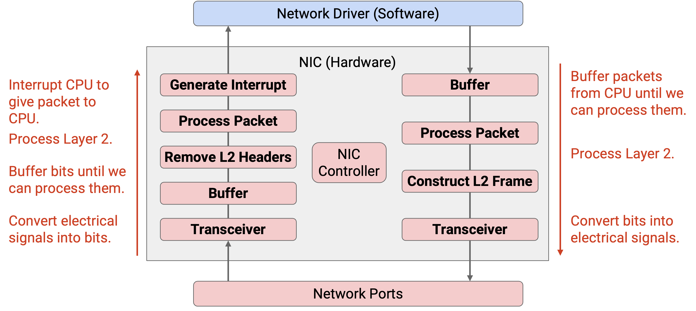

在这一简化模型中，NIC像门垫：把进入的分组交给操作系统，把操作系统给出的分组送出去，只做很少处理。

> 编者注：真实NIC与驱动通过DMA及描述符传输数据，通常不会严格按“每包一个中断、硬件总删除整个二层头”的单一路径工作。这里是原文教学抽象，不是所有设备的接口契约。

## 二十、Epoch 1：较简单的逐包卸载

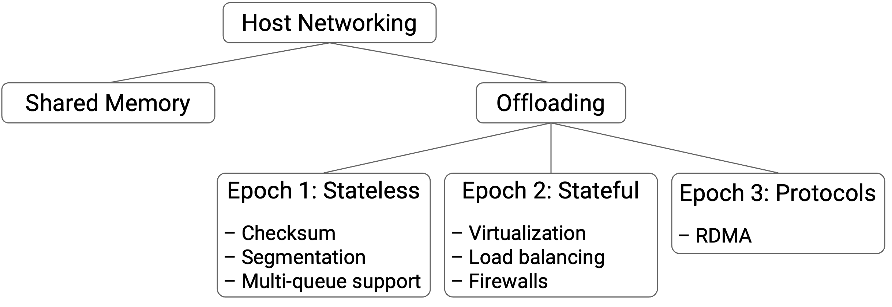

第一批卸载是较简单、原文称为**无状态**的操作，可主要按单个分组处理，不必维护完整跨包协议状态。

### 20.1 校验和

可卸载二、三、四层的校验和计算。NIC验证入站校验和、计算出站校验和，CPU便无须重复执行这些操作。

### 20.2 分段与聚合

标准模型中，应用发送大文件时，操作系统把它分成小分组；接收操作系统再重组。把分段与接收聚合交给NIC后，软件只需处理少量大块，而不是大量小包，减少头部处理等开销。

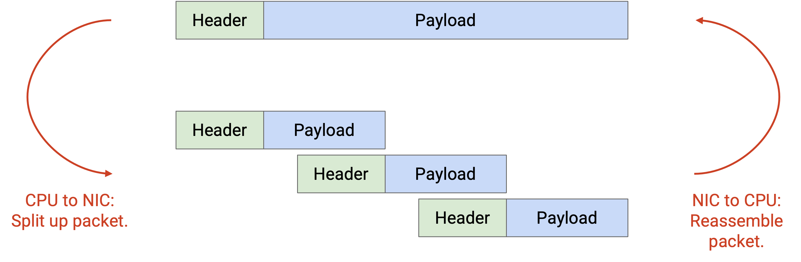

这里有平滑性与CPU效率的取舍。一次给NIC很大一块数据，CPU工作少，却可能导致突发发送；一次给小块，CPU工作多，但数据到达NIC更平稳。

接收聚合也有困难：中间丢了一个包时，NIC可能不能合并成一个连续大块，只能交付多个小块；不同分组的ECN等标志不同，又该如何表示聚合后的标志？

> 编者注：接收聚合显然可能需要缓存和维护局部状态，“无状态”是相对于完整连接协议状态的粗分类，而不是绝对没有状态。分段卸载也不是让链路发送无限大的物理帧，实际仍须满足链路MTU。

### 20.3 多队列

原模型只有一个发送队列、一个接收队列，全部应用共享，由软件驱动在多应用、多CPU之间平衡负载。可以把这部分工作交给NIC：提供多个发送和接收队列，例如每个CPU有专属队列；NIC并行维护，支持隔离、负载均衡和优先级。

但多个队列最终仍共用一条物理链路，所以还需要分组调度器，决定接下来服务哪个队列，并按所需策略配置。

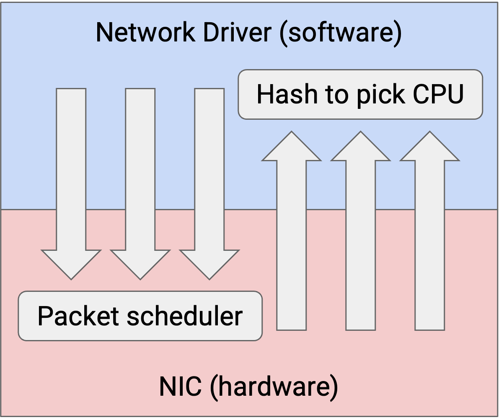

难点是分组到队列的映射。一个CPU发送时应选哪个队列？特别要让同一流的分组留在同一队列，避免并行队列造成乱序。TCP可以处理乱序，但缓存等待等会损害性能。

接收时，NIC可以散列头部选择处理CPU，再通知该CPU。它与ECMP的思路类似：让同流交给同一CPU，有利于保持处理顺序。

## 二十一、Epoch 2：有状态功能卸载

之后，更多复杂、有状态的操作被移到NIC。数据中心虚拟化推动了这一阶段：同一物理服务器有多台VM，需要虚拟交换机把入站分组交给正确VM。此前把虚拟交换机画在软件里，也可以把它放进硬件。

防火墙和带宽管理也能卸载。例如丢弃某恶意IP的分组，或规定用户A每分钟只能发送 **100个分组**，超出就丢弃。原本由软件检查的安全与资源策略，可由硬件执行。

可以使用类似OpenFlow的匹配—动作表，由软件下发策略，硬件按五元组或其他头部字段匹配，执行丢弃、转发、修改头部等动作。


> 编者注：匹配恶意源地址的静态ACL本身未必是有状态操作；限速需要计数或令牌等状态。该阶段分类强调可支持的功能复杂性，不意味着图中每条规则都要维护连接状态。

## 二十二、Epoch 3：完整协议卸载

教材将当前阶段描述为尝试把TCP等完整协议从操作系统卸载到NIC。更高的性能需求，尤其AI/ML应用，推动了这种设计。

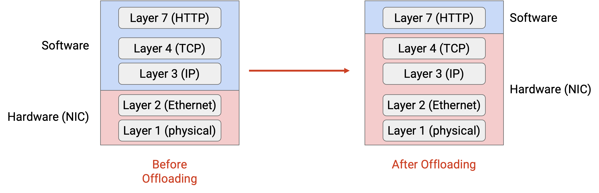

理想状态是应用直接把数据交给硬件，由硬件执行四、三、二、一层处理，使操作系统退出逐包数据路径。

原文认为，尽管曾尝试把标准TCP直接卸载到NIC，但没有成为普遍的大规模方案；另一条路线是采用更适合硬件实现的RDMA等新接口与协议体系。

> 编者注：这不意味着TCP卸载不存在。RDMA也不是一条必然替换所有TCP/IP层的单一线协议，而是一组远程内存访问语义及其实现技术；不同承载方式保留的网络层不同。

## 二十三、RDMA：远程直接内存访问

**RDMA（Remote Direct Memory Access）** 提供一种抽象：服务器A可以访问服务器B的内存，在主要数据传输过程中无须两端CPU或操作系统逐包处理。相应处理可在硬件实现，绕过传统软件网络栈的数据路径。

假设A要向B传一个 **10 GB** 文件。传统模型中，发送CPU从内存读取数据，经TCP/IP处理后交NIC；接收NIC再交CPU处理并写入内存。CPU参与了10 GB文件的逐包处理。

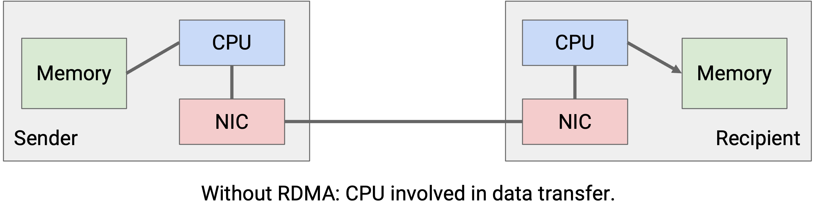

RDMA模型中，NIC直接读取发送内存、发送数据；接收NIC处理并写入目标内存。CPU仍需要在开始时配置传输、结束时处理完成，但大量数据移动不再由CPU逐包执行。

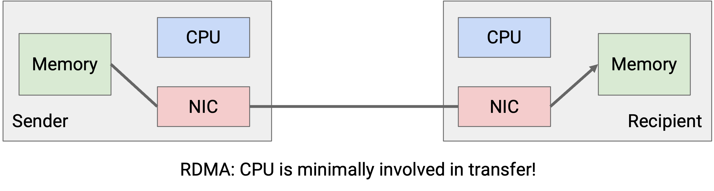

使用RDMA时，主要接口不再是传统socket字节流，而是**队列对（Queue Pair，QP）**：发送工作队列存放待执行的发送类工作，接收工作队列存放准备接收数据的工作。一块NIC可以有很多QP，不同QP服务可以提供可靠有序或不可靠等不同语义；可靠有序的QP最接近TCP连接提供的服务。

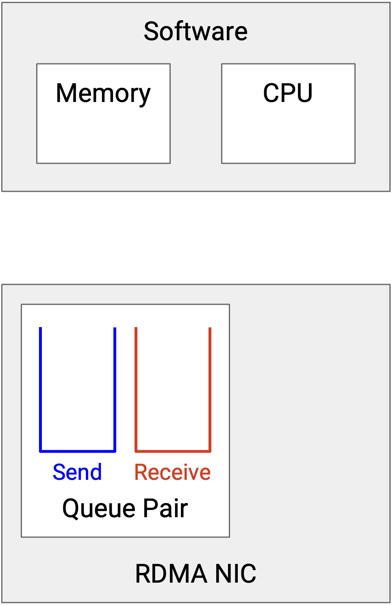

队列中的元素称为**工作队列元素（WQE）**，描述要执行的工作。原文用自然语言举例：“从远端地址0xffff1234起取100 MB，写入本地0xffff7890”，并把它放在“接收队列”的讲述中。在程序里，工作请求以结构体记录缓冲区位置等信息。

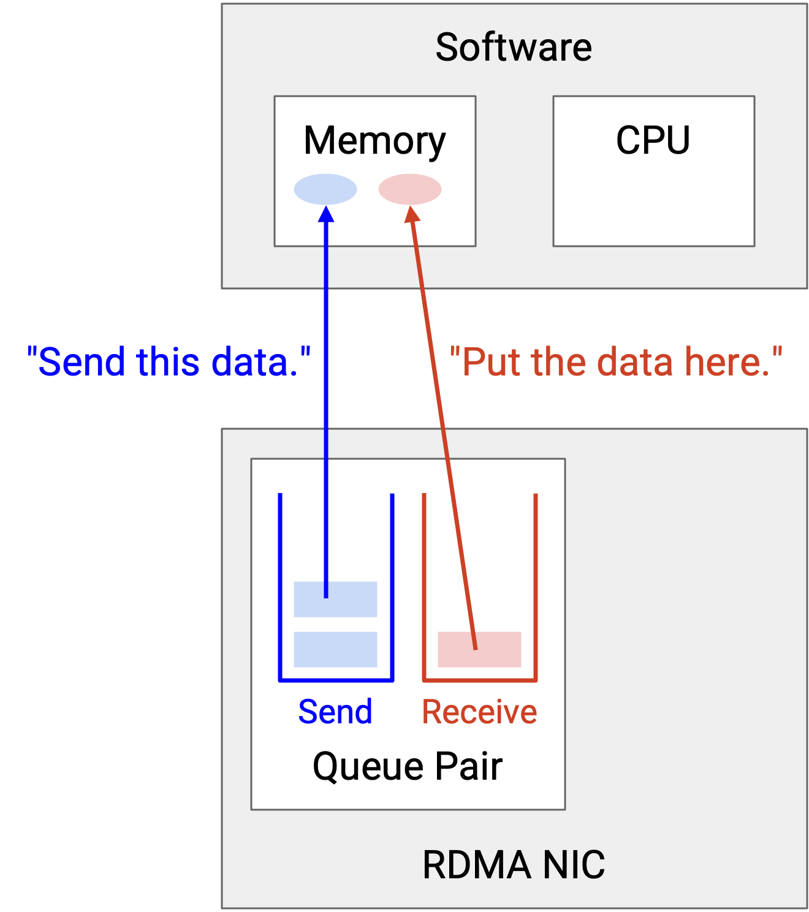

> 重要勘误：上述“主动读取远端地址”是**RDMA READ**类工作，通常提交到发起方的发送工作队列，不是普通receive WQE。接收WQE主要给出本地缓冲区、长度、访问键等，用来接收对端SEND。已核对rdma-core的`ibv_post_send`与`ibv_post_recv`手册，参见页底。原文的100 MB与两个地址在这里保留，但不可据此实现错误队列操作。

相较TCP/IP只看到字节流，WQE让网络接口知道更高层的工作边界，例如要搬运哪个地址范围的一块数据。

工作完成后，NIC生成**完成队列元素（CQE）**，记录成功或失败等状态，放到完成队列，等待应用读取。教材把这一过程描述为原WQE从工作队列移除。

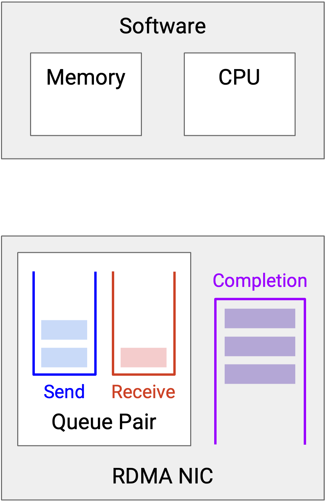

RDMA是异步的：应用先提交工作，NIC按相应队列语义处理；完成后写CQE，应用稍后读取，而不是每来一个数据包都要求CPU立即执行协议处理。

> 编者注：顺序与完成通知依具体操作、QP类型和标志确定；发送完成可以选择性通知，并非所有WQE都必然产生独立CQE。传统网络也可轮询，RDMA也支持完成事件，不能简单以“是否中断”区分两者。

## 二十四、RDMA SEND示例

RDMA支持多种操作，各自有不同的性能、延迟、语义和错误行为。下面是**双边SEND／RECV**例子：A从本地内存读取文件并发送，B把它放入自己的接收内存。

### 第一步：登记可访问内存

两端指定NIC可用于RDMA的内存区域。A的文件区应可被NIC读取；B准备空缓冲区供NIC写入。

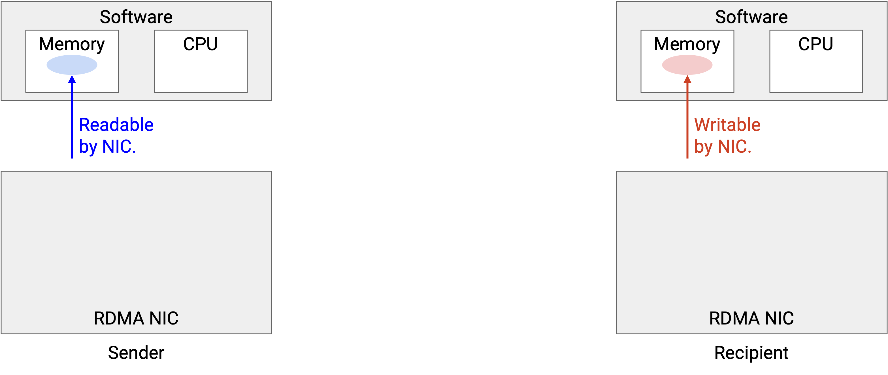

> 源文勘误：正文把B接收区也写成“NIC-readable”，但原图正确标为“Writable by NIC”。接收数据需要写权限，译文据操作语义明确区分。

### 第二步：建立队列

两端NIC建立发送、接收、完成队列。配置协调可以带外进行，例如先用传统TCP通信交换必要信息。

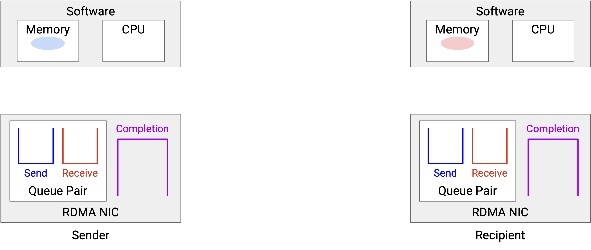

### 第三步：提交工作

A在发送队列放入WQE，指向要发送的文件；B在接收队列放入WQE，指向空缓冲区，说明数据应该写到哪里。

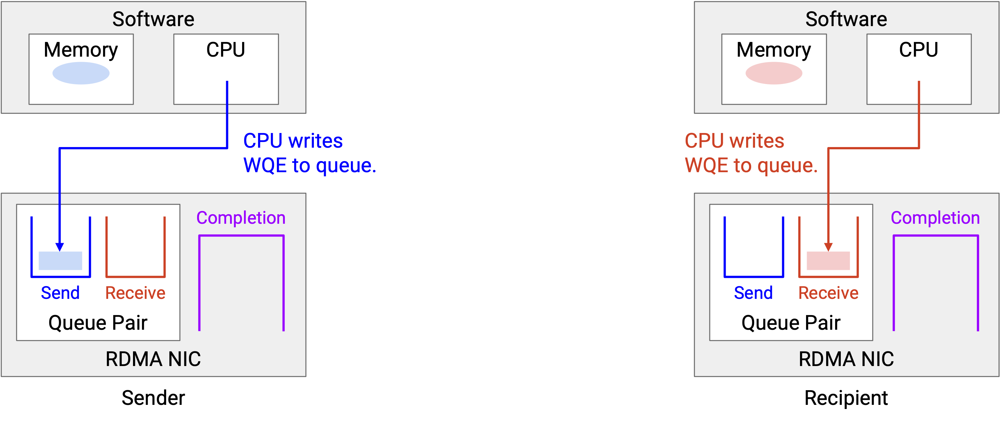

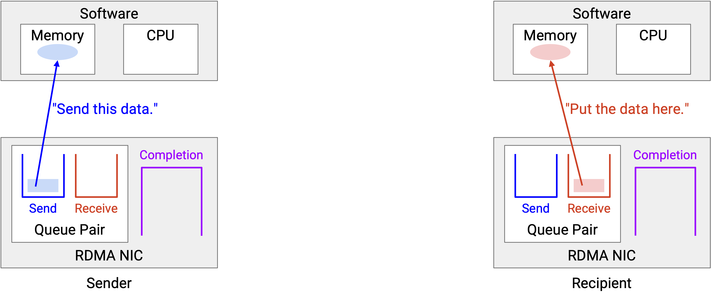

### 第四步：硬件执行数据传输

当两边工作就绪，NIC执行传输，软件不参与每个分组。相应硬件与网络协议处理可靠性、拥塞控制等要求。

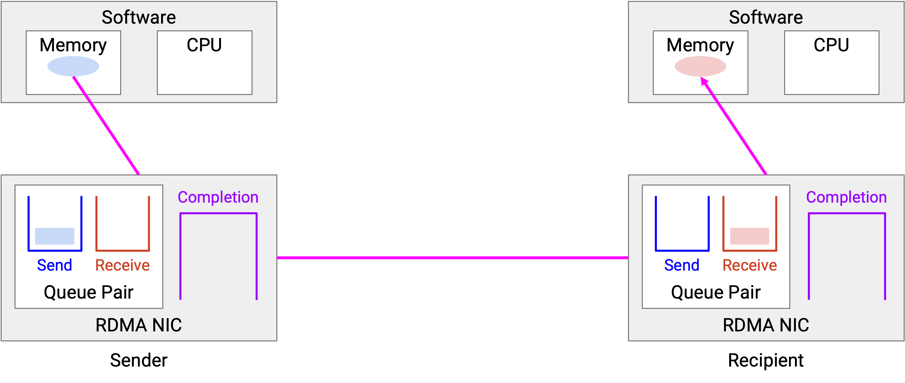

### 第五步：生成完成状态

传输完成后，队列中的对应工作完成；在本例启用相应通知的条件下，两端NIC生成CQE，说明发送或接收完成，并携带错误等状态。

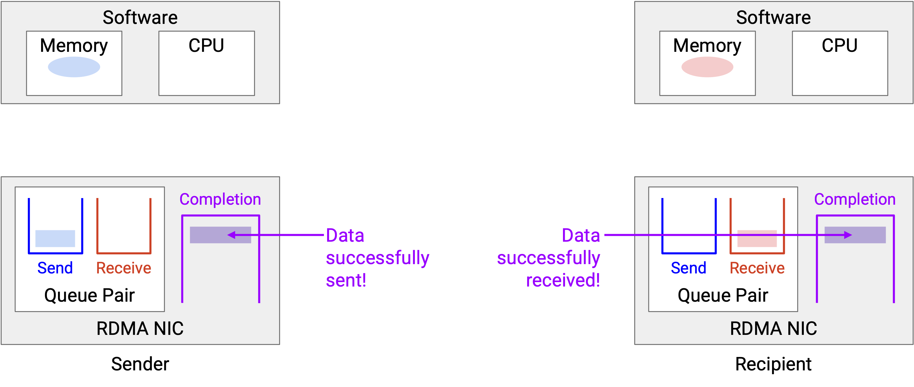

### 第六步：应用读取结果

应用最终读取CQE，了解这次传输发生了什么。

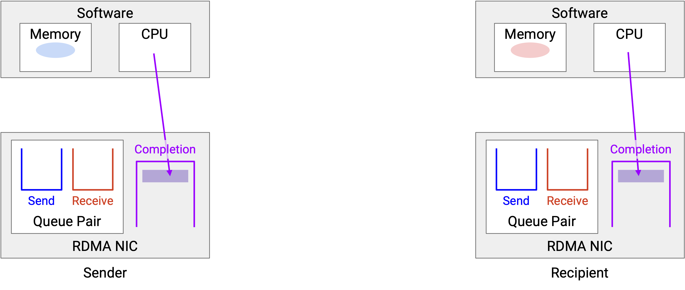

> 编者注：本例是双边SEND／RECV，不能推广为每个单边RDMA READ／WRITE都需要远端事先投递一个receive WQE。提交成功也不等于传输完成；普通非inline缓冲区须等符合语义的完成后才能安全复用。

## 二十五、RDMA的收益、代价与应用

RDMA可提供低延迟、高带宽，释放CPU给应用。但它需要专门硬件与软件，通常比传统网络接口复杂；可靠性、拥塞控制等职责并未消失，只是由硬件和网络协议体系承担。

教材指出，RDMA往往在两台服务器物理距离较近的数据中心中收益明显。如果相距很远，传播延迟主导，节省主机处理时间在总延迟中占比可能很小；距离较近时，主机处理可能成为主要延迟，优化收益就大。

应用包括科学计算、金融建模、天气预报、机器学习和搜索。云计算可以用它迁移大型VM，释放CPU供客户使用；AI/ML训练除了节省CPU、降低延迟，还重视较稳定可预测的延迟，便于多机协同。

> 编者注：远距离不意味着CPU节约和带宽收益必为零；原文的比较主要针对端到端延迟中各部分占比。

## 二十六、怎样实现RDMA？

RDMA的服务仍须处理可靠性、拥塞等问题。原文概括两种取向：

1. 在网络内部实现更多机制，例如交换机参与可靠性相关保障；教材以Nvidia的InfiniBand为例。
2. 在NIC中、QP抽象以下实现更多机制；教材称Google正在探索这一路线。

两种情况下，应用可以通过相应QP得到可靠、有序服务的抽象，差别在于底层如何实现。

> 边界说明：这不是严格的“交换机包办可靠性”与“NIC独自包办可靠性”二分。链路流控、拥塞反馈、端点重传和顺序控制是不同职责。InfiniBand可靠连接仍需端点传输机制，不能把端到端重传等全部归给交换机；并且前文已指出QP服务可不可靠，因此末段“可靠有序”仅适用于选择这种服务类型的QP。RDMA可运行在不同网络承载上，不应一概写成彻底替换IP。

## 引用与来源

- SDN完整现存正文：[Software-Defined Networking](https://textbook.cs168.io/datacenter/sdn.html)，源末节未完成；本页未补造后续内容。
- 课表原指定 [special-topics/host-networking](https://textbook.cs168.io/special-topics/host-networking.html) 在固定版本仅有迁移链接。本次沿其明确指向取得同一commit的 [datacenter/host-networking](https://textbook.cs168.io/datacenter/host-networking.html)，完整翻译其207行源文件全部正文与23幅图。加上SDN16幅图，本页共39幅教材图。
- 作者 **Peyrin Kao**，基于 **Sylvia Ratnasamy、Rob Shakir等人**的讲授。教材及本译文依 [CC BY-SA 4.0](https://creativecommons.org/licenses/by-sa/4.0/) 发布。修改包括中文翻译、中文图注、排版与明确标出的纠错；原图字节不变，仅以白底显示。
- 固定教材版本日期 **2026-10-01**，不是Spring 2025历史教材；commit：

```text
0b8208742d31df7fc3d53a0cd94fdd4e04f8d47e
```

- 编者核对资料：rdma-core项目手册 [ibv_post_recv(3)](https://man7.org/linux/man-pages/man3/ibv_post_recv.3.html)、[ibv_post_send(3)](https://man7.org/linux/man-pages/man3/ibv_post_send.3.html)，已读完整DESCRIPTION、NOTES与操作支持表，2026-11-15访问。它们用于区分receive缓冲区、RDMA READ提交位置及完成后缓冲区复用，不是2025视频指定阅读。
- 教材许可不覆盖视频、课件或外链论文。本页不声称已核验2025课堂覆盖、首尾问答或实际主机实验。
