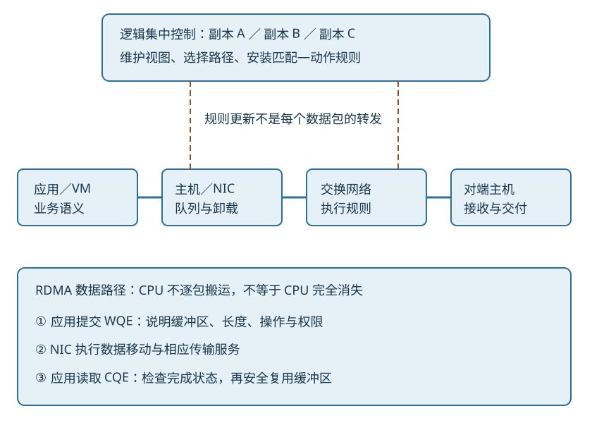

# 第23讲：谁决定路径，谁承担每包工作？

## 1. 把两个“搬走”分开理解

SDN把一部分**控制决策**从各设备的封闭实现中分离出来；主机卸载把一部分**逐包工作**从CPU移到NIC。它们都改变职责划分，但不是同一件事。

- 控制平面回答：哪些规则应当存在？
- 数据平面回答：当前这个分组按哪些规则处理？
- 管理平面回答：目标、约束、配置、观测与运维如何组织？
- 主机网络优化回答：应用到线路之间的工作由哪个处理器、哪段内存和哪组队列承担？

完整教材译文、39幅原图与错误勘注见[本讲材料](#/c/berkeley-cs168-2025/lec/lec23?v=materials)。

## 2. SDN不是“所有包送给一台大电脑”

集中控制器可以收集拓扑、需求和策略，计算路径并安装规则。之后数据包直接在交换机或虚拟交换机中匹配规则并转发，不必逐包经过控制器。

最重要的模块边界是：

**抽象网络状态 → 控制程序决策 → 可执行流表 → 数据平面处理。**

OpenFlow是这类可编程控制接口的一种，不是SDN的同义词，也不是新的传输层协议。控制程序可以很复杂，但下发动作仍必须在硬件可支持的匹配、转发、封装、丢弃等操作范围内。

### 流表例子

“租户7内、目的10.0.0.8”可匹配为一条规则，其动作是添加该租户标签、封装到宿主192.0.2.20，再转发。控制程序负责决定映射，数据平面只需执行。

若VM迁移到192.0.2.30，变化的是规则的定位结果，不要求应用修改自己的虚拟目的地址。规则更新期间的旧、新状态共存问题仍需设计，不会因为称为SDN就自动消失。

## 3. 逻辑集中与物理分布为什么不矛盾？

“逻辑集中”表示网络决策通过一个协调的全局抽象形成；控制服务实际可以有多个副本、多个分片、多个服务器。

“每台路由器都独立运行距离向量”也是物理分布，但其抽象是各节点通告与局部计算。两者的区别不是CPU数量，而是**状态与决策的组织方式**。

多个副本可以容忍单机故障，却不能自动消除：

- 共同的软件错误；
- 失效或过时的全局视图；
- 控制链路故障；
- 副本分歧与协调延迟；
- 超过处理能力的状态更新量。

### 控制器断了，网络立刻断吗？

不一定。已安装规则可能继续转发，直到规则过期或网络环境改变。真正危险的是失去响应新故障、安装新VM映射、调整路径的能力。

因此评价可用性应分别问：**既有数据流还能走吗？新流能建立吗？发生链路故障还能恢复吗？** 只问“控制器是否在线”不够。

## 4. 流量工程如何超越局部最短路？

### 例一：20与100的顺序陷阱

两条可用路径容量分别为20、100 Gbps，两个不可拆分的需求分别为20、100 Gbps。

若20的需求先占用100的路径，之后100的需求面对的剩余容量是20与80，两条单路径都不够。局部“选一条当前满足需求的短路”没有考虑后续组合。

全局配置把20放在20的路径，把100放在100的路径，两者都满足。

注意原教材对应的第二幅图保留了“10 Gbps”文字，与正文不符；本例以明确的20／100数值推导。

### 例二：12与8如何共享两个10？

如果流可分拆，第一条需求12 Gbps可以分成10+2，第二条需求8 Gbps与这2 Gbps共享另一路：

$$
\begin{aligned}
P_1 &: 10,\\
P_2 &: 2+8=10.
\end{aligned}
$$

这说明分流能提高容量可行性，但若是单条TCP连接，还必须处理不同路径时延造成的乱序。路径标签让交换机知道走哪条路，并不自动解决接收顺序。

### 什么时候不能声称“全局最优”？

控制器有全局视图，才有机会优化全局目标；但需求可能估错、状态可能滞后、求解可能采用启发式，实际更新也可能非瞬时。应说“具备全局协调能力”，而不是“集中计算必然最优”。

## 5. Overlay SDN与Underlay SDN各管什么？

**Overlay控制**维护租户、虚拟地址、宿主位置和封装规则。它让物理交换机不必知道每台VM。规模可以按租户和通信关系拆分。

**Underlay控制**维护物理拓扑、路径、容量与故障，负责让真实链路得到利用。例如发现两个大象流竞争同一核心链路后，重新安排不同物理路径。

两者可以分离实现。VM创建并不必然改变物理路由；链路故障也不必改变VM的虚拟身份。相反，如果把每次虚拟变化都传播到全部物理设备，就失去了层次分解的收益。

## 6. 网络变快后，主机为什么可能成为瓶颈？

只看Gbps会掩盖包率。忽略链路额外开销，一条100 Gbps链路承载1500字节分组时，包率约为：

$$
\begin{aligned}
P&=\frac{100\times10^9}{1500\times8}\\
&\approx 8.33\times10^6\ \text{包/秒}.
\end{aligned}
$$

若仅靠一个3 GHz CPU核，则平均每包预算约：

$$
\frac{3\times10^9}{8.33\times10^6}
\approx360\ \text{周期/包}.
$$

这360周期还要覆盖访问内存、协议状态、队列、安全检查等，而且应用本身也需要CPU。这个原创算例不是特定硬件测量；实际以太网开销会改变包率，小包往往让每包预算更紧张。

把主机总工作粗分为：

$$
\begin{aligned}
W\approx{}&a\times\text{包数}\\
&+b\times\text{字节数}\\
&+c\times\text{连接状态工作}.
\end{aligned}
$$

- 批处理、分段卸载减少CPU看到的包数项；
- 减少复制降低字节搬运项；
- 协议与流表卸载把部分状态处理转给NIC。

三者不能互相替代，优化前先确定哪一项是真瓶颈。

## 7. 用户态协议栈与NIC卸载的边界

### 用户态共享内存

把应用与协议栈放到可共享缓冲区的用户态，可以减少用户／内核之间复制，并方便迭代。但它没有自动消除数据路径工作，CPU仍可能执行TCP、IP、策略和轮询。

安全边界也没有消失：网卡DMA访问哪段内存、哪个进程拥有缓冲区、VM之间是否隔离，都需要明确机制。

### 简单卸载

校验和、发送分段、接收聚合、多队列等可减轻CPU压力。分段卸载让软件交给NIC大块数据，再由硬件生成符合MTU的小包；不等于线上出现无限大包。

接收聚合不能随意丢掉分组差异。例如ECN标记或序号间隙包含协议信息，合并时必须保留语义。

### 多队列与ECMP的相似性

ECMP把同流映射到同一路径，多队列接收可把同流映射到同一个CPU。两者都在“并行度”和“顺序／状态局部性”之间取舍。

如果每包随机换CPU，虽可能均分包数，却会让同一连接的状态在缓存之间来回迁移，也更容易乱序。固定到一个CPU则可能让大流集中，均衡问题仍存在。

### 有状态卸载

虚拟交换、限速、防火墙或完整协议处理涉及更多状态与规则。卸载不是删除复杂度，而是把复杂度放到另一种执行环境：NIC资源有限，规则更新、状态容量、故障恢复、可观测性仍需考虑。

## 8. RDMA的正确心智模型：提交工作，不是“CPU完全消失”

传统socket主要暴露字节流；RDMA接口暴露缓冲区与工作请求。应用准备内存和队列，提交WQE，NIC执行数据传输，再通过CQE返回相应完成状态。

要区分三个时刻：

1. **投递成功：** 工作已进入处理流程；
2. **传输完成：** 相应操作达到服务定义的完成条件；
3. **应用消费：** 对端应用真正读到数据并完成业务处理。

它们不是同一事件。尤其“NIC报告完成”并不天然证明对端业务已经处理完毕。

### 双边SEND／RECV

发送方提交指向发送缓冲区的工作；接收方事先提供接收缓冲区。NIC把数据送入该缓冲区，双方按各自配置观察完成。

### 单边READ／WRITE

发起方请求读或写已获授权的远端内存，不应把它们一概画成双边SEND／RECV。教材把“从远端地址读100 MB”举成receive队列工作，这是错误的：rdma-core接口把RDMA READ放到发送工作队列；receive请求只描述本地接收缓冲区等。

### 缓冲区生命周期是不变量

普通非inline发送缓冲区不能投递后立即改写；接收缓冲区也不能在NIC仍可能写入时交给无关用途。必须等符合操作语义的完成，再安全复用。否则即使网络可靠，应用也可能读到被自身并发修改的数据。

这些是接口理解与静态学习边界，本页不执行RDMA、不配置主机、不提供实验实现。

## 9. 延迟收益的上限

把端到端时间拆成：

$$
T=T_{\mathrm{host}}+T_{\mathrm{network}}.
$$

若主机占8微秒、网络占2微秒，把主机处理降到2微秒，总时延由10降到4，收益明显。若网络本身占10毫秒，同样节省6微秒对总时延比例很小，却仍可能节省CPU。

因此不能把“RDMA适合数据中心”理解为距离远就绝无价值。应同时分析时延比例、CPU成本、吞吐、稳定性及软硬件复杂度。

## 10. 自测

1. 三个控制器副本是否就说明该系统不属于集中控制？

不是。多个物理副本可以维护一个协调的逻辑控制服务。“逻辑集中”讨论决策抽象，不讨论是否只有一个CPU。

2. 控制器失联时既有流仍能转发，能否宣布控制器不是关键组件？

不能。现有规则可能暂时有效，但新流、VM迁移、链路故障与表项过期仍需控制响应。应分别评价稳定状态与变化期间的可用性。

3. 为何不能把“可编程控制平面”理解成交换芯片可运行任意应用代码？

控制程序可以在通用CPU上复杂计算，最终仍要编译成芯片支持的匹配和动作。硬件可解析字段、规则容量和流水线能力限定了数据平面行为。

4. 用户态TCP为什么可能仍然耗尽CPU？

省掉某些跨边界复制和切换，不代表省掉协议处理、校验、队列和状态工作。若瓶颈是每包计算，仍须减少包处理次数或卸载部分工作。

5. receive WQE能否直接表达“到远端某地址读取100 MB”？

普通receive WQE描述本地接收缓冲区。主动远端读取属于RDMA READ操作，提交到发起方发送工作队列；不能照抄教材此处的错误分类。

6. NIC接管可靠性后，拥塞控制和权限检查是不是都可以删掉？

不能。可靠传输、拥塞适应、内存访问授权仍然是必要职责，只是实现位置和接口发生变化。QP还存在不同服务类型，不能假设每种QP都可靠有序。

## 引用、版本与课堂边界

- 本页基于固定教材[SDN](https://textbook.cs168.io/datacenter/sdn.html)及原指定页面明确迁移到的[Host Networking](https://textbook.cs168.io/datacenter/host-networking.html)，是独立组织的学习解释；原创算例不是课堂实验结果。
- [教材全译](#/c/berkeley-cs168-2025/lec/lec23?v=materials)覆盖全部可达正文。SDN最后的管理／数据平面小节本身未写完，保留源缺口；不能将该缺口填成作者原文。教材固定版本2026-10-01，不是2025历史教材，作者Peyrin Kao，基于Sylvia Ratnasamy、Rob Shakir等人讲授，CC BY-SA 4.0。
- 编者实际核对rdma-core项目手册 [ibv_post_recv](https://man7.org/linux/man-pages/man3/ibv_post_recv.3.html) 与 [ibv_post_send](https://man7.org/linux/man-pages/man3/ibv_post_send.3.html)的完整说明、操作表和注意事项，用于纠正WQE方向与缓冲区生命周期。没有执行任何主机网络实验。
- 2025官网第23讲录像ID **OaqLmzS407M**，逐视频标题 **[CS168 SP25] Lecture 23. Datacenters 3-4: SDN and Host Networking**，时长 **81:17（4877秒）**；官方频道 **CS 168 (Internet Architecture) at UC Berkeley**，上传日期 **2025-04-22**，课表日期为2025-04-21。课表两份slides仍属于这同一讲，不据此虚构两个视频时间轴。
- 字幕主路径与一次不同官方timedtext路径均HTTP429。未取得字幕、音画或截图证据；课堂讲授覆盖、片头、收尾和问答未核验，无draft，也不猜时间段。视频许可未知，教材许可不覆盖视频或课件。
