# 一、组播（Multicast）

## 动机：为什么不只用单播？

此前各个主题都把互联网的目标描述为在主机之间传送数据，特别是假设使用单播：一个源向一个目的地发送数据。HTTP、DNS、TCP、TLS 等协议采用客户端—服务器模型，一个客户端与一个服务器交换数据，也就隐含了双方之间的单播。

互联网大多数流量确实是单播，但也有例外。有些应用需要一群主机通信，例如多人游戏、实时内容分发（Zoom 会议、体育赛事直播）、协作文档（Google Docs）。更特别的用途还包括发现服务（向所有 Apple 设备发消息以寻找最近的扬声器）和 AI 训练，后者将在集体通信中讨论。

在多人游戏或视频会议中，并没有天然唯一的客户端和服务器。因此，客户端—服务器未必是最自然的思考方式。网络应提供怎样的支持，让开发者更容易编写这些应用？

一种答案是：网络完全不用增加支持，群组通信可以用单播实现。例如修改协作文档后，分别向组内每个人发送一个单播包，让大家得知修改。

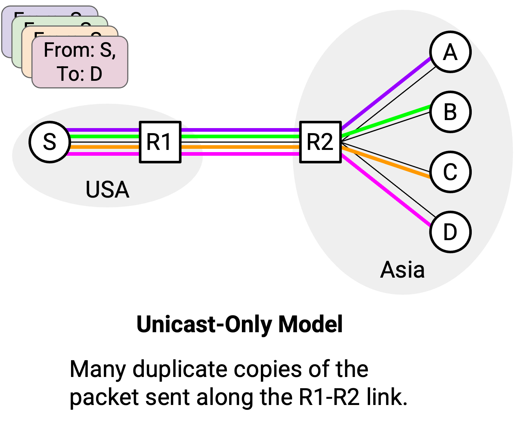

图7-001：纯单播模型：源 S 向 A、B、C、D 分别发送副本，同一条 R1—R2 链路重复承载相同数据。原文举欧洲为例，图中区域标签却是 Asia；两者地名不一致，不影响跨洋链路示例。

但这种办法可能低效。假设你在美国，其他成员都在欧洲，逐一单播会让昂贵的海底光缆反复承载相同数据；发送方也必须发送大量重复包，扩展性不好，例如一台服务器向数百万用户直播体育赛事。

更自然的办法是只让一个包跨过海底光缆，再由欧洲的路由器或主机分发副本。理想情况下，每条链路只承载该包一次；如果沿该链路没有成员，则一次也不发送。

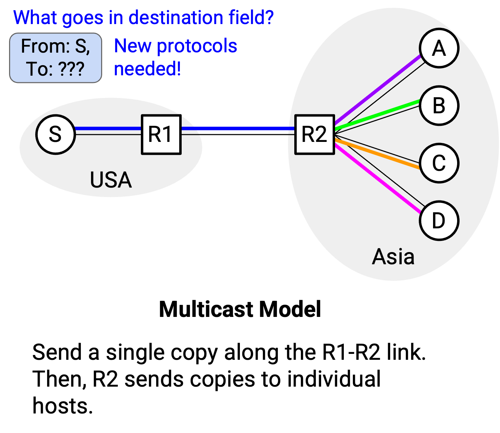

图7-002：组播模型：R1—R2 只发送一份，R2 再向各接收者复制。目的地址如何表示群组，需要新的协议支持。

这需要网络增加功能，也需要设计新协议。

## 四种投递模型

- **单播 Unicast**：恰好向一个目的地发送。
- **任播 Anycast**：向一组候选目的地中的任意一个发送，只需一个成员收到。
- **广播 Broadcast**：向所有目的地发送。“所有”的边界取决于问题，可以理解为本地网络内的所有主机。
- **组播 Multicast**：向某个组的所有成员发送。主机可以随时加入或退出；发送者即使不是成员，也可以向这个组发送。

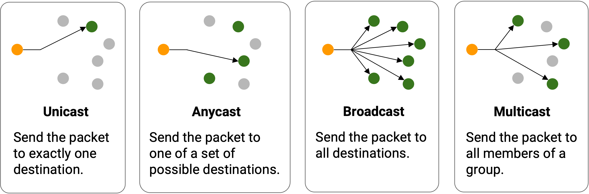

图7-003：单播选一个指定目的地，任播选集合中一个，广播覆盖范围内所有目的地，组播只覆盖自愿加入的成员。

体育直播可以让所有感兴趣的主机加入同一个组，服务方向该组发送。发现打印机时，可以让楼内打印机加入一个组，用户向整组发消息来寻找可用打印机。

## IP 组播与覆盖组播

组播历史中反复出现一个架构问题：在哪一层实现？

一个选择是在第 3 层实现，即 **IP multicast**。路由器增加专门支持，理解如何复制、转发组播包；性能较好，但实现较困难。

另一个选择是在第 7 层实现，即 **overlay multicast（覆盖组播）**。应用负责所有组播功能，保持第 3 层不变，路由器只需要理解单播；性能可能较差，但较容易部署。两者没有绝对优劣，需要分析取舍。

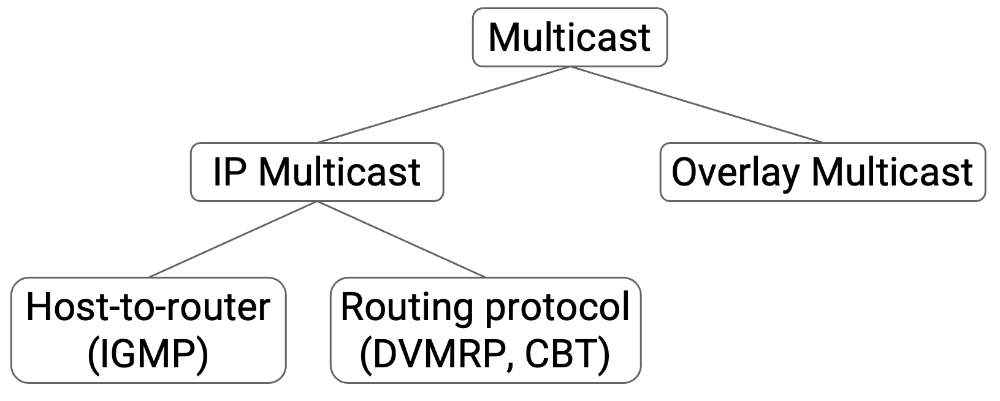

图7-004：分类：组播分为 IP 组播与覆盖组播；IP 组播内又分主机—路由器成员管理 IGMP，以及路由器之间的 DVMRP、CBT。

# 二、IP 组播服务模型

## 简史

1990 年代和 2000 年代，IP 组播经历了活跃的研究开发。当时人们预期互联网的杀手级应用是电视或电台直播；一个趣闻是，Rolling Stones 在 1994 年进行了早期在线音乐会直播。

回头看，这些协议的实际采用程度好坏参半。现代路由器有相关支持，但运营者不一定启用；禁用协议实际上意味着该路由器不理解、不支持它。

IP 组播有时用于单一管理域，例如数据中心内部，但很少甚至不跨域部署。因此用户不能指望全球互联网自动向一个由世界各地用户组成的组投递数据。尽管未全球部署，其技术还能解决其他网络问题，在 AI 训练的集体通信中重新变得重要。

## 主机看到的接口

一个组由一个 IP 地址标识。IPv4 的 224.0.0.0 到 239.255.255.255 是约定的组播地址范围，大家都知道这个固定范围不是普通单播地址。

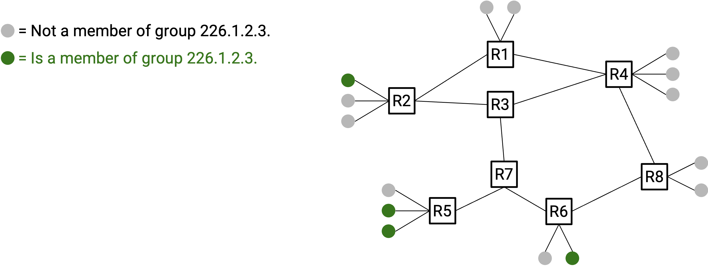

图7-005：以 226.1.2.3 标识一个组；绿色主机是成员，灰色主机不是成员。

加入时，主机宣布想加入哪个组播地址。至少一个路由器（例如家庭路由器）应听到这个消息，之后路由器通过路由协议等机制协调传播，学习成员分布。原文将其概述为“最终所有路由器知道你属于该组”；这是一种服务模型直觉，不表示每台路由器必须保存每个成员的完整名单。

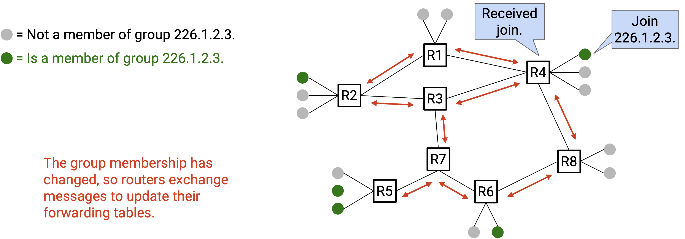

图7-006：主机向 226.1.2.3 发出加入通知，路由器交换信息并更新转发表。

离开时也宣布退出，用组播地址说明是退出哪个组。

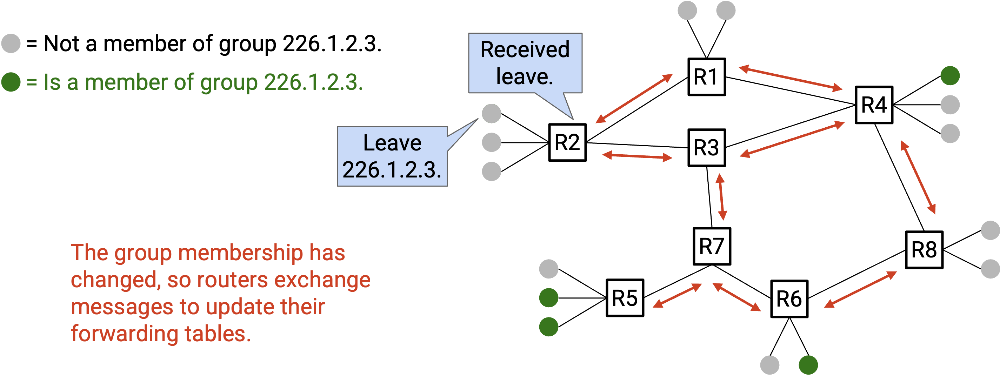

图7-007：退出通知改变成员分布，路由器相应更新转发表。

向组发送数据，只需把 IP 目的地址填写为该组地址，路由器负责将包送给所有成员。发送者不必知道组里有哪些人。

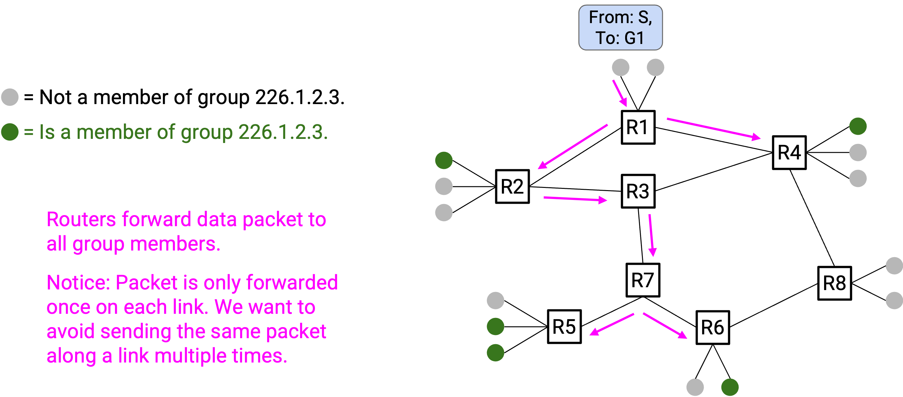

图7-008：从源 S 向组 G1 转发；路由器在分叉处复制，理想情况下同一链路只承载一份，不向无成员方向发送。

综上，终端有三种操作：向组发送、宣布加入、宣布退出。发送并不要求自己是成员。三种操作都通过发包实现，路由器处理这些包、互相协调并决定组播路由。

单播路由器收到一个包后选择一个下一跳。组播路由器看到目的地址属于组播范围后，可能向零条、一条或多条出链路转发。为此路由器必须增加状态，记住哪些方向通向成员；无成员方向无需发送，加入、退出会改变某组的下一跳集合。

## 将实现分成两个问题

目标仍是让主机只负责发送、加入和退出，路由器据此正确地把包转给组内成员。可以拆为：

1. 路由器怎样知道直连主机属于哪些组？使用 **IGMP**。

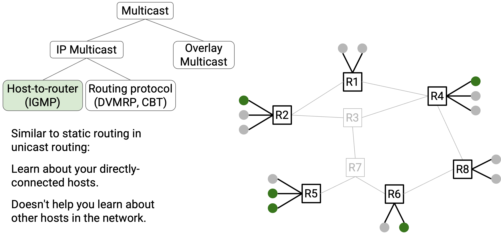

图7-009：IGMP 负责直连成员发现，类似单播中学习直连主机的基础信息；不负责发现远处的主机。

2. 路由器怎样通过网络将数据送到成员？下面研究 **DVMRP** 与 **CBT**。两者解决同一个问题，教材将其作为可选择的两种方案，类似在距离向量和链路状态之间选择。

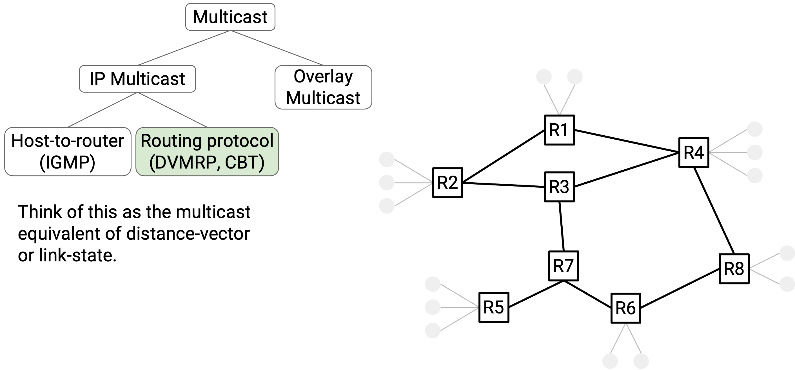

图7-010：DVMRP 与 CBT 都处于路由器之间的组播路由层，和主机—路由器的 IGMP 分工不同。

## IGMP：直连主机

先考虑一台直接连接许多主机的路由器。它需要知道每台主机属于哪些组，使用 Internet Group Management Protocol，即互联网组管理协议。

路由器与主机交换消息：**Query（查询）** 由路由器周期性发出，询问“你属于哪些组？”；**Report（报告）** 由主机回应，说明“我属于这些组”。主机也能不等查询就主动报告。

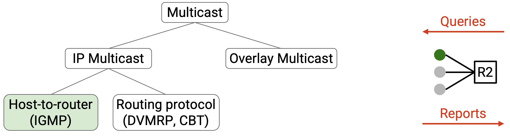

图7-011：路由器向主机发 Queries，主机向路由器发 Reports；周期性交换维持成员信息。

周期性查询和报告让路由器掌握最新成员状态。很久没有收到某项成员关系的报告时，路由器认为它已过期并使之失效。

IGMP 只解决直连主机，远处主机仍需路由算法。类比距离向量路由，可将 IGMP 看作学习直连信息的“静态路由”对应物；这是职责类比，不是说 IGMP 真的是静态配置。

# 三、DVMRP

## 朴素办法：泛洪

组播路由的任务是合作把目的地址为组的包送到所有成员。最简单的办法是泛洪：路由器收到包后，从除了入端口以外的所有端口转发。

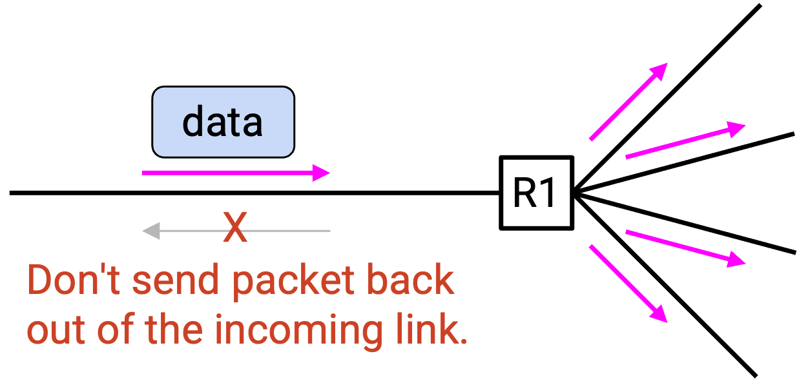

图7-012：R1 向所有其他端口复制，但不立即沿入链路送回。

为什么有效？因为所有主机都会收到，当然包含组内成员。好处是概念简单，不需要运行路由协议。主要问题有两个：同一份数据沿多条路径传送，浪费带宽；数据也发给非成员，同样浪费。环路还会让包无限循环形成广播风暴，可以记录已见过的包并丢弃重复包来处理这一问题。

## RPB：反向路径广播

先只解决重复路径，暂时仍向非成员发送。假如 R1 到 R4 有多条路径，泛洪会让包沿每条路走，R4 只好丢弃副本。我们希望任意两点间只走一条路。

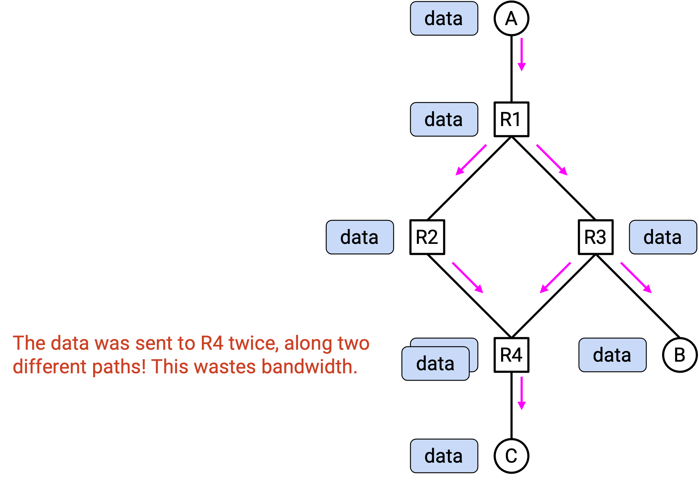

图7-013：R1 经 R2 和 R3 都能把同一数据送到 R4，造成冗余。

什么结构在任意两点之间只有一条路径？树。因此构造一棵生成树，让每个人只从一条路径收到包。

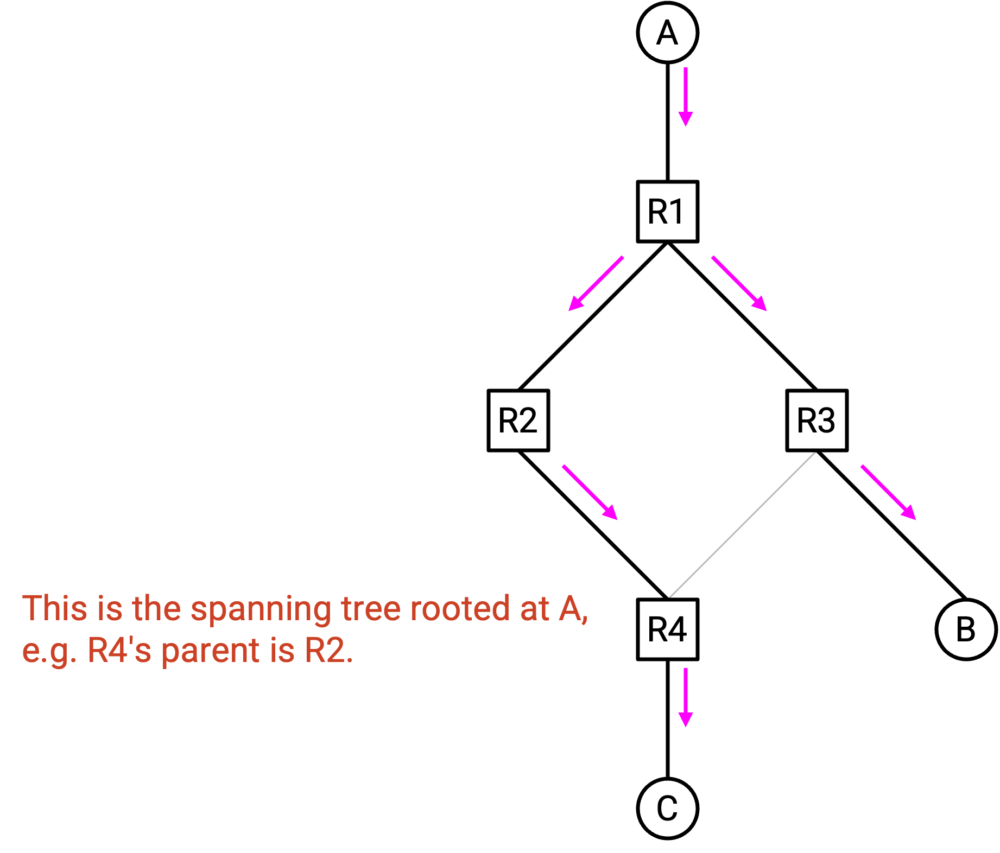

图7-014：选定树后，R4 只有一个父节点 R2，不再通过两个方向接收有效副本。

无需从零构造。单播距离向量已经形成了指向目的地的树，包沿树向上流向目的根。

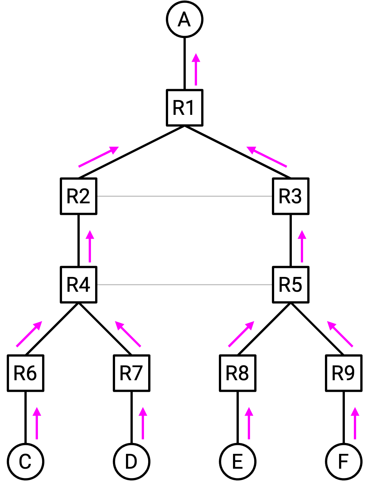

图7-015：单播以目的 A 为根，各节点向父节点发送，数据向根汇聚。

反转箭头后得到适合组播的树：根变为发送源，副本从根向下流，到达全部目的地。

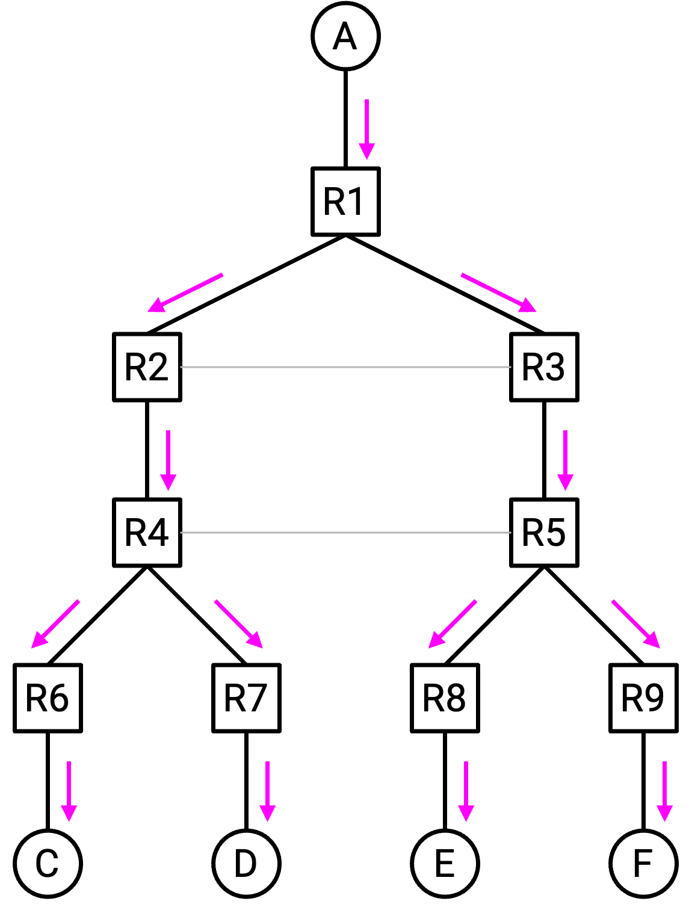

图7-016：组播以发送者 A 为根，数据从父节点流向子节点。

为了避免箭头反转带来的混乱，用树的标准术语：非根路由器恰有一个父节点，有零个或多个子节点；最上面是根，没有子节点的是叶。单播根是目的地，收到孩子的包向父节点转；组播根是源，收到父节点的包向孩子转。

转发规则为：**若包从父节点到来，发给所有孩子；否则丢弃。** 即便有其他路径的副本到达，也因不是来自父节点而被丢弃，避免沿多路反复转发。

## 学习父节点与子节点

原文章节标题写作“RPM: Learning Your Parent and Children”，但本节尚未剪枝，讲的是 RPB 所需状态。

找父节点很容易：单播表里通往根（这次是源）的下一跳就是父节点。

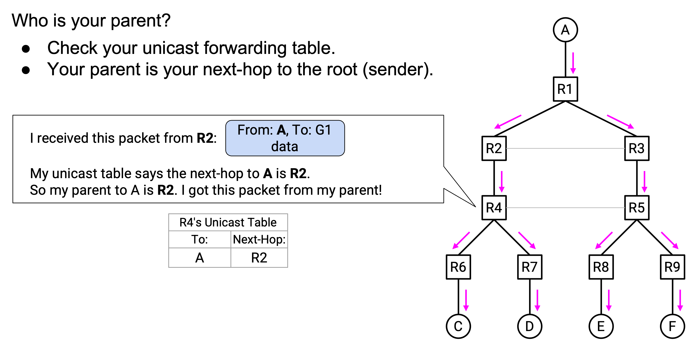

图7-017：R4 查单播表发现通往 A 的下一跳是 R2，因此来源为 A 的组播必须从 R2 到达。

找孩子更费事：单播表只告诉父节点，不告诉前一跳是谁。因此每个节点向已知父节点发送组播路由通告：“在以 A 为根的树中，我是你的孩子。”

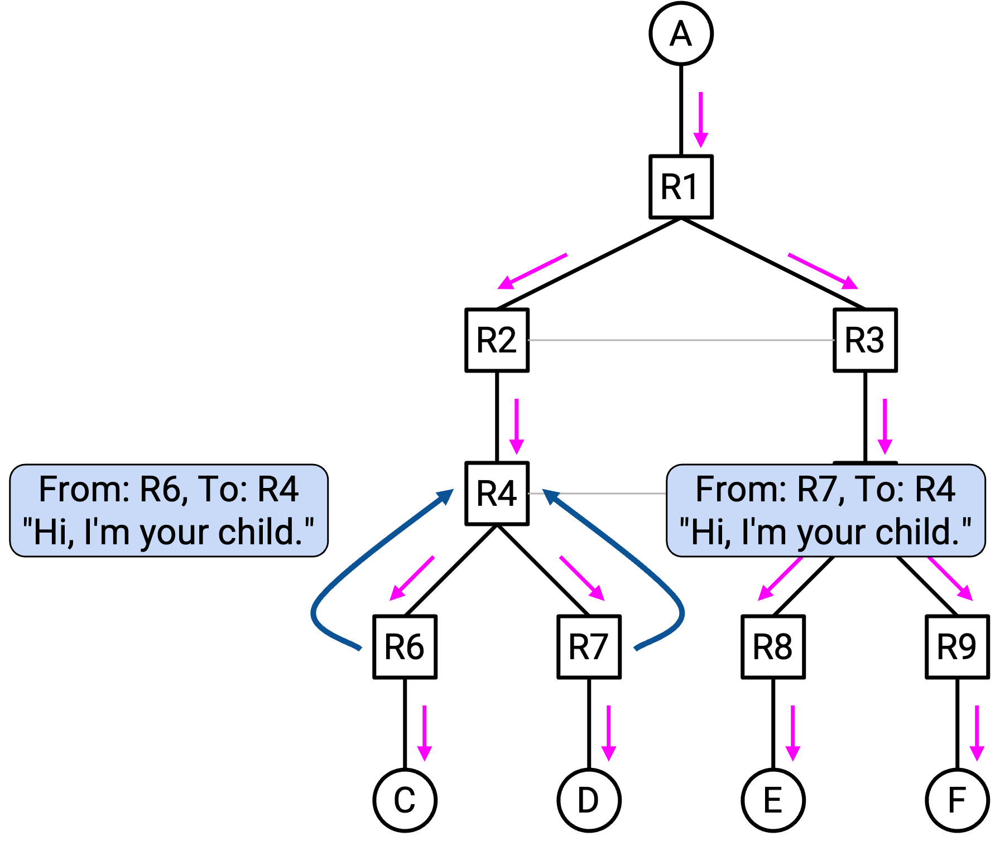

图7-018：R6、R7 向 R4 通告自己是以 A 为根的树中的孩子。

收到通告的路由器保存孩子集合。这是为组播新增的信息，存入与单播表分离的组播转发表。

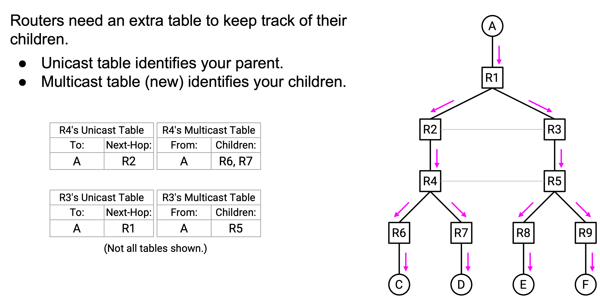

图7-019：R4 的单播表含 A→R2，组播表含源 A→孩子 R6、R7；R3 对应父 R1、孩子 R5。

因此实现时，先用单播表检查是否来自父节点，通过后再用新组播表选择孩子。

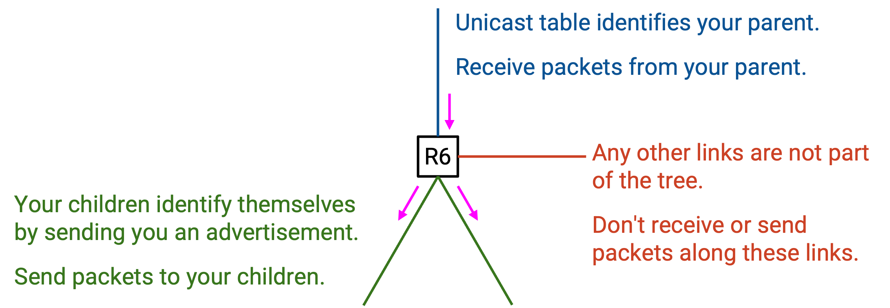

图7-020：单播表确定父方向；孩子通过通告自报身份；非树链路不用于该树的收发。

两张表各有用途：单播表用于普通单播、检查组播入方向、向父节点发“我是孩子”的路由通告。组播表由孩子通告构建，用于向孩子复制数据。

关键是单播对每个目的地分别建立一棵树，因此每个目的地对应一个父节点；反向后则对**每个发送源**建立一棵树。组播表中的一项可读作：“若源为 A，转发给 R6、R7。”

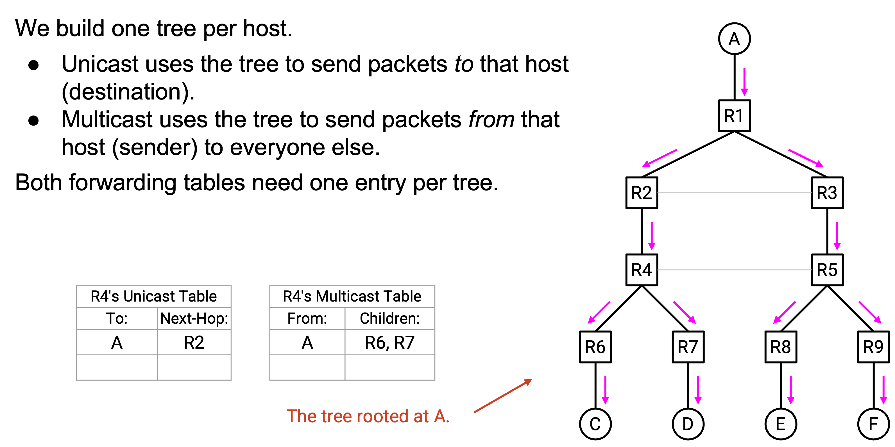

图7-021：以 A 为根的树：R4 的父为 R2，孩子为 R6、R7；同一棵树用于朝 A 单播或从 A 向外广播。

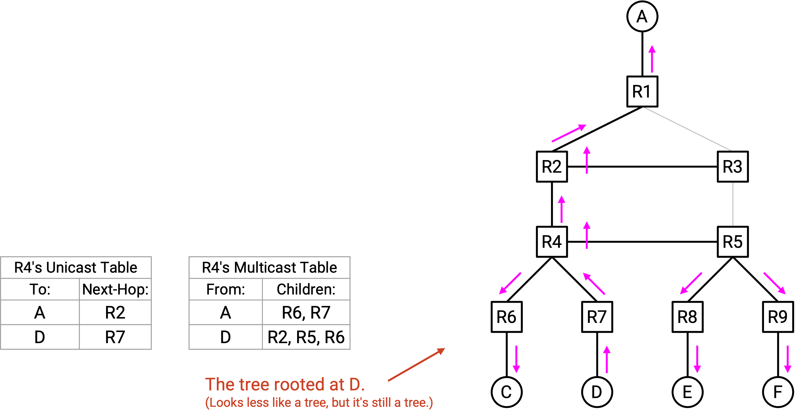

图7-022：以 D 为根时，R4 的父变为 R7，孩子变为 R2、R5、R6；树不一定在纸面上呈上下形状，仍是树。

## RPM：反向路径组播与剪枝

RPB 已解决重复路径，但仍给所有人广播，包含非成员。通过**剪枝**删除没有任何组成员的分支。

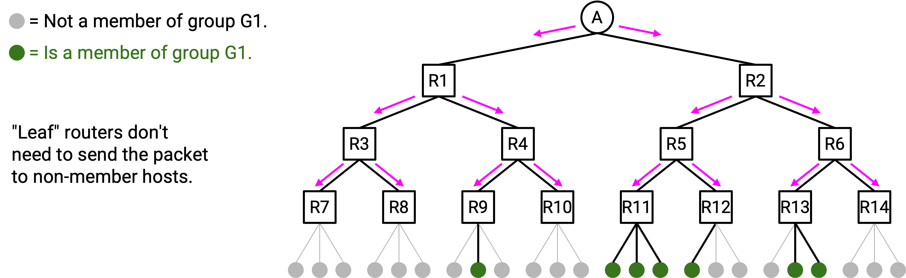

图7-023：剪枝前：灰色非成员仍处在广播树上，很多叶方向不需要数据。

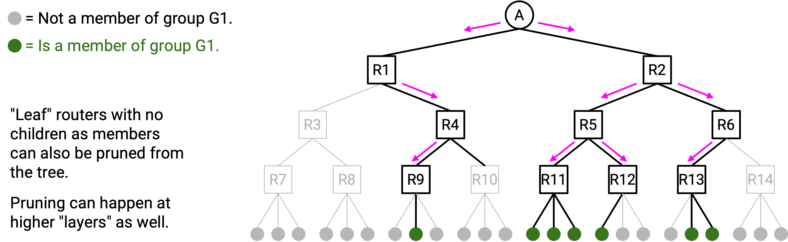

图7-024：剪枝后：仅保留通向绿色成员的分支，较高层的整棵无成员子树也可移除。

剪枝从孩子向父传播。原文设想 R5 通过 IGMP 得知三个直连主机都不是成员，于是无需留在该组的树上；随后的图以 R7 展示同一过程。

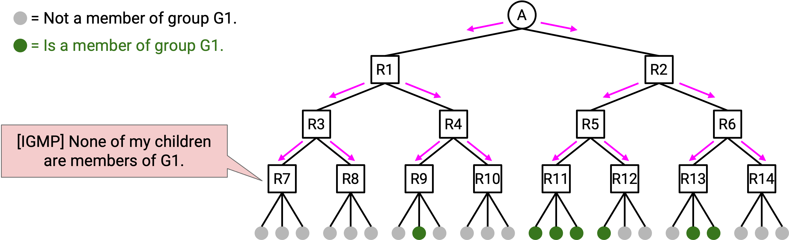

图7-025：叶路由器通过 IGMP 得知其直连主机均不属于 G1，具备剪枝条件。

它告诉父节点：“我是你的孩子，但我的后代没有该组成员，请不要再给我数据包。”父节点更新组播表，把它从孩子集合移除。剪枝消息只发给直接父节点，不继续转发原消息。

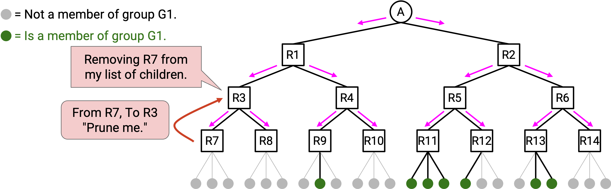

图7-026：R7 向 R3 发 Prune，R3 从对应孩子列表中删除 R7。

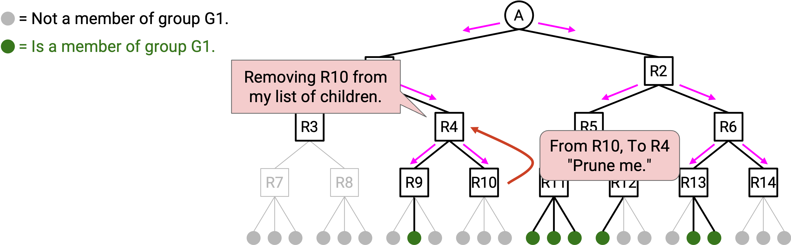

图7-027：R10 向 R4 发 Prune，R4 删除 R10，同时保留仍有成员的 R9。

较高层也能剪枝。假设 R3 的两个孩子都已声明无成员，且 R3 本身没有直连成员，它就可以向自己的父节点发出新的剪枝通告，使自己也退出树。

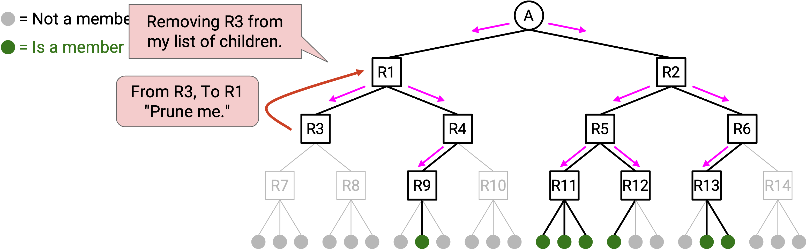

图7-028：R3 的孩子均已剪枝，于是 R3 向 R1 发送自己的 Prune，R1 删除 R3。

注意，一个中间路由器可能既连接子路由器，又连接终端。必须**所有孩子均已剪枝，且所有直连主机都不是成员**，才可向上剪枝。

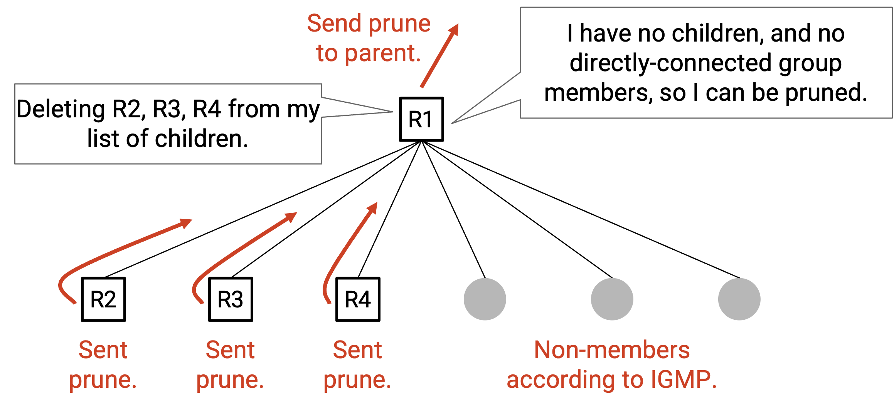

图7-029：R1 只有在 R2、R3、R4 都请求剪枝，而且直连主机均为非成员时，才能向自己的父节点请求剪枝。

剪枝使状态更复杂：原先只需“源→孩子集合”，现在集合还取决于目的组。比如 R11、R12 都有 G1 成员，但只有 R11 有 G2 成员。因此每个源、每个组都要一项：“A 发给 G1 时转给 R11、R12”；另一项是“A 发给 G2 时仅转给 R11”。原文在解释这一例子时有一次把 R12 写成 R2，本译文按其后续描述与含义勘正。

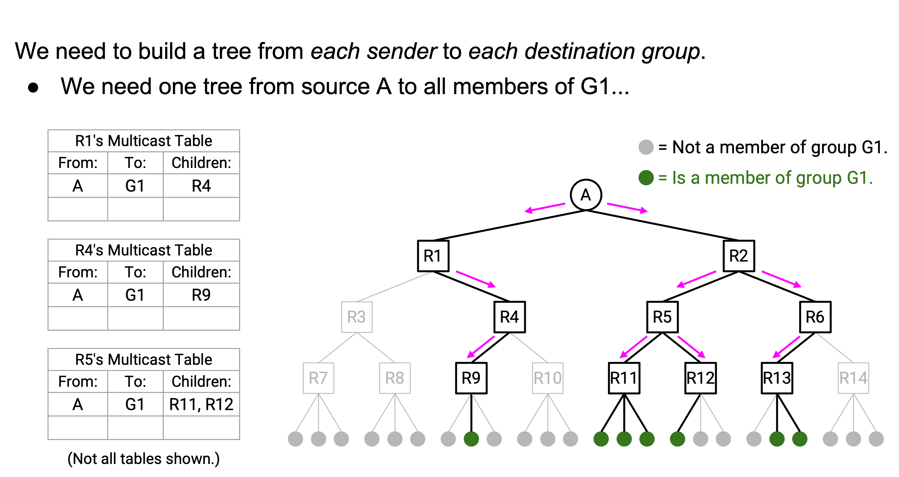

图7-030：以 A 为源、G1 为目的组的剪枝树；例如 R5 的孩子为 R11、R12。

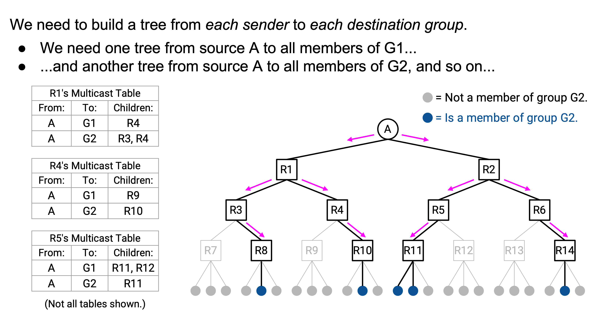

图7-031：同一源 A 向 G2 发送需要另一棵树；例如 R5 此时只保留 R11。

换句话说，先前每个源一棵覆盖所有人的树，现在按目的组删去不同分支，故每个 **(源, 目的组)** 对一棵树。

另一个问题是成员会变化：现在无成员的分支以后可能出现新成员。教材方案让路由器周期性清空全部剪枝状态，恢复向所有孩子转发的 RPB。计时器到期后，新加入者所在分支重新连上；如果仍无成员，就再次向父节点请求剪枝。

## 规则汇总

**路由规则：** 每棵源树都需要父和孩子。父节点无需另算，单播表已经给出；每个节点向父通告，父收到后学习孩子。

**转发规则：** 收到数据后，按包的源查单播表并检查父方向；如果来自父方向，则按目的组查组播表，仅转给未剪枝的孩子；如果不是来自父方向，丢弃。

**剪枝规则：** 对每个 (目的组, 源) 对分别处理。收到孩子的剪枝请求后，从对应项删除该孩子；如果直连主机和下游孩子都不需要该组，向父节点发送剪枝请求；周期性清空剪枝信息，恢复所有孩子。

## 优缺点

缺点是每次清空剪枝状态都会暂时向所有人广播，直到再次收敛；此外每个源、每个目的组都需要状态，转发表扩展性较差。

优点是这是对距离向量路由简单、优雅的扩展，可以复用单播表，无需重新发明父节点发现方法。复用距离向量的投递树也带来最低代价路径：从源到每个成员沿最短路径传送。原文据此称它“最优”。**编者注：这里指模型中源到各接收者的路径代价，不等于整个组播树的总边权达到全局最小；也以相应单播路径与反向链路模型适用为前提。**

耦合也有代价：若单播从距离向量改为链路状态，教材描述的组播协议也需重新考虑如何配合。

# 四、基于核心的树（CBT）

## 定义

目标不变：把发给组的数据送到全部成员。这次采用与 DVMRP 不同的方法。

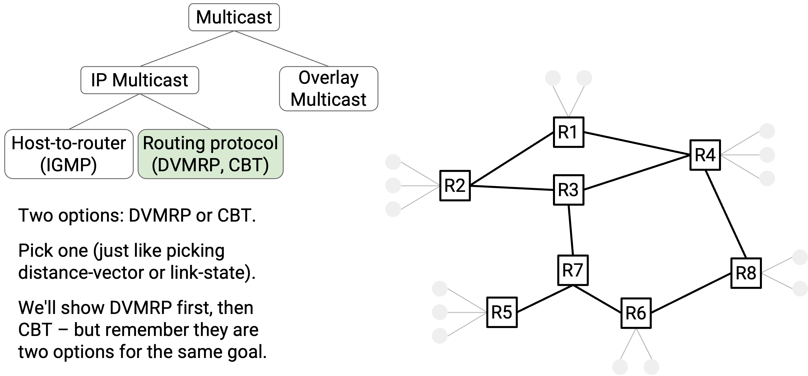

图7-032：CBT 与 DVMRP 是组播路由问题的两种思路，IGMP 仍负责直连成员信息。

**Core-Based Tree** 为每个目的组建立一棵接触该组所有成员的树。暂时把 CBT 树和 DVMRP 树当作不同概念，有助于避免混淆。

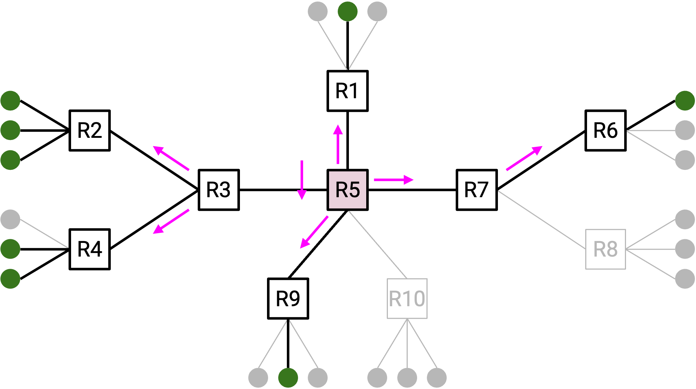

图7-033：以 R5 为核心的共享树连接组内全部绿色主机，不依赖某个特定发送源。

## 建树

先选择一个路由器作为根，称为 **core（核心）**。它是事先选定的网络中的某台路由器。然后以它为根连接所有成员。

成员希望加入时，向核心单播 join 消息。该消息沿途经过的路由器也加入树，形成核心到新成员的路径。

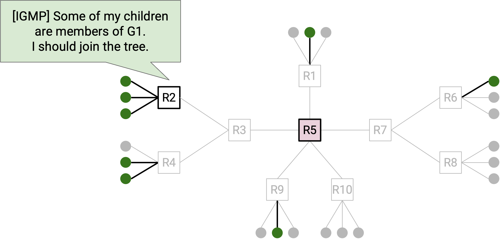

图7-034：R2 经 IGMP 知道直连主机想加入 G1，需要加入以 R5 为核心的树。

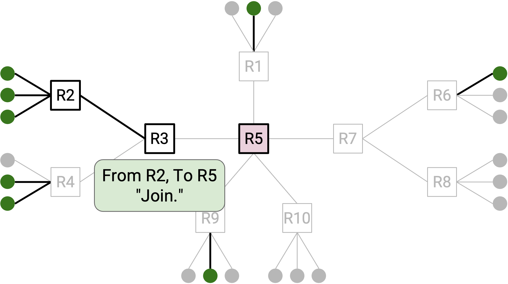

图7-035：R2 向 R5 单播 Join，路径 R2—R3—R5 被纳入树。

更形式化地说，路由器收到某组 Join 后，知道自己属于该组的树。Join 的入链路指向孩子，出链路（通往根的下一跳）指向父节点。路由器记下这两种方向；没有全局“大脑”保存整棵树，每台路由器只记自己的父和孩子。


图7-036：收到 Join 时启用入链路并向核心转发，出链路也加入树。

成员离开时，向树上的直接父节点单播 quit。如果所有孩子都已退出，自己也可向父发送新的 quit。消息只送直接父节点，不将原消息一路转发到根。

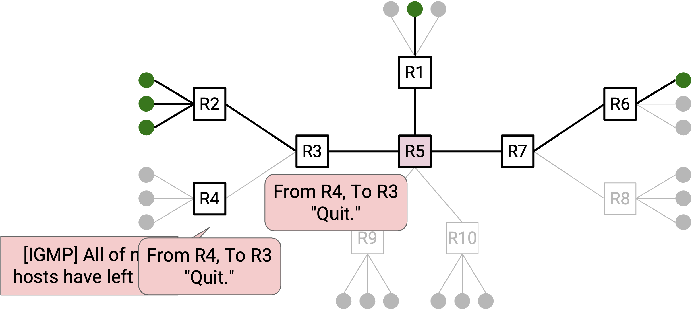

图7-037：R4 通过 IGMP 得知本地成员均离开，于是向 R3 发 Quit。

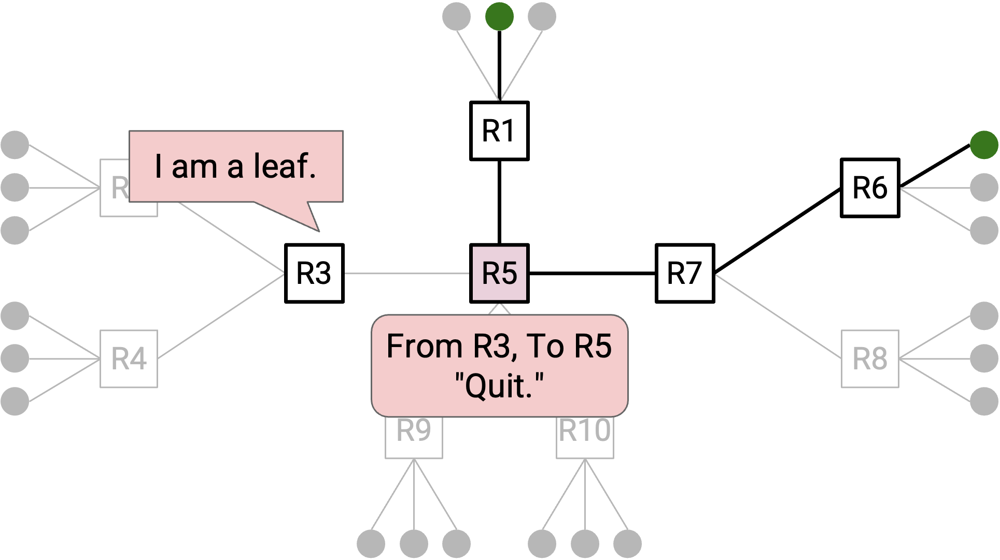

图7-038：R3 已无需要保留的孩子，向 R5 发 Quit，使空分支进一步收缩。


图7-039：Quit 关闭对应入链路；只剩通向父的一条树链路且无本地成员时，可向父发送 Quit，而不是直接发给根。

**编者注：退出条件同样必须检查直连成员。仅仅“所有子路由器退出”并不足以让仍有本地接收者的路由器退出。**

因为每组一棵树，路由器需要为自己参与的各个组分别记父和孩子；Join/Quit 也必须带具体组标识，例如 G2。

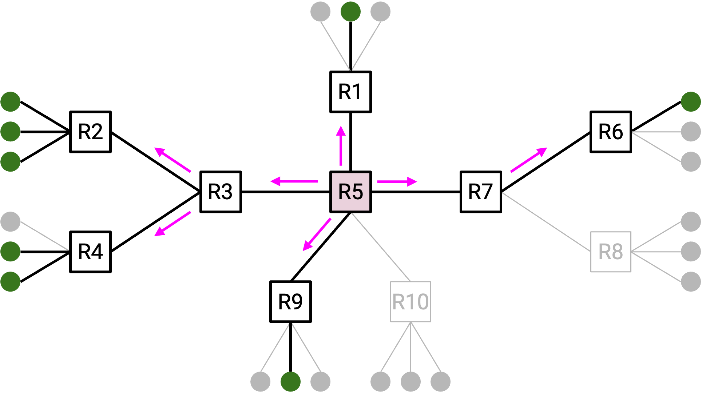

图7-040：G1 的树包含 R2、R4、R6、R9 等成员方向。

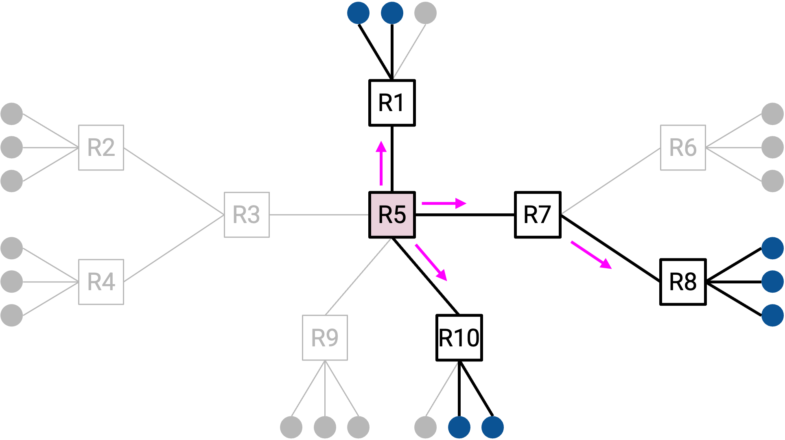

图7-041：G2 可以共享核心 R5，却有另一组树边，连接 R1、R8、R10 等方向。

核心还有几点细节：核心是路由器，有单播 IP，任何人可向它单播；不同组可以选不同核心；这里假设人人知道“组→核心”的映射，例如 G1→R2，可用 DNS 这类键值分发机制发布；核心不是组成员，因为本模型是主机加入组，不是路由器加入组。

Join/Quit 的实际发送者是第一跳路由器，它先通过 IGMP 检测直连成员变化。实际协议还会发送 JOIN-ACK、QUIT-ACK，并在 JOIN-ACK 时记录树状态；教材为突出直觉忽略这些确认。

## 用树发送

**情况一：发送者本身是成员。** 它已经接触树，只需沿树广播。先将包交给树上的父方向，然后各路由器沿父边和子边传播。

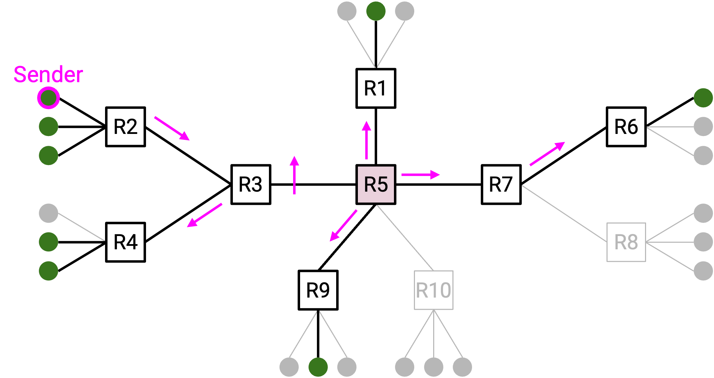

图7-042：组内发送者从 R2 一侧注入，数据沿共享树向其他分支扩散，不必先只送到核心再重新开始。

这里“沿所有树链路泛洪”不包括把同一副本立即送回入链路；否则连树也会来回反射。

**情况二：发送者不是成员。** 它可能不接触树，因此将包单播给核心，由核心在树上广播。需要封装：外层首部是通往核心的单播信息，内层首部保留组播信息。核心收到后剥去外层，看到内层目的组，沿树的父、子链路传播。

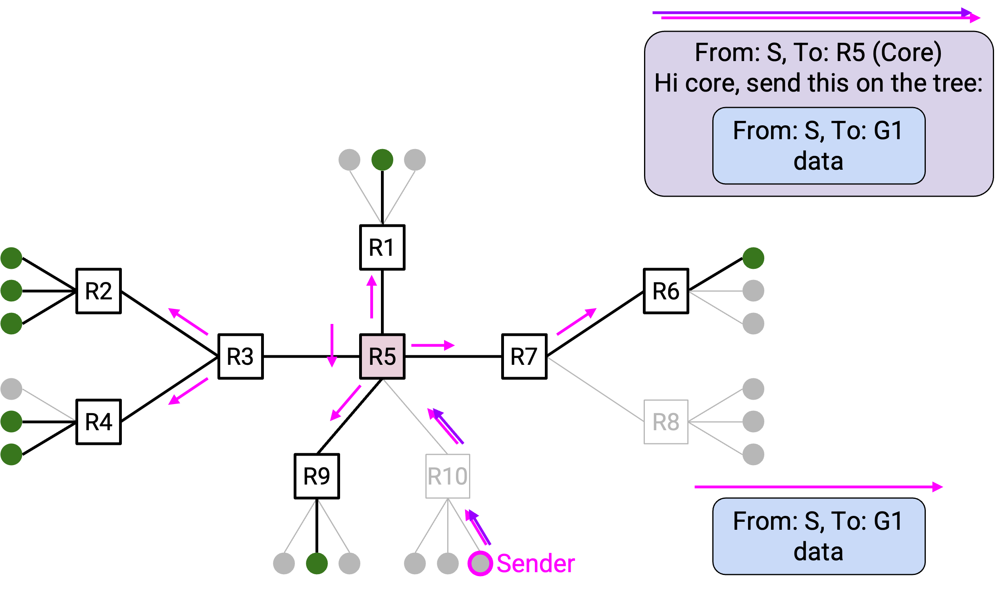

图7-043：非成员 S 向核心 R5 发封装包：外层 S→R5，内层 S→G1；核心解封装后沿 G1 的树分发。

## 更好的扩展性

DVMRP 每个源、每个组维护一棵最短路径树；CBT 仅要求一棵树接触某组所有成员，同组所有源共享。因此从“源数乘组数”降为“组数”尺度。

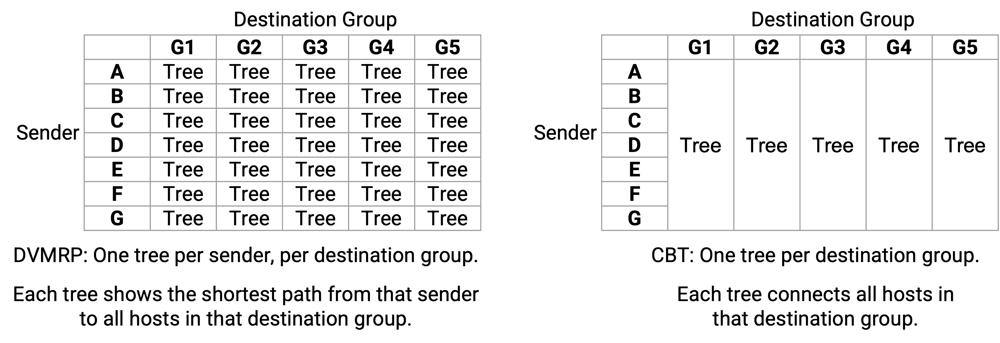

图7-044：DVMRP 状态矩阵每个源—组组合各有 Tree；CBT 每一列组共享一棵 Tree。

这种比较有助于理解状态规模，但两类树的语义并不相同。CBT 还避免 DVMRP 周期性清空剪枝导致的全网广播：树本身说明成员在哪些方向，不需要先向所有非成员泛洪。

## 效率分析

DVMRP 建立从发送者到各成员的最低代价树。CBT 建树不考虑当前发送者，因而不保证发送者到每位成员都是最低代价路径。这是在效率与扩展性之间取舍：存更少的状态，但有些包绕远路。

效率强烈依赖核心的选择。原图比较同一拓扑的三个核心：

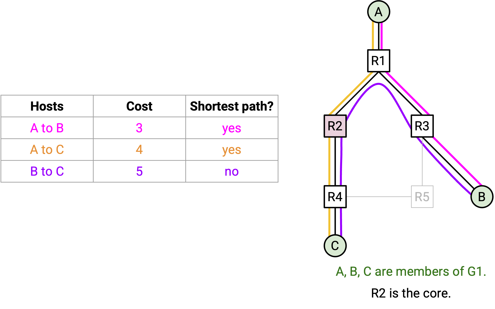

图7-045：选择 R2：A→B 代价 3、A→C 代价 4，都是最短；B→C 代价 5，不是最短。

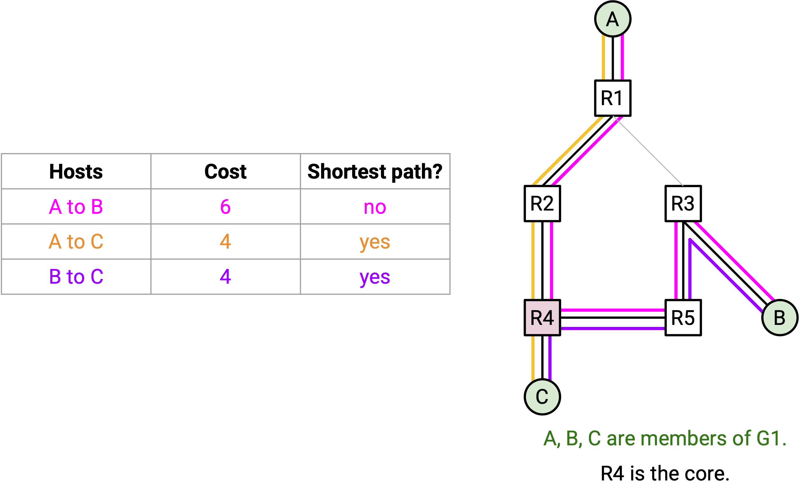

图7-046：选择 R4：A→B 代价 6，不是最短；A→C 与 B→C 代价均为 4，是最短。

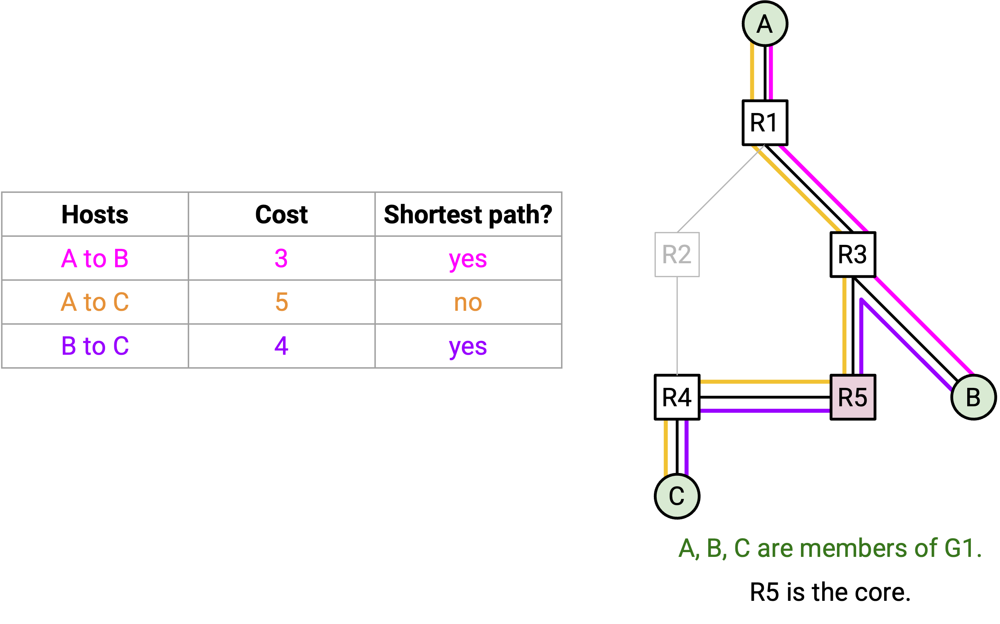

图7-047：选择 R5：A→B 代价 3、B→C 代价 4，是最短；A→C 代价 5，不是最短。

无论选哪个核心，至少一对主机走非最短路径。若 A 发送很多，R2 可能合适，因为恰好让 A 到 B、C 都走最短路；但 B 向 C 发包会绕路。成员随时变化，寻找最优核心不切实际，运营者常人工选择。

## 其他取舍

核心构成单点故障。可用多个核心增加容错，但复杂度也增加，本章不继续讨论多核；原文给出了进一步阅读论文链接，见页底。

DVMRP 建立在距离向量之上，单播与组播较紧耦合；CBT 只使用单播表来传送 Join 等消息，不在乎表由距离向量、链路状态还是手工配置生成。因此 CBT 不依赖某个特定单播协议。

到底选哪个？一个源向很大的组发很多数据时，DVMRP 的最短路径能节省大量带宽；若几乎所有主机都是成员，偶尔泛洪的额外代价也可能不大。若大网络中只有少量、分散的成员，CBT 可避免大量向非成员泛洪，可能更合适。

原文末尾将 DVMRP 称作 PIM-DM，将 CBT 称作 PIM-SM，以说明密集组与稀疏组的适用直觉。**勘误：这些并不是协议别名。DVMRP 与 PIM-DM 是不同协议，CBT 与 PIM-SM 也不是同一协议；只能把这里理解为密集泛洪剪枝与稀疏共享树思路的类比，不能据此等同协议。**

# 五、IP 组播的挑战

## 域间路由

IGMP、DVMRP、CBT 可用于域内，但难以直接扩展为域间方案。扩展性是一个问题：全球 DVMRP 定期删除剪枝状态时，可能向整个互联网泛洪，显然不可行。

域间还有 AS 自治与隐私问题。全球 CBT 的核心可能属于另一个网络，你必须信任其他人控制核心。域间组播已有大量研究，例如每个网络一个核心、再让核心之间通信；实际采用仍很少。

## 计费

IP 组播服务模型与现代 ISP 商业模式存在根本张力。


图7-048：AS A 与 AS B 对等互联：A 发给 B 一个包，B 却可能向许多成员方向复制多个包。

对等网络理应交换等价流量，但怎样叫“等价”？B 收一份、发多份，使用的带宽远多于 A。A 是否应该额外付费？没有明确通用答案。

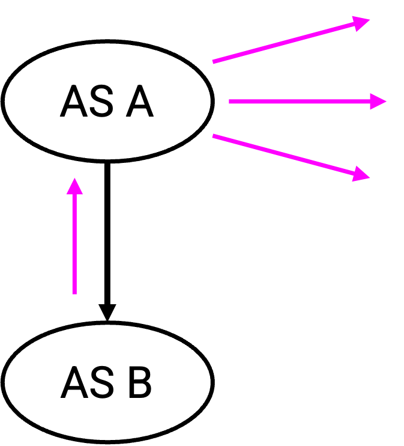

图7-049：AS A 是提供商，AS B 是客户；B 付费给 A，但一个组播输入可导致 A 向许多方向输出。

如果客户 B 发送组播，提供商 A 要转发很多副本，是否应该比单播收费更高、又高多少？同样没有清楚答案。

此外服务模型并不显式追踪组大小。转发表只知道树上的父和孩子，不知道最终有多少终端收到。如果想按成员数收费，现有状态无法直接给出这个数量。

## 拥塞控制

一个源沿投递树发给多个接收者，应选择怎样的速率？

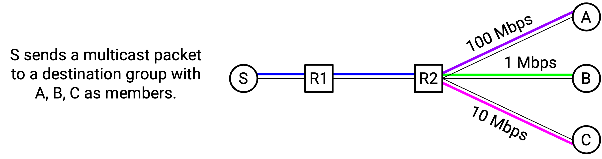

图7-050：三个分支分别有 100 Mbps、1 Mbps、10 Mbps 能力；单一源速率面对不同瓶颈。

选择 1 Mbps 可以不压垮任何分支，但浪费其他路径容量；选择 100 Mbps 则让慢链路超载，没有简单统一的答案。一种实践是按性能定义多个组，例如同一视频四种画质各一个组，接收者试着加入能提供合适性能的组。

## 可靠性

IP 组播和 IP 单播一样是尽力而为。一个包可能只到达部分成员。若加 ACK，百万成员就可能每包返回百万确认，发送者无法承受。

也可用否定确认 NACK：收到不回，没收到（例如计时器超时）才回；但大规模丢包仍会让 NACK 淹没发送者。恢复方式也难选择：向整组重传，会让已经收到的人再收副本；只向 NACK 成员逐一单播，则在许多人没收到时很浪费。例如第一条链路就丢包，全组都需要重传。哪种更好取决于实际丢失范围。

实践中有些应用不做可靠传输，或者在数据里加入冗余，类似纠错码，让接收者不依赖网络重传就修复损失。代价是更多比特。例如要发送 5 个包的数据，可以编码成 10 个包，任意收到其中 5 个即可重建原始数据。

## 安全

IP 组播缺少内建访问控制：任何人都能加入，也能向任意组发消息。如果要限制付费用户看赛事，必须额外实现。

攻击者可以向某组洪泛，让全体成员过载；相较逐一攻击每个成员，这种放大更有效。加密同样困难：给所有成员同一密钥后，一个成员离开仍持有密钥。更换密钥可撤销其访问，但又必须安全地把新密钥分发给剩余成员。

## 实践与下一步

这些挑战使 IP 组播主要局限于单域。多人游戏、视频会议等跨网应用通常自行实现群组通信。组很小时，可让所有消息单播到中央中继，再由中继逐一单播给成员；或直接由发送者分别单播。

既然 IP 组播难以跨域，而自定义方案又要额外实现和扩容，一种办法是在第 7 层实现网络功能，即下面的覆盖组播。

# 六、覆盖组播

## 简史

IP 组播在 1990 年代与 2000 年代发展，但部署进度缓慢。2000 年代初出现 FastForward Networks（Berkeley）、ProxyNet（Berkeley）、Sightpath（MIT）、Akamai（MIT）等公司。它们大体独立工作，却都采用覆盖组播这个共同思想。

## 定义与封装

IP 组播的困难之一是跨网络协调。图中所有主机即使属于同一个组，不同网络的路由器也难以协同向整组发包。

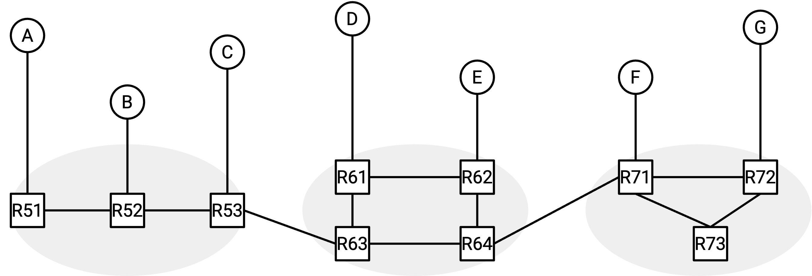

图7-051：A 到 G 分散在不同物理网络，底层路由器并不自动提供跨域组播。

解决办法是在主机间画一张直接相连的**虚拟拓扑**。

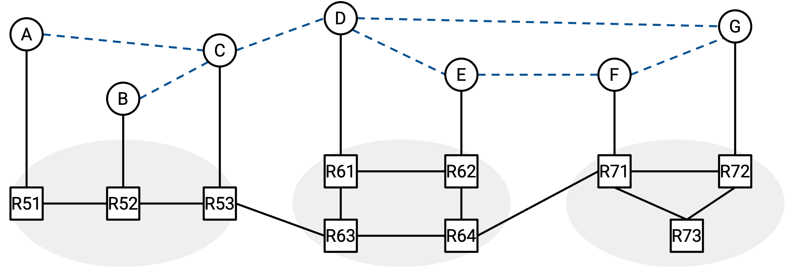

图7-052：在主机间添加虚拟边，形成覆盖网络；原有底层路由器和物理链路不变。

虚拟边不是实际的物理线。A 沿虚拟边向 D 发送，仍要经过多个真实路由器与链路。但我们可以把主机想成小型局域网中的节点，让它们运行组播路由算法。

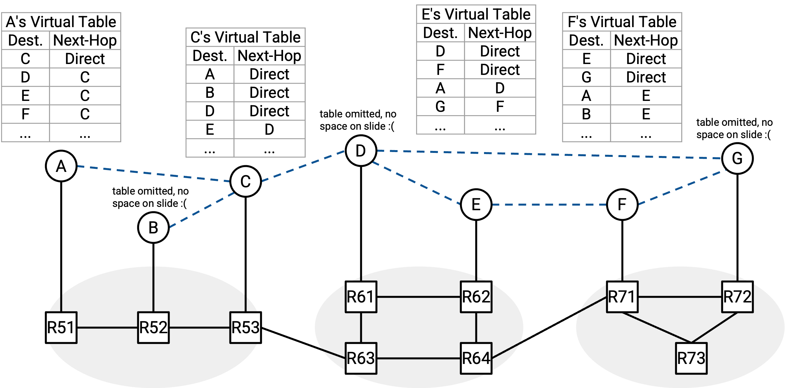

图7-053：主机维护虚拟转发表，例如 A 可把通往 G 的覆盖流量交给 C，C 再交给 D；表项依据虚拟邻居而非物理端口。

例如可在虚拟边上以 D 为根建 CBT，再沿树广播。A 若要同时转给 D 和 B，实际上发送两个单播包：“A→D”和“A→B”，每个包都沿真实网络传输。

下面 A 向 G 单播的例子中，C、D 是接收并继续转发数据的覆盖中间主机，底层仍经过多个路由器。


图7-055：A→C→D→G 是覆盖路径，每段都映射为多跳底层路径。

虚拟网络让散布全球的主机产生“大家在一个小网络里”的错觉。第 7 层终端成为**虚拟路由器**：建立组播表，知道虚拟出链路（例如静态配置），并沿这些边转发。真实路由器不需要懂组播，普通单播即可。这与 IP 组播相反，后者由路由器运行组播协议，终端只管向组地址发送。

虚拟链路构成 **overlay**；终端互相运行覆盖路由协议，表项类似“收到 A 的包后交给 C、D”。真实路由器与链路构成 **underlay**，运行距离向量、BGP 等普通单播协议，表项类似“通往 G 的下一跳是 R2”。


图7-054：底层各路由器的表以真实下一跳为依据，与主机的覆盖转发表分离。

封装把两层组合起来。假设组播包内层写“源 A，目的 G1”，主机读内层来决定覆盖转发。若 A 决定交给虚拟邻居 C，就加外层“源 A，目的 C”，底层只看外层单播到 C。


图7-056：原图具体展示到终端 G 的覆盖单播：内层 A→G 保持不变，A 到 C 的外层是 A→C；C 收到后解封装。


图7-057：C 查覆盖表决定交给 D，新外层为 C→D，内层仍是 A→G；D 解封装。


图7-058：D 再封装为 D→G，抵达 G 后去掉外层，G 接收最终内层包。

**编者注：正文用 G1 说明组播内层地址，图7-056至058用 G 演示覆盖单播封装。两者是同一封装机制的不同例子，不应把图中的终端 G 当成组地址。**

## 实现覆盖网络

最基本模型中，覆盖节点就是个人电脑等终端，它们理解组播协议、建立转发表、转发数据。也可以由公司部署代理服务器，类似 CDN 节点；这些专门帮助组播的机器仍是终端，需要封装并通过底层单播，不是第 3 层路由器。

覆盖网络也可用于组播之外的目标，例如在覆盖拓扑里单播，或构建点对点文件共享。点对点意味着组内任何用户可向其他用户分享文件，而不依赖存着所有文件的中央服务器。

多个覆盖网络可同时共存于同一底层。对终端而言，就是运行多个应用；每个应用有自己的转发表、邻居表，可以提供不同服务。

## 优点

最大优点是容易部署。底层只把它看作另一个收发单播的应用，不需要改路由器或协议。IP 组播要求多数甚至所有路由器理解协议；覆盖组播只需参与节点理解，其他终端不变。

每个覆盖应用可选择自己的实现，不要求不同组、不同应用统一协议。相比之下，IP 组播路由器必须使用互相理解的协议才能协调。

独立选择还带来自定义目标的自由：应用决定虚拟拓扑、边权与路径，有些重视延迟，有些重视吞吐。访问控制更容易定制，只让授权用户参与；授权的含义也由各应用定义。

商业模式同样可定制，协议可记录用量并收费。例如 CDN 覆盖网络向数百万用户直播赛事，应用自己记录观看用户并收费。原文还举出一个较特殊的反例：非法传播受版权保护内容的点对点系统可能故意不记录用户，以避免用户被追查；这是原文对不同设计目标的说明，不是本资料建议。

## 性能与 stretch

覆盖性能高度依赖虚拟拓扑是否反映底层的距离与成本。


图7-059：较好的覆盖拓扑：A→C→D→G 与底层较短路径接近。

A 到 C 在底层仅经过 3 台路由器，可以赋较低虚拟代价；D 到 G 经过 5 台路由器，可赋较高代价。这样求覆盖最短路，有望得到接近底层最短路的实际路径。数据最终走底层，因此底层路径短才有意义。此图的 A 到 G 便接近最短。


图7-060：底层不变，只改变虚拟边后，A→C→B→E→F→G 的覆盖最短路却在底层来回绕行。

原文用 **stretch factor** 衡量底层路径代价与覆盖路径代价之比。


图7-061：假设所有边代价为 1，A—C 的一条虚拟边对应四条物理边；底层代价 4，虚拟代价 1，教材定义的 stretch 为 4。

此例若把虚拟边代价设为 4，会更准确反映底层。大的 stretch 说明实际底层路径比标出的覆盖路径昂贵很多，教材希望它接近 1。

**定义注：这里是“实际底层成本÷虚拟标价”，用于检查建模。常见另一种路径伸长定义是“覆盖方案实际走过的底层成本÷端点间底层最短路径成本”。两种分母不同：单纯把虚拟边权从 1 改为 4 会改变教材的比值，却不会让实际数据少走一跳。本页忠实保留原定义，不将两者混用。**

怎样建立低 stretch 拓扑？可以人工设计，也有自组织方法：最初随机选邻居；周期性寻找候选邻居，用发包测 RTT 等方法估计距离；若最佳候选优于当前最差邻居，就删除最差边，加入新边。

## 缺点

封装、解封装增加处理时间与开销，影响性能。覆盖组播也不是互联网内建服务，应用开发者要自行实现转发表等功能；IP 组播则允许应用只向组地址发包。尽管如此，覆盖组播性能往往足够好，现代互联网中广泛使用。

## 引用、版本与许可

- 本页完整翻译指定入口下六个实质章节，入口本身只有目录元数据，没有正文。原作：Peyrin Kao，基于 Sylvia Ratnasamy、Rob Shakir 等人的课程。教材：[Beyond Client-Server](https://textbook.cs168.io/beyond-client-server/)。
- 逐章原页：[Multicast](https://textbook.cs168.io/beyond-client-server/intro.html)、[IP Multicast](https://textbook.cs168.io/beyond-client-server/ip-multicast-service-model.html)、[DVMRP](https://textbook.cs168.io/beyond-client-server/dvmrp.html)、[CBT](https://textbook.cs168.io/beyond-client-server/cbt.html)、[Challenges](https://textbook.cs168.io/beyond-client-server/ip-multicast-challenges.html)、[Overlay](https://textbook.cs168.io/beyond-client-server/overlay-multicast.html)。
- 使用固定源码快照，日期 **2026-10-01**，不是 Spring 2025 历史教材。完整 commit：

```text
0b8208742d31df7fc3d53a0cd94fdd4e04f8d47e
```

- [固定版本源码目录](https://github.com/berkeley-cs168/textbook/tree/0b8208742d31df7fc3d53a0cd94fdd4e04f8d47e/beyond-client-server)。所有61幅原图保留原字节与原图号，增加中文图注，并以白底显示透明 PNG。中文翻译、图注与明确标出的勘注属于修改，随原教材以 [CC BY-SA 4.0](https://creativecommons.org/licenses/by-sa/4.0/) 发布；署名许可证据来自[教材首页](https://textbook.cs168.io/)。
- 原文 CBT 延伸阅读链接：[CBT paper](https://people.eecs.berkeley.edu/~sylvia/cs268-2019/papers/cbt.pdf)。本包未读该论文，不把其内容算作已核验材料。
- 课堂视频、课件不继承教材许可；本页不是课堂逐字稿。课堂覆盖与时间轴未核验。
