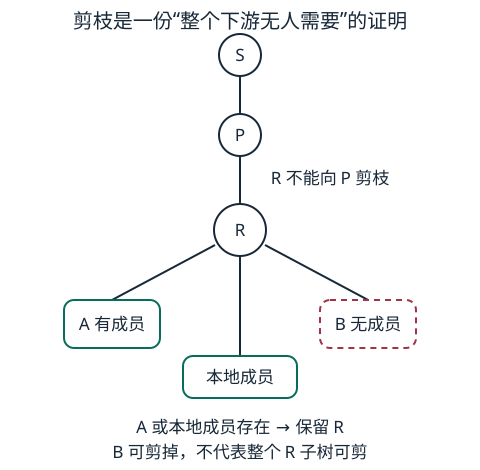

# 核心问题：一次复制能否同时做到不漏收、不重复、不浪费？

把组播理解为“发给很多人”还不够。真正需要决定的是：**副本在哪里分叉，哪些分支应该存在，成员变化后谁更新这些决定？**

自拟情境：源 S 不属于组 G；G 的接收者 A、B 在同一个远端网络，接收者 C 在另一侧。S 可以发送给 G，A、B、C 才是成员。若 S 分别单播，共用链路要承载多个副本；若在分叉路由器复制，共用段只走一次。这个例子里“发送源”与“成员集合”是两种独立身份。

## 1. 先建立状态账本

用三个问题拆开系统，不要让“知道成员”变成含混的全局魔法：

| 问题 | 状态或机制 | 不意味着什么 |
| --- | --- | --- |
| 本地链路有人要 G 吗？ | IGMP 查询、报告、超时 | 不提供全球成员名单 |
| 从 S 来的包允许从哪边进？ | 到 S 的单播下一跳，即反向父方向 | 不是查到 G 的单播路由 |
| 应复制到哪些方向？ | DVMRP 的 (S,G) 孩子集合，或 CBT 的 G 共享树 | 不是每包无条件发所有端口 |

IGMP 报告的是接收兴趣。只发送而不接收的 S 不必先加入 G；只因路由器帮忙转发，也不能把它算作终端组成员。

## 2. 反向路径检查查的是源，不是目的组

设 R 到源 S 的单播下一跳为 P。对源为 S 的组播数据，检查入接口是否来自 P：

$$
\begin{aligned}
&\text{接受并继续转发}\\
&\Longrightarrow
\text{入方向}=\operatorname{parent}_S(R).
\end{aligned}
$$

这不是将包发回源，而是利用已有单播结果判断“哪一份副本可以继续走”。其他方向到达的副本即使负载相同，也不继续复制。

**自拟小例。** S 连接 P，P 连接 R 与 Q，Q 又连接 R。R 的反向父方向是 P。包经 P→R 到达时可转发；经 P→Q→R 到达时丢弃。仍需学习哪些节点把 R 当父节点，才能只向树的孩子发；单播表本身没有孩子列表。

不变量是：在路由稳定、父方向构成树的模型下，每个非根节点只认可一个上游，因而不会因为网络有多条路径而沿多路持续转发。它不自动保证全网最小总带宽，也不代替成员过滤。

## 3. 剪枝的证据必须覆盖全部下游

设 $L_G(R)$ 表示 R 有直连 G 成员，$C_{S,G}(R)$ 表示仍需数据的孩子集合。可向父请求剪枝的条件是：

$$
\neg L_G(R)
\quad\land\quad
C_{S,G}(R)=\varnothing.
$$

两个条件缺一不可。如果所有子路由器都请求剪枝，但 R 的本地电脑仍在看直播，R 不能剪掉自己。

图为原创例子：B 分支没有成员，可剪；A 分支有成员，必须保留；R 另有本地成员时，即使 A 以后也退出，R 仍不能向 P 请求剪枝。

**按事件推演：**

1. 起初 A、B 都有成员，R 给两个孩子复制。
2. B 的最后一个成员退出，B 向 R 发 Prune；R 删 B，但仍向 A 发。
3. A 的最后一个成员退出，A 也发 Prune；若 R 无本地成员，R 才向 P 发自己的 Prune。
4. B 后来新加入一位成员；若剪枝永久有效，B 永远收不到新包。因此教材模型周期性清空剪枝，再泛洪、再剪枝。

第四步说明一个代价：**软状态能修复过时的“无人需要”，但会重新付出泛洪费用。** 本页采用教材的过期恢复模型，不凭空追加另一套即时恢复协议。

同一源 S 发给 G 与 H，成员分布不同，剪枝集合不同；另一个源 T 的反向树也不同。因此状态键是 $(S,G)$，不是只有 S，也不是只有 G。若有 $s$ 个活跃源和 $g$ 个组，潜在组合数是 $sg$；这只是状态规模直觉，实际条目还取决于哪些组合活跃。

## 4. CBT 减状态，付出的是什么？

CBT 为一个组建一棵共享树，核心是树的锚点，不是必须接收应用数据的成员。Join 沿单播路径连接到核心，沿途路由器记下树边；Quit 让不再需要的分支逐段退出。

数据从树上的任意位置进入后，都可沿树的其他边扩散，**不沿入边立刻反射回去**。非成员如果不在树上，可将组播包封装成到核心的单播包，再由核心解封装注入。

共享树对所有源复用，把状态从源—组组合降为按组。但同一棵树不可能天然同时是每个发送者的最短路径树。

**自拟 stretch 例。** 底层 A—B 直接路径代价 2，共享树却让 A→核心→B，代价 6。若定义路径伸长为实际路径相对于底层最短路，则：

$$
\text{路径伸长}=6/2=3.
$$

这不表示 CBT 算错了；它正确投递了数据，只是以绕路换取共享状态。也不表示全局必须选“几何中心”作核心：发送分布、组成员、底层边权都会影响选择。

## 5. 覆盖层看一条边，底层可能看见多次流量

覆盖节点是应用主机或专用代理。虚拟边 X→Y 的实现，是通过原网络单播到 Y；外层首部随虚拟下一跳改变，内层保留应用要传的包。

这样可不改互联网路由器，应用还能自行定义认证、费用和拓扑。但两个虚拟边可能共用同一物理链路，造成重复与争用；虚拟“相邻”不等于物理近邻。

**两种 stretch 要分开：**

- 教材用“某虚拟路径实际底层成本÷其虚拟标价”。一条标价1的虚拟边实际走4条单位物理边，比值4；改标价为4，比值变1。
- 常见路径绕行比较用“方案实际底层成本÷两端底层最短成本”。仅改标价不会改变这一个比值。

所以不能因“把虚拟边权调大使 stretch 变小”，就宣布真实传输已经变快。边权建模和路径选择是两个步骤。

## 6. 正确树之外还有系统问题

- **可靠性**：IP 组播仍尽力而为；覆盖全体成员的目标不意味着实际不丢包。每人回 ACK 会造成反馈聚集，NACK 在全体丢失时同样可能爆发。
- **拥塞控制**：不同接收分支有不同瓶颈，单一源速率难同时满足所有人；按画质分组是教材的一种思路，不是保证公平的完整算法。
- **计费**：跨 AS 收到一份却输出多份，如何定义流量交换等价？父、孩子数量也不等于终端人数。
- **安全**：公开组地址不等于权限；退组不等于撤销已知密钥。
- **域间自治**：不只看路由计算能否完成，还要看谁控制核心、谁承担成本。

## 7. 易错点与自测

R 收到发给 G 的包，查 G 的单播下一跳来做 RPF，对吗？

不对。这里的反向路径检查查包的源 S，确定 R 到 S 的父方向；目的组 G 用于选哪些孩子仍需数据。

R 的两个子路由器都剪枝了，但 R 的直连主机仍是成员。可以向父剪枝吗？

不可以。剪枝要证明整个下游都不需要，包括直连主机；只统计子路由器不够。

为什么不永久保存 Prune，省去周期泛洪？

因为成员会变化。永久的否定状态可能挡住后来加入的成员。教材通过剪枝过期、重新泛洪恢复可达，同时承担额外流量。

一个不属于 G 的主机可否发给 G？CBT 核心是否必须加入 G？

可以发。发送权与接收成员身份分离。核心是路由器，教材的组成员是主机，核心无须作为成员加入。

DVMRP 的“最优”是否意味着得到最小总边权的组播树？

不是。教材讨论从源到每个接收者的最短路径性质；对各接收者分别最短，与所有边的总成本最小，是不同目标。

DVMRP=PIM-DM、CBT=PIM-SM，可以作为协议名称记忆吗？

不可以。原教材这两处表述过强；它们是不同协议，只能类比密集泛洪剪枝与稀疏共享树的设计思路。详见材料中的勘注。

## 引用与来源边界

- 依据 [本讲教材全译](#/c/berkeley-cs168-2025/lec/lec24?v=materials) 的六章完整阅读与61幅原图，形成独立核心问题、原创例子和图。原作 Peyrin Kao，基于 Sylvia Ratnasamy、Rob Shakir 等；教材为 CC BY-SA 4.0。本页文字、原创图及教材派生说明同许可。
- 固定教材版本是 2026-10-01 当前快照，不是 2025 历史课本。主题转接见 [L25 集体通信](#/c/berkeley-cs168-2025/lec/lec25?v=notes)。
- 本讲按 Spring 2025 官方课表映射为 lec24，课表日期4月23日。视频 ID `4YpTehZYPaw` 的上传标题却写“Lecture 25”；保留这一源端编号差异，不擅自挪到 lec25。
- 个体视频元数据给出 **4838秒（1:20:38）**，上传日期 **2025-04-24**；上传日不是课表日。官方频道为 CS 168 (Internet Architecture) at UC Berkeley。
- 字幕主通路与一次不同的官方 timedtext 通路均返回 HTTP 429。未取得、未读取字幕，未查看音画、片头、片尾或 Q&A，**不提供任何推测时间分块，也不生成 draft 占位页**。本页是教材驱动笔记，课堂覆盖未核验；视频许可字段为空，不能套用教材许可。
