# 一、集体通信操作

## 动机：AI 训练

AI 是活跃的研究领域，现代系统需要在大量数据上训练模型。本章忽略模型如何工作的细节，只把未训练模型想成填着随机数的大矩阵，把训练想成对训练数据和模型进行大量矩阵乘法，即乘法与加法。最终得到训练好的模型，就像同一个大矩阵现在装着有用的数。


图7-062：未训练模型与训练数据输入训练任务，输出训练好的模型；图中的矩阵乘法只是黑盒抽象。

真实训练复杂得多。例如训练是迭代的：在数据上运行模型，看结果如何，根据错误计算误差项，再更新模型。我们不讨论这些细节，只把训练视为在巨大数据集上执行大量矩阵运算的黑盒。

## 分布式训练

训练任务太大，单台计算机串行地逐个相乘，几乎不可能及时完成。因此必须并行，让许多运算同时发生。**分布式计算**有多种拆分维度：

- 拆数据：每个节点训练不同数据子集。
- 拆模型：每个节点训练模型的一部分。
- 拆操作、形成流水线：例如先“加 5”再“平方”，你的节点加 5，把结果交给我的节点平方，每份数据依次经过两个节点。

本章同样不讨论具体如何拆任务，只假设大任务已经拆成子任务。我们关心的是节点如何同步：它们常需通信来保持状态一致；一次计算后，输出可能分散在不同节点，必须合作合成完整结果。

结合训练与分布式计算，可得到高层过程：

1. 将任务分成子任务，各节点执行自己的部分。

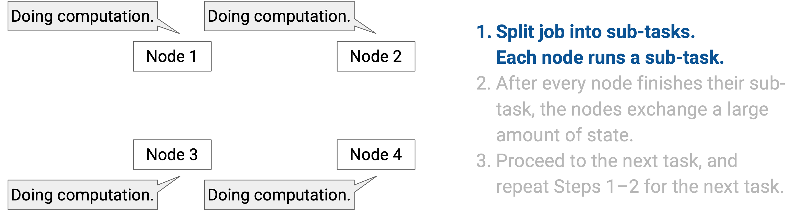

图7-063：每个节点先进行本地子任务计算。

2. 等每个节点完成后，交换大量状态。

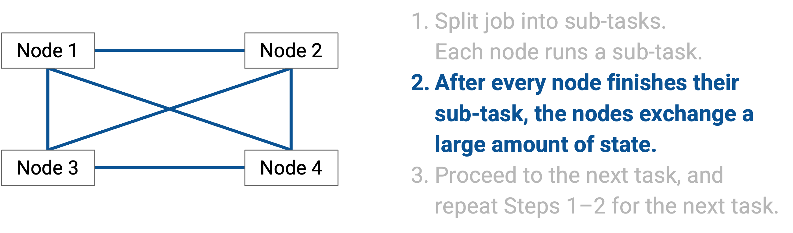

图7-064：节点之间交换状态，通信是本章优化的对象。

3. 进入下一个任务，重复计算、交换的过程。

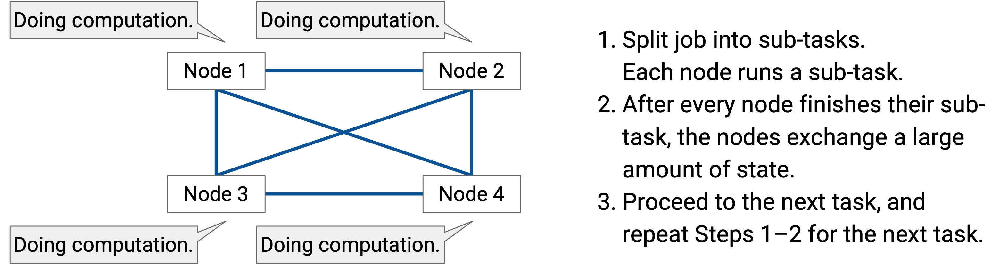

图7-065：完成通信后继续下一轮本地计算，再进入后续交换阶段。

我们关注第二步的数据交换效率，而不是交换数据的具体含义。不同模型和拆分方式会交换不同内容，重点是数据怎样被交换。

## 分布式训练基础设施

一个节点可以是使用普通 CPU 的计算机，但实际中常是专门高效执行矩阵运算的 **GPU（Graphics Processing Unit）**，或 Google 开发的 AI 优化 **TPU（Tensor Processing Unit）**。一个训练任务可能使用几百甚至几万个节点，取决于任务规模、背景及单个节点能力。

GPU 在类似数据中心的网络中互联，因此具有此前讨论的优点：物理距离近（例如同一建筑内），拓扑有结构（例如 Clos），节点同构，链路带宽高。

机房里服务器按机架排列，不过每台服务器装有一个或多个计算 GPU，还可有普通 CPU 处理杂项；CPU 通常不是主要计算力量。同一服务器上的 GPU 通过同一个 NIC 与其他服务器交换数据。

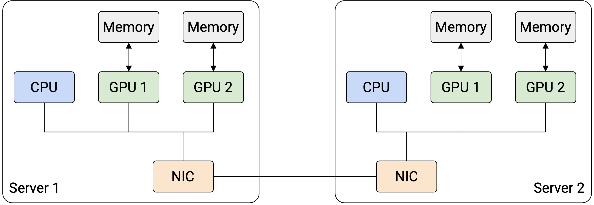

图7-066：两台服务器各含 CPU、多个 GPU、各 GPU 的内存，以及用于跨服务器通信的 NIC。

拓扑抽象要稍作修改：服务器间仍通过交换机和高速链路连接，但同一服务器内两个节点也可能通信。机内通信比跨服务器高效得多，教材把它近似为无限带宽、零延迟的链路。每个 GPU 可以有独立内存，RDMA 等技术可加速 GPU 内存之间的数据传输。这里无限带宽、零延迟仅是模型近似，并非硬件事实。

机架之间有多种拓扑，本章采用胖树 Clos。任意一对 GPU 的距离并不相同：同机可不经过外部网络；同 pod/机架、不同服务器可能只经一个交换机；跨机架可能经过多跳。越近的节点通常能以更高带宽、更低延迟通信。

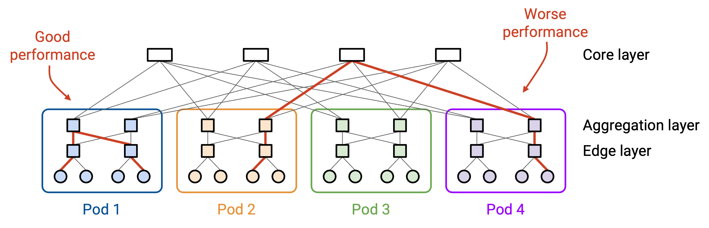

图7-067：Clos 中同 pod 的连接较好，跨 pod 需要更高层路径，性能可能更差。

还有其他拓扑。TPU 内建路由器，可不经独立交换机直接互联。一种常见连接是 **3D torus（三维环面）**，像立方体的边界回绕：从顶端继续向上会回到底端，从前面继续向前会回到后面。和 Clos 一样，直接邻居较近，多跳节点较远。

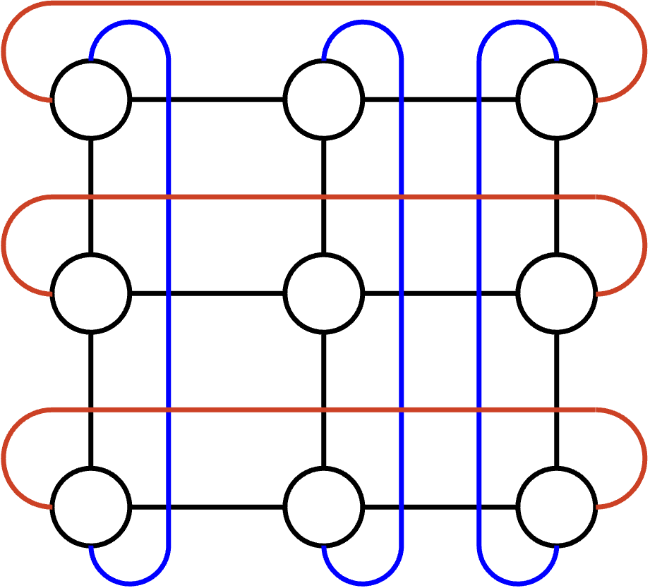

图7-068：二维环面：行、列两端回绕连接，不是普通有边界网格。

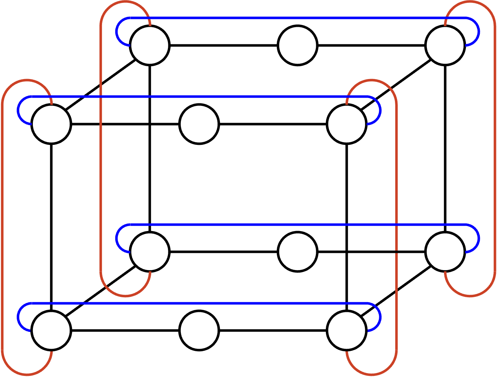

图7-069：三维环面：三个维度都可回绕，示意图中外侧弧线连接相对边界。

## 集体通信的定义

现在我们知道任务是分布式计算，基础设施是数据中心式 GPU/TPU 网络。**集体通信**的定义是：作为群组计算的一部分，一组节点以协调方式交换数据。通俗地说，许多节点合作达成共同目标，并在过程中交换数据。

这些概念与术语几十年前就用于超级计算机；AI 的发展让它们再次成为活跃研究领域。现代集体通信库有 Nvidia 的 NCCL、Microsoft 的 MSCCL、Thunder Research Group 的 TCCL 等。NCCL 源码公开，有兴趣可以阅读；本页没有执行或审读其实现。

它与此前网络场景有三个主要区别。

**高度结构化的通信。** 此前网络抽象不关心具体数据，也不知道谁何时需要通信，只允许任意一对主机随时交换。集体通信有预先明确的目标，所以能事先规定哪些数据何时通过网络，所有节点按精心安排的通信与计算步骤合作。

**专用基础设施。** 普通网络要支持同时发生的多个连接，数据中心也可能有多个租户。AI 训练任务很大，常独占基础设施，没有其他任务的数据，因而更容易预测任一时刻的带宽使用。这里是本章讨论的场景，不是所有训练都必然独占网络。

**数据在交换途中被变换。** 此前 HTTP/TCP/IP 的直觉是服务器有文件，把它的副本交给用户。集体操作中，数据可能在传输过程中被求和等简单运算变换，接收端拿到的未必就是发送者原先的数据。

若为每种 AI 模型从零设计协调通信，会很繁琐且重复。因此定义一小组基本通信模式，称为 **collectives（集体操作）**，像分布式通信 API 或库函数。用户把它们组合起来实现任务。AI 训练的大多数通信任务可以分解为这些少量原语。本章讨论定义和网络实现，不讨论为什么特定 AI 计算需要某个原语，那超出网络课程范围。

## 操作的统一设置

下面定义七种基本操作，只规定输入、输出，不规定网络实现。

有 $p$ 个节点，示例取 $p=4$。每个节点画一个含 $p$ 个元素的向量，可想成 4 个整数，也可以是矩阵的 4 行、4 个等大数据块等更高维内容。输出规定哪些元素移动到哪些位置，有时还规定求和等聚合运算。

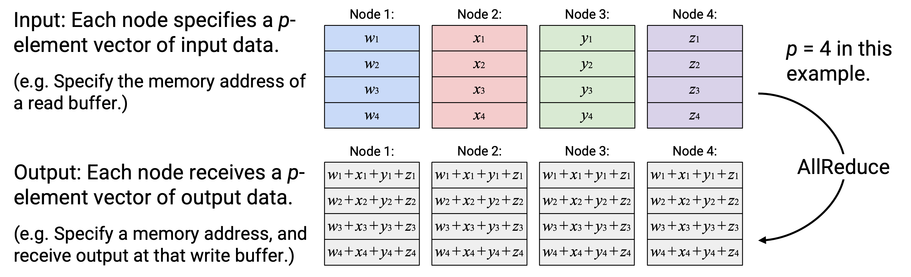

图7-070：上方是各节点的输入/read buffer，下方是输出/write buffer；例中 p=4，数据可以是标量或等大的块。

开始前还需协调，让每个节点知道自己的编号和总节点数。具体协调超出本章，可想象中央调度器或控制器布置任务并发放这些信息。

每个节点并行运行相同代码，同时调用同一个集体操作，完成后输出应符合定义。理想情况下硬件相同、同时完成；若有人慢，就必须等大家都完成后进入下一任务。教材因此把操作描述为由控制器编排、同步开始、同构执行、阻塞完成。**编者注：这是教材的执行模型，不是声称所有现实库 API 都只支持阻塞调用。**

七种操作粗分为四种“重新分配数据而不变换”和三种“将多份数据归并”。

### Broadcast：广播

取指定根节点的整个向量，将一份完整副本送到每个节点。

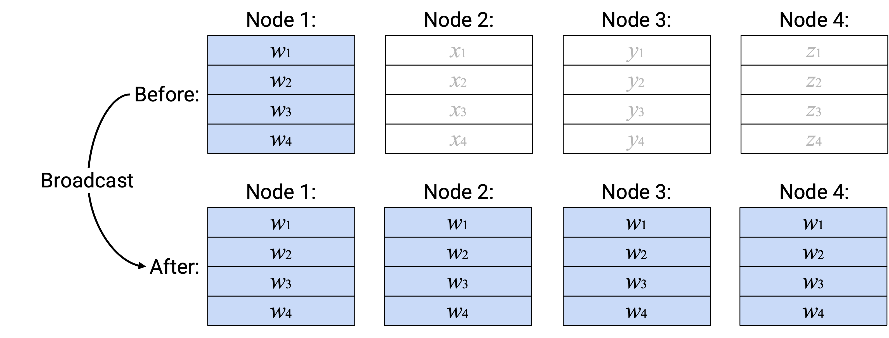

图7-071：以节点1为根，把 w1、w2、w3、w4 复制到全部四个节点。

也可以选择其他根；根是用户传入的参数。非根的输入向量不参与产生输出，可理解为没有使用的函数参数。输入、输出不必占同一内存：如果共用位置，Broadcast 等操作会覆盖原输入；也可以单独分配接收缓冲区。

### Scatter：分散

取指定根的整个向量，将第 $i$ 个元素交给第 $i$ 个节点。

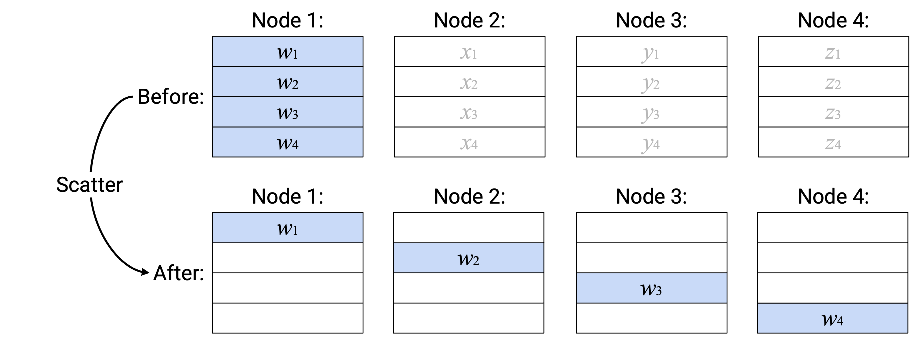

图7-072：节点1持有的 w1、w2、w3、w4 分别交给节点1、2、3、4；不是给每人完整副本。

和 Broadcast 一样，根可以任选，非根输入不用来生成输出。

### Gather：收集

构造新向量，第 $i$ 个元素来自第 $i$ 个节点的第 $i$ 个位置；把该向量交给指定根。

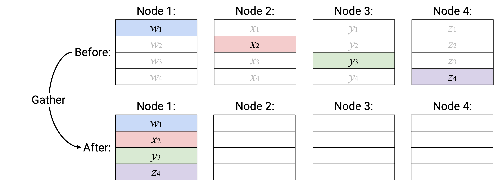

图7-073：将节点1的 w1、节点2的 x2、节点3的 y3、节点4的 z4 组成一个向量，只交给根节点1。

非根接收缓冲区没有本操作规定的输出。注意“第 $i$ 个格子”是教材为统一绘图采用的布局，不要求现实 Gather 的用户缓冲区一定预留 $p$ 个位置。

### AllGather：全收集

同样用第 $i$ 个节点的第 $i$ 个元素构造新向量，但将完整副本交给**每个**节点。等价地，每个节点 $i$ 广播自己的第 $i$ 个元素，使它成为所有输出向量的第 $i$ 个元素。

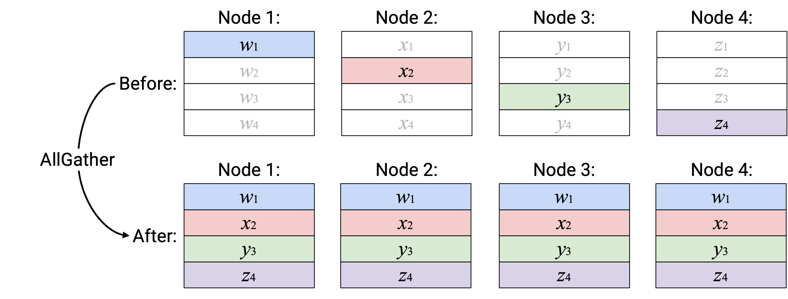

图7-074：所有人最终得到 w1、x2、y3、z4；只是拼接，没有求和。

### Reduce：归约

将所有输入向量逐元素相加，把和向量交给指定根。

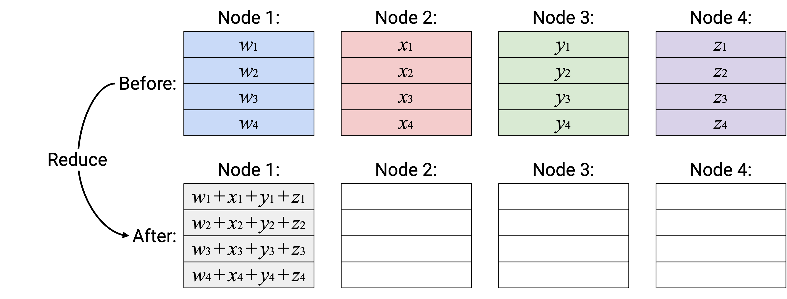

图7-075：根的第 j 个输出为 wj+xj+yj+zj，所有列都参与，但仅根得到完整和。

本章用加法，Reduce、ReduceScatter、AllReduce 也可以采用其他归约，例如乘法。归约通常满足结合律和交换律，因而可调整计算顺序而不改变数学结果。**编者注：浮点加法不严格满足结合律，不同归约树可能产生不同舍入结果；“数学求和相同”不等于逐比特一致。**

### AllReduce：全归约

将所有向量逐元素相加，把完整和向量的副本交给每个节点。


图7-076：四个节点都得到每一行的总和，不是把各输入原封不动收集起来。

### ReduceScatter：归约后分散

将所有向量逐元素相加，把和向量的第 $i$ 个元素交给第 $i$ 个节点。等价地，对所有节点的第 $i$ 个元素求和，所得标量交给节点 $i$。

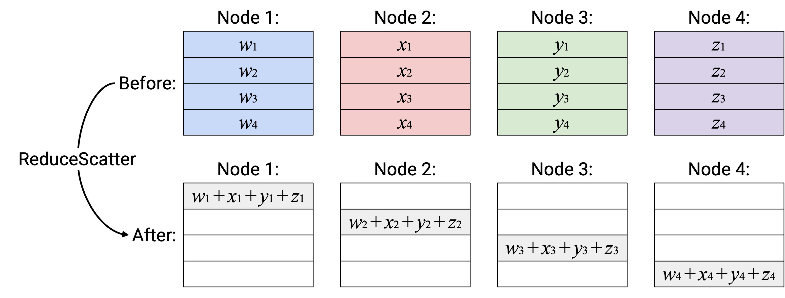

图7-077：节点1得到第一行总和，节点2得到第二行总和，以此类推；每个输出只持有最终和的一块。

## 对偶

有些操作互为 **dual（对偶）**，粗略地说像反向操作，正如平方与开平方可作直觉类比。判断时忽略归约运算本身，只看读、写哪些格子，不关心格子里具体的值。这里不是说 Reduce 能恢复 Broadcast 前各个节点的原输入。

Broadcast 与 Reduce 对偶：前者从根的 4 格读、向全部 16 格写；后者从全部 16 格读、向根的 4 格写。

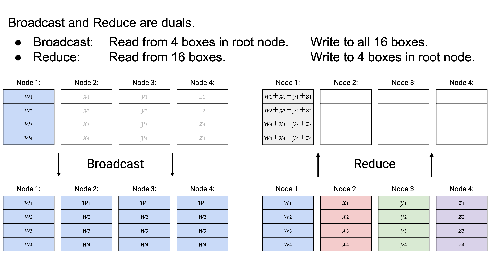

图7-078：Broadcast 与 Reduce 的读写位置方向相反；忽略中间是否做加法。

Scatter 与 Gather 对偶：前者从根 4 格读，向各节点自己的第 $i$ 格写，总计 4 格；后者从这 4 个分散位置读，写入根的 4 格。

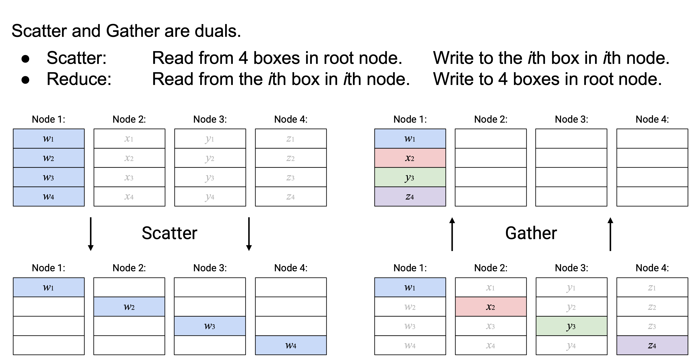

图7-079：Scatter 与 Gather 在相同格子布局上反向搬运。

AllGather 与 ReduceScatter 对偶：前者从分散的 4 格读、向全部 16 格写；后者从 16 格读、向各节点自己的第 $i$ 格写。

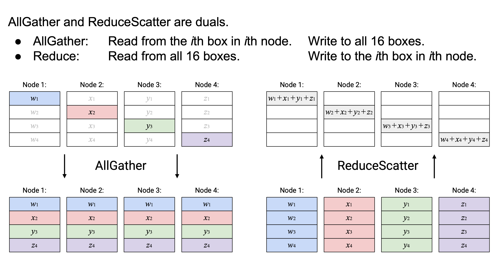

图7-080：AllGather 与 ReduceScatter 的读写集合相反，一个扩散各块，一个归约后分散。

AllReduce 没有另外一个对偶，也可视为自对偶，因为读写都是全部 16 格。

对偶对实现有帮助：对同一拓扑、可反向的路由方案，教材认为原操作与对偶的数据总收发量相同，故有相同带宽表现。**条件注：这是通信量对称性的直觉；若双向链路速率、计算成本、争用或调度不同，实际完成时间未必相同。**

## 操作组合

多个原语可以组合。比如 AllReduce 等价于先 ReduceScatter，再 AllGather。

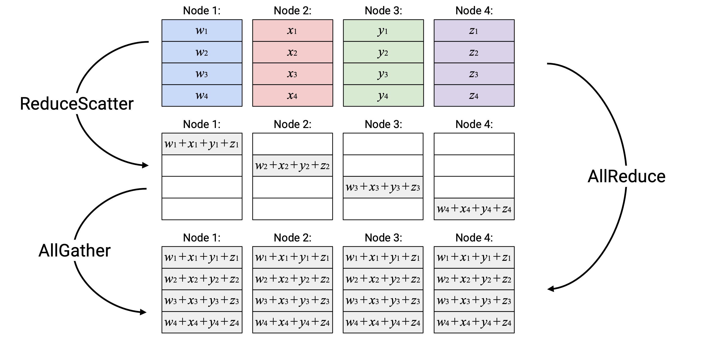

图7-081：第一步每个节点得到一块全局和，第二步交换这些已归约的块，最终每个人得到完整和向量。

# 二、集体通信的实现

## 目标与成本模型

定义了七种操作后，实现还需回答两件事：节点连成什么拓扑？交换哪些数据才能高效完成？然后分析总通信量、完成时间等指标，本章聚焦这两个。

记节点数为 $p$，每个输入向量总大小为 $D$ 字节，分成 $p$ 个等大块，每块 $D/p$ 字节。下面示例用 $p=5$，所以向量画成五格。增加节点数并不一定增加数据总量，也可能只是把同一个向量分成更多块。

本章重点实现 AllReduce，即逐元素归约后把完整和送到所有节点，但方法也能应用于其他操作。


图7-082：五节点 AllReduce：每个输出向量的每一行都是五份输入对应行的和。

**先声明口径。** 原文把“bandwidth”用于传输的字节数量，不是字节/秒；又在不同算法中混用了“每次链路发送只算一次”与“发送、接收两端都计”的口径。本译文保留原公式，并在相关段落标注其含义：

- $V_{\rm send}$：每次逻辑链路传送只计发送的字节；相同字节经过另一条覆盖边要再计。
- $V_{\rm IO}$：所有端点的发送与接收字节之和。无丢包的点对点传输中，同一传送算两端，因此 $V_{\rm IO}=2V_{\rm send}$。
- 物理网络流量还要将每条覆盖边映射到底层多跳，不能直接等同上述逻辑量。
- “一步”主要表示依赖阶段，不是固定秒数。消息大小、链路并行性、网卡瓶颈和计算耗时会决定每一步多长。

## 方法一：全互连 Full Mesh

拓扑中每个节点都直接连接其他每个节点。

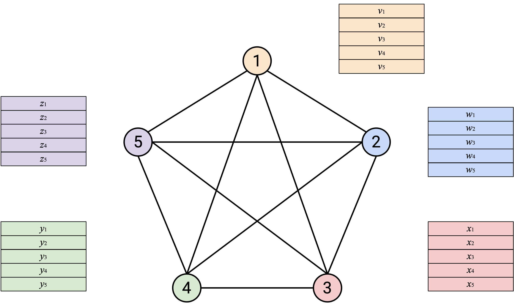

图7-083：五节点全互连，每个节点有四个邻居。

先让所有节点将自己的整个输入向量发送给每个其他节点。

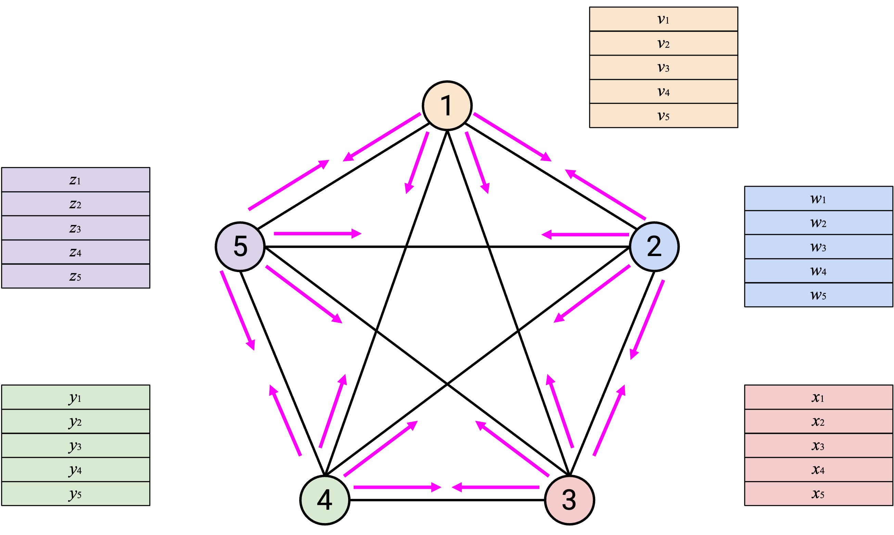

图7-084：每个节点把完整 D 字节向量复制到其他 p−1 个节点。

然后各节点把收到的所有向量与本地向量相加，得到完整结果。

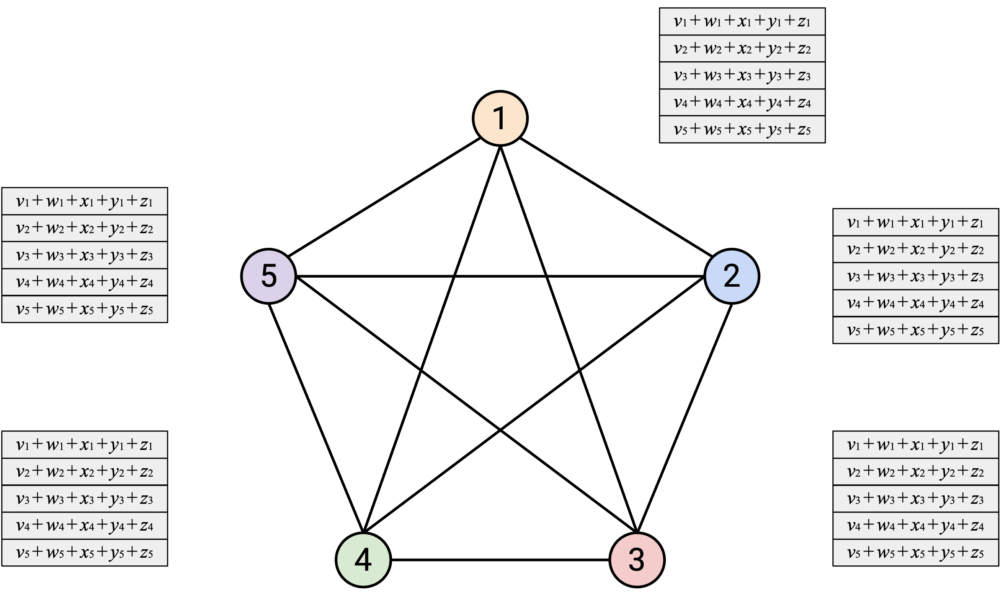

图7-085：每个节点本地计算所有输入的逐元素和，完成 AllReduce。

每节点发送 $D(p-1)$ 字节，所有节点总发送量为：

$$
V_{\rm send}=Dp(p-1)=O(Dp^2).
$$

时间取决于资源限制。若没有资源限制，所有发送可同时发生，一步完成。原文用“每节点同时使用 3 条出链路”说明并行，但本节 $p=5$ 的图中应是 4 条，3 是遗留笔误。每节点该步发送和接收各 $D(p-1)$，端点 I/O 合计 $2D(p-1)$。所谓“一步”隐含各节点能同时承载所有相邻链路的传输，不是说一张固定带宽网卡能瞬时发送任意多字节。

## 方法二：在一个节点归约

选一个节点完成计算，图中选择节点1。原文“single topology do all computation”应理解为单个节点，不是一个拓扑执行计算。

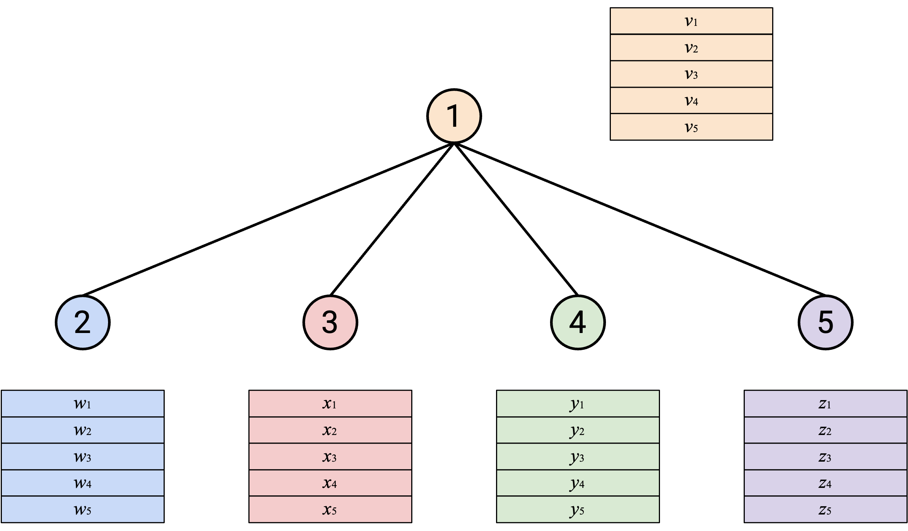

图7-086：以节点1为中心的星型连接。

除节点1外，大家先把整个向量发给节点1。

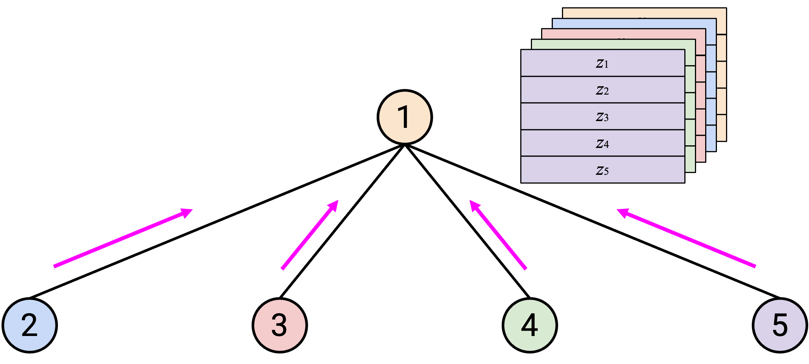

图7-087：节点1收到其他 p−1 份向量，连同自己的输入准备求和。

节点1计算和，再将结果发回所有其他节点。

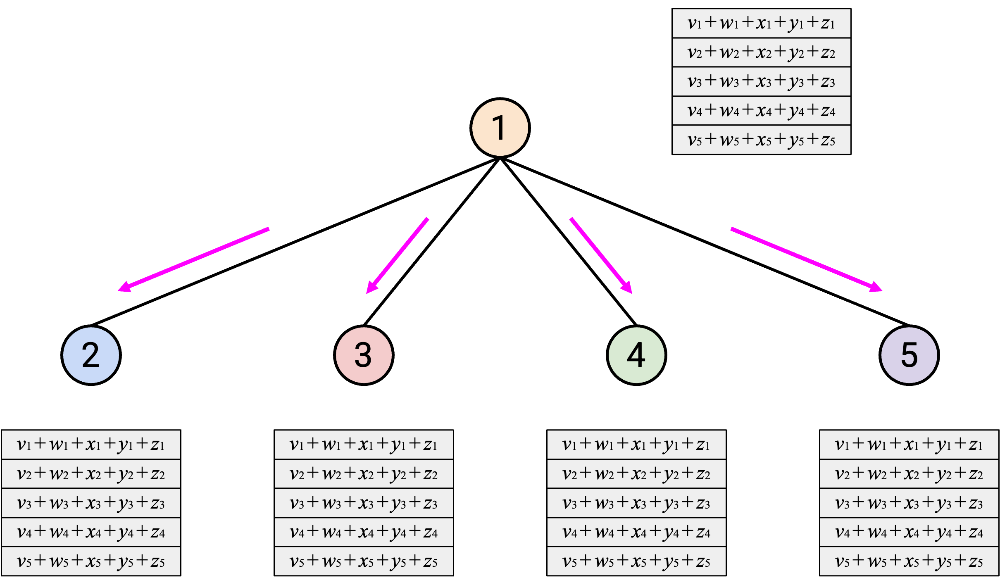

图7-088：中心向每个其他节点发送完整和向量。

第一阶段有 $p-1$ 个节点各发 $D$ 字节，共 $D(p-1)$；第二阶段中心发 $p-1$ 份同样大小的结果，也是 $D(p-1)$。故：

$$
V_{\rm send}=2D(p-1)=O(Dp).
$$

相对全互连，量级减少一个 $p$ 因子。精确比值是 $p/2$，原文“a factor of $p$”是量级说法。

无资源限制时，大家能同时向中心发，中心求和后同时向大家回传，总共两步。节点1每步需要接收或发送 $D(p-1)$ 字节。第一阶段必须完成，第二阶段才能开始；原文并未精确定义一步的实际长度，主要比较依赖关系。中心成为单点故障，这个方案在实践中不常使用。

## 方法三：树

构造二叉树，即每个节点最多两个孩子。

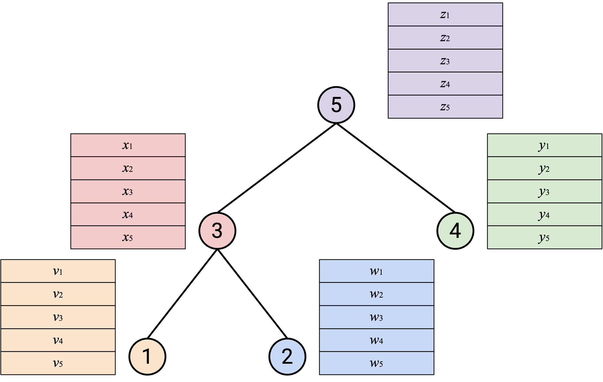

图7-089：根为节点5；其孩子为3、4，节点3的孩子为1、2，每节点各持一个输入向量。

从叶子开始，节点把向量交给父节点。

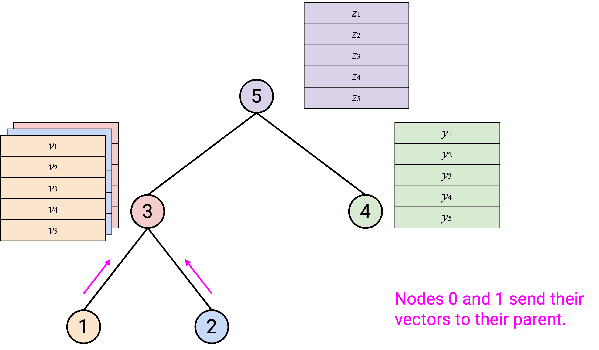

图7-090：节点1、2向节点3发送；原图文字误标为 Nodes 0 and 1，本图实际编号是1、2。

收到所有孩子的向量后，加上自己的向量。

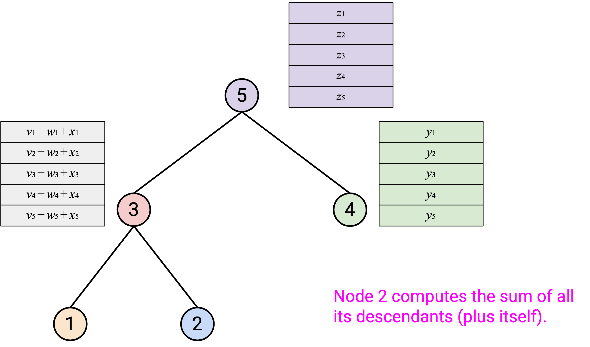

图7-091：节点3计算 v+w+x；原图文字写 Node 2，但图中完成运算的是节点3。

然后将和向量交给父节点。

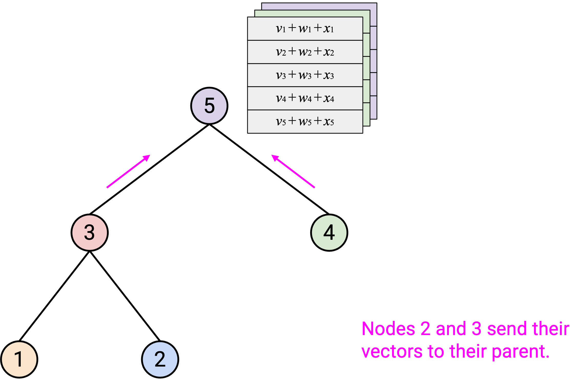

图7-092：节点3把 v+w+x 交给节点5，节点4也把 y 交给节点5；原图说明中的编号沿用旧的零基编号，应按图中节点3、4理解。

如此逐层向上，根最终得到全局和。

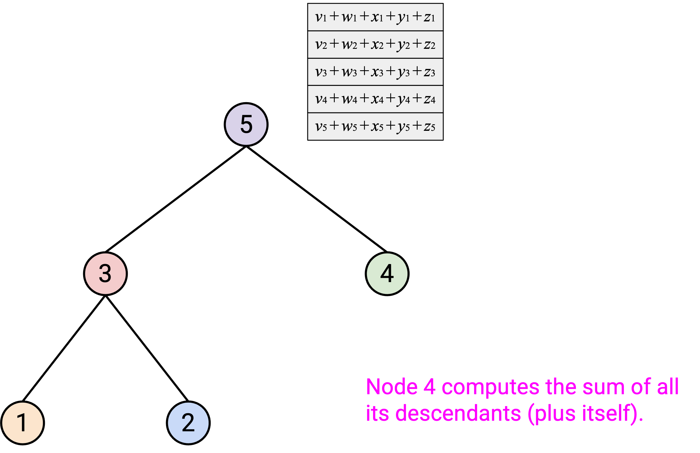

图7-093：根节点5计算 v+w+x+y+z；原图文字 Node 4 与图中编号5不一致。

第二阶段，根把总和发给孩子；每个节点收到父给的总和，再向自己所有孩子复制。

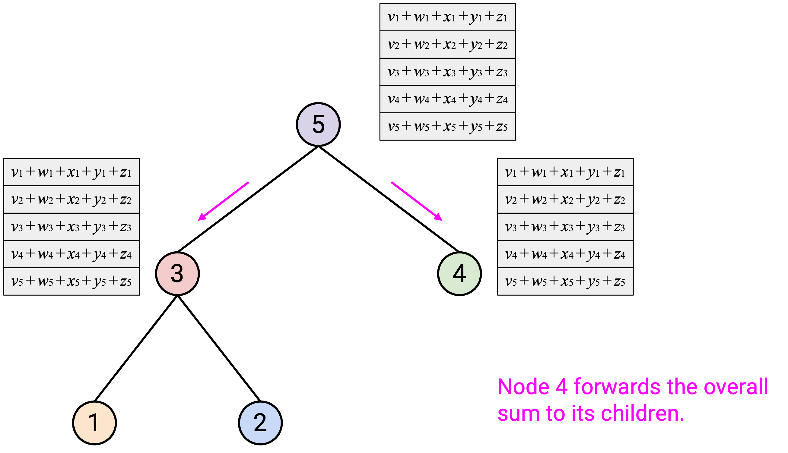

图7-094：节点5向3、4下发总和；图中旧编号 Node 4 应读作节点5。

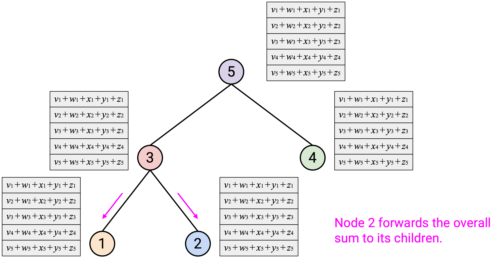

图7-095：节点3再向1、2下发总和；图中旧编号 Node 2 应读作节点3。

原文的带宽分析如下：第一阶段，每节点最多从两个孩子收 $2D$，向父发 $D$，所以每节点端点 I/O 上界是 $3D$，把这个上界乘节点数得到 $3Dp$。第二阶段，每节点从父收 $D$，向两个孩子发至多 $2D$，也是 $3Dp$。两个阶段合计原文写为：

$$
6Dp=O(Dp).
$$

**计数勘注：这是把每节点最坏端点 I/O 相加得到的宽松上界，不是精确“全网已发送字节”。** 叶节点、根不同时具有父和两个孩子。若每条树边上行、下行各发送一个 $D$ 字节向量，树有 $p-1$ 条边，则编者按统一口径推导：

$$
\begin{aligned}
V_{\rm send}&=2D(p-1),\\
V_{\rm IO}&=4D(p-1).
\end{aligned}
$$

这不改变原文 $O(Dp)$ 的结论，与中心归约同量级，比全互连少一个 $p$ 的量级，但不能直接拿 $6Dp$ 与全互连发送量当作同一精确指标。

时间方面，孩子的结果到齐才能向父发送。原文给出向上 $O(\log p)$ 步、向下 $O(\log p)$ 步，总计 $O(\log p)$；每节点一个阶段相关 I/O 至多 $3D$，比前两种方案的热点节点更少。精确时间仍要带入 $D$ 和网络资源约束。大致直觉是步骤更多，但每步传输较少，可能更快。

**树高条件：** 二叉只限制分支数，并不保证平衡。若树高为 $h$，整体向上再向下的层级依赖是 $2h$；只有 $h=O(\log p)$ 的平衡树才有原文对数结论，链状二叉树可有 $h=p-1$。

此方案利用了归约：节点把自己的向量和孩子的向量合成一个 $D$ 字节和再发送，而不是把三份向量都向上转。一般地，Reduce、ReduceScatter、AllReduce 等归并类操作允许中途合并，减少之后必须传输的数据。例如已知输出是求和，收到两份就可合成一份再转，而不必逐份搬运。原文“收到的数据少于发送的数据”指归约 API 总输入、输出规模的减少，不是物理网络中已发送的字节凭空消失。

## 方法四：朴素环

后两种方法将节点连成环。图里节点1和5的回绕线画得较长，没有特殊性能含义。

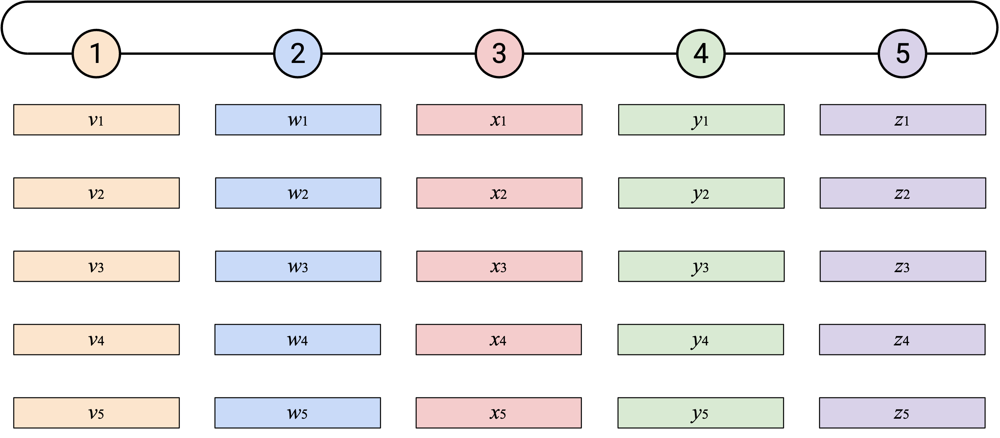

图7-096：五节点环展开画为1到5，最上方的线连接1和5。

朴素 AllReduce 从节点5开始，把自己的完整向量向左发送。收到右邻向量后，将其与自己的向量相加，再向左发这个和。

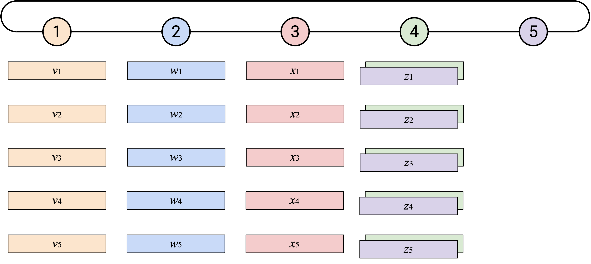

图7-097：节点5把 z 向左交给节点4。

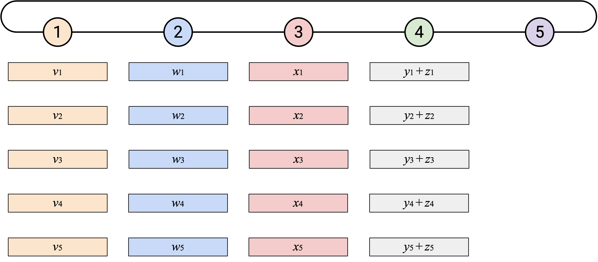

图7-098：节点4计算 y+z。

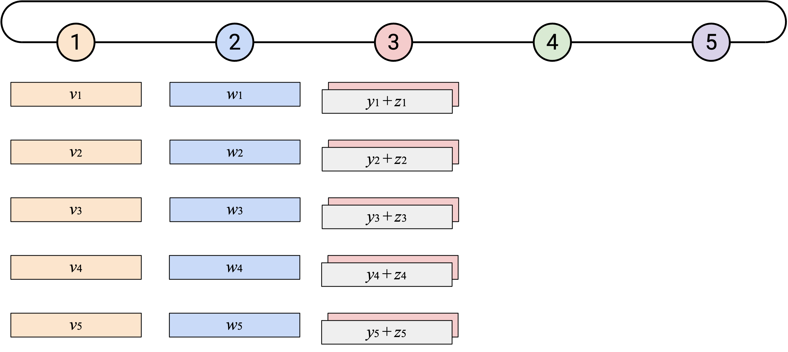

图7-099：节点4把 y+z 交给节点3。

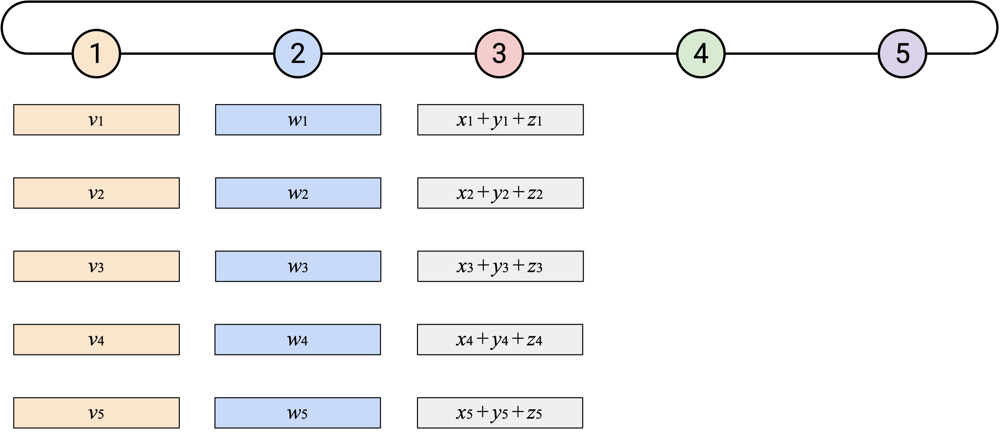

图7-100：节点3计算 x+y+z。

这个过程沿环继续。

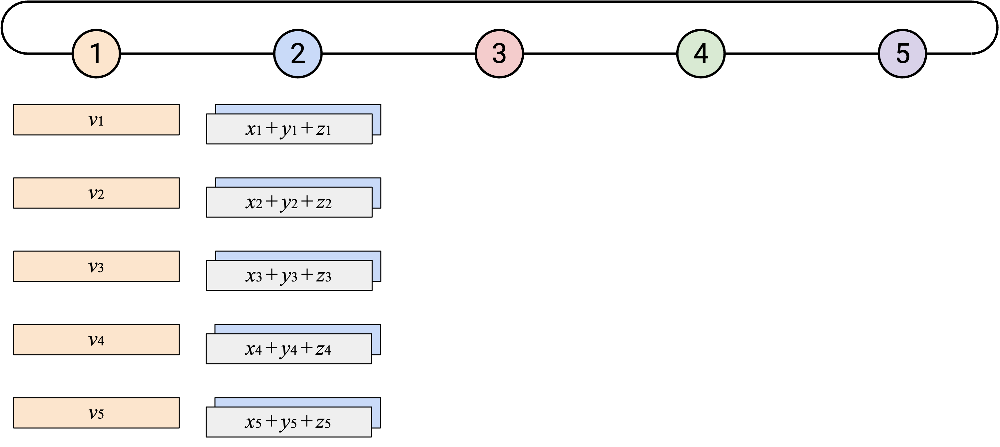

图7-101：节点3把部分和交给节点2。

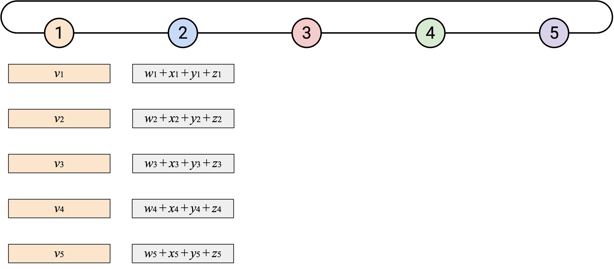

图7-102：节点2计算 w+x+y+z。

最后节点1得到并计算完整和。

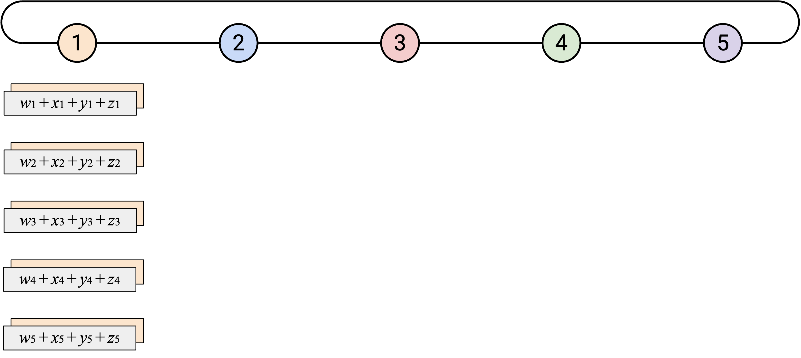

图7-103：节点2向节点1发送部分和，等待节点1合入自己的 v。

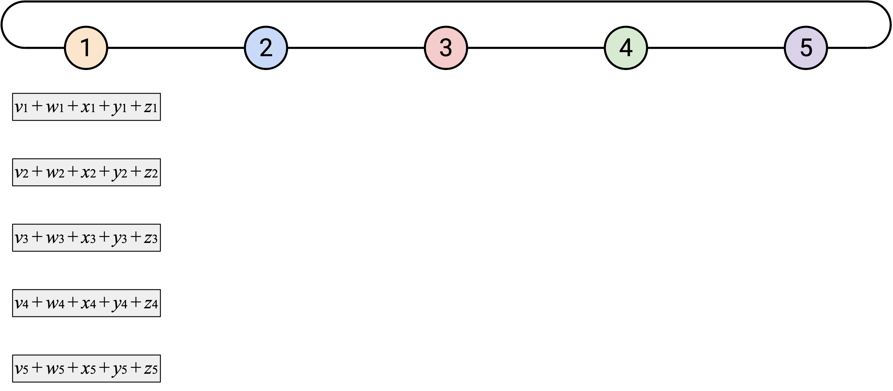

图7-104：节点1持有 v+w+x+y+z，归约完成。

第二阶段，让总和沿环传播，所有人得到副本。原文此处又写“节点5开始发送总和”，而前文及图7-104明确是节点1计算出总和；必须先由持有结果的节点1向左经回绕边交给5，再由5向4等继续复制。收到完整和时只复制，不再加入本地输入。

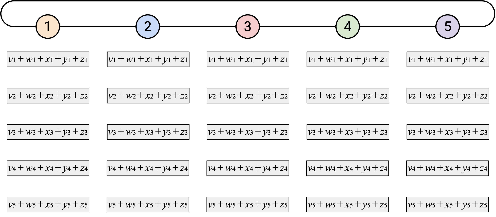

图7-105：总和经环传给各节点，所有节点最终持有完整和。

原文分析：第一阶段每节点收一个向量、发一个向量，端点 I/O 上界 $2D$，全体上界 $2Dp$；第二阶段同样为 $2Dp$，合计：

$$
V_{\rm IO}\leq 4Dp=O(Dp).
$$

这里仍是端点 I/O 上界，不是精确单计发送量。如果只做完成任务所需的 $p-1$ 次向左归约转发，再做 $p-1$ 次结果分发，则编者的精确发送量是 $2D(p-1)$、端点 I/O 是 $4D(p-1)$。原文用“每阶段绕完整一圈”的宽松 $p$ 步记账，不应与这一省去冗余末跳的 $p-1$ 模型混成同一个精确等式。

原文时间为第一圈 $p$ 步、第二圈 $p$ 步，共 $2p=O(p)$，每个活跃节点每步端点 I/O 至多 $2D$。原文时间段落又写“从左收、向右发”，与此前方向相反；对本图统一采用从右收、向左发，方向本身可整体反转，但同一个执行过程不能任意切换。

和树一样，实际时间要考虑 $D$ 和资源。相对前两种方案，环的步骤更多，但每步数据较少，可能完成较快。也不一定从节点5开始，换起点或把整个环方向反转都可正确实现。

## 方法五：错开分块的环

前面的方案都能得到正确结果，但负载突发。朴素环的大部分节点常在闲等；一个节点突然收到整个向量，需要马上求和、转发，其他人继续等它。

为了更均衡，把朴素环的步骤错开。不要一次向左发送整个向量，而是每步只发一个元素，即一个 $D/p$ 字节块。

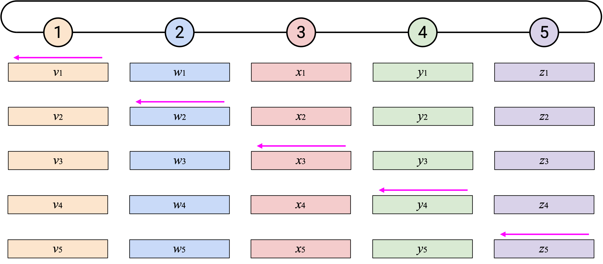

图7-106：初始每节点持有五块输入；节点 i 从自己的第 i 块开始向左发。

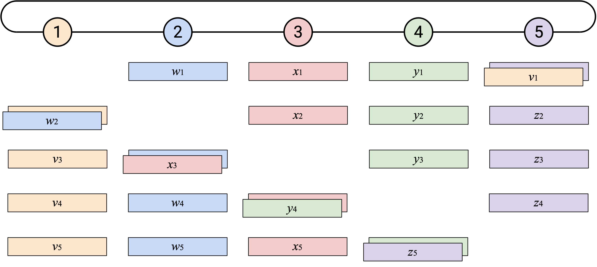

图7-107：所有节点同时向左发送各自起始块，不再只让节点5启动全部数据。

收到一块时，与本地对应块相加，再向左发送部分和。原文一句“从左收到”与图和随后总结不一致，按统一向左的数据流应是从右邻收到。

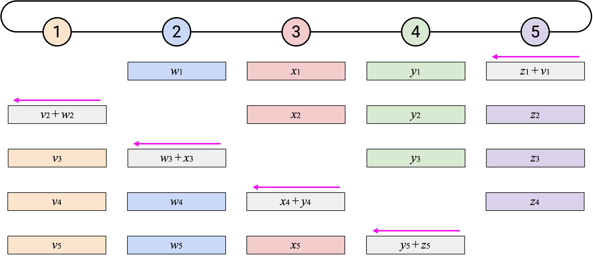

图7-108：收到的块与本地同一行相加，例如某节点合并自己该行输入与上游来的部分和。

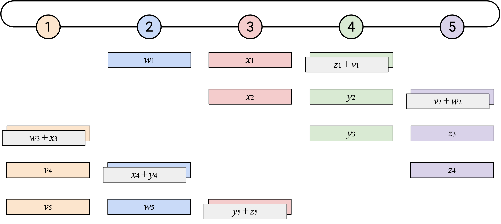

图7-109：不同块的部分和在不同节点并行推进。

不仅每个向量拆开发送，起点也错开：第 $i$ 个节点先发送第 $i$ 块，而不是让节点5发送所有块。

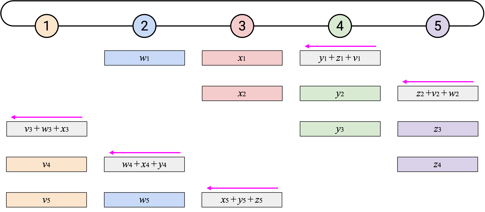

图7-110：又一轮各节点同时向左推进一块，链路工作被均匀分散。

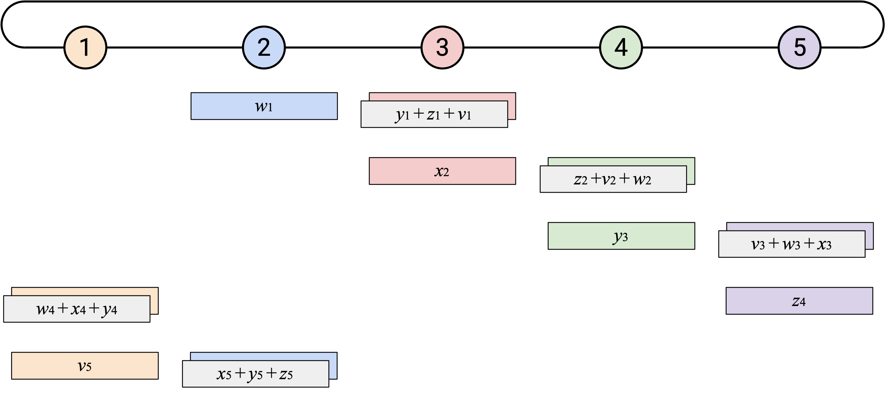

图7-111：每块已有更多节点的贡献，仍只合并相同块编号。

这两个维度的错开——每次一块、各节点不同起始块——使每个时间步都能让各节点从右收一块、做一次求和、向左发一块。

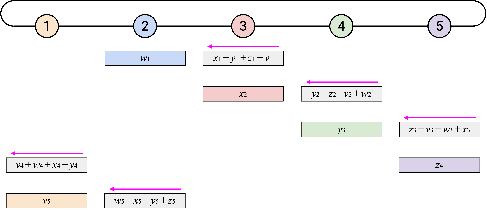

图7-112：各节点继续发送当前部分和，不必等整条向量到齐。

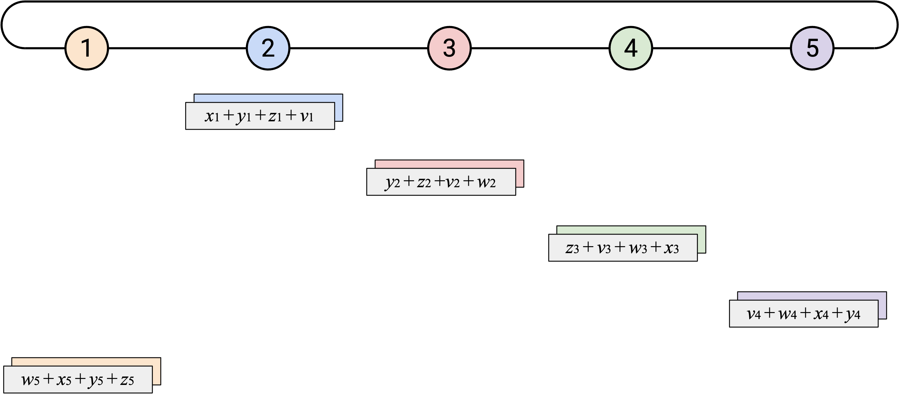

图7-113：各行部分和分别抵达不同节点，逐渐覆盖所有输入贡献。

原文以重复 $p$ 次来表示每块绕环一圈。

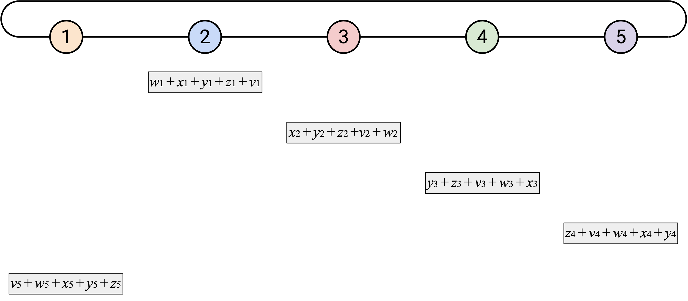

图7-114：每行得到全部五个输入之和，但完整和的不同块仍分散在不同节点。

此时不是每个节点都知道所有结果，还要第二圈传播各块。收到完整归约块后只复制，不能再相加。原文这里一度写“向右复制”，随后图和总结继续向左；此处统一按图的向左传播说明。


图7-115：已完成求和的块开始沿环复制，进入分发阶段。


图7-116：收到完整块后保存，并继续向左转发。


图7-117：各节点持有的完整结果块逐渐增多。


图7-118：所有节点最终都拥有全部五个结果块，AllReduce 完成。

观察这些连续图时可分两个方向：看某一列，即某节点，会发现它一次发送、接收一块；看某一行，即某块，会发现它依次到每个节点，与该节点同一块相加，再向左传递，所以最终每份贡献都被加进去。

因此优化环做的归约与分发工作与朴素环相同，只是将向量收发错开以减少突发。原文保留相同的宽松成本：第一阶段每节点发送加接收 $2D$，第二阶段再 $2D$，全体端点 I/O 上界 $4Dp=O(Dp)$；仍需 $O(p)$ 步完成两圈。

每步 I/O 却从活跃节点的整向量 $2D$ 降到一块的：

$$
\frac{2D}{p}.
$$

**不能把“优化”误读为无需条件的速度保证。** 这是一种教材给出的分块、错开起点方案。若所有环边能同时通信且每节点能并行收发，就能利用均衡流水；如果底层共享瓶颈让虚拟边互相争用，或每块启动开销占主导，现实收益还需分析。

**编者补充的精确标准计数（与原文圈数分开）：** 令归约后每个完整块停在一个约定所有者，不做多余回源跳。ReduceScatter 做 $p-1$ 轮，每轮每节点发送并接收一块；AllGather 再做 $p-1$ 轮。于是：

$$
\begin{aligned}
\text{轮数}&=2(p-1),\\
\text{每节点发送}&=\frac{2D(p-1)}p,\\
\text{每节点接收}&=\frac{2D(p-1)}p,\\
V_{\rm send}&=2D(p-1),\\
V_{\rm IO}&=4D(p-1).
\end{aligned}
$$

每块在归约阶段必须恰好合入每节点一次；不同起点可能使结果停在旋转后的所有者，若作为具有指定 rank 输出的 ReduceScatter 接口，要相应安排块编号。AllReduce 的中间分块不必恰好使用图中第 $i$ 行归节点 $i$ 的外部布局，但第二阶段必须收齐正确的块。

## 覆盖与底层拓扑

用户选择任意 $p$ 台主机调用 AllReduce，它们不太可能刚好物理上连成环。可在主机间添加虚拟边，形成覆盖环。


图7-119：A、C、B、D 之间的虚拟环建立在原有多跳物理网络上。

D 把向量交给 B，从覆盖看是一条邻居边，从底层看却经过多跳路由。和覆盖组播一样，性能取决于虚拟拓扑与物理网络是否匹配；训练数据量巨大，这尤其重要。

假设四节点要运行 AllReduce，应如何编号？在本章可交换、可结合的数学求和模型里，任意编号都能产生相同的抽象结果；这个结论不适用于所有集体操作。例如 Scatter 的 rank 会决定哪一块归谁。浮点求和也可能因重排而改变舍入结果，不保证逐比特一致。


图7-120：两种编号：方案一依次 A、C、D、B，方案二依次 A、C、B、D；都可形成环，但虚拟邻居不同。

第一种平均 stretch 是 3.5，特别是 C→D、B→A 的虚拟边对应较长底层路径。


图7-121：四条虚拟边的底层跳数为2、5、2、5，虚拟边均记1；平均为(2+5+2+5)/4=3.5。

第二种平均 stretch 是 2.5，将环中的邻居在物理上放得更近。


图7-122：四条虚拟边对应2、3、2、3跳，平均为(2+3+2+3)/4=2.5。

这里沿用教材“底层成本÷虚拟标价”的 stretch，虚拟边全取1，所以平均值就是平均底层边数；不是把实际绕行路径与端点最短路比较的另一种 stretch 定义。

一般而言，希望节点 $i$ 与 $i+1$ 之类的环邻居在网络中较近。图里虽是任意底层拓扑，同样原则也适用于结构化数据中心：同机 GPU 的连接很好，跨机架 GPU 的连接较差。

训练任务可预测、底层固定且规则，因而有很多优化机会，例如把需要集体通信的任务放到同一机架的近邻节点。如何优化训练任务仍是活跃研究领域；本页不额外声称某个没有论证的调度或“最优算法”。

## 三层抽象

1. **定义层**：给出输入、期望输出。用户理解 API 即可，不必了解网络实现。
2. **覆盖层**：考虑在树、环等有用虚拟拓扑上交换什么数据，可先假设邻居间可传送。
3. **底层**：把虚拟边映射到真实物理链路。节点5把向量给节点4，实际可能需多台路由器转发。

## 引用、版本与许可

- 原作 Peyrin Kao，基于 Sylvia Ratnasamy、Rob Shakir 等人的课程。本页完整翻译 [Collective Operations](https://textbook.cs168.io/beyond-client-server/collective-operations.html) 与 [Collective Implementations](https://textbook.cs168.io/beyond-client-server/collective-implementations.html)，包括七种操作、对偶、组合、五种 AllReduce 实现与全部61幅引用图。原文没有学生实现代码，本页也未添加。
- 使用 **2026-10-01 当前固定快照**，不是 2025 历史教材。固定 commit：

```text
0b8208742d31df7fc3d53a0cd94fdd4e04f8d47e
```

- [固定源码](https://github.com/berkeley-cs168/textbook/tree/0b8208742d31df7fc3d53a0cd94fdd4e04f8d47e/beyond-client-server)。原图字节不变，添加中文图注，以白底显示透明 PNG。中文翻译、图注、计数口径说明、明确标出的勘误与编者推导均为修改，随教材采用 [CC BY-SA 4.0](https://creativecommons.org/licenses/by-sa/4.0/)，许可与署名证据见[教材首页](https://textbook.cs168.io/)。
- 视频、课件的授权独立且未知，不继承教材许可。本页不是课堂逐字稿；课堂覆盖、讲解顺序与实际音画均未核验。
