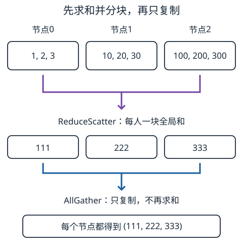

# 核心问题：同一个 AllReduce，为什么一步不一定比八步快？

集体通信要同时回答三个不同问题：**最终每人该得到什么，部分结果如何逐步形成，硬件为这些步骤付出多少时间？** 若把这三层揉在一起，就会把“AllGather 当求和”、把“收发都计的总量当发送量”，或把“一步当一秒”。

## 1. 用三个节点的小例核验 API

设三节点输入分别为：

$$
\begin{aligned}
x_0&=(1,2,3),\\
x_1&=(10,20,30),\\
x_2&=(100,200,300).
\end{aligned}
$$

这是原创算例，使用从0开始编号；教材图使用从1开始编号，两者不可在同一推导里混用。全局逐元素和是 $s=(111,222,333)$。

| 操作 | 输出应该是什么 |
| --- | --- |
| Broadcast，根0 | 所有人拿到 (1,2,3)，其他节点原输入不用 |
| Scatter，根0 | 节点0拿1，节点1拿2，节点2拿3 |
| Gather，根0 | 按教材对角格约定，根拿到 (1,20,300) |
| AllGather | 所有人拿到 (1,20,300)，没有求和 |
| Reduce，根0 | 只有根得到 (111,222,333) |
| ReduceScatter | 节点0得111，节点1得222，节点2得333 |
| AllReduce | 所有人得到 (111,222,333) |

现实库的 Gather/AllGather 输入可直接是一块，不要求分配一整行只用“对角格”；表中遵循教材布局，用来区分数据所有者与块编号。

**组合不变量：** ReduceScatter 完成后，结果的每一块都有一个持有者；AllGather 只是复制这些已完成的块。第二阶段若继续做加法，就会重复计算。

图为原创算例。紫色路径表示计算全局和后分散，蓝色路径表示只复制、不再相加。箭头说明逻辑阶段，不宣称固定物理拓扑或真实时间。

## 2. 树归约怎样证明没有漏加、重加？

为树上节点 R 定义贡献集合 $A_R$：R 自己与其子树所有节点。R 向父发送的向量应为：

$$
S_R=\sum_{i\in A_R}x_i.
$$

叶节点只有自己，条件成立。内部节点收到孩子的部分和后，合入本地输入；如果孩子子树互不重叠，就恰好覆盖 $A_R$。根因此得到所有输入之和。向下广播时只复制结果，保持数值不变。

这是归约的关键，不是“节点越多加得越快”。如果两条路径把同一个输入重复送进归约，树状图即使画得漂亮也会算错。

若运算是可结合、可交换的整数求和，换树不改数学结果。浮点求和换次序可能改舍入；带顺序的非交换算子还需保留约定顺序，不能随意重新编号或路由。

## 3. 建立不混单位的成本模型

以下均为编者统一记账模型：$p$ 个节点，每人输入一个 $D$ 字节向量；归约后向量仍是 $D$ 字节；点对点逻辑传送不丢包。

- **发送量**：每次覆盖链路传送计一次，单位字节。
- **端点 I/O**：发送端和接收端都计，总计是发送量的两倍。
- **物理链路量**：还要乘各次传送的实际底层跳数，不能由逻辑总量直接推出。
- **依赖轮数**：上一轮必要数据到齐，下一轮才可开始；不是秒。

### 全互连

每人发整向量给另外 $p-1$ 人：

$$
\begin{aligned}
\text{每人发送}&=D(p-1),\\
\text{全体发送}&=Dp(p-1).
\end{aligned}
$$

无资源限制时可在一个通信阶段同时发完，但每人该阶段还接收 $D(p-1)$。如果网卡总发送率只有 $B$，仅发送就受 $D(p-1)/B$ 约束；“一步”并没有消掉这些字节。

### 树：Reduce 再 Broadcast

每条树边上传一个 $D$ 字节部分和，下传一个 $D$ 字节结果。树有 $p-1$ 条边：

$$
V_{\rm send}=2D(p-1).
$$

对有 $c$ 个孩子的非根节点，整个操作发送 $(c+1)D$、接收 $(c+1)D$；根发送、接收各 $cD$；叶发送、接收各 $D$。这是每节点负载，而不是把所有节点都当作拥有最大度。

若树高为 $h$，无切块且逐层归约、逐层广播，关键依赖为 $2h$。二叉不自动平衡，不能从“二叉”直接推出 $O(\log p)$。

### 精确分块环：ReduceScatter 再 AllGather

向量均匀切成 $p$ 块，各 $D/p$ 字节；每轮每节点向一个邻居发一块，从另一邻居收一块；所有环边可并行使用，节点可同时发送、接收。

第一阶段 $p-1$ 轮，每块在经过节点时恰好纳入一次本地贡献；第二阶段 $p-1$ 轮，只复制完整和块。结果所有者的块编号须按调度约定保持一致。

$$
\begin{aligned}
\text{总轮数}&=2(p-1),\\
\text{每人发送}&=2\frac{p-1}{p}D,\\
\text{每人接收}&=2\frac{p-1}{p}D,\\
V_{\rm send}&=2D(p-1).
\end{aligned}
$$

环与树的精确逻辑总发送量相同，并不意味着时间相同。环均衡地分摊负载，但启动轮数更多；树依赖深度可较小，但内部节点工作更多。

**与原文分开：** 教材写树 $6Dp$、环 $4Dp$，属于累加每节点发送加接收的宽松上界；教材环还按每阶段完整一圈的 $p$ 步计。它们没有与本节 $p-1$ 轮精确模型使用同一计数口径，不能直接混在一张“精确常数”表里。

## 4. 一组具体数字揭示“一步”的陷阱

自拟 $p=4$、$D=12$ MB（十进制），每块3 MB：

- 全互连：每人发36 MB、收36 MB，全体发送144 MB。理想依赖只有一个通信阶段，但要求三路并发资源。
- 树归约加广播：全体发送72 MB；若树高2，则层级关键依赖4步，树内部节点与叶负载不同。
- 分块环：每阶段3轮，共6轮；每轮每人发3 MB、收3 MB，每人合计发18 MB、收18 MB，全体发送72 MB。

把传一块的启动开销记为 $\alpha$，有效单向链路速率记为 $B$，忽略计算且允许全双工并行，环的简化时间为：

$$
T_{\rm ring}\approx
2(p-1)\left(\alpha+\frac{D}{pB}\right).
$$

这是**条件模型**，不是实测或全局真值。小消息时 $\alpha$ 可能主导，多轮环未必占优；大消息时分块后的均衡带宽使用可能重要。如果多条虚拟环边共享同一物理瓶颈，“每边都能获得 B”的假设还会失效。

## 5. 环上的正确性比“左或右”更重要

可以全程顺时针，也可以全程逆时针；不能在一半步骤里无依据地换方向。跟踪任一块 $j$，为其部分和附上集合 $A$：

$$
\text{当前块值}=\sum_{i\in A}x_i[j].
$$

归约遇到尚未包含的节点 k，更新为 $A\cup\{k\}$；若 k 已在 A 里，再加一次就是错误。集合达到全体时切换到复制阶段，不再改数值。这是理解教材连续动画图比背诵“第几步向左”更可靠的办法。

注意教材环图和文字存在起点、方向笔误，树图注又混用零基和一基编号；[材料](#/c/berkeley-cs168-2025/lec/lec25?v=materials) 已逐处保留原图并勘注，不把错字发明成新算法。

## 6. 重排 rank 能省什么，又不能保证什么？

设同机节点 A、B 很近，同机节点 C、D 很近。覆盖环若交错排列 A→C→B→D→A，每条边都跨机器；改成 A→B→C→D→A，可减少跨机器边。

这只是拓扑意识的原创例子，不是证明该环全局最优。性能还取决于物理路径拥塞、双向带宽、GPU 到 NIC 通路和数据分配。原教材用平均底层跳数说明较好的排序，不是用平均值承诺最坏瓶颈也一定改善。

对可交换、可结合的 AllReduce，rank 重排不改抽象输出；但 Scatter、ReduceScatter 的指定输出所有者会受编号影响。浮点 AllReduce 也不能保证重排后逐比特相同。

## 7. 折叠自测

AllGather 能代替 AllReduce 吗？

不能直接替代。AllGather 复制各节点已有块，不计算全局逐元素和；只有先形成正确的 ReduceScatter 结果，再 AllGather，才得到 AllReduce。

四节点、每向量12 MB，精确分块环全体发送多少？端点 I/O 多少？

全体发送 $2(4-1)\times12=72$ MB。每次传送还在接收端记一次，端点 I/O 为144 MB。每节点发送18 MB、接收18 MB。

树的原文 6Dp 比环的 4Dp 大，可以断言环少发送三分之一数据吗？

不可以。这些是端点负载的宽松上界，树还把根、叶都按最大度累加。统一按每条逻辑边精确计数，两者在本页模型中都发送 $2D(p-1)$。

所有节点最多两个孩子，是否一定只需对数轮？

不一定。链也是二叉树，可以高达 $p-1$；对数轮还需要树高为对数级。

归约阶段完成后，继续沿环遇到本地输入就相加，会发生什么？

重复计入已有贡献。传播完整结果时只复制；状态机必须区分“部分和”和“最终块”。

全互连只有一步，为什么可能比多轮环慢？

该步每节点需发送、接收 $D(p-1)$，并发链路与网卡资源有限。环每轮只交换 $D/p$，可更均衡，但有更多启动开销。必须带入实际资源和消息大小，不能只比较轮数。

## 引用与来源边界

- 依据 [完整教材材料](#/c/berkeley-cs168-2025/lec/lec25?v=materials) 的 Operations、Implementations 两章及61幅原图；原作 Peyrin Kao，基于 Sylvia Ratnasamy、Rob Shakir 等人的课程，采用 CC BY-SA 4.0。本页原创例子、SVG、解释及推导同许可。
- 采用2026-10-01固定教材快照，不代表2025历史文本。覆盖网络基础见 [L24](#/c/berkeley-cs168-2025/lec/lec24?v=notes)。没有执行任何学生代码或通信库，也没有报告性能实测。
- Spring 2025 课表日期为4月28日；个体视频 `g-gNXO01T5I` 上传于 **2025-04-29**，时长 **4883秒（1:21:23）**。标题为“Lecture 25 - Multicast (continued) and Collectives”，因此视频名称明确含组播续讲，但未据此推测具体内容或时段。
- 官方频道：CS 168 (Internet Architecture) at UC Berkeley。字幕主通路、一次不同官方 timedtext 通路均 HTTP 429，无可读字幕，音画未查看，许可字段为空。**本页教材驱动、课堂覆盖未核验；不编造时间轴、Q&A 或片尾，不生成 draft 占位。**
