# 无线链路

## 无线技术简介

无线通信技术实际上比互联网更早出现。19 世纪 80 年代，Bell 和 Tainter 的光电话尝试利用光束无线传送数据；19 世纪 90 年代，Marconi 的无线电报尝试利用无线电波传送数据。同一时期，Bose 也开展了毫米波实验；今天，毫米波再次成为活跃的研究领域。

你或许把无线通信想象为：不可见的粒子沿着一条虚构的链路从 A 点走到 B 点。但这并不准确。它更像池塘中的涟漪：发送数据时产生向外传播的波纹，距离越远，波纹越弱；其他发送者产生的波纹会与它相长或相消干涉。波纹遇到类似池塘中的船或池塘边界的障碍物，还会反射或折射。

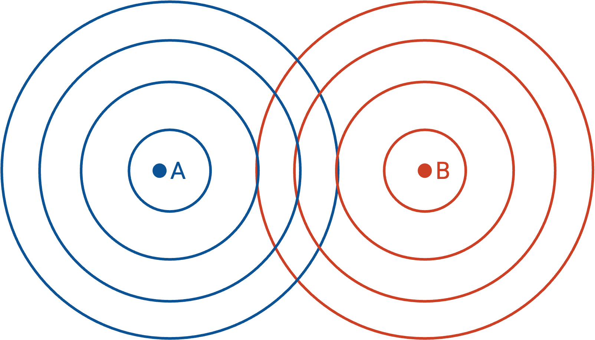

本章考察有线与无线通信的四项重要区别。它们主要影响第 1 层（物理层）和第 2 层（链路层），也有稍后讨论的例外，特别是为了性能而在第 2 层实现可靠性，而不是只依靠端到端实现。

1. 无线介质本质上是共享的，有线介质则不是默认共享的。
2. 无线信号随距离增加而明显衰减。
3. 无线环境可能迅速变化。
4. 无线系统中的分组碰撞更难检测。

> 编者勘注：原文简介把后两项对照写成“有线信号不衰减”“有线环境不变化”，这是教学上的简化，而非物理上的绝对断言。下文原文本身也承认有线信号会衰减。有线共享总线也确实存在。

## 区别一：无线是共享介质

有线链路默认是私有的、点到点的：一条线连接两台设备。若要做成连接多台设备的多点总线，需要额外设计。外部信号通常不容易干扰线内信号，例如可以在线外增加屏蔽。在线上可以通过电信号传输数据，如高电压表示 1、低电压表示 0。

无线链路恰好相反。默认情况下，它是共享的：发射信号会向四周辐射。要在两台主机之间创建私有的点到点无线链路，需要额外设计，也难以把信号与外部干扰隔离。这里通过无线电波编码并传送比特。

## 在无线链路上编码数据

物理层怎样把数据编码为电磁波？直接把一串 0 和 1 画成波形，得到的往往是低频信号；原文用“较弱、难以传送”来说明为什么不直接发射它。

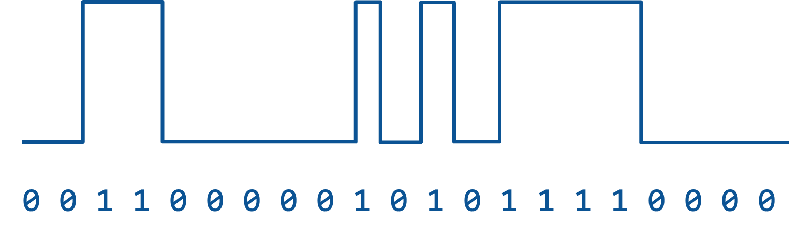

因此需要**调制（modulation）**。先产生频率固定的载波，例如正弦波。它本身不携带信息，但频率较高，便于发射。再把数据信号，也叫调制信号，叠加到载波的某种特征上。所得波形既有便于传输的载波特征，又包含要传输的数据。接收者需要从调制后的波形中重新提取 0 和 1。

调制有多种方法。**幅度调制（AM）** 根据输入改变载波的高度，例如高幅度表示 1、低幅度表示 0。**频率调制（FM）** 根据输入改变载波频率：窄而密的波形，即较高频率，表示 1；宽而疏的波形，即较低频率，表示 0。还有相位调制，以及幅度和相位结合的更复杂方式。

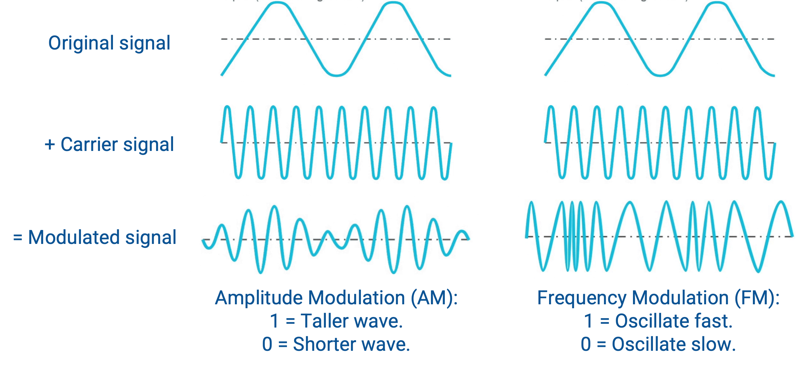

> 编者勘注：“低频信号弱”并非普适物理定律。这里讨论的是把基带信息搬移到适合给定无线系统发射的载波上；发射难易还取决于天线、频段及实现，不能仅由频率推断功率。

## 噪声和干扰

无线是共享介质，因此必须处理可能破坏接收信号的噪声和干扰。即使附近没有其他设备发射，噪声也始终存在。类似于周围无人说话时仍然有自然环境声，这种背景噪声称为**噪声底（noise floor）**。与此相对，干扰来自其他正在发射信号的发送者；这里的“有意发射”不等于恶意干扰。

**信干噪比 SINR（Signal to Interference and Noise Ratio）** 用于衡量接收端的无线连接质量：

$$
\mathrm{SINR}=\frac{P_{\mathrm{signal}}}{P_{\mathrm{interference}}+P_{\mathrm{noise}}}
$$

它是两个功率量之比，没有量纲，也可以用对数形式的分贝 dB 表示。0 dB 对应比值 1；增加 10 dB，底层比值就增大 10 倍，例如信号功率增为 10 倍，或干扰加噪声功率降为十分之一。

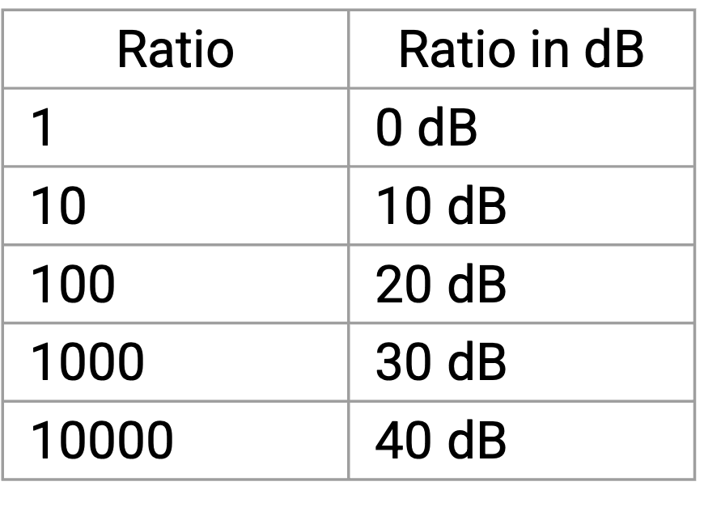

$$
\mathrm{SINR}_{\mathrm{dB}}=10\log_{10}\!\left(\frac{P_{\mathrm{signal}}}{P_{\mathrm{interference}}+P_{\mathrm{noise}}}\right)
$$

这说明，噪声更多时，为了保持相同接收质量，需要更强的信号。也可以利用**编码增益**，例如纠错码：即使信号较弱、混入噪声和干扰，发送足够冗余仍可能让接收者恢复信息。

香农容量给出在一定噪声和干扰条件下，信道每单位时间能够传送多少数据的理论上限。它不只适用于无线链路，也适用于有线链路：

$$
C=B\log_2(1+\mathrm{SINR})
$$

其中，$B$ 是信道带宽，即接收者可处理的最高频率与最低频率之差，单位为 Hz；SINR 取线性比值；$C$ 是理论数据率上限，单位 bit/s。

> 编者边界：该容量式基于带限、加性高斯噪声等理想信道假设。使用 SINR 时还把干扰作为等效噪声处理；它不是任意无线信道和任意干扰结构下的无条件容量上限。

带宽越大，每单位时间能传输的数据越多；SINR 越高，即信号更强或噪声更小，数据率上限也越高。若目标是 1 Mbps 之类的容量，可以代入链路物理参数，判断理论上是否有可能达到目标。

原文以传统电话系统为例：频率范围 300–3300 Hz，带宽为 3 kHz；SINR 约为 20 dB，即比值 100。原文随后写出：

$$
C=4000\log_2(1+100)\approx20000
$$

并据此声称约为 20 kbps。

> **原文数值勘误：** 300–3300 Hz 的带宽确为 3000 Hz，而非式中的 4000。采用其给定带宽，应为 $3000\log_2(101)\approx19975$ bit/s，约 20 kbps；若真用 4000，则约为 26.6 kbps。译文保留错误出处并明确修正，不能同时沿用不一致的式子与答案。

## 区别二：衰减

无线信号会随距离增长而显著减弱。有线信号也会随距离衰减，但在这里比较的典型环境中影响较小。设计无线系统时必须显式考虑衰减，而有线系统通常不把它作为同等突出的设计约束。

这带来根本权衡：我们希望链路准确、快速、覆盖远；同时希望节约能源，例如笔记本电池，以及减少对可能昂贵的频谱资源的占用。但更好的信号通常需要更多功率或更大的频率带宽。

## 自由空间模型

简单的衰减模型是**自由空间模型**，也称视距模型：假设收发者处于完全空旷的环境，信号向各方向辐射，没有任何障碍物，甚至不考虑地球表面。

信号功率遵循距离的平方反比关系：

$$
P_r\propto\frac{P_t}{d^2}
$$

$P_r$ 是接收功率，$P_t$ 是发射功率，$d$ 是收发距离。距离变成 2 倍，接收功率变为四分之一；距离变成 10 倍，则变为百分之一。原文紧邻公式的英文先说“与距离成反比”，准确含义应以公式为准，是“与距离的平方成反比”。

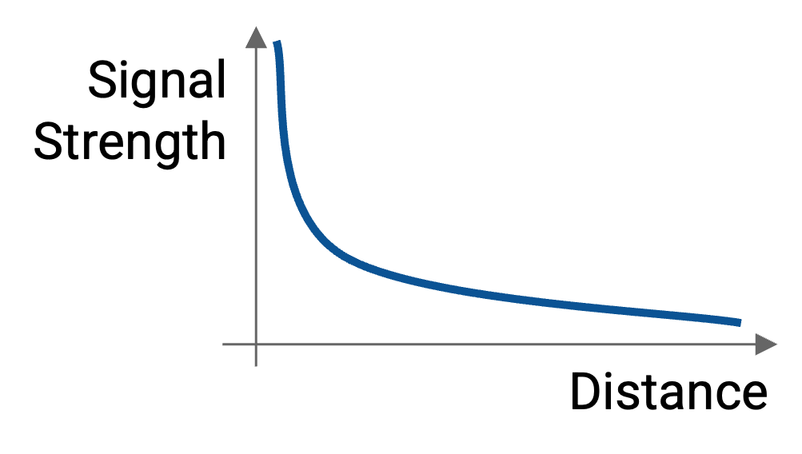

直观原因是信号向四面八方传播。某一时刻的波前构成以发射者为中心的球面。半径 $r$ 的球面面积为 $4\pi r^2$，所以距离增长时，同样的功率分散在按距离平方增长的面积上。距离翻倍，面积变成 4 倍，单位面积上的功率就降到四分之一。

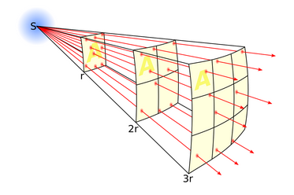

除了距离，还要考虑收发天线。**Friis 公式**给出：

$$
\begin{aligned}
P_r&=P_tG_tG_r\left(\frac{\lambda^2}{4\pi}\right)\left(\frac{1}{4\pi d^2}\right)\\
&=P_tG_tG_r\left(\frac{\lambda}{4\pi d}\right)^2
\end{aligned}
$$

其中 $G_t$、$G_r$ 分别是发射和接收天线增益；$\lambda$ 是波长，在这里与天线有效孔径有关；$d$ 是两天线之间的距离。

计算接收功率时，先从发射功率 $P_t$ 出发，乘上两个天线的增益。较高增益可以理解为天线在相关方向上更善于发送或接收。距离项 $1/(4\pi d^2)$ 来自球面扩散。另一个 $\lambda^2/(4\pi)$ 与接收天线有效孔径，即有效接收面积有关。

可以用手电筒照纸的比喻理解：纸越大，截获的光越多。原文把有效孔径写为 $\lambda^2/(4\pi)$，这里不作证明。式中的 $(4\pi)^2$ 来自两个不同的 $4\pi$，一个出自球面扩散，另一个出自孔径公式。

> 编者勘注：对于含接收增益的天线，有效孔径为 $A_e=G_r\lambda^2/(4\pi)$；原文已把 $G_r$ 单独乘在总式中。不能在孔径中再乘一次之后，又在总式中重复计算它。源码还留有一条说明纸张比喻出处的注释，见页底链接；本译文没有把该外链作为独立已读资料。

两边除以发射功率，可得：

$$
\frac{P_r}{P_t}=G_tG_r\left(\frac{\lambda}{4\pi d}\right)^2
$$

它说明接收功率相对于发射功率的比例，例如二分之一或百分之一，由天线增益、距离平方的倒数以及天线有效孔径共同决定。

对两边取对数，则可用分贝表示功率和增益：

$$
\begin{aligned}
P_r^{\mathrm{dB}}={}&P_t^{\mathrm{dB}}+G_t^{\mathrm{dB}}+G_r^{\mathrm{dB}}\\
&+20\log_{10}\left(\frac{\lambda}{4\pi d}\right)
\end{aligned}
$$

自由空间模型可以给出理想环境中的接收功率；现实的障碍物，例如地面，使该理想值不能直接当作实际预测。

## 链路预算

既然信号随距离减弱，怎样判断一条链路能否工作，也就是接收者能否检测到可理解的信号？需要把沿途所有增益和损耗纳入**链路预算**：

$$
P_r^{\mathrm{dB}}=P_t^{\mathrm{dB}}+\sum\mathrm{gains}-\sum\mathrm{losses}
$$

天线等带来的增益增加预算，长距离传播等带来的损耗消耗预算。相加相减后得到接收功率，再与接收机灵敏度，即提取有用信息所需的最低信号强度，作比较。如果接收功率高于这个门槛，链路可用；反之不可用。原文所称“预算为正/负”应理解为相对灵敏度的余量，而不是接收功率的 dB 数值本身必须为正。

分贝是对数单位，所以原本的乘除变为加减。例如 1000 倍功率增益对应加 30 dB，功率降到 1% 对应减 20 dB。

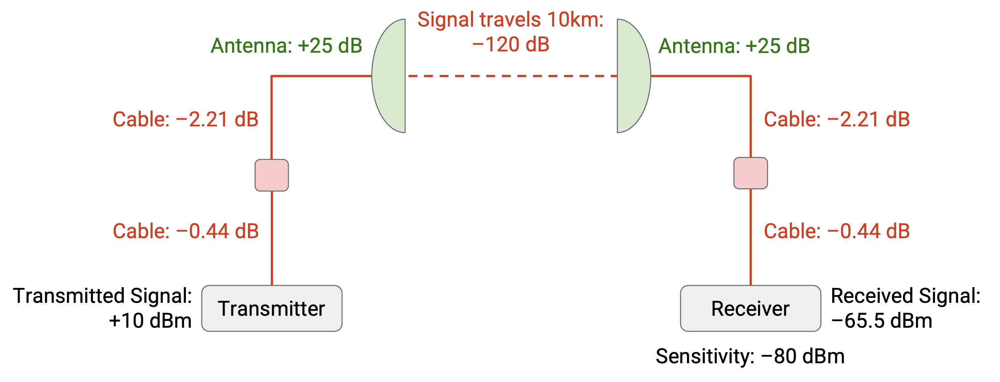

原文示例从发射端的 10 dB 开始。信号经过电缆、避雷器和另一段电缆，分别损失 0.44、0.1、2.21 dB；发射天线增加 25 dB；通过 10 千米空间损失 120 dB；接收天线再增加 25 dB；接收端电缆等又分别损失 0.44、0.1、2.21 dB。最终接收功率为：

$$
\begin{aligned}
P_r={}&10-(0.44+0.1+2.21)+25\\
&-120+25-(0.44+0.1+2.21)\\
={}&-65.5
\end{aligned}
$$

接收机灵敏度为 −80，故 −65.5 高于门槛，链路应能工作。

**链路余量（link margin）** 等于接收功率减去接收灵敏度。例如收到的功率为 30、灵敏度为 10，余量为 20 dB。前述示例的余量则为 $-65.5-(-80)=14.5$ dB。负余量意味着信号不可用；余量越大，通常越能抵抗干扰和其他不利因素。

> **单位勘注：** 原文正文把绝对功率和灵敏度简写为 dB，但原图明确标为 **dBm**：发射功率 10 dBm、接收功率 −65.5 dBm、灵敏度 −80 dBm。dB 是比值单位，dBm 是以 1 mW 为参考的功率单位。上述计算结果因而为 −65.5 dBm；增益、损耗、余量用 dB，余量仍为 14.5 dB。图中两端避雷器用方块画出而未标 0.1 dB，正文提供了这两个损耗，不能遗漏。

## 区别三：环境会变化

无线环境可能迅速变化：设备会移动，障碍物可能移到两设备之间，其他通信也可能开始造成干扰。

自由空间模型把距离 $d$ 当作固定值，并假设没有障碍物和干扰。如果设备移动，或环境不再空旷，模型又会怎样？假定天线增益和孔径不变，自由空间下信号强度随距离平滑下降；考虑环境变化后，曲线会出现明显波动。

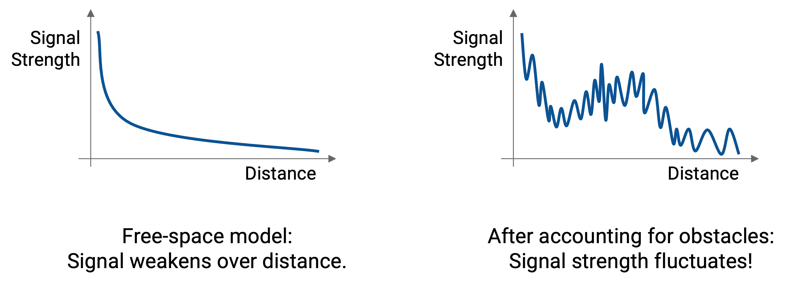

这条曲线可理解为三条较小曲线的叠加，每条对应一种环境特征。有些变化缓慢，有些则随位置细微变化而迅速起伏。

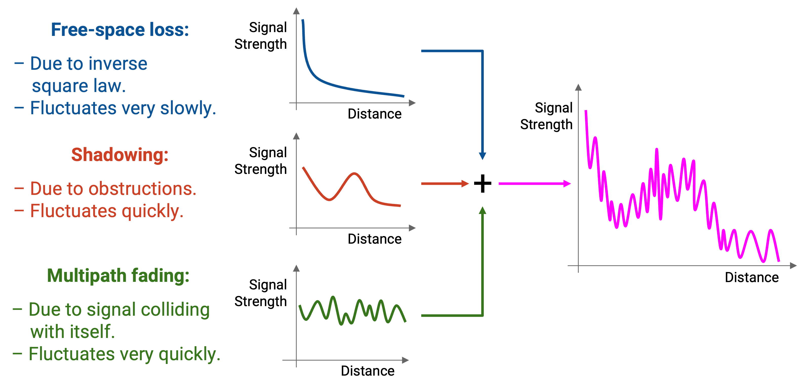

第一项是**自由空间路径损耗**，即平方反比导致的缓慢、连续衰减。

第二项是**阴影遮挡（shadowing）**：收发者之间的物体挡住信号，信号需要经折射或反射绕开障碍，接收信号变弱。取决于障碍位置，距离增大时信号未必一直变弱。例如走到建筑物遮挡处，信号显著减弱；继续走过建筑物，信号反而可能增强。

第三项是**多径衰落（multipath fading）**：波在障碍物上反射或折射，多个有偏移的副本到达接收机。不同长度的路径可能造成不同相位，彼此干涉。稍微改变距离，信号强度就可能增加或下降。

综合三项才能得到某位置的接收强度。若收发者静止，工作点是曲线上的一个点；设备移动时，工作点沿曲线变化；若障碍物进入或离开，整条曲线本身也会变化。

## 近似路径损耗

同时考虑自由空间损耗、阴影和多径衰落并不容易，特别是多条路径造成接收波形相位不同的情况。

较简单的近似是**双径模型（two-ray model）**：信号只走两条路径，一条从发射者直达接收者，另一条经地面反射到达接收者。注意，它仍然是一个向外辐射的发射信号，只是部分波直达、部分波经地面反射。

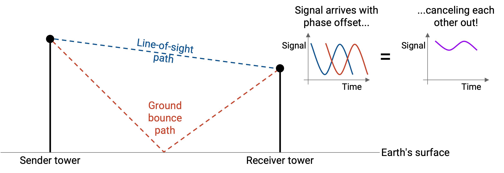

原文说明，当收发者距离足够远时，两路波趋于反相，相消干涉使接收功率显著降低。在这种模型的远距离区间，接收功率不再按 $1/d^2$，而是按 $1/d^4$ 衰减。因此，自由空间模型忽略包括地面在内的所有障碍物，得到平方反比；双径模型加入地面后，远距离衰减更快。

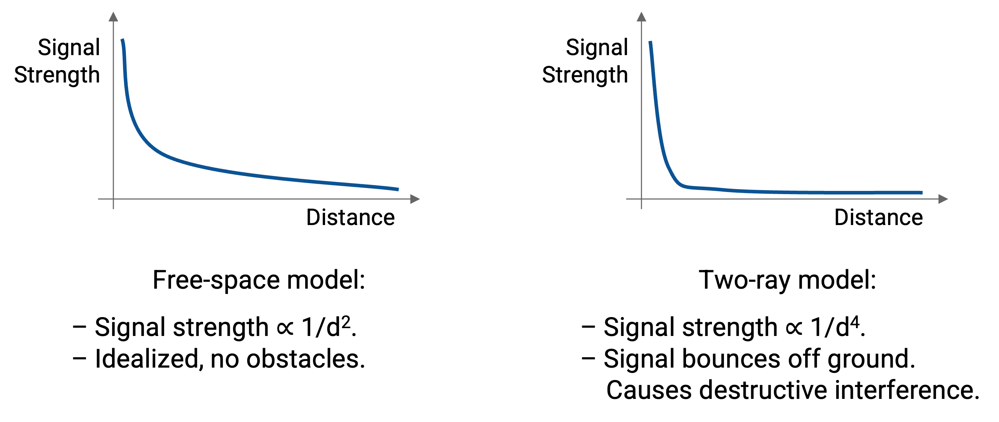

> 编者勘注：这里是双径模型的远场近似，不表示任意距离、任意地面条件下两路波都恰好相差 180°，也不表示现实中处处严格服从四次方反比。

若还有其他障碍物，双径模型就不足够了。更一般的射线追踪模型考虑反射、散射和衍射，需要障碍物位置等具体环境信息，可用计算机模拟构建。原文指出，在这类复杂环境中，反射分量往往比无遮挡直达分量更突出。

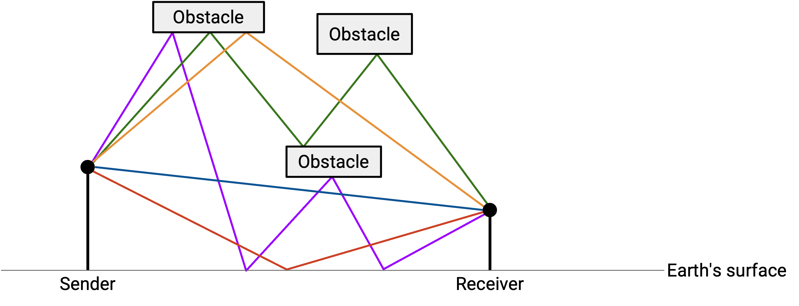

由这些模型，可提炼出距离与功率关系的经验式。原文写为：

$$
P_r=P_tKd^\gamma
$$

$P_r$、$P_t$、$d$ 的含义不变；$K$ 和 $\gamma$ 根据环境和模型经验确定。若障碍物位置很不利，$K$ 可能很小，使接收功率较低。原文接着说明 $\gamma$ 通常介于 2 与 8，最好情况按 $1/d^2$ 衰减，最坏情况按 $1/d^8$ 衰减。

> **原文符号勘误：** 正的 $\gamma\in[2,8]$ 与上式的 $d^\gamma$ 不一致。按其文字和例子，应写 $P_r=P_tK/d^\gamma$，或保留 $d^\gamma$ 但把指数定义为负数。后续学习采用前一种约定。

## 区别四：检测碰撞

有线碰撞通常容易检测。点到点链路可能根本不存在这种竞争碰撞；在共享导线上，通常可以通过监听线路来检测。传播时延会带来问题，但最终只需感知一条线上叠加的信号。

无线碰撞则具有空间性：波可能在某个位置碰撞，在另一个位置却不碰撞。

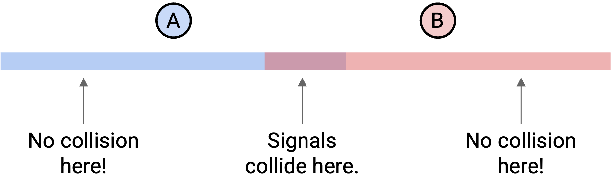

无线系统中碰撞检测和避免更难，但共享介质仍然需要多路访问机制。可选方法包括固定频率分配、协调发送时间等。适合的方法取决于环境：在非常稀疏的环境里，可能可以容忍偶发碰撞并事后处理。本章重点是**载波侦听多路访问 CSMA**：先听，若已有别人发送就不发。

接下来的示例作出简化：忽略障碍物，信号在一定距离内强度不变，超过距离就完全不可检测；所有设备排成一条线，只画左右传播。真实信号仍是在三维空间中传播，距离门槛也不是这样的硬边界。

## CSMA 的问题

无线电通过检测超过一定阈值的能量来判断是否有别人发送。

若两对设备相距足够远，这个策略可行：

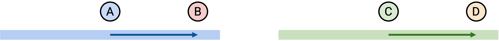

A 想与 B 通信，C 想与 D 通信。A 听不到其他信号，于是向 B 发送；其信号向四周而非只向 B 传播。稍后 C 因在 A 范围外也听不到信号，便向 D 发送。

若两组都在彼此范围内，这个策略也可行：

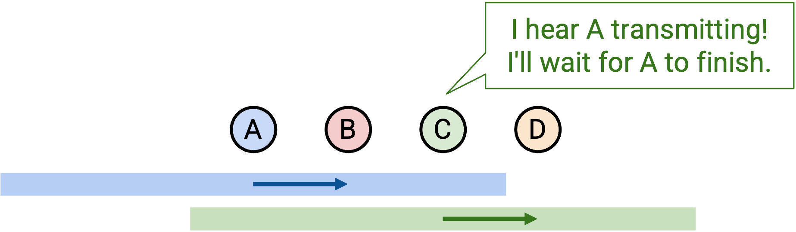

A 先监听并向 B 发送；稍后 C 听到 A，因此等待 A 完成后才向 D 发。

但有时会出问题：


若 A、C 都想向 B 发，A 听到空闲后开始；C 在 A 范围外，也听到空闲并开始。结果在 B 处碰撞。这就是**隐藏终端问题**：两个发送者彼此超出侦听范围，无法知道另一个正在发送。

另一个问题如下：

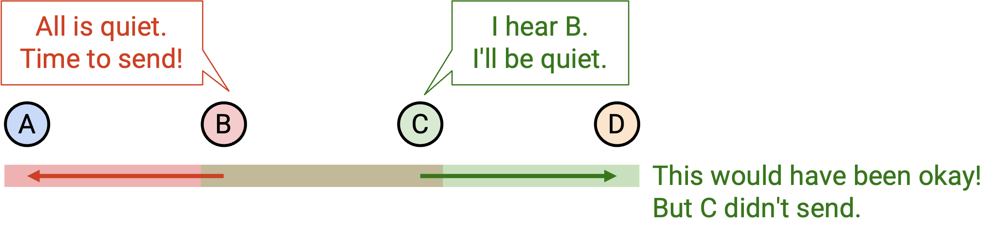

B 想向 A 发，C 想向 D 发。B 先发，其信号也到达 C；C 听到后保持安静。实际上，B、C 原本可以同时发：即使它们之间的某些位置出现信号交叠，接收者 A、D 却不会发生有害碰撞。这是**暴露终端问题**：本可并发的一次发送被不必要地阻止。这里不是 C 已检测到实际接收失败，而是载波侦听过于保守。

## MACA：避免碰撞

**MACA（Multiple Access with Collision Avoidance）** 是另一种多路访问方法，目标是处理隐藏终端。CSMA 的核心局限在于发送者只知道发送处的情况，而真正影响交付的是接收处的碰撞。MACA 让接收者参与协调。

假设 A 要向 B 发送，一次成功传输分三步：

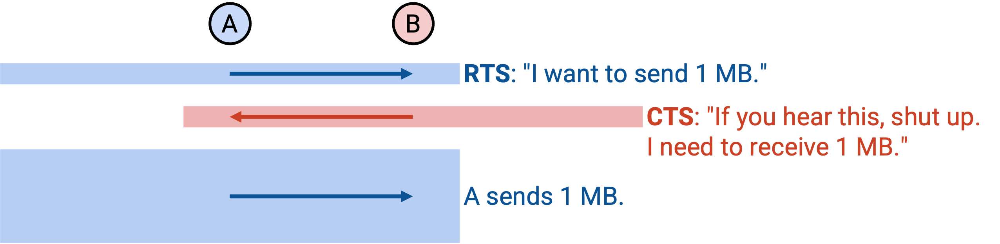

1. A 发出 **RTS（Request To Send，请求发送）**，包含数据长度，表示“想向 B 发送 k 比特”。
2. B 回复 **CTS（Clear To Send，允许发送）**，也包含数据长度，告诉 A 可以发送，并告知 B 范围内的其他节点：“我即将接收 k 比特，请在这段时间保持安静。”
3. A 发送数据，B 接收；收到 CTS 的其他设备保持安静。

它处理了前述隐藏终端情形：A 发 RTS 后，B 的 CTS 能被 C 听到，C 因而不再与 A 同时向 B 发送。

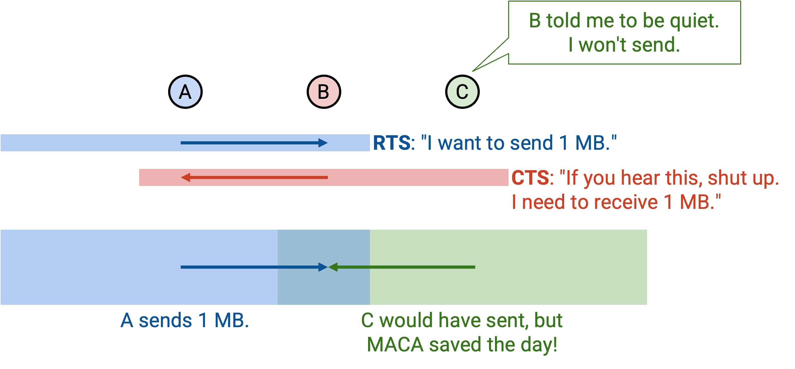

听到 RTS，说明你在发送者范围内，而发送者接下来要收 CTS。因此应至少等待一个足以容纳 CTS 交换的时隙，避免自己的数据盖住发送者要收的 CTS。若随后听到 CTS，说明也处在接收者范围内，需要在数据传输期间继续安静；若没听到 CTS，在本章理想范围模型中意味着不在接收者范围内，可以尝试自己的传输。

在一定假设下，这也能处理暴露终端。例如 B 向 A 发、C 向 D 发：C 听见 B 的 RTS 后等一个时隙，却没听到 A 的 CTS，因此可知自己不会干扰 A，于是尝试向 D 发。

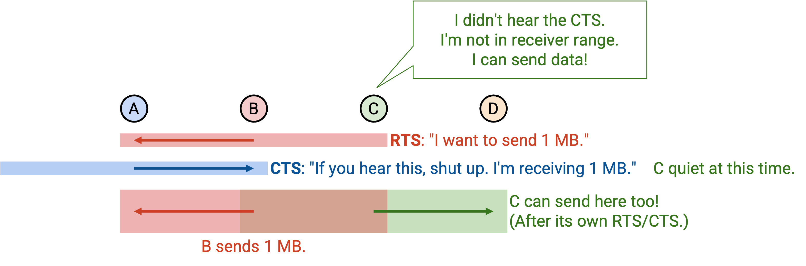

但这里有关键假设：**C 必须能听到 D 回复的 CTS。** C 同时听得到 B 的数据，D 的 CTS 可能被盖住。CSMA 的发送者主要关注自己发送；MACA 的发送者开始发送前却必须先成功接收 CTS。

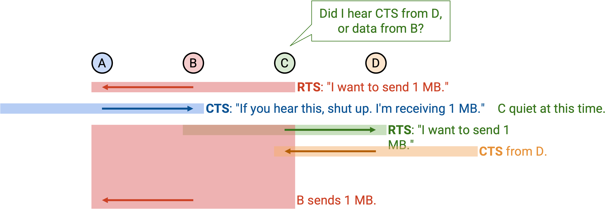

若发送 RTS 后没收到对应 CTS，就没有得到发送许可。可能是接收处已有传输，或两个请求同时到达发生碰撞。这时采用类似 CSMA/CD 的二进制指数退避，扩大随机等待范围后重试 RTS。

每台设备维护竞争窗口 **CW（Contention Window）**。发生失败时，在 0 到 CW 之间随机选择等待时长。教材模型最小 CW 为 2 个时隙，最大为 64，一个时隙为发送 RTS 所需时间。成功 RTS/CTS 后把 CW 重置为 2；RTS 失败、没有 CTS 时，将 CW 加倍，但不超过 64。

> 编者边界：未收到 CTS 是本协议的失败观测，不足以在现实中唯一证明碰撞，也可能来自噪声或损坏。上述窗口常数和协议过程属于这里的 MACA 教学模型，不是所有 Wi-Fi 或所有无线系统的通用参数。

## MACAW：用 ACK 提升可靠性

**MACAW（Multiple Access Collision Avoidance for Wireless）** 对 MACA 作出一些改进。

第一项是加入确认：发送者发 RTS，接收者发 CTS，发送者发数据，最后接收者回 ACK。

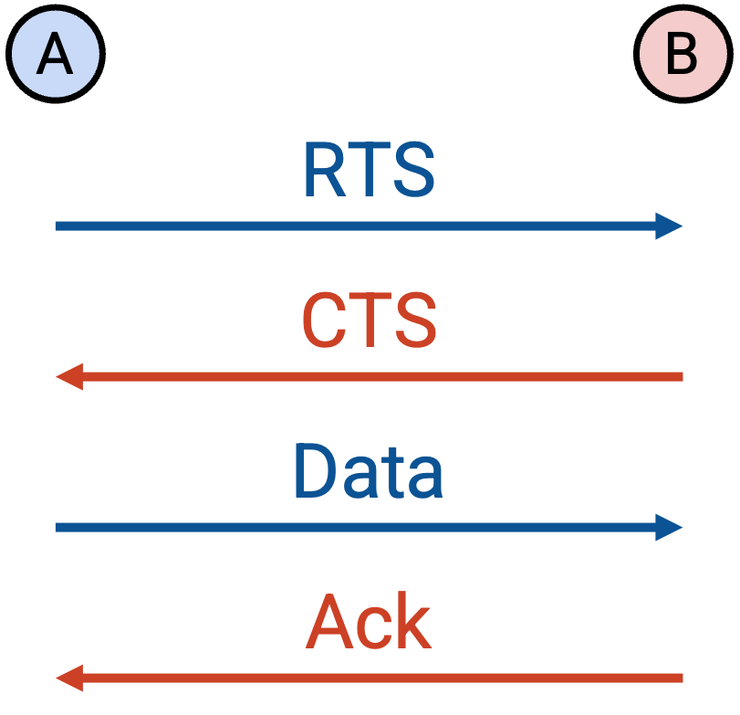

若数据丢失，没有 ACK，发送者须从新 RTS 开始重试。如果数据已正确收到但 ACK 丢失，发送者仍会重发 RTS；接收者可以直接回 ACK 而不是 CTS，避免重复发送已经收到的数据。

为什么加 ACK？端到端原则要求端点实现可靠性来保证正确性，但此处是在一条链路内实现可靠性，目的是性能。没有链路恢复时，TCP 仍负责端到端可靠交付，但丢包可能触发显著降速，例如拥塞窗口减半。链路内恢复可以更快修复无线丢失。

> 编者勘注：这不是以链路可靠性取代端到端可靠性，也不表示所有 TCP 丢包场景都严格“窗口减半”；该表述承接教材先前的拥塞控制简化模型。

## MACAW：用更好的退避改善公平性

MACA 中，两台竞争设备可能形成“赢家继续赢、输家继续输”。例如 A、B 的 CW 起初都是 2，同时争用信道。若 A 赢、B 输，则 A 仍为 2，B 加倍为 4；A 很可能更早重试，再次抢到信道，B 再败并把窗口增到 8。之后 A 持续迅速夺得信道，而 B 等得越来越久，却仍常在 A 发送时重试并失败。

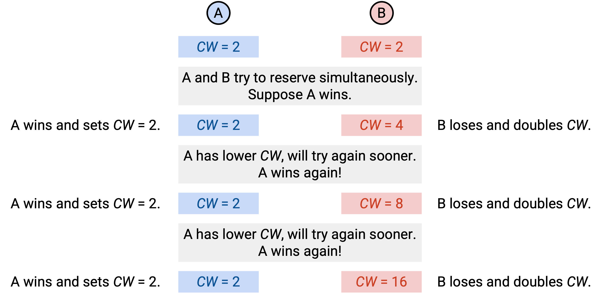

一个改进是让设备共享 CW。分组首部携带 CW，收到分组的设备将自己的 CW 设置为该值；大家在相同范围内随机选择等待时间，就不会因为窗口不同而偏向某个设备。这是简化描述，在所有设备互相可达时成立。

MACAW 还让窗口变化更温和。最小仍为 2，最大仍为 64；RTS 失败而无 CTS 时，CW 乘 1.5，并限制不超过 64；完整的 RTS/CTS/DATA/ACK 成功后，CW 减 1，而非一下重置到 2，并保持最小值约束。如果 RTS/CTS 成功但 ACK 失败，则 CW 不变。这称为 **MILD：乘性增加、线性减少**。

## MACAW：DS 与暴露终端

再看 B 向 A、C 向 D 的暴露终端例子。B 发 RTS，A 回 CTS，B 开始发数据。C 没听见 CTS，意味着它不在 A 的范围内，本来可以不干扰 A 地发数据。但 C 必须先收到 D 的 CTS，而 B 的数据可能把这个 CTS 盖住。

MACAW 在这里承认：B→A 和 C→D 不能靠当前交换方式可靠地同时进行。换言之，这里并没有解决暴露终端的并发利用问题，CSMA 也没有。

即使不在对方接收者范围内，只要处在对方发送者范围内，就可能因听不到自己所需的 CTS 而不能发。为此，在数据前增加 **DS（Data Sending，数据发送通知）**，由发送者告诉周围节点：“我现在要发 k 比特，请在这段时间保持安静。”

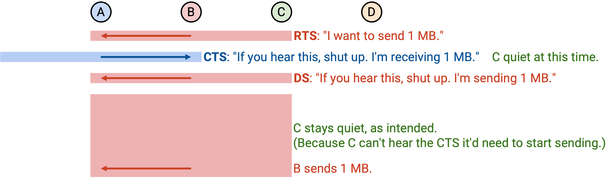

协议因此有五步：

1. 发送者发 RTS，请求发送 k 比特。
2. 接收者发 CTS，要求其范围内节点安静，因为即将接收 k 比特。
3. 发送者发 DS，要求其范围内节点安静，因为其数据会盖住别人的 CTS。
4. 发送者发 DATA。
5. 接收者发 ACK。

RTS 与 DS 并不冗余。RTS 是可能不获批准的请求；DS 则确认请求确已获准，并明确要求发送者周围的节点在该数据期内安静。

## MACAW：DS 与同步

DS 的第二个重要用途是同步竞争机会。仍看暴露终端情形，并接受两次传输分开进行。

若没有 DS，B 发 RTS、收 CTS 后开始 DATA。C 听见 RTS，就等一个时隙；但它听不见 CTS。此时 C 会发徒劳的 RTS，却因 B 的 DATA 盖住 D 的 CTS 而失败。C 只能随机重试，不知道 B 什么时候停止。

B 却精确知道自己的发送何时结束，因此能立即发起下一次请求。C 大多数重试都落在 B 仍占用信道的时段。这给 B 很大优势。

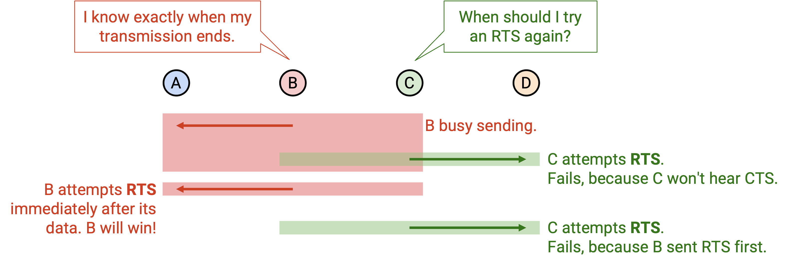

竞争期通常只占很短时间，大部分时间都在发送数据。赢家知道下一个短暂竞争窗口何时到来，输家却不知道，这种不同步导致不公平。

DS 告知周围节点即将发送 k 比特，因此不仅让 C 停止徒劳 RTS，也使 C 知道 B 何时结束，从而更公平地参加下一轮竞争。

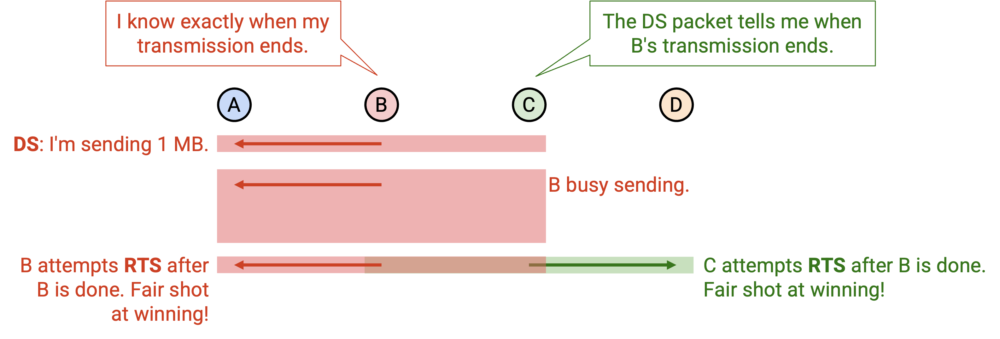

## MACAW：RRTS 与同步

另一个需要同步的例子是 A→B 与 D→C。A 已依次发 RTS、收到 B 的 CTS、发 DS 和数据。C 听见 B 的 CTS，必须在数据期安静。D 却不知道发生了什么：它向 C 发 RTS，C 不能回答，D 就继续随机重试并失败，不知道 A 何时停止。

A 则知道自己何时结束，能够立即开始下一轮。D 只有恰好在 A 完成、又尚未再次请求的狭窄间隙请求，才有机会获胜。

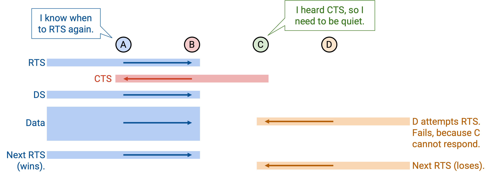

这里 DS 无效，因为两个发送者 A、D 互相超出范围，D 听不见 A 宣布的发送时间。

解决思路是让接收者代发送者参与争用。D 不知道何时重试，C 却知道。C 收到 D 的 RTS 后，知道 D 想发，但要先安静等待；C 能听到 B 的 ACK，从而知道下一轮竞争到来。届时 C 发 **RRTS（Request-for-RTS，请求对方发送 RTS）**，通知 D 立即发 RTS，使 D 更有机会参加竞争。

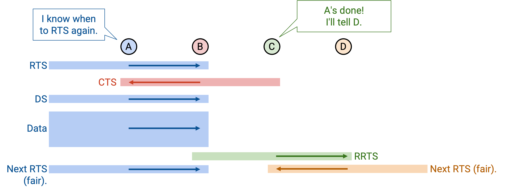

听到 RRTS 的设备应安静两个时隙，让相应的 RTS/CTS 交换完成。在例子中，B 听见 C 的 RRTS 后安静，D 发 RTS，C 回 CTS；CTS 又要求 B 在随后的数据期保持安静，于是 D→C 得以进行。一般而言，若收到 RTS 却因为别人的通知而不能立即回应，可在之后适当的竞争时机发 RRTS。

但 DS 和 RRTS 并没有解决所有问题。考虑 A→B 和 C→D，C 已开始发数据。A 的 RTS 在 B 处被 C 的数据盖住，只有 C 两次发送间的短暂间隙可能到达 B。A 不知道这个间隙何时出现，而 C 知道，因此 A 容易持续失败。RRTS 也救不了它，因为 B 连 RTS 都听不到，根本不知道 A 想通信，因而不会替 A 发 RRTS。原文指出，原始 MACAW 论文没有解决这个问题。

## 引用与来源

- 译者完整阅读并翻译固定提交中的 [Wireless Links](https://github.com/berkeley-cs168/textbook/blob/0b8208742d31df7fc3d53a0cd94fdd4e04f8d47e/wireless/wireless-links.md)，覆盖全部现存正文、28 幅图及全部公式、示例与协议过程。课表的旧路径 [special-topics/wireless](https://textbook.cs168.io/special-topics/wireless.html) 在该提交仅写“本页已迁移”，目标为 [wireless/wireless-links](https://textbook.cs168.io/wireless/wireless-links.html)，故本页沿迁移目标翻译，而不是把旧空壳当作完成。
- 固定提交日期为 **2026-10-01**，不是 2025 年课堂时的教材版本；提交标识：

```text
0b8208742d31df7fc3d53a0cd94fdd4e04f8d47e
```

- 作者 **Peyrin Kao**，基于 **Sylvia Ratnasamy、Rob Shakir 等**的讲授。原作及本中文改编依 [CC BY-SA 4.0](https://creativecommons.org/licenses/by-sa/4.0/) 发布，许可依据为[教材首页](https://textbook.cs168.io/)。修改包括翻译、中文图注、公式排版及明确标注的勘误；原图字节不变，仅加白色显示底以便深色主题阅读。此许可不延伸至课程视频或课件。
- 源码提到的[纸张与天线有效孔径比喻出处](https://www.cdt21.com/design_guide/friis-equation-and-antenna-effective-area/#What_is_the_effective_area_of_an_antenna)仅保留为原文注释出处，未独立通读；本页不声称已核验外链论文或原始 MACAW 论文。
- [独立学习笔记](#/c/berkeley-cs168-2025/lec/lec26?v=notes)另行组织问题与推导，不是本译文的缩写课堂稿。
